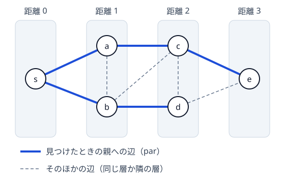

!!! abstract "要点"
    - **何ができるか**：始点に近い順に頂点を確定させる探索で、辺の重みがすべて等しいグラフの最短距離を $O(N + M)$ で求める。親を記録すれば経路を復元でき、全始点をキューに入れれば多始点の距離になる。
    - **いつ使うか**：
        - 最小の手数・回数を求める（1 回の移動のコストがすべて同じ）。
        - 一番近い〇〇までの距離・複数の場所から同時に広がる。
        - 最短路を 1 つ出力する・次に進む頂点を答える。
        - $N, M \le 2 \times 10^5$、またはマスの数 $H \times W \le 10^6$ 程度。
    - **計算量**：$O(N + M)$（各頂点はキューに 1 回だけ入り、各辺は両端から 1 回ずつ見る）。グリッドは $O(HW)$。全始点から 1 回ずつ行うと $O(N(N + M))$。
    - **前提**：[グラフの表現と用語](../graph/graph-basics.md)、[スタック・キュー・deque の使いどころ](../ds/stack-techniques.md)

<!-- textlint-disable -->
別名：幅優先探索・BFS・breadth-first search・無重み最短路・多始点 BFS・最短経路の復元
<!-- textlint-enable -->

幅優先探索（BFS）は、始点から距離 0 の頂点、距離 1 の頂点、距離 2 の頂点…と、近い順に頂点を見つけていく探索である。見つけた頂点をキュー（先に入れたものから取り出す列）に積むだけで近い順になり、最初に見つけたときの距離がそのまま最短距離になる。辺の重みがすべて等しいグラフなら、最短路はこれだけで線形時間に求まる。以下、頂点は 0-indexed で、$\mathrm{dist}[v]$ を始点から $v$ までの辺の本数の最小とする。

## 最初に見つけた距離が最短になる理由 {#why-shortest}

BFS は、[ダイクストラ法](../graph/dijkstra.md)と同じ「距離の小さい順に頂点を確定させる」探索の特別な場合である。確定の順番を保証しているのは、キューの中身がいつも次の形に並んでいることである。

- キューの中の頂点の距離は、前から順に $d, \dots, d, d + 1, \dots, d + 1$ の 2 種類だけで、広義単調増加になっている
- 先頭の $u$（距離 $d$）を取り出して隣の頂点を距離 $d + 1$ で末尾に入れても、この形は崩れない

だから頂点は距離の小さい順に取り出され、距離 $d$ の頂点がすべて取り出されてから距離 $d + 1$ の頂点が取り出される。次の図は、始点 $s$ から BFS したときの距離の層である。



辺は、先の層へ 2 つ以上飛ばない。辺 $u \to v$ があれば、$v$ へは $u$ から 1 歩で行けるので $\mathrm{dist}[v] \le \mathrm{dist}[u] + 1$ だからである。無向グラフなら、辺は同じ層どうしか隣り合う層の間だけになる。そのため $v$ を最初に見つけるのは、距離 $\mathrm{dist}[v] - 1$ の層の頂点を取り出したときである。このとき書き込む値は、ちょうど真の距離になる。

??? note "証明"
    距離を誤って書き込まれた頂点があるとして、そのうち真の距離 $D$ が最小のものを $v$ とする（始点は 0 で正しいので $D \ge 1$）。始点から $v$ への最短路で $v$ の 1 つ前の頂点を $w$ とすると、$w$ の真の距離は $D - 1$ で、$v$ より小さいので正しく $D - 1$ と書き込まれている。

    頂点は書き込まれた距離の小さい順に取り出されるので、$w$ を取り出すのは、距離 $D$ 以上と書き込まれた頂点を取り出すより前である。$w$ を取り出したとき、$v$ がまだ見つかっていなければ $D$ と書き込まれる。すでに見つかっていれば、それより前に取り出した、書き込まれた距離が $D - 1$ 以下の頂点から見つけたので、書き込まれた値は $D$ 以下である。真の距離より小さい値は書き込まれない（書き込んだ値の分だけ実際に歩ける）ので、どちらでも値は $D$ になり、誤っていたことに矛盾する。

前提が崩れると、この保証もなくなる。辺の重みが違えば、辺の本数の多い経路の方が短いこともある。$s \to t$ が重み 5、$s \to a \to t$ が重み 1 と 1 なら、BFS は $t$ を 1 本目の辺で見つけて確定させる。しかし本当の距離は 2 である。重みのあるグラフの扱いは[重みの節](#weighted)にまとめた。

<div class="kp-viz" data-viz="bfs-layers" data-config='{"labels": ["s", "a", "b", "c", "d", "e"], "edges": [[0, 1], [0, 2], [1, 2], [1, 3], [2, 3], [2, 4], [3, 4], [3, 5], [4, 5]], "source": 0}'></div>

上の動く図では、同じグラフでキューの中身と距離の層を 1 ステップずつ確かめられる。見つけた頂点にはその場で距離を書き込み、キューの中の距離がいつも 2 種類までに収まることを見てほしい。

??? question "確認問題：深さ優先探索では最短距離が求まらない"
    [深さ優先探索](../graph/dfs.md)で頂点を初めて見つけたときの深さを距離とすると、最短距離にならない例を作れ。

    ??? success "答え"
        3 頂点 $s, a, b$ に辺 $s - a$、$a - b$、$s - b$ がある三角形で、$s$ から先に $a$ へ進む場合である。深さ優先探索は $s \to a \to b$ と進んで $b$ を深さ 2 で見つけるが、$s - b$ の辺があるので本当の距離は 1 である。深さ優先探索は 1 本の道を行けるところまで進むので、近い頂点を後回しにすることがある。

## 印は push のときに付ける・dist を −1 で初期化して訪問済みの印を兼ねる {#mark-on-push}

実装では $\mathrm{dist}$ を $-1$ で初期化し、$-1$ のままなら「まだ見つけていない」と読む。距離の配列が訪問済みの印を兼ねるので、別の `visited` の配列は要らない。始点に 0 を書いて push し、取り出した頂点の隣で $-1$ のものだけに距離を書いて push する。

```cpp
--8<-- "bfs/path.cpp:core"
```

印（距離）は push するときに付ける。こうすると各頂点はキューに 1 回しか入らず、各辺は両端から 1 回ずつ見るだけなので $O(N + M)$ になる。

印を pop するときに付けると、まだ取り出していない頂点を、隣の頂点を取り出すたびに push してしまう。pop したときに「もう印がある」と見て読み飛ばせば、push の回数は辺の数ほどで済むが、キューが $O(M)$ の大きさになる。読み飛ばしも忘れると、同じ頂点を取り出すたびに隣を調べ直して、push の回数が爆発する。壁のない $12 \times 12$ のグリッドで試すと、push で印を付ければ 144 回の push が、pop で印を付けて読み飛ばさないと約 270 万回になる。

??? question "確認問題：pop で印を付けると"
    壁のない $H \times W$ のグリッドの左上から、印を pop で付け、読み飛ばしもしない BFS をした。右下のマスは何回キューに入るか。

    ??? success "答え"
        左上から右下への最短路の本数 $\binom{H + W - 2}{H - 1}$ 回である。最短路の 1 歩手前のマスの写しを取り出すたびに、まだ印のない右下のマスが push されるので、写しの数は最短路の本数と同じ増え方をする。$H = W = 12$ で約 70 万回になり、間に合わない。push で印を付ければ 1 回である。

## 経路復元（発見したときの親を記録して終点からたどる） {#path-restoration}

最短距離だけでなく経路そのものが要るときは、頂点 $v$ を見つけたときに、そのとき取り出していた頂点 $u$ を $\mathrm{par}[v] = u$ と記録する。$\mathrm{dist}[v] = \mathrm{dist}[u] + 1$ なので、$v$ から $\mathrm{par}$ を 1 回たどるごとに距離が 1 減り、ちょうど $\mathrm{dist}[t]$ 回で始点に戻る。たどった頂点の列を反転すれば、始点から $t$ への最短路になる（前の節のコード片の後半）。

- $\mathrm{par}$ を結んだ辺は、始点を根とする木になる（距離の層の図の太い辺）。この木を最短路木と呼ぶ。「各頂点から始点へ最短で戻るとき、次に進む頂点を答える」は、$\mathrm{par}$ をそのまま出力すればよい
- 復元は終点から始点への向きに行う。始点からは、どの辺を選べば終点に向かうか分からない
- $\mathrm{dist}[t] = -1$ なら経路はない。たどる前に確かめる
- 最短路は 1 本とは限らず、$\mathrm{par}$ は最初に見つけた 1 本だけを覚える。本数を数えるときや、条件を満たす最短路を選ぶときは、$\mathrm{dist}[v] = \mathrm{dist}[u] + 1$ を満たす辺をすべて使う（[最短路 DAG](../graph/shortest-path-dag.md)）

## 多始点 BFS（超始点から距離 0 の辺を張るのと同じ） {#multi-source}

「どれかの始点から何歩で行けるか」「一番近い〇〇までの距離」を全頂点について求めるときは、始点ごとに BFS をせず、すべての始点を距離 0 でキューに入れてから 1 回だけ BFS する。これを多始点 BFS と呼ぶ。始点が $K$ 個なら、$K$ 回の BFS の $O(K(N + M))$ が $O(N + M)$ になる。

正しさは、始点の外に 1 つ[超頂点](../graph/extended-dijkstra.md#super-vertex)を足して考えると分かる。超頂点から各始点へ距離 0 の辺を張ると、各頂点の超頂点からの距離は「一番近い始点からの距離」である。超頂点から BFS を始めると、最初の 1 歩で始点がすべて距離 0 でキューに並ぶ。これは始点を全部入れてから始めた状態と同じで、キューの中身が距離 2 種類の並びになる性質も保たれる。

```cpp
--8<-- "bfs/multi-source.cpp:core"
```

- **時間とともに広がる様子**：「毎秒、黒いマスの隣が黒くなる」のような広がり方は、多始点 BFS の距離がそのまま「何秒後に黒くなるか」になる。シミュレーションを毎秒やり直すと $O(HW)$ を秒数の分だけ繰り返すが、BFS なら全体で $O(HW)$ である
- **どの始点に一番近いか**：距離と一緒に、見つけた元の始点の番号を書き写していくと、各頂点に一番近い始点が分かる
- **超頂点を実際に足す**：超頂点を頂点として足すなら、各始点への辺を重み 1 にして普通に BFS し、最後に全頂点の距離から 1 を引く。重み 0 の辺は BFS では扱えないからである

??? question "確認問題：2 つの集合の間の最短距離"
    頂点の集合 $A$ と $B$ があり、$A$ のどれかから $B$ のどれかへの最短距離を求めたい。BFS を何回すればよいか。

    ??? success "答え"
        1 回でよい。$A$ の頂点をすべて距離 0 で入れて多始点 BFS をし、$B$ の頂点の距離の最小を答える。$A$ と $B$ が共通の頂点を持てば答えは 0 である。

## 重みが 1 と 2 なら辺を割る・重み付きなら 01-BFS かダイクストラ法 {#weighted}

BFS が使えるのは、すべての辺の重みが等しいときだけである（等しい重みが $c$ なら、辺の本数を $c$ 倍すればよい）。重みの違う辺が混ざるときは、重みの種類で次のように選ぶ。

| 辺の重み | 使う方法 | 計算量 |
| --- | --- | --- |
| すべて等しい | BFS | $O(N + M)$ |
| 小さい正の整数（1 と 2 など） | 辺を割って BFS | 割った後の頂点数・辺数で $O(N + M)$ |
| 0 と 1 | [01-BFS](../graph/zero-one-bfs.md) | $O(N + M)$ |
| 0 以上の任意の値 | [ダイクストラ法](../graph/dijkstra.md) | $O((N + M) \log N)$ |

**辺を割る**。重み 2 の辺 $u - v$ は、中間の頂点 $w$ を 1 つ足して、重み 1 の辺 $u - w$ と $w - v$ の 2 本に置き換える。$u$ と $v$ の間の距離は変わらず、全辺の重みが 1 になるので BFS が使える。重み $k$ の辺は $k - 1$ 個の頂点を足して $k$ 本に割る。重みの合計を $W$ とすると頂点が $O(W)$ 個増えるので、重みが小さいときだけ使える。

**01-BFS とダイクストラ法**。どちらも「距離の小さい順に確定させる」探索で、BFS ではキューの順番が確定の順番を保証していた。重み 0 の辺があると、同じ距離の頂点をキューの先頭に入れる必要が出るので deque を使う（01-BFS）。重みが任意なら、取り出す頂点を距離の最小で選ぶ優先度付きキューを使う（ダイクストラ法）。全辺の重みが 1 なら、ダイクストラ法は BFS と同じ順に頂点を確定させる。

??? question "確認問題：重み 1 と 2 の辺"
    頂点が $N$ 個、辺が $M$ 本で、そのうち $K$ 本の重みが 2、残りが 1 である。重み 2 の辺を割ると、頂点と辺はいくつになるか。

    ??? success "答え"
        重み 2 の辺 1 本につき頂点が 1 個、辺が 1 本増えるので、頂点は $N + K$ 個、辺は $M + K$ 本になる。BFS は $O(N + M + K)$ で、$K \le M$ なので $O(N + M)$ のままである。

## 落とし穴 {#pitfalls}

**届かない頂点の $-1$ をそのまま使う**。非連結なグラフや壁で区切られたグリッドでは、$\mathrm{dist}$ が $-1$ のまま残る。「距離の最大」を取るときに $-1$ を混ぜる、届かないのに $-1$ を足し引きする、`dist[t]` を確かめずに経路復元する、のどれもよくある誤りである。最大や合計を取る前に、$-1$ を除く（または問題の指定どおり $-1$ を出力する）。

**全始点からの BFS の計算量を見積もらない**。「すべての 2 頂点の間の最短距離」には、始点を全探索して BFS を $N$ 回行う $O(N(N + M))$ が素直である。グリッドなら $O((HW)^2)$ で、$H, W \le 20$ なら約 $1.6 \times 10^5$ と速いが、$H, W \le 1000$ では間に合わない。全始点が要るのか、多始点 1 回で済むのかを先に考える。

**グリッドの範囲外と、行と列の取り違え**。隣のマスを調べるときは、範囲外の判定を壁の判定より先に書く（配列の外を読むと[未定義動作](../cpp/cpp-undefined-behavior.md)になる）。$H$ 行 $W$ 列で $(i, j)$ の $i$ が行である。外周を壁で囲む書き方は[グリッドグラフ](../graph/grid-graph.md)にまとめた。

**無向グラフの辺を片方向しか張らない**。入力の辺 $a - b$ は `g[a]` と `g[b]` の両方に入れる。片方だけだと、たまたま入力例では通るが、本番で届かない頂点が出る。

**状態ごとに印を持たない**。「向き」や「壁を壊した回数」のように位置以外の情報で次の動きが変わるときは、位置だけで印を付けると、別の状態で来た経路を捨ててしまう。$\mathrm{dist}$ を（位置, 状態）の組ごとに持つ（[状態を頂点にする](../graph/extended-dijkstra.md)）。

## 使い分け {#comparison}

- 届くかどうか・連結成分だけなら、BFS でも深さ優先探索でもよい。辺を後から足すだけなら [Union-Find で連結性を扱う](../graph/union-find-connectivity.md)
- 全点対の最短距離で $N$ が数百までなら[ワーシャルフロイド法](../graph/warshall-floyd.md)も使える。重みが等しく辺の少ないグラフなら、全始点の BFS の方が速い
- 「つながっていない 2 頂点の間に辺がある」補グラフの上の BFS は、辺を全部張らずに行う工夫が要る（[補グラフ上の BFS](../graph/complement-graph-bfs.md)）

## 例題 {#examples}

### ABC007 C. 幅優先探索 {#abc007_3}

<div class="kp-problems" data-role="example" markdown>

- [ABC007 C. 幅優先探索](https://atcoder.jp/contests/abc007/tasks/abc007_3)（diff 1024）：壁と通路からなる迷路で、スタートのマスからゴールのマスまで上下左右に進むときの最小の移動回数を求める。

</div>

マスを頂点、上下左右に隣り合う通路のマスどうしを重み 1 の辺とみなすと、スタートからの BFS の距離がそのまま答えになる。1 回の移動のコストがすべて同じなので、最初に見つけたときの距離が最短である。

??? note "解法の詳細"
    - 入力の座標は 1-indexed なので 1 を引いて 0-indexed にする。$\mathrm{dist}$ を $R \times C$ の $-1$ で埋め、スタートに 0 を書いてキューに入れる。
    - 取り出したマス $(i, j)$ の上下左右 $(i + \Delta_i, j + \Delta_j)$ について、範囲外・壁・$\mathrm{dist} \ne -1$ のどれかなら飛ばし、そうでなければ $\mathrm{dist}[i][j] + 1$ を書いて push する。
    - 最後にゴールの $\mathrm{dist}$ を出力する。到達できることは保証されている。各マスを 1 回ずつ取り出すので $O(RC)$ である。
    - コードは[多始点 BFS の節](#multi-source)のものから、始点を 1 つにした形である。

## 練習問題 {#practice}

<div class="kp-problems" data-role="practice" markdown>

- [ABC383 C. Humidifier 3](https://atcoder.jp/contests/abc383/tasks/abc383_c)（diff 750）：床・壁・加湿器のマスからなるグリッドで、どれかの加湿器から壁を通らずに D 歩以内で行ける床のマスの数を求める。
- [ABC168 D. .. (Double Dots)](https://atcoder.jp/contests/abc168/tasks/abc168_d)（diff 804）：無向グラフの各部屋に、部屋 1 へ最短で向かうために次に進む部屋を道しるべとして置き、その置き方を出力する。
- [ABC160 D. Line++](https://atcoder.jp/contests/abc160/tasks/abc160_d)（diff 879）：1 列に並ぶ N 頂点に近道の辺を 1 本足したグラフで、距離が k の頂点の組の数を k ごとに求める。
- [ABC151 D. Maze Master](https://atcoder.jp/contests/abc151/tasks/abc151_d)（diff 959）：迷路の通路のマス 2 つを選ぶとき、その間の最短の移動回数の最大値を求める。
- [AGC033 A. Darker and Darker](https://atcoder.jp/contests/agc033/tasks/agc033_a)（diff 1159）：黒マスに隣接する白マスをすべて黒にする操作を、全体が黒になるまで繰り返すときの操作の回数を求める。

</div>

??? note "練習の方針"
    - **ABC383 C**：加湿器のマスをすべて距離 0 で入れて多始点 BFS をし、距離が $D$ 以下のマスを数える。加湿器ごとに BFS すると間に合わない
    - **ABC168 D**：通路は双方向なので、部屋 1 から BFS して各部屋の $\mathrm{par}$ を出力すればよい。$\mathrm{par}$ の向きに進むと距離が 1 ずつ減って部屋 1 に着く
    - **ABC160 D**：$N \le 2000$ なので、各頂点から BFS しても $O(N^2)$ で間に合う。近道を使う経路と使わない経路の短い方を式で求めてもよい
    - **ABC151 D**：$H, W \le 20$ と小さいので、通路のマスを始点に全探索し、それぞれ BFS する。壁のマスと $-1$ を最大から除く
    - **AGC033 A**：最初の黒マスをすべて始点にした多始点 BFS で、各マスが黒くなるのは一番近い黒マスまでの距離の回数後である。距離の最大が答え

## 力試し {#challenge}

<div class="kp-problems" data-role="challenge" markdown>

- [ABC460 D. Repeatedly Repainting](https://atcoder.jp/contests/abc460/tasks/abc460_d)（diff 1216）：白黒のグリッドで、全マスを同時に「黒は白に、8 近傍に黒がある白は黒に」塗り替える操作を 10^100 回繰り返した後の色を求める。

</div>

??? note "力試しの方針"
    - **ABC460 D**：一度黒になったマスは、それ以降、白と黒を毎回入れ替え続ける（自分が黒になった次の回に、自分を黒にした隣が黒に戻るから）。そこで各マスが入れ替わりを始める回を、8 近傍の多始点 BFS の距離で求める。初めから黒で周りに白がないマスは 1 回目に白になって止まるので、1 回目の塗り替えを済ませた盤面の黒マスを始点にすると扱いがそろう。$10^{100}$ は偶数なので、最後の色は距離の偶奇で決まる

## 参考 {#references}

- [drken「BFS (幅優先探索) 超入門！ 〜 キューを鮮やかに使いこなす 〜」](https://qiita.com/drken/items/996d80bcae64649a6580)：最短距離になる理由の背理法の筋、dist を −1 で初期化して印を兼ねること、push のときに印を付けること
- [ageprocpp「最短路問題総特集！！！～BFSから拡張ダイクストラまで～」](https://qiita.com/ageprocpp/items/cdf67e828e1b09316f6e)：BFS・01-BFS・ダイクストラ法の使い分けと経路復元
- [E869120「レッドコーダーが教える、競プロ・AtCoder上達のガイドライン【中級編：目指せ水色コーダー！】」](https://qiita.com/e869120/items/eb50fdaece12be418faa)：例題の選定
- [drken「AtCoder ABC 007 C - 幅優先探索 (3Q, 試験管緑色)」](https://drken1215.hatenablog.com/entry/2023/06/11/123536)：例題の問いと解法の確認
- [Lanly「AtCoder Beginner Contest 383」](https://www.cnblogs.com/Lanly/p/18606772)：練習の方針（ABC383 C の多始点 BFS）
- [hamayan「.. (Double Dots) [AtCoder Beginner Contest 168 D]」](https://blog.hamayanhamayan.com/entry/2020/05/17/224335)：練習の方針（親を記録して出力する）
- [hamayan「Line++ [AtCoder Beginner Contest 160 D]」](https://blog.hamayanhamayan.com/entry/2020/03/29/000745)：練習の方針（ABC160 D の制約と距離の式）
- [hamayan「Maze Master [AtCoder Beginner Contest 151 D]」](https://blog.hamayanhamayan.com/entry/2020/01/12/225950)：練習の方針（始点だけを全探索する）
- [hamayan「Darker and Darker [AtCoder Grand Contest 033 A]」](https://blog.hamayanhamayan.com/entry/2019/05/05/000255)：練習の方針（黒マスを始点にした多始点 BFS）
- [comet725「ABC460Dを解いた【BFS】」](https://qiita.com/comet725/items/5ebb5d1dec695f2a3df0)：力試しの方針（1 回目の塗り替えの後の 8 近傍の多始点 BFS と距離の偶奇）
- [iwamutsu256「AtCoder Beginner Contest 460 参加記録と解答例 (A D問題)」](https://dev.to/iwamutsu256/atcoder-beginner-contest-460-can-jia-ji-lu-tojie-da-li-a-dwen-ti--3jk2)：力試しの問いの塗り替えの規則と、一度黒になったマスが白黒を繰り返す理由
