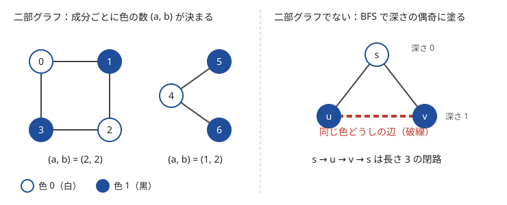

!!! abstract "要点"
    - **何ができるか**：無向グラフの頂点を、どの辺の両端も違う色になるように 2 色で塗れるかを判定する。隣り合う頂点を反対の色で塗っていき、同じ色どうしを結ぶ辺（奇数長の閉路）が見つかれば二部グラフでない。成分ごとの色の数を使う数え上げや、二部マッチング・最小カットの前提になる。
    - **いつ使うか**：
        - 2 つのグループに分ける・隣り合うものは異なる色。
        - X_i と Y_i は異なる値、という条件が M 個ある。
        - 奇数長の閉路があるか。
    - **計算量**：BFS・DFS で $O(N + M)$。辺を 1 本ずつ足しながら判定するなら、Union-Find で 1 辺あたりならし $O(\alpha(N))$。
    - **前提**：[深さ優先探索（DFS）](../graph/dfs.md)、[幅優先探索（BFS）と無重み最短路](../graph/bfs.md)

<!-- textlint-disable -->
別名：二部グラフ・2 彩色・奇閉路・2 色の塗り分け・bipartite graph
<!-- textlint-enable -->

二部グラフ判定は、無向グラフの頂点を 2 つの組に分けて、どの辺も組をまたぐようにできるかを調べる方法である。2 つの組を白と黒の 2 色と見れば、「隣り合う頂点は違う色」という塗り分けができるかという問題になる。探索で塗るだけなら易しいが、問題文に「二部グラフ」と書かれることは少なく、「異なる値を割り当てる」「2 チームに分ける」といった条件から自分でグラフを作る場面で使う。

## BFS・DFS で塗る（非連結なら成分ごとに） {#coloring}

塗り方は 1 通りに近い。ある頂点を白に決めると、その隣はすべて黒、さらにその隣はすべて白、と連結成分全体の色が決まってしまう。だから「好きな頂点を白にして、探索しながら隣を反対の色で塗る」を試し、途中で同じ色どうしの辺が見つかれば、どう塗っても無理だと分かる。



処理の流れは次のとおりである。色は $\mathrm{color}[v] \in \{-1, 0, 1\}$ で持ち、$-1$ を未訪問にする。

1. すべての頂点 $s$ を順に見て、未訪問なら $\mathrm{color}[s] = 0$ にして BFS（か DFS）を始める
2. 頂点 $u$ から辺 $(u, v)$ を見る。$v$ が未訪問なら $\mathrm{color}[v] = 1 - \mathrm{color}[u]$ にして探索を続ける
3. $v$ がすでに塗られていて $\mathrm{color}[v] = \mathrm{color}[u]$ なら、二部グラフでない
4. 最後まで矛盾がなければ二部グラフで、$\mathrm{color}$ がそのまま塗り分けになる

1 の「すべての頂点から」が要点である。グラフが連結とは限らないので、頂点 0 からの 1 回の探索で終えると、ほかの成分にある奇閉路を見落とす。

```cpp
--8<-- "bipartite-graph/coloring.cpp:core"
```

各頂点は 1 回だけキューに入り、各辺は両方向から 1 回ずつ見るので、全体で $O(N + M)$ である。DFS で塗っても同じだが、再帰で書くと、パスのような細長いグラフで再帰が $N$ 段の深さになる（[深さ優先探索](../graph/dfs.md)）。BFS かループで書いた DFS なら、その心配がない。

## 二部グラフでないことと奇閉路があることは同じ {#odd-cycle}

**[閉路](../graph/graph-basics.md#terms)**の長さ（辺の数）が奇数のものを奇閉路と呼ぶ。次が成り立つ。

$$
\text{二部グラフでない} \iff \text{奇閉路がある}
$$

**奇閉路があれば二部グラフでない**：閉路を一周すると、辺を 1 本渡るたびに色が入れ替わる。出発点に戻ったとき元の色に戻るには、入れ替わりの回数（閉路の長さ）が偶数でなければならない。だから長さが奇数の閉路は塗れない。長さ 1 の閉路である自己ループもこれに含まれる。

**二部グラフでなければ奇閉路がある**：BFS で塗ると、色は始点からの距離 $\mathrm{dep}[v]$ の偶奇になる。矛盾が出たのは、辺 $(u, v)$ の両端の深さの偶奇が同じときである。BFS では辺の両端の深さの差は 1 以下なので、偶奇が同じなら $\mathrm{dep}[u] = \mathrm{dep}[v]$ になる。$u$ と $v$ から BFS 木を同時に親へ 1 歩ずつ上ると、同じ深さを保ったまま、ある頂点 $w$ で初めて出会う。

$$
\underbrace{(\mathrm{dep}[u] - \mathrm{dep}[w])}_{u \to w} + \underbrace{(\mathrm{dep}[v] - \mathrm{dep}[w])}_{w \to v} + \underbrace{1}_{v \to u} = 2(\mathrm{dep}[u] - \mathrm{dep}[w]) + 1
$$

2 本の道は $w$ 以外で頂点を共有しないので、これは長さが奇数の閉路である。この証明はそのまま奇閉路を 1 つ取り出す手順になる。

```cpp
--8<-- "bipartite-graph/odd-cycle.cpp:core"
```

DFS で塗った場合は、無向グラフの DFS 木に含まれない辺は祖先と子孫を結ぶので、矛盾した辺 $(u, v)$ の一方は他方の祖先である。子孫の側から親をたどって祖先に着くまでの道と辺 $(u, v)$ が奇閉路になる。

??? question "確認問題：偶数長の閉路だけのグラフ"
    長さ 4 の閉路と長さ 6 の閉路が 1 頂点を共有しているグラフは二部グラフか。

    ??? success "答え"
        二部グラフである。共有する頂点を白にして、それぞれの閉路を白・黒と交互に塗っていけばよい。偶数長の閉路は交互に塗ると一周して元の色に戻るので、どちらの閉路でも矛盾は出ない。

## 成分ごとの色の数を使う数え上げ {#count-by-color}

二部グラフの塗り方は、連結成分ごとに「白と黒を入れ替える」自由しかない。成分の 1 頂点の色を決めると成分全体が決まるからである。成分 $i$ の白の数を $a_i$、黒の数を $b_i$ とすると、塗り方を変えても $(a_i, b_i)$ は入れ替わるだけで、組としては変わらない。ここから次の量がすぐに求まる。

| 求めるもの | 式 |
| --- | --- |
| 塗り方の数（成分の数を $C$ とする） | $2^C$ |
| 黒の数の最小 | $\sum_i \min(a_i, b_i)$ |
| 足しても二部グラフのままの頂点の組（辺のない組） | $\binom{N}{2} - M - \sum_i \left( \binom{a_i}{2} + \binom{b_i}{2} \right)$ |

3 行目は、足すと二部グラフでなくなる組を数えて全体から引いている。同じ成分の同じ色の 2 頂点を結ぶと、その間の偶数長の道と合わせて奇閉路ができる。違う成分の 2 頂点なら、片方の成分の色を入れ替えればよいので、どの組を結んでも構わない。既存の辺は必ず違う色を結んでいるので、引く $M$ と重ならない。ただし、この式は多重辺がない（単純グラフの）ときのものである。多重辺があれば、$M$ を「辺で結ばれた頂点の組の数」に置き換える。

数え上げの答えは $N = 2 \times 10^5$ で $\binom{N}{2} \approx 2 \times 10^{10}$ になり、`int` に収まらない。`long long` で計算する。

??? question "確認問題：連結な二部グラフに足せる辺"
    連結な二部グラフで、白が $a$ 個、黒が $b$ 個、辺が $M$ 本ある。二部グラフのまま足せる辺は何本か。

    ??? success "答え"
        $ab - M$ 本である。二部グラフのままにするには白と黒の間にしか辺を足せず、白と黒の組は $ab$ 通りある。そのうち $M$ 組はすでに辺で結ばれている。表の 3 行目の式に $C = 1$ を入れても $\binom{a+b}{2} - \binom{a}{2} - \binom{b}{2} - M = ab - M$ と同じ値になる。

## Union-Find（頂点を 2 倍にする・偶奇を持つ）で判定する {#union-find}

辺が 1 本ずつ追加され、そのたびに二部グラフかを答える問題では、毎回 BFS で塗り直すと $O(M(N + M))$ かかる。[Union-Find](../ds/union-find.md) なら、辺を足すたびにならし $O(\alpha(N))$ で判定できる。

**頂点を 2 倍にする**：各頂点 $v$ に「$v$ が色 0」を表す頂点 $v$ と「$v$ が色 1」を表す頂点 $v + N$ を用意する。同時に成り立つもの同士を併合していく。辺 $(u, v)$ の意味は「$u$ が色 0 なら $v$ は色 1」「$u$ が色 1 なら $v$ は色 0」なので、$u$ と $v + N$、$u + N$ と $v$ を併合する。頂点 $v$ と $v + N$ が同じグループになれば、「$v$ が色 0」と「$v$ が色 1」が同時に成り立つので矛盾である。ACL の `dsu` をそのまま使える。

```cpp
--8<-- "bipartite-graph/dsu-double.cpp:core"
```

それまで矛盾がなければ、足した辺の端点 $u$ だけを調べれば足りる。新しい辺 $(u, v)$ で矛盾が生じるのは、$u$ と $v$ がすでに同じグループ（同じ色に決まっていた）ときだけである。このとき対称性から $u + N$ と $v + N$ も同じグループなので、$u$ と $v + N$ を併合すると $u$ と $u + N$ が同じグループになる。逆に、$u$ を含むグループを $A$、$v$ を含むグループを $B$、それぞれの色を入れ替えたグループを $A'$・$B'$ とすると、併合でできるのは $A \cup B'$ と $A' \cup B$ だけである。$A \ne B$ なら、どの頂点 $x$ についても $x$ と $x + N$ はいつも片方ずつに分かれるので、端点以外で矛盾が生じることはない。

**偶奇を持つ**：各頂点に「親との色の違い（0 か 1）」を持たせる[重み付き Union-Find](../ds/weighted-union-find.md#generalization) でも判定できる。頂点数は $N$ のままで、根に成分の $(a_i, b_i)$ を持たせれば、辺を足すたびに $\sum_i \min(a_i, b_i)$ を更新できる。頂点を 2 倍にする方法で成分ごとの色の数を数えるのは手間がかかるので、色の数が要るならこちらを使う。

!!! info "ACL では"
    `atcoder::dsu d(2 * n);`。`d.merge(a, b)`・`d.same(a, b)`・`d.size(a)` はどれもならし $O(\alpha(N))$。

## 木・4 近傍のグリッドは必ず二部グラフ {#always-bipartite}

奇閉路がなければ二部グラフなので、構造から閉路の長さが偶数と分かるグラフは、判定しなくても二部グラフである。

- **木（森）**：閉路がないので、根からの深さの偶奇で塗れる。辺に長さがあり「距離の偶奇」で塗るときは、辺の長さの偶奇で色を入れ替えるかを決める（[木の 2 色塗り分けと距離の偶奇](../tree/tree-bipartite.md)）
- **4 近傍のグリッド**：上下左右に 1 マス動くと $i + j$ がちょうど 1 変わるので、$(i + j)$ の偶奇で塗る市松模様が塗り分けになる（[グリッドグラフ](../graph/grid-graph.md)）。8 近傍では斜めの移動で $i + j$ の偶奇が変わらず、3 マスで長さ 3 の閉路ができるので二部グラフでない
- **2 種類のものを結ぶグラフ**：「行と列」「x 座標と y 座標」「人と仕事」のように、辺がいつも種類の違うものを結ぶなら、種類で塗れば二部グラフである（[グラフへの帰着](../graph/graph-modeling.md)）。数を偶奇で分け、和が奇数になる組だけを結ぶグラフもこの形である

「必ず二部グラフ」と分かると、塗り分けを求めずに式だけで答えの出る問題もある。二部マッチングのように二部グラフでしか使えない手法を選ぶときも、この見方で前提を確かめる。

??? question "確認問題：8 近傍のグリッド"
    $2 \times 2$ のマス目で、8 近傍に隣り合うマスを辺で結んだグラフは二部グラフか。

    ??? success "答え"
        二部グラフでない。左上・右上・右下の 3 マスは、どの 2 つも 8 近傍で隣り合うので、長さ 3 の閉路になる。4 近傍なら左上と右下は隣り合わず、長さ 4 の閉路しかないので二部グラフである。

## 落とし穴 {#pitfalls}

**最初の成分だけ塗る**。頂点 0 からの 1 回の探索だけで「矛盾なし」と答えると、ほかの成分の奇閉路を見落とす。すべての頂点を順に見て、未訪問なら塗り始める。

**未訪問と色 0 の区別**。`color` を 0 で初期化して 0 を「未訪問」の意味にも使うと、色 0 で塗った頂点を未訪問と取り違える。$-1$ で初期化するか、訪問済みの配列を別に持つ。

**自己ループを捨てる**。入力を読むときに $u = v$ の辺を読み飛ばすと、長さ 1 の奇閉路を見落とす。「$X_u \ne X_u$」という条件はそれだけで満たせない。隣接リストにそのまま入れておけば、BFS の「同じ色どうしの辺」の判定で自然に見つかる。多重辺は長さ 2 の閉路なので、二部グラフかどうかに影響しない。

**色の数を全体で数える**。黒の数の最小を求めるとき、BFS で塗った結果の黒の総数を答えると誤りである。成分ごとに白と黒を入れ替えてよいので、成分ごとに $\min(a_i, b_i)$ を選んで足す。

**再帰の DFS が深すぎる**。$N = 2 \times 10^5$ のパスでは再帰が $2 \times 10^5$ 段になり、環境によってはスタックがあふれる。BFS で塗れば起きない。

**数え上げのあふれ**。頂点の組の数は $10^{10}$ を超えることがある。`int` どうしの積 `a * b` は、代入先が `long long` でも `int` のまま計算されてあふれる。`1LL * a * b` と書く。

## 上位の手法とのつながり {#next-steps}

二部グラフであることは、多くの上位の手法の前提になる。

- **二部マッチング**：二部グラフの両側を始点と終点につなぐと、最大マッチングが最大流で求まる（[二部マッチング](../graph/bipartite-matching.md)）。一般のグラフのマッチングはずっと難しいので、まずグラフが二部グラフかを確かめる
- **König の定理**：二部グラフでは、最小頂点被覆の大きさが最大マッチングの大きさに等しく、最大独立集合は頂点数からそれを引いたものになる（[König の定理](../graph/konig-theorem.md)）。一般のグラフの最大独立集合は難しい問題で、二部グラフかどうかが分かれ目になる
- **燃やす埋める**：最小カットで表せるのは「2 つが違うとコスト」の形で、「2 つが同じだとコスト」はそのままでは表せない。グラフが二部グラフなら、片側の色の頂点の意味（選ぶ・選ばない）を反転すると「同じ」と「違う」が入れ替わり、表せるようになる（[燃やす埋める](../graph/project-selection.md)）
- **2-SAT**：「$X_u \ne X_v$」は「$X_u$ か $X_v$ の少なくとも一方は真」「少なくとも一方は偽」の 2 つの条件の組である。「$X_u$ が真なら $X_v$ も真」のような片向きの条件が混ざると、二部グラフ判定では足りず [2-SAT](../graph/two-sat.md) を使う

## 例題 {#examples}

### ABC327 D. Good Tuple Problem {#abc327_d}

<div class="kp-problems" data-role="example" markdown>

- [ABC327 D. Good Tuple Problem](https://atcoder.jp/contests/abc327/tasks/abc327_d)（diff 709）：長さ M の 2 つの数列 S・T について、すべての i で X_{S_i} ≠ X_{T_i} となる 0/1 の列 X が存在するかを判定する

</div>

$X$ の各項を頂点の色と見る。「$X_{S_i} \ne X_{T_i}$」を「頂点 $S_i$ と $T_i$ を違う色に塗る」と読めば、$S_i$ と $T_i$ を辺で結んだグラフが二部グラフかを判定すればよい。条件を満たす $X$ と 2 色の塗り分けは、ちょうど 1 対 1 に対応する。

??? note "解法の詳細"
    - 頂点 $N$ 個のグラフに、$i = 1, \dots, M$ について辺 $(S_i, T_i)$ を張る（0-indexed に直すなら両方から 1 を引く）。無向グラフなので両方向に入れる
    - [BFS・DFS で塗る](#coloring)の手順で、未訪問の頂点ごとに塗り始める。同じ色どうしの辺が見つかれば No、最後まで矛盾がなければ Yes
    - $S_i = T_i$ の組があれば自己ループで、それだけで No になる。読み飛ばさずに隣接リストへ入れておけば、そのまま検出される
    - 全体で $O(N + M)$。辺を足しながら [Union-Find](#union-find) で判定してもよい

## 練習問題 {#practice}

<div class="kp-problems" data-role="practice" markdown>

- [ABC472 E. Odd Cycle](https://atcoder.jp/contests/abc472/tasks/abc472_e)（diff 1029）：無向グラフに長さが奇数の閉路があるかを調べ、あれば 1 つ示す。
- [ABC282 D. Make Bipartite 2](https://atcoder.jp/contests/abc282/tasks/abc282_d)（diff 1154）：辺で結ばれていない 2 頂点の組のうち、その 2 頂点を結ぶ辺を足してもグラフが二部グラフのままである組の数を求める
- [ABC451 F. Make Bipartite 3](https://atcoder.jp/contests/abc451/tasks/abc451_f)（diff 1540）：辺を 1 本ずつ足すたびに、どの辺の両端も違う色になるように頂点を白と黒に塗るときの黒の頂点の数の最小を答える（塗れなくなったら以降は −1）。

</div>

??? note "練習の方針"
    - **ABC472 E**：BFS で塗り、同じ色どうしの辺 $(u, v)$ が見つかれば奇閉路がある。閉路そのものを答えるなら、$u$ と $v$ から BFS 木を同時に上って出会う頂点で 2 本の道をつなぐ（[奇閉路の取り出し](#odd-cycle)）
    - **ABC282 D**：二部グラフでなければ 0。二部グラフなら成分ごとに色の数 $(a_i, b_i)$ を数え、全体の組から既存の辺と同じ成分の同じ色の組を引く（[成分ごとの色の数](#count-by-color)の表の 3 行目）。`long long` で計算する
    - **ABC451 F**：辺を足すたびに判定するので Union-Find を使う。根に成分の白と黒の数を持たせ、答え $\sum_i \min(a_i, b_i)$ を、併合する 2 成分の分を引いて併合後の分を足すことで更新する。違う成分の頂点が同じ色なら、片方の成分の色を入れ替えてから併合する。一度塗れなくなったら以降は −1

## 力試し {#challenge}

<div class="kp-problems" data-role="challenge" markdown>

- [CODE-FESTIVAL-2017-QUALB C. 3 Steps](https://atcoder.jp/contests/code-festival-2017-qualb/tasks/code_festival_2017_qualb_c)（diff 1883）：距離がちょうど 3 の 2 頂点の間に辺を足す操作をくり返すとき、足せる辺の最大数を求める

</div>

??? note "力試しの方針"
    - **CODE FESTIVAL 2017 qual B C**：グラフは連結である。距離 3 の 2 頂点を結ぶと距離が 2 縮むので、長さが奇数のウォーク（頂点の繰り返しを許す道）で結ばれた 2 頂点はいずれ直接結べる。二部グラフなら奇数長のウォークは違う色の間にしかなく、答えは（白の数）×（黒の数）− $M$。奇閉路があれば閉路を回ってウォークの長さの偶奇を変えられるので、どの 2 頂点の間にも奇数長のウォークがあり、完全グラフになる。答えは $\binom{N}{2} - M$

## 参考 {#references}

- [drken「AtCoder ABC 327 D - Good Tuple Problem (2Q, 茶色, 400 点)」](https://drken1215.hatenablog.com/entry/2023/11/05/161745)：例題の方針（条件を辺にして二部グラフ判定に帰着する）
- [drken「AtCoder ABC 282 D - Make Bipartite 2 (1Q, 緑色, 400 点)」](https://drken1215.hatenablog.com/entry/2022/12/23/223700)：成分ごとの色の数が塗り方によらないことと、足せない組を数えて引く数え方
- [bit_otter「Shrike-LiteでAtCoder問題を解く(39)：Interlude - ABC472の各問題をFPGAなどの視点で見てみる」](https://qiita.com/bit_otter/items/9c4ef77dbf7d5ba293e2)：練習の問い（奇数長の閉路を探す）と、二部グラフ判定で解けること
- [ikatakos「AtCoder Beginner Contest 451 F,G問題メモ」](https://ikatakos.com/pot/programming_algorithm/contest_history/atcoder/2026/0328_abc451)：練習の方針（XOR の重み付き Union-Find に成分の白と黒の数を持たせる。解法の節だけを参照）
- [drken「AtCoder 版！蟻本 (初級編)」](https://qiita.com/drken/items/e77685614f3c6bf86f44)：二部グラフ判定の位置付けと「二部グラフと奇閉路を含まないことは同じ」の使い方
- [kmjp「CODE FESTIVAL 2017 Qual B : C - 3 Steps」](https://kmjp.hatenablog.jp/entry/2017/10/09/0900)：力試しの方針（奇数長の道で結べる組と、奇閉路があれば完全グラフになること）
- [hamayan「3 Steps [CODE FESTIVAL 2017 予選B C]」](https://blog.hamayanhamayan.com/entry/2017/10/09/112402)：力試しの答えの式（二部グラフかどうかで場合分け）
