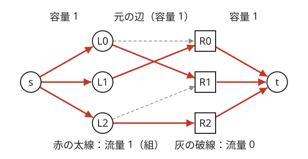
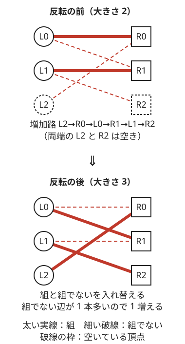

!!! abstract "要点"
    - **何ができるか**：二部グラフで端点を共有しない辺の最大集合（最大[マッチング](../guide/glossary.md#matching)）を、容量 1 の最大流（s → 左 → 右 → t）で求める。交互路を反転するとマッチングが 1 増えることが要で、答えの二分探索と[完全マッチング](../guide/glossary.md#perfect-matching)の判定を組む型が多い。
    - **いつ使うか**：
        - ペアを作る最大数・各人に 1 つずつ割り当てる。
        - 答えを決め打つと、全員に割り当てられるかの判定になる。
        - 和が素数・偶奇で 2 つのグループに分かれる。
    - **計算量**：頂点数 $N$・辺数 $M$ として、Hopcroft-Karp で $O(M \sqrt{N})$。ACL の `mf_graph` は容量がすべて 1 なら $O((N + M) \sqrt{M})$。増加路を 1 本ずつ探す方法（Kuhn）は $O(NM)$。
    - **前提**：[最大流](../graph/max-flow.md)、[二部グラフ判定](../graph/bipartite-graph.md)

<!-- textlint-disable -->
別名：二部グラフの最大マッチング・Hopcroft-Karp・交互路・完全マッチング・二部グラフの辺彩色・bipartite matching
<!-- textlint-enable -->

二部マッチングは、左右 2 つのグループに分かれたグラフで、どの頂点も高々 1 本しか使わないように辺を選び、選んだ辺の本数を最大にする問題である。始点から左へ、左から右へ、右から終点へ容量 1 の辺を張った[最大流](../graph/max-flow.md)がそのまま答えになる。AtCoder では ACL の `mf_graph` があるので、中身よりも「何を左右の頂点と辺にするか」と「答えの二分探索とどう組むか」が問われる。

## 最大流への帰着（容量 1） {#reduction}

[二部グラフ](../graph/bipartite-graph.md)で、端点を共有しない辺の集合をマッチングと呼ぶ。マッチングに入れた辺を「組」と呼ぶ。左右の頂点がすべて組に入るとき、完全マッチングという。左右の数が違うときは、左の頂点をすべて組に入れるマッチング（左を覆うマッチング）があるかを問うことが多い。

素朴な貪欲は失敗する。左 $L_0$ が右 $R_0$・$R_1$ と、左 $L_1$ が右 $R_0$ とだけつながっているとき、$L_0$ が先に $R_0$ を取ると $L_1$ の相手がなくなる。組の数は 1 だが、$L_0$–$R_1$ と $L_1$–$R_0$ にすれば 2 になる。後から組み替える仕組みが要り、それが最大流の逆辺である。

グラフは次のように作る。

- 始点 $s$ から左の各頂点へ容量 1 の辺
- 元の辺を左から右への向きで容量 1 の辺
- 右の各頂点から終点 $t$ へ容量 1 の辺



このグラフの最大流の値が、最大マッチングの大きさに等しい。理由は次の 2 つである。

- **流れ → マッチング**：容量が整数なら、どの辺の流量も整数の最大流がある（[残余グラフと増加路](../graph/max-flow.md#residual)のとおり）。容量 1 なので各辺の流量は 0 か 1 である。左の頂点 $u$ に入るのは $s \to u$ の 1 だけなので、$u$ から出て流量 1 の辺は高々 1 本である。右も同じなので、流量 1 の左から右の辺は端点を共有しない
- **マッチング → 流れ**：組 $(u, v)$ ごとに $s \to u \to v \to t$ へ 1 流せば、容量を超えない流れになる

組の復元は、左から右の辺のうち流量が 1 のものを集めればよい。そのために、辺を足したときの番号を覚えておく。

!!! info "ACL では"
    `atcoder::mf_graph<int> g(n);`。`g.add_edge(from, to, cap)` は辺の番号を返し、`g.flow(s, t)` が流せた量、`g.get_edge(i).flow` がその辺の流量である。`flow` の計算量は、容量がすべて 1 なら $O((N + M) \sqrt{M})$（ACL のドキュメントの値）。辺を足してから `flow` をもう一度呼ぶと、今の流れから続けて流し、増えた量を返す。

```cpp
--8<-- "bipartite-matching/mf-graph.cpp:core"
```

頂点の番号は「左 $0..L-1$、右 $L..L+R-1$、$s = L+R$、$t = L+R+1$」のように、重ならないよう先に決めておく。

容量を 1 以外にすると、割り当ての形を広げられる。

- **頂点を $c$ 回まで使える**：$s \to u$ の容量を $c$ にする。同じ値がいくつもあるとき、値ごとに 1 頂点にして個数を容量にすれば頂点数が減る
- **同じ組を何度でも使える**：左から右の辺の容量を十分大きくする（両端の容量で抑えられる）
- **ほかの条件を足す**：頂点に容量があるなら頂点を入口と出口に分けるなど、最大流のモデル化がそのまま使える（[最大流](../graph/max-flow.md#modeling)）

## 交互路と増加路（Kuhn・Hopcroft-Karp） {#alternating-path}

最大流の増加路を元の二部グラフに戻すと、「組でない辺」と「組の辺」が交互に並ぶ路になる。この路を交互路と呼び、両端がどちらも組に入っていない頂点（空いている頂点）である交互路を増加路と呼ぶ。増加路の上の辺について、組と組でないを入れ替える（反転する）と、マッチングが 1 増える。



増加路は組でない辺で始まり組でない辺で終わるので、組でない辺が組の辺より 1 本多い。反転しても路の内側の頂点はちょうど 1 本の組に入ったままで、両端の空いていた頂点が新しく組に入る。だから反転した後もマッチングであり、大きさは 1 増える。

逆に、増加路がなければ最大である（Berge の定理）。最大流で「残余グラフに増加路がなければ最大」と言えるのと同じことを、マッチングの言葉で言ったものである。

??? note "証明（増加路がなければ最大）"
    マッチング $X$ より大きいマッチング $Y$ があるとする。$X$ と $Y$ のどちらか一方だけに入る辺を集めると、各頂点にはそれぞれから高々 1 本ずつ、合わせて高々 2 本の辺が付く。だからこの辺の集まりは、$X$ の辺と $Y$ の辺が交互に並ぶ路と閉路に分かれる。閉路は $X$ と $Y$ の辺を同じ本数ずつ含む。$Y$ の方が多いので、$Y$ の辺が $X$ の辺より 1 本多い路が少なくとも 1 本ある。その路の両端は $X$ で空いているので、$X$ の増加路である。

**Kuhn の方法**は、左の頂点を 1 つずつ始点にして増加路を DFS で探し、見つかれば反転する。左の頂点 $u$ から、右の頂点 $v$ へ進む。$v$ が空いていれば増加路が見つかったので、帰りがけに組を付け替える。$v$ に相手 $w$ がいれば、$w$ に今の相手を手放させる代わりに、$w$ から別の右の頂点を探しに行く。

```cpp
--8<-- "bipartite-matching/kuhn.cpp:core"
```

- 訪れた印は始点ごとに消す（`stamp` を 1 増やす）。1 回の探索の中では、同じ左の頂点を 2 度調べない。調べて失敗した頂点からは、その探索の中で何度来ても失敗するからである
- 1 回の探索は $O(N + M)$ で、始点は左の頂点の数だけなので、全体で $O(NM)$ である
- ある始点から増加路が見つからなければ、その後で別の始点から反転しても、その始点から増加路は現れない。だから各始点を 1 回ずつ試せば最大になる
- 再帰の深さは左の頂点の数まで達しうる（[非再帰の DFS と再帰の深さ](../graph/dfs.md#iterative)）

**Hopcroft-Karp** は、BFS で空いている左の頂点からの距離を求め、最短の長さの増加路を、頂点を共有しないものだけまとめて反転する。この 1 回（フェーズ）は $O(M)$ で、フェーズは $O(\sqrt{N})$ 回で終わるので、全体で $O(M \sqrt{N})$ になる。ACL の `mf_graph` が使う Dinic 法も、このグラフでは同じ動きをする。

??? note "フェーズが $O(\sqrt{N})$ 回で終わる理由"
    フェーズを 1 回行うごとに、最短の増加路の長さは真に長くなる。$\sqrt{N}$ 回行うと、残る増加路の長さはどれも $\sqrt{N}$ 以上である。今のマッチングと最大マッチングの差は、頂点を共有しない増加路に分けられ（上の証明と同じ）、各路は $\sqrt{N}$ 個以上の頂点を使う。頂点は $N$ 個しかないので、そうした路は $\sqrt{N}$ 本以下で、最大との差も $\sqrt{N}$ 以下である。残りは 1 フェーズで少なくとも 1 増えるので、あと $\sqrt{N}$ 回以下で終わる。

ACL があれば Hopcroft-Karp を自分で書く必要はほとんどない。Kuhn の方法を知っておくと役に立つのは、次の場面である。

- 辺を後から足しながら、マッチングを伸ばしたい（[答えの二分探索の節](#binary-search)）
- 組んだ相手を配列で直接持ちたい（`match_l`・`match_r`）
- 左の頂点が少なく（数百）、ACL を使わずに短く書きたい

## 答えの二分探索と完全マッチングの判定 {#binary-search}

「$N$ 人を $N$ 個の行き先に 1 対 1 で割り当て、かかる時間の最大を最小にする」のような問題では、時間 $T$ を決め打つと判定の問題になる。判定 $\mathrm{check}(T)$ は「時間 $T$ 以内で行ける組だけを辺にしたグラフに、完全マッチングがあるか」である。$T$ を大きくすると辺は増えるだけなので、判定は単調で、[答えで二分探索](../basics/binary-search-answer.md)できる。

最大の最小化では、答えは必ずどれかの組のコストに等しい。だから実数の二分探索ではなく、組のコストを全部並べてソートし、添字で二分探索すれば誤差なく求まる。コストが距離なら、距離の 2 乗のまま整数で比べ、最後に平方根を取って出力する。

```cpp
--8<-- "bipartite-matching/bottleneck.cpp:core"
```

候補は $N^2$ 個なので、判定は $O(\log N)$ 回で済む。各判定は $N^2$ 本の辺のグラフで最大流を 1 回求める。

判定のグラフを毎回作り直す代わりに、辺をコストの小さい順に足しながらマッチングを伸ばす方法もある。最大のマッチングの大きさが $N$ に届いた時点のコストが答えである。

- 辺を 1 本足しても、最大マッチングは高々 1 しか増えない
- ACL なら、辺を足してから `flow(s, t)` をもう一度呼ぶと、今の流れを保ったまま増えた量を返す
- ただし、増えないときも呼び出しごとに BFS で $O(N + M)$ かかる。コストの値の種類が多いなら、値ごとにまとめて足すか、二分探索の方が速い

判定のグラフの辺が多すぎるときは、各頂点の候補を減らせないかを考える。たとえば「右の頂点が時刻で、左の各頂点は使える時刻のうちどれか 1 つを取る」なら、左の頂点が $N$ 個しかないので、各左の頂点の候補は早い方から $N$ 個だけ残せば足りる。ほかの $N - 1$ 個の頂点が取る時刻は高々 $N - 1$ 個なので、$N$ 個の候補のどれかは必ず空いているからである（[ABC320 G](#challenge) がこの形）。

## 構造で貪欲が通る特殊な場合との見分け {#greedy-cases}

一般の二部グラフでは、マッチングに最大流（か増加路）が要る。だが、辺の張られ方に強い構造があると、ソートと貪欲で $O(N \log N)$ にできる。$N = 2 \times 10^5$ で辺が $N^2$ 本ありうる問題は、マッチングのアルゴリズムでは間に合わないので、この形を疑う。

- **しきい値の形**：各人に能力 $a_i$、各仕事に要求 $b_j$ があり、$a_i \ge b_j$ なら組める。両方をソートし、要求の小さい仕事から、組める人のうち能力の最も低い人を当てる（尺取りで済む）。能力の高い人を残しておいても損をしない
- **区間の形**：右の頂点が数直線上の点で、左の各頂点が区間 $[l_i, r_i)$ に入る点とだけ組める。点を左から見て、その点を含む区間のうち右端の最も小さいものを当てる。区間を左端の順に並べておき、左端が点以下になった区間を[優先度付きキュー](../ds/priority-queue.md)に右端をキーにして入れ、右端が点以下になったもの（半開区間なので点を含まない）は捨てる。早く締め切られる区間を先に使う方が損をしない（[区間スケジューリング](../basics/interval-scheduling.md)の交換の考え方）
- **2 次元の支配の形**：「$x$ も $y$ も大きい方とだけ組める」なら、一方の座標で並べ、もう一方の座標で貪欲に選べる（[練習](#practice)の ARC092 C）

どの形でも、正しさは[交換論法](../basics/exchange-argument.md)で示す。「最適な組み方で、貪欲の選んだ組と違うものがあっても、入れ替えて悪くならない」ことを確かめる。確かめられないなら、貪欲に頼らずマッチングで解く。$N$ が数百までなら、辺が $N^2$ 本あっても `mf_graph` で十分間に合う。

逆に、次の性質から二部グラフだと気づけば、一般のグラフに見える問題もマッチングで解ける。

- **偶奇**：和が奇数の素数になるのは「奇数＋偶数」のときだけなので、奇数と偶数で左右に分かれる。ただし $1 + 1 = 2$ は偶数の素数なので、1 どうしは別に扱う
- **市松模様**：グリッドの上下左右の隣り合うマスは、$(i + j)$ の偶奇が違う（[木・4 近傍のグリッドは必ず二部グラフ](../graph/bipartite-graph.md#always-bipartite)）。ドミノを置ける最大の個数は、隣り合う空きマスどうしのマッチングである
- **行と列**：「各行・各列に高々 1 つ」は、行を左、列を右の頂点にしたマッチングである

## 正則二部グラフの分解・辺彩色 {#edge-coloring}

この節は追加の前提として、[Hall の結婚定理](../graph/dilworth-path-cover.md#hall)を使う。Hall の結婚定理は「左の頂点の集合 $S$ のどれについても、$S$ とつながる右の頂点が $\lvert S \rvert$ 個以上あれば、左の頂点をすべて組に入れるマッチングがある」というものである。

どの頂点の[次数](../guide/glossary.md#degree)もちょうど $k$（$k \ge 1$）のグラフを $k$ 正則という。同じ組を結ぶ辺が何本あってもよい（多重辺）とする。$k$ 正則の二部グラフには、必ず完全マッチングがある。左の頂点の集合 $S$ から出る辺は $k \lvert S \rvert$ 本で、それを受ける右の頂点はそれぞれ $k$ 本までしか受けられないので、$S$ とつながる右の頂点は $\lvert S \rvert$ 個以上ある。Hall の条件を満たすので、完全マッチングがある。

完全マッチングを 1 つ取り除くと、残りは $(k-1)$ 正則の二部グラフになる。これをくり返すと、辺全体が $k$ 個の完全マッチングに分かれる。各マッチングを 1 色とみれば、どの頂点でも同じ色の辺が 2 本ない塗り方（辺彩色）が $k$ 色でできたことになる。より一般に、最大次数 $\Delta$ の二部グラフは $\Delta$ 色で辺を塗れる（König の辺彩色定理）。

- **計算の仕方**：最大流で完全マッチングを求め、取った辺の容量を 1 減らして、また求める。これを $k$ 回くり返すので、マッチング $k$ 回分の時間がかかる。多重辺は、組 $(u, v)$ ごとに容量を本数にした 1 本の辺で持つとよい
- **サイン**：「各行の中で並べ替えて、各列が順列になるように」は、行と値を左右の頂点にした正則二部グラフの分解である（[力試し](#challenge)の ABC317 G）
- 速い方法として、オイラー路で辺を半分ずつに分けていく $O(M \log M)$ のアルゴリズム（Alon）などがある。Library Checker の bipartite_edge_coloring で確かめられる

## 落とし穴 {#pitfalls}

**左右の頂点の番号が重なる**。左の $i$ と右の $i$ を同じ番号にすると、別の頂点が 1 つにつぶれ、答えが小さくなる。右は $L + j$ のようにずらし、$s$ と $t$ は最後の 2 つに置く。

**二部グラフでないのにそのまま流す**。左から右への向きの辺しか張らないので、同じ側の頂点どうしの組は表せない。和が素数の組で、$1 + 1 = 2$ を見落とすのが典型である。一般のグラフのマッチングは[一般グラフのマッチング](../graph/general-matching.md#odd-cycles)のページを見る。

**組の復元で別の辺を見る**。流量が 1 の辺には $s \to u$ や $v \to t$ も含まれる。左から右の辺の番号を `add_edge` の戻り値で覚えておき、その辺だけを見る。

**Kuhn の訪れた印を消し忘れる・消しすぎる**。始点を変えるときに印を消さないと、前の探索で通った頂点を使えず、増加路を見落とす。逆に 1 回の探索の中で印を消すと、同じ頂点を何度も調べて指数時間になりうる。

**判定に実数を使う**。距離を `sqrt` で比べると、等しい距離の比較が誤差で揺れる。2 乗のまま整数で比べる。座標が $10^9$ なら 2 乗の和は $2 \times 10^{18}$ ほどで、`long long` に収まる。座標が $10^{18}$ なら 2 乗の和は $2 \times 10^{36}$ ほどになるので、[`__int128`](../cpp/cpp-integer-overflow.md#int128) で持つ（[例題の ABC401 G](#abc401_g)）。

**辺が多すぎる**。$N = 2 \times 10^5$ で全部の組を辺にすると $4 \times 10^{10}$ 本になる。[構造で貪欲が通る場合](#greedy-cases)か、候補を減らす方法（[答えの二分探索の節](#binary-search)の時刻の例）を考える。

**左をすべて組に入れる判定で、左右の数を取り違える**。左が $N$ 個、右が $N'$ 個のとき、「全員に割り当てる」は大きさが左の数 $N$ に届くかであり、右の数とは比べない。

## 例題 {#examples}

### 典型90 077. Planes on a 2D Plane（★7） {#typical90_by}

<div class="kp-problems" data-role="example" markdown>

- [典型90 077. Planes on a 2D Plane（★7）](https://atcoder.jp/contests/typical90/tasks/typical90_by)（diff なし）：N 機の飛行機を時間 T の後に、8 方向のどれかへ（斜めなら x と y の両方を）T だけ動かし、指定の N か所に 1 機ずつ着くようにできるかを判定し、できれば方向を出力する。

</div>

飛行機を左、着く場所を右の頂点にし、ある方向に動かしてその場所に着くなら辺を張る。各飛行機の行き先の候補は 8 か所までなので、辺は $8N$ 本以下である。大きさ $N$ のマッチングがあれば可能で、組から方向を復元する。

??? note "解法の詳細"
    - 着く場所の座標から番号を引く `map`（か `unordered_map`）を作る。飛行機 $i$ の 8 方向それぞれについて、時間 $T$ 動いた先の座標が場所にあれば、その向きを覚えて辺を張る。
    - `mf_graph` で $s \to$ 飛行機、飛行機 $\to$ 場所、場所 $\to t$ をどれも容量 1 にして流す。流量が $N$ でなければ不可能。
    - 流量が 1 の「飛行機 $\to$ 場所」の辺から、覚えておいた向きを出力する。
    - 辺は $O(N)$ 本なので、`map` を含めて $O(N \log N + N \sqrt{N})$ ほどで済む。

### ABC401 G. Push Simultaneously {#abc401_g}

<div class="kp-problems" data-role="example" markdown>

- [ABC401 G. Push Simultaneously](https://atcoder.jp/contests/abc401/tasks/abc401_g)（diff 2022）：N 人と N 個のボタンの位置が与えられ、各人が別々のボタンを押しに行くとき、全部のボタンが押されるまでの時間の最小値を求める。

</div>

全部が押されるまでの時間は、組ごとの移動時間の最大である。時間 $T$ を決め打つと「距離が $T$ 以下の組だけで完全マッチングがあるか」の判定になり、$T$ について単調なので二分探索する。答えはどれかの組の距離なので、距離の 2 乗を全部並べて、添字で二分探索すれば誤差が出ない。

??? note "解法の詳細"
    - 人 $i$ とボタン $j$ の距離の 2 乗 $d_{ij}$ を整数で求める（入力の座標が整数なので、2 乗の和も整数）。座標は $10^{18}$ まであるので、2 乗の和は $2 \times 10^{36}$ ほどになり `long long` に収まらない。[`__int128`](../cpp/cpp-integer-overflow.md#int128)（上限は約 $1.7 \times 10^{38}$）で求め、候補もその型で並べる。[答えの二分探索の節](#binary-search)のコードの `long long` をそのまま使うとあふれる。
    - $d_{ij}$ の $N^2$ 個の値をソートして重複を除き、添字で二分探索する。最大の値ならすべての辺があるので必ず可で、ok の番兵にできる。
    - 判定は、$d_{ij} \le x$ の組だけを辺にした `mf_graph` で流量が $N$ になるか。[答えの二分探索の節](#binary-search)のコードと同じ形である。
    - 求めた値 $x$ の平方根を `sqrtl((long double)x)` で求め、十分な桁数（`setprecision(15)` など）で出力する（許される誤差は相対 $10^{-6}$ なので足りる）。判定は $O(\log N)$ 回で済む。

## 練習問題 {#practice}

<div class="kp-problems" data-role="practice" markdown>

- [鉄則本 A69. Bipartite Matching](https://atcoder.jp/contests/tessoku-book/tasks/tessoku_book_bq)（diff なし）：N×N の表で、i 行 j 列が # なら左の i 番目と右の j 番目を組にしてよいとき、どの要素も 1 回までしか使わずに作れる組の最大数を求める。
- [ARC092 C. 2D Plane 2N Points](https://atcoder.jp/contests/arc092/tasks/arc092_a)（diff 1268）：赤い点と青い点が N 個ずつあり、x 座標も y 座標も赤い点の方が小さい組を仲良しとするとき、作れる仲良しの組の最大数を求める。
- [ABC263 G. Erasing Prime Pairs](https://atcoder.jp/contests/abc263/tasks/abc263_g)（diff 2261）：整数とその個数が与えられ、和が素数になる 2 つを選んで消す操作の最大回数を求める。

</div>

??? note "練習の方針"
    - **鉄則本 A69**：表の # の位置に左から右の辺を張り、`mf_graph` で流すだけの基本形である。
    - **ARC092 C**：制約が小さいので二部マッチング（`mf_graph`）でも解けるが、青い点を $x$ の小さい順に見て、組める赤い点のうち $y$ が最大のものを選ぶ貪欲でも解ける。$y$ の大きい赤い点ほど後の青い点と組みにくいので、先に使っても損をしない。
    - **ABC263 G**：1 以外の数どうしでは、和が素数になるのは奇数と偶数の組だけなので、値ごとに 1 頂点にして個数を容量にした二部グラフで流す。まず 1 を除いて流し（流量 $B$）、次に 1 の頂点とその辺を足して流し足す（合計 $C$）。流し足した分 $C - B$ が 1 を使った個数で、これが最小になる。残った 1 は 1 どうしで組めるので、1 の個数を $A$ として答えは $C + \lfloor (A - (C - B)) / 2 \rfloor$ である。個数が大きいので容量は `long long` にする。

## 力試し {#challenge}

<div class="kp-problems" data-role="challenge" markdown>

- [ABC320 G. Slot Strategy 2 (Hard)](https://atcoder.jp/contests/abc320/tasks/abc320_g)（diff 2575）：N 個のリールにそれぞれ長さ M の数字の列があり、時刻 t に止めたリールには列の (t mod M)+1 文字目（0 から数えて t mod M 番目）の数字が出る。同じ時刻に止められるのは 1 つだけのとき、すべてのリールを同じ数字で止め終える最短の時刻を求める（できなければ -1 を出力する）。
- [ABC317 G. Rearranging](https://atcoder.jp/contests/abc317/tasks/abc317_g)（diff 2649）：N×M の表に 1〜N がそれぞれ M 個ずつ書かれているとき、各行の中で並べ替えて、各列が 1〜N の順列になるようにできるかを判定し、できれば表を出力する。

</div>

??? note "力試しの方針"
    - **ABC320 G**：そろえる数字を 0〜9 のどれかに決める。リールを左、時刻を右の頂点にし、その数字が出る時刻に辺を張る。時刻は無限にあるが、各リールでは早い方から $N$ 個の時刻だけを候補にすれば足りる（ほかのリールに取られる時刻は $N - 1$ 個まで）。時刻の小さい順に辺を足してマッチングを伸ばすか、時刻を二分探索して、大きさが $N$ になる最小の時刻を求める。数字が出ないリールがあれば、その数字はそろえられない。
    - **ABC317 G**：行を左、値を右の頂点にし、行 $i$ に値 $j$ が $c$ 個あれば容量 $c$ の辺を張る。どの頂点の次数も $M$ なので $M$ 正則の二部グラフで、完全マッチングが必ずある。完全マッチングを 1 つ取って 1 列目に並べ、使った辺の容量を 1 減らす。これを $M$ 回くり返す。つまり答えは必ず「できる」になる。

## 確認問題 {#quiz}

??? question "確認問題：失敗した始点を見直さなくてよい理由"
    Kuhn の方法で、ある左の頂点 $u$ を始点にして増加路が見つからなかったとする。その後、別の始点からの増加路で組を付け替えても、$u$ をもう一度始点にして試さなくてよいのはなぜか。

    ??? success "答え"
        $u$ から交互路でたどれる頂点の集合を $A$ とする。増加路が見つからなかったので、$A$ の右の頂点はどれも組に入っていて、その相手の左の頂点も $A$ に入る。後の始点 $w$ からの増加路が $A$ の頂点を通るとすると、その路は $A$ に入った後、$A$ の中の組の辺と組でない辺だけをたどり、空いている右の頂点に着けない。だから後の増加路は $A$ を通らず、反転しても $A$ の中の組は変わらない。$u$ から見えるグラフが変わらないので、$u$ からは後でも増加路が見つからない。

??? question "確認問題：Kuhn の印を消す単位"
    Kuhn の方法で、訪れた印を「始点を変えるとき」に消すのはなぜか。1 回の探索の中で消さない理由と合わせて答えよ。

    ??? success "答え"
        始点が変わるとマッチングが変わっているので、前の探索で失敗した頂点からも増加路が見つかることがある。だから始点ごとに消す。一方、1 回の探索の中ではマッチングは変わらないので、一度調べて失敗した頂点はもう一度来ても失敗する。印を残せば各頂点を 1 回だけ調べて済み、1 回の探索が $O(N + M)$ になる。

??? question "確認問題：判定の単調性"
    「時間 $T$ 以内に行ける組だけで完全マッチングがあるか」が $T$ について単調なのはなぜか。また、答えが組の距離のどれかに等しいのはなぜか。

    ??? success "答え"
        $T$ を大きくすると、辺は増えるだけで減らない。$T$ で見つかった完全マッチングは、より大きい $T'$ のグラフにもそのまま残るので、$T$ で可なら $T'$ でも可である。答えは最適な組み方での組の距離の最大なので、どれかの組の距離に等しい。だから組の距離を並べた候補の中で二分探索すればよい。

??? question "確認問題：偶奇で分けるときの例外"
    「和が素数になる 2 つを組にする」問題で、奇数と偶数で左右に分けた二部グラフだけでは足りない場合があるのはなぜか。

    ??? success "答え"
        和が素数になるのは、和が 2 のときを除けば和が奇数のとき、つまり奇数と偶数の組である。ただし $1 + 1 = 2$ は素数なので、1 どうし（奇数どうし）の組がありうる。この組は二部グラフの辺にならないので、1 を使う個数をできるだけ減らしてから、残った 1 どうしを組にするなど、別に数える。

## 使い分け {#comparison}

- 組ごとに重み（コスト・利得）があり、その合計を最小・最大にするなら[最小費用流](../graph/min-cost-flow.md#modeling)を使う。最大の最小化のように「最も悪い組」だけを見るなら、この節の二分探索で足りる
- 二部グラフでない（奇数長の閉路がある）なら[一般グラフのマッチング](../graph/general-matching.md#odd-cycles)。頂点が 20 程度までなら、[集合だけを状態にする bitDP](../dp/bit-dp.md#set-only) で数えられる
- 最大マッチングの大きさではなく、最小頂点被覆や最大独立集合を問われたら [König の定理](../graph/konig-theorem.md#theorem)で言い換える
- DAG の頂点を最少のパスで覆う問題は、頂点を 2 つに分けた二部マッチングになる（[DAG の最小パス被覆](../graph/dilworth-path-cover.md#path-cover)）
- 辺に区間・しきい値などの構造があって $N$ が大きいなら、[構造で貪欲が通る場合](#greedy-cases)を使う

## 参考 {#references}

- [AtCoder Library「MaxFlow」（document_ja）](https://github.com/atcoder/ac-library/blob/master/document_ja/maxflow.md)：`mf_graph` の宣言・計算量・辺の番号と `get_edge`
- [AtCoder Library「Appendix」（document_ja）](https://github.com/atcoder/ac-library/blob/master/document_ja/appendix.md)：`flow` を何度も呼んだときの動き
- [Wikipedia「Hopcroft–Karp algorithm」](https://en.wikipedia.org/wiki/Hopcroft%E2%80%93Karp_algorithm)：フェーズの数が $O(\sqrt{N})$ になる理由と計算量
- [Wikipedia「Berge's theorem」](https://en.wikipedia.org/wiki/Berge%27s_theorem)：増加路がなければ最大であることの証明の筋
- [Wikipedia「Edge coloring」](https://en.wikipedia.org/wiki/Edge_coloring)：二部グラフは最大次数の色数で辺を塗れること、正則二部グラフの完全マッチングへの分解、Alon の方法
- [E869120「kyopro-tessoku」](https://github.com/E869120/kyopro-tessoku/tree/main/codes/cpp/chap09)：練習の鉄則本 A69 の問いとグラフの作り方（解答コード）
- [drken「競プロ典型 90 問 077 - Planes on a 2D Plane（2D, ★7）」](https://drken1215.hatenablog.com/entry/2023/11/14/023400)：例題の方針（行き先の候補を引くことと方向の復元）
- [kmjp「AtCoder ABC #401 : G - Push Simultaneously」](https://kmjp.hatenablog.jp/entry/2025/04/13/0900)：例題の方針（時間の二分探索と完全マッチングの判定）
- [drken「AtCoder ABC 091 C - 2D Plane 2N Point (ARC 092 C) (1Q, 水色, 400 点)」](https://drken1215.hatenablog.com/entry/2021/07/05/183800)：練習の方針（貪欲と交換による正しさ）
- [kmjp「AtCoder ABC #263 : G - Erasing Prime Pairs」](https://kmjp.hatenablog.jp/entry/2022/08/07/0900)：練習の方針（偶奇の二部グラフと 1 の扱い）
- [kmjp「AtCoder ABC #320 (トヨタ自動車プログラミングコンテスト2023#5) : G - Slot Strategy 2 (Hard)」](https://kmjp.hatenablog.jp/entry/2023/09/17/0930)：力試しの方針（候補を N 個に絞ることと、小さい順に辺を足すこと）
- [drken「AtCoder ABC 317 G - Rearranging (4D, 橙色, 600 点)」](https://drken1215.hatenablog.com/entry/2023/08/27/000216)：力試しの方針（正則二部グラフの完全マッチングを M 回取り出す）
