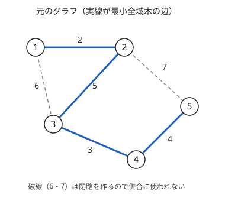
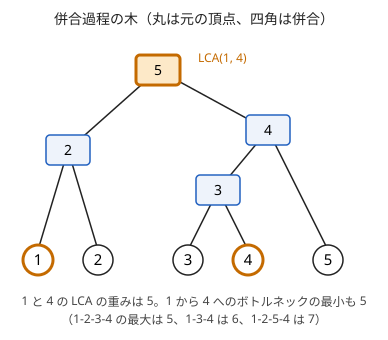

!!! abstract "要点"
    - **何ができるか**：2 点を結ぶ経路のうち、通る辺の重みの最大値が最小になるものの値（最小[ボトルネック](../guide/glossary.md#bottleneck)）を求める。辺を重みの昇順に Union-Find で併合し、2 点が初めて同じ成分になった辺の重みが答えで、その経路は最小全域木の上にとれる。多数の 2 点の質問は、成分にクエリを持たせる併合か併合過程の木で答える。
    - **いつ使うか**：
        - 経路上の最大の辺（最小の頂点）を最小化（最大化）する
        - 重さ・高さの制限以下で行けるか
        - しきい値を上げていくと連結になる時刻
    - **計算量**：2 点 1 組はソートの $O(M \log M)$。$Q$ 組はオフラインで $O(M \log M + Q \log N \cdot \alpha(N))$。併合過程の木なら前計算 $O(M \log M + N \log N)$、1 組 $O(\log N)$ でオンラインに答えられる
    - **前提**：[最小全域木](../graph/minimum-spanning-tree.md)、[Union-Find で連結性を扱う](../graph/union-find-connectivity.md)

<!-- textlint-disable -->
別名：minimax 経路・ボトルネック・経路上の最大の辺の最小化・bottleneck path
<!-- textlint-enable -->

最小ボトルネック路は、経路の長さを辺の重みの「和」ではなく「最大値」で測ったときの最短の経路である。辺を軽い順に足していく[クラスカル法](../graph/minimum-spanning-tree.md#kruskal-prim)の途中で、2 点が初めてつながった瞬間の辺の重みが値になる。重量制限のある道路、高さや水位のしきい値で通れるかが決まる移動、障害物の隙間を通り抜ける幾何の問題が、この形に言い換えられる。

## 最小全域木の上の経路がボトルネック最小になる理由（カット性質） {#why-mst}

無向グラフの頂点数を $N$、辺数を $M$、辺 $e$ の重みを $w(e)$ とする。$s$ から $t$ への経路 $P$ の**ボトルネック**を、$P$ が通る辺の重みの最大値 $\max_{e \in P} w(e)$ とする。求めたいのは、すべての経路にわたるその最小値である。

$$
b(s, t) = \min_{P : s \to t} \ \max_{e \in P} w(e)
$$

経路は指数個あるので全部は試せない。ダイクストラ法も、和を足す形のままでは使えない。手がかりは、値を $x$ に決めたときの判定である。

$$
b(s, t) \le x \iff \text{重みが } x \text{ 以下の辺だけで } s \text{ と } t \text{ が連結}
$$

左から右は、ボトルネックが $x$ 以下の経路の辺はどれも $x$ 以下だからである。右から左は、$x$ 以下の辺だけでできた経路がそのままボトルネック $x$ 以下の経路になるからである。$x$ を大きくすると使える辺が増えるので、判定は $x$ について単調になる。よって $b(s, t)$ は「その辺まで使えば $s$ と $t$ が連結になる」最小の辺の重みで、答えは必ずどれかの辺の重みに一致する。



図のグラフ（頂点は 1-indexed）で $b(1, 4)$ を求める。重み 4 以下の辺は 1-2・3-4・4-5 で、1 と 4 は別の成分にある。重み 5 の辺 2-3 を加えると 1-2-3-4 がつながるので、$b(1, 4) = 5$ である。経路 1-3-4 はボトルネック 6、1-2-5-4 は 7 で、どちらも 5 より悪い。

この値は、最小全域木 $T$ の上の $s$–$t$ パスで実現できる。$T$ の上のパスの最大の辺を $e$、その重みを $W$ とする。$T$ から $e$ を除くと、$s$ を含む組 $S$ と $t$ を含む組に分かれる。この 2 組への分け方は[カット](../guide/glossary.md#cut)で、$s$ から $t$ への経路はどれもカットを横切る辺 $f$ を通る。

- もし $w(f) < W$ なら、$T$ から $e$ を除いて $f$ を足すと全域木のままで重みが減り、$T$ が最小であることに反する。
- よってカットを横切る辺はどれも重みが $W$ 以上で、どの経路のボトルネックも $W$ 以上になる。
- $T$ の上のパスはボトルネックがちょうど $W$ なので、最小である。

この議論は最小全域木の[正しさの理由](../graph/minimum-spanning-tree.md#why-correct)で使う交換と同じで、最小全域木が複数あってもどれについても成り立つ。グラフが連結でなければ、最小全域森の同じ木の中だけで成り立ち、別の成分の 2 点には経路がない。

最小全域木の上に、すべての 2 点の最小ボトルネック路がまとめて載っている。$N - 1$ 本の辺だけを残せばよいので、多数の質問に答えるときは木の上の問題（パス上の最大値）に直せる。ただし最小全域木の上のパスは、辺の重みの和で測った最短路ではない（[最小全域木の確認問題](../graph/minimum-spanning-tree.md#quiz)）。

## クラスカル法の順に成分を併合しながら答える {#kruskal-order}

$s$ と $t$ の 1 組だけを問われたら、最小全域木を作らずに、クラスカル法のループの途中で止めればよい。

1. $s = t$ なら、辺を 1 本も通らないので答えは 0 とする（問題の定義に従う）。
2. 辺を重みの昇順にソートする。
3. Union-Find で辺を順に併合し、併合のたびに $s$ と $t$ が同じ成分かを調べる。初めて同じになったときの辺の重みが答えである。
4. 最後まで同じにならなければ、$s$ と $t$ は連結でない。

重みが $x$ 以下の辺をすべて併合し終えた時点の成分は、重み $x$ 以下の辺だけのグラフの連結成分と一致する。判定の式から、初めて連結になった辺の重みが $b(s, t)$ である。同じ重みの辺がいくつあっても答えは変わらない。連結にした辺の重みが同じだからである。

```cpp
--8<-- "bottleneck-path/pair.cpp:core"
```

ソートが $O(M \log M)$、併合と判定が $M$ 回でならし $O(M \alpha(N))$ なので、全体で $O(M \log M)$ である。[答えで二分探索](../basics/binary-search-answer.md#minimax)して連結判定をくり返す書き方でも解けるが、昇順に足す方が速い。答えが辺の重みそのものなので、実数でも二分探索の打ち切りの誤差が出ない（[二分探索と連結判定の組合せ](../graph/union-find-connectivity.md#binary-search)）。

!!! info "ACL では"
    `dsu d(n);`。`d.merge(a, b)` は併合して新しい代表元を返し、`d.same(a, b)` は同じ成分かを返し、`d.leader(a)` は $a$ の成分の代表元を返す。`d.size(a)` は成分の頂点数を返す。どれもならし $O(\alpha(N))$ である。

応用の型は次のとおりである。

- **最小値の最大化**：「経路上の最も細い辺（最小の辺）をなるべく太くする」なら、辺を重みの降順に足す。[最大全域木](../graph/minimum-spanning-tree.md#maximum)の上の経路になる。サインは「重さ $w$ 以上に耐える道だけで運べる最大の重さ」である。
- **頂点の重み**：「通る頂点（建物・マス）の高さの最小を最大にする」なら、高い頂点から順に有効にし、両端が有効になった辺を併合する。辺の重みを $\min(h_u, h_v)$ とみなすのと同じで、始点と終点の高さも経路に含まれる（[練習の ABC394 G](#practice)）。
- **全点対の和**：すべての組 $(u, v)$ の $b(u, v)$ の和は、併合のたびに「重み × 片方の成分の頂点数 × もう片方の成分の頂点数」を足せば求まる。そのとき初めてつながった組の値がちょうどその重みだからである（[ABC214 D の例題](../ds/union-find-applications.md#abc214_d)）。
- **幾何の通り抜け**：障害物どうしや障害物と壁の距離を辺の重みにし、上下の壁が初めてつながる距離から通れる円の大きさが決まる（[練習の ABC181 F](#practice)）。
- **組の割り当て**：2 つの集合の点を 1 対 1 で組み、ボトルネックの和を最小にするなら、併合のたびに新しくつながった組をその重みで作る貪欲が最適になる（[例題の ABC383 E](#abc383_e)）。

## 多数の 2 点の質問：成分にクエリを持たせて小さい方から移す {#many-queries}

この節は[マージテク](../tree/small-to-large.md#relabel-smaller)を前提にする。

$Q$ 組の $(u_i, v_i)$ について $b(u_i, v_i)$ を答えるとき、1 組ずつ上のループを回すと $O(QM)$ かかる。$N, M, Q$ が $2 \times 10^5$ なら間に合わない。質問を先に全部読めるなら、1 回のクラスカル法で全部に答えられる。

**持つもの**：各成分の代表元 $r$ に、一覧 $\mathrm{ids}[r]$ を持たせる。中身は「端点の片方がこの成分にあり、まだ答えの出ていない質問の番号」である。最初は、質問 $i$ の番号を $\mathrm{ids}[u_i]$ と $\mathrm{ids}[v_i]$ の両方に入れる（$u_i = v_i$ の質問は先に 0 と答えて入れない）。

**併合の手順**（重み $w$ の辺で、代表元 $a \ne b$ の成分を併合する）：

1. 併合して新しい代表元 $r$ を得る。代表元でなくなった方を $o$ とする。
2. $\mathrm{ids}[o]$ の方が長ければ、$\mathrm{ids}[o]$ と $\mathrm{ids}[r]$ を入れ替える。
3. 短い方 $\mathrm{ids}[o]$ の各番号 $i$ を見る。答えが出ていれば読み飛ばす。$u_i$ と $v_i$ が同じ成分になっていれば答えを $w$ にする。そうでなければ $\mathrm{ids}[r]$ に移す。

2 つの端点の成分が併合される瞬間、質問 $i$ の番号は 2 つの一覧の両方に 1 つずつある。だから短い方を見るだけで必ず見つかり、そのときの $w$ が初めてつながった辺の重みである。長い方に残った写しは、後で見たときに「答えが出ている」として捨てる。

```cpp
--8<-- "bottleneck-path/many-queries.cpp:core"
```

**計算量**：1 回の併合で見る番号の数は 2 つの一覧の短い方の長さで、頂点数の小さい成分の一覧の長さ以下である。見た回数は、頂点数の小さい成分の写し 1 つにつき 1 回として数える。数えられた写しの成分は、併合で頂点数が 2 倍以上になる。頂点数は $N$ を超えないので、1 つの写しが数えられるのは $\log_2 N$ 回までである。写しは $2Q$ 個なので、見る回数は合わせて $O(Q \log N)$ で、全体は $O(M \log M + Q \log N \cdot \alpha(N))$ になる。

同じ質問に別の方法でも答えられる。

- **最小全域木と LCA**：最小全域木を作り、木の上の $u$–$v$ パスの最大の辺を[ダブリングで表と一緒に持つ](../tree/lca.md#path-aggregate)。前計算 $O(M \log M + N \log N)$、1 組 $O(\log N)$ で、質問を先読みできなくても使える。
- **並列二分探索・部分永続 Union-Find**：「初めて連結になる時刻」でなく「成分の頂点数が $z$ 以上になる時刻」のように、連結以外の条件を問われたときに使う（[並列二分探索](../ds/parallel-binary-search.md#with-union-find)、[部分永続 Union-Find](../ds/partially-persistent-union-find.md#binary-search-time)）。

## 併合過程の木（Kruskal 再構築木）でオンラインに答える（木の章へ） {#reconstruction-tree}

この節は[最小共通祖先（LCA）](../tree/lca.md)を前提にする。木の作り方の詳細は[併合過程の木](../tree/merge-process-tree.md#new-vertex)のページにある。

クラスカル法で 2 つの成分を併合するたびに、新しい頂点を 1 つ作る。新しい頂点の重みを併合に使った辺の重み $w$ にし、併合した 2 つの成分を表す頂点を子にする。元の $N$ 頂点が葉になり、連結なら $N - 1$ 回の併合で $2N - 1$ 頂点の二分木ができる。この木を**併合過程の木**（Kruskal 再構築木）と呼ぶ。実装では、Union-Find の代表元ごとに「その成分を表す木の頂点」の番号を持てばよい。



$u$ と $v$ の LCA は、$u$ と $v$ が初めて同じ成分になった併合を表す。よって LCA の重みが $b(u, v)$ になる。上の図は[最初の節](#why-mst)のグラフの木で、1 と 4 の LCA は根の重み 5 であり、$b(1, 4) = 5$ と一致する。辺は昇順に併合するので、頂点の重みは根に近いほど大きい（等しいこともある）。

この性質から、次の質問にもオンラインで答えられる。

- **2 点のボトルネック**：LCA の重みを返す。1 組 $O(\log N)$ である。
- **重み $x$ 以下の辺で $v$ から行ける頂点**：$v$ の祖先のうち重みが $x$ 以下で最も根に近いもの $p$ を[ダブリングで探す](../tree/lca.md#farthest-ancestor)。行ける頂点は $p$ の部分木の葉で、葉を DFS の順に並べると区間になる。個数や最大値は区間の問い合わせになる。

## 落とし穴 {#pitfalls}

- **$s = t$ の質問**：判定を併合の後にだけ書くと、最初の辺を併合した直後に「同じ成分」と判定され、その辺の重みを答えてしまう。ループの前に $s = t$ を調べ、問題の定義どおり（多くは 0）に答える。
- **非連結**：最後まで連結にならない組がある。答えの初期値を $-1$ などの印にし、出力の前に確かめる。ボトルネックを $\infty$ の番兵で持つなら、出力で印に直す。
- **最短路との混同**：最小全域木の上のパスは、辺の重みの和で最短とは限らない。逆に、和の最短路のボトルネックも最小とは限らない。問われているのが和か最大かを先に確かめる。
- **頂点の重みの端点**：頂点の高さで制限される問題では、始点と終点の頂点も経路に含まれる。同じ頂点の質問や、端点が低い場合を別に確かめる（[練習の ABC394 G](#practice) の同じ建物の質問）。
- **しきい値の等号**：「$w$ 以下の辺を使える」と「$w$ 未満の辺を使える」では、整数の答えが 1 ずれる。辺の重みをそのまま答えにするのは「以下」のときで、「未満」なら答えを直す。実数の上限を問う幾何の問題なら、等号の向きで答えは変わらない。
- **重みの型と距離**：重みの和を取る型（全点対の和・組の割り当て）は `long long` にする。幾何で距離を重みにするときは、距離の 2 乗の整数で並べ、平方根は答えにだけ取る。
- **一覧の写し**：多数の質問の処理では、1 つの質問が 2 つの一覧に入る。答えが出た質問を読み飛ばさないと、後の併合で答えを書き換えてしまう。

## 例題 {#examples}

### ABC383 E. Sum of Max Matching {#abc383_e}

<div class="kp-problems" data-role="example" markdown>

- [ABC383 E. Sum of Max Matching](https://atcoder.jp/contests/abc383/tasks/abc383_e)（diff 1616）：f(x, y) を x から y への経路の辺の重みの最大値の最小値とするとき、2 つの列 A・B を並べ替えて Σ f(A_i, B_i) を最小にする。

</div>

$f$ は最小ボトルネックなので、辺を重みの昇順に併合すると、$x$ と $y$ が初めて同じ成分になった辺の重みが $f(x, y)$ になる。そこで、併合のたびに「新しく同じ成分に入った $A$ の点と $B$ の点」をその重みで組にしていく。各成分の代表元に、まだ組にしていない $A$ の点の数と $B$ の点の数を持てば、組にできる数は 2 つの数の小さい方である。

??? note "解法の詳細"
    最初に、同じ頂点にある $A$ と $B$ を重み 0 で組にしておく。1 頂点だけの成分で $\min$ 組を作るのにあたる。

    重み $w$ の辺で 2 つの成分を併合したら、2 つの成分の残りの数を足して、併合後の成分の「残っている $A$ の数」$p$ と「残っている $B$ の数」$q$ を求める。次に $\min(p, q)$ 組を重み $w$ で作り、答えに $\min(p, q) \cdot w$ を足す。残りの数は $p - \min(p, q)$ と $q - \min(p, q)$ で、どちらかが 0 になる。

    ```cpp
    --8<-- "bottleneck-path/matching.cpp:core"
    ```

    この貪欲が最適である理由は、しきい値ごとの上限で示せる。重み $x$ 以下の辺だけのグラフを考え、その各成分 $c$ の $A$ の数を $a_c$、$B$ の数を $b_c$ とする。値 $x$ 以下の組は同じ成分の中でしか作れないので、どの組み方でも、その数は $\sum_c \min(a_c, b_c)$ を超えない。貪欲は、各成分で $A$ か $B$ の一方を使い切るので、すべての $x$ でこの上限にちょうど等しい。組の値の和は、しきい値 $x$ ごとに「値が $x$ より大きい組の数」を積み上げたもので、貪欲はどの $x$ でもその数を最小にしている。よって和も最小である。

    ソートが $O(M \log M)$ で、併合は全体でならし $O(M \alpha(N))$ である。答えは `long long` で持つ。

## 練習問題 {#practice}

<div class="kp-problems" data-role="practice" markdown>

- [ABC181 F. Silver Woods](https://atcoder.jp/contests/abc181/tasks/abc181_f)（diff 2009）：上下の壁の間に釘が打たれた通路を、ある半径の円が左から右へ通り抜けられるときの最大の半径を求める。
- [ABC394 G. Dense Buildings](https://atcoder.jp/contests/abc394/tasks/abc394_g)（diff 2031）：建物が格子状に並び、隣り合う建物の間は両方の高さ以下の階で行き来できるとき、2 つの建物の指定された階どうしを移動する際の、上り下りする階数の最小値を各質問に答える。

</div>

??? note "練習の方針"
    - **ABC181 F**：釘 $N$ 本に上の壁と下の壁を加えた $N + 2$ 頂点を作る。辺の重みは、釘どうしの距離、釘と各壁の距離、壁どうしの距離（通路の幅）である。重みの昇順に併合し、上の壁と下の壁が初めてつながった重み $d$ が、通れる隙間の最小のボトルネックになる。答えは $d / 2$ である。辺は $O(N^2)$ 本で、全体は $O(N^2 \log N)$。距離は 2 乗の整数で並べ、平方根は最後にだけ取る。
    - **ABC394 G**：通る建物の高さの最小をなるべく高くしたいので、高い建物から順に有効にし、両方が有効になった隣どうしを併合する。2 つの建物が初めてつながる高さを $h$ とする。指定された 2 つの階を $Y, Z$ とすると、$\min(Y, Z) \le h$ なら上り下りは $\lvert Y - Z \rvert$ で済み、そうでなければ $h$ 階まで下りて上るので $Y + Z - 2h$ である。質問が多数あるので、[成分にクエリを持たせる方法](#many-queries)か最小全域木と LCA で答える。同じ建物の質問は $\lvert Y - Z \rvert$ と答える。

## 確認問題 {#quiz}

??? question "確認問題：最小全域木が複数あるとき"
    重みの等しい辺があり、最小全域木が複数ある。どれを選んでも、その上の $s$–$t$ パスの最大の辺の重みは同じか。

    ??? success "答え"
        同じである。[最初の節](#why-mst)の議論は、どの最小全域木 $T$ についても「$T$ の上のパスのボトルネックが $b(s, t)$ に等しい」ことを示している。$b(s, t)$ は木の選び方によらず決まるので、どの木でも同じ値になる。通る辺そのものは木によって違ってよい。

??? question "確認問題：ダイクストラ法で求められるか"
    1 つの始点 $s$ からすべての頂点への $b(s, v)$ を、ダイクストラ法を変えて求められるか。

    ??? success "答え"
        求められる。緩和の式を $\mathrm{dist}[u] + w$ から $\max(\mathrm{dist}[u], w)$ に変える。経路を延ばしても最大値は減らないので、和のときと同じく「取り出した頂点の値が確定する」理由がそのまま成り立つ。計算量は $O(M \log N)$ である。始点が 1 つならこれでもよいが、多数の組を問われたら最小全域木にまとめる方が使い回せる。

??? question "確認問題：和の最短路のボトルネック"
    辺の重みの和が最小の $s$–$t$ 経路は、ボトルネックも最小か。

    ??? success "答え"
        そうとは限らない。3 頂点 $s, a, t$ に、辺 $s$–$t$（重み 10）、$s$–$a$（重み 6）、$a$–$t$（重み 6）があるとする。和の最短路は直接の辺で長さ 10、ボトルネックも 10 である。$s$–$a$–$t$ は和が 12 だがボトルネックは 6 で小さい。

## 使い分け {#comparison}

- 2 点 1 組なら、昇順に併合して初めてつながった辺の重みを答える。辺を全部並べられないとき（辺の重みが判定のたびに計算で決まるなど）は、[答えで二分探索](../basics/binary-search-answer.md)と連結判定にする。
- 始点が 1 つで終点は多数なら、緩和を $\max$ に変えた[ダイクストラ法](../graph/dijkstra.md)でもよい。
- 「重み $x$ 以下の辺だけで連結か」をしきい値 $x$ 付きで問われたら、[しきい値の順に辺を足す](../graph/union-find-connectivity.md#threshold)方が直接である。
- 多数の組をオフラインで問われたら[成分にクエリを持たせる](#many-queries)。オンラインなら最小全域木と [LCA](../tree/lca.md#path-aggregate)、行ける範囲まで問われたら[併合過程の木](#reconstruction-tree)にする。
- 経路の重みの和を問われたら、ボトルネックではなく最短路の問題である。

## 参考 {#references}

- [Lanly「AtCoder Beginner Contest 383」](https://www.cnblogs.com/Lanly/p/18606772)：例題 abc383_e の問いと、併合のたびに成分の A と B の数から組を作る方針
- [drken「AtCoder ABC 181 F - Silver Woods (黄色, 600 点)」](https://drken1215.hatenablog.com/entry/2020/11/02/013900)：練習 abc181_f の壁を頂点にした連結判定と、二分探索をせず距離の順に併合する解き方
- [kmjp「AtCoder ABC #394 (鹿島建設プログラミングコンテスト2025) : G - Dense Buildings」](https://kmjp.hatenablog.jp/entry/2025/02/24/1000)：練習 abc394_g の問い、答えの式、高い順に併合してクエリの集合を移す方針
- [AtCoder Library「DSU」（document_ja）](https://github.com/atcoder/ac-library/blob/master/document_ja/dsu.md)：`dsu` の `merge`・`same`・`leader`・`size` と計算量
