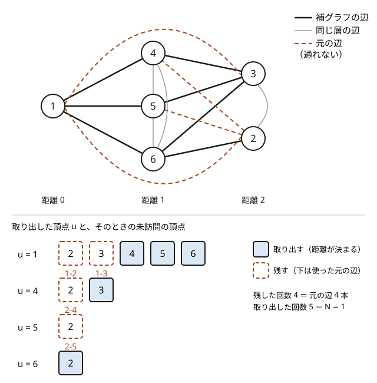

!!! abstract "要点"
    - **何ができるか**：完全グラフから $M$ 本の辺を除いたグラフ（補グラフ）を、辺を列挙せずに BFS する。未訪問の頂点の集合を持ち、取り出した頂点と元のグラフで隣接しない未訪問の頂点を一度に取り出すと、全体で $O(N + M)$ になる。層ごとの最短路の本数も同じ計算量で数えられる。
    - **いつ使うか**：
        - 完全グラフから $M$ 本の辺を取り除いたグラフ・辺が「ない」組が与えられる。
        - $N \le 2 \times 10^5$ で、補グラフの辺は $N^2$ 本近くあり列挙できない。
    - **計算量**：$O(N + M)$（$M$ は取り除かれた辺の数）。未訪問の頂点を set で持つなら $O((N + M) \log N)$。
    - **前提**：[幅優先探索（BFS）と無重み最短路](../graph/bfs.md)、[set・multiset・map の応用](../ds/ordered-set.md)

<!-- textlint-disable -->
別名：補グラフ・未訪問頂点の集合・complement graph
<!-- textlint-enable -->

補グラフ上の BFS は、[BFS](../graph/bfs.md) の「隣の頂点を列挙する」部分を「未訪問の頂点を走査して、元のグラフで隣接しないものを取り出す」に置き換えた探索である。補グラフの辺は $N^2$ 本近くあっても、一度訪れた頂点を二度と走査しないので、走査の回数は頂点数と元の辺の数で抑えられる。

## 未訪問頂点の集合から取り出す {#take-unvisited}

問題文が「$N$ 頂点の完全グラフから $M$ 本の辺を取り除いたグラフ」や「この $M$ 組の間には道がない（ほかの組はすべて直接行き来できる）」の形で与えられることがある。このページでは、取り除かれた $M$ 本の辺からなるグラフを**元のグラフ** $G$、実際に通れるグラフをその[補グラフ](../graph/graph-basics.md#terms) $\overline{G}$ と呼ぶ。頂点は 0-indexed で書く。

$\overline{G}$ の辺は $N(N-1)/2 - M$ 本ある。$N = 2 \times 10^5$ なら約 $2 \times 10^{10}$ 本で、隣接リストを作ることも、辺を 1 本ずつたどることもできない。頂点を取り出すたびに全頂点を調べて「$G$ で隣接していないか」を見る素朴な BFS も、$N$ 回 × $N$ 頂点で $O(N^2)$ になり間に合わない。

鍵は、BFS では**すでに訪れた頂点を調べる必要がない**ことである。そこで、まだ距離の決まっていない頂点の集合 $\mathrm{rest}$ を持つ。キューから頂点 $u$ を取り出したら、$\mathrm{rest}$ の各頂点 $w$ を見て次のように分ける。

- $w$ が $G$ で $u$ と隣接していない：$\overline{G}$ では $u$ と隣接する。$\mathrm{dist}[w] = \mathrm{dist}[u] + 1$ と決め、キューに入れ、$\mathrm{rest}$ から取り除く。
- $w$ が $G$ で $u$ と隣接している：$u$ からは行けない。$\mathrm{rest}$ に残す。

これは普通の BFS と同じ動きである。普通の BFS も、$u$ の隣のうち未訪問のものだけに距離を付けてキューに入れる。ここでは「$u$ の隣のうち未訪問のもの」を、隣から探す代わりに未訪問の側から探しているだけである。だから、最初に付けた距離が最短になる理由は BFS と同じである（[BFS の正しさ](../graph/bfs.md#why-shortest)）。

「$w$ が $G$ で $u$ と隣接しているか」は、$u$ を取り出したときに $G$ での $u$ の隣に印を付け、走査が終わったら印を消せば $O(1)$ で分かる。印を付けるのと消すのは、どちらも $u$ の $G$ での次数だけの手間である。

次の図は、$N = 6$ の完全グラフから辺 1-2・1-3・2-4・2-5 を取り除いたグラフで、頂点 1 から始めた例である（図だけは頂点を 1 から番号付けしている）。



頂点 1 を取り出すと、未訪問の 2・3・4・5・6 のうち、元の辺 1-2・1-3 のある 2・3 だけが残り、4・5・6 は距離 1 に決まる。次に頂点 4 を取り出すと、未訪問は 2・3 だけで、元の辺 2-4 のある 2 が残り、3 が距離 2 に決まる。頂点 5 では 2 が辺 2-5 で残り、頂点 6 でようやく 2 が取り出される。未訪問が空になった後は、キューの残りを取り出しても何も走査しない。

処理の流れは次のとおりである。

```text
rest = s 以外の全頂点、dist[s] = 0、キューに s
キューが空でない間：
    u を取り出す
    keep = 空
    G での u の隣すべてに印を付ける
    rest の各 w について：
        印があれば keep に入れる（u からは行けない）
        印がなければ dist[w] = dist[u] + 1、w をキューに入れる
    rest = keep
    G での u の隣すべての印を消す
```

$\mathrm{rest}$ を配列で持ち、残す頂点だけを新しい配列に移して入れ替えるのが最も簡単である。

```cpp
--8<-- "complement-graph-bfs/complement-bfs.cpp:core"
```

**応用の型：補グラフの連結成分**（サイン：「辺のない組が与えられ、互いに行き来できるグループに分けよ」）。$\mathrm{rest}$ をすべての BFS で共有し、$\mathrm{rest}$ が空になるまで「残っている頂点を 1 つ取り出して BFS を始める」をくり返す。1 回の BFS で取り出した頂点が 1 つの連結成分になる。$\mathrm{rest}$ を共有しているので、全体でもやはり $O(N + M)$ である。Library Checker の [Connected Components of Complement Graph](https://judge.yosupo.jp/problem/connected_components_of_complement_graph) がこの型そのもので、練習に使える。

```cpp
--8<-- "complement-graph-bfs/components.cpp:core"
```

## 各頂点が 1 回しか取り出されない理由（O(N + M)） {#complexity}

補グラフ上の BFS の計算量は、$\mathrm{rest}$ を走査する回数で決まる。走査で見た頂点 $w$ は、「取り出す」か「残す」のどちらかになる。この 2 つを別々に数える。

- **取り出す回数**：取り出した頂点は $\mathrm{rest}$ から消え、二度と走査されない。だから全体で $N - 1$ 回以下である。
- **残す回数**：$u$ を取り出したときに $w$ を残すのは、$G$ に辺 $u$-$w$ があるときだけである。各頂点 $u$ はキューから 1 回しか取り出されないので、1 本の辺 $u$-$w$ が「残す」に使われるのは、2 つの端点のうち先に取り出された方を取り出したときの 1 回だけである。$u$ を取り出して $w$ を残したなら、後で $w$ を取り出すときには $u$ はもう $\mathrm{rest}$ にいない。だから全体で $M$ 回以下である。

印を付ける・消す手間は $u$ の次数の合計で $2M$、キューの出し入れは $N$ 回である。合わせて $O(N + M)$ になる。図の例でも、残した回数は 4 回（元の辺の数）、取り出した回数は 5 回（$N - 1$）だった。

1 回の走査は長くなりうる。最初の頂点を取り出したときは $N - 1$ 頂点を走査する。それでも合計は抑えられるので、これは全体を合わせた[ならし](../guide/glossary.md#amortized-complexity)の評価である。$O(N + M)$ の根拠は「訪れた頂点を走査しない」ことだけにある。$\mathrm{rest}$ から消し忘れて全頂点を毎回走査すると、取り出す回数の評価が崩れて $O(N^2)$ に戻る。

$\mathrm{rest}$ の持ち方は 3 通りある。

| 持ち方 | 消し方 | 計算量 |
| --- | --- | --- |
| 配列（残す分で作り直す） | 残す頂点だけを新しい配列に移す | $O(N + M)$ |
| [連結リスト](../ds/linked-list.md) | 前後の頂点をつなぎ替える | $O(N + M)$ |
| `std::set` | `it = rest.erase(it)` で次へ進む | $O((N + M) \log N)$ |

配列の作り直しは、新しい配列に移す回数が「残す回数」と同じなので、計算量を増やさない。set を使うと消すたびに $O(\log N)$ かかるが、$N = 2 \times 10^5$ なら十分に間に合う（残す頂点はイテレータを進めるだけなので、細かく数えれば $O(N \log N + M)$ である）。`set<pair<int, int>>` で「$G$ に辺があるか」を引く書き方では、走査 1 回ごとに $O(\log M)$ かかり、全体で $O((N + M) \log M)$ になる。

## 層ごとに最短路の本数を数える {#count-by-layer}

この節は[最短路の本数の DP](../graph/shortest-path-dag.md#count-paths) を前提にする。$\overline{G}$ で始点 $s$ から各頂点への最短路の本数 $\mathrm{cnt}[v]$ を数えたい。普通の BFS なら「距離が 1 小さい隣の本数を足す」が、$\overline{G}$ では隣を列挙できない。

そこで足す側を[余事象](../thinking/complement.md)で数える。$\mathrm{dist}[v] = d$ の頂点 $v$ への最短路の最後の辺は、距離 $d - 1$ の頂点 $u$ から $v$ への $\overline{G}$ の辺である。距離 $d - 1$ の頂点は、$G$ で $v$ と隣接していなければ $\overline{G}$ で $v$ と隣接する。だから、距離 $d - 1$ の頂点の本数の合計から、$G$ で $v$ と隣接する分を引けばよい。

$$
T_{d-1} = \sum_{\mathrm{dist}[u] = d - 1} \mathrm{cnt}[u], \qquad
\mathrm{cnt}[v] = T_{d-1} - \sum_{\substack{u\text{-}v \in G \\ \mathrm{dist}[u] = d - 1}} \mathrm{cnt}[u]
$$

$\mathrm{cnt}[s] = 1$ から始め、距離の小さい層から順に求める。$T_{d-1}$ は層ごとに 1 回足せば全体で $O(N)$ である。引く側は $v$ の $G$ での隣を見るだけなので、全体で $2M$ 回である。距離を BFS で先に求めておけば、合わせて $O(N + M)$ で数えられる。

[未訪問頂点の節](#take-unvisited)の図の例で確かめる。距離 0 は頂点 1 だけで $T_0 = 1$ である。頂点 4・5・6 は $G$ で頂点 1 と隣接しないので、本数はどれも 1 で、$T_1 = 3$ になる。頂点 3 の $G$ での隣は頂点 1（距離 0）だけで、距離 1 の頂点は引かれないので $\mathrm{cnt}[3] = 3$ である。頂点 2 の $G$ での隣のうち距離 1 のものは 4 と 5 なので、$\mathrm{cnt}[2] = 3 - 1 - 1 = 1$ になる。実際、頂点 2 へは 1 → 6 → 2 の 1 本しかない。

```cpp
--8<-- "complement-graph-bfs/complement-bfs.cpp:count"
```

引くのは**距離 $d - 1$ の隣だけ**である。$G$ での隣が同じ層や 2 つ以上前の層にあっても、それはもともと $T_{d-1}$ に入っていないので引かない。本数は mod で答えるのがふつうで、引き算で負にならないよう modint を使うか、`long long` なら引いた後に法を足して余りを取り直す。

**応用の型：全体から例外を引く**（サイン：補グラフや「〜以外のすべて」の上で和や個数を求める）。$\overline{G}$ での $v$ の隣についての和は、「全体の和 − $v$ 自身 − $G$ での隣の和」で、$v$ の $G$ での次数の手間で求まる。本数の DP に限らず、$\overline{G}$ の上で「隣の値の和」「隣の値の最大」が要るときにも使える。ただし最大値は引き算で戻せないので、値の大きい順に並べた列を先頭から見て、$v$ 自身でも $G$ での隣でもない最初の頂点を探す。見送るのは $v$ 自身と $G$ での隣だけなので、これも次数で抑えられる。

## 落とし穴 {#pitfalls}

**取り出した頂点を rest から消さない**。訪問済みの印だけを付けて、毎回全頂点を走査すると $O(N^2)$ になる。計算量の根拠は「走査する頂点が未訪問だけ」にあるので、取り出した頂点は必ず集合から消す。

**set を回しながら消す**。`for (int w : rest)` の中で `rest.erase(w)` を呼ぶと、消した要素のイテレータを進めることになり未定義動作である。`it = rest.erase(it)` で次の位置を受け取るか、配列を作り直す書き方にする（[イテレータの無効化](../ds/ordered-set.md#pitfalls)）。

**補グラフの隣接リストを作る**。$N$ が小さい入力例では通るが、$N = 2 \times 10^5$ では辺が $2 \times 10^{10}$ 本になり、メモリと時間が足りない。補グラフの辺は一度も作らない。

**印を消し忘れる**。$u$ の隣に付けた印を消さないと、次に取り出した頂点の走査で、$u$ の隣が「$G$ で隣接している」と誤って残され、距離が大きくなったり届かなくなったりする。印は $u$ の走査の直後に、同じ隣のリストで消す。

**入力に同じ組が 2 回あるときの本数**。問題が多重辺を許すなら、$G$ の隣のリストに同じ頂点が 2 回入る。BFS はそれでも正しいが、本数の式では同じ $\mathrm{cnt}[u]$ を 2 回引いてしまう。制約で単純グラフと保証されていなければ、隣のリストを重複なしにしてから数える。

## 使い分け {#comparison}

- $N$ が数千までなら、隣接行列で $\overline{G}$ をそのまま作り、普通の [BFS](../graph/bfs.md) で $O(N^2)$ でもよい。
- 通れる組が「除かれた $M$ 本以外」ではなく値の条件で決まる（座標の差が $D$ 以下の組を結ぶなど）なら、未訪問の頂点を値の順の set で持ち、条件を満たす範囲だけを取り出す。取り出し方が違うだけで、訪れた頂点を二度と見ない点は同じである（[行ごと・列ごとの set](../ds/ordered-set.md#rows-and-columns)）。
- 最短路の本数の数え方そのものは[最短路 DAG](../graph/shortest-path-dag.md) と同じで、補グラフでは足す側を余事象で数える点だけが違う。

## 例題 {#examples}

### ABC319 G. Counting Shortest Paths {#abc319_g}

<div class="kp-problems" data-role="example" markdown>

- [ABC319 G. Counting Shortest Paths](https://atcoder.jp/contests/abc319/tasks/abc319_g)（diff 2185）：完全グラフから M 本の辺を除いたグラフで、頂点 1 から頂点 N への最短路の本数を求める。

</div>

通れるのは、取り除かれた $M$ 本以外のすべての組である。だから通れる辺は列挙できず、まず[未訪問頂点の集合](#take-unvisited)を使った BFS で頂点 1 からの距離を求める。次に、[層ごとの本数](#count-by-layer)を「1 つ前の層の合計 − 取り除かれた辺でつながる 1 つ前の層の頂点の本数」で求める。

??? note "解法の詳細"
    - 取り除かれた辺で隣接リスト $G$ を作る（入力は 1-indexed なので 1 を引く）。
    - 頂点 0 から補グラフの BFS をして $\mathrm{dist}$ を求める。$\mathrm{dist}[N-1] = -1$ なら $-1$ を出力する。
    - 頂点を距離ごとの層に分け、$\mathrm{cnt}[0] = 1$ から層の順に、$\mathrm{cnt}[v] = T_{d-1} - \sum \mathrm{cnt}[u]$（$u$ は $G$ での $v$ の隣で距離 $d - 1$ のもの）を mod 998244353 で求める。
    - $\mathrm{cnt}[N-1]$ を出力する。BFS も本数の計算も $O(N + M)$ である。コードは[層ごとに本数を数える節](#count-by-layer)の関数をそのまま使える。

## 確認問題 {#quiz}

??? question "確認問題：辺が 1 本も取り除かれないとき"
    $M = 0$（$\overline{G}$ が完全グラフ）で頂点 0 から補グラフの BFS をすると、$\mathrm{rest}$ の走査は全体で何回になるか。

    ??? success "答え"
        頂点 0 を取り出したときに、残りの $N - 1$ 頂点がすべて取り出され、$\mathrm{rest}$ は空になる。その後の $N - 1$ 回の取り出しでは何も走査しない。走査は全体で $N - 1$ 回で、どれも「取り出す」である。

??? question "確認問題：残す回数の上限"
    $u$ を取り出したときに $w$ を残すのは、$G$ に辺 $u$-$w$ があるときだけである。では、同じ頂点 $w$ は全体で何回まで残されうるか。

    ??? success "答え"
        $w$ を残すたびに、取り出された $u$ は $w$ の $G$ での隣で、$u$ は毎回違う頂点である（各頂点は 1 回しか取り出されない）。だから $w$ が残される回数は $w$ の $G$ での次数以下である。全頂点で足すと $2M$ 以下になる（辺ごとに見れば「残す」に使われるのは 1 回なので、実際は $M$ 以下である）。

??? question "確認問題：同じ層の隣を引く"
    本数の式で、$G$ での $v$ の隣を距離に関係なくすべて引いたら、何が起きるか。

    ??? success "答え"
        $T_{d-1}$ に入っていない頂点（同じ層や 2 つ以上前の層の頂点）の本数まで引いてしまい、本数が小さくなる。図の例では頂点 3 の $G$ での隣の頂点 1（距離 0）を引くと、$\mathrm{cnt}[3] = 3 - 1 = 2$ と誤る。距離が $d - 1$ の隣だけを引く。

## 参考 {#references}

- [kmjp「AtCoder ABC #319 : G - Counting Shortest Paths」](https://kmjp.hatenablog.jp/entry/2023/09/09/0930)：例題の方針（層ごとに、1 つ前の層の合計から取り除かれた辺の分を引く）
- [yosupo06「library-checker-problems: Connected Components of Complement Graph」](https://github.com/yosupo06/library-checker-problems/blob/master/graph/connected_components_of_complement_graph/task.md)：補グラフの連結成分の問題の入出力の形
