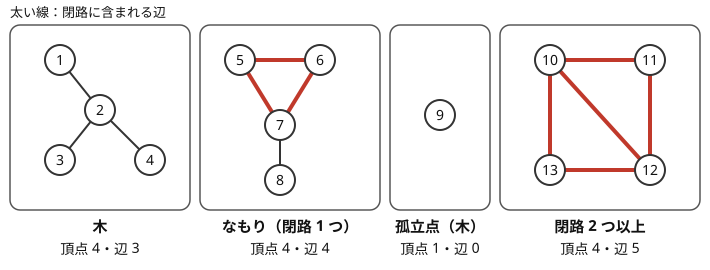

!!! abstract "要点"
    - **何ができるか**：無向グラフを互いに行き来できる頂点の集まりに分け、成分ごとに頂点数・辺数などを集計する。グラフが固定なら DFS・BFS、辺が増えていくなら Union-Find を使う。
    - **いつ使うか**：
        - つながっているか・グループの数・最大のグループの大きさを問われる。
        - 友達の友達は友達。
        - 成分ごとの頂点数と辺数の関係（木か・閉路がちょうど 1 つか）で条件が決まる。
        - 点 $(x, y)$ の集合で、同じ $x$・同じ $y$ を持つ点どうしが関係する。
    - **計算量**：DFS・BFS で $O(N + M)$。Union-Find ならならし $O((N + M) \alpha(N))$ で、実用上は線形と同じである。
    - **前提**：[深さ優先探索（DFS）](../graph/dfs.md)、[Union-Find](../ds/union-find.md)

<!-- textlint-disable -->
別名：連結成分分解・連結判定・connected components
<!-- textlint-enable -->

連結成分は、無向グラフで辺をたどって互いに行き来できる頂点を 1 つにまとめた集まりである。どの頂点もちょうど 1 つの成分に属し、成分どうしの間には辺がない。だから多くの問題は「成分ごとに答えを出して、足す・掛ける・最大を取る」に分かれる。成分を求めること自体は易しく、問題の本体は成分ごとに何を数えるかにある。

## DFS・BFS・Union-Find の 3 つの求め方と使い分け {#three-methods}

連結成分の求め方は 3 つあり、どれでも同じ分け方が得られる。違うのは、グラフがいつ与えられるかと、何を一緒に知りたいかである。

| 方法 | 向く場面 | 計算量 |
| --- | --- | --- |
| [DFS](../graph/dfs.md)・[BFS](../graph/bfs.md) | グラフが最初から全部与えられる。距離（BFS）や探索の順序も要る | $O(N + M)$ |
| [Union-Find](../ds/union-find.md) | 辺が順に増え、途中で「同じ成分か」を問われる | ならし $O(\alpha(N))$／回 |

探索で求めるときは、各頂点に成分の番号 $\mathrm{comp}[v]$ を付ける。$\mathrm{comp}$ を $-1$ で初期化して未訪問の印を兼ね、頂点を番号順に見て、未訪問の頂点 $s$ を見つけたら新しい番号 $c$ で $s$ から探索する。探索で届く頂点がちょうど $s$ の成分なので、全部に $c$ を付けて $c$ を 1 増やす。各頂点は一度だけ番号を付けられ、各辺は両端から 1 回ずつ見られるので、全体で $O(N + M)$ になる。

```cpp
--8<-- "connected-components/bfs-tally.cpp:core"
```

完全なプログラム：[`bfs-tally.cpp`](https://github.com/yuukougun/kyopro-atlas/blob/main/snippets/connected-components/bfs-tally.cpp)（GitHub）
{ .kp-code-src }

探索の始点を「未訪問の全頂点」にするのが要点である。頂点 0 から 1 回探索するだけでは、0 の成分しか分からない。「グラフ全体が連結か」だけなら、頂点 0 から 1 回探索して全頂点に届いたかを見ればよい。

Union-Find は隣接リストを作らずに辺を読みながら併合でき、最大の成分の大きさのような量なら短く書ける。一方で、成分の中の距離や経路は分からない。辺の追加と質問が交互に来るとき、質問のたびに探索し直すと $O(Q(N + M))$ かかるので、Union-Find を使う。削除があるときは [Union-Find で連結性を扱う](../graph/union-find-connectivity.md)の逆順の処理を使う。

!!! info "ACL では"
    `atcoder::dsu d(n);`。`d.merge(a, b)`・`d.same(a, b)`・`d.size(a)` はどれもならし $O(\alpha(N))$。`d.groups()` は成分ごとの頂点のリストを返すが、呼ぶたびに $O(N)$ かかる。

```cpp
--8<-- "connected-components/acl-dsu.cpp:core"
```

完全なプログラム：[`acl-dsu.cpp`](https://github.com/yuukougun/kyopro-atlas/blob/main/snippets/connected-components/acl-dsu.cpp)（GitHub）
{ .kp-code-src }

## 成分ごとの集計（頂点数と辺数で木・なもり・それ以外を見分ける） {#per-component}

成分を求めたら、成分の番号を添字にした配列で集計する。頂点数は、頂点を 1 つずつ見て $\mathrm{vcnt}[\mathrm{comp}[v]]$ に 1 を足す。辺数は、辺リストを 1 本ずつ見て $\mathrm{ecnt}[\mathrm{comp}[u]]$ に 1 を足す。辺の両端は同じ成分にあるので、どちらの端で数えてもよい。重みの和・色の種類・最小値なども同じ形で集められる。

集計で特によく使うのが、頂点数 $V$ と辺数 $E$ の関係である。次の図は 4 つの成分の $V$ と $E$ を並べたもので、太い線は閉路に含まれる辺である。



連結な成分は $E \ge V - 1$ を満たし、$E - (V - 1)$ で形が分かれる。

- $E = V - 1$：**木**である。[孤立点](../guide/glossary.md#isolated-vertex)（$V = 1$, $E = 0$）も木に数える
- $E = V$：閉路をちょうど 1 つ持つ（[なもりグラフ](../graph/namori-graph.md)）
- $E > V$：閉路を 2 つ以上持つ

理由は全域木で説明できる。連結な成分は、辺を選んで $V - 1$ 本の木（全域木）にできる。全域木に残りの辺を 1 本足すと、その両端を結ぶ木の上の道と合わせて閉路がちょうど 1 つできる。残りの辺が 0 本なら閉路はなく、1 本なら閉路は 1 つ、2 本以上なら閉路は 2 つ以上になる。

この判定には連結であることが要る。グラフ全体で $E = V$ でも、木の成分と閉路を 2 つ持つ成分が混ざっていることがある。「すべての成分で $E = V$ か」のように、成分ごとに確かめる。

??? question "確認問題：辺が 1 本多い成分"
    連結な成分で $E = V + 1$ のとき、閉路はちょうど 2 つあるか。

    ??? success "答え"
        2 つとは限らない。図の右下の成分（4 頂点の閉路に対角線を 1 本足したもの）は $E = V + 1$ だが、閉路は 3 つある（対角線で分かれた 2 つの三角形と、外周の四角形）。言えるのは「全域木の外の辺が 2 本ある」ことまでで、閉路の数そのものは形で変わる。だから見分けは「木・閉路 1 つ・それ以外」の 3 通りにしておく。

## 森の連結成分の数は N − M {#forest}

閉路を持たないグラフ（[森](../guide/glossary.md#forest)）では、連結成分の数が $N - M$ になる。探索しなくても、頂点数と辺数だけで成分の数が分かる。

理由は、辺のない $N$ 頂点から 1 本ずつ辺を足していくと分かる。最初は成分が $N$ 個ある。辺 $(u, v)$ を足すとき、$u$ と $v$ が別の成分なら 2 つが 1 つになり、成分は 1 減る。同じ成分なら、すでにある道と合わせて閉路ができる。森には閉路がないので、どの辺も成分を 1 減らし、最後は $N - M$ 個になる。各成分が木なので、頂点数 $V_i$ の成分は $V_i - 1$ 本の辺を持ち、足し合わせると $M = N - C$（$C$ は成分の数）になる、と見てもよい。

閉路があるグラフでは、同じ成分を結ぶ辺は成分を減らさないので、$C \ge N - M$ になる。等号から外れる分 $M - (N - C)$ が「閉路を作った辺」の本数で、閉路をなくすために取り除く辺の最小本数に等しい（[Union-Find の例題](../ds/union-find.md#abc288_c)）。

??? question "確認問題：森の成分の数"
    10 頂点 7 辺のグラフに閉路がないとき、連結成分はいくつか。また、同じ 10 頂点 7 辺で閉路が 1 つだけあるときはいくつか。

    ??? success "答え"
        閉路がなければ $10 - 7 = 3$ 個である。閉路が 1 つだけなら、閉路を作った辺が 1 本あるので、成分を減らした辺は 6 本で、$10 - 6 = 4$ 個になる。

## 座標や値を頂点にして成分を考える {#values-as-vertices}

この節は [グラフへの帰着](../graph/graph-modeling.md#what-to-vertex)を前提にする。「同じ $x$ 座標か同じ $y$ 座標を持つ点どうしがつながる」のような関係は、点を頂点にすると辺が $O(N^2)$ 本になりうる。同じ $x$ を持つ点が $N$ 個あれば、それだけで $N(N - 1)/2$ 本である。

そこで、点ではなく座標の値を頂点にする。$x$ 座標の値ごとに 1 頂点、$y$ 座標の値ごとに 1 頂点を用意し、点 $(x, y)$ を「$x$ の頂点と $y$ の頂点を結ぶ辺」とみなす。左に $x$、右に $y$ が並ぶ二部グラフになり、辺は $N$ 本で済む。2 つの点が同じ $x$・同じ $y$ のつながりをたどって行き来できることは、対応する 2 本の辺が同じ連結成分にあることと同じである。座標の値が大きいときは[座標圧縮](../basics/coordinate-compression.md)で番号を振る。$y$ の頂点の番号は、$x$ の頂点の数だけずらす。

この見方は、操作で点が増えていく問題で効く。たとえば「長方形の 3 隅に点があれば残りの 1 隅に点を足す」操作は、二部グラフでは「$x_1$–$y_1$、$x_1$–$y_2$、$x_2$–$y_1$ の辺があれば $x_2$–$y_2$ を足す」になる。これをくり返すと、各成分は同じ成分の $x$ と $y$ がすべて結ばれた[完全二部グラフ](../guide/glossary.md#complete-bipartite-graph)になり、成分の中の $x$ の数を $X_c$、$y$ の数を $Y_c$ とすると、最後の点の数は $\sum_c X_c Y_c$ である。操作は同じ成分の中でしか辺を足さないので、成分をまたいで点が増えることはない。

??? note "証明：各成分が完全二部グラフになる"
    同じ成分の $x$ の頂点と $y$ の頂点は、二部グラフなので長さが奇数の道で結ばれる。長さ 3 の道 $x$–$y'$–$x'$–$y$ があれば、操作で辺 $x$–$y$ が足される。長さ $2k + 1$（$k \ge 2$）の道は、先頭の 3 本に操作を使うと $x$ から道の 4 番目の頂点へ直接の辺ができ、長さ $2k - 1$ の道に縮む。くり返すと長さ 1、すなわち $x$–$y$ の辺になる。

値を頂点にする型はほかにもある。「同じ値を持つ位置どうしをつなぐ」なら、値ごとに 1 頂点（[超頂点](../guide/glossary.md#super-vertex)）を作り、各位置をその値の頂点に結べば辺は $N$ 本で済む。「値 $a$ を値 $b$ に一括で置き換える」操作を値どうしの辺とみなし、成分の大きさから必要な回数を数える型もある（[Union-Find の練習](../ds/union-find.md#practice)）。

## 落とし穴 {#pitfalls}

**孤立点を数え忘れる**。辺が 1 本もない頂点は、それだけで 1 つの成分である。辺リストに現れる頂点だけを集めて探索したり、`map` に辺の端点だけを入れたりすると、孤立点が成分の数から漏れる。頂点を $0$ から $N - 1$ まで全部見て、未訪問なら始点にする。Union-Find なら、成分の数は「$N$ − 併合に成功した回数」で、孤立点は自然に入る。ACL の `merge` は併合したかどうかを返さないので、`if (!d.same(a, b))` で数えてから併合する（最後に `d.groups().size()` を取ってもよい）。

**[多重辺](../guide/glossary.md#multi-edge)と[自己ループ](../guide/glossary.md#self-loop)で辺数を誤る**。連結かどうかには影響しないが、辺数を数える問題では入力の辺を 1 本ずつ数える。自己ループ $(v, v)$ は頂点 1 つ・辺 1 本の閉路、2 頂点の間の 2 本の辺は長さ 2 の閉路になり、どちらも $E = V$ 側に効く。次の 2 つの書き方は誤る。

- 隣接リストを `set` で作って重複を消す：多重辺が 1 本に減る
- 次数の和を 2 で割って辺数を出す：自己ループを隣接リストに 1 回しか入れないと、1 本が $1/2$ と数えられる（`g[u].push_back(v); g[v].push_back(u);` と両方入れれば 2 回入るので正しい）

辺リストから $\mathrm{ecnt}[\mathrm{comp}[u]]$ に足す書き方なら、どちらも起きない。自己ループや多重辺がありうるかは、制約の不等号（$u_i \le v_i$ と $u_i < v_i$ のどちら）や「単純グラフ」の語で確かめる。

**再帰の DFS が深くなる**。$N = 2 \times 10^5$ の一直線のグラフでは、再帰の深さが $N$ になる。手元の環境ではスタックがあふれて落ちることがある（[実行環境](../cpp/cpp-environment.md#stack-depth)）。連結成分を求めるだけなら探索の順序は何でもよいので、BFS か Union-Find にすれば深さを気にしなくてよい。

**有向の辺を片方向だけ入れる**。連結成分は無向グラフの概念である。問題が有向でも「向きを無視してつながっているか」を問うなら、両方向に辺を入れる。向きを守って互いに行き来できるかを問うなら、[強連結成分分解](../graph/scc.md)を使う。

## 上位の手法へのつながり {#next-steps}

- **辺の削除・しきい値の順に辺を足す**：削除を逆順の追加に直す、重みの小さい順に辺を足して質問に答える（[Union-Find で連結性を扱う](../graph/union-find-connectivity.md)）
- **成分に情報を持たせる**：成分ごとの最小値や上位 $K$ 個を、併合のたびに更新して持つ（[Union-Find の応用](../ds/union-find-applications.md)）
- **閉路が 1 つの成分**：$E = V$ の成分は閉路に木がぶら下がった形になり、閉路の部分と木の部分に分けて考える（[なもりグラフ](../graph/namori-graph.md)）。閉路そのものを取り出すなら[閉路の検出と復元](../graph/cycle-detection.md)
- **成分ごとに独立に数える**：成分どうしは影響しないので、2 色の塗り方（[二部グラフ](../graph/bipartite-graph.md)）や小さいグラフの塗り分け（[小さいグラフの全探索](../graph/small-graph-brute-force.md)）の数は、成分ごとの数の積になる
- **有向グラフ**：互いに行き来できる頂点の集まりは[強連結成分分解](../graph/scc.md)で求める
- **最小全域木**：重みの小さい順に、別の成分を結ぶ辺だけを採用する（[最小全域木](../graph/minimum-spanning-tree.md)）

## 例題 {#examples}

### ABC177 D. Friends {#abc177_d}

<div class="kp-problems" data-role="example" markdown>

- [ABC177 D. Friends](https://atcoder.jp/contests/abc177/tasks/abc177_d)（diff 732）：友達関係が与えられ、友達の友達も友達とみなすとき、どのグループにも友達どうしがいないように分けるのに必要なグループ数の最小値を求める。

</div>

人を頂点、友達関係を辺にすると、「友達の友達も友達」なので、同じ連結成分の人は全員が互いに友達である。同じ成分の人はすべて別のグループに入れる必要があるので、グループは最大の成分の大きさ以上要る。逆にその数だけグループがあれば、どの成分も人を 1 人ずつ別のグループに配れる。だから答えは最大の連結成分の大きさである。

??? note "解法の詳細"
    - 頂点番号は読んだらすぐに 1 を引いて 0-indexed にする。
    - Union-Find で全部の辺を併合し、全頂点 $v$ について $\mathrm{size}(v)$ の最大を取る。BFS で成分を求め、成分ごとの頂点数の最大を取ってもよい（[3 つの求め方](#three-methods)の 2 つのコード片のどちらでも出る）。
    - 友達関係が 1 つもなければ、どの成分も大きさ 1 で答えは 1 になる。孤立点を数え漏らすと、この場合に誤る。
    - 全体で $O(N + M)$（Union-Find ならならし $O((N + M) \alpha(N))$）。

## 練習問題 {#practice}

<div class="kp-problems" data-role="practice" markdown>

- [ABC284 C. Count Connected Components](https://atcoder.jp/contests/abc284/tasks/abc284_c)（diff 193）：単純無向グラフの連結成分の個数を求める。
- [ABC292 D. Unicyclic Components](https://atcoder.jp/contests/abc292/tasks/abc292_d)（diff 579）：無向グラフのすべての連結成分で、頂点数と辺数が等しいかを判定する。
- [ABC157 D. Friend Suggestions](https://atcoder.jp/contests/abc157/tasks/abc157_d)（diff 1208）：友達関係とブロック関係が与えられ、各人について、同じ成分にいて友達でもブロック相手でもない人の数を求める。

</div>

??? note "練習の方針"
    - **ABC284 C**：DFS・BFS で未訪問の頂点から探索を始めた回数を数えるか、Union-Find で辺をすべて併合して代表の数を数える（[3 つの求め方](#three-methods)）。
    - **ABC292 D**：成分ごとに頂点数と辺数を集計し、全成分で等しいかを見る。制約で自己ループがありうるので、辺は入力の 1 本ずつを数える（[成分ごとの集計](#per-component)）
    - **ABC157 D**：友達関係で成分を求める。人 $i$ の答えは「成分の大きさ − 1 − （友達と、同じ成分にいるブロック相手を合わせた人数）」である。友達は必ず同じ成分にいるので全員数え、ブロック相手は同じ成分のときだけ数える。同じ人を二度引かないよう、合わせた人数は重複を除いて数える

## 力試し {#challenge}

<div class="kp-problems" data-role="challenge" markdown>

- [ABC131 F. Must Be Rectangular!](https://atcoder.jp/contests/abc131/tasks/abc131_f)（diff 1937）：平面の点の集合に「長方形の 3 隅があれば残りの 1 隅を足す」操作をくり返すとき、できる操作の最大回数を求める。

</div>

??? note "力試しの方針"
    - **ABC131 F**：$x$ 座標と $y$ 座標を頂点、点を辺にした二部グラフの成分を求める。各成分は操作で完全二部グラフになるので、最後の点の数は成分ごとの（$x$ の数）×（$y$ の数）の和で、そこから元の点の数 $N$ を引いたものが操作の回数である（[座標や値を頂点にして成分を考える](#values-as-vertices)）。積と和は `long long` で計算する

## 参考 {#references}

- [けんちょん「AtCoder ABC 177 D - Friends」](https://drken1215.hatenablog.com/entry/2020/10/10/023200)：例題の方針（最大の連結成分の大きさが答えになる理由と、DFS・BFS・Union-Find の 3 通りの求め方）
- [kyo-pro「ABC292D - Unicyclic Components」](https://kyo-pro.hatenablog.com/entry/ABC292D)：練習の方針（成分ごとに頂点数と辺数を数える）
- [kazun「AtCoder Beginner Contest 292 D問題 Unicyclic Components」](https://kazun-kyopro.hatenablog.com/entry/ABC/292/D)：練習の方針と、制約で自己ループがありうること
- [けんちょん「AtCoder ABC 157 D - Friend Suggestions」](https://drken1215.hatenablog.com/entry/2020/03/02/022900)：練習の方針（成分の大きさから自分・友達・同じ成分のブロック相手を引く）
- [drken「AtCoder ABC 131 F - Must Be Rectangular! (青色, 600 点)」](https://drken1215.hatenablog.com/entry/2019/06/23/004700)：座標を頂点にした二部グラフと、各成分が完全二部グラフになる理由
- [AtCoder Library「DSU」（document_ja）](https://github.com/atcoder/ac-library/blob/master/document_ja/dsu.md)：`dsu` の操作と計算量（`groups()` は $O(N)$）
