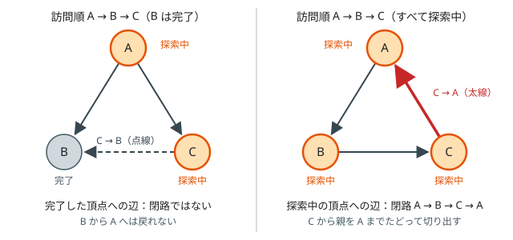

!!! abstract "要点"
    - **何ができるか**：グラフに閉路があるかを判定し、あれば 1 つ取り出す。無向グラフでは Union-Find か「来た辺以外で訪問済みの頂点への辺」、有向グラフでは「探索中の頂点への辺」（3 色の DFS）が閉路の印になり、DFS の親をたどれば閉路の頂点の列が得られる。シミュレーションの周期の検出とは別物である。
    - **いつ使うか**：
        - 循環している・依存関係が回っている・矛盾があれば −1。
        - 閉路を 1 つ見つけて出力せよ。
    - **計算量**：DFS・Kahn 法は $O(N + M)$。Union-Find で判定するならならし $O(M \alpha(N))$。
    - **前提**：[深さ優先探索（DFS）](../graph/dfs.md)、[Union-Find](../ds/union-find.md)

<!-- textlint-disable -->
別名：閉路検出・サイクル検出・有向閉路・無向閉路・3 色の DFS・cycle detection
<!-- textlint-enable -->

閉路の検出は、グラフの中に出発点へ戻ってくる道があるかを調べる処理である。無向と有向で「閉路の印」が違い、取り違えると誤答になる。DFS で見つけるなら、同じ探索のついでに親をたどって閉路そのものも取り出せる。このページでは頂点を 0-indexed で $0, \dots, N-1$、辺数を $M$ とする。

## 無向グラフ：Union-Find・親以外の訪問済みの頂点への辺（多重辺は辺の番号で除外） {#undirected}

無向グラフの閉路は、すでにつながっている 2 頂点を結ぶ辺ができた瞬間に生まれる。この見方から 2 つの判定方法が出てくる。

**Union-Find**：辺 $(u, v)$ を 1 本ずつ足し、足す前に $u$ と $v$ が同じ成分にあればその辺で閉路ができる。閉路があるかだけを知りたいとき、辺が順に増えていくときに向く。閉路を作る辺の本数は、成分の数を $C$ として $M - (N - C)$ 本である。併合に成功した辺は森を作り、森の辺は $N - C$ 本だからである。

**DFS**：DFS の木の辺以外で訪問済みの頂点に出会えば、その頂点は今の頂点の祖先で、木の経路と合わせて閉路になる。ここで「親へ戻る辺」を除く必要があるが、除くのは**来た辺そのもの**であって親の頂点ではない。頂点 $u, v$ を結ぶ辺が 2 本あれば、それだけで長さ 2 の閉路になる。親の頂点を丸ごと除くと、この閉路を見落とす。辺に番号を付け、隣接リストに（行き先, 辺の番号）を持たせて、来た辺の番号だけを飛ばす。

```cpp
--8<-- "cycle-detection/undirected.cpp:core"
```

[自己ループ](../guide/glossary.md#self-loop) $(v, v)$ はそれ自体が長さ 1 の閉路である。上のコードでは自分自身が探索中なので、そのまま閉路として見つかる。Union-Find でも $v$ と $v$ は同じ成分なので閉路として数えられる。

## 有向グラフ：3 色の DFS（探索中の頂点への辺だけが閉路） {#directed}

有向グラフでは「訪問済みの頂点への辺があれば閉路」は誤りである。DFS の各頂点を 3 つの状態で区別する。

- **未訪問**：まだ来ていない
- **探索中**：来たが、そこから出る辺をまだ調べ終えていない。今の再帰の経路（呼び出しスタック）の上にある頂点がちょうどこれである
- **完了**：そこから行ける頂点をすべて調べ終えた

辺 $v \to u$ で $u$ が探索中なら、$u$ から $v$ へは再帰の経路で行けるので、$u \to \dots \to v \to u$ が閉路になる。$u$ が完了なら閉路は作らない。頂点が完了するのは、出る辺の先がすべて完了したときだけである（先が未訪問なら先に探索して完了させ、探索中なら閉路として止まる）。だから完了した頂点から行ける頂点はすべて完了している。$v$ は探索中なので、完了した $u$ から $v$ へ戻る道はなく、辺 $v \to u$ は閉路を作らない。



図の左は、A から 2 通りの道で B に着くだけで、B から A へ戻る道はない。それでも 2 色（訪問済みかどうか）だけで判定すると、C→B を閉路と誤る。右では C→A の A が探索中なので、本当に閉路がある。

```cpp
--8<-- "cycle-detection/directed.cpp:core"
```

すべての頂点を始点に試すのは、頂点 0 から届かない所に閉路があるかもしれないからである。各頂点は 1 回だけ探索中になり、各辺は 1 回だけ調べるので $O(N + M)$ である。

??? question "確認問題：有向グラフに Union-Find を使う"
    有向グラフの辺の向きを無視して Union-Find で閉路を判定すると、何が起きるか。逆に、向きを無視してよいのはどんなグラフか。

    ??? success "答え"
        辺 A→B、A→C、C→B は、向きを無視すると三角形の閉路になるが、有向の閉路はない。Union-Find は「閉路がある」と誤答する。向きを無視してよいのは、たとえばどの頂点も出る辺・入る辺がそれぞれ高々 1 本のグラフである。このとき成分はパスか閉路だけで、閉路上の各頂点は入る辺と出る辺を 1 本ずつ使うので、向きがそろった有向の閉路になる。

## Kahn 法で残る頂点（すべてが閉路上とは限らない） {#kahn-leftover}

[トポロジカルソート](../graph/topological-sort.md)の Kahn 法（入次数 0 の頂点をキューから取り出し、その頂点から出る辺を消すことをくり返す）でも閉路があるかが分かる。取り出せなかった頂点が残れば閉路がある。閉路の頂点のうち最初に取り出されるものがあったとすると、その時点で閉路の 1 つ前の頂点はまだ残っているので、入次数は 0 でなく取り出せない。だから閉路の頂点は 1 つも取り出されない。逆に閉路がなければ、残った頂点の中に入次数 0 のものが必ずあり、最後まで取り出せる。

ただし、残った頂点がすべて閉路上とは限らない。辺 $0 \to 1 \to 2 \to 0$ と $2 \to 3$ のグラフでは、頂点 3 は閉路の上にないが、2 からの辺が消えないので残る。閉路から出た先の頂点はすべて残る。

- 残った頂点から閉路を 1 つ取り出すなら、残った頂点の中で辺を逆向きにたどる。どの頂点にも残った頂点から入る辺があるので、逆向きにはいつまでも進め、同じ頂点に 2 回来たところで閉路が切り出せる（[出次数 1 の節](#out-degree-one)と同じ要領）
- 出る辺を数えて行き止まりから剥がす向きでも同じことが言え、残った頂点は「閉路へ入っていく頂点」も含む
- 全頂点について閉路上にあるかを正確に知るには[強連結成分分解](../graph/scc.md)を使う。頂点が 2 個以上の成分、または自己ループを持つ頂点が閉路上にある

??? question "確認問題：両側から剥がす"
    入次数 0 の頂点を剥がし、さらに出次数 0 の頂点も剥がしたとき、残った頂点はすべて閉路上か。

    ??? success "答え"
        そうとは限らない。閉路 $0 \to 1 \to 0$ から頂点 2 へ辺があり、2 から別の閉路 $3 \to 4 \to 3$ へ辺があるとき、頂点 2 は入る辺も出る辺も消えずに残るが、どの閉路の上にもない。閉路上かどうかは強連結成分分解で決める。

## 閉路の復元（親をたどる） {#restore}

DFS で閉路を見つけた瞬間には、閉路の頂点はすべて再帰の経路の上にある。辺 $v \to u$（$u$ は探索中）を見つけたら、$v$ から親の配列 $\mathrm{par}$ を $u$ までたどって通った頂点を集める。それを逆順にすれば、$u$ から辺の向きに沿って並んだ閉路が得られる。無向グラフでも、来た辺以外の辺で探索中の頂点 $u$ と出会ったら、同じようにたどる。

```text
x = v
while x != u: 列に x を足す; x = par[x]
列に u を足す
列を逆順にする        // u → … → v の順になり、最後の v → u で閉じる
```

- 見つけたらすぐに再帰を打ち切る。続けると $\mathrm{par}$ が書き換わり、別の閉路と混ざる。コードでは見つけたら `true` を返し、呼び出し元もそのまま `true` を返している
- 親をたどるのは最大で閉路の長さ分なので、復元は $O(N)$ で済む
- 再帰の深さは最大で $N$ になる。$N = 2 \times 10^5$ 程度のパス状のグラフだと、手元の環境ではスタックの不足で落ちることがある（[C++ の実行環境](../cpp/cpp-environment.md#stack-depth)）

## 出次数 1 のグラフでは同じ頂点に 2 回来るまで進む {#out-degree-one}

どの頂点からも辺がちょうど 1 本出るグラフ（[Functional graph](../graph/functional-graph.md)）では、DFS の分岐がないので、1 本道をたどるだけで閉路が見つかる。頂点は $N$ 個しかないので、どこから出発しても $N$ 歩以内に同じ頂点を 2 回訪れる。その頂点を $x$ とすると、1 回目に $x$ を訪れてから 2 回目に訪れるまでにたどった部分が閉路である。

```text
step[v] = -1（すべての v）、x = 始点、t = 0
while step[x] == -1: step[x] = t; 列に x を足す; x = nxt[x]; t += 1
列のうち step[x] 番目から後ろが閉路
```

訪問の印を使わない書き方もある。始点から $N$ 歩進んだ頂点は必ず閉路の上にある。閉路に入るまでの道（しっぽ）の長さは $N$ 未満だからである。その頂点から自分に戻るまで進めば、閉路を一周分だけ集められる。

このグラフでは、各成分に閉路がちょうど 1 つある。入次数 0 の頂点から剥がしていくと、残る頂点はちょうど閉路上の頂点になる。剥がしても出る辺の行き先は残るので、残った頂点はどれも出次数 1・入次数 1 以上で、入次数の合計と出次数の合計が等しいことから入次数もちょうど 1 になるからである。[Kahn 法の節](#kahn-leftover)の一般のグラフとは、ここが違う。

## シミュレーションの周期の検出（基本テクニックの章）との違い {#vs-periodicity}

[周期性の検出](../basics/periodicity.md)も「同じ状態に 2 回来たら繰り返す」を使うので、出次数 1 のグラフの閉路と同じ形をしている。違いは次の 2 点である。

| | 閉路の検出 | 周期の検出 |
| --- | --- | --- |
| グラフ | 入力で与えられ、頂点から辺が何本も出てよい | 状態と「次の状態」の関数で決まり、出る辺は 1 本 |
| 知りたいこと | 閉路があるか、どこにあるか | 決まった始点から $K$ 回後の状態や途中の和 |

周期の検出では、グラフ全体を作らず、始点から実際にたどった状態だけを記録する。状態の種類が多くても、たどった分だけで済む。閉路の検出は分岐のあるグラフ全体を調べるので、3 色の DFS や Kahn 法が要る。出次数 1 のグラフで「どこから始めても閉路に入る」という事実は両方に共通で、周期の検出の尾と周期（[ρ 型](../basics/periodicity.md#rho)）は、ここでのしっぽと閉路にあたる。

## 落とし穴 {#pitfalls}

**有向グラフで訪問済みの印だけを見る**。完了した頂点への辺まで閉路と判定し、閉路のないグラフで「ある」と答える（[有向グラフの節](#directed)の図の左）。探索中と完了を区別する。

**無向グラフで親の頂点を除外する**。[多重辺](../guide/glossary.md#multi-edge)がある問題で長さ 2 の閉路を見落とす。辺の番号で、来た辺だけを除く。単純グラフ（多重辺と自己ループがない）と明記されていれば、頂点で除いてもよい。

**始点を 1 つしか試さない**。グラフが連結とは限らない。未訪問の頂点すべてから DFS を始める。

**状態の配列を探索ごとに初期化する**。始点ごとに色を未訪問に戻すと、同じ頂点を何度も調べて $O(N(N + M))$ になる。完了した頂点はほかの始点からたどり着いても閉路を作らないので、色は全体で 1 回だけ初期化する。

**文字列や大きな値を頂点にしたまま扱う**。名前や座標を頂点にするときは、先に `map` などで $0, \dots, K-1$ の番号に直してから配列で探索する。

!!! info "ACL では"
    - 無向グラフの判定は `dsu d(n);` で、辺 $(u, v)$ ごとに `d.same(u, v)` なら閉路、そうでなければ `d.merge(u, v)`。どちらもならし $O(\alpha(N))$。
    - 有向グラフは `scc_graph g(n);`・`g.add_edge(from, to);`・`g.scc()` で強連結成分（頂点のリストのリスト）が $O(N + M)$ で得られる。頂点が 2 個以上の成分の頂点は閉路上にある。自己ループは成分の大きさに表れないので、別に調べる。閉路の頂点の順番は得られないので、復元は DFS で行う。

## 使い分け {#comparison}

- 無向グラフで、あるかだけ・辺が増えていく：Union-Find。どの辺が閉路の上にないか（橋）を知りたいなら [lowlink](../graph/lowlink.md#conditions)
- 無向グラフで、閉路を取り出す：辺の番号を持った DFS
- 有向グラフで、あるかだけ：Kahn 法（ついでにトポロジカル順も得られる）か 3 色の DFS
- 有向グラフで、閉路を取り出す：3 色の DFS
- 有向グラフで、全頂点について閉路上かを知る：強連結成分分解
- 連結で頂点数と辺数が等しい無向グラフ（閉路がちょうど 1 つ）：[なもりグラフ](../graph/namori-graph.md)。次数 1 の頂点から剥がすと閉路が残る

## 例題 {#examples}

### ABC285 D. Change Usernames {#abc285_d}

<div class="kp-problems" data-role="example" markdown>

- [ABC285 D. Change Usernames](https://atcoder.jp/contests/abc285/tasks/abc285_d)（diff 663）：ユーザー名の変更依頼がいくつか与えられ、同じ名前の人が同時に 2 人いないように、すべての変更を順に行えるかを判定する

</div>

名前を頂点、変更依頼「$S$ を $T$ に変える」を辺 $S \to T$ にした有向グラフを考える。閉路があれば不可能である。閉路の上では、どの人の変更先も閉路の次の人が今使っている名前なので、誰も最初に変えられない。閉路がなければ、変更先の名前を今使っている人がいない人から順に変えていけばよい。変更前の名前どうし・変更後の名前どうしはそれぞれ相異なるので、各名前から出る辺・入る辺は高々 1 本である。閉路がなければグラフはパスの集まりになり、各パスを終点の側から変えていけば、変更先の名前はいつも空いている。だから答えは「閉路がないか」と同じになり、3 色の DFS か Kahn 法で判定できる。

??? note "解法の詳細"
    - 名前は文字列なので、`map<string, int>` で出てきた順に番号を振り、頂点数は最大 $2N$ にする。
    - 辺 $S_i \to T_i$ を張り、[有向グラフの節](#directed)の 3 色の DFS を全頂点から行う。閉路が見つかれば No、見つからなければ Yes。Kahn 法で全頂点を取り出せたかで判定してもよい。
    - 計算量は名前の番号付けを含めて $O(N \log N)$（文字列の比較の長さは除く）。
    - 第三者の解説には、無向の Union-Find で「両端がすでに同じ成分なら No」と判定するものもある。変更前の名前どうし・変更後の名前どうしはそれぞれ相異なるので、各名前から出る辺・入る辺は高々 1 本である。このとき[確認問題](#directed)のとおり、向きを無視した Union-Find で判定しても正しい。

## 練習問題 {#practice}

<div class="kp-problems" data-role="practice" markdown>

- [ABC288 C. Don’t be cycle](https://atcoder.jp/contests/abc288/tasks/abc288_c)（diff 436）：単純無向グラフから辺を取り除いて閉路をなくすとき、取り除く辺の最小本数を求める。
- [ABC311 C. Find it!](https://atcoder.jp/contests/abc311/tasks/abc311_c)（diff 448）：各頂点から辺がちょうど 1 本出る有向グラフで、有向閉路を 1 つ見つけて出力する

</div>

??? note "練習の方針"
    - **ABC288 C**：辺を順に Union-Find に足し、両端がすでに同じ成分なら数える。その数が答えで、$M - (N - C)$（$C$ は成分の数）とも書ける
    - **ABC311 C**：どの頂点から始めても、辺をたどれば同じ頂点に 2 回来る。2 回目に来た頂点から一周分を出力する。1-indexed に直すのを忘れない

## 力試し {#challenge}

<div class="kp-problems" data-role="challenge" markdown>

- [ABC456 E. Endless Holidays](https://atcoder.jp/contests/abc456/tasks/abc456_e)（diff 1214）：都市ごとに曜日による休日が決まっているとき、毎日道路で移動するかとどまるかを選んで、休日の都市にいる状態をいつまでも続けられるかを判定する。

</div>

??? note "力試しの方針"
    - **ABC456 E**：（都市, 曜日）の組を頂点にし、休日どうしを翌日の曜日へ結ぶ辺（とどまる辺も含む）を張る。有限のグラフでいつまでも歩き続けられることは、閉路があることと同じである。行き止まりから剥がしていき、頂点が残れば続けられる

## 参考 {#references}

- [kyo-pro「ABC285D - Change Usernames」](https://kyo-pro.hatenablog.com/entry/ABC285D)：例題の方針（名前を頂点にした閉路の判定と、Union-Find による判定）
- [kazun「AtCoder Beginner Contest 285 D問題 Change Usernames」](https://kazun-kyopro.hatenablog.com/entry/ABC/285/D)：例題の制約（変更前の名前どうし・変更後の名前どうしが相異なること）
- [dokaraya「ABC285-D: Change Usernames 解説」](https://zenn.dev/dokaraya/articles/atcoder-abc285d)：例題を 3 状態の DFS で解く方針
- [プロひろ「ABC285 D問題（Change Usernames）を解く」](https://programming-hiroba.com/abc285-d/)：例題を探索中・完了の 2 つの印で解く方針
- [kyo-pro「ABC288C - Don’t be cycle」](https://kyo-pro.hatenablog.com/entry/2023/02/04/224004)：練習の方針（Union-Find で閉路を作る辺を数える）
- [drken「AtCoder ABC 311 C - Find it! (3Q, 茶色, 350 点)」](https://drken1215.hatenablog.com/entry/2023/07/24/030543)：練習の方針（$N$ 歩進めば閉路の上にいること）
- [ikatakos「AtCoder Beginner Contest 456（Promotion of AtCoder Career Design DAY）E,F,G問題メモ」](https://ikatakos.com/pot/programming_algorithm/contest_history/atcoder/2026/0502_abc456)：力試しの方針（都市と曜日の組を頂点にし、行き止まりから剥がす。解法の部分だけを参照）
- [AtCoder Library「SCC」（document_ja）](https://github.com/atcoder/ac-library/blob/master/document_ja/scc.md)：`scc_graph` の宣言と計算量
- [AtCoder Library「DSU」（document_ja）](https://github.com/atcoder/ac-library/blob/master/document_ja/dsu.md)：`dsu` の宣言と計算量
- [Library Checker の問題一覧](https://github.com/yosupo06/library-checker-problems)：自作の確認先（cycle_detection・cycle_detection_undirected）
