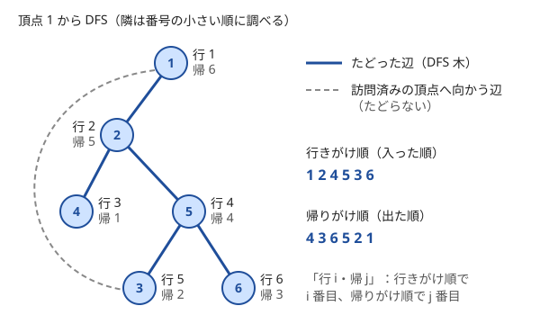

!!! abstract "要点"
    - **何ができるか**：行けるところまで進んでから戻る探索で、到達可能性・連結成分・閉路検出・トポロジカル順の土台になる。帰りがけで訪問の印を外せば単純パスを全列挙できる。
    - **いつ使うか**：
        - すべての単純パス・経路を数える（答えが上限を超えたら打ち切ってよい）。
        - 依存関係をたどり、必要なものを先に済ませる順に出力する。
        - $N \le 10$ 程度で、経路を全部列挙できる。
    - **計算量**：一度訪れた頂点を二度と訪れない型は $O(N + M)$。印を外すバックトラック型は列挙する単純パスの数に比例し、指数時間になりうる（上限で打ち切るなら「上限 × 最大次数」）。
    - **前提**：[グラフの表現と用語](../graph/graph-basics.md)

<!-- textlint-disable -->
別名：深さ優先探索・DFS・depth-first search・単純パスの列挙
<!-- textlint-enable -->

深さ優先探索（DFS）は、今いる頂点からまだ行っていない隣へ進み、進めなくなったら 1 つ前の頂点へ戻って別の隣を試す探索である。書き方はほぼ再帰関数 1 つで決まるが、訪問の印を「付けたままにする」か「帰りがけで外す」かで、$O(N + M)$ の探索にも指数時間の全列挙にもなる。どちらの型を書いているのかを意識することが、DFS を使いこなす要点である。

## 一度訪れた頂点は二度と訪れない型（O(N+M)） {#visit-once}

到達可能性・連結成分・閉路検出など、「どの頂点に届くか」だけが問題になるときは、頂点に入った時点で印を付け、二度と外さない。次のコードは、無向グラフの連結成分を数えながら、頂点 0 を含む成分の大きさも求める（頂点は 0-indexed）。

```cpp
--8<-- "dfs/components.cpp:core"
```

再帰するラムダは、自分を引数 `self` で受け取って呼ぶ（理由は[落とし穴](#pitfalls)と[ラムダが再帰できない理由](../cpp/cpp-lambda.md#recursive-lambda)）。

- **なぜ $O(N + M)$ か**：印が付くのは各頂点 1 回なので、`dfs` は各頂点で 1 回しか呼ばれない。呼ばれた頂点 $v$ では隣接リストを 1 周するので、調べる辺の合計は次数の和に等しく、無向グラフなら $2M$（有向グラフなら $M$）である
- **なぜ届く頂点をすべて訪れるか**：始点から届くのに、印のない頂点が残ったとする。始点からの経路上で、印のない最初の頂点を $w$、その直前の頂点を $u$ とする。$u$ には印があるので `dfs(u)` は呼ばれており、隣の $w$ も調べたはずである。そのとき $w$ に印がなければ `dfs(w)` を呼ぶので矛盾する
- **全頂点から始める**：グラフが連結とは限らないので、印のない頂点を始点にして `dfs` を呼び直す。呼び直した回数が[連結成分](../graph/connected-components.md)の個数になる

この型では、頂点を訪れる順は辺の並びで変わるが、届く頂点の集合は変わらない。最短距離は求まらない（[BFS・Union-Find との使い分け](#comparison)）。

## バックトラック型（帰りがけで印を外す） {#backtracking}

「頂点 1 から始まる単純パスをすべて数える」「同じマスを 2 回通らない長さ $K$ の経路を数える」のように、経路そのものを列挙するときは、行きがけで印を付け、帰りがけで印を外す。このときの印は「訪問済み」ではなく「いまの経路に載っている」という意味である。経路を戻れば、その頂点は別の経路でまた通ってよい。

```cpp
--8<-- "dfs/simple-paths.cpp:core"
```

- **対応**：`dfs(v)` の呼び出し 1 回が、始点から $v$ までの単純パス 1 本にちょうど対応する。呼び出しの入れ子が経路の形そのものなので、同じパスを二度数えることも、数え漏らすこともない
- **計算量**：呼び出しの回数は単純パスの数で、完全グラフなら始点 1 つあたり約 $e \cdot (N-1)!$ 本（$N = 10$ で約 $10^6$）まで増える。$N \le 10$ 程度か、マス目が小さく 1 歩ごとの分かれ方が少ないときだけ使える。長さ $K$ の経路をマス目で数えるなら、1 歩目は 4 方向、2 歩目からは来た方向を除く 3 方向なので、始点 1 つあたり $4 \cdot 3^{K-1}$ 本以下である
- **上限での打ち切り**：「答えが $10^6$ を超えたら $10^6$ を出力」という指定があれば、数えた本数が上限に達した時点で全部の呼び出しを打ち切る。数える呼び出しは上限の回数までで、1 回あたり隣接リストを 1 周するので、全体は「上限 × 最大次数」で抑えられる

2 つの型を取り違えるバグはよく起きる。一度だけ訪れる型のつもりで印を外すと、同じ頂点を経路の数だけ訪れて指数時間になる。バックトラック型のつもりで印を外し忘れると、先に通った経路で印の付いた頂点へ別の経路から入れず、数え漏れる。

??? question "確認問題：印を外し忘れると"
    4 頂点の閉路（辺 1-2、2-3、3-4、4-1）で、頂点 1 から始まる単純パス（1 頂点だけのものも含む）を数える。帰りがけで印を外さないと、いくつと数えるか。正しい答えはいくつか。

    ??? success "答え"
        印を外さないと、1 → 2 → 3 → 4 と進んだ時点で全頂点に印が付き、戻った後に 4 → 3 → 2 の側へ進めない。数えるのは 1 頂点・1-2・1-2-3・1-2-3-4 の 4 本である。4 の側から先に調べても、一方へ進み切った時点で全頂点に印が付くので、やはり 4 本である。正しくは逆回りの 1-4・1-4-3・1-4-3-2 を足した 7 本である。

## 行きがけ順と帰りがけ順 {#pre-post-order}

再帰の中で処理を書く位置は 2 つある。子を調べる前（行きがけ）と、子をすべて調べ終えた後（帰りがけ）である。頂点を行きがけで並べた順を行きがけ順、帰りがけで並べた順を帰りがけ順という。次の図は、6 頂点の無向グラフを頂点 1 から探索したときの 2 つの順である。



たどった辺だけを残すと、始点を根とする木になる。この木を [DFS 木](../guide/glossary.md#dfs-tree)という。図では頂点 2 の子が 4 と 5、頂点 5 の子が 3 と 6 である。

```cpp
--8<-- "dfs/order.cpp:core"
```

2 つの順は、それぞれ次の性質を持つ。

- **行きがけ順**：DFS 木の各頂点の部分木は、行きがけ順で連続した区間になる。図では頂点 5 の部分木 $\{5, 3, 6\}$ が、行きがけ順 1 2 4 **5 3 6** の後ろ 3 つに並ぶ。$v$ に入ってから出るまでの間に入る頂点が、ちょうど $v$ の子孫だからである。部分木の集計を区間の集計に直す[オイラーツアー](../tree/euler-tour.md)は、この性質を使う
- **帰りがけ順**：頂点 $v$ が帰りがけ順に並ぶのは、$v$ の子孫がすべて並んだ後である。有向グラフで閉路がなければ、$v$ から辺で行ける頂点はすべて $v$ より前に並ぶ。だから「$v$ の前に $v$ が依存するものを済ませる」順がそのまま得られ、逆に読めば[トポロジカルソート](../graph/topological-sort.md)の順になる

帰りがけ順の性質には、閉路のないことが要る。理由は次のとおりである。$v$ を調べているとき、辺の先 $w$ がすでに印付きなら、$w$ は「出た後」か「まだ出ていない」かのどちらかである。まだ出ていない頂点は、始点から $v$ までの再帰の途中にいる祖先なので、$v \to w$ の辺で閉路ができる。閉路がなければ $w$ は必ず出た後で、$v$ より前に並んでいる。有向グラフの閉路の検出では、この「まだ出ていない頂点へ向かう辺」を探す（[閉路の検出と復元](../graph/cycle-detection.md)）。

??? question "確認問題：行きがけ順で部分木が区間になる"
    図のグラフで、頂点 2 の部分木は行きがけ順のどの区間に並ぶか。また、頂点 2 から出るのは帰りがけ順で何番目か。

    ??? success "答え"
        頂点 2 の部分木は $\{2, 4, 5, 3, 6\}$ で、行きがけ順 1 **2 4 5 3 6** の 2 番目から 6 番目に連続して並ぶ。頂点 2 が帰りがけ順に並ぶのは子孫 4・3・6・5 の後なので、5 番目である。

## 非再帰の DFS と再帰の深さ {#iterative}

再帰の深さは、DFS 木の根から最も深い頂点までの頂点数になる。グラフが一本道なら深さは $N$ で、$N$ が $10^5$ を超えると手元の環境ではスタックがあふれて落ちることがある。AtCoder ではスタックの上限が大きく、再帰のままで通ることが多い。手元で落ちるならスタックの上限を広げるか（[AtCoder と手元の C++ 環境](../cpp/cpp-environment.md#stack-depth)）、再帰を使わない形に書き直す。

非再帰で書くときは、「$v$ に入る」と「$v$ から出る」の 2 種類の予定をスタックに積む。出る予定は `~v`（負の数）で表し、子より先に積む。スタックは後に積んだものから取り出すので、出る予定が取り出されるのは子の処理がすべて終わった後になる。

```cpp
--8<-- "dfs/order.cpp:iterative"
```

- **印は取り出したときに確かめる**：同じ頂点は複数回積まれうるので、取り出した時点で印付きなら飛ばす。積んだ時点で印を付けると訪れる順が再帰と変わり、帰りがけ順が正しくならない
- **隣は逆順に積む**：スタックからは最後に積んだものから出てくる。逆順に積めば、再帰と同じ順で隣を調べる。届く頂点を数えるだけなら順はどうでもよい
- **スタックの大きさ**：同じ頂点が何度も積まれるので、スタックの要素数は $O(M)$ になる。時間は $O(N + M)$ のままである

帰りがけの処理が要らず、届く頂点を数えるだけなら、スタックの代わりにキューを使っても同じ結果になる（[幅優先探索](../graph/bfs.md)）。

## 上位の手法へのつながり {#next-steps}

DFS は多くの手法で、行きがけ順・帰りがけ順・DFS 木の性質を部品として使う。

- **トポロジカルソート・DAG 上の DP**：帰りがけ順の逆がトポロジカル順になる。帰りがけで子の値から自分の値を決めれば、そのまま[DAG 上の DP](../dp/dp-dag.md) になる（メモ化再帰）
- **閉路の検出**：有向グラフで「入ったがまだ出ていない」頂点へ向かう辺を見つける（[閉路の検出と復元](../graph/cycle-detection.md)）
- **強連結成分分解・橋と関節点**：各頂点の行きがけ番号と、その頂点の部分木から DFS 木以外の辺を 1 本使って戻れる行きがけ番号の最小値（lowlink）を比べる（[強連結成分分解](../graph/scc.md)・[橋・関節点・二重連結成分](../graph/lowlink.md#ord-low)）
- **木の走査**：木では閉路がないので、親を引数で渡せば印の配列が要らない（[根付き木と走査順](../tree/tree-traversal.md)）。行きがけ順で部分木が区間になる性質は[オイラーツアー](../tree/euler-tour.md)で使う
- **全列挙**：バックトラック型は、選択を 1 つずつ決める[再帰による全列挙](../basics/recursive-enumeration.md)の、グラフの上での形である

## 落とし穴 {#pitfalls}

**印を外すか外さないかの取り違え**。到達や連結を調べるのに印を外すと指数時間になり、経路を数えるのに印を外さないと数え漏れる。書く前に「印の意味は訪問済みか、いまの経路上か」を決める。

**グリッドで番兵か範囲外の判定を忘れる**。マス目を DFS するとき、隣のマスが盤面の外かを先に判定しないと配列の外を読む。外周を壁で囲めば判定が要らなくなる（[グリッドグラフ](../graph/grid-graph.md)）。

**無向グラフで辺を片方向しか入れない**。入力の辺 $(u, v)$ を `g[u]` にだけ入れると、$v$ から $u$ へ戻れず、届く頂点を取りこぼす。無向なら両方に入れる。

**再帰のラムダの書き方**。`auto dfs = [&](int v) { … dfs(to); };` はコンパイルできない。自分を引数で受け取り、`dfs(dfs, 0)` と呼ぶ（[ラムダが再帰できない理由](../cpp/cpp-lambda.md#recursive-lambda)）。

**再帰の中で大きな配列を作る**。関数の中で `vector` を作ってコピーすると、呼び出しのたびに $O(N)$ かかる。バックトラック型では経路を表す配列を 1 つだけ外に置き、行きがけで足して帰りがけで戻す。

## 使い分け {#comparison}

- **最短距離・最小の手数が要る**：[幅優先探索](../graph/bfs.md)を使う。DFS が最初に見つけた経路は最短とは限らない
- **辺が増えていく中で連結かを何度も聞かれる**：[Union-Find](../ds/union-find.md) を使う。DFS で毎回調べ直すと $O(Q(N + M))$ かかる
- **帰りがけの処理が要る**（トポロジカル順・部分木の集計・閉路の検出）：DFS を使う
- **届くかどうかだけ**：DFS・BFS・Union-Find のどれでもよい。書き慣れたものを使う

## 例題 {#examples}

### ABC315 E. Prerequisites {#abc315_e}

<div class="kp-problems" data-role="example" markdown>

- [ABC315 E. Prerequisites](https://atcoder.jp/contests/abc315/tasks/abc315_e)（diff 921）：本 i を読むには指定された本を先に読む必要があるとき、本 1 を読むために読む本を、読む順に出力する

</div>

本 $i$ から、$i$ を読む前に要る本へ辺を張った有向グラフを考える。本 1 を読むのに要る本は、本 1 から辺をたどって届く頂点そのものである。届く頂点を「要る本が先に来る順」に並べればよく、これは本 1 から DFS した帰りがけ順である。

??? note "解法の詳細"
    - 隣接リスト：本 $i$ の行に書かれた本 $P_{i,j}$ へ、$i \to P_{i,j}$ の辺を張る。
    - 本 1 から一度だけ訪れる型の DFS をし、帰りがけで頂点を記録する。頂点 $v$ が記録されるのは、$v$ から届く本がすべて記録された後である（すべての本を読める設定なので、依存に閉路はない）。
    - 記録の最後は本 1 なので、それを除いて順に出力する。全体で $O(N + \sum C_i)$。
    - 依存が一本道に長くつながると再帰が深くなる。手元で落ちるなら[非再帰の形](#iterative)にする。

## 練習問題 {#practice}

<div class="kp-problems" data-role="practice" markdown>

- [ABC378 D. Count Simple Paths](https://atcoder.jp/contests/abc378/tasks/abc378_d)（diff 587）：障害物のあるグリッドで、同じマスを 2 回通らない長さ K の移動経路の数を求める
- [ABC284 E. Count Simple Paths](https://atcoder.jp/contests/abc284/tasks/abc284_e)（diff 1043）：頂点 1 から始まる単純パスの数を、10^6 を上限として求める
- [典型90 072. Loop Railway Plan（★4）](https://atcoder.jp/contests/typical90/tasks/typical90_bt)（diff —）：小さいグリッドで、山のマスを避けて同じマスを通らずに戻ってくる最長の経路を求める

</div>

??? note "練習の方針"
    - **ABC378 D**：空きマスのそれぞれを始点とし、バックトラック型の DFS で $K$ 歩進んだ経路を数える。経路は始点 1 つあたり $4 \cdot 3^{K-1}$ 本以下なので、全マスから始めても間に合う
    - **ABC284 E**：頂点 1 からバックトラック型の DFS をし、呼び出しのたびに 1 本数える。$10^6$ に達したら打ち切る。各頂点の次数が 10 以下なので、隣を調べる回数は合わせて $10^7$ 程度に収まる
    - **典型90 072**：マスは 16 個以下なので、全マスを始点としてバックトラック型の DFS をする。隣が始点のときは、印があっても進んで経路の長さを記録する。同じ辺の往復（長さ 2）は閉路に数えない

## 参考 {#references}

- [kyo-pro「ABC315E - Prerequisites」](https://kyo-pro.hatenablog.com/entry/ABC315E)：例題の帰りがけ順による解法と、「入る」「出る」をスタックに積む非再帰の書き方
- [プロひろ「ABC315 E問題（Prerequisites）を解く」](https://programming-hiroba.com/abc315-e/)：例題の帰りがけ順の別の説明と、再帰が深くなること
- [drken「AtCoder ABC 378 D - Count Simple Paths (2Q, 茶色, 425 点)」](https://drken1215.hatenablog.com/entry/2024/11/03/235041)：練習の方針（始点ごとのバックトラック）
- [kyo-pro「ABC284E - Count Simple Paths」](https://kyo-pro.hatenablog.com/entry/ABC284E)：練習の方針（行きがけで印を付け、帰りがけで外す）
- [プロひろ「ABC284 E問題（Count Simple Paths）を解く」](https://programming-hiroba.com/abc284-e/)：上限での打ち切りと、次数の制約による計算量の見積もり
- [E869120「競プロ典型 90 問 072 の解答例」](https://github.com/E869120/kyopro_educational_90/blob/main/sol/072.cpp)：練習の方針（始点に戻ったときの扱いと、長さ 2 を除くこと）
