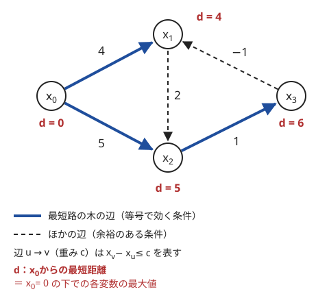

!!! abstract "要点"
    - **何ができるか**：$x_v - x_u \le c$ の形の条件を辺 $u \to v$（重み $c$）と読み、始点からの最短距離で全条件を満たす最大の解を求める。[負閉路](../guide/glossary.md#negative-cycle)があれば解はなく、区間の和の条件は累積和の差に直せる。
    - **いつ使うか**：
        - $x_j - x_i \le c$ の形の条件の下で、ある変数を最大化（最小化）する。
        - 区間の和が $S$ 以上・以下という条件が並ぶ。
        - 位置の差の情報が矛盾しないか。
        - 条件を整理すると $x_v \le x_u + c$ の形の不等式の集まりになる。
    - **計算量**：変数 $N$ 個・条件 $M$ 個で、一般には $O(NM)$（ベルマンフォード法）。重みがすべて非負なら $O((N + M) \log N)$（ダイクストラ法）。
    - **前提**：[ベルマンフォード法](../graph/bellman-ford.md)、[累積和](../basics/prefix-sum.md)

<!-- textlint-disable -->
別名：牛ゲー・差分制約系・不等式を辺にする・difference constraints
<!-- textlint-enable -->

差分制約（牛ゲー）は、2 つの変数の差に上限を付ける不等式の集まりを、重み付き有向グラフの最短路に置き換える方法である。最短路の三角不等式 $\mathrm{dist}[v] \le \mathrm{dist}[u] + c$ が条件 $x_v \le x_u + c$ と同じ形をしていることを使う。区間の和や列の単調性の条件も、累積和を変数にすれば差の条件になるので、列を構成する問題に広く使える。

## 不等式を辺にする向き {#direction}

条件 $x_v - x_u \le c$ は、移項すると $x_v \le x_u + c$ になる。これは「$u$ の値に $c$ を足した値を $v$ は超えない」と読める。最短路の[緩和](../guide/glossary.md#relaxation) $\mathrm{dist}[v] \leftarrow \min(\mathrm{dist}[v], \mathrm{dist}[u] + c)$ と同じ形である。そこで、条件 1 つを **頂点 $u$ から頂点 $v$ への重み $c$ の辺** にする。

向きは「右辺の $x_u + c$ の側から、左辺で上から抑えられる $x_v$ の側へ」と覚える。辺は $u$ から出て $v$ に入る。

例として、変数 $x_0, x_1, x_2, x_3$ に次の 5 つの条件があるとする。

| 条件 | 辺 | 重み |
| --- | --- | --- |
| $x_1 - x_0 \le 4$ | $0 \to 1$ | $4$ |
| $x_2 - x_0 \le 5$ | $0 \to 2$ | $5$ |
| $x_2 - x_1 \le 2$ | $1 \to 2$ | $2$ |
| $x_3 - x_2 \le 1$ | $2 \to 3$ | $1$ |
| $x_1 - x_3 \le -1$ | $3 \to 1$ | $-1$ |

この 5 本の辺のグラフで、頂点 0 から最短距離 $d$ を求めると次の図のようになる。



$x = d = (0, 4, 5, 6)$ を代入すると、5 つの条件はすべて成り立つ。最短路の木の辺（太線）に当たる条件は等号で成り立ち、ほかの条件には余裕がある（$x_2 - x_1 = 1 \le 2$、$x_1 - x_3 = -2 \le -1$）。そして $x_0 = 0$ のとき、$x_3$ は 6 より大きくできない。$x_3 \le x_2 + 1 \le x_0 + 5 + 1 = 6$ と、最短路 $0 \to 2 \to 3$ に沿って条件をたどれば上限が出るからである。

## 最短距離が最大の解になる理由 {#why-maximum}

始点 $s$ を決め、$x_s = 0$ として考える。$s$ からすべての頂点に届き、負閉路がないとき、最短距離 $d$ について次の 2 つが成り立つ。

1. **$d$ は解である**：最短距離が求まった後は、どの辺 $u \to v$ でもそれ以上緩和できないので $d_v \le d_u + c$ が成り立つ。これは条件そのものである
2. **どの解も $d$ を超えない**：条件を満たす任意の $x$（$x_s = 0$）と、$s$ から $v$ への道 $s = v_0 \to v_1 \to \dots \to v_k = v$ をとる。道の各辺の条件 $x_{v_{i+1}} - x_{v_i} \le c_i$ を足すと、途中の変数が打ち消し合って $x_v - x_s \le c_0 + \dots + c_{k-1}$ になる。右辺は道の長さなので、最短の道を選べば $x_v \le d_v$ である

2 つを合わせると、$d$ は条件を満たし、しかも **すべての変数を同時に最大にした解** である。だから「$x_t - x_s$ の最大値」は $s$ から $t$ への最短距離 $d_t$ そのものになる。条件の $c$ がすべて整数なら $d$ も整数なので、整数の解を求める問題でもそのまま使える。

最短距離が定まらない 2 つの場合は、次の意味になる。

- **負閉路がある**：閉路に沿って条件を足すと、左辺は打ち消し合って 0 になり、$0 \le (\text{閉路の重みの和}) < 0$ という矛盾が出る。だから解はない。$s$ から届かない場所の負閉路でも同じである。逆に負閉路がどこにもなければ、すべての変数を 0 から始めてベルマンフォード法を行うと解が 1 つ求まる（全頂点へ重み 0 の辺を張った仮の始点から求めるのと同じ）
- **$t$ に届かない**：$x_t$ を上から抑える条件の道がないので、$x_t - x_s$ はいくらでも大きくできる（解があるとき）。解を 1 つとり、$s$ から届かない変数をまとめて同じだけ大きくしても、どの条件も破れない。届く頂点からその集まりに入る辺はなく（入る辺があれば、その先も届く）、集まりの中の辺の差は変わらず、集まりから出る辺の条件は緩むだけだからである

**最小化は向きを逆にする**。$x_t - x_s$ の最小値は、$-(x_s - x_t)$ の最大値の符号を変えたものなので、$t$ から $s$ への最短距離の $-1$ 倍である。始点を $t$ にして最短距離 $d$ を求め、$-d_s$ を答えにする。

??? note "線形計画との関係"
    差分制約で $x_t - x_s$ を最大化する問題は、変数の差だけを含む線形計画である。その双対問題が $s$ から $t$ への最短路の問題になる。本文の 2 つの性質（$d$ が解であることと、どの解も道の長さを超えないこと）は、この双対性を直接確かめたものである。

## 等式・正値・区間の和の条件の書き方 {#encodings}

問題の条件は、そのままでは $x_v - x_u \le c$ の形でないことが多い。次の表のように変形してから辺にする。$B$ は列 $A$ の[累積和](../basics/prefix-sum.md#half-open)で、0-indexed で $B_0 = 0$、$B_{i+1} = B_i + A_i$ とする（$[l, r)$ の和は $B_r - B_l$）。

| 元の条件 | $\le$ の形 | 辺（重み） |
| --- | --- | --- |
| $x_v - x_u \ge c$ | $x_u - x_v \le -c$ | $v \to u$（$-c$） |
| $x_v - x_u = c$ | $\le c$ と $\ge c$ の 2 本 | $u \to v$（$c$）と $v \to u$（$-c$） |
| $x_v - x_u < c$（整数） | $x_v - x_u \le c - 1$ | $u \to v$（$c - 1$） |
| $x_v \le c$（変数 1 つ） | $x_v - x_z \le c$ | $z \to v$（$c$） |
| $x_v \ge c$（変数 1 つ） | $x_z - x_v \le -c$ | $v \to z$（$-c$） |
| $[l, r)$ の和 $\le S$ | $B_r - B_l \le S$ | $l \to r$（$S$） |
| $[l, r)$ の和 $\ge S$ | $B_l - B_r \le -S$ | $r \to l$（$-S$） |
| $A_i \ge 1$（正値） | $B_i - B_{i+1} \le -1$ | $i + 1 \to i$（$-1$） |
| $A_i \in \{0, 1\}$ | $0 \le B_{i+1} - B_i \le 1$ | $i \to i + 1$（$1$）と $i + 1 \to i$（$0$） |

- **変数 1 つの条件**：値が 0 の基準の変数 $x_z$ を足し、$x_v \le c$ を $x_v - x_z \le c$ と読む。始点を $z$ にすれば、$x_z = 0$ が保たれる
- **区間の和**：「区間の和」の条件を累積和の差に直すと、区間 $[l, r)$ は頂点 $l$ と $r$ を結ぶ 1 本の辺になる。ほかの項がどうであっても、両端の 2 つの変数だけで書ける
- **列の性質を忘れない**：累積和を変数にすると、元の列の性質（各項が正、0 か 1 など）は自動では守られない。表の下 2 行のように、隣り合う $B_i$ と $B_{i+1}$ の条件として明示する
- **直せない条件**：$x_u + x_v \le c$ のような和の条件、$\max$ や「または」を含む条件は差の形にならない。そのような条件が残るなら、別の方法を考える

整数の厳密な不等式は $c - 1$ にできるが、実数の変数では直せない。実数の問題で「$<$」が出たら、等号を許しても答えが変わらないかを先に確かめる。

## 負辺があればベルマンフォード、なければダイクストラ {#which-algorithm}

グラフを作った後は、最短路を求めるだけである。どの方法を使うかは重みの符号で決まる。

- **負の重みがある**：[ベルマンフォード法](../graph/bellman-ford.md)で $O(NM)$。負閉路も同時に判定できる。$N$・$M$ が数千までなら間に合う
- **重みがすべて非負**：負閉路は起こりえないので解は必ずあり、[ダイクストラ法](../graph/dijkstra.md)で $O((N + M) \log N)$。$N$・$M$ が $2 \times 10^5$ でも間に合う

**変数の取り方で負辺を消せることがある**。0/1 の列で「区間に 1 が $X$ 個以上」という条件を考える。1 の個数の累積和 $C$ を変数にすると、条件は $C_l - C_r \le -X$ で負の辺になる。0 の個数の累積和 $B$ を変数にすると、区間 $[l, r)$ の 0 は $(r - l) - X$ 個以下である。条件は $B_r - B_l \le (r - l) - X$ となり、$X \le r - l$ なら重みは非負である。$0 \le B_{i+1} - B_i \le 1$ の辺も重み 0 と 1 なので、全体をダイクストラ法で解ける（[例題](#abc216_g)）。

**解が 1 つ分かればポテンシャルで非負にできる**。条件を満たす $p$ が 1 つあれば、辺の重みを $c + p_u - p_v$ に付け替えると、$p_v - p_u \le c$ からどの辺も非負になる。これは[ダイクストラ法のポテンシャル](../graph/dijkstra.md#potential)と同じ考え方で、始点を何度も変えて最短路を求めるときに役立つ。

次のコードは、条件の一覧から $x_t - x_s$ の最大値を求める。先にすべての変数を 0 から始めた緩和で負閉路（矛盾）を調べ、その後で $s$ から最短距離を求める。

```cpp
--8<-- "difference-constraints/max-diff.cpp:core"
```

`relax_all` は、更新が止まれば最短距離を、$N$ 回とも更新が続けば負閉路ありとして `nullopt` を返す。負閉路がなければ、すべての辺を見る走査を $N - 1$ 回行えば値が定まり、次の走査で更新がないことを見て返す。$s$ だけを 0 にした場合は、最短路が単純な道で辺を $N - 1$ 本までしか使わないからである。すべてを 0 から始めた場合は、仮の始点からの最短路が辺を $N$ 本まで使うが、最初の 1 本（仮の始点からの重み 0 の辺）は初期値で済んでいるので、残りは $N - 1$ 本である。

## 整合性の判定だけなら重み付き Union-Find（データ構造の章） {#consistency}

条件がすべて等式 $x_v - x_u = c$ で、矛盾するかどうかだけを問うなら、最短路は要らない。等式は成分の中で差を 1 通りに決めるので、[重み付き Union-Find](../ds/weighted-union-find.md#consistency) で根との差を持てば、ほぼ線形の時間で判定できる。情報が最初にすべてそろっているなら、[DFS](../graph/dfs.md) で成分ごとに値を伝えて確かめてもよい。

等式を 2 本の辺にしてベルマンフォード法を使っても判定はできる（矛盾は負閉路として現れる）。しかし $O(NM)$ かかるので、$N$・$M$ が $10^5$ を超えると間に合わない。不等式が 1 つでも混ざると値が 1 通りに決まらなくなり、根との差では表せない。このときに差分制約の最短路を使う。練習の [ARC090 D](#practice) は等式だけの例である。

## 落とし穴 {#pitfalls}

**辺の向きを逆にする**。$x_v - x_u \le c$ を $v \to u$ の辺にすると、まったく別の問題を解いてしまう。毎回 $x_v \le x_u + c$ と移項し、「右辺の $u$ から左辺の $v$ へ」と確かめる。小さな例で、求めた $d$ を条件に代入して確かめるのが確実である。

**最大と最小を取り違える**。始点からの最短距離は「最大の解」である。最小が欲しいときに同じ向きで求めると、答えが合わない。$x_t - x_s$ の最小は、$t$ から $s$ への最短距離の符号を変えたものである（[最大の解の節](#why-maximum)）。

**始点から届かない負閉路を見落とす**。$s$ からだけ緩和すると、$s$ から届かない場所の矛盾に気づかない。解の有無を問う問題では、すべての変数を 0 から始めた緩和（仮の始点）で負閉路を調べる。

**届かない頂点の扱い**。$t$ に届かないとき、答えは「いくらでも大きい」である。問題が値の範囲を決めているなら、その範囲を $x_v - x_z \le U$ のような条件として辺に入れ忘れていないかを確かめる。

**列の暗黙の条件を入れ忘れる**。累積和を変数にしたら、「各項が 0 か 1」「各項が正」などの条件を隣り合う変数の辺として足す。区間の条件だけを辺にすると、累積和が減る（項が負になる）解が出てくる。

**届いていない頂点から緩和する**。まだ届いていない頂点（$\mathrm{dist} = \infty$）から緩和すると、負の重みを足して $\infty$ より小さい値が生まれ、届いたことになってしまう。届いていない頂点からは緩和しない。なお、INF を `LLONG_MAX` にすると足し算であふれるので、`LLONG_MAX / 4` のように余裕を持たせる。

## 例題 {#examples}

### ABC216 G. 01Sequence {#abc216_g}

<div class="kp-problems" data-role="example" markdown>

- [ABC216 G. 01Sequence](https://atcoder.jp/contests/abc216/tasks/abc216_g)（diff 1963）：長さ N の 0/1 列で、区間 [L_i, R_i] に 1 が X_i 個以上あるという条件をすべて満たすもののうち、1 の個数が最小のものを 1 つ出力する。

</div>

$N$・$M$ は $2 \times 10^5$ までなので、$O(NM)$ のベルマンフォード法は間に合わない。1 の個数を最小にすることは、0 の個数を最大にすることと同じである。そこで「先頭 $i$ 文字の 0 の個数」$B_i$ を変数にすると、差分制約の最大の解がそのまま答えになり、しかも重みがすべて非負になってダイクストラ法で解ける。

??? note "解法の詳細"
    頂点を $0, 1, \dots, N$ とし、$B_0 = 0$ を始点にする。条件は 3 種類の辺になる。

    - **1 文字で 0 は高々 1 個増える**：$B_{i+1} - B_i \le 1$ なので辺 $i \to i + 1$（重み 1）
    - **0 の個数は減らない**：$B_i - B_{i+1} \le 0$ なので辺 $i + 1 \to i$（重み 0）
    - **区間の条件**：1-indexed の閉区間 $[L, R]$ は 0-indexed の半開区間 $[L - 1, R)$ で、長さは $R - L + 1$。1 が $X$ 個以上なら 0 は $(R - L + 1) - X$ 個以下なので、辺 $L - 1 \to R$（重み $R - L + 1 - X$）

    $X$ は区間の長さ以下なので、どの重みも非負である。頂点 0 からダイクストラ法で最短距離 $d$ を求めると、$d$ は条件を満たし、すべての $B_i$ を同時に最大にする。特に $B_N$（0 の総数）が最大なので、1 の個数は最小である。

    答えの列は、$d_{i+1} - d_i$ が 1 なら $i$ 文字目（0-indexed）が 0、0 なら 1 として復元する。前の 2 種類の辺があるので、$d_{i+1} - d_i$ は必ず 0 か 1 になる。頂点 $N + 1$ 個・辺 $2N + M$ 本で、全体は $O((N + M) \log N)$ である。

    1 の個数の累積和を変数にすると、区間の条件は重み $-X$ の負の辺になり、最小化のために向きも逆になる。変数の取り方で、使える最短路の方法が変わる例である。

## 練習問題 {#practice}

<div class="kp-problems" data-role="practice" markdown>

- [ARC090 D. People on a Line](https://atcoder.jp/contests/arc090/tasks/arc090_b)（diff 1452）：「人 R は人 L より D だけ右にいる」という情報の集まりが矛盾しないかを判定する。
- [ABC404 G. Specified Range Sums](https://atcoder.jp/contests/abc404/tasks/abc404_g)（diff 1894）：数列の区間の和がいくつか指定されているとき、各項が正で条件を満たす数列のうち総和の最小値を求める（なければ −1）。

</div>

??? note "方針"
    - **ARC090 D**：条件はすべて等式なので、[重み付き Union-Find](../ds/weighted-union-find.md) か DFS で成分ごとに位置を決めて照合する（[整合性の節](#consistency)）。等式を 2 本の辺にした差分制約としても読めるが、$N \le 10^5$・$M \le 2 \times 10^5$ なのでベルマンフォード法では間に合わない
    - **ABC404 G**：累積和 $B$ を変数にし、区間の和 $= S$ を 2 本の辺に、各項が正を $B_i - B_{i+1} \le -1$ の辺にする。負の辺があるのでベルマンフォード法を使い、負閉路があれば $-1$ を出力する。総和 $B_N - B_0$ の最小値が欲しいので、頂点 $N$ を始点にして最短距離 $d$ を求め、$-d_0$ を答える（[最小化は向きを逆にする](#why-maximum)）

## 確認問題 {#quiz}

??? question "確認問題：辺の向き"
    条件「$x_3 \ge x_5 + 2$」は、どの頂点からどの頂点への、重みいくつの辺にするか。

    ??? success "答え"
        $x_5 - x_3 \le -2$ と書き直せるので、頂点 3 から頂点 5 への重み $-2$ の辺である。$x_v \le x_u + c$ の形（$x_5 \le x_3 - 2$）にしてから、右辺の $u = 3$ から左辺の $v = 5$ へ張る。

??? question "確認問題：なぜ最短距離が「最大」になるのか"
    始点 $s$ からの最短距離 $d_v$ が、$x_s = 0$ の下での $x_v$ の最大値になる理由を説明せよ。

    ??? success "答え"
        $s$ から $v$ への道に沿って条件を足すと、途中の変数が打ち消し合い、$x_v \le$（道の長さ）になる。どの道でも成り立つので $x_v \le d_v$ である。一方、$d$ は緩和しきった後の値なのでどの辺でも $d_v \le d_u + c$ を満たし、それ自体が解になる。上限に届く解があるので、最大値は $d_v$ である。

??? question "確認問題：届かない頂点"
    すべての条件を辺にしたところ、始点 $s$ から頂点 $t$ へ届かなかった。負閉路はない。$x_t - x_s$ の最大値はどうなるか。

    ??? success "答え"
        いくらでも大きくできる。解を 1 つとり、$s$ から届かない変数（$x_t$ も含む）をまとめて同じだけ大きくずらす。$s$ から届く頂点からこれらに入る辺はないので、どの条件も破れない（中の辺の差は変わらず、外へ出る辺の条件は緩むだけである）。問題が値の範囲を決めているなら、その範囲の条件を辺に入れ忘れていないかを確かめる。

## 使い分け {#comparison}

| 条件の形・問われ方 | 使う手法 |
| --- | --- |
| 差の等式だけで、矛盾の判定や差の質問 | [重み付き Union-Find](../ds/weighted-union-find.md) か DFS |
| 差の不等式があり、重みがすべて非負 | 差分制約＋[ダイクストラ法](../graph/dijkstra.md) |
| 差の不等式があり、負の重みがある | 差分制約＋[ベルマンフォード法](../graph/bellman-ford.md) |
| 条件が 2 値の「または」の組 | [2-SAT](../graph/two-sat.md) |

和の条件や「または」が混ざる問題は差分制約にならない。その形の条件が出たら、[グラフへの言い換え](../graph/graph-modeling.md#constraints-to-edges)のほかの型を探す。

## 参考 {#references}

- [kmjp「AtCoder ABC #216 : G - 01Sequence」](https://kmjp.hatenablog.jp/entry/2021/09/01/0930)：例題 abc216_g の、0 の個数の累積和を変数にした辺の張り方とダイクストラ法での解き方、列の復元
- [kmjp「AtCoder ABC #404 : G - Specified Range Sums」](https://kmjp.hatenablog.jp/entry/2025/05/04/0930)：練習 abc404_g の、等式を 2 本の辺にし正値の条件を足す定式化と、頂点 N を始点にして符号を反転する答えの取り出し方
- [yamate11「ABC216 G - 01Sequence」](https://yamate11.github.io/blog/posts/2021/08-30-abc216g-01sequence/)：例題 abc216_g の制約（$N, M \le 2 \times 10^5$）
- [drken「重み付き Union-Find とそれが使える問題のまとめ、および、牛ゲーについて」](https://qiita.com/drken/items/cce6fc5c579051e64fab)：牛ゲーの定式化（$x_T - x_S$ の最大化が $S$ から $T$ への最短路になること）、負閉路なら解なし・届かなければ非有界という場合分け
- [drken「AtCoder ABC 087 D - People on a Line (ARC 090 D)」](https://drken1215.hatenablog.com/entry/2022/12/08/152700)：練習 arc090_b が等式だけの差の情報の整合性の問題であることと、その制約
