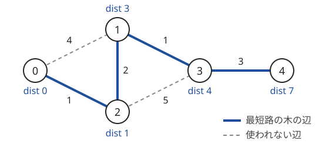
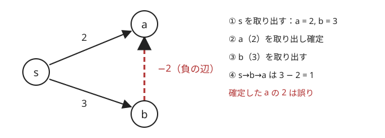

!!! abstract "要点"
    - **何ができるか**：辺の重みが非負のグラフで、暫定距離が最小の頂点から順に確定させ、単一始点の最短距離を $O((N + M) \log N)$ で求める。逆向きのグラフや両端からの距離を組み合わせれば、経由点や往復の問題も解ける。
    - **いつ使うか**：
        - 非負の重み付きグラフの最短距離・最小コスト（頂点にもコストがある）。
        - $N, M \le 2 \times 10^5$ で辺の重みが非負。
        - 頂点 $k$ を経由する最短路をすべての $k$ について・行きと帰り。
        - 負の辺の重みが「高さの差」の形をしている。
    - **計算量**：優先度付きキューを使う版は $O((N + M) \log N)$。辺が $N^2$ 本近い密グラフでは、配列で最小を探す版が $O(N^2)$。
    - **前提**：[幅優先探索（BFS）と無重み最短路](../graph/bfs.md)

<!-- textlint-disable -->
別名：ダイクストラ・Dijkstra・Dijkstra's algorithm・経由点の最短路・両端からのダイクストラ・逆向きのグラフ・最短閉路・ポテンシャルで負辺を消す・Johnson のアイデア
<!-- textlint-enable -->

ダイクストラ法は、[BFS](../graph/bfs.md) のキューを[優先度付きキュー](../ds/priority-queue.md)に替え、始点からの暫定距離が最小の頂点から順に距離を確定させる最短路のアルゴリズムである。BFS が「辺の重みがすべて 1」だから到着順に確定できたのに対し、ダイクストラ法は「辺の重みが非負」だから暫定距離の小さい順に確定できる。このページでは頂点を 0-indexed で書き、始点を $s$、始点からの最短距離を $\mathrm{dist}[v]$ と書く。

## 取り出した頂点の距離が確定する理由 {#why-correct}

ダイクストラ法は、確定した頂点の集合 $S$ と、各頂点の暫定距離 $\mathrm{dist}[v]$（$S$ の頂点だけを経由して $v$ に着く最短の長さ）を持つ。手順は次の 2 つを繰り返すだけである。

```text
dist[s] = 0、ほかは INF。ヒープに (0, s) を入れる
ヒープが空でない間：
    最小の (d, v) を取り出す。d > dist[v] なら読み飛ばす（古い組）
    v を確定する
    v から出る各辺 (v → to, 重み w) について、d + w < dist[to] なら
        dist[to] = d + w にして、(dist[to], to) をヒープに入れる
```

次の図は、6 本の無向辺を持つ 5 頂点のグラフと、始点 0 から求めた最短距離である。太い実線は、各頂点の距離を最後に更新した辺（[最短路の木](../guide/glossary.md#shortest-path-tree)）である。



このグラフでの動きを、ヒープの中身とともに表にする。組は (距離, 頂点) である。

| 取り出した組 | 処理 | 処理の後のヒープ |
| --- | --- | --- |
| (0, 0) | 0 を確定。1 を 4、2 を 1 に更新 | (1, 2)・(4, 1) |
| (1, 2) | 2 を確定。1 を 3、3 を 6 に更新 | (3, 1)・(4, 1)・(6, 3) |
| (3, 1) | 1 を確定。3 を 4 に更新 | (4, 1)・(4, 3)・(6, 3) |
| (4, 1) | 古い組（$\mathrm{dist}[1] = 3$）なので読み飛ばす | (4, 3)・(6, 3) |
| (4, 3) | 3 を確定。4 を 7 に更新 | (6, 3)・(7, 4) |
| (6, 3) | 古い組なので読み飛ばす | (7, 4) |
| (7, 4) | 4 を確定。更新はない | 空 |

次の動く図は、同じグラフでヒープの中身と確定済みの頂点の集合をステップ送りで見せる。上の図と違い、太い実線はそのステップで更新に使った辺で、細い実線が今の暫定距離を与えている辺である。最後のステップでは、細い実線の辺が最短路の木になる。

<div class="kp-viz" data-viz="dijkstra" data-config='{"n": 5, "directed": false, "source": 0, "edges": [[0, 1, 4], [0, 2, 1], [2, 1, 2], [1, 3, 1], [2, 3, 5], [3, 4, 3]], "pos": [[60, 120], [200, 50], [200, 190], [340, 120], [480, 120]]}'></div>

確定が正しいのは、**未確定の頂点のうち暫定距離が最小の頂点 $v$ には、それより短い道がない**からである。$v$ への道はどれも、$S$ の中から出発し、どこかで初めて $S$ の外の頂点 $y$ に出る。$y$ までの部分の長さは $\mathrm{dist}[y]$ 以上で、$v$ を選んだことから $\mathrm{dist}[y] \ge \mathrm{dist}[v]$ である。$y$ から先の辺は非負なので、道の全体は $\mathrm{dist}[v]$ より短くならない。

??? note "証明"
    取り出した $v$ の暫定距離を $d$ とし、長さが $d$ 未満の $s$ から $v$ への道 $P$ があったとする。$P$ をたどって初めて $S$ の外に出る辺を $x \to y$ とする（$x \in S$、$y \notin S$）。$x$ は確定済みで、確定したときに辺 $x \to y$ で緩和しているので、$\mathrm{dist}[y] \le \mathrm{dist}[x] + w(x, y)$ である。$P$ の $s$ から $x$ の部分は $\mathrm{dist}[x]$ 以上なので、$\mathrm{dist}[y] \le (P \text{ の } y \text{ までの長さ})$ となる。辺の重みが非負なので $(P \text{ の } y \text{ までの長さ}) \le (P \text{ の長さ}) < d$ になり、$\mathrm{dist}[y] < d$ を得る。これは、未確定の中で暫定距離が最小のものとして $v$ を選んだことに反する。

この議論で辺の重みが非負であることを使ったのは、「道の先を伸ばしても短くならない」の 1 か所だけである。BFS も同じ形で、重みがすべて 1 のときは暫定距離の小さい順とキューに入った順が一致するので、ヒープの代わりにキューで済む。

## 古い組を読み飛ばす・priority_queue を最小ヒープにする {#skip-stale}

C++ の `priority_queue` には、入っている組の距離を小さくする操作がない。そこで暫定距離を更新するたびに新しい組 $(\mathrm{dist}[to], to)$ を入れ、前に入れた組はヒープに残す。残った組は、取り出したときに $d > \mathrm{dist}[v]$ で見分けて読み飛ばす。

```cpp
--8<-- "dijkstra/dijkstra.cpp:core"
```

- **最小ヒープにする**：`priority_queue` は既定で最大のものを取り出す。`greater<>` を指定するか、距離を負にして入れる（[優先度付きキュー](../ds/priority-queue.md#what-it-does)）。最大ヒープのままでも小さい例では出力が合うことがあり、気づきにくい
- **組の順序は (距離, 頂点)**：`pair` は第 1 要素から比べるので、距離を先に置く。(頂点, 距離) にすると、頂点の番号の順に取り出してしまう
- **読み飛ばしを忘れると遅くなる**：古い組から[緩和](../guide/glossary.md#relaxation)しても $d + w \ge \mathrm{dist}[v] + w$ なので更新は起きず、答えは変わらない。ただし辺を見る回数が「頂点に組が入った回数 × 出る辺の数」の和になる。たとえば $N/2$ 個の頂点が 1 つの頂点 $h$ へ順に短い距離を届け、$h$ から $N/2$ 本の辺が出ていると、$h$ の組が $N/2$ 個できて、合わせて約 $N^2/4$ 回辺を見る
- 読み飛ばしの代わりに、確定済みの印 `done[v]` を持って 2 回目以降を捨ててもよい。辺の重みが非負なら、どちらも「1 頂点の辺を見るのは 1 回だけ」を保証し、結果も同じになる（負の辺があると 2 つは違う動きをする。[負辺で壊れる例](#negative-edges)）

ヒープに入る組は始点の分と、更新 1 回につき 1 個で、更新は辺ごとに高々 1 回起きる（辺 $v \to to$ を見るのは $v$ の確定時だけ）。だからヒープの大きさは $M + 1$ 以下で、操作 1 回は $O(\log M)$ である。多重辺がなければ $M \le N^2$ なので $\log M \le 2 \log N$ となり、全体は $O((N + M) \log N)$ である。多重辺があっても $O((N + M) \log M)$ で、$M \le 2 \times 10^5$ 程度なら差はない。

## 頂点の重みを辺に足す・経路復元は BFS と同じ {#vertex-weights}

頂点を通るたびにコスト $A_v$ がかかる問題は、**辺に行き先の頂点の重みを足す**と、辺の重みだけのグラフになる。辺 $u \to v$（重み $B$）の重みを $B + A_v$ にし、始点の距離を $0$ ではなく $A_s$ から始める。無向の辺は 2 本の有向辺として入れ、それぞれに自分の行き先の重みを足す（$u \to v$ には $A_v$、$v \to u$ には $A_u$）。$A_v$ が非負なら新しい辺の重みも非負なので、ダイクストラ法がそのまま使える。

出るときに払う形なら、辺 $u \to v$ に出発側の $A_u$ を足す（始点の距離は 0 から始め、終点の $A_t$ は数えない）。「最初の 1 回だけ払う」も、重みが非負なら最短路は同じ頂点を 2 度通らないので、通るたびに払うのと同じ答えになる。払う額が状態（乗り換えたか・何回目か）で変わるなら、状態を頂点に持たせる（[頂点倍化](../graph/extended-dijkstra.md#layered-graph)）。

経路の復元は BFS と同じで、$\mathrm{dist}[to]$ を更新したときの $v$ を $\mathrm{prev}[to]$ に記録し、終点から始点へたどって反転する。記録は更新のたびに上書きしてよい。最後に残る $\mathrm{prev}$ は、確定した距離を与えた辺を指す。

```cpp
--8<-- "dijkstra/dijkstra.cpp:path"
```

## 密グラフの O(N^2) 版 {#dense}

すべての頂点の組に辺がある完全グラフのように $M$ が $N^2$ に近いと、ヒープ版は $O(N^2 \log N)$ になる。ヒープを使わず、毎回「未確定で暫定距離が最小の頂点」を配列から線形に探すと、探索は $N$ 回 × $O(N)$、緩和も合わせて $O(N^2)$ なので、全体は $O(N^2)$ になる。$N$ が数千までの密グラフ（座標から辺の重みが決まる問題など）で使う。

```cpp
--8<-- "dijkstra/dense.cpp:core"
```

辺を隣接リストに展開する必要もないので、$N^2$ 個の辺を持つメモリも省ける。辺の重みを行列で持つか、座標などからその場で計算する。

## 負辺で壊れる例 {#negative-edges}

確定が正しい理由は「道の先を伸ばしても短くならない」だったので、負の辺があると壊れる。最小の例は次の 3 頂点である。



ダイクストラ法は $s$ の次に暫定距離 2 の $a$ を取り出して確定する。その後で $b$（距離 3）を取り出すと、$s \to b \to a$ の長さが $3 - 2 = 1$ と分かるが、$a$ はすでに確定している。確定済みの印 `done[v]` で 2 回目以降を捨てる書き方では、$\mathrm{dist}[a]$ は 1 に書き換わるが、$(1, a)$ を取り出しても捨てるので、$a$ から出る辺は見直されない。この例は $a$ から出る辺がないので答えが合うが、$a$ から先に辺があれば、その先の距離は誤ったままになる。

一方、このページのコード片のように $d > \mathrm{dist}[v]$ のときだけ読み飛ばす書き方では、$(1, a)$ は古い組ではないので、$a$ がもう一度取り出され、出る辺も見直される。下の動く図は、この入れ直す書き方で、確定済みの $a$ の距離が後から縮む様子を見せる。

<div class="kp-viz" data-viz="dijkstra" data-config='{"n": 3, "directed": true, "source": 0, "labels": ["s", "a", "b"], "edges": [[0, 1, 2], [0, 2, 3], [2, 1, -2]], "pos": [[60, 120], [240, 40], [240, 190]]}'></div>

このように確定済みでも更新したら入れ直す書き方なら、負閉路がなければ答えは合う。しかし同じ頂点が何度も取り出されうるので、$O((N + M) \log N)$ の保証はなくなる。答えが合っても計算量の保証がないことが、負の辺があるときにダイクストラ法を使ってはいけない理由である。負の辺があるときは次のどれかを使う。

- 制約が小さければ[ベルマンフォード法](../graph/bellman-ford.md)（$O(NM)$）
- 重みが「高さの差」のような形なら、[ポテンシャルで負辺を消す](#potential)

**すべての辺に同じ定数を足して非負にする方法は誤り**である。足される量は道の辺の数に比例するので、辺の多い道ほど不利になる。たとえば $s \to t$ が重み 0、$s \to a \to b \to t$ が重み $-1, 0, 0$（合計 $-1$）なら、後者が最短である。全辺に 1 を足すと前者が 1、後者が 2 になり、順位が入れ替わる。

## 最短閉路（ある頂点を含む閉路の最小の長さ） {#shortest-cycle}

有向グラフで頂点 $s$ を含む閉路の最小の長さは、$s$ からの最短距離を求めてから、$s$ へ戻る辺を見ればよい。

$$
\min_{u \to s \text{ が辺}} \bigl(\mathrm{dist}[u] + w(u, s)\bigr)
$$

$s$ を含む閉路は、$s$ からある頂点 $u$ へ行き、辺 $u \to s$ で戻る形をしている。$u$ までの部分を最短路に取り替えても閉路のままで、長さは増えないので、この最小が答えになる。重みがすべて 1 なら BFS で同じことをする。

始点の $\mathrm{dist}[s] = 0$ のままでは、閉路を表す「$s$ に戻ってくる距離」が 0 に潰れてしまう。$s$ に戻る辺を別に見るのはそのためである。

無向グラフでは、辺 $s - u$ を行って同じ辺で戻ると長さ $2w$ の偽の閉路になるので、上の式はそのまま使えない。$s$ の次数が小さければ、$s$ につながる辺 $e = (s, u)$ ごとに「$e$ を除いたグラフでの $s$ から $u$ への最短距離 $+ w(e)$」を求め、その最小を取る。$s$ を含む閉路は $s$ につながる辺のどれかを使う。その辺を除いても、閉路の残りの部分が $s$ から $u$ への道として残るからである。

## 逆向きのグラフと両端からの最短路 {#reverse-graph}

ここからは、ダイクストラ法を 2 回以上使い、結果を組み合わせる型を扱う。始点 $s$ からの距離を $d_S[v]$、$v$ から終点 $t$ への距離を $d_T[v]$ と書く。

![始点 s から頂点 k までの距離 dS[k] と、k から終点 t までの距離 dT[k] を足すと、k を通る最短路の長さになる](../img/dijkstra/two-ends.svg)

- **終点への距離は、逆向きのグラフで終点から求める**：有向グラフで「各頂点から $t$ への距離」を頂点ごとに求めると $N$ 回のダイクストラ法になる。すべての辺の向きを反転したグラフで $t$ から 1 回求めれば、それが元のグラフでの $v$ から $t$ への距離である。無向グラフなら反転しなくても同じである
- **頂点 $k$ を経由する最短路**：$d_S[k] + d_T[k]$。すべての $k$ について 2 回のダイクストラ法で求まる
- **最短路に乗る頂点・辺**：頂点 $c$ が $s$ から $t$ へのある最短路の上にあるのは、$d_S[c] + d_T[c] = d_S[t]$ のときである。辺 $u \to v$ なら条件は $d_S[u] + w(u, v) + d_T[v] = d_S[t]$ になる（[最短路 DAG](../graph/shortest-path-dag.md#edge-on-path)）
- **行きと帰り**：$s$ から出て頂点 $k$ に寄り、$s$ へ戻る往復は、元のグラフで $s$ から求めた距離と、逆向きのグラフで $s$ から求めた距離の和である
- **途中で重みが変わる**：「どこか 1 か所で乗り換えると、以後は別の運賃になる」なら、乗り換える頂点 $k$ を決めると「前半の重みでの $d_S[k]$」＋「後半の重みでの $d_T[k]$」になる。乗り換えの位置に条件があれば、条件を満たす $k$ の中で最小を取る

同じことは「(頂点, 乗り換えたか) を頂点にした 2 層のグラフ」でも解ける（[頂点倍化](../graph/extended-dijkstra.md#layered-graph)）。両端から求める方法は、乗り換えの位置を後から変えて何度も答える問題に向いている。

## ポテンシャルで負辺を消す（Johnson のアイデア） {#potential}

負の辺を含むグラフでも、各頂点に値 $p(v)$（[ポテンシャル](../guide/glossary.md#potential)）を決めて辺の重みを次のように付け替えると、ダイクストラ法を使えることがある。

$$
w'(u, v) = w(u, v) + p(u) - p(v)
$$

道 $s = v_0 \to v_1 \to \dots \to v_k = t$ の長さは、付け替えると途中の $p$ が打ち消し合い、次の関係になる。

$$
w'(\text{道}) = w(\text{道}) + p(s) - p(t)
$$

$p(s) - p(t)$ は道によらない定数なので、$s$ から $t$ への道の長さの順位は変わらない。だから、すべての辺で $w'(u, v) \ge 0$ となる $p$ が見つかれば、$w'$ でダイクストラ法を行い、$\mathrm{dist}'[t] - p(s) + p(t)$ で元の距離に戻せる。

問題は $w' \ge 0$ となる $p$ をどう見つけるかである。Johnson のアルゴリズムは、全頂点へ重み 0 の辺を張った仮想の頂点を足す。そこから[ベルマンフォード法](../graph/bellman-ford.md#vs-potential)で求めた最短距離を $p$ にする（三角不等式 $\mathrm{dist}[v] \le \mathrm{dist}[u] + w(u, v)$ から $w' \ge 0$）。競プロでは、問題の構造から $p$ が直接分かる場合が多い。

**高さの差の形**：高さ $H_v$ があり、下りでは得をし（負のコスト）、上りでは損をする問題を考える。下りのコストが $-(H_u - H_v)$、上りのコストが $2(H_v - H_u)$ なら、$p(v) = H_v$ として付け替えると次のようになる。

- 下り（$H_u > H_v$）：$w' = -(H_u - H_v) + H_u - H_v = 0$
- 上り（$H_u \le H_v$）：$w' = 2(H_v - H_u) + H_u - H_v = H_v - H_u \ge 0$

どちらも非負なので、$w'$ でダイクストラ法を行える。元のコストへは、終点 $t$ ごとに $\mathrm{dist}'[t] - H_s + H_t$ で戻す。

このアイデアは、[最小費用流](../graph/min-cost-flow.md#successive-shortest-path)で負のコストの残余辺が現れても、毎回ダイクストラ法で最短路を求めるために使われている。

## 落とし穴 {#pitfalls}

- **INF の大きさ**：`INT_MAX` や `LLONG_MAX` を INF にして `dist[v] + w` を計算するとあふれる。足してもあふれない `LLONG_MAX / 4` などにし、届かない頂点は出力の前に判定する。重みの和が $2^{31}$ を超えうるなら距離は `long long` にする
- **無向グラフの辺を片向きにしか入れない**：入力の 1 行ごとに `g[u]` と `g[v]` の両方に入れる。逆に、有向グラフで両向きに入れると、通れない向きの道ができる
- **到達できない頂点**：$\mathrm{dist}[v] = \mathrm{INF}$ のまま答えに混ぜると、最小値や合計が壊れる。「届かなければ $-1$」の指定にも注意する
- **頂点ごとにダイクストラ法を回す**：「各頂点から終点への距離」は逆向きのグラフで 1 回で求まる（[逆向きのグラフと両端からの最短路](#reverse-graph)）
- **最短閉路で dist[s] を読む**：$\mathrm{dist}[s] = 0$ は閉路の長さではない。$s$ へ戻る辺を別に見る（[最短閉路](#shortest-cycle)）

## 上位の手法へのつながり {#next-steps}

ダイクストラ法は「暫定距離の小さい順に確定させる」の代表で、多くの最短路の手法がこの上に乗る。

- **状態を頂点にする**：残り回数・向き・乗り換えたかなどを頂点に足すと、頂点だけでは決まらない最短路も解ける（[状態を頂点にする](../graph/extended-dijkstra.md)）。グループ内を自由に移動できるなら、超頂点で辺を減らす（[超頂点](../graph/extended-dijkstra.md#super-vertex)）
- **重みが 0 と 1**：ヒープの代わりに deque で $O(N + M)$ にできる（[01-BFS](../graph/zero-one-bfs.md)）
- **時刻で変わる辺**：「遅く出発すると早く着くことはない」なら、到着時刻を距離にしてそのまま使える（[時刻で変わる辺](../graph/time-dependent-dijkstra.md)）
- **最短路の数え上げ・最短路に乗る辺**：辺の重みがすべて正なら、$\mathrm{dist}$ が確定した順は最短路 DAG のトポロジカル順なので、DP を重ねられる（重み 0 の辺があるときは[最短路 DAG](../graph/shortest-path-dag.md#build)）
- **K 番目の最短路**：各頂点を $K$ 回まで取り出すように変える（[K 番目の最短路](../graph/k-shortest-paths.md#k-times)）
- **最小費用流**：ポテンシャルで負の残余辺を消しながら最短路を繰り返す（[最小費用流](../graph/min-cost-flow.md#successive-shortest-path)）

自作のダイクストラ法は、Library Checker の [Shortest Path](https://judge.yosupo.jp/problem/shortest_path)（経路の出力つき）で確かめられる。

## 確認問題 {#quiz}

??? question "確認問題：古い組の意味"
    ヒープから取り出した組 $(d, v)$ が $d > \mathrm{dist}[v]$ を満たした。これは何を意味するか。読み飛ばさずに緩和を続けると、答えと計算時間はどうなるか。

    ??? success "答え"
        $v$ の暫定距離が、この組を入れた後でより小さい値に更新され、その値で $v$ がすでに確定していることを意味する。緩和を続けても $d + w \ge \mathrm{dist}[v] + w$ なので更新は起きず、答えは変わらない。ただし同じ頂点の辺を何度も見るので、最悪で $O(NM)$ 近くまで遅くなる。

??? question "確認問題：重みがすべて 1 のとき"
    すべての辺の重みが 1 のグラフで、ダイクストラ法と BFS は同じ順に頂点を確定させるか。

    ??? success "答え"
        距離の小さい順に確定させる点は同じなので、距離 0 の頂点、距離 1 の頂点、…という層の順は一致する。同じ距離の頂点どうしの順は、ヒープは頂点の番号で、BFS はキューに入った順で決まるので、一致するとは限らない。どちらの順でも求まる距離は同じである。

??? question "確認問題：頂点の重み"
    無向グラフの各頂点に重み $A_v \ge 0$、各辺に重み $B \ge 0$ がある。道の重みを「通った頂点と辺の重みの和」とするとき、頂点 0 から各頂点への最小の重みを求めたい。辺の重みと始点の距離をどう決めればよいか。

    ??? success "答え"
        無向の辺 $u - v$ を有向辺 $u \to v$（重み $B + A_v$）と $v \to u$（重み $B + A_u$）に分け、$\mathrm{dist}[0] = A_0$ から始める。どの辺も行き先の頂点の重みを含むので、始点以外の頂点の重みはちょうど 1 回ずつ数えられる。

## 使い分け {#comparison}

- 辺の重みがすべて等しいなら [BFS](../graph/bfs.md)、0 か 1 なら [01-BFS](../graph/zero-one-bfs.md) で $O(N + M)$
- 負の辺があるなら[ベルマンフォード法](../graph/bellman-ford.md)。構造があれば[ポテンシャル](#potential)で非負に直す
- 全点対の距離が要り、$N$ が 400〜500 程度までなら[ワーシャルフロイド法](../graph/warshall-floyd.md)。疎なグラフなら全頂点からダイクストラ法を回す方が速いこともある

## 例題 {#examples}

### ABC362 D. Shortest Path 3 {#abc362_d}

<div class="kp-problems" data-role="example" markdown>

- [ABC362 D. Shortest Path 3](https://atcoder.jp/contests/abc362/tasks/abc362_d)（diff 634）：頂点と辺の両方に重みがあるグラフで、頂点 1 から各頂点への経路の重み（通った頂点と辺の重みの和）の最小値を求める。

</div>

頂点の重みが道の重みに入るので、[頂点の重みを辺に足す](#vertex-weights)の形にする。辺 $u \to v$ の重みを「辺の重み ＋ 行き先 $v$ の重み」にすれば、残りはふつうのダイクストラ法である。

??? note "解法の詳細"
    - 入力の頂点を 0-indexed に直し、無向の辺 $u - v$（重み $B$）を、$u \to v$（重み $B + A_v$）と $v \to u$（重み $B + A_u$）の 2 本にする。
    - $\mathrm{dist}[0] = A_0$ として、ヒープに $(A_0, 0)$ を入れてダイクストラ法を行う。
    - 頂点 2 から $N$（0-indexed で 1 から $N - 1$）の $\mathrm{dist}$ を出力する。重みの和は大きくなりうるので `long long` で持つ。
    - 計算量は $O((N + M) \log N)$。

## 練習問題 {#practice}

<div class="kp-problems" data-role="practice" markdown>

- [ABC376 D. Cycle](https://atcoder.jp/contests/abc376/tasks/abc376_d)（diff 743）：有向グラフで、頂点 1 を含む有向閉路のうち辺の数が最小のものの辺の数を求める。
- [ABC340 D. Super Takahashi Bros.](https://atcoder.jp/contests/abc340/tasks/abc340_d)（diff 784）：ステージ i をクリアすると次のステージか指定のステージへ進めるとき、ステージ N を遊べるようになるまでの最短時間を求める。
- [ABC325 E. Our clients, please wait a moment](https://atcoder.jp/contests/abc325/tasks/abc325_e)（diff 1093）：社用車から電車へ 1 回だけ乗り換えられるとき、都市 1 から都市 N への最短時間を求める。
- [ABC237 E. Skiing](https://atcoder.jp/contests/abc237/tasks/abc237_e)（diff 1208）：標高の差で楽しさが増減する移動で、広場 1 から出発したときの楽しさの最大値を求める。
- [ABC477 E. Wheel Distance](https://atcoder.jp/contests/abc477/tasks/abc477_e)（diff 1235）：外周の閉路と中心の頂点からなる車輪の形の重み付きグラフで、2 頂点の間の最短距離を多数のクエリについて答える。
- [典型90 013. Passing（★5）](https://atcoder.jp/contests/typical90/tasks/typical90_m)（diff —）：各頂点 k について、頂点 1 から頂点 k を経由して頂点 N へ行く最短距離を求める。

</div>

??? note "練習の方針"
    - **ABC376 D**：辺の重みはすべて 1 なので BFS でよい。頂点 1 からの距離を求め、頂点 1 へ戻る辺 $u \to 1$ について $\mathrm{dist}[u] + 1$ の最小を取る（[最短閉路](#shortest-cycle)）。どこからも戻れなければ $-1$
    - **ABC340 D**：ステージを頂点にし、「次のステージへ進む」と「指定のステージへ進む」をそれぞれ所要時間を重みにした有向辺にする。頂点 1 から頂点 $N$ への最短距離が答え
    - **ABC325 E**：すべての都市の組が移動でき、辺が $N^2$ 本ある。(都市, 乗り換えたか) の 2 層にし、車の層から電車の層へ重み 0 の辺を張る。辺が多いので[配列版](#dense)の $O(N^2)$ が確実である。車での頂点 1 からの距離と、電車での頂点 $N$ からの距離を求め、乗り換える都市 $k$ ごとに和の最小を取ってもよい
    - **ABC237 E**：楽しさの最大化を、符号を反転してコストの最小化にする。下りのコストが負になるが、高さをポテンシャルにすると非負になる（[ポテンシャルで負辺を消す](#potential)）
    - **ABC477 E**：グラフの形が決まっているので、中心から 1 回だけダイクストラ法を行う。外周上の 2 頂点の距離は「中心を通る」「外周を右に回る」「外周を左に回る」の最小である。外周の弧の長さは累積和で $O(1)$ で求まる
    - **典型90 013**：頂点 1 と頂点 $N$ からの 2 回のダイクストラ法を行い、各 $k$ で $d_1[k] + d_N[k]$ を出力する（[逆向きのグラフと両端からの最短路](#reverse-graph)。無向なので反転は要らない）

## 力試し {#challenge}

<div class="kp-problems" data-role="challenge" markdown>

- [ABC035 D. トレジャーハント](https://atcoder.jp/contests/abc035/tasks/abc035_d)（diff 1591）：時間 T 以内に町 1 から出発して 1 つの町に滞在し、町 1 へ戻るとき、滞在で得られるお金の最大値を求める。
- [SOUNDHOUND2018-SUMMER-QUAL D. Saving Snuuk](https://atcoder.jp/contests/soundhound2018-summer-qual/tasks/soundhound2018_summer_qual_d)（diff 1637）：円とスヌークの 2 つの運賃がある路線で、両替所が年ごとに閉じていくとき、各年に旅行した場合に手元に残るスヌークの最大値を求める。

</div>

??? note "力試しの方針"
    - **ABC035 D**：滞在する町は 1 つで十分である。町 $k$ ごとに「行きの最短時間 ＋ 帰りの最短時間」を求める。道は一方通行なので、帰りは辺を反転したグラフで町 1 から求める。往復で $T$ を超える町を除き、（残り時間）×（町 $k$ の稼ぎの速さ）の最大を取る
    - **Saving Snuuk**：両替する都市 $k$ を決めると、費用は「始点からの円での距離」＋「終点からのスヌークでの距離」になる。$i$ 年後（$i = 0$ から）に使える両替所は、都市を 0-indexed にして番号が $i$ 以上のものである。だから、この和の後ろからの最小値を取る

## 参考 {#references}

- [ageprocpp「最短経路問題総特集！！！～BFSから拡張ダイクストラまで～」](https://qiita.com/ageprocpp/items/cdf67e828e1b09316f6e)：最短路の手法の使い分けと、最短路に乗る頂点の判定
- [yuu_kyopro「ダイクストラ法の計算量と定数倍改善・負の辺・超頂点・頂点倍加・01BFS【競プロ】」](https://qiita.com/yuu_kyopro/items/761919d9bccc88521863)：密グラフでの $O(N^2)$ 版、負辺で確定が壊れること、頂点の重みを辺に直すこと
- [Lanly「AtCoder Beginner Contest 362」](https://www.cnblogs.com/Lanly/p/18301039)：例題の方針（頂点の重みを辺に足し、始点の距離を頂点の重みから始める）
- [Lanly「AtCoder Beginner Contest 376」](https://www.cnblogs.com/Lanly/p/18486698)：練習の方針（頂点 1 を含む最短の閉路）
- [Lanly「AtCoder Beginner Contest 340」](https://www.cnblogs.com/Lanly/p/18013072)：練習の方針（ステージを頂点にしたグラフ）
- [drken「AtCoder ABC 325 E - Our clients, please wait a moment (1Q, 緑色, 450 点)」](https://drken1215.hatenablog.com/entry/2023/10/22/191500)：練習の方針（2 層のグラフと、密グラフでの $O(N^2)$ のダイクストラ法）
- [kyo-pro「ABC237E - Skiing」](https://kyo-pro.hatenablog.com/entry/ABC237E)：ポテンシャルで負の辺を非負に直す方法と、元のコストへの戻し方
- [ikatakos「UNICORNプログラミングコンテスト2026(AtCoder Beginner Contest 477)D,E,F,G問題メモ」](https://ikatakos.com/pot/programming_algorithm/contest_history/atcoder/2026/0926_abc477)：練習の方針（中心からのダイクストラ法と外周の累積和。解説の部分だけを参照）
- [E869120「kyopro_educational_90 sol/013.cpp」](https://github.com/E869120/kyopro_educational_90/blob/main/sol/013.cpp)：練習の方針（頂点 1 と頂点 N からの 2 回のダイクストラ法）
- [oraclesqlpuzzle「ABC035-D トレジャーハント」](https://oraclesqlpuzzle.ninja-web.net/kyoupro/05-atcoder-02-abc/kyoupro-abc035-d.html)：力試しの方針（元のグラフと逆向きのグラフでのダイクストラ法）
- [hamayan「Saving Snuuk [SoundHound Inc. Programming Contest 2018 -Masters Tournament- D]」](https://blog.hamayanhamayan.com/entry/2018/07/09/190130)：力試しの方針（両端からの距離の和と後ろからの最小値）
- [Library Checker「Shortest Path」](https://judge.yosupo.jp/problem/shortest_path)：自作のダイクストラ法の確認先
