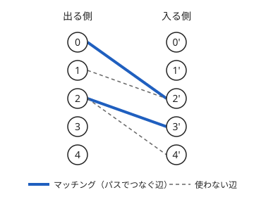

!!! abstract "要点"
    - **何ができるか**：DAG の頂点を最少の本数のパスで覆う数は、頂点を 2 つに分けた二部グラフの最大マッチングから求まる。完全マッチングがあるかは、Hall の定理で部分集合ごとに確かめられる。
    - **いつ使うか**：
        - 互いに包含しない（比べられない）ものを最大数選ぶ
        - 最少の本数のパス（鎖）で全頂点を覆う
        - 種類が 20 程度以下で、部分集合ごとに供給と需要を比べられる
    - **計算量**：頂点数 $N$・辺数 $M$ として、最小パス被覆は二部マッチング 1 回（Hopcroft-Karp で $O(M \sqrt{N})$）。頂点を共有してよい鎖での被覆と最大反鎖は、[推移閉包](../guide/glossary.md#transitive-closure)（bitset で $O(N(N + M) / 64)$）の後に、辺が $N^2$ 本までのマッチングで $O(N^{2.5})$。Hall の条件を種類の部分集合ごとに確かめるなら、種類の数 $K$ として $O(2^K K)$
    - **前提**：[二部マッチング](../graph/bipartite-matching.md)、[強連結成分分解（SCC）](../graph/scc.md)

<!-- textlint-disable -->
別名：最小パス被覆・最大反鎖・最小鎖被覆・結婚定理・マッチングの双対・path cover・Hall's theorem
<!-- textlint-enable -->

最小パス被覆の公式と Hall の定理は、どちらも二部マッチングの大きさを別の量に読み替える定理である。最小パス被覆は「パスでつなぐ辺」をマッチングとみて、Dilworth の定理を通じて「比べられないものを最大数選ぶ」問題にもつながる。Hall の定理は、完全マッチングがないことを、隣が足りない部分集合 1 つで示せることを言う。ABC では難しい G・Ex に現れる程度で、どちらもグラフの作り方さえ分かれば ACL の `mf_graph` で書ける。

## DAG の最小パス被覆（頂点を 2 つに分けた二部マッチング） {#path-cover}

[DAG](../guide/glossary.md#dag) の頂点を、頂点を共有しないパスに分ける。1 頂点だけのパスも 1 本と数える。このパスの本数の最小を、最小パス被覆という。

各頂点 $v$ を「出る側 $v$」と「入る側 $v'$」の 2 つに分け、元の辺 $u \to v$ ごとに出る側 $u$ と入る側 $v'$ を結ぶ。この二部グラフの最大[マッチング](../guide/glossary.md#matching)の大きさを $\nu$ とすると、最小パス被覆の本数は $N - \nu$ である。

- **パスからマッチングへ**：パスで使う辺 $u \to v$ を組 $(u, v')$ にする。どの頂点もパスの中で後ろの頂点は 1 つまで、前の頂点も 1 つまでなので、これはマッチングである。
- **マッチングからパスへ**：組 $(u, v')$ を辺 $u \to v$ とみると、どの頂点も出る辺と入る辺が 1 本までになる。元のグラフが DAG なので閉路はできず、選んだ辺はいくつかのパスに分かれる。
- **本数**：$N$ 本の 1 頂点のパスから始めて、辺を 1 本使うごとに 2 本のパスが 1 本になる。$k$ 本の辺を使えば $N - k$ 本なので、使う辺を最大にすれば本数は最小になる。

次の図は、辺 $0 \to 2$・$1 \to 2$・$2 \to 3$・$2 \to 4$ の DAG を 2 つに分けた二部グラフである。最大マッチングは $(0, 2')$・$(2, 3')$ の 2 組で、パスは $0 \to 2 \to 3$・$1$・$4$ の $5 - 2 = 3$ 本になる。頂点 2 は前と後ろに 1 つずつしかつなげないので、$1$ と $4$ は 1 頂点のパスとして残る。



自作するときの要点は次の 3 つである。

- **番号の付け方**：出る側を $0, \dots, N - 1$、入る側を $N, \dots, 2N - 1$ にし、始点と終点を $2N$・$2N + 1$ に置く。出る側と入る側を同じ番号にすると、別の頂点が 1 つにつぶれる（[二部マッチングの落とし穴](../graph/bipartite-matching.md#pitfalls)）。
- **閉路があるとき**：パスでなくウォーク（同じ頂点を何度通ってもよい）で覆うなら、[SCC で縮約](../graph/scc.md#condensation)して DAG にする。1 つの成分は 1 本のウォークで回りきれるので、成分を 1 頂点とみてよい。さらに、ウォークどうしは頂点を共有してよいので、縮約した DAG の[推移閉包](#antichain)を取ってから最小パス被覆を求める。縮約だけで止めると頂点を共有しないパスの本数になり、多く数える。図の DAG なら、ウォークは $0 \to 2 \to 3$・$1 \to 2 \to 4$ の 2 本で足りるが、閉包を取らないと 3 本と答えてしまう。閉路があるまま二部グラフを作ると、マッチングが閉路を拾い、パスに戻せない。
- **復元**：流量が 1 の「出る側 $u$ → 入る側 $v'$」の辺が、パスでつなぐ辺 $u \to v$ である。入る側に流れのない頂点がパスの先頭になる。

```cpp
--8<-- "dilworth-path-cover/path-cover.cpp:core"
```

!!! info "ACL では"
    `atcoder::mf_graph<int> g(2 * n + 2);`。`g.add_edge(from, to, 1)` で辺を足し、`g.flow(s, t)` が最大マッチングの大きさを返す。容量がすべて 1 なら $O((n + m) \sqrt{m})$（$n$・$m$ は流すグラフの頂点数と辺数）。`g.min_cut(s)` は残余グラフで $s$ から届く頂点を $O(n + m)$ で返す。二部マッチングの形では、`mf_graph` が使う Dinic 法も Hopcroft-Karp と同じく $O(M \sqrt{N})$ で動く（[二部マッチング](../graph/bipartite-matching.md#alternating-path)）。ドキュメントの式はそれより緩い上限である。

Library Checker には最小パス被覆そのものの問題はないので、二部マッチングの部分を [Matching on Bipartite Graph](https://judge.yosupo.jp/problem/bipartitematching) で確かめておくとよい（[練習問題](#practice)）。

## 推移閉包と最大反鎖（数列なら LIS のページの Dilworth の定理へ） {#antichain}

「頂点を共有してよい」パスで覆うときは、元のグラフのままではいけない。先に推移閉包を取る。推移閉包とは、$u$ から $v$ へ（1 本以上の辺で）届くとき、またそのときだけ辺 $u \to v$ を張ったグラフである。推移閉包の上のパスは、途中の頂点を飛ばして元のグラフをたどった道にあたるので、頂点を共有しないパスで覆えば、元のグラフで頂点を共有してよい被覆になる。

[図](#path-cover)の例では、推移閉包で $0 \to 3$・$0 \to 4$・$1 \to 3$・$1 \to 4$ が増え、$0 \to 2 \to 4$ と $1 \to 3$（元のグラフでは $1 \to 2 \to 3$）の 2 本で覆える。頂点 2 を 2 本が共有している。

推移閉包は、比べられる・比べられないの関係を表す[半順序](../guide/glossary.md#partial-order)である。どの 2 つも比べられる（一方から他方へ届く）頂点の集まりを鎖、どの 2 つも比べられない頂点の集まりを反鎖という。次の Dilworth の定理が成り立つ。

> 有限の半順序で、反鎖の大きさの最大は、全体を鎖に分けるときの鎖の本数の最小に等しい。

1 つの鎖には反鎖の頂点が 1 つまでしか入らないので、鎖の本数は反鎖の大きさ以上である。等しくなることの証明は [König の定理](../graph/konig-theorem.md#theorem)から出る。推移閉包を 2 つに分けた二部グラフで、最小[頂点被覆](../guide/glossary.md#vertex-cover) $C$ は $\nu$ 個の頂点からなる。出る側と入る側のどちらも $C$ に入らない頂点 $v$ は $N - \nu$ 個以上あり、どの 2 つの間にも辺がない（あれば $C$ がその辺を覆わない）。推移閉包で辺がないことは比べられないことなので、これは大きさ $N - \nu$ 以上の反鎖である。鎖の本数は $N - \nu$ なので、両者は等しい。

この証明はそのまま反鎖の復元の手順になる。最大流を流した後の残余グラフで始点から届く頂点を求め（[被覆の復元](../graph/konig-theorem.md#restore)）、「出る側に届き、入る側に届かない」頂点を集めると最大反鎖である。

```cpp
--8<-- "dilworth-path-cover/path-cover.cpp:antichain"
```

自作するときの要点は次のとおりである。

- **推移閉包の計算**：各頂点から DFS すれば $O(N(N + M))$ で、bitset で逆トポロジカル順に OR を取れば $O(N(N + M) / 64)$ で済む（[DAG の到達可能性](../misc/bitset-speedup.md#reachability)）。包含関係のように、比べられるかを 2 つずつ直接判定できるなら、全部の組を判定して辺を張れば、それがすでに推移閉包である。
- **辺の数**：推移閉包の辺は $N^2 / 2$ 本ほどまで増える。Hopcroft-Karp の上限（`mf_graph` の Dinic 法でも同じ）で $O(N^{2.5})$ なので、$N$ は数千までが目安である。
- **同じものがあるとき**：「包含する」を辺にすると、同じ文字列どうしは互いに包含して閉路になる。同じものは 1 つにまとめるか、番号の小さい方を小さいとみなして順序を厳密にする。
- **重み付きの反鎖**：始点から出る側へと入る側から終点へは容量を重みにし、比べられる組は容量 $\infty$ の辺で結ぶ。反鎖の重みの和の最大は「重みの総和 − 最大流」になる（[練習問題](#practice)の ABC354 G）。

数列を増加列に分ける問題（鎖が「左から右へ狭義増加」）では、二部マッチングを使わずに、最長減少部分列の長さとして $O(N \log N)$ で求まる（[LIS の Dilworth の定理](../dp/lis.md#dilworth)）。2 次元の点の鎖も同じである。一般の半順序のときだけ、このページの二部マッチングを使う。

## Hall の結婚定理 {#hall}

二部グラフの左の頂点の集合 $L$ を、すべてマッチングに入れられるかを考える。左の頂点の集合 $S$ について、$S$ のどれかと辺で結ばれる右の頂点の集合を $N(S)$ と書く。

> 左の頂点をすべてマッチングに入れられるのは、$L$ のどの部分集合 $S$ についても $\lvert N(S) \rvert \ge \lvert S \rvert$ のときで、またそのときに限る（Hall の結婚定理）。

必要なことは明らかで、$S$ の頂点の相手はどれも $N(S)$ に入るので、$\lvert N(S) \rvert$ が足りなければ組めない。十分なことは König の定理から出る。最大マッチングが $\lvert L \rvert$ 未満なら、大きさ $\lvert L \rvert$ 未満の頂点被覆 $C$ がある。$S = L \setminus C$ とすると、$S$ から出る辺は右側の $C$ の頂点で覆われるので $N(S) \subseteq R \cap C$ で、$\lvert N(S) \rvert \le \lvert C \rvert - \lvert L \cap C \rvert < \lvert L \rvert - \lvert L \cap C \rvert = \lvert S \rvert$ になる。より詳しく、最大マッチングの大きさは $\lvert L \rvert - \max_S (\lvert S \rvert - \lvert N(S) \rvert)$ である（$S = \emptyset$ も含めて最大を取る）。

競技プログラミングで使うのは、頂点に個数がある形である。左の頂点 $i$ が $b_i$ 個の需要を、右の頂点 $j$ が $a_j$ 個の供給を持つとき、すべての需要を満たせるのは、左のどの部分集合 $S$ についても

$$
\sum_{i \in S} b_i \le \sum_{j \in N(S)} a_j
$$

のときである（頂点を個数の分だけ複製すれば元の定理になる）。

- **右の部分集合で数える**：右の種類が少ないときは、右の部分集合 $T$ ごとに「受け入れ先がすべて $T$ に入る左の頂点の需要の和」$D(T)$ と、$T$ の供給の和を比べればよい。$N(S) \subseteq T$ となる $S$ は受け入れ先が $T$ に収まる左の頂点だけからなるので、需要の和は $D(T)$ 以下である。逆に、その頂点をすべて集めた $S$ は $N(S) \subseteq T$ を満たす。よって $T$ の供給の和を $a(T)$ として、$T$ ごとに $D(T) \le a(T)$ を確かめればよい。これで、どの $S$ についても $\sum_{i \in S} b_i \le D(N(S)) \le a(N(S))$ が成り立つ。$D(T)$ は、左の頂点 $i$ の需要を受け入れ先の集合の位置に置いて、[部分集合の和の高速ゼータ変換](../comb/zeta-mobius-subset.md#multidimensional)で全部の $T$ について $O(2^K K)$ で求まる。
- **使いどころ**：判定だけなら最大流を流せば済む。Hall の定理が要るのは、条件を壊す最小の操作や、条件を満たす場合の数のように、「どの部分集合で足りなくなるか」を数える問題である（[練習問題](#practice)の ABC215 H）。
- **正則二部グラフ**：どの頂点の次数も $k$ の二部グラフに完全マッチングがあることも、この定理からすぐ出る（[正則二部グラフの分解・辺彩色](../graph/bipartite-matching.md#edge-coloring)）。

## 例題 {#examples}

### ABC237 Ex. Hakata {#abc237_h}

<div class="kp-problems" data-role="example" markdown>

- [ABC237 Ex. Hakata](https://atcoder.jp/contests/abc237/tasks/abc237_h)（diff 2807）：文字列の部分文字列である回文をいくつか選び、どの 2 つも一方が他方の部分文字列にならないようにするとき、選べる最大数を求める。

</div>

回文の部分文字列を頂点にし、「部分文字列として含む」を半順序とみると、求めるものは最大反鎖の大きさである。Dilworth の定理により、それは包含関係のグラフの最小の鎖の本数、すなわち頂点数から二部グラフの最大マッチングを引いた値に等しい。

??? note "解法の詳細"
    - **回文の数**：異なる回文の部分文字列は $\lvert S \rvert$ 個以下である。文字列の末尾に 1 文字足したとき、新しく現れうる回文は末尾で終わる最長の回文だけである。それより短い末尾の回文は、最長の回文の接尾辞なので、折り返すと最長の回文の接頭辞にも現れ、すでに出ている。
    - **列挙**：すべての区間について回文かを判定し、異なるものだけを残す（`set<string>` などで重複を除く）。
    - **辺**：回文の組 $(p, q)$ ごとに、$q$ が $p$ の部分文字列なら辺 $p \to q$ を張る。全部の組を判定するので、このグラフはすでに推移閉包になっている。重複を除いたので、互いに含み合う組（同じ文字列）はない。
    - **答え**：回文の数を $P$ として、出る側と入る側に分けた二部グラフの最大マッチング $\nu$ を `mf_graph` で求め、$P - \nu$ を出力する。辺は $P^2$ 本までである。

## 練習問題 {#practice}

<div class="kp-problems" data-role="practice" markdown>

- [ABC374 G. Only One Product Name](https://atcoder.jp/contests/abc374/tasks/abc374_g)（diff 2608）：2 文字の文字列の集合が与えられる。隣り合うどの 2 文字も集合に含まれる文字列を何本か作り、集合の文字列がどれも少なくとも 1 本に部分文字列として現れるようにするとき、本数の最小を求める。
- [ABC354 G. Select Strings](https://atcoder.jp/contests/abc354/tasks/abc354_g)（diff 2665）：重みの付いた文字列が N 個与えられ、どの 2 つも一方が他方の部分文字列にならないように選ぶとき、選んだ重みの和の最大を求める。
- [ABC215 H. Cabbage Master](https://atcoder.jp/contests/abc215/tasks/abc215_h)（diff 3101）：キャベツの種類ごとの個数と、各会社の必要数と受け入れる種類が与えられる。全社の要求を満たす配り方がなくなるように取り除く個数の最小値と、その個数での取り除き方の数を求める。

</div>

??? note "練習の方針"
    - **ABC374 G**：文字列を頂点にし、1 つ目の 2 文字目と 2 つ目の 1 文字目が一致すれば辺を張る。作る文字列はこのグラフのウォークで、同じ頂点を何度通ってもよい。SCC で縮約して DAG にし、推移閉包を取ってから最小パス被覆を求める。
    - **ABC354 G**：包含関係の最大反鎖の重み付きの版である。同じ文字列は重みの最大のものだけ残し、[推移閉包と最大反鎖](#antichain)の重み付きのグラフで「重みの総和 − 最大流」を求める。
    - **ABC215 H**：会社を左、キャベツの種類を右にした需要と供給の Hall の条件を、種類の部分集合 $T$ ごとに $D(T)$ と $T$ の個数の和の比較で書く。条件が最初に壊れる $T$ から最小の個数が決まり、取り除き方の数は部分集合の包除（メビウス変換）で数える。

### Library Checker

- [Matching on Bipartite Graph](https://judge.yosupo.jp/problem/bipartitematching)：二部グラフの最大マッチングを求め、組も出力する。最小パス被覆で使う部分そのものである。組は、パスの復元と同じく流量が 1 の辺から取り出す。

## 確認問題 {#quiz}

??? question "確認問題：辺 0→1、1→2 の DAG で 0 と 2 だけを覆う。閉包を取らずに解くとどうなるか"
    覆う頂点を 0 と 2 に絞って二部グラフを作る。0 と 2 の間に辺がないのでマッチングは 0 で、2 本と答えてしまう。実際は $0 \to 1 \to 2$ の 1 本で、頂点 1 を通過するだけで済む。覆わなくてよい頂点を通れるときは、推移閉包を取ってから覆う頂点だけで二部グラフを作る（閉包には辺 $0 \to 2$ がある）。

??? question "確認問題：Hall の条件で、左の部分集合をすべて調べると何が困るか。右の種類が少ないときはどうするか"
    左の頂点が多いと部分集合が $2^{\lvert L \rvert}$ 個になり、調べきれない。右の種類が $K$ 個なら、$N(S)$ は $2^K$ 通りしかない。$N(S) \subseteq T$ となる $S$ の需要の和は、受け入れ先が $T$ に収まる左の頂点をすべて集めたときの和 $D(T)$ 以下なので、$T$ ごとに $D(T)$ と $T$ の供給の和を 1 回比べれば足りる。

## 参考 {#references}

- [kmjp「AtCoder ABC #237 : Ex - Hakata」](https://kmjp.hatenablog.jp/entry/2022/01/31/0930)：例題の回文の数の上限、包含関係のグラフと最小パス被覆
- [kmjp「AtCoder ABC #374 (キーエンスプログラミングコンテスト2024) : G - Only One Product Name」](https://kmjp.hatenablog.jp/entry/2024/10/06/0930)：練習の SCC の縮約と推移閉包を取ってからの最小パス被覆
- [ikatakos「キーエンスプログラミングコンテスト2024（AtCoder Beginner Contest 374）E,F,G問題メモ」](https://ikatakos.com/pot/programming_algorithm/contest_history/atcoder/2024/1005_abc374)：練習の問いの確認と、頂点を共有しないパスでは数えすぎる点（解法の節だけを参照）
- [kmjp「AtCoder ABC #354 (パナソニックグループ プログラミングコンテスト2024) : G - Select Strings」](https://kmjp.hatenablog.jp/entry/2024/05/19/0930)：練習の重み付きの反鎖のフローと、同じ文字列の扱い
- [ikatakos「パナソニックグループ プログラミングコンテスト2024（AtCoder Beginner Contest 354）G問題メモ」](https://ikatakos.com/pot/programming_algorithm/contest_history/atcoder/2024/0518_abc354)：練習の問いの確認と、同じ文字列を重みの最大のものだけ残す扱い（解法の節だけを参照）
- [kmjp「AtCoder ABC #215 : H - Cabbage Master」](https://kmjp.hatenablog.jp/entry/2021/08/22/0930)：練習の Hall の条件を部分集合ごとに確かめる方法
- [ikatakos「AtCoder Beginner Contest 215 H問題メモ」](https://ikatakos.com/pot/programming_algorithm/contest_history/atcoder/2021/0821_abc215)：練習の問いの確認と、取り除き方を数える包除（解法の節だけを参照）
- [Wikipedia「Dilworth's theorem」](https://en.wikipedia.org/wiki/Dilworth%27s_theorem)：König の定理からの証明と、二部マッチングで幅が求まること（学ぶための資料）
- [Wikipedia「Hall's marriage theorem」](https://en.wikipedia.org/wiki/Hall%27s_marriage_theorem)：定理の主張と証明（学ぶための資料）
- [OI Wiki「序理论」](https://oi-wiki.org/math/order-theory/)：鎖・反鎖の定義と Dilworth の定理・Mirsky の定理（学ぶための資料。文章と図は使っていない）
- [ACL「MaxFlow」](https://github.com/atcoder/ac-library/blob/master/document_ja/maxflow.md)：`mf_graph` の `flow`・`min_cut` の計算量
- [Library Checker「Matching on Bipartite Graph」](https://judge.yosupo.jp/problem/bipartitematching)：練習の問題の内容
