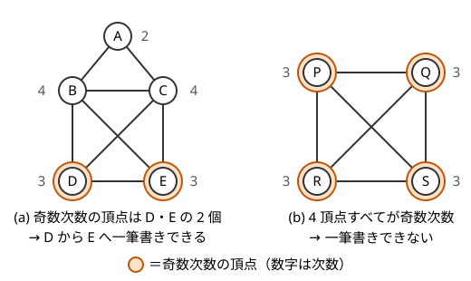
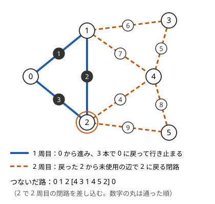

!!! abstract "要点"
    - **何ができるか**：すべての辺をちょうど 1 回ずつ通る路があるかを、次数の偶奇と連結性だけで判定する。無向グラフなら、辺のある頂点が連結で、奇数次数の頂点が 0 個か 2 個のときに限りある。有向なら入次数と出次数の差で決まる。実際の路も Hierholzer 法により $O(N + M)$ で作れる。
    - **いつ使うか**：
        - すべての辺をちょうど 1 回ずつ通る・一筆書き
        - 同じ道を 2 度通らずにすべての道を通れるか
    - **計算量**：判定・構成とも $O(N + M)$（非再帰で書き、各頂点の隣接リストを読む位置を戻さない場合）
    - **前提**：[連結成分](../graph/connected-components.md)

<!-- textlint-disable -->
別名：オイラー閉路・一筆書き・Hierholzer・Euler path・Eulerian trail
<!-- textlint-enable -->

オイラー路（一筆書き）は、グラフのすべての辺をちょうど 1 回ずつ通る[ウォーク](../guide/glossary.md#path-walk)である。頂点は何度通ってもよい。始点と終点が一致するものをオイラー閉路と呼ぶ。あるかどうかは次数の数え上げで $O(N + M)$ で決まり、頂点をちょうど 1 回ずつ通るハミルトン路（[NP 困難](../guide/glossary.md#np-hard)）とは難しさがまったく違う。

## 存在条件（無向・有向） {#conditions}

辺をすべてたどる順を全探索すると $M!$ 通りあり、$M$ が 10 を超えるともう間に合わない。オイラー路では、この探索がまったく要らない。各頂点の[次数](../guide/glossary.md#degree)の偶奇と連結性を見るだけで、あるかどうかが決まるからである。

**無向グラフ**：次の 2 つが両方成り立つときに限り、オイラー路がある。

1. 次数が 1 以上の頂点が、すべて 1 つの連結成分に入っている（[孤立点](../guide/glossary.md#isolated-vertex)は無視する）
2. 次数が奇数の頂点が 0 個か 2 個である

0 個ならオイラー閉路があり、辺のある頂点のどこから始めてもよい。2 個なら、路はその一方から始まり、もう一方で終わる。[握手補題](../graph/graph-basics.md#handshake)により奇数次数の頂点は必ず偶数個なので、「2 個以下」と言っても同じである。



図の (a) は D から始めて E で終えれば一筆書きでき、(b) は奇数次数の頂点が 4 個あるのでできない。

**なぜ必要か**：路の途中で頂点 $v$ を通過するたびに、入る辺と出る辺の 2 本を使う。始点と終点以外の頂点では、使う辺が 2 本ずつ組になるので、次数は偶数でなければならない。始点と終点が違えば、始点は出る辺が 1 本、終点は入る辺が 1 本余るので、その 2 頂点だけが奇数になる。始点と終点が同じ（閉路）なら、余りが打ち消し合って全頂点が偶数になる。連結性は、離れた 2 つの成分の辺を 1 本のウォークでたどれないことから明らかである。十分であることは、次の節の Hierholzer 法が実際に路を作ることで示せる。

**有向グラフ**：$\mathrm{out}(v)$ を出次数、$\mathrm{in}(v)$ を[入次数](../guide/glossary.md#in-degree)とする。次の 2 つが両方成り立つときに限り、オイラー路がある。

1. 辺の向きを無視したとき、次数が 1 以上の頂点がすべて 1 つの連結成分に入っている（弱連結）
2. 次のどちらかである
    - すべての頂点で $\mathrm{out}(v) = \mathrm{in}(v)$（オイラー閉路があり、辺のある頂点のどこから始めてもよい）
    - $\mathrm{out}(s) - \mathrm{in}(s) = 1$ の頂点 $s$ と、$\mathrm{in}(t) - \mathrm{out}(t) = 1$ の頂点 $t$ が 1 つずつあり、ほかの頂点はすべて $\mathrm{out}(v) = \mathrm{in}(v)$（$s$ から始まり $t$ で終わる）

理由は無向と同じで、途中の頂点では入る辺と出る辺が 1 本ずつ組になる。連結性については、強連結でなくても弱連結で足りる。全頂点で入次数と出次数が等しければ、弱連結なだけで互いに行き来できるからである（$s$ と $t$ が違う場合は、辺 $t \to s$ を 1 本足して考える。[確認問題](#quiz)）。

**多重辺と自己ループ**：条件は[多重辺](../guide/glossary.md#multi-edge)や[自己ループ](../guide/glossary.md#self-loop)があっても、そのまま成り立つ。自己ループは無向グラフでは次数に 2 数える（入って出る 1 回の通過に当たる）ので、偶奇を変えない。有向グラフでは出次数と入次数に 1 ずつ数えるので、差を変えない。

## Hierholzer 法で構成する {#hierholzer}

条件を満たすグラフで実際の路を作るには、Hierholzer 法を使う。考え方は「行けるところまで進み、行き止まったら、通ってきた頂点に戻りながら、まだ使っていない辺から閉路を作って差し込む」である。

次の図は、全頂点の次数が偶数のグラフで、頂点 0 から始めたときの動きである。



1 周目は $0 \to 1 \to 2 \to 0$ と進み、0 で使える辺がなくなる。ここで 1 周目の路を後ろからたどって戻る。未使用の辺が残る頂点 2 から 2 周目を始める。2 周目は $2 \to 4 \to 3 \to 1 \to 4 \to 5 \to 2$ と進み、2 に戻って行き止まる。この閉路を 1 周目の 2 の位置に差し込むと、すべての辺を 1 回ずつ通る $0, 1, 2, 4, 3, 1, 4, 5, 2, 0$ になる。

### 処理の流れ {#hierholzer-steps}

差し込みはスタック 1 本で実装できる。スタックには「今たどっている途中の頂点の列」を積み、行き止まった頂点から順に答えの列 ans へ移す（下のコードでは ans が `t.vs`、対応する辺の番号の列が `t.es` である）。次数の条件を先に確かめるのは、条件を満たさないグラフや誤った始点でも ans の長さが $M + 1$ になることがあり、長さだけでは誤った列を路として出してしまうからである。

```text
次数の条件（奇数次数の頂点が 0 個か 2 個）を確かめ、満たさなければオイラー路はない
st ← [s]（s は始点）、ans ← 空
st が空でない間：
    v ← st の末尾
    v に未使用の辺 e = (v, w) があるなら：
        e を使用済みにし、w を st に積む        # 先へ進む
    なければ：
        v を st から取り出し、ans の末尾に足す  # 行き止まり：路に確定
（次数の条件を満たしたうえで）ans の長さが M + 1 でなければ、オイラー路はない（辺のある頂点が連結でない）
ans を反転したものが路
```

- **始点**：奇数次数の頂点が 2 個なら、そのどちらか（有向なら $\mathrm{out} - \mathrm{in} = 1$ の頂点）にする。0 個なら、辺のある頂点のどれか
- **未使用の辺を探す**：頂点ごとに「隣接リストのどこまで見たか」の位置 $\mathrm{ptr}[v]$ を持ち、前にだけ進める。無向グラフでは 1 本の辺が両端の隣接リストに入るので、使用済みの印を辺の番号ごとに持ち、印の付いた辺は読み飛ばす
- **辺の番号**：答えに辺の列も要るなら、スタックに「その頂点へ来た辺の番号」も一緒に積み、取り出すときに記録する

C++ では次のように書く（無向グラフ。辺の番号の列も返す）。

```cpp
--8<-- "euler-path/hierholzer.cpp:core"
```

有向グラフでは、各辺が隣接リストに 1 回しか入らないので使用済みの印は要らず、$\mathrm{ptr}[v]$ を進めるだけでよい。始点は $\mathrm{out} - \mathrm{in} = 1$ の頂点にする。取り出した順は路の逆順なので、反転を忘れない。

??? note "C++ の実装例（有向グラフ）"
    ```cpp
    --8<-- "euler-path/hierholzer.cpp:directed"
    ```

### なぜ正しいか {#hierholzer-proof}

要は、2 周目以降の寄り道が必ず出発した頂点に戻ってくる閉路になることである。だから、どこに差し込んでも路がつながる。

??? note "証明"
    無向グラフで説明する（有向グラフも「次数の偶奇」を「出次数と入次数の差」に読み替えれば同じ）。

    **1 周目の行き止まり**：始点 $s$ から進むとき、$s$ でも終点の候補 $t$（奇数次数のもう一方）でもない頂点 $w$ に入った時点では、$w$ の次数のうち使った辺の分は奇数である（入った辺の 1 と、それまでの通過で 2 ずつ。自己ループも 2 と数える）。$w$ の次数は偶数なので、未使用の辺が 1 本以上残り、$w$ では行き止まらない。よって 1 周目は $t$（奇数次数の頂点が 0 個なら $s$）で行き止まる。

    **2 周目以降は閉路**：1 周目の $s$ から $t$ への路を取り除くと、残りの辺について全頂点の次数が偶数になる（路は途中の頂点の辺を 2 本ずつ、$s$ と $t$ の辺を 1 本ずつ使う）。全頂点の次数が偶数のグラフで頂点 $u$ から進むと、上と同じ理由で $u$ 以外では行き止まらない。よって寄り道は $u$ に戻ってくる閉路になり、使った後も全頂点の次数は偶数のままである。

    **ans がつながった路になる**：頂点 $v$ を取り出したとき、スタックで $v$ の 1 つ下にある頂点 $u$ は、$v$ を積んだときの辺 $(u, v)$ の端点である。$u$ からさらに寄り道をしても、それは $u$ に戻る閉路なので、次に取り出されるのは $u$ の写しである。したがって、ans で隣り合う 2 頂点は必ず使った辺で結ばれ、各辺はちょうど 1 回だけ積まれる。

    **すべての辺を使うこと**：辺のある頂点が連結なら、未使用の辺が残る限り、その辺の端点につながる頂点がスタックのどこかにあり、そこからの寄り道で使われる。連結でなければ、$s$ の成分にない辺は一度も使われず、ans の長さが $M + 1$ に届かない。長さの確認で連結性の判定も兼ねられるのはこのためである。

### 計算量 {#hierholzer-complexity}

各辺は 1 回だけスタックに積まれ、1 回だけ取り出される。$\mathrm{ptr}[v]$ は前にしか進まないので、隣接リストを読む回数は合わせて $O(N + M)$ である（無向グラフでは各辺が 2 か所に入るので $2M$）。次数の数え上げも $O(N + M)$ なので、判定と構成はどちらも $O(N + M)$ になる。

$\mathrm{ptr}[v]$ を持たずに毎回隣接リストの先頭から未使用の辺を探すと、次数 $D$ の頂点へは $D/2$ 回ほど戻り、そのたびに最大 $D$ 個を読む。合わせて $O(D^2)$ かかる。2 頂点の間に $2 \times 10^5$ 本の多重辺があるだけで $4 \times 10^{10}$ 回ほどになり、間に合わない。

## 応用の型（縮約・辺を足す・向き付け・文字列を辺にする） {#applications}

オイラー路が問題文にそのまま出ることは少なく、グラフを作り直してから条件を確かめる形が多い。

**何度でも通れる辺を縮約する**（サイン：一部の辺はちょうど 1 回、ほかの辺は何回でも通ってよい）：何度でも通れる辺でつながった頂点どうしは自由に行き来できるので、[Union-Find](../ds/union-find.md) で 1 つの頂点にまとめる。残った「ちょうど 1 回」の辺だけの多重グラフで、オイラー路の条件を確かめればよい。縮約で両端が同じ頂点になった辺は自己ループになり、偶奇に影響しない（[例題 ABC286 G](#abc286_g)）。

**足りない分を辺で補う**（サイン：何回の一筆書きで全部の辺を描けるか）：連結なグラフで奇数次数の頂点が $2k$ 個（$k \ge 1$）あるとき、辺を重ならないように $k$ 本の路に分けられ、$k$ 本より少なくはできない。新しい頂点を 1 つ足して奇数次数の頂点すべてと結ぶと（[超頂点](../guide/glossary.md#super-vertex)）、全頂点の次数が偶数になってオイラー閉路ができる。その閉路を足した頂点のところで切ると、$k$ 本の路に分かれる。少なくできないのは、1 本の路が奇数次数にできる頂点は端点の 2 個だけだからである。

**辺に向きを付けて入次数と出次数をそろえる**（サイン：無向グラフの各辺に向きを付けて、各頂点の入次数と出次数の差を 1 以下にする）：上と同じく、奇数次数の頂点を新しい頂点と結んでオイラー閉路を作り、たどった向きに辺の向きを付ける。閉路では全頂点で入る辺と出る辺の数が等しい。足した辺を取り除いても、各頂点の差は 1 しか変わらない。

**文字列や部品を辺にする**（サイン：単語を「最後の文字と次の最初の文字が一致する」ようにすべて並べる、長さ $k$ のすべてのパターンを 1 回ずつ含む最短の列）：要素を頂点ではなく辺にすると、オイラー路の問題になる。しりとりでは、単語を「最初の文字から最後の文字への有向辺」にする。0 と 1 の長さ $k$ の列をすべて含む最短の文字列（de Bruijn 列）では、長さ $k - 1$ の列を頂点、長さ $k$ の列を辺にする。各頂点の入次数と出次数はどちらも 2 で、オイラー閉路の $2^k$ 本の辺をたどると、長さ $2^k + k - 1$ の文字列ができる。要素を頂点にするとハミルトン路になってしまうので、どちらを辺にするかが分かれ目になる。有向グラフのオイラー閉路の個数は、BEST 定理（[行列木定理](../graph/matrix-tree-theorem.md#best-theorem)）で数える。

## ハミルトン路（頂点をちょうど 1 回、bitDP）との違い {#vs-hamiltonian}

「一筆書き」という言葉は、辺をすべて通る意味（オイラー路）にも、頂点をすべて通る意味（ハミルトン路）にも使われる。問題文で何をちょうど 1 回通るのかを最初に確かめる。

| | オイラー路 | ハミルトン路 |
| --- | --- | --- |
| ちょうど 1 回通るもの | 辺 | 頂点 |
| 判定 | 次数と連結性で $O(N + M)$ | NP 困難 |
| 構成 | Hierholzer 法 $O(N + M)$ | [bitDP](../dp/bit-dp.md#tsp) $O(2^N N^2)$ |
| 制約の目安 | $N, M \le 2 \times 10^5$ | $N \le 16$〜$20$ |

制約から見分けることもできる。「すべての道を 1 回ずつ通る」で $N, M$ が大きければオイラー路で、「すべての町を 1 回ずつ訪れる」で $N$ が 20 以下ならハミルトン路の bitDP である。$N \le 8$ ほどなら、頂点の順列をすべて試してもよい。

## 落とし穴 {#pitfalls}

- **孤立点で連結性を誤る**：辺のない頂点まで含めて「グラフが連結か」を調べると、孤立点があるだけで「ない」と答えてしまう。連結性は次数が 1 以上の頂点だけで見る。上の実装のように「使った辺が $M$ 本か」で確かめれば、孤立点は自然に除かれる
- **始点を奇数次数の頂点にしない**：奇数次数の頂点が 2 個のとき、ほかの頂点から始めると、ans の長さが $M + 1$ になっても途中に辺で結ばれていない所を含む誤った列を路として出すことがある（長さが足りずに「ない」と誤ることもある）。有向なら $\mathrm{out} - \mathrm{in} = 1$ の頂点から始める
- **使用済みを頂点の組で持つ**：「$u$ と $v$ の間の辺は使った」と頂点の組で印を付けると、多重辺のうち 1 本しか使えない。印は辺の番号ごとに持つ（[隣接リストに持たせる情報](../graph/graph-basics.md#adjacency-extras)）
- **無向グラフで印を付けずに ptr だけ進める**：有向の書き方をそのまま無向に使うと、同じ辺を両端から 1 回ずつ、合わせて 2 回通ってしまう
- **再帰で書いてスタックがあふれる**：再帰で書くと深さが最大 $M$ になる。$M = 2 \times 10^5$ の一本道でも手元では落ちることがあるので、スタックを使った非再帰で書く（[非再帰の DFS と再帰の深さ](../graph/dfs.md#iterative)）
- **有向グラフで反転を忘れる**：ans は行き止まった順なので、終点から始点へ並んでいる。無向グラフなら逆順でも路として正しいが、有向グラフでは辺の向きと逆になる
- **有向グラフで強連結を求める**：条件は弱連結で足りる。[強連結成分分解](../graph/scc.md)で強連結かを調べると、オイラー路（閉路でないもの）があるグラフを「ない」と誤る。$s \to t$ の 1 本道は強連結ではないが、オイラー路である
- **「オイラーツアー」と混同する**：木の頂点を DFS の順に並べる[オイラーツアー](../tree/euler-tour.md)は、名前が似ているだけの別の手法である

## 例題 {#examples}

### ABC286 G. Unique Walk {#abc286_g}

<div class="kp-problems" data-role="example" markdown>

- [ABC286 G. Unique Walk](https://atcoder.jp/contests/abc286/tasks/abc286_g)（diff 2135）：無向グラフで、指定された K 本の辺はそれぞれちょうど 1 回、ほかの辺は何回でも通ってよい歩道があるかを判定する。

</div>

指定されていない辺は何回でも通れるので、その両端は自由に行き来できる。指定されていない辺で頂点を Union-Find でまとめ、まとめた頂点を 1 点とみなす。すると、指定された辺だけの多重グラフで「すべての辺をちょうど 1 回ずつ通るウォーク」を探す問題、すなわちオイラー路の判定になる。

??? note "解法の詳細"
    1. 指定されていない辺 $(u, v)$ について、Union-Find で $u$ と $v$ を併合する
    2. 指定された各辺 $(u, v)$ について、$u$ の代表元と $v$ の代表元の次数をそれぞれ 1 増やす。両端が同じ代表元になれば自己ループで、次数は 2 増えて偶奇は変わらない
    3. 代表元のうち次数が奇数のものを数え、0 個か 2 個なら Yes、そうでなければ No

    この問題では元のグラフが連結であることが保証されている。縮約しても連結のままで、残る辺は指定された辺だけなので、縮約したグラフは指定された辺だけで連結になる。よって連結性の確認は要らず、偶奇だけで決まる。保証がない問題では、指定された辺のある代表元が 1 つの成分に入るかも確かめる。

    計算量は、Union-Find の併合と次数の数え上げを合わせて、ほぼ $O(N + M)$ である。

## 練習問題 {#practice}

台帳で確かめた AtCoder の練習問題はまだない。構成を自分で書いたら、Library Checker の [Eulerian Trail (Undirected)](https://judge.yosupo.jp/problem/eulerian_trail_undirected) と [Eulerian Trail (Directed)](https://judge.yosupo.jp/problem/eulerian_trail_directed) で確かめられる。どちらも 1 つの入力に複数のケースがあり、多重辺や自己ループ、辺のない頂点を含むので、[落とし穴](#pitfalls)をひととおり試せる。

## 確認問題 {#quiz}

??? question "確認問題：奇数次数の頂点がちょうど 1 個の無向グラフはあるか"
    ない。次数の和は辺の数の 2 倍で偶数なので、奇数次数の頂点は偶数個である（[握手補題](../graph/graph-basics.md#handshake)）。「奇数次数の頂点が 0 個か 2 個」は「2 個以下」と同じ意味になる。

??? question "確認問題：有向グラフで、条件が強連結ではなく弱連結で足りるのはなぜか"
    すべての頂点で $\mathrm{out}(v) = \mathrm{in}(v)$ のとき、各弱連結成分は強連結になるからである。辺 $u \to v$ があって $v$ から $u$ へ戻れないとすると、$v$ から到達できる頂点の集合 $R$ には $u$ が入らない。$R$ の外から $R$ へ入る辺（$u \to v$）が 1 本以上あるのに、$R$ から外へ出る辺は 1 本もない。ところが $R$ の全頂点で出次数と入次数が等しいので、$R$ に入る辺と出る辺の本数は等しいはずで、矛盾する。$s \to t$ のオイラー路の場合は、辺 $t \to s$ を 1 本足すと全頂点で等しくなるので、同じ議論が使える。

??? question "確認問題：オイラー閉路とハミルトン閉路の違いは何か"
    オイラー閉路は全部の辺をちょうど 1 回ずつ通って戻る閉路で、頂点は何度通ってもよい。ハミルトン閉路は全部の頂点をちょうど 1 回ずつ通って戻る閉路で、使わない辺があってよい。前者は全頂点の次数が偶数で辺のある頂点が連結かどうかで $O(N + M)$ で判定でき、後者は NP 困難で、$N$ が小さいときに bitDP で解く。

??? question "確認問題：Hierholzer 法で、最初に行き止まった頂点はどこか"
    奇数次数の頂点が 2 個あり、その一方 $s$ から始めたなら、もう一方の奇数次数の頂点である。ほかの頂点では、入った時点で次数のうち使った辺の分が奇数（自己ループは 2 と数える）なので、偶数の次数から未使用の辺が残る。奇数次数の頂点が 0 個なら、始点に戻って行き止まる。どちらの場合も、最初に行き止まった頂点が路の終点になる。

## 使い分け {#comparison}

| 問われていること | 使う手法 |
| --- | --- |
| すべての辺をちょうど 1 回ずつ通る | このページ（次数と連結性、Hierholzer 法） |
| すべての頂点をちょうど 1 回ずつ通る | [bitDP](../dp/bit-dp.md#tsp)（$N$ が小さいとき） |
| 有向グラフのオイラー閉路の個数を数える | BEST 定理（[行列木定理](../graph/matrix-tree-theorem.md#best-theorem)） |
| 木の頂点を DFS の順に並べて部分木を区間にする | [オイラーツアー](../tree/euler-tour.md) |
| 自由に通れる辺がある・グラフを作り直す | [グラフの作り方](../graph/graph-modeling.md#contraction)・[連結成分](../graph/connected-components.md) |

## 参考 {#references}

- [kmjp「AtCoder ABC #286 (ウルシステムズプログラミングコンテスト2023) : G - Unique Walk」](https://kmjp.hatenablog.jp/entry/2023/01/21/1100)：例題 abc286_g の縮約とオイラー路の判定への帰着
- [MichaelChick「青 (←水) 色コーダーが ABC 全問解説する【ABC286】」](https://it.commutty.com/MichaelChick/articles/21b95c9dc0f943829e9ef939cda4fbfb)：例題 abc286_g で元のグラフが連結なので、偶奇だけで判定できること
- [drken「DFS (深さ優先探索) 超入門！ 〜 グラフ・アルゴリズムの世界への入口 〜【後編】」](https://qiita.com/drken/items/a803d4fc4a727e02f7ba)：オイラー閉路の存在条件と、DFS で構成して十分性を示す筋
- [kokiymgch「競プロにおけるオイラー路とその応用について」](https://kokiymgch.hatenablog.com/entry/2017/12/07/193238)：オイラー路の構成と応用の型の範囲
- [Library Checker「Eulerian Trail (Undirected)」・「Eulerian Trail (Directed)」の問題文（library-checker-problems）](https://github.com/yosupo06/library-checker-problems/tree/master/graph)：入出力の形と、多重辺を含むこと
