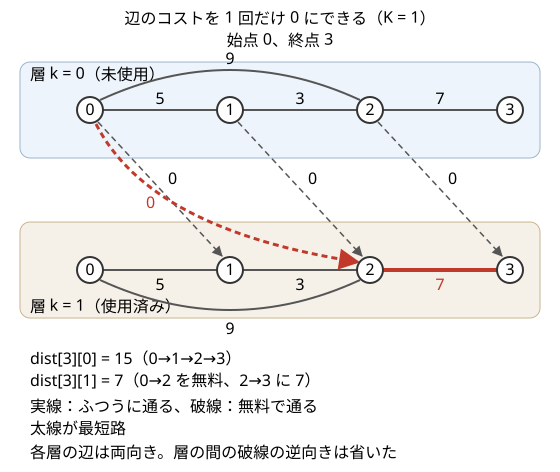
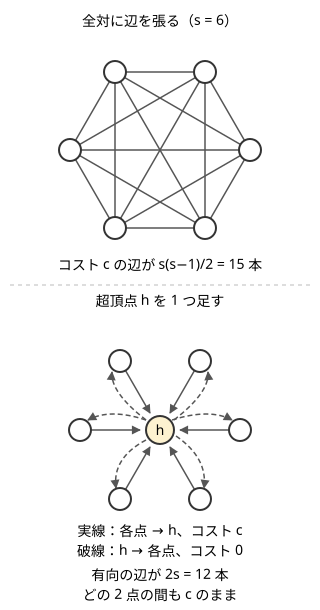
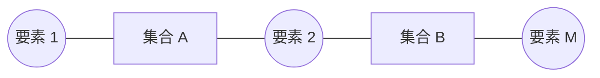

!!! abstract "要点"
    - **何ができるか**：元の頂点だけでは次の動きが決まらないとき、向き・残り回数・偶奇・盤面などを組にした状態を頂点にして最短路を求める。グループ内を自由に行き来できるなら、超頂点を足して辺を減らす。
    - **いつ使うか**：
        - K 回まで無料・スキップできる、手持ちのお金・燃料・体力がある
        - 向き・直前の移動・歩数の偶奇や mod で次の移動が変わる
        - 同じグループ（色・文字・集合）の中ならどこへでも移動できる
        - 盤面・配置を操作して目標の形にする最小回数・2 人（2 つの駒）が同時に動く
        - 状態数が 10&#94;6〜10&#94;7 程度に収まる（9! = 362880、60&#94;4 ≈ 1.3×10&#94;7）
        - 距離を dist\[頂点][向き・残り回数・偶奇] のように 2 次元以上で持ちたくなる
    - **計算量**：状態数 $S$、遷移の数 $T$ に対して、BFS で $O(S + T)$、ダイクストラ法で $O((S + T) \log S)$。(頂点, $K$ 通りの情報) を状態にすると $S = NK$、$T$ はおよそ $MK$
    - **前提**：[ダイクストラ法](../graph/dijkstra.md)

<!-- textlint-disable -->
別名：状態空間の探索・状態空間 BFS・拡張ダイクストラ・頂点倍化・頂点倍加・レイヤー化グラフ・超頂点・仮想頂点・補助頂点・盤面の BFS・state-space search・layered graph・super vertex
<!-- textlint-enable -->

状態を頂点にする手法は、「今どの頂点にいるか」に加えて、この先の動きを決めるのに要る情報を組にしたものを 1 つの頂点とみなし、そのグラフで最短路を求める。最短路のアルゴリズム自体は [BFS](../graph/bfs.md)・[01-BFS](../graph/zero-one-bfs.md)・[ダイクストラ法](../graph/dijkstra.md)のままで、変わるのはグラフの作り方だけである。グループ内の全対に辺がある問題では、逆に頂点を 1 つ足して辺を減らす（超頂点）。

## 状態として持つべき情報を決める {#choose-state}

状態として持つべき情報は、「その時点から先にできる動きとそのコストが、何を知っていれば決まるか」で決める。頂点だけでは決まらないときに、決めるのに足りない情報を頂点に足す。

### 必要になる場面

重み付きの無向グラフで、頂点 $0$ から頂点 $N-1$ へ行く。ただし、辺のコストを $K$ 回まで $0$ にできる。ふつうのダイクストラ法は $\mathrm{dist}[v]$ だけを持つが、同じ頂点 $v$ でも「あと何回無料にできるか」で先の最短路が変わる。そのため、$\mathrm{dist}[v]$ を 1 つの値に決められない。

すべての辺の選び方（どの $K$ 本を無料にするか）を試すと $\binom{M}{K}$ 通りあり、間に合わない。

### アイデア：使った回数を頂点に足す

状態を (頂点 $v$, 無料を使った回数 $k$) にする。$0 \le k \le K$ なので、状態は $N(K+1)$ 個ある。元の辺 $u \to v$（コスト $c$）1 本から、各 $k$ について次の 2 本の辺を張る。

- ふつうに通る：$(u, k) \to (v, k)$、コスト $c$
- 無料で通る：$(u, k) \to (v, k+1)$、コスト $0$（$k < K$ のときだけ）

$k$ ごとに元のグラフの写しを 1 枚ずつ重ねたもの（層）と考えると、無料で通る辺は 1 つ下の層へ降りる辺になる。



この例では $K = 1$ で、元の辺は $0\text{–}1$（5）・$1\text{–}2$（3）・$2\text{–}3$（7）・$0\text{–}2$（9）である。上の層だけを通ると $\mathrm{dist}[3][0] = 15$ になる。$0 \to 2$ を無料で通って下の層へ降り、$2 \to 3$ にコスト 7 を払うと $\mathrm{dist}[3][1] = 7$ になる。答えは終点のすべての層の最小で $\min(15, 7) = 7$ である。

### なぜ正しいか

元の問題で許される動き方（どの辺を通り、どこで無料を使うか）と、状態のグラフで始点の状態 $(0, 0)$ から出る経路は 1 対 1 に対応し、コストも等しい。動き方を 1 つ決めると、各時点の (頂点, 使った回数) が決まり、それが状態のグラフの経路になる。逆に経路をたどれば動き方が読み取れる。無料で通る辺は $k$ を 1 増やすので、$K$ 回を超えて使う経路は状態のグラフにない。

したがって、元の問題の最小コストは「状態のグラフでの $(0, 0)$ から終点の状態のどれかへの最短距離」に等しい。辺のコストは非負なので、ダイクストラ法がそのまま正しく動く。

一般に、状態は次の条件を満たせばよい。

- **先が状態だけで決まる**：その状態から出る辺（できる動き）とそのコストが、状態だけで決まる。過去の動き方を知らなくてよい
- **答えが状態から読める**：ゴールしたかどうかと、答えにしたい量が状態と距離から分かる

情報が足りないと、同じ状態でも過去の動き方によって次にできる動きが変わってしまい、距離が正しくならない。逆に余計な情報を持つと、正しいが状態数が増える。持つべき情報は「この条件を満たす最小のもの」を探す。

### 処理の流れ

状態のグラフを辺の一覧として作らず、状態を取り出すたびに遷移をその場で作るのが基本である。

```text
dist[状態] を全部 INF にする
始点の状態 s0 について dist[s0] = 0、キューに s0 を入れる
キューが空になるまで：
    距離が最小の状態 x を取り出す（古い候補なら捨てる）
    x を (頂点 v, 情報 k) に戻す
    v から出る元の辺と、k の規則から、x の遷移先 y とコスト c を作る
    dist[x] + c < dist[y] なら更新して y を入れる
答え = 終点の頂点を持つすべての状態の dist の最小
```

辺のコストがすべて等しければ BFS、0 と 1 だけなら 01-BFS、非負ならダイクストラ法を使う。$K$ 回まで無料の例をダイクストラ法で書くと次のようになる。状態 $(v, k)$ を整数 $v(K+1) + k$ に詰めている。

```cpp
--8<-- "extended-dijkstra/layered.cpp:core"
```

??? question "確認問題：層の間の辺を下向き（k から k+1）だけにするのはなぜか"
    無料を使った回数は増えるだけで、減ることがないからである。上向きの辺を張ると、使った回数を取り消せることになり、$K$ 回を超えて無料にする経路ができてしまう。層の間の辺が一方向なので、状態のグラフで $k$ は経路に沿って単調に増え、各経路が使う無料の回数は終点の層の番号に等しい。

## 状態数と遷移数の見積もり・状態を整数に詰める（配列で引くか map で持つか） {#state-count}

状態数と遷移数の見積もりは、状態を決めたら最初にする仕事である。計算量は、BFS なら $O(S + T)$、ダイクストラ法なら $O((S + T) \log S)$ になる。ここで $S$ は状態数、$T$ は全状態の遷移の数の合計である。

| 状態 | 状態数 $S$ | 遷移の数 $T$（辺は有向で $M$ 本） |
| --- | --- | --- |
| (頂点, 使った回数 $0..K$) | $N(K+1)$ | 約 $2M(K+1)$ |
| (マス, 向き 4 通り) | $4HW$ | $16HW$ |
| (頂点, 訪問した集合) | $N 2^N$ | $M 2^N$ 程度 |
| 9 個の駒の並び | $9! = 362880$ | 状態ごとに空いた頂点の次数 |
| 2 人の位置（$60 \times 60$ の盤） | $60^4 \approx 1.3 \times 10^7$ | $4S$ |

目安として、BFS なら $S + T$ が $10^7$〜$10^8$ 程度まで、ダイクストラ法なら $\log$ がかかる分だけ小さく見積もる。

### 整数に詰めて配列で引く

状態が「各成分の範囲が決まった組」なら、混合基数で 1 つの整数に詰めて配列で引く。

$$
(v, k) \mapsto v \cdot L + k \quad (0 \le k < L)
$$

$$
(r_1, c_1, r_2, c_2) \mapsto ((r_1 W + c_1) H + r_2) W + c_2
$$

戻すときは割り算と余りを使う（$v = x / L$、$k = x \bmod L$）。成分の範囲 $L$ を 1 つでも小さく取ると、別の状態と同じ整数になり、距離が混ざる。$K$ 回まで使える問題の範囲は $0..K$ の $K + 1$ 通りである。

### map で持つとき

盤面の並びや文字列のように、とりうる値は少ないが整数への詰め方が自明でないときは、`map` か `unordered_map` に状態そのものを鍵として距離を持つ。書くのは楽だが、1 回の操作が配列より何倍も遅い。状態数が $10^5$〜$10^6$ を超えるなら、整数に詰めて配列で引けないかを考える。9 個の並びなら $9^9 \approx 3.9 \times 10^8$ の配列は大きすぎるが、並びは順列なので map で 362880 個を持てば足りる。

??? question "確認問題：60×60 の盤で 2 人の位置の組を状態にするとき、距離の配列はどれくらいのメモリを使うか"
    状態数は $60^4 = 12960000$ である。`int` で持つと 4 バイトずつで約 52MB になる。`vector<int>` 1 本なら多くの環境で収まるが、同じ大きさの配列を何本も持つ（訪問済み・前の状態など）と足りなくなることがある。訪問済みは距離が INF かどうかで判定して、配列を増やさない。

## 2 つの位置の組を状態にする {#pair-state}

2 つの駒（2 人）が同時に動く問題では、どちらか一方の位置だけでは次の動きが決まらない。そこで、2 つの位置の組 $(p_1, p_2)$ を 1 つの状態にする。1 回の操作で両方が動くなら、操作 1 回が状態のグラフの辺 1 本になる。

- 状態数は「位置の数の 2 乗」になる。$H \times W$ の盤なら $(HW)^2$ で、$60 \times 60$ で約 $1.3 \times 10^7$ である
- 片方だけが壁で止まる規則は、その人の行き先を「動けなければ元の位置」にするだけで遷移に入る
- 2 人を区別しないなら $(p_1, p_2)$ と $(p_2, p_1)$ を同じ状態にまとめられ、状態数が約半分になる。区別するかどうかは、規則が 2 人について対称かで決める

盤面全体・駒の配置・石の並びを状態にするのも同じ考え方である。この場合は状態数が組合せの数（$9!$ や $2^N \times N$ など）になるので、先に見積もってから実装する。例題は[ABC339 D](#abc339_d)。

## 頂点倍化（層を作り、層の間の辺でコストを表す） {#layered-graph}

頂点倍化は、元の頂点を「状態の数」だけ複製して層を作り、層の中の辺で元の移動を、層の間の辺で状態の変化とそのコストを表す手法である。[状態として持つべき情報を決める](#choose-state)の $K$ 回まで無料の例は、層が $K+1$ 枚の頂点倍化である。

層の間の辺の向きとコストで、いろいろな規則を表せる。

- **回数に上限がある操作**（$K$ 回まで無料・スキップ）：層 $k$ から層 $k+1$ へ一方向の辺を張る。上限を超えないことが層の数で保証される
- **一度切り替えたら戻れない**（ある時点から先はコストの付け方が変わる）：「切り替え前」「切り替え後」の 2 層を作り、前から後へだけ辺を張る
- **乗り換えや向きの変更にコストがかかる**：「今乗っている路線」「今の向き」を層にし、層を移る辺にそのコストを付ける

最後の型では、路線（会社）ごとに層を作ると層が多すぎる場合もある。実際に現れる (駅, 路線) の組だけを頂点にすれば、頂点数は辺の数に比例する程度で済む。乗り換えは「改札の外」の頂点を 1 つ通す形にすると、同じ駅の路線の全対に辺を張らずに済む（[超頂点](#super-vertex)と同じ考え方）。

## 偶奇・mod・向きを持つ {#parity-mod-direction}

歩数の偶奇や mod、直前の向きのように、取りうる値が数通りしかない情報は、状態に足しても状態数が数倍になるだけで済む。

- **歩数の mod**：「3 歩で 1 回」のように数歩ずつ区切られる移動では、(頂点, 歩数 $\bmod 3$) を状態にする。区切りの途中か区切りの位置かだけが先の動きに効くので、歩数そのものは要らない。状態数 $3N$、辺数 $3M$ で BFS できる。例題は[ABC132 E](#abc132_e)
- **偶奇**：「ちょうど偶数歩で着く」などの条件は (頂点, 歩数 $\bmod 2$)。曜日や周期のある規則も (頂点, 時刻 $\bmod$ 周期) にすると、周期の数倍のグラフで考えられる
- **直前の向き**：「直進しかできないマス」「曲がるとコスト 1」などは (マス, 直前の向き) にする。直進をコスト 0、曲がるのをコスト 1 にすると 0 と 1 の辺だけになり、01-BFS で解ける

向きを持つときは、始点の「まだ動いていない」状態に気をつける。始点ではどの向きにも進めることが多いので、始点の 4 つの向きの状態をすべて距離 0 でキューに入れるか、「向きなし」の状態を 1 つ足す。

## 超頂点・補助頂点で辺の数を減らす {#super-vertex}

超頂点（補助頂点）は、グループ内のどの 2 点の間もコスト $c$ で行き来できるとき、全対に辺を張る代わりに、新しい頂点 $h$ を 1 つ足して辺の数を減らす手法である。全対に張ると $s$ 点のグループで $s(s-1)/2$ 本になり、グループが大きいと辺の数が $O(N^2)$ になる。



辺は有向に張り、次のようにコストを分ける。

- 各点 $v$ から $h$ へ：コスト $c$
- $h$ から各点 $v$ へ：コスト $0$

グループ内の 2 点 $u, v$ の間は $u \to h \to v$ でちょうど $c$ になり、元のグラフと距離が変わらない。$h$ に入るには必ず $c$ を払うので、$h$ を経由して得をする経路はない。辺の数はグループごとに $2s$ 本で、合計はグループの大きさの和に比例する（グループが重ならなければ頂点数に比例する）。

コストが $X_i + Y + X_j$ のように出る側と入る側に分かれる場合も同じで、辺 $i \to h$ のコストを $X_i$、辺 $h \to j$ のコストを $Y + X_j$ とする。グループ（色・文字・集合）が複数あれば、グループごとに超頂点を 1 つずつ足す。

BFS のまま扱いたいときは、超頂点を経由する移動を「1 回だけ展開する」書き方もある。あるグループの点を初めてキューから取り出したとき、そのグループの全点に距離を付けて、以後そのグループは展開しない。初めて取り出した時点の距離が最小なので、後から取り出しても距離は縮まらない。各点は 1 回しか展開されないので、合計は $O(N + M)$ になる。例題は[ABC184 E](#abc184_e)。

## 超頂点で距離がずれる場合の補正（2 で割る・1 を引く） {#super-vertex-offset}

超頂点の辺をすべてコスト 1 の無向の辺にして BFS すると、グループ内の移動 1 回が辺 2 本になり、距離が元の値からずれる。ずれ方が一定なら、最後に補正して答える。



この図は、集合を超頂点にし、要素と集合を「含む」関係でつないだグラフである。要素 1 から要素 $M$ への経路は、要素と集合を交互に通る。使う集合が $k$ 個なら経路の長さは $d = 2k$ になる。$k$ 個の集合を 1 つにまとめる操作は $k - 1$ 回なので、答えは $d/2 - 1$ である。

補正のしかたは、グラフの作り方で決まる。

- **すべての移動が超頂点を通る**（要素と集合が交互に並ぶ二部グラフ）：距離は必ず偶数で、移動の回数は $d/2$。数えたいものが別なら、さらに $1$ を引くなどの調整をする
- **ふつうの辺と超頂点を通る移動が混ざる**：一律に 2 で割れない。ふつうの辺のコストを 2 にそろえるか、超頂点の辺を[超頂点の節](#super-vertex)のように (入る $c$, 出る $0$) の有向にして、補正そのものを要らなくする

補正を使うときは、小さな例で「元の答え」と「状態のグラフの距離」を手で並べ、式を確かめてから書く。

??? question "確認問題：超頂点との辺のコストを、有向の (入る c, 出る 0) にする場合と、無向の c/2 ずつにする場合で何が変わるか"
    どちらもグループ内の 2 点の間の距離は $c$ で、元のグラフと同じになる。違いは 2 つある。1 つは、$c$ が奇数だと $c/2$ が整数にならないことで、無向にするならすべてのコストを 2 倍にする必要がある。もう 1 つは、始点や終点が超頂点そのものになる場合で、無向の $c/2$ では超頂点までの距離が $c/2$ という中途半端な値になる。有向の (入る $c$, 出る $0$) なら、どちらの問題も起きない。

## 状態が多すぎるときは重要な点だけのグラフに作り直す {#key-points}

状態を頂点にすると状態数が多すぎるときは、答えに効く「重要な点」だけを頂点としたグラフへ作り直す。たとえば、グリッドを 1 歩進むたびに体力が 1 減り、ところどころの「回復する点」では体力をその点ごとの決まった値 $E_i$ にできるとする。回復は使うかどうかを選べ、素通りしてもよい。(マス, 体力) を状態にすると、$200 \times 200$ のグリッドで体力も $200^2$ 通りなら $1.6 \times 10^9$ 状態になり、持てない。

回復する点が $P$ 個しかないなら、次のように作り直す。

1. 始点と回復する点のそれぞれから BFS し、ほかの重要な点や終点への距離を求める（$P$ 回程度の BFS で $O(P \cdot HW)$）
2. 点 $i$ の回復の値 $E_i$ が $i$ から $j$ への距離以上なら、$i \to j$ に有向の辺を張る（始点からは始点の体力で同じように張る）
3. 作り直したグラフで到達できるかや最短路を調べる

回復した直後の体力はその点だけで決まるので、回復した点にいるときの状態は (点) だけで足りる。途中の回復する点は素通りしてよいので、$i$ から $j$ への最短の距離だけを見ればよい。これが作り直してよい理由である。回復が強制される問題では、途中の点で体力が書き換わるので、この作り方は使えない。状態のうち途中の値（歩いている間の体力）を捨て、重要な点での値だけを残している。

## 資源を状態に持ち、上限で打ち切る {#resource-state}

追加の前提：なし（[頂点倍化](#layered-graph)の続き）。

所持金・燃料・体力のように増えたり減ったりする量（資源）を状態に持つと、(頂点, 資源の量) が状態になる。資源の量に上限がないと状態数が決まらないので、「これ以上持っていても意味がない量」$U$ で打ち切り、$U$ 以上はすべて $U$ とみなす。

### 打ち切ってよい理由

辺を通るたびに資源を払い、頂点で時間をかけて資源を補充できる問題で考える。辺 1 本で払う資源を高々 $A$、頂点数を $N$ とし、$U = (N-1)A$ とする。

- 資源を $U$ 以上持っていれば、以後は補充せずに、どの頂点へも時間の最短路で行ける。最短路は同じ頂点を 2 度通らないものが取れるので、辺は高々 $N-1$ 本で、払う資源は $U$ 以下だからである
- 補充は時間がかかるだけなので、資源が足りているなら補充しないほうがよい
- よって、資源が $U$ 以上の状態から先の最小時間は、資源の量によらず同じである。$U$ 以上をまとめて $U$ にしても距離は変わらない

状態数は $N(U+1)$ で、遷移は「辺を通る（資源が足りるとき）」と「その場で補充する（上限で $U$ に切る）」の 2 種類である。どちらも時間は非負なので、ダイクストラ法を使う。

??? question "確認問題：打ち切りの値を、払う資源の合計の上限（全部の辺の A の和）にしても正しいか"
    正しい。打ち切りの値は「それ以上持っていれば先の最小時間が変わらない量」以上であればよく、大きく取るぶんには距離は変わらない。ただし状態数が増えて遅くなる。単純な路の辺の数が高々 $N-1$ 本であることを使うと、$(N-1)A$ まで小さくできる。

## 訪問した集合を持つ（bitDP へのつなぎ） {#visited-set}

追加の前提：[bitDP](../dp/bit-dp.md)、[bit 演算](../basics/bit-operations.md)。

「各頂点を何回通ったかの偶奇」「どの鍵を拾ったか」のように、頂点の集合そのものが先の動きや答えに効くときは、(訪問した集合, 今の頂点) を状態にする。集合は $N$ ビットの整数で表すので、状態数は $N 2^N$ で、$N \le 17$ 程度が目安になる。

- 遷移は「今の頂点 $v$ から隣の $u$ へ動き、集合を更新する」。偶奇なら集合 $X$ を $X \oplus 2^u$ にする（$u$ の偶奇が反転する）
- 辺のコストがすべて 1 なら BFS で、全状態の距離が $O(2^N (N + M))$ で求まる
- 始点が自由なら、すべての $(\{v\}, v)$ を距離 0 として最初のキューへ入れる（多始点 BFS）。長さを頂点の数として数える問題なら、距離 1 から始める（ABC244 F はこちら）

偶奇の集合は同じ頂点を何度通っても変わり続けるので、状態のグラフに閉路があり、DP ではなく BFS で距離を求める。逆に、各頂点を 1 回ずつ訪れる（集合が増えるだけの）問題なら、集合の包含の順に計算できるので bitDP で書ける。巡回セールスマン問題はこちらの型である。

## 両端から伸ばす（回文の最短路） {#two-ends}

追加の前提：なし（[2 つの位置の組](#pair-state)の続き）。

辺に文字が書かれたグラフで、通った辺の文字列が回文になる最短の歩道を求めるときは、歩道の両端を同時に伸ばす。状態を両端の頂点の組 $(u, v)$ にし、$(u, v)$ の距離を「$u$ から $v$ への回文の歩道の最短の長さ」とする。

- **始まり**：長さが偶数の回文は真ん中が空なので、すべての $(x, x)$ が距離 0。長さが奇数の回文は真ん中が 1 本の辺なので、辺 $x\text{–}y$ ごとに $(x, y)$ が距離 1
- **遷移**：$(x, y)$ から、$x$ の隣の $s$ と $y$ の隣の $t$ へ同じ文字の辺があれば、$(s, t)$ へ距離 $+2$ で伸ばす。外側に同じ文字を 1 つずつ足しても回文のままだからである
- **答え**：$(1, N)$ の距離。無向グラフなら $(u, v)$ と $(v, u)$ は同じ値になる

始まりの距離は 0 と 1 で、遷移はどれも $+2$ である。距離 0 の状態を先に、距離 1 の状態を後にキューへ入れておけば、ふつうのキューで距離の小さい順に取り出せる。状態数は $N^2$ で、遷移は文字ごとに隣どうしの組を作るので、合計は $O(M^2)$ 程度になる。

## 落とし穴 {#pitfalls}

- **答えを 1 つの状態だけで読む**：終点が (終点, $k$) のように複数の状態に分かれるとき、すべての $k$ の最小を取る。$K$ 回まで無料の問題で $\mathrm{dist}[t][K]$ だけを見ると、無料を使い切らない経路を見落とす
- **始点の状態を決め忘れる**：向きを持つ問題で始点の向きを 1 つに決め打ちすると、最初の 1 歩が制限される。始点のすべての向きを距離 0 で入れる
- **詰め方の範囲が小さい**：$v \cdot K + k$ と書いて $k = K$ を許すと、$(v, K)$ と $(v+1, 0)$ が同じ整数になる。範囲は $0..K$ の $K + 1$ 通りなので $v(K+1) + k$ にする
- **状態のグラフを先に全部作る**：状態数 $10^7$ のグラフを隣接リストで持つと、メモリが足りなくなる。遷移は取り出したときにその場で作る
- **グループの全対に辺を張る**：同じ文字・同じ色の全対を展開すると $O(N^2)$ になる。超頂点を足すか、グループを 1 回だけ展開する
- **超頂点の辺を無向で張り、ふつうの辺と混ぜる**：グループ内の移動だけ距離が 2 倍になり、一律の補正ができない。有向の (入る $c$, 出る $0$) にする
- **資源の上限を決めずに状態を持つ**：所持金 $10^9$ をそのまま状態にすると持てない。先の動きに効く上限で打ち切る

## 例題 {#examples}

### ABC339 D. Synchronized Players {#abc339_d}

<div class="kp-problems" data-role="example" markdown>

- [ABC339 D. Synchronized Players](https://atcoder.jp/contests/abc339/tasks/abc339_d)（diff 1276）：障害物のあるグリッドに 2 人がいて、毎回同じ方向へ一斉に動く（動けない人はその場に残る）とき、2 人を同じマスに集める最小の操作回数を求める

</div>

方針：1 人の位置だけでは、もう 1 人がどこにいるかで次の結果が変わる。2 人の位置の組を状態にすると、1 回の操作で状態が 1 つに決まる。操作はどれもコスト 1 なので BFS で最小回数が求まる。

??? note "解法の詳細"
    - 状態は $(r_1, c_1, r_2, c_2)$。盤の一辺を $N$ とすると状態数は $N^4$ で、$N = 60$ でも約 $1.3 \times 10^7$ である。$((r_1 N + c_1) N + r_2) N + c_2$ に詰めて配列で距離を持つ。
    - 各状態から 4 つの方向を試す。それぞれの人について、行き先が盤の外か障害物ならその場に残り、そうでなければ動く。
    - 初めの状態から BFS し、2 人が同じマスにいる状態を初めて取り出したときの距離が答えである。キューが空になれば集められない。
    - 遷移が状態ごとに 4 本なので、計算量は $O(N^4)$。

### ABC184 E. Third Avenue {#abc184_e}

<div class="kp-problems" data-role="example" markdown>

- [ABC184 E. Third Avenue](https://atcoder.jp/contests/abc184/tasks/abc184_e)（diff 1418）：同じ文字のテレポーターの間を移動できる迷路で、スタートからゴールまでの最小の移動回数を求める

</div>

方針：同じ文字のマスの全対に辺を張ると、1 つの文字のマスが多いときに辺が $O((HW)^2)$ になる。文字ごとに超頂点を足すか、文字ごとのテレポートを 1 回だけ展開して、BFS を $O(HW)$ に収める。

??? note "解法の詳細"
    - **1 回だけ展開する書き方**：文字ごとにマスの一覧を作っておく。BFS で文字 $\alpha$ のマスを初めて取り出したら（距離 $d$）、$\alpha$ の全マスのうち未訪問のものを距離 $d+1$ でキューに入れ、$\alpha$ の一覧を空にする。以後 $\alpha$ のマスを取り出しても展開しない。
    - 1 回でよい理由：BFS は距離の小さい順に取り出すので、$\alpha$ のマスを後で取り出すときの距離は $d$ 以上である。そこから展開しても $d+1$ より小さい距離は付かない。
    - **超頂点で書く場合**：文字ごとに頂点 $h_\alpha$ を足し、マス $\to h_\alpha$ をコスト 1、$h_\alpha \to$ マスをコスト 0 にして 01-BFS する。
    - どちらも頂点は $HW + 26$ 個、辺は $O(HW)$ 本で、計算量は $O(HW)$。

### ABC132 E. Hopscotch Addict {#abc132_e}

<div class="kp-problems" data-role="example" markdown>

- [ABC132 E. Hopscotch Addict](https://atcoder.jp/contests/abc132/tasks/abc132_e)（diff 1625）：有向グラフで、辺を 3 本たどる「ケンケンパ」をくり返して頂点 S から頂点 T へ行くとき、ケンケンパの最小回数を求める

</div>

方針：ケンケンパの途中で T を通っても着いたことにならない。今が「3 本区切りの何本目か」が分かれば先の動きが決まるので、(頂点, たどった辺の数 $\bmod 3$) を状態にする。BFS で $(T, 0)$ への距離を求め、3 で割る。

??? note "解法の詳細"
    - 状態は $(v, r)$（$0 \le r < 3$）で $3N$ 個。元の辺 $u \to v$ から、各 $r$ について $(u, r) \to (v, (r+1) \bmod 3)$ を張る。辺は $3M$ 本。
    - $(S, 0)$ から BFS する。$(T, 0)$ への距離 $d$ は 3 の倍数で、ケンケンパの回数は $d/3$。$(T, 0)$ に着かなければ $-1$。
    - たどる辺の本数が最小なら回数も最小なので、辺の本数で BFS してよい。
    - 計算量は $O(N + M)$。

## 練習問題 {#practice}

<div class="kp-problems" data-role="practice" markdown>

- [ABC453 D. Go Straight](https://atcoder.jp/contests/abc453/tasks/abc453_d)（diff 1011）：マスごとに「直前と同じ向きにしか進めない」「直前と違う向きにしか進めない」などの決まりがあるグリッドで、S から G へ行けるかを判定し、行けるなら経路を 1 つ示す。
- [ABC463 E. Roads and Gates](https://atcoder.jp/contests/abc463/tasks/abc463_e)（diff 1055）：道路での移動に加えて、費用 X_i + Y + X_j で都市 i から都市 j へ直接移れるとき、都市 1 から各都市への最短の時間を求める。
- [ABC361 D. Go Stone Puzzle](https://atcoder.jp/contests/abc361/tasks/abc361_d)（diff 1202）：一列に並んだ白と黒の石を、隣り合う 2 個ずつ空きマスへ移す操作で目標の並びにするとき、操作の最小回数を求める
- [ABC224 D. 8 Puzzle on Graph](https://atcoder.jp/contests/abc224/tasks/abc224_d)（diff 1376）：9 頂点のグラフの 8 頂点に駒が置かれ、空いた頂点へ隣の駒を動かせるとき、すべての駒を目的の頂点へそろえる最小の手数を求める
- [ABC302 F. Merge Set](https://atcoder.jp/contests/abc302/tasks/abc302_f)（diff 1430）：共通の要素をもつ 2 つの集合を和集合に置き換える操作で、1 と M を両方含む集合を作るのに必要な最小の操作回数を求める
- [ABC244 F. Shortest Good Path](https://atcoder.jp/contests/abc244/tasks/abc244_f)（diff 1661）：各頂点を通った回数の偶奇を表す 0/1 列 S のすべてについて、その偶奇になる最短の歩道の長さを求め、総和を答える

</div>

??? note "練習の方針"
    - **ABC453 D**：(マス, 直前の向き) を状態にして BFS する。始点では向きが決まっていないので、始点の 4 つの向きの状態をすべて入れる。経路は各状態の前の状態を記録してたどる（[偶奇・mod・向き](#parity-mod-direction)）。
    - **ABC463 E**：都市から超頂点へ $X_i$、超頂点からもう 1 つの補助頂点へ $Y$、補助頂点から都市へ $X_j$ の有向の辺を足してダイクストラ法を回す（[超頂点](#super-vertex)）。
    - **ABC361 D**：石の並びに空きマス 2 つを足した文字列を状態にし、map で距離を持って BFS する。状態数は $O(N 2^N)$（[2 つの位置の組](#pair-state)と同じ、盤面を状態にする型）。
    - **ABC224 D**：空いた頂点に仮想の駒 9 を置くと、配置は 9 個の順列になる。$9! = 362880$ 状態を map で持って BFS する。
    - **ABC302 F**：集合と要素を頂点にし、含む関係で辺を張る。要素 1 から要素 $M$ への距離 $d$ から $d/2 - 1$ を答える（[補正](#super-vertex-offset)）。
    - **ABC244 F**：(偶奇の集合, 今の頂点) を状態にし、すべての $(\{v\}, v)$ から多始点 BFS する。集合ごとに最小の距離を取って足す（[訪問した集合](#visited-set)）。

## 力試し {#challenge}

<div class="kp-problems" data-role="challenge" markdown>

- [ABC164 E. Two Currencies](https://atcoder.jp/contests/abc164/tasks/abc164_e)（diff 1877）：運賃が銀貨、所要時間が分の路線で、各都市で金貨を銀貨に両替できるとき、都市 1 から各都市への最短時間を求める
- [ABC197 F. Construct a Palindrome](https://atcoder.jp/contests/abc197/tasks/abc197_f)（diff 1945）：各辺に文字が書かれた無向グラフで、頂点 1 から頂点 N への歩道のうち、通った辺の文字列が回文になるものの最短の長さを求める
- [ARC061 E. Snuke's Subway Trip](https://atcoder.jp/contests/arc061/tasks/arc061_c)（diff 2502）：路線ごとに鉄道会社が決まっており、会社を乗り換えるたびに運賃が 1 かかるとき、駅 1 から駅 N への最小運賃を求める

</div>

??? note "力試しの方針"
    - **ABC164 E**：(都市, 銀貨の枚数) を状態にしてダイクストラ法を回す。制約は $N \le 50$・運賃 $\le 50$ である。銀貨を $49 \times 50 = 2450$ 以上持っても意味がないので、2500 などで打ち切る（[資源を状態に持つ](#resource-state)）。
    - **ABC197 F**：両端の組 $(u, v)$ を状態にし、同じ文字の辺で両側へ伸ばす（[両端から伸ばす](#two-ends)）。
    - **ARC061 E**：実際に現れる (駅, 会社) の組と、駅ごとの「改札の外」を頂点にする。外から (駅, 会社) へ入る辺はコスト 1 にする。(駅, 会社) から外へ出る辺と、同じ会社の路線の辺はコスト 0 にして 01-BFS する。答えは駅 1 の外から駅 $N$ の外への距離である（[頂点倍化](#layered-graph)）。

## 確認問題 {#quiz}

??? question "確認問題：「状態として持つべき情報」が足りないと、何が起きるか"
    同じ状態なのに、過去の動き方によって次にできる動きやコストが違う、ということが起きる。最短路のアルゴリズムは各状態の距離を 1 つしか持たないので、先に確定した動き方の都合で、本当は通れる遷移を通れないとみなしたり、通れない遷移を通ってしまったりする。たとえば向きで動きが変わる問題で (マス) だけを状態にすると、別の向きから来たほうが先へ進めるのに、先に確定した向きだけで遷移を作ってしまう。

??? question "確認問題：N = 10^5、M = 2×10^5、K = 10 で「K 回まで無料」の問題をダイクストラ法で解くとき、状態数と辺数はどれくらいか"
    状態数は $N(K+1) = 1.1 \times 10^6$ である。無向の辺 1 本は有向の 2 本になる。各層で「ふつうに通る」と「無料で通る」の 2 種類があるので、辺数はおよそ $2M \times 2 \times (K+1) \approx 8.8 \times 10^6$ である。$\log$ を掛けても $10^8$ 程度で、間に合う見込みが立つ。

??? question "確認問題：超頂点を足しても、元のグラフの 2 点間の距離が変わらないのはなぜか"
    元のグループ内の辺 $u\text{–}v$（コスト $c$）は、$u \to h \to v$（コスト $c + 0$）で置き換えられる。だから距離は増えない。逆に $h$ を通る経路は必ず「グループの点 $\to h \to$ グループの点」の形をしていて、そのコストは $c$ で、元の辺 1 本に戻せる。よって距離は減りもしない。$h$ に入る辺がグループの点からしか出ていないことと、入るときに $c$ を払うことが要点である。

## 使い分け {#comparison}

- **遷移のコスト**：すべて等しければ BFS、0 と 1 だけなら 01-BFS、非負の重みならダイクストラ法。状態の作り方とは独立に選ぶ
- **訪問した集合を持つ**：集合が増えるだけ（各頂点を 1 回ずつ）なら bitDP で計算順序を決めて書ける。偶奇のように集合が行き来するなら BFS
- **時刻で辺が変わる**：状態に時刻を持つ前に、[時刻で変わる辺](../graph/time-dependent-dijkstra.md)の型（待つ遷移を入れたダイクストラ法）で済まないかを考える
- **連結かどうかだけ**：最短距離が要らず、グループをまとめて行き来できるかだけなら、超頂点より [Union-Find](../graph/union-find-connectivity.md) で同じグループを併合するほうが短く書ける
- **区間の全点に辺を張る**：超頂点を何段も重ねた[区間に辺を張る](../graph/segment-tree-graph.md)手法を使う
- **頂点を剰余にする**：「値の mod を頂点にして、到達できる最小値を求める」型は[同余最短路](../graph/modular-shortest-path.md)
- **何を頂点にするか自体を考える**：[グラフへの帰着](../graph/graph-modeling.md)

## 参考 {#references}

- [Lanly「AtCoder Beginner Contest 339」](https://www.cnblogs.com/Lanly/p/18005285)：ABC339 D の状態（2 人の位置の組）・遷移・状態数
- [kmjp「AtCoder ABC #184 : E - Third Avenue」](https://kmjp.hatenablog.jp/entry/2020/11/22/1000)：テレポートを文字ごとに 1 回だけ展開する BFS
- [kmjp「AtCoder ABC #132 : E - Hopscotch Addict」](https://kmjp.hatenablog.jp/entry/2019/06/29/1030)：(頂点, 歩数 mod 3) の状態と、距離を 3 で割る答え方
- [yuu_kyopro「ダイクストラ法の計算量と定数倍改善・負の辺・超頂点・頂点倍加・01BFS【競プロ】」](https://qiita.com/yuu_kyopro/items/761919d9bccc88521863)：超頂点と頂点倍加の分類、ABC302 F の補正
- [comet725「ABC453Dを解いた【BFS】」](https://qiita.com/comet725/items/5f7d010ebd6a79b29996)：ABC453 D の状態（マス, 直前の向き）と始点の扱い
- [comet725「ABC463Eを解いた【ダイクストラ法】」](https://qiita.com/comet725/items/15e9951d2076493fcbe6)：ABC463 E の補助頂点 2 つの作り方
- [けんちょん「AtCoder ABC 302 F - Merge Set」](https://drken1215.hatenablog.com/entry/2023/06/10/130500)：集合と要素の二部グラフと、答え $d/2 - 1$ の理由
- [けんちょん「AtCoder ABC 361 D - Go Stone Puzzle」](https://drken1215.hatenablog.com/entry/2024/07/07/151254)：石の並びを状態にした BFS と状態数
- [競プロはじめました「ABC224D - 8 Puzzle on Graph」](https://kyo-pro.hatenablog.com/entry/ABC224D)：空き頂点に仮想の駒を置いて順列を状態にする
- [はまやん「Shortest Good Path [AtCoder Beginner Contest 244 F]」](https://blog.hamayanhamayan.com/entry/2022/03/21/163326)：(偶奇の集合, 今の頂点) の BFS と多始点
- [kmjp「AtCoder ABC #164 : E - Two Currencies」](https://kmjp.hatenablog.jp/entry/2020/04/28/0900)：(頂点, 銀貨) のダイクストラ法と上限での打ち切り
- [けんちょん「AtCoder ABC 164 E - Two Currencies」](https://drken1215.hatenablog.com/entry/2020/04/27/190000)：ABC164 E の制約と、上限 2500 の根拠
- [kmjp「AtCoder ABC #197 : F - Construct a Palindrome」](https://kmjp.hatenablog.jp/entry/2021/03/27/0900)：両端の組の状態・偶数長と奇数長の始まり
- [betrue12「AtCoder Regular Contest 061 E - すぬけ君の地下鉄旅行」](https://betrue12.hateblo.jp/entry/2019/05/25/134323)：(駅, 会社) と改札の外の頂点による作り方
