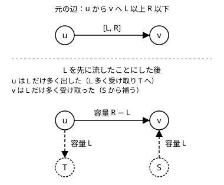

!!! abstract "要点"
    - **何ができるか**：辺に「少なくとも L は流す」という下限があるとき、L を先に流したことにして超頂点で過不足を調整し、普通の最大流に帰着する。下限を満たす流れがあるかの判定と、その中での最大の流量が求まる。
    - **いつ使うか**：
        - この辺には少なくとも L だけ流す
        - 必ず使う・使ってもよい・使ってはいけないものが混在する割当
    - **計算量**：頂点 $N + 2$・辺 $M + N + 1$ のグラフで最大流を 2 回。Dinic 法で $O(N^2 M)$、流れた量を $F$ として $O(F(N + M))$（どちらも上限）
    - **前提**：[最大流](../graph/max-flow.md)

<!-- textlint-disable -->
別名：下限付きフロー・最小流量制約・flow with demands・flow with lower bounds
<!-- textlint-enable -->

最小流量制約付きフローは、各辺の流量の範囲を、上限 $R$ だけでなく下限 $L$ も含めて決めたフローである。下限の分を先に流したことにすると、頂点ごとの「入る量と出る量の食い違い」が残る。この食い違いを 2 つの[超頂点](../guide/glossary.md#super-vertex)から埋められるかを最大流で調べれば、普通の最大流のライブラリで解ける。ABC では発展の帯でまれに現れる程度である。

## 下限を先に流したことにする {#pre-flow}

辺 $u \to v$ に「$L$ 以上 $R$ 以下」の制約があるとする。流量を $f = L + g$ と書き直すと、$g$ の範囲は $0 \le g \le R - L$ になり、下限のない普通の辺と同じ形になる。そこで辺の容量を $R - L$ に置き換え、$L$ はあらかじめ流れているものとして扱う。

先に流した $L$ は流量の保存則を崩す。$u$ からは $L$ が余分に出ていき、$v$ には $L$ が余分に入ってくる。頂点ごとに、先に流した分で入る量の合計から出る量の合計を引いた値を $d(v)$ とする。

$$
d(v) = \sum_{e = (x \to v)} L_e - \sum_{e = (v \to y)} L_e
$$

$d(v) > 0$ の頂点は受け取りすぎで、残りの $g$ の流れで $d(v)$ だけ多く送り出さなければならない。$d(v) < 0$ の頂点は送りすぎで、$-d(v)$ だけ多く受け取らなければならない。$d$ の総和は 0 である（どの $L_e$ も 1 回足されて 1 回引かれる）。



この置き換えは辺ごとに考えてもよいが、後で過不足を埋める辺を足すとき、頂点ごとに $d(v)$ をまとめておくと、足す辺は頂点 1 つにつき高々 1 本で済む。

## 超頂点で過不足を調整して判定する {#super-vertex}

下限を先に流したことで生じた食い違い $d(v)$（$v$ に入る辺の下限の合計 − 出る辺の下限の合計）を埋める流れを、新しい始点 $S$ と終点 $T$ から作る。$d(v) > 0$ の頂点へは $S \to v$（容量 $d(v)$）を、$d(v) < 0$ の頂点からは $v \to T$（容量 $-d(v)$）を張る。$S$ から出る辺の容量の合計を $D = \sum_{d(v) > 0} d(v)$ とする。

- **循環流（始点・終点がなく、すべての頂点で保存則が成り立つ流れ）のとき**：$S$ から $T$ への最大流が $D$ に等しければ、下限を満たす流れがある。$S$ から出る辺がすべて飽和すれば、各頂点の食い違いがちょうど打ち消されるからである。
- **始点 $s$ と終点 $t$ があるとき**：$s$ と $t$ だけは保存則が要らないので、$t \to s$ に容量が十分大きい辺を足して循環流に直してから同じ判定をする。$t \to s$ の辺に流れた量が、元の $s$-$t$ 流の流量にあたる。

正しさは両向きの対応で確かめられる。下限を満たす流れ $f$ があれば、$g = f - L$ に $S \to v$・$v \to T$ の辺を飽和させた流れを加えると、流量 $D$ の $S$-$T$ 流になる。逆に流量 $D$ の整数の $S$-$T$ 流があれば、$S$・$T$ に関わる辺を除いて元の辺に $L$ を足し戻すと、下限を満たす整数の流れになる。容量が整数なら最大流も整数で取れるので、整数の解だけを考えれば足りる。

下限を満たす中で $s$-$t$ の流量を最大にしたいときは、判定の後の[残余グラフ](../guide/glossary.md#residual-graph)で $s$ から $t$ へさらに流す。判定で足した $t \to s$ の辺は残したままでよい。この辺の逆辺（$s \to t$、容量はすでに流れた量）も[増加路](../guide/glossary.md#augmenting-path)になるので、2 回目の最大流の返り値がそのまま合計の流量になる。$S$ から出る辺と $T$ へ入る辺は判定で飽和しているので、2 回目の流れが下限を壊すことはない。

コストのある最小費用流でも、下限の分のコスト $\sum L_e c_e$ を定数として足し、同じ超頂点の作り方で帰着できる（[最小費用流](../graph/min-cost-flow.md)）。ACL の `mcf_graph` のコストは非負に限られるので、負のコストの辺は先に上限まで流したことにして、逆向きでコストが正の辺に置き換えてから使う（このページの置き換えと同じ考え方である）。

## 自作するときの要点と Library Checker {#library}

ACL に下限付きの最大流そのものはなく、`mf_graph` で超頂点を足したグラフを作る。

!!! info "ACL では"
    `mf_graph<long long> g(n + 2);` に、元の辺を容量 $R - L$ で、$S$・$T$ への辺を $d(v)$ から、$t \to s$ を大きな容量で足す。`g.flow(S, T)` が $D$ に等しいかで判定し、続けて `g.flow(s, t)` を呼ぶと最大の流量が返る。どちらも Dinic 法で $O(N^2 M)$ が上限である（[ACL の mf_graph](../graph/max-flow.md#acl)）。

自作するときの要点は次のとおりである。完全なプログラムは `snippets/flow-lower-bounds/usage.cpp` で、小さいグラフで各辺の流量を全通り試した答えと照合してある。

- **$d(v)$ は頂点ごとにまとめる**：辺 1 本ごとに $S \to v$・$u \to T$ を張っても答えは同じだが、辺の数が増える。自己ループ（$u = v$）の下限は $d$ の中で打ち消し合う。
- **大きな容量はあふれない値にする**：$t \to s$ の容量は、ほかの容量の合計より大きければ足りる。容量は `long long` にし、$t \to s$ の容量は $2^{60}$ などにする。`int` の最大値では、ほかの容量の合計に足りないことがある。
- **判定が通るまで最大化に進まない**：`g.flow(S, T)` が $D$ に届かなければ下限を満たす流れはないので、その場で打ち切る。届かないまま `g.flow(s, t)` を呼ぶと、下限を満たさない流れの流量が返ってしまう。
- **流量は 0 以上として扱う**：$t \to s$ の辺は $t$ から $s$ への向きにしか戻さないので、求まるのは流量が 0 以上の流れだけである。下限のせいで流量が負にしかなれない入力は、この形では「流せない」と判定される。

```cpp
--8<-- "flow-lower-bounds/usage.cpp:core"
```

最小の流量は次のように求まる（Luzhiled's Library の方法）。判定で $t \to s$ の辺に流れた量を $X$ とし、この辺の残りの容量を 0 にしてから $t$ から $s$ へ流す。その返り値を $Y$ とすると、最小の流量は $X - Y$ である。判定が通る入力でも、この値は負になることがある。

下限付きの流れそのものを確かめる Library Checker の問題は、コストも付いた Minimum Cost b-flow（[練習問題](#practice)）である。

## 学ぶための資料 {#resources}

- snuke 氏の「最小流量制限付き最大流」：下限を容量から引き、超頂点で過不足を補う作り方と、辺を流す順序の注意
- Luzhiled's Library の「Max Flow Lower Bound」：判定・最大の流量・最小の流量をまとめたライブラリの形
- cp-algorithms の「Flows with demands」（英語）：下限で入る分と出る分を超頂点への辺にする作り方と、最小の流量を二分探索で求める方法

## 例題 {#examples}

### ABC285 G. Tatami {#abc285_g}

<div class="kp-problems" data-role="example" markdown>

- [ABC285 G. Tatami](https://atcoder.jp/contests/abc285/tasks/abc285_g)（diff 2566）：1・2・? が書かれた盤面を 1×1 と 1×2 のタイルで敷き詰めるとき、2 のマスは必ず 1×2 で、1 のマスは必ず 1×1 で覆えるかを判定する。

</div>

盤面を[市松模様で二部グラフ](../graph/grid-graph.md#checkerboard)にすると、1×2 のタイルは隣り合う黒と白のマスの組、すなわちマッチングの 1 本になる。2 のマスは「必ずマッチさせる」、1 のマスは「マッチさせない」、? のマスは「どちらでもよい」である。必ず使うものと使ってもよいものが混ざった割当なので、[二部マッチングの最大流への帰着](../graph/bipartite-matching.md#reduction)の辺に下限を付ければよい。

??? note "解法の詳細"
    - $s$ から各黒マスへ、各白マスから $t$ へ、隣り合う黒から白へ辺を張る。2 のマスにつながる $s$ 側・$t$ 側の辺は下限 1・上限 1、? のマスは下限 0・上限 1 にする。1 のマスには辺を張らない。
    - タイルの置き方から流れへ：1×2 のタイル 1 枚を、$s$ → 黒マス → 白マス → $t$ の流量 1 にする。タイルは重ならないので容量 1 を守り、2 のマスはすべて 1×2 で覆われるので下限も満たす。
    - 整数の流れから置き方へ：流量 1 が通る黒と白の組に 1×2 のタイルを置き、残りのマスは 1×1 にする。容量 1 なので各マスは高々 1 枚のタイルに使われ、下限 1 により 2 のマスは必ず 1×2 で覆われる。1 のマスには辺がないので 1×2 に使われない。
    - よって下限を満たす流れがあるかを[判定](#super-vertex)すれば答えになる。流量の最大化は要らない。
    - 頂点はマスの数 $HW$ ほど、辺は $O(HW)$ である。判定で流す量 $D$ は 2 のマスの数に等しく $HW$ 以下なので、$O(F(N + M))$ の上限から計算量は $O((HW)^2)$ で抑えられる。

## 練習問題 {#practice}

### Library Checker

- [Minimum Cost b-flow](https://judge.yosupo.jp/problem/min_cost_b_flow)：辺に下限・上限・コスト、頂点に供給量が付いたグラフで、条件を満たす流れのうちコストが最小のものを求める（なければ infeasible）。最小のコストだけでなく、各辺の流量と双対変数（ポテンシャル）も出力させ、答えが 64 bit に収まらないことがあるので、ACL の `mcf_graph` だけでは通らない。

## 参考 {#references}

- [snuke「最小流量制限付き最大流」](https://snuke.hatenablog.com/entry/2016/07/10/043918)：下限を容量から引き、超頂点で過不足を補う作り方と、辺の流す順序の注意
- [Luzhiled's Library「Max Flow Lower Bound」](https://ei1333.github.io/library/graph/flow/maxflow-lower-bound.hpp)：判定・最大の流量・最小の流量をまとめたライブラリの形と、最小の流量の求め方
- [cp-algorithms「Flows with demands」](https://cp-algorithms.com/graph/flow_with_demands.html)：下限で入る分と出る分を超頂点への辺にする作り方と、最小の流量を二分探索で求める方法（文章と図は使っていない）
- [AtCoder Library「MaxFlow」（document_ja）](https://github.com/atcoder/ac-library/blob/master/document_ja/maxflow.md)：`mf_graph` の `add_edge`・`flow` の仕様と計算量
- [Library Checker「Minimum Cost b-flow」](https://judge.yosupo.jp/problem/min_cost_b_flow)：辺に下限・上限・コスト、頂点に供給量が付いた問題の定義
- [kmjp「AtCoder ABC #285 : G - Tatami」](https://kmjp.hatenablog.jp/entry/2023/01/22/0900)：例題の市松模様のマッチングと、2 のマスの辺を下限付きにする方針
- [recuraki「AtCoder ABC285-G Tatami 最小流量制限付き最大流 の解法をそれとなく理解する - 類題ALPC-Dからのアプローチ」](https://qiita.com/recuraki/items/9620eb026a33972df626)：例題で 2 のマスの $s$ 側・$t$ 側の辺に下限 1 を付け、? のマスは下限 0 にするモデル化
