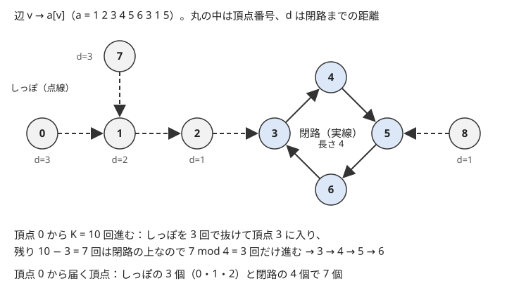

!!! abstract "要点"
    - **何ができるか**：各頂点から出る辺がちょうど 1 本の有向グラフで、$K$ 回進んだ位置・閉路に入るまでの長さ・閉路上の頂点や閉路ごとの集計を求める。各成分は閉路がちょうど 1 つあってそこへ木が流れ込む ρ の形なので、閉路に入るまでと閉路の周回に分けて考え、全頂点についてまとめて $O(N)$ で求まる。
    - **いつ使うか**：
        - 各 $i$ から $A_i$ へ移動する。
        - K 回（$K \le 10^{18}$）移動した後の位置を問われる。
        - 嫌いな相手・行き先が 1 人（1 つ）ずつ決まっている。
        - 遷移が $x \to f(x)$ の写像 1 つで決まる。
    - **計算量**：閉路の検出・閉路までの距離・閉路ごとの集計は $O(N)$。全頂点について $K$ 回後を求めるのはダブリングで $O(N \log K)$（置換なら $O(N)$）。
    - **前提**：[閉路の検出と復元](../graph/cycle-detection.md)

<!-- textlint-disable -->
別名：関数グラフ・ρ 形・rho 形・successor graph
<!-- textlint-enable -->

Functional graph は、頂点 $v$ から出る辺が $v \to f(v)$ の 1 本だけの有向グラフである。「人 $i$ は $A_i$ さんが嫌い」「町 $i$ からは町 $A_i$ へ移る」のように、行き先が写像 1 つで決まる問題は、すべてこの形になる。一般の有向グラフでは閉路の扱いに [SCC](../graph/scc.md) などの道具が要るが、Functional graph では「各成分に閉路がちょうど 1 つ」という強い性質があるので、閉路を先に片付けてから残りの木を処理する、という決まった手順で多くの問いが解ける。

このページでは、頂点を 0-indexed で $0, 1, \dots, N-1$ とし、辺を $v \to a[v]$ と書く。問題文の $A_i$（1-indexed）とは $a[i-1] = A_i - 1$ で対応させる。

## 各成分に閉路がちょうど 1 つある理由 {#one-cycle}

Functional graph の各連結成分（辺の向きを無視してつながっている部分）には、有向閉路がちょうど 1 つある。閉路以外の頂点は、辺をたどるとやがて閉路に流れ込む木の部分になる。下の図は $N = 9$ の例である。



**閉路が少なくとも 1 つある**。どの頂点から出発しても、辺は必ず 1 本出ているので、いつまでも進み続けられる。頂点は $N$ 個しかないので、$N$ 歩以内に同じ頂点を 2 回訪れる（[閉路の検出](../graph/cycle-detection.md)）。2 回の訪問の間にたどった部分が閉路である。

**閉路は高々 1 つ**。頂点が $n$ 個の成分を考える。成分の各頂点から出る辺は 1 本ずつで、その行き先も同じ成分にあるので、成分の辺はちょうど $n$ 本である。向きを無視すると、$n$ 頂点で連結なグラフは $n - 1$ 本の辺で木になり、そこに 1 本足すと閉路がちょうど 1 つできる（[木の基本](../tree/tree-basics.md#remove-add-edge)）。有向閉路は向きを無視しても閉路なので、成分の中の有向閉路は 1 つしかない。

自己ループ $v \to v$ は長さ 1 の閉路、$u \to v$ と $v \to u$ の組は長さ 2 の閉路として数える。どちらもこの議論の中に含まれる（向きを無視すると、自己ループや 2 本の平行な辺が閉路になる）。

閉路の外の頂点 $v$ について、$v$ から辺をたどって閉路に着くまでの歩数を $\mathrm{dist}[v]$ と書く（閉路上なら 0）。辺を逆向きに見ると、閉路の各頂点を根として、木がぶら下がった形になる。ギリシャ文字の ρ のように、しっぽから輪に入る形なので ρ 形とも呼ぶ。しっぽは[周期性のページ](../basics/periodicity.md#rho)でいう尾のことで、その長さを $\mu$ と書く。

??? question "確認問題：同じ成分なら必ず行けるか"
    同じ成分にある 2 頂点 $u$・$v$ について、$u$ から辺をたどって $v$ に必ず到達できるか。

    ??? success "答え"
        できるとは限らない。$u$ から進める道は 1 本しかなく、$u$ から閉路までのしっぽと、閉路の全体だけを通る。図では頂点 7 から頂点 0 や 8 へは行けない（7 → 1 → 2 → 3 と進むが、0 には入る辺しかなく、8 からは辺が出ていくだけである）。ただし閉路上の頂点へは、同じ成分のどの頂点からでも到達できる。

## K 回後の位置（しっぽと周回に分ける・ダブリング） {#k-steps}

「頂点 $s$ から $K$ 回進んだ頂点」を、$K \le 10^{18}$ で 1 歩ずつ求めると間に合わない。ρ 形を使い、閉路に入るまでの $\mathrm{dist}[s]$ 歩と、閉路の上の残りの歩数に分ける。閉路の長さを $\lambda$ とする。閉路の上では $\lambda$ 歩ごとに同じ頂点へ戻るので、残りの歩数は $\lambda$ で割った余りだけ進めばよい。

$$
K \text{ 回後} = \begin{cases} \text{しっぽの } K \text{ 番目} & (K < \mathrm{dist}[s]) \\ \text{入口から } (K - \mathrm{dist}[s]) \bmod \lambda \text{ 歩先} & (K \ge \mathrm{dist}[s]) \end{cases}
$$

図の頂点 0 なら $\mathrm{dist}[0] = 3$、$\lambda = 4$ で、$K = 10$ 回後は入口の頂点 3 から $7 \bmod 4 = 3$ 歩進んだ頂点 6 である。

求め方は、始点がいくつあるかと、$K$ が共通かで選ぶ。

| 問われ方 | 方法 | 計算量 |
| --- | --- | --- |
| 始点が 1 つ | 訪れた時刻を記録して周期を見つける | $O(N)$ |
| 全始点で同じ $K$ | 写像の繰り返し二乗 | $O(N \log K)$ |
| 始点と $K$ の組がクエリ | ダブリングの表 | 前計算 $O(N \log K)$、1 回 $O(\log K)$ |
| 置換（[入次数](../guide/glossary.md#in-degree)もすべて 1） | 閉路ごとに $K \bmod \lambda$ 歩 | $O(N)$ |

- **始点が 1 つ**：$s$ から進みながら各頂点を初めて訪れた時刻を記録し、記録のある頂点に来たら止める。その頂点を初めて訪れた時刻がしっぽの長さ $\mu$、現在の時刻との差が周期 $\lambda$ である。手順と式は[周期性の ρ 型の節](../basics/periodicity.md#rho)にある
- **全始点で同じ $K$**：写像 $a$ を自分自身と合成すると「2 歩先」の写像になる。これを繰り返して $a^K$ を作る（[置換の K 回合成](../basics/doubling.md#permutation-power)）。置換でなくても使える
- **クエリ**：$\mathrm{nxt}[k][v]$ ＝「$v$ から $2^k$ 歩先」の表を作り、$K$ の 2 進展開で進む（[表の作り方](../basics/doubling.md#table)）。途中の和や最小値も同じ表に持てる

ρ 形だけを使って、全始点を $O(N)$ で処理する方法もある。$K \ge \mathrm{dist}[v]$ の頂点は、閉路の頂点に 0 から番号を振っておけば、入口の番号に $(K - \mathrm{dist}[v]) \bmod \lambda$ を足すだけで行き先が分かる。$K < \mathrm{dist}[v]$ の頂点では、木の $K$ 個上の祖先が行き先である。辺を逆向きにして閉路の頂点から DFS し、根から今の頂点までの経路をスタックに持てば、$K$ 個上の祖先はスタックの一番上（今の頂点）から $K$ 個下の要素 `stk[stk.size() - 1 - K]` として読める。ただし実装が長くなるので、制限時間に余裕があればダブリングで済ませるのが楽である。

??? question "確認問題：始点に戻るまで進める"
    頂点 $s$ から「$s$ に戻るまで」進めて周期を数えるコードを書いた。図のグラフで $s = 0$ とすると何が起きるか。

    ??? success "答え"
        止まらない。頂点 0 は閉路の上になく、0 に入る辺はあっても、閉路から 0 へ戻る辺はない。0 → 1 → 2 → 3 → 4 → 5 → 6 → 3 → … と閉路を永遠に回る。初めて訪れた時刻を記録し、記録のある頂点に来たら止める書き方にする。

## 全頂点について閉路上かを求める（入次数 0 から剥がす・SCC） {#on-cycle}

閉路の外の頂点は、どれも木の部分にある。木の葉にあたる頂点は入次数（入ってくる辺の数）が 0 なので、入次数 0 の頂点を取り除き、行き先の入次数を 1 減らすことをくり返すと、外側から木が剥がれていく。最後に残った頂点が、ちょうど閉路上の頂点である。

- **閉路上の頂点は残る**：閉路上の頂点 $v$ には、閉路の 1 つ前の頂点から辺が入っている。その頂点も閉路上なので、帰納的に、閉路上の頂点はどれも入次数が 0 にならず、1 つも取り除かれない
- **残った頂点はすべて閉路上**：残った頂点 $v$ の行き先 $a[v]$ は取り除かれない（$a[v]$ が取り除かれるのは入次数が 0 になったときだが、$v$ からの辺が残っている）。だから残った頂点の集合は、その中で各頂点から 1 本ずつ辺が出ている。残った頂点が $r$ 個なら、その中の辺は $r$ 本で、入次数の合計は $r$ になる。各頂点の入次数は 1 以上なので、どれもちょうど 1 になる。出次数も入次数も 1 なので、残った部分は閉路の集まりである

一般の有向グラフでこの方法を使うと、閉路から出た先の頂点も残ってしまう（[Kahn 法で残る頂点](../graph/cycle-detection.md#kahn-leftover)）。残りがすべて閉路上になるのは、出次数がすべて 1 だからである。

剥がした順にはもう 1 つ使い道がある。頂点 $v$ は必ず $a[v]$ より先に剥がされるので、剥がした順の逆にたどると、行き先の値が決まってから自分の値を決められる。閉路の長さを数えてから、逆順に $\mathrm{dist}[v] = \mathrm{dist}[a[v]] + 1$ とすれば、全頂点の閉路までの距離が再帰なしで求まる。

```cpp
--8<-- "functional-graph/peel.cpp:core"
```

完全なプログラム：[`peel.cpp`](https://github.com/yuukougun/kyopro-atlas/blob/main/snippets/functional-graph/peel.cpp)（GitHub）
{ .kp-code-src }

1 本道をたどる方法でも全頂点を $O(N)$ で処理できる。頂点に「未訪問・今たどっている途中・処理済み」の 3 種類の印を付け、未訪問の頂点から印を付けながら進む。印のある頂点に当たったら止め、それが「途中」の頂点なら、そこから先が新しい閉路である。「処理済み」の頂点に当たったなら、すでに見つけた閉路か、その木に合流しただけである。最後に今回たどった頂点をすべて処理済みにする。どの頂点も 1 回しかたどらないので $O(N)$ である。コードは[例題の ABC256 E](#abc256_e) の節に置く。

[強連結成分分解](../graph/scc.md#on-cycle)を使ってもよい。頂点が 2 個以上の強連結成分は閉路そのもので、頂点が 1 個の成分は自己ループを持つときだけ閉路である。一般の有向グラフにも使えるが、Functional graph では上の 2 つの方法の方が軽い。

!!! info "ACL では"
    `atcoder::scc_graph g(n);` に `g.add_edge(v, a[v])` で辺を足し、`g.scc()` で強連結成分のリスト（トポロジカル順）を得る。`add_edge` はならし $O(1)$、`scc()` は $O(N + M)$ で、Functional graph では $M = N$ である。頂点が 2 個以上の成分と、自己ループを持つ 1 個の成分が閉路になる。

```cpp
--8<-- "functional-graph/scc.cpp:core"
```

完全なプログラム：[`scc.cpp`](https://github.com/yuukougun/kyopro-atlas/blob/main/snippets/functional-graph/scc.cpp)（GitHub）
{ .kp-code-src }

## 閉路ごとの集計・到達できる頂点の数 {#per-cycle}

閉路が見つかれば、多くの問いは「閉路の上で決まる量」と「木の上で閉路から伝える量」に分かれる。

- **閉路ごとに 1 つ選ぶ**：「行き先の人より先に配らないと不満が出る」のように、辺 $v \to a[v]$ ごとに守りたい順序があるとき、閉路の上では全部を守れない。閉路の頂点のうち最初に配る人の 1 つ前の人は必ず不満を持つからである。閉路の辺を 1 本だけ諦めれば、残りは閉路のない森になり、全部を守る順序が作れる。だから答えは閉路ごとの最小のコストの和になる（[例題の ABC256 E](#abc256_e)）
- **閉路上の頂点の数**：何回目の移動でもそこにいられる頂点は、閉路上の頂点だけである。閉路の外の頂点は、どこから出発しても $N$ 回目以降は二度と訪れない（[練習の ABC296 E](#practice)）
- **到達できる頂点の数**：頂点 $v$ から到達できる頂点は、閉路に着くまでのしっぽの $\mathrm{dist}[v]$ 個と、閉路の全体 $\lambda$ 個である。しっぽと閉路は重ならないので、ちょうど $\mathrm{dist}[v] + \lambda$ 個になる（[例題の ABC357 E](#abc357_e)）

木の部分を集計するときは、剥がした順を使う。$v$ は $a[v]$ より先に剥がされるので、剥がした順に「$a[v]$ の値に $v$ の値を足す」と、葉から根（閉路の頂点）へ値が集まる。逆順に「$v$ の値を $a[v]$ の値から決める」と、閉路から葉へ値が伝わる。ふつうの根付き木の [木 DP](../dp/tree-dp.md) と同じで、子が $v \to a[v]$ の辺で親を指している形である。

??? question "確認問題：閉路の頂点に流れ込む数"
    閉路上の各頂点 $c$ について、「$c$ にしっぽで流れ込む頂点（$c$ 自身を含み、$c$ 以外の閉路の頂点は含まない）の数」を求めたい。剥がした順をどう使えばよいか。

    ??? success "答え"
        全頂点で $\mathrm{cnt}[v] = 1$ から始め、剥がした順に $\mathrm{cnt}[a[v]] \mathrel{+}= \mathrm{cnt}[v]$ とする。剥がされる頂点はどれも、自分に流れ込む頂点がすべて剥がされた後に剥がされるので、足し込む時点で $\mathrm{cnt}[v]$ は確定している。閉路の頂点は剥がされないので足し込み先にだけなり、最後の $\mathrm{cnt}[c]$ が答えである。

## 置換は閉路の集まり（巡回分解は数え上げの章） {#permutation}

$a$ が置換（$0, \dots, N-1$ の並べ替え）なら、出次数に加えて入次数もすべて 1 である。入次数 0 の頂点がないのでしっぽがなく、Functional graph は閉路だけの集まりになる。置換の言葉では、これを巡回分解と呼ぶ（[置換の巡回分解](../comb/permutation-cycles.md)）。

しっぽがないので、$K$ 回後の位置は閉路ごとに $K \bmod \lambda$ 歩進めるだけで、全頂点について $O(N)$ で求まる。印を付けて閉路を 1 周ずつたどり、閉路の頂点を並べた列の上で添字を $K \bmod \lambda$ だけずらせばよい。

「$P_i$ を $P_{P_i}$ に同時に置き換える」のように、写像を自分自身と合成する操作も、閉路の上の歩数で考えると見通しがよい。$P$ を $i$ から 1 歩先へ進む写像と見ると、1 回の操作の後の $P_i$ は $i$ から 2 歩先、2 回の後は 4 歩先になり、$K$ 回の後は $2^K$ 歩先になる。$2^K$ は巨大なので、閉路の長さ $\lambda$ を法にして $2^K \bmod \lambda$ を[繰り返し二乗法](../math/mod-pow.md)で求める（[練習の ABC377 E](#practice)）。

一般の Functional graph の頂点に置換の書き方（印の付いた頂点に戻るまでたどれば閉路）をそのまま使うと、しっぽの頂点まで閉路に数えてしまう。入次数がすべて 1 かを確かめてから使う。

## 落とし穴 {#pitfalls}

**始点に戻るまで進めると止まらない**。始点がしっぽの上にあると、閉路から始点へは戻ってこない。「記録のある頂点に来たら止める」と書く。全頂点から 1 本道をたどるときも、処理済みの頂点で止めないと、同じ閉路を何度もたどって $O(N^2)$ になる。

**行き先がない頂点がある**。「$A_i = 0$ なら止まる」「出口に着いたら終わり」のように、辺の出ない頂点を含むグラフは Functional graph ではない。その頂点を含む成分には閉路がなく、剥がすとすべて消える。止まる頂点に自己ループを足せば、「止まる」は「同じ頂点に居続ける」と同じ意味になり、ρ 形の議論がそのまま使える。

**再帰が深くなる**。しっぽの長さは最大で $N - 1$ なので、$\mathrm{dist}[v] = \mathrm{dist}[a[v]] + 1$ を素朴なメモ化再帰で書くと、深さが $N$ 近くになる（[メモ化再帰の落とし穴](../dp/memoized-recursion.md#pitfalls)）。剥がした順の逆にたどるか、1 本道を配列に記録してから後ろから値を決めれば、再帰を使わずに済む。

**答えのあふれ**。到達できる組の数は最大で $N^2$ で、$N = 2 \times 10^5$ なら $4 \times 10^{10}$ になり `int` を超える。コストの和も同じで、`long long` で持つ。$K$ も `long long` で読み、$K - \mathrm{dist}[v]$ を計算する前に $K < \mathrm{dist}[v]$ の場合を分ける。

**自己ループを見落とす**。SCC で閉路上の頂点を数えるとき、頂点が 1 個の成分をすべて閉路の外とすると、自己ループ $v \to v$ を落とす。剥がす方法では、自己ループの頂点は自分から入る辺があるので残り、正しく閉路上と判定される。

**1-indexed のまま配列を作る**。配列の大きさを $N$ にして $A_i$ を 1-indexed のまま使うと、$A_i = N$ で範囲外を指す。読み込むときに $a[i] = A_{i+1} - 1$ に直す。

## 例題 {#examples}

### ABC256 E. Takahashi's Anguish {#abc256_e}

<div class="kp-problems" data-role="example" markdown>

- [ABC256 E. Takahashi's Anguish](https://atcoder.jp/contests/abc256/tasks/abc256_e)（diff 1224）：人 i は X_i さんより先にキャンディーをもらえないと不満 C_i を感じるとき、配る順を決めて不満の合計の最小値を求める

</div>

人 $i$ から嫌いな人 $X_i$ へ辺を張ると、各頂点から辺が 1 本出る Functional graph になる。辺 $i \to X_i$ は「$i$ を $X_i$ より先に配りたい」という順序の希望で、守れないとコスト $C_i$ がかかる。閉路の上では全部の希望を守れないので、閉路ごとに 1 本は諦める必要があり、諦めるのは最小のコストの辺でよい。答えは閉路ごとの最小の $C$ の和である。

??? note "解法の詳細"
    - **下限**：閉路 $v_1 \to v_2 \to \dots \to v_k \to v_1$ の頂点のうち、最初に配る人を $v_j$ とする。その 1 つ前の人 $v_{j-1}$（$j = 1$ なら $v_k$）は、嫌いな $v_j$ が先にもらうので不満を持つ。だから閉路ごとに少なくとも 1 人は不満を持ち、合計はその閉路の最小の $C$ 以上になる。閉路は互いに頂点を共有しないので、閉路ごとの最小の和が下限である
    - **その値を達成する**：各閉路で $C$ が最小の辺を 1 本取り除く。各成分の閉路はちょうど 1 つなので、残りのグラフには閉路がない（[各成分に閉路がちょうど 1 つある理由](#one-cycle)）。閉路のない有向グラフにはトポロジカル順があり、その順に配ればすべての残りの希望を守れる
    - **実装**：3 種類の印で 1 本道をたどり、新しい閉路を見つけたら閉路を 1 周してコストの最小を足す。$O(N)$。和は `long long` で持つ
    - コスト $C_i$ の大きい順に、辺 $i$–$X_i$ を Union-Find でつなぎ、両端がすでに同じ成分にある辺の $C_i$ を足す方法でも解ける。各成分の辺のうち最後に閉路を作る辺が、閉路の最小の辺になるからである

```cpp
--8<-- "functional-graph/walk.cpp:core"
```

完全なプログラム：[`walk.cpp`](https://github.com/yuukougun/kyopro-atlas/blob/main/snippets/functional-graph/walk.cpp)（GitHub）
{ .kp-code-src }

### ABC357 E. Reachability in Functional Graph {#abc357_e}

<div class="kp-problems" data-role="example" markdown>

- [ABC357 E. Reachability in Functional Graph](https://atcoder.jp/contests/abc357/tasks/abc357_e)（diff 1295）：各頂点から辺がちょうど 1 本出る有向グラフで、u から v へ到達できる組 (u, v) の数を求める

</div>

組 $(u, v)$ を数える代わりに、各頂点 $u$ から到達できる頂点の数を足す（$u = v$ も 0 歩で到達できるとして数える）。$u$ から到達できるのは、閉路までのしっぽの頂点と閉路の全体なので、その数は $\mathrm{dist}[u] + \lambda$ である。閉路の長さと閉路までの距離が全頂点で分かれば、足すだけで答えが出る。

??? note "解法の詳細"
    - 入次数 0 の頂点から剥がし、残った頂点を閉路上とする。残った頂点から閉路を 1 周たどり、その長さを閉路の各頂点に書く
    - 剥がした順の逆にたどり、$\mathrm{dist}[v] = \mathrm{dist}[a[v]] + 1$、閉路の長さは $a[v]$ のものを写す
    - 答えは $\sum_v (\mathrm{dist}[v] + \lambda_v)$ で、最大 $N^2$ なので `long long` で足す。全体で $O(N)$
    - コードは[全頂点について閉路上かを求める](#on-cycle)の節のものと同じである。メモ化再帰で $\mathrm{dist}$ を求めてもよいが、しっぽが長いと再帰が深くなる

## 練習問題 {#practice}

<div class="kp-problems" data-role="practice" markdown>

- [ABC167 D. Teleporter](https://atcoder.jp/contests/abc167/tasks/abc167_d)（diff 754）：各町のテレポーターで決まった町へ移動するとき、町 1 から K ≤ 10^18 回移動した後の町を求める。
- [ABC296 E. Transition Game](https://atcoder.jp/contests/abc296/tasks/abc296_e)（diff 1285）：x から A_x へ移る操作について、相手が回数 K をどう選んでも、出発点をうまく選べば K 回の移動の後に i にいられるような i の個数を求める。
- [ABC377 E. Permute K times 2](https://atcoder.jp/contests/abc377/tasks/abc377_e)（diff 1685）：順列 P に対して、すべての i で P_i を P_(P_i) に同時に置き換える操作を K 回行った後の列を求める。

</div>

??? note "練習の方針"
    - **ABC167 D**：始点が 1 つなので、町 1 から訪れた時刻を記録して進み、しっぽの長さと周期を求めて $K$ を周期で割る。ダブリングでも解ける
    - **ABC296 E**：閉路上の頂点は、閉路を逆向きに $K$ 歩戻った頂点から出発すれば、どの $K$ でもそこにいられる。閉路の外の頂点は、$K$ が大きいとどこから出発しても届かない。だから答えは閉路上の頂点の数で、入次数 0 の頂点を剥がして残りを数える
    - **ABC377 E**：$K$ 回の操作の後の $P_i$ は、$i$ から $P$ の辺を $2^K$ 歩進んだ頂点である。閉路ごとに長さ $\lambda$ を法として $2^K \bmod \lambda$ を繰り返し二乗法で求め、閉路の列の上でその分だけずらす

## 確認問題 {#quiz}

??? question "確認問題：置換との違い"
    置換をグラフにしたものと、一般の Functional graph とでは、形の上で何が違うか。

    ??? success "答え"
        置換では入次数もすべて 1 なので、しっぽ（木の部分）がなく、すべての頂点が閉路の上にある。一般の Functional graph では、1 つの頂点に複数の辺が入ってよいので、入次数 0 の頂点から始まる木が閉路に流れ込む。置換の巡回分解の書き方は、しっぽがないことを前提にしている。

??? question "確認問題：閉路の個数の範囲"
    $N$ 頂点の Functional graph に含まれる閉路の個数は、最小でいくつ、最大でいくつか。

    ??? success "答え"
        最小は 1 個、最大は $N$ 個である。閉路は成分ごとにちょうど 1 つなので、閉路の個数は連結成分の個数に等しい。全体が 1 つの成分なら 1 個、すべての頂点が自己ループなら $N$ 個になる。

## 使い分け {#comparison}

- 遷移が写像でも状態の数が多すぎて配列に入らない（値が $10^{18}$ まであるなど）なら、グラフを作らず、`map` で訪れた時刻を記録して周期を見つける（[周期性](../basics/periodicity.md)）
- $K$ 回後の位置をクエリごとに違う始点と $K$ で答える、途中の和も要る、なら[ダブリング](../basics/doubling.md)が手軽である
- 出次数が 1 と限らない有向グラフで閉路を探すなら [閉路の検出](../graph/cycle-detection.md) か [SCC](../graph/scc.md)
- 向きのない $N$ 頂点 $N$ 辺の連結グラフは[なもりグラフ](../graph/namori-graph.md#directed-version)で、閉路がちょうど 1 つという性質は同じだが、閉路の求め方は次数 1 の頂点を削る形になる
- 置換なら[巡回分解](../comb/permutation-cycles.md)として扱い、しっぽの処理を省く

## 参考 {#references}

- [drken「AtCoder ABC 256 E - Takahashi's Anguish (1Q, 水色, 500 点)」](https://drken1215.hatenablog.com/entry/2023/08/03/140800)：例題の方針（閉路ごとに最小のコストを足す理由と、Union-Find による別解）
- [drken「AtCoder ABC 357 E - Reachability in Functional Graph (1D, 水色, 450 点)」](https://drken1215.hatenablog.com/entry/2024/06/09/231700)：例題の方針（閉路の長さと閉路までの距離から到達できる頂点の数を求める）
- [kyo-pro「ABC296E - Transition Game」](https://kyo-pro.hatenablog.com/entry/ABC296E)：練習の方針（閉路上の頂点が答えになる理由と、入次数 0 から剥がす求め方）
- [Lanly「AtCoder Beginner Contest 377」](https://www.cnblogs.com/Lanly/p/18513188)：練習の方針（K 回の操作で閉路上を 2 のべき乗だけ進むこと）
- [hamayan「Teleporter [AtCoder Beginner Contest 167 D]」](https://blog.hamayanhamayan.com/entry/2020/05/10/232914)：練習の方針（周期を見つける方法とダブリング）
- [AtCoder Library「SCC」（document_ja）](https://github.com/atcoder/ac-library/blob/master/document_ja/scc.md)：`scc_graph` の宣言と計算量
