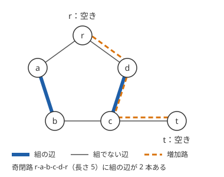
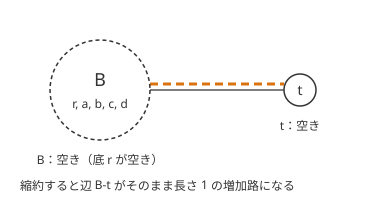

!!! abstract "要点"
    - **何ができるか**：二部グラフでないグラフの最大[マッチング](../guide/glossary.md#matching)は、奇閉路（花）を縮約する Edmonds のアルゴリズムで多項式時間で求まる。重み付きでも多項式時間で解ける。$N \le 16$ 程度なら bitDP で足りる。
    - **いつ使うか**：
        - 二部グラフでないグラフでペアを作る最大数
        - $N \le 16$ 程度の一般グラフでペアを作る
    - **計算量**：最大マッチングは Edmonds のアルゴリズムで多項式時間（ライブラリでよく見る実装で $O(NM \log N)$）。最大重みマッチングは $O(N^3)$ のアルゴリズムがある。大きさだけなら乱択で $O(N^3)$、$N \le 20$ 程度なら bitDP で $O(2^N N)$
    - **前提**：[二部マッチング](../graph/bipartite-matching.md)

<!-- textlint-disable -->
別名：Edmonds・blossom・花のアルゴリズム・一般グラフの最大マッチング・general matching
<!-- textlint-enable -->

一般グラフのマッチングは、二部グラフに限らない無向グラフで、端点を共有しない辺をできるだけ多く（重み付きなら重みの和が最大になるように）選ぶ問題である。二部グラフなら最大流で解けるが、奇数の長さの閉路があるとその方法は使えず、Edmonds のアルゴリズムが要る。ACL にはなく、ABC では difficulty 3000 を超える G で 1 問見つかった程度である。

## 二部グラフとの違い（奇閉路） {#odd-cycles}

「[増加路](../guide/glossary.md#augmenting-path)がなければ最大」（Berge の定理）は、二部グラフに限らずどのグラフでも成り立つ（[二部マッチングの証明](../graph/bipartite-matching.md#alternating-path)は二部性を使っていない）。だから一般グラフでも、増加路を見つけて反転することを繰り返せば最大マッチングになる。難しいのは増加路の探し方である。

二部グラフでは、空いている頂点から[交互路](../guide/glossary.md#alternating-path)をたどると、各頂点に着くときの偶奇（組でない辺で着いたか、組の辺で着いたか）が頂点ごとに決まっている。だから「訪れた頂点は 2 度調べない」という DFS で漏れなく探せる。奇閉路があると、同じ頂点に偶奇の違う 2 通りで着くことがあり、この印の付け方では増加路を見落とす。



図のグラフで、空いている頂点 r から先に a の方へ進むとする。r→a→b（組の辺）→c と来ると、c からは組の辺で d へ進むしかなく、d の先は訪れた r だけなので失敗する。この探索で c と d に印が付くので、次に r→d と進んでも d は調べ済みとして打ち切られる。しかし増加路 r→d→c→t はある。d には 1 回目は組の辺（c→d）で着いたが、今回は組でない辺（r→d）で着いている。偶奇の違う着き方を同じ印で打ち切ったため、その先で c に組の辺で着く場合（d→c→t）を調べられなかったのが原因である。

二部グラフには奇閉路がないので、こうしたことは起きない。一般グラフで同じ素朴な探索を使うと、答えが最大より小さくなる。

## Edmonds のアルゴリズムの概要 {#edmonds}

Edmonds のアルゴリズムは、奇閉路を見つけたらそれを 1 つの頂点に縮約し、縮約したグラフで増加路を探し続ける。ここで縮約する奇閉路は、長さ $2k + 1$ で組の辺を $k$ 本含む閉路で、花（blossom）と呼ぶ。閉路の上の組の辺に入っていない、ただ 1 つの頂点を底と呼ぶ。



[奇閉路の節](#odd-cycles)の例では、花 r-a-b-c-d-r（底は r）を頂点 B にまとめると、B と t がどちらも空いていて、辺 B-t が長さ 1 の増加路になる。B を元に戻すときは、花の 2 周りのうち交互路になる方（r→d→c）を選んで、増加路 r→d→c→t が得られる。

要となる事実は「縮約したグラフに増加路がある ⟺ 元のグラフに増加路がある」である。花の中のどの頂点にも、底から偶数の長さの交互路で着ける（2 周りのうち片方を選べばよい）ので、花全体を「偶数の長さで着いた 1 つの頂点」とみなしてよい。証明は[学ぶための資料](#resources)に任せる。

探索の流れは次のとおりである。

```text
各回：すべての空いている頂点を根にして、交互路の森を BFS で伸ばす
  根からの距離が偶数の頂点を「外」、奇数の頂点を「内」と呼ぶ
  外の頂点 u から辺 u-v を調べる
    v が未訪問（空いている頂点はすべて根なので、組の相手 w がいる）：v を内、w を外として木に足す
    v が別の木の外：根から u、辺 u-v、v から根で増加路。反転してこの回を終える
    v が同じ木の外：u と v の LCA を底とする花ができる。花を 1 つの外の頂点に縮約する
    v が内：何もしない
増加路が見つからなければ、その時点のマッチングが最大
```

増加路は 1 回に 1 本見つかり、マッチングは高々 $N/2$ 回しか増えないので、多項式時間で終わる。計算量は実装で大きく違う。

- 説明どおりに縮約したグラフを作り直す素朴な実装は $O(N^2 M)$（Wikipedia の Blossom algorithm の項）。
- Gabow による改良版（縮約したグラフを作り直さない）を実装した ei1333 氏のライブラリは $O(NM \log N)$ である。
- 理論上の最速は Micali-Vazirani の $O(M \sqrt{N})$ だが、競技プログラミングで書くことはまずない。

重み付き（最大重みマッチング）も、花の縮約に双対変数（各頂点・各花の値）を組み合わせて多項式時間で解け、$O(N^3)$ のアルゴリズムが知られている（Gabow）。実装は長く、ライブラリを写して使うものと考えてよい。重みの和を最小にする完全マッチングは、重みを「十分大きな定数 − 重み」に置き換えて最大重みマッチングを求めれば得られる。定数 $C$ は $C > (N/2) \max w$ なら足り、辺の本数の多いマッチングが必ず勝つ。得られたマッチングが完全でなければ、完全マッチングはない。重みが大きくなるので、和は long long で持つ。

## 大きさだけなら乱択（Tutte 行列の階数） {#tutte-matrix}

最大マッチングの大きさ（辺の本数）だけが要るなら、行列の階数で求める短い方法がある。$N \times N$ の行列 $T$ を、辺 $u$-$v$（$u < v$）ごとに $T_{uv} = x_{uv}$、$T_{vu} = -x_{uv}$ とし、ほかを 0 にする（Tutte 行列）。$x_{uv}$ を変数のまま扱うと、$T$ の階数は最大マッチングの大きさのちょうど 2 倍になる（Lovász）。

変数の代わりに大きな素数 $p$ を法とする乱数を入れても、階数が変わらない確率は $1 - N/p$ 以上である（0 でない小行列式は次数 $N$ 以下の多項式で、乱数を入れて 0 になる確率は $N/p$ 以下。Schwartz-Zippel の補題）。$p = 998244353$ なら $N = 500$ でも外れる確率は $10^{-6}$ ほどである。階数は[掃き出し法](../math/gaussian-elimination.md)で $O(N^3)$ で求まる。

```cpp
--8<-- "general-matching/tutte-rank.cpp:core"
```

- 乱数は 0 を避け、毎回の実行で種を変える（固定の種では、狙った入力で外れうる）。
- 間違えるのは「階数が小さく出る」向きだけである。乱数を入れた行列の階数が、変数のままの階数を超えることはない。
- 完全マッチングがあるかだけなら、行列式が 0 でないかを見れば足りる。変数のままの行列式が多項式として 0 でないことと、完全マッチングがあることが同値だからである（Tutte, 1947）。
- マッチングの辺そのものを取り出すのは、この方法では手間がかかる。辺が要るなら Edmonds のアルゴリズムのライブラリを使う。

[例題の ABC412 G](#abc412_g) の解説（kmjp 氏）は、この行列に重みを表す変数をもう 1 つ入れて、最小重みの完全マッチングまで求めている。

## 小さければ bitDP {#bitdp}

頂点が 20 個程度までなら、[bitDP](../dp/bit-dp.md) で重み付きの最大マッチングまで短く書ける。$\mathrm{dp}[S]$ ＝ 頂点の集合 $S$ について「組むか、組まないか」を決め終えたときの、重みの和の最大とする。

- **遷移**：$S$ に入っていない最も小さい頂点 $i$ について、組まないか、$S$ にない $j > i$ と組むかを選ぶ。最も小さい頂点から決めるので、同じマッチングを 2 通りに数えない。
- **計算順序**：遷移先は $S$ より大きいので、$S$ の昇順。
- **初期値と答え**：$\mathrm{dp}[\emptyset] = 0$、答えは $\mathrm{dp}[2^N - 1]$。

```cpp
--8<-- "general-matching/bitdp.cpp:core"
```

状態は $2^N$ 個、遷移は各 $N$ 通りなので $O(2^N N)$ である。完全マッチングだけを考えるなら「組まない」遷移を外せばよい。決める順を固定して状態を集合だけにするのは、[集合だけを状態にする節](../dp/bit-dp.md#set-only)と同じ考え方である。

## 自作するときの要点と確かめ方 {#library}

ACL に一般グラフのマッチングはないので、必要なら自作するか、公開されたライブラリを写す。

- まず二部グラフかどうかを確かめる。二部グラフなら[二部マッチング](../graph/bipartite-matching.md)（ACL の `mf_graph`）で足り、重み付きなら最小費用流で解ける。
- 大きさだけで足りるか、辺そのものが要るかで道具を選ぶ。大きさだけなら [Tutte 行列の階数](#tutte-matrix)が最も短い。
- Edmonds のアルゴリズムを書くなら、花の縮約は「頂点 → 属する花の底」の対応（Union-Find か配列）で表し、グラフを作り直さない。増加路の反転は、木の親と花を閉じた辺をたどって元のグラフの辺に戻す。
- 重み付きは実装が長く間違えやすいので、確かめ済みのライブラリを使う。

Library Checker では、最大マッチングを General Matching（general_matching）、最大重みマッチングを General Weighted Matching（general_weighted_matching）で確かめられる。どちらも単純グラフ（自己ループなし）で $N \le 500$、General Weighted Matching の重みは 1 以上 $10^6$ 以下である（2026-10-22 に問題の一覧で確かめた）。最大重みマッチングは完全マッチングとは限らない（重みの和が最大になる、本数の少ないマッチングもありうる）。自作したら、小さい乱数のグラフで [bitDP](#bitdp) と比べる。奇閉路が入るよう、辺を密にした入力も混ぜるとよい。

## 学ぶための資料 {#resources}

- Wikipedia（英語）の Blossom algorithm の項は、花の定義・縮約したグラフで増加路が保たれる理由・増加路を元のグラフに戻す方法を、図と擬似コードで説明している。
- ei1333 氏のライブラリの Gabow Edmonds は、一般グラフの最大マッチングの実装例で、Library Checker の General Matching で確かめられている。
- Harvey の論文「Algebraic Structures and Algorithms for Matching and Matroid Problems (Preliminary Version)」（英語）は、Tutte 行列に乱数を入れて最大マッチングを求める代数的な方法を扱い、階数と最大マッチングの関係（Lovász）にも触れている。

## 例題 {#examples}

### ABC412 G. Degree Harmony {#abc412_g}

<div class="kp-problems" data-role="example" markdown>

- [ABC412 G. Degree Harmony](https://atcoder.jp/contests/abc412/tasks/abc412_g)（diff 3402）：単純な無向グラフと各頂点の値 A_i が与えられ、各頂点の次数が A_i 以下で A_i と偶奇が等しくなるように辺を選ぶとき、選ぶ辺の数の最小を求める（できなければ -1）。

</div>

方針：頂点 $i$ を $A_i$ 個の複製に増やし、次数の条件を、複製のグラフの最小重み完全マッチングに言い換える。

??? note "解法の詳細"
    - $X = \sum A_i$ が奇数なら完全マッチングは作れず、答えは -1 である（次数の和は偶数なので、元の問題でも条件を満たせない）。以下 $X$ は偶数とする。
    - 頂点 $i$ の複製どうしを重み 0 の辺で、元のグラフで隣り合う $i$・$j$ の複製どうしを重み 1 の辺で結ぶ（頂点 $X$ 個の一般グラフ）。
    - 完全マッチングで $i$ の複製のうち $d_i$ 個がほかの頂点の複製と組むと、残りの $A_i - d_i$ 個は $i$ の複製どうしで 2 個ずつ組む。だから $d_i \le A_i$ で、$A_i - d_i$ は偶数になる。重み 1 の辺を元の辺に戻すと、条件を満たす辺の選び方になる。
    - 同じ元の辺 $i$-$j$ を 2 回使うマッチング（$i_1$-$j_1$ と $i_2$-$j_2$）は、$i_1$-$i_2$ と $j_1$-$j_2$ の重み 0 の 2 本に替えると重みが 2 減る。よって最小重みのマッチングは同じ辺を 2 回使わない。
    - 逆に、条件を満たす辺の選び方があれば、各頂点 $i$ で選んだ辺に $i$ の複製を 1 つずつ割り当て、残りの $A_i - d_i$ 個（偶数）を 2 個ずつ組めば、重みが辺の数に等しい完全マッチングになる。だから最小重みがそのまま答えになる。
    - 完全マッチングがなければ（$X$ が偶数でも）答えは -1 である。
    - 最小重み完全マッチングは、重み付きのライブラリで重みを「定数 − 重み」にして求められる。kmjp 氏の解説は、[Tutte 行列](#tutte-matrix)の重み 1 の辺の値に変数 $Y$ を掛け、行列式を $Y$ の多項式として補間し、0 でない最低次の項の次数の半分を答えにしている。

## 参考 {#references}

- [Wikipedia「Blossom algorithm」](https://en.wikipedia.org/wiki/Blossom_algorithm)：花の定義、縮約で増加路が保たれること、素朴な実装の $O(N^2 M)$ と Micali-Vazirani の $O(M \sqrt{N})$
- [Wikipedia「Maximum weight matching」](https://en.wikipedia.org/wiki/Maximum_weight_matching)：重み付きの $O(N^3)$（Gabow）、「定数 − 重み」で最小重みの最大マッチングに直す方法
- [Wikipedia「Tutte matrix」](https://en.wikipedia.org/wiki/Tutte_matrix)：Tutte 行列の定義と、行列式が 0 でないことと完全マッチングの存在の関係
- [Nicholas J. A. Harvey「Algebraic Structures and Algorithms for Matching and Matroid Problems (Preliminary Version)」](https://arxiv.org/abs/cs/0601026)：Tutte 行列に乱数を入れた行列の階数が最大マッチングの 2 倍になること（Lovász の結果の引用）
- [ei1333「Gabow Edmonds (一般グラフの最大マッチング)」](https://ei1333.github.io/library/graph/flow/gabow-edmonds.hpp)：実装の計算量 $O(NM \log N)$ と使い方
- [yosupo「Library Checker の問題」](https://github.com/yosupo06/library-checker-problems)：general_matching・general_weighted_matching の制約
- [kmjp「AtCoder ABC #412 (日本最強プログラマー学生選手権～Advance～ -予選-) : G - Degree Harmony」](https://kmjp.hatenablog.jp/entry/2025/06/29/0930)：例題 ABC412 G の、複製したグラフの最小重み完全マッチングへの言い換えと、Tutte 行列と補間による解き方
