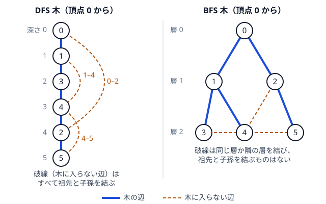

!!! abstract "要点"
    - **何ができるか**：無向グラフの DFS 木では木に入らない辺がすべて祖先と子孫を結び、BFS 木では層が高々 1 違う頂点どうしを結ぶ。この性質で条件を満たす木や経路を作り、距離表からグラフを復元する。
    - **いつ使うか**：
        - 条件を満たすグラフ・経路・全域木を 1 つ出力せよ。
        - 訪問回数の偶奇が指定された経路を作る。
        - 全点対の距離表からグラフを復元できるか。
    - **計算量**：DFS 木・BFS 木はどちらも $O(N + M)$。$N$ 頂点の距離表からの復元は $O(N^3)$。
    - **前提**：[深さ優先探索（DFS）](../graph/dfs.md)、[幅優先探索（BFS）と無重み最短路](../graph/bfs.md)

<!-- textlint-disable -->
別名：グラフの構築・DFS 木・BFS 木・後退辺・グラフの復元・DFS tree・back edge
<!-- textlint-enable -->

DFS 木・BFS 木は、探索で「まだ見ていない頂点へ進んだ辺」だけを残してできる全域木である。どちらも作るだけなら探索を 1 回するだけだが、木に入らなかった辺がどこを結ぶかに強い制約がつく。「条件を満たす木や経路を 1 つ作れ」という構築の問題では、この制約がそのまま答えの条件になることが多い。以下、頂点は 0-indexed（本文の図・例はコードと同じ番号で、問題文の頂点 $v$ はコードの頂点 $v - 1$ になる）とし、グラフは連結な単純無向グラフとし、頂点数を $N$、辺数を $M$ とする。

## DFS 木の性質（木に入らない辺は後退辺だけ） {#dfs-tree}

無向グラフを根 $r$ から[深さ優先探索](../graph/dfs.md)し、まだ訪れていない頂点へ進んだ辺だけを残すと、$r$ を根とする[全域木](../guide/glossary.md#spanning-tree)ができる。これを [DFS 木](../guide/glossary.md#dfs-tree)という。DFS 木には次の性質がある。

> DFS 木に入らない辺 $(u, v)$ は、必ず一方がもう一方の[祖先](../guide/glossary.md#ancestor)である

このような辺を[後退辺](../guide/glossary.md#back-edge)という。逆に、別の枝どうしを結ぶ辺（横断辺）は 1 本もない。次の図の左は、6 頂点・8 本の辺のグラフを頂点 0 から DFS した木で（隣は番号の小さい順に調べる）、木に入らない 3 本の辺はどれも、縦に並んだ祖先と子孫を結んでいる。



**なぜ横断辺がないか**。辺 $(u, v)$ の両端のうち、先に訪れた方を $u$ とする。$u$ に入ってから $u$ を出るまでの間に、DFS は $u$ の隣接リストを全部調べ、その中に $v$ もある。

- その時点で $v$ がまだ訪れていなければ、$u$ から $v$ へ進み、$v$ は $u$ の子になる（木の辺）
- すでに訪れていれば、$u$ より後に訪れたのだから、$u$ に入ってから $v$ を調べるまでの間に訪れている。その間に訪れた頂点はすべて $u$ の部分木に入るので、$v$ は $u$ の子孫である

どちらの場合も $u$ は $v$ の祖先になる。要は「$u$ に入っている間に、$u$ から行ける未訪問の頂点は、すべて $u$ の部分木に吸い込まれる」ことである。

実装は、訪れたときに親を記録する再帰の DFS である。

```cpp
--8<-- "graph-construction/spanning-trees.cpp:dfs-tree"
```

再帰が深すぎるときの非再帰版は、[落とし穴](#pitfalls)の 1 つ目に注意して書く。スタックには（頂点, 積んだときの親）の組を積み、取り出したときに印と親を決める。同じ頂点が何度も積まれるが、最後に積まれた組が先に取り出されるので、再帰と同じ木になる。[DFS のページ](../graph/dfs.md)の非再帰版は `v` と `~v` を積む形だが、ここでは親を記録したいので、（頂点, 親）の組を積む。

```cpp
--8<-- "graph-construction/spanning-trees.cpp:dfs-tree-iterative"
```

**有向グラフでは事情が違う**。有向グラフの DFS では、「先に調べ終えた別の枝へ向かう辺」（横断辺）も木に入らない辺として現れる。横断辺がないのは、辺を両向きに通れる無向グラフだけの性質である。有向グラフの辺の分類は[閉路の検出](../graph/cycle-detection.md#directed)で使う。

応用の型：

- **閉路を 1 つ見つける**：後退辺 $(u, v)$（$u$ が祖先）があれば、木の上の $u \to v$ のパスと辺 $(v, u)$ で閉路になる。親をたどれば頂点の列が得られる（[閉路の復元](../graph/cycle-detection.md#restore)）。閉路の長さは深さの差に 1 を足したものである。奇閉路を探すときは、深さの差が偶数の後退辺を探せばよい。なければ深さの偶奇で 2 色に塗れるので、奇閉路はない。一方、長さ $K$ 以上の閉路は、後退辺が作る閉路だけを見ても見つかるとは限らない（見つかればそれが答えになるが、逆は言えない）
- **橋と関節点**：木の辺 $(p, c)$ は、$c$ の部分木から出る後退辺が $p$ かその祖先に届けば橋でなく、届かなければ橋である。関節点の判定では、$p$ 自身に届く辺は $p$ を迂回しないので数えず、$p$ より上（真の祖先）に届くかを見る。横断辺がないので、「部分木から上へ戻る辺」は後退辺だけを見ればよい（[橋・関節点・二重連結成分](../graph/lowlink.md)）
- **辺の向き付け**：木の辺を親から子へ、後退辺を子孫から祖先へ向ける。すると、橋を含まない部分（二重辺連結成分）の中はどの 2 頂点も互いに行き来できるようになり、一方通行になるのは橋だけである

## BFS 木の性質（層が高々 1 違う） {#bfs-tree}

根 $r$ から[幅優先探索](../graph/bfs.md)し、頂点を見つけたときの辺だけを残すと、BFS 木ができる。BFS 木は $r$ からの[最短路木](../guide/glossary.md#shortest-path-tree)で、頂点 $v$ の深さ $\mathrm{dep}[v]$ は $r$ からの距離に等しい（理由は[最初に見つけた距離が最短になる理由](../graph/bfs.md#why-shortest)）。BFS 木には次の性質がある。

> どの辺 $(u, v)$ でも $\lvert \mathrm{dep}[u] - \mathrm{dep}[v] \rvert \le 1$ で、木に入らない辺は祖先と子孫を結ばない

前半は距離の性質である。辺 $(u, v)$ があれば $v$ へは $u$ から 1 歩で行けるので $\mathrm{dep}[v] \le \mathrm{dep}[u] + 1$ で、逆向きも同じである。後半は前半から出る。木に入らない辺 $(u, v)$ の両端は、深さが同じか 1 だけ違う。深さが同じなら、どちらも相手の祖先ではない。深さが 1 違い、浅い方が深い方の祖先なら、浅い方は深い方の親である。単純グラフで親子を結ぶ辺は木の辺しかないので、木に入らない辺ではありえない。

[DFS 木の節](#dfs-tree)の図の右は、左と同じグラフの BFS 木である。木に入らない辺 2-4 は層 1 と層 2、3-4 と 4-5 は同じ層 2 を結び、どれも別の枝どうしを結ぶ。DFS 木と BFS 木は、木に入らない辺について正反対の性質を持つ。

```cpp
--8<-- "graph-construction/spanning-trees.cpp:bfs-tree"
```

応用の型：

- **始点からの距離の列からグラフを作る**：頂点 $r$ からの距離 $D_v$ だけが与えられ、それを実現するグラフを作る問題では、層の性質が必要十分条件になる。$D_v = 0$ は $r$ だけで、$D_v = d \ge 1$ の各頂点は、距離 $d - 1$ の頂点のどれかと辺で結ぶ。距離 $d - 1$ の頂点がない（層が飛んでいる）なら作れない。辺を足すなら、層の差が 1 以下の組だけに足せる
- **奇閉路を 1 つ見つける**：同じ層を結ぶ木に入らない辺 $(u, v)$ があるとする。$u$ と $v$ から根へ向かう 2 本のパスが初めて合流する頂点を $w$ とすると、$u$ から $w$ と $v$ から $w$ の長さは等しい（深さが同じだから）。その 2 本と辺 $(u, v)$ で長さが奇数の閉路になり、二部グラフでないことの証拠になる。逆に同じ層を結ぶ辺がなければ、層の偶奇で 2 色に塗れる（[二部グラフ](../graph/bipartite-graph.md#odd-cycle)）

## 距離表からの復元（迂回できる辺は不要） {#from-distances}

全点対の距離の表 $A$ が与えられ、「辺の長さがすべて正の無向グラフで、最短距離がちょうど $A$ になるものはあるか。あれば辺の長さの和の最小はいくらか」と問われることがある。$N$ が数百までなら、次の 2 段で解ける。計算量は $O(N^3)$ である。

1. **作れるかの判定**：ある $i, j, k$ で $A[i][k] + A[k][j] < A[i][j]$ なら、$k$ を経由すれば $A[i][j]$ より短く行けるので、$A$ は最短距離になれない。逆に、すべての組で三角不等式 $A[i][k] + A[k][j] \ge A[i][j]$ が成り立てば、すべての組 $(i, j)$ に長さ $A[i][j]$ の辺を張った完全グラフが、ちょうど $A$ を最短距離に持つ
2. **要らない辺を外す**：組 $(i, j)$ について、$A[i][k] + A[k][j] = A[i][j]$ となる $k$（$k \ne i, j$）があるとする。このとき辺 $(i, j)$ がなくても、$k$ を経由して同じ距離で行ける。そのような $k$ がない組にだけ辺を張る

たとえば次の 4 頂点の表では、$A[0][2] = 5 = A[0][1] + A[1][2]$、$A[0][3] = 6 = A[0][1] + A[1][3]$ なので、辺 0-2 と 0-3 は要らない。残る 0-1・1-2・1-3・2-3 の和 13 が答えである。

| | 0 | 1 | 2 | 3 |
| --- | --- | --- | --- | --- |
| 0 | 0 | 2 | 5 | 6 |
| 1 | 2 | 0 | 3 | 4 |
| 2 | 5 | 3 | 0 | 4 |
| 3 | 6 | 4 | 4 | 0 |

```cpp
--8<-- "graph-construction/restore.cpp:core"
```

**張らなかった辺がすべて同時になくてもよい理由**。2 段目では、辺を 1 本ずつ外さず、「迂回できる辺」を一度に全部外している。外した辺 $(i, j)$ の迂回路 $i \to k \to j$ も外した辺を含みうるが、迂回路の 2 本はどちらも $A[i][j]$ より真に短い（長さはすべて正）。短い順に帰納法を使うと、外した辺はすべて残した辺だけの経路に置き換わる。この議論は[迂回できる辺は不要](../graph/warshall-floyd.md#redundant-edges)に詳しい。長さ 0 の辺を許す問題では、2 本の辺が互いの迂回路になりうるので、この議論が成り立たない。

最小性も同じ考え方で分かる。迂回できない組 $(i, j)$ は、$i$ から $j$ への長さ $A[i][j]$ の経路が途中に頂点を持てない。だから、$A$ を実現するどのグラフも長さ $A[i][j]$ の辺 $(i, j)$ を必ず持つ。必ず要る辺だけで足りるので、和は最小である。

1 段目の判定は、$A$ にそのまま[ワーシャルフロイド法](../graph/warshall-floyd.md)を 1 回かけ、値が変わる組を探すのと同じである。

## DFS 木をたどって偶奇を合わせる {#parity-walk}

この節は黄の内容である。前提は、木を根から出て根に戻る道順（[オイラーツアー](../tree/euler-tour.md)の頂点の列）である。

「各頂点を通る回数の偶奇が指定どおりになる[ウォーク](../guide/glossary.md#path-walk)を、長さの上限つきで 1 つ作れ」という問題を考える。辺を何度通ってもよいなら、グラフの全域木の上だけを歩けばよい。木に入らない辺は使わなくても困らない。だから全域木はどれでもよいが、DFS をすれば木を作りながら同時にたどれるので、ここでは DFS 木を使う。

この節では、ウォークの長さを列の頂点の個数で数える（辺の本数はそれより 1 少ない）。ABC244 G の「長さ」が列の頂点の個数なので、それに合わせる。

まず、根から DFS 木をたどる。頂点に入るたび、および子から戻るたびに、今いる頂点を列に書く。この列は、根から始まって根に戻る、頂点の個数が $2N - 1$（辺は $2N - 2$ 本）のウォークである。ここに次の修正を加える。

- 子 $c$ の部分木をたどり終えて親 $v$ へ戻った直後、$c$ の回数の偶奇が指定と違えば、$c \to v$ の往復を足す（列に $c, v$ を書く）。$c$ と $v$ の回数が 1 ずつ増え、$c$ の偶奇が合う
- $c$ の部分木の外へ出た後は、$c$ を二度と通らない。だから $c$ の偶奇はここで確定し、崩れない。親 $v$ の偶奇は変わるが、$v$ はまだ確定していないので、$v$ の親へ戻るときにまとめて直る
- 最後に残るのは根だけである。根の偶奇が違えば、列の最後の根を消す。最後の根を消してもウォークは途切れず、根の回数だけが 1 減る

```text
walk = []
visit(v):
    walk に v を書く
    v の子 c ごとに:
        visit(c)
        walk に v を書く            # c から v へ戻る
        if c の回数の偶奇が指定と違う:
            walk に c, v を書く     # 往復して c と v の回数を 1 ずつ増やす
visit(root)
if root の回数の偶奇が指定と違う: walk の最後の要素を消す
```

列の頂点の個数は、たどる列の $2N - 1$ に、根以外の各頂点で高々 2 を足して $4N - 3$ 以下である。修正で足した往復がほかの頂点を通らないことが、子の偶奇を確定させられる理由である。部分木を下から順に確定させ、最後に根で帳尻を合わせる型は、木の上の構築でよく使う。

??? question "確認問題：根で偶奇を直す方法"
    最後に根の偶奇が合わないとき、列の最初の根を消してもよいか。根の子が 1 つもない（$N = 1$）ときはどうなるか。

    ??? success "答え"
        最初の根を消してもよい。ウォークは 2 番目の頂点から始まるだけで、根の回数が 1 減る。$N = 1$ ならウォークは根 1 つだけで、消すと頂点が 0 個になる。頂点が 0 個の列を出力として許すかは問題の条件で決まるので、確かめる。

## 落とし穴 {#pitfalls}

**スタックに積む時点で印を付けると DFS 木にならない**。[幅優先探索](../graph/bfs.md#mark-on-push)では積むときに印を付けるのが正しい。しかし同じ書き方でキューをスタックに替えると、頂点 $v$ の隣をすべて「$v$ の子」と決めてしまう。三角形 0-1・0-2・1-2 で 0 から始めると、1 と 2 がどちらも 0 の子になり、辺 1-2 は兄弟どうしを結ぶ横断辺になる。訪れる順は深さ優先に見えても、親の決まり方が DFS ではない。非再帰で DFS 木を作るなら、[DFS 木の節](#dfs-tree)の非再帰版のように、取り出したときに印と親を決める。届く頂点を数えるだけならどちらでもよいので、試験で気づきにくい。

**探索の始点と根をそろえない**。木の性質は「探索を始めた頂点を根にした」根付き木についての主張である。問題が頂点 1 を根と決めているなら、0-indexed のコードでは頂点 0 から探索する。別の頂点から作った木を後で根付けし直すと、祖先と子孫の関係が変わる。

**距離表の復元で $k = i, j$ を除かない**。$k = i$ なら $A[i][i] + A[i][j] = A[i][j]$ がいつも成り立ち、すべての辺が「迂回できる」と判定されて答えが 0 になる。また、等号を `<` にすると、同じ長さの迂回路がある辺を残してしまう。

**辺の長さの和のあふれ**。距離表の値が $10^9$ 程度なら、$N = 300$ で辺がすべて残ると和は最大で約 $4.5 \times 10^{13}$ になり、`int` に収まらない。

## 例題 {#examples}

### ARC083 D. Restoring Road Network {#arc083_b}

<div class="kp-problems" data-role="example" markdown>

- [ARC083 D. Restoring Road Network](https://atcoder.jp/contests/arc083/tasks/arc083_b)（diff 1563）：N 都市の全点対の最短距離の表が与えられ、それを実現する道路網があるかを判定し、あれば道路の長さの和の最小値を求める。

</div>

[距離表からの復元](#from-distances)の手順がそのまま答えになる。表が三角不等式を満たさなければ作れない。満たすなら、ほかの都市を経由して同じ長さで行ける組を除き、残った組の距離を足す。

??? note "解法の詳細"
    すべての $i, j, k$ について $A[i][k] + A[k][j] < A[i][j]$ となる組があるかを調べ、あれば $-1$ を出力する。なければ $i < j$ の各組で、$A[i][k] + A[k][j] = A[i][j]$ となる $k$（$k \ne i, j$）を探す。なければ $A[i][j]$ を答えに足す。どちらも 3 重ループで $O(N^3)$ である。和は `long long` で持つ。

### ABC251 F. Two Spanning Trees {#abc251_f}

<div class="kp-problems" data-role="example" markdown>

- [ABC251 F. Two Spanning Trees](https://atcoder.jp/contests/abc251/tasks/abc251_f)（diff 1703）：連結な無向グラフで、木に入らない辺の両端の関係について決められた 2 つの条件を満たす全域木を、それぞれ 1 つずつ出力する。

</div>

頂点 1（0-indexed のコードでは頂点 0）を根とする全域木を 2 つ作る。1 つ目は「木に入らない辺の両端がいつも祖先と子孫」、2 つ目は「木に入らない辺の両端がどれも祖先と子孫でない」という条件である。前者は DFS 木の性質、後者は BFS 木の性質そのものなので、頂点 1 から DFS と BFS をして、それぞれ親への辺を出力すればよい。

??? note "解法の詳細"
    1 つ目は頂点 1 からの DFS で、まだ訪れていない頂点へ進んだときの辺 $(v, \mathrm{to})$ を出力する。$N$ が大きいと再帰が深くなりうるので、[DFS 木の節](#dfs-tree)の非再帰版で書くと安全である。2 つ目は頂点 1 からの BFS で、頂点を見つけたときの辺を出力する。どちらも $O(N + M)$ である。スタックに積む時点で印を付けた木は、1 つ目の条件を満たさないことがある（[落とし穴](#pitfalls)）。

## 練習問題 {#practice}

<div class="kp-problems" data-role="practice" markdown>

- [ABC244 G. Construct Good Path](https://atcoder.jp/contests/abc244/tasks/abc244_g)（diff 2117）：連結な無向グラフで、各頂点を通る回数の偶奇が指定どおりになる長さ 4N 以下の経路を 1 つ出力する。

</div>

??? note "方針"
    - **ABC244 G**：全域木を 1 つ作り、[DFS 木をたどって偶奇を合わせる](#parity-walk)手順で列を作る。子から戻った直後に偶奇が違えば往復を挟み、最後に根の偶奇を最後の要素の削除で直す。列の頂点の個数は $4N - 3$ 以下に収まる。

## 力試し {#challenge}

<div class="kp-problems" data-role="challenge" markdown>

- [ABC232 H. King's Tour](https://atcoder.jp/contests/abc232/tasks/abc232_h)（diff 2780）：H×W の盤面で、キングが左上から全マスを 1 回ずつ通り、指定のマスで終わる経路を出力する。

</div>

??? note "方針"
    - **ABC232 H**：端の 1 列（または 1 行）を先に通り切って、残りを小さい盤面の同じ問題にする。盤面の幅が 2 になったら、ジグザグに進んでから指定のマスへ戻る形で直接作る。終点の位置によっては縦と横を入れ替えてから分ける。

## 確認問題 {#quiz}

??? question "確認問題：横断辺がない理由"
    無向グラフの DFS 木で、木に入らない辺 $(u, v)$ の $u$ と $v$ が別の枝にある（どちらも相手の祖先でない）ことはない。$u$ を先に訪れたとして、その理由を説明せよ。

    ??? success "答え"
        $u$ に入ってから出るまでの間に、DFS は $u$ の隣にある $v$ を必ず調べる。そのとき $v$ が未訪問なら $v$ は $u$ の子になる。訪問済みなら、$v$ は $u$ より後に訪れたので、$u$ に入っている間に訪れたことになり、$u$ の部分木にいる。どちらでも $u$ は $v$ の祖先なので、別の枝にはならない。

??? question "確認問題：BFS 木の層を飛ばす辺"
    無向グラフの BFS 木で、深さ 1 の頂点と深さ 3 の頂点を結ぶ辺はありうるか。

    ??? success "答え"
        ない。その辺があれば、深さ 3 の頂点へは深さ 1 の頂点から 1 歩で行けるので、根からの距離は 2 以下になる。BFS 木の深さは根からの距離に等しいので、深さ 3 と矛盾する。

??? question "確認問題：DFS 木で深さの差がちょうど 1 の後退辺"
    単純な無向グラフの DFS 木で、木に入らない辺の両端の深さの差がちょうど 1 になることはあるか。

    ??? success "答え"
        ない。木に入らない辺は祖先と子孫を結ぶので、深さの差が 1 なら親と子である。単純グラフで親と子を結ぶ辺は木の辺の 1 本しかない。だから後退辺の両端の深さの差は 2 以上で、後退辺が作る閉路の長さは 3 以上になる。

## 使い分け {#comparison}

- **木に入らない辺を祖先と子孫の間に限りたい**（閉路・橋・関節点・辺の向き付け）：DFS 木を使う
- **根からの距離や層が要る**（最短路・層の差の条件・奇閉路）：BFS 木を使う
- **どんな全域木でもよい**（木の上だけを歩く構築など）：DFS 木・BFS 木・[Union-Find](../ds/union-find.md) で作った木のどれでもよい。木をたどる処理を続けるなら、DFS で作ると作る処理とたどる処理を 1 回で済ませられる
- **木そのものを距離や次数の条件から作る**：[木の構築](../tree/tree-construction.md)を見る。木では「最も近い頂点とは辺で結ばれる」など、一般のグラフにない性質が使える
- **構築の問題全般の考え方**（小さい場合を試す・必要条件を先に挙げる）：[構築](../thinking/construction.md)を見る

## 参考 {#references}

- [競プロはじめました「ABC251F - Two Spanning Trees」](https://kyo-pro.hatenablog.com/entry/ABC251F)：例題 ABC251 F で、スタックとキューを替えて 2 つの木を作る方針。
- [Kazun「AtCoder Beginner Contest 251 F問題 Two Spanning Trees」](https://kazun-kyopro.hatenablog.com/entry/ABC/251/F)：例題 ABC251 F の 2 つの条件と、頂点 1 からの DFS 木・BFS 木で答える結論。
- [はまやんはまやんはまやん「Restoring Road Network [AtCoder Regular Contest 083 / AtCoder Beginner Contest 074 D]」](https://blog.hamayanhamayan.com/entry/2017/09/17/212251)：例題 ARC083 D で、作れない場合の判定と、同じ長さの迂回路がある辺を外す方針。
- [E869120「レッドコーダーが教える、競プロ・AtCoder上達のガイドライン【中級編：目指せ水色コーダー！】」](https://qiita.com/e869120/items/eb50fdaece12be418faa)：ARC083 D をワーシャルフロイド法の問題として分類していること。
- [kmjp「AtCoder ABC #244 : G - Construct Good Path」](https://kmjp.hatenablog.jp/entry/2022/03/22/0900)：練習 ABC244 G で、全域木を DFS でたどり、偶奇の合わない子では往復を挟み、最後に根を直す方針。
- [kmjp「AtCoder ABC #232 : H - King's Tour」](https://kmjp.hatenablog.jp/entry/2021/12/19/1030)：力試し ABC232 H で、端を通り切って小さい盤面に帰着させる方針。
