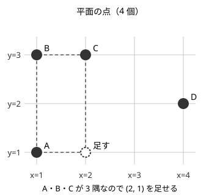
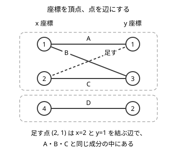

!!! abstract "要点"
    - **何のページか**：物・値・座標・状態・時刻・剰余などを頂点に、関係・操作・制約を辺にすると、問題が既知のグラフの問題（連結・二部・閉路・最短路）に変わる。自由に行き来できる部分は 1 点に縮約できる。
    - **使い方**：問題文の「もの」を[何を頂点にするか](#what-to-vertex)の表で、「つながり」を[何を辺にするか](#what-to-edge)と[制約の表](#constraints-to-edges)で探し、行のページの節へ進む。グラフが大きすぎるときは[縮約](#contraction)を見る。
    - **計算量**：作ったグラフの頂点数 $V$・辺数 $E$ で決まる。BFS・DFS は $O(V + E)$、Union-Find はならし $O((V + E)\,\alpha(V))$、ダイクストラ法は $O((V + E) \log V)$
    - **前提**：[グラフの表現と用語](../graph/graph-basics.md)

<!-- textlint-disable -->
別名：グラフに言い換える・モデル化・何を頂点にするか・何を辺にするか・グラフの縮約・graph modeling
<!-- textlint-enable -->

グラフへの帰着は、問題文にグラフが出てこない問題を、頂点と辺を決め直して既知のグラフの問題に変える考え方である。決めることは「何を頂点にするか」「何を辺にするか」の 2 つで、決まれば後は探索・Union-Find・最短路などの道具をそのまま使える。このページは、その選び方を表にまとめた案内であり、各手法の中身は行き先のページに任せる。グラフに限らない言い換えは[言い換えの典型](../thinking/reformulation.md#table)にある。

作ったグラフの大きさは必ず見積もる。頂点数 $V$ と辺数 $E$ が $10^6$〜$10^7$ 程度に収まれば、BFS・Union-Find のような線形に近い探索は 1 秒前後で終わる。$\log$ がつくダイクストラ法なら $10^6$ 程度までが目安である（[見積もりの手順](../basics/complexity-estimation.md#how-to-estimate)）。見積もりが大きすぎるときは、頂点の選び方を変えるか、[縮約](#contraction)や[超頂点](../graph/extended-dijkstra.md#super-vertex)で減らす。

## 何を頂点にするか（物・値・座標・状態・時刻・剰余・区間の端点） {#what-to-vertex}

頂点は、問題の中で「区別したいもの」1 つにつき 1 個置く。物や場所をそのまま頂点にするのが基本だが、それで辺が多すぎるときや、先の動きが頂点だけで決まらないときは、別のものを頂点にする。次の表は、問題文の手がかりから頂点の候補を引くためのものである。

| 何を頂点にするか | 手がかり | ページ | 代表の問題 |
| --- | --- | --- | --- |
| 物・人・場所 | 道・友達・つながりが直接与えられる | [グラフの表現と用語](../graph/graph-basics.md#representations) | [ABC177 D](../graph/connected-components.md#abc177_d) |
| マス目の各マス | 迷路・盤面の上の移動 | [グリッドグラフ](../graph/grid-graph.md#flatten) | [ABC325 C](../graph/grid-graph.md#abc325_c) |
| 座標の値・列の値 | 同じ $x$ か同じ $y$ でつながる、値 $a$ を $b$ に一括で書き換える | [連結成分](../graph/connected-components.md#values-as-vertices)・[Union-Find の応用](../ds/union-find-applications.md#modeling) | — |
| （場所, 補助の情報）の組 | 残り回数・向き・持ち物で次の動きが変わる | [状態を頂点にする](../graph/extended-dijkstra.md#choose-state) | [ABC132 E](../graph/extended-dijkstra.md#abc132_e) |
| 2 つの位置の組・盤面全体 | 2 人が同時に動く、配置を目標の形にする | [状態を頂点にする](../graph/extended-dijkstra.md#pair-state) | [ABC339 D](../graph/extended-dijkstra.md#abc339_d) |
| 訪問した頂点の集合 | 頂点数が 17 程度で、どこを回ったかが効く | [状態を頂点にする](../graph/extended-dijkstra.md#visited-set)・[bitDP](../dp/bit-dp.md#with-shortest-paths) | — |
| （場所, 時刻）の組 | 時刻ごとに容量がある、周期で規則が変わる | [最大流](../graph/max-flow.md#modeling)・[状態を頂点にする](../graph/extended-dijkstra.md#parity-mod-direction) | — |
| 剰余 | $K$ の正の倍数の桁和の最小、作れる数の集合 | [剰余を頂点にする最短路](../graph/modular-shortest-path.md#residue-vertices) | [ARC084 D](../graph/modular-shortest-path.md#arc084_b) |
| 区間の端点・累積和の添字 | 区間の和が分かる、区間を反転する | [Union-Find の応用](../ds/union-find-applications.md#modeling)・[最小全域木](../graph/minimum-spanning-tree.md#modeling) | [ABC238 E](../ds/union-find-applications.md#abc238_e) |
| グループ・集合・操作 | 同じ色ならどこへでも行ける、集合をまとめる | [状態を頂点にする](../graph/extended-dijkstra.md#super-vertex) | [ABC184 E](../graph/extended-dijkstra.md#abc184_e) |
| 条件の真偽（$x$ と「$x$ でない」） | 各要素が 2 択で、「同時には選べない」「少なくとも一方」 | [2-SAT](../graph/two-sat.md#implication) | [ABC210 F](../graph/two-sat.md#abc210_f) |
| 区間をまとめた補助の頂点 | 頂点から区間内の全頂点へ移動できる | [区間に辺を張る](../graph/segment-tree-graph.md#two-trees) | — |

座標や値を頂点にする見方は、言い換えの前後を並べると分かりやすい。1 枚目の図は平面の 4 点で、A・B・C が長方形の 3 隅になっている。2 枚目の図は同じ点を「$x$ 座標の頂点と $y$ 座標の頂点を結ぶ辺」に描き直したものである。

点を頂点にすると、同じ $x$ を持つ点どうしをすべて結ぶので辺が $O(N^2)$ 本になりうる。座標を頂点にすれば辺は点の数の $N$ 本で済み、長方形の隅を補う操作は「同じ成分の中で辺を足す」操作に変わる。詳しい理由は[連結成分の節](../graph/connected-components.md#values-as-vertices)にある。

状態を頂点にするときは、状態数を先に数える。（頂点, $K$ 通りの情報）なら頂点は $NK$ 個、辺はおよそ $MK$ 本になる。見積もりの仕方と、状態を整数に詰める方法は[状態数の見積もり](../graph/extended-dijkstra.md#state-count)にある。

## 何を辺にするか（関係・操作・制約・写像） {#what-to-edge}

辺は、2 つの頂点の間の「つながり」を表す。つながりが対称なら無向の辺、片向きなら有向の辺にする。重みは移動や操作のコストで、すべて同じなら重みなしでよい。つながりの種類ごとに、作ったグラフで解く問題がおおよそ決まる。

| 何を辺にするか | 向き・重み | 解く問題とページ | 代表の問題 |
| --- | --- | --- | --- |
| 関係（友達・同じグループ・道） | 無向・重みなし | [連結成分](../graph/connected-components.md#three-methods) | [ABC177 D](../graph/connected-components.md#abc177_d) |
| 操作（1 手で移れる） | 有向、手数なら重みなし | 最小の手数は [BFS](../graph/bfs.md#why-shortest) | [ABC339 D](../graph/extended-dijkstra.md#abc339_d) |
| コストが 0 か 1 の操作 | 有向・重み 0 と 1 | [01-BFS](../graph/zero-one-bfs.md#cost-modeling) | [ABC176 D](../graph/zero-one-bfs.md#abc176_d) |
| 写像（各 $i$ から $A_i$ へ、置換） | 有向・出次数がちょうど 1 | [Functional graph](../graph/functional-graph.md#one-cycle)・[置換の巡回分解](../comb/permutation-cycles.md#decompose) | [ABC256 E](../graph/functional-graph.md#abc256_e) |
| 依存・前後関係（$a$ は $b$ より前） | 有向 | [トポロジカルソート](../graph/topological-sort.md#kahn-dfs)・[閉路の検出](../graph/cycle-detection.md#directed) | [ABC223 D](../graph/topological-sort.md#abc223_d) |
| 制約（異なる・等しい・差・大小） | 制約による | [次の節の表](#constraints-to-edges) | — |
| 物そのもの（点・単語・部品） | 両端は座標や文字 | [連結成分](../graph/connected-components.md#values-as-vertices)・[オイラー路](../graph/euler-path.md#applications) | — |
| グループ内の全対（同じ色へワープ） | 超頂点を足して 2 本ずつに減らす | [状態を頂点にする](../graph/extended-dijkstra.md#super-vertex) | [ABC184 E](../graph/extended-dijkstra.md#abc184_e) |
| 頂点・区間から区間への移動 | セグメント木の形の補助の頂点を通す | [区間に辺を張る](../graph/segment-tree-graph.md#cover) | [ABC414 G](../graph/segment-tree-graph.md#abc414_g) |
| 与えられた辺の「ない」ところ | 補グラフ。辺を作らずに探索する | [補グラフ上の BFS](../graph/complement-graph-bfs.md#take-unvisited) | [ABC319 G](../graph/complement-graph-bfs.md#abc319_g) |

物そのものを辺にする型は、何を頂点にするかと表裏の関係にある。単語を「最初の文字から最後の文字への辺」にすると、すべての単語を並べるしりとりはオイラー路になる。単語を頂点にすると、すべての頂点を 1 回ずつ通るハミルトン路になってしまい、頂点が多いと解けない。どちらを辺にするかで解ける問題かどうかが分かれる（[オイラー路の応用の型](../graph/euler-path.md#applications)）。

写像を辺にしたグラフは、各頂点から出る辺がちょうど 1 本なので、各成分にちょうど 1 つの閉路がある。置換なら入る辺も 1 本ずつなので、閉路だけの集まりになる。「$K$ 回くり返した後」を聞かれたら、閉路の上を何歩進むかに言い換えられる（[K 回後の位置](../graph/functional-graph.md#k-steps)）。

## 制約を辺にすると何の問題になるか（二部グラフ・閉路・差分制約） {#constraints-to-edges}

「$X_u$ と $X_v$ は異なる」「$u$ は $v$ より前」のような 2 変数の制約は、変数を頂点、制約を辺にすると、満たす割り当てがあるかがグラフの性質の判定に変わる。制約の形ごとに、判定する性質と道具が決まる。

| 制約の形 | 辺の張り方 | 判定する性質（道具） | ページ |
| --- | --- | --- | --- |
| $X_u = X_v$ | 無向 | 連結成分ごとに値が 1 つ（Union-Find） | [Union-Find](../ds/union-find.md#what-it-does)・[連結成分](../graph/connected-components.md#three-methods) |
| 2 値で $X_u \ne X_v$ | 無向 | 二部グラフか（2 色に塗る） | [二部グラフ判定](../graph/bipartite-graph.md#coloring) |
| 2 値で「等しい」と「異なる」が混ざる | 偶奇の重みを付ける | 偶奇の矛盾がないか | [重み付き Union-Find](../ds/weighted-union-find.md#generalization)・[二部グラフ判定](../graph/bipartite-graph.md#union-find) |
| $x_v - x_u = d$ | 重み $d$ と $-d$ の辺 | 差の矛盾がないか | [重み付き Union-Find](../ds/weighted-union-find.md#consistency) |
| $x_v - x_u \le w$ | $u \to v$（重み $w$） | 負閉路がないか、最短距離が解（差分制約） | [差分制約](../graph/difference-constraints.md#direction) |
| $u$ は $v$ より前 | $u \to v$ | 閉路がないか、順序はトポロジカル順 | [閉路の検出](../graph/cycle-detection.md#directed)・[トポロジカルソート](../graph/topological-sort.md#kahn-dfs) |
| $x_u \le x_v$ と $x_u < x_v$ | $u \to v$ | 同じ強連結成分の中に $<$ がないか | [強連結成分分解](../graph/scc.md#patterns) |
| 2 択で「$a$ または $b$」 | 含意の辺 2 本 | $x$ と「$x$ でない」が同じ強連結成分にないか（2-SAT） | [2-SAT](../graph/two-sat.md#cheatsheet) |

判定の行（1 行目を除く各行）は、制約を満たせないことがグラフの「悪い形」と同じになる、という対応で成り立っている。

- **異なる値**：2 色で $X_u \ne X_v$ を満たせないことは、長さが奇数の閉路があることと同じである（[奇閉路の節](../graph/bipartite-graph.md#odd-cycle)）。偶数の長さの閉路なら、色を交互に置ける
- **前後関係**：すべての「前」を満たす順序がないことは、有向閉路があることと同じである。閉路の上の頂点は、どれも自分より前に自分が来ることになる
- **差の不等式**：$x_v - x_u \le w$ をすべて満たす値がないことは、負閉路があることと同じである。負閉路に沿って不等式を足すと $0 \le (\text{負の数})$ になる。$x_t - x_s$ の最大は $\mathrm{dist}(s \to t)$ である（[最短距離が最大の解になる理由](../graph/difference-constraints.md#why-maximum)）

制約が 3 変数以上にまたがるもの、$x_u + x_v \le c$ のような和の条件、2 択でない「または」は、この形にならない。その場合は別の手法を探す（[差分制約で直せない条件](../graph/difference-constraints.md#encodings)）。

選ぶか選ばないかの 2 択で、違反に「ペナルティ」を払う最適化は、判定ではなく最小カットになる（[燃やす埋める](../graph/project-selection.md#cheatsheet)）。「同時に選べない組」を辺にして最も多く選ぶ問題は最大独立集合で、一般のグラフでは難しいが、二部グラフなら [König の定理](../graph/konig-theorem.md#theorem)で最大マッチングから求まる。

## 自由に行き来できる部分を 1 点に縮約する（Union-Find・SCC・次数 2 の頂点を消す） {#contraction}

[縮約](../guide/glossary.md#contraction)は、いくつかの頂点を 1 つの頂点にまとめて、グラフを小さく単純にする操作である。互いに自由に行き来できる頂点どうしは、答えに関しては区別しなくてよいことが多い。まとめた後のグラフが木や DAG のような扱いやすい形になれば、その上で既知の手法が使える。

| まとめるもの | 道具 | まとめた後の形・使い方 | ページ |
| --- | --- | --- | --- |
| 何度でも通れる辺でつながった頂点（無向） | Union-Find | 残りの辺だけの多重グラフで判定する | [オイラー路の応用の型](../graph/euler-path.md#applications) |
| 互いに行き来できる頂点（有向） | 強連結成分分解 | DAG になり、DAG 上の DP ができる | [強連結成分分解](../graph/scc.md#condensation)・[DAG 上の DP](../dp/dp-dag.md#with-cycles) |
| 橋を通らずに行き来できる頂点（無向） | lowlink | 木（森）になる | [二重辺連結成分](../graph/lowlink.md#two-edge-connected) |
| 答えに効く重要な点の間の経路 | 重要な点ごとの BFS | 重要な点だけのグラフに作り直す | [状態を頂点にする](../graph/extended-dijkstra.md#key-points) |
| 次数 1 の頂点（葉） | キューで削る | 閉路と、閉路どうしをつなぐ部分が残る（なもりグラフなら閉路だけ） | [なもりグラフ](../graph/namori-graph.md#peel-leaves)・[葉から考える](../tree/leaf-first.md#peel-leaves) |
| 次数 2 の頂点 | 両隣の辺を 1 本にまとめる | 次数 3 以上の頂点だけが残る | このページの下の説明 |

頂点をまとめる縮約（表の上 3 行）では、まとめた頂点の中の移動はコスト 0 とみなされる。何度でも通れる辺を Union-Find でまとめると、通る回数が決まった辺の両端が同じ頂点になることがある。その辺も通らなければならないので、ふつうの[縮約](../guide/glossary.md#contraction)のように消さずに、自己ループとして残す。オイラー路の判定では、自己ループは次数の偶奇を変えない。強連結成分を縮約したときは、成分の中の頂点数や重みの和を新しい頂点の値として持たせ、DAG の上で足し合わせる。

**次数 1 と次数 2 の頂点を消す**：単純パスの数え上げや全列挙のように、グラフの「分かれ道」だけが効く問題で使う。次数 1 の頂点は、そこを通り抜ける単純パスがないので、端点として使わないなら削ってよい。次数 2 の頂点 $v$（隣が $a$ と $b$）は、辺 $a$–$v$ と $v$–$b$ を 1 本の辺 $a$–$b$ にまとめる。重みは 2 本の和にし、途中の頂点数も数えるなら辺に持たせる。始点や終点のように答えに出てくる頂点は、次数にかかわらず残す。

この 2 つの操作はどちらも頂点と辺を 1 つずつ減らすので、辺数と頂点数の差 $k = E - V$ は変わらず、元のグラフの $M - N$ に等しい。グラフが連結で $k \ge 1$（木でも閉路 1 つでもない）なら、消せる頂点がなくなったとき全頂点の次数が 3 以上なので、[握手補題](../graph/graph-basics.md#handshake)から $2E \ge 3V$ である。$E = V + k$ を代入すると $V \le 2k$、$E \le 3k$ になる。非連結なら成分ごとに当てる（閉路だけの成分は $k = 0$ のまま頂点が 1 個残る）。始点・終点のように残した頂点が $t$ 個あると、その分だけ上界が増え、$2E \ge 3(V - t) + t$ から $V \le 2k + 2t$ になる。つまり、辺が頂点よりわずかしか多くない（$M - N$ が小さい）連結なグラフは、まとめると $O(M - N)$ 頂点の小さなグラフになり、指数時間の全探索も間に合うことがある。まとめると多重辺や自己ループができるので、隣接リストは多重グラフとして持つ。

## 落とし穴 {#pitfalls}

- **状態の頂点数を見積もらない**：（頂点, 残り回数, 向き）のように組を増やすと、頂点数は積で増える。$N = 10^5$、残り回数 $100$、向き $4$ なら $4 \times 10^7$ 頂点になり、距離の配列だけで数百 MB になる。作る前に掛け算する
- **値を頂点にするときの番号のずれ**：$x$ 座標と $y$ 座標を同じ配列で持つなら、$y$ の頂点の番号を $x$ の頂点の数だけずらす。ずらさないと、$x = 3$ と $y = 3$ が同じ頂点になり、別の成分がつながる。値が大きいときは[座標圧縮](../basics/coordinate-compression.md)で番号を振ってからずらす
- **片向きの関係を無向にする**：「$a$ が $b$ へ変われる」「$i$ の次が $A_i$」のような関係は有向である。無向にすると、戻れないはずの移動ができてしまう。逆に、友達のような対称な関係を片向きだけ張ると、探索で届かない頂点が出る
- **累積和の添字を 1 つずらす**：閉区間 $[l, r]$（1-indexed）の和は $S_r - S_{l-1}$ なので、結ぶのは $l - 1$ と $r$ である。頂点は $0, \dots, N$ の $N + 1$ 個になる（[Union-Find の応用](../ds/union-find-applications.md#modeling)）

## 練習問題 {#practice}

- [ABC377 E. Permute K times 2](https://atcoder.jp/contests/abc377/tasks/abc377_e)（diff 1685）：順列 P に対して、すべての i で P_i を P_{P_i} に同時に置き換える操作を K 回行った後の列を求める。
- [ABC131 F. Must Be Rectangular!](https://atcoder.jp/contests/abc131/tasks/abc131_f)（diff 1937）：平面の点の集合に「長方形の 3 隅があれば残りの 1 隅を足す」操作をくり返すとき、できる操作の最大回数を求める。
- [ABC286 G. Unique Walk](https://atcoder.jp/contests/abc286/tasks/abc286_g)（diff 2135）：無向グラフで、指定された K 本の辺はそれぞれちょうど 1 回、ほかの辺は何回でも通ってよいウォークがあるかを判定する。

??? note "方針"
    - **ABC377 E**：添字 $i$ から $P_i$ への辺を張ると、順列なので閉路だけの集まりになる（[置換は閉路の集まり](../graph/functional-graph.md#permutation)）。今の列を「$i$ から何歩先の頂点か」で表すと、1 回の操作で歩数が 2 倍になるので、$K$ 回後は $i$ から $2^K$ 歩先の頂点が答えになる。長さ $L$ の閉路では $2^K \bmod L$ 歩だけ進めればよく、これは[繰り返し二乗法](../math/mod-pow.md)で求まる。
    - **ABC131 F**：$x$ 座標と $y$ 座標を頂点、点を辺にした二部グラフを作る（[何を頂点にするか](#what-to-vertex)の図）。操作を続けると各成分は完全二部グラフになるので、成分ごとの（$x$ の数）×（$y$ の数）の和から、元の点の数 $N$ を引いたものが答えである。
    - **ABC286 G**：何回でも通ってよい辺で結ばれた頂点を Union-Find で 1 点に縮約する。指定の $K$ 本の辺だけを、縮約後の頂点の間の辺として張り直す。この多重グラフで、辺のある頂点が連結で、次数が奇数の頂点が 0 個か 2 個ならウォークがある（[オイラー路の存在条件](../graph/euler-path.md#conditions)）。

## 確認問題 {#quiz}

??? question "確認問題：「X と Y は異なる値」という条件を辺にすると、何を判定する問題になるか"
    値が 0 と 1 の 2 通りのとき、各条件を $X$ と $Y$ を結ぶ無向の辺にすると、何を判定すればよいか。値が 3 通りに増えたらどうなるか。

    ??? success "答え"
        2 通りなら、辺の両端が必ず違う色になるように 2 色で塗れるか、すなわち二部グラフかの判定になる。BFS か DFS で塗れば $O(N + M)$ である（[二部グラフ判定](../graph/bipartite-graph.md#coloring)）。3 通りに増えると 3 彩色の判定になり、一般のグラフでは効率のよい方法が知られていない。頂点数が小さいときの全探索や bitDP を考える（[小さいグラフの全探索](../graph/small-graph-brute-force.md#coloring)）。

??? question "確認問題：斜めでつながる点は何を頂点にするか"
    平面の $N$ 個の点で、「同じ $x + y$ を持つ点どうし」と「同じ $x - y$ を持つ点どうし」がつながるとする。連結成分を $O(N^2)$ 本の辺を作らずに求めるには、何を頂点、何を辺にすればよいか。

    ??? success "答え"
        $x + y$ の値と $x - y$ の値を頂点にし、点 $(x, y)$ を「$x + y$ の頂点と $x - y$ の頂点を結ぶ辺」にする。2 つの点が同じ $x + y$ か同じ $x - y$ を持つことは、2 本の辺が頂点を共有することにあたるので、辺どうしが同じ成分に入るかで判定できる。辺は $N$ 本で済む。2 種類の値は番号をずらして別の頂点にする（$x + y = 0$ と $x - y = 0$ を同じ頂点にしない）。$x - y$ は負にもなるので、[座標圧縮](../basics/coordinate-compression.md)で番号を振るとよい（[連結成分](../graph/connected-components.md#values-as-vertices)）。

??? question "確認問題：縮約で V ≤ 2k になるのはなぜか"
    次数 1 の頂点を削る操作と、次数 2 の頂点を両隣の辺 1 本にまとめる操作をくり返した。どちらも使えなくなったとき、頂点数 $V$ が $2(E - V)$ 以下になる理由を説明せよ。ただし元のグラフは連結で、木でも閉路 1 つでもない（$E - V \ge 1$）ものとする。

    ??? success "答え"
        どちらの操作も頂点と辺を 1 つずつ減らし、連結性も保つので、$k = E - V \ge 1$ は変わらない。操作が使えないとき残る頂点の次数は 0、2、3 以上のどれかだが、次数 0 の頂点は成分全体が孤立点（$k = -1$）、両隣の辺にまとめられない次数 2 の頂点は自己ループ 1 本だけの頂点（成分全体で $k = 0$）のときに限るので、連結で $k \ge 1$ なら現れない。よって全頂点の次数は 3 以上で、次数の和 $2E$ は $3V$ 以上である。$E = V + k$ を入れると $2V + 2k \ge 3V$、すなわち $V \le 2k$ になる。

## 参考 {#references}

- [けんちょん「AtCoder ABC 131 F - Must Be Rectangular! (青色, 600 点)」](https://drken1215.hatenablog.com/entry/2019/06/23/004700)：座標を頂点、点を辺にした二部グラフと、答えの式（成分ごとの積の和から点の数を引く）
- [kmjp「AtCoder ABC #286 (ウルシステムズプログラミングコンテスト2023) : G - Unique Walk」](https://kmjp.hatenablog.jp/entry/2023/01/21/1100)：何度でも通れる辺の縮約と、縮約後のオイラー路の条件
- [Lanly「AtCoder Beginner Contest 377」](https://www.cnblogs.com/Lanly/p/18513188)：ABC377 E の閉路への分解と、2 の累乗の歩数を閉路の長さで割った余りだけ進める方針
