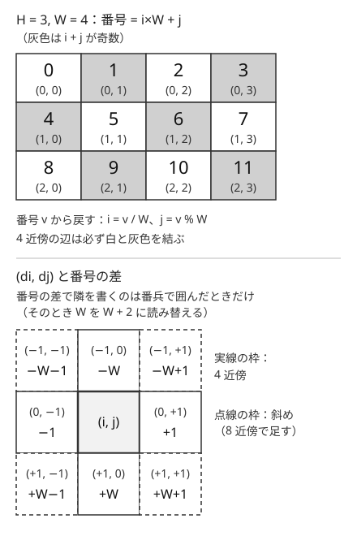
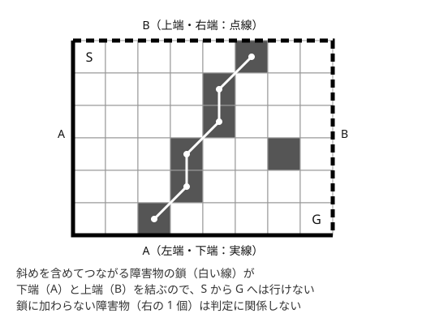

!!! abstract "要点"
    - **何ができるか**：マスを頂点、隣り合うマスを辺と見て、BFS・DFS・Union-Find をそのまま使う。隣のマスは移動の配列で作り、隣接リストは作らない。(i, j) の 1 次元化・番兵・止まるマスの扱いと、市松模様で二部グラフになることが要点になる。
    - **いつ使うか**：
        - H×W のマス目を上下左右（8 方向）に移動する・壁や障害物がある。
        - $H, W \le 2000$ 程度（マスの数が $4 \times 10^6$ 程度まで）。
        - $H, W$ が巨大で、障害物の数だけが少ない。
    - **計算量**：マスの数 $HW$ に対して $O(HW)$。辺は 4 近傍で高々 $2HW$ 本、8 近傍で高々 $4HW$ 本である。障害物 $K$ 個だけを見る判定は $O(K \log K)$。
    - **前提**：[幅優先探索（BFS）と無重み最短路](../graph/bfs.md)、[深さ優先探索（DFS）](../graph/dfs.md)

<!-- textlint-disable -->
別名：グリッド BFS・迷路の探索・4 近傍・8 近傍・grid graph
<!-- textlint-enable -->

グリッドグラフは、マス目の各マスを頂点、隣り合う 2 マスを辺で結んだグラフである。頂点と辺は配列の添字から計算で作れるので、隣接リストを持たずに [BFS](../graph/bfs.md) や [DFS](../graph/dfs.md) を回せる。探索そのものは一般のグラフと同じで、差が出るのは添字の扱い・範囲外の処理・グリッドに特有の性質（市松模様、障害物の連結）である。

## 4 近傍・8 近傍と dx・dy の配列 {#neighbors}

マス $(i, j)$ の 4 近傍は上下左右の 4 マス、8 近傍はそれに斜めの 4 マスを足したものである。8 近傍は、自分以外で行の差と列の差がどちらも 1 以下の（[チェビシェフ距離](../geometry/manhattan-chebyshev.md)が 1 の）マスと言い換えられる。

隣のマスは、移動量の配列（よく dx・dy と書く。このページでは行と列の取り違えを避けて di・dj と書く）を回して作る。マス $(i, j)$ は $i$ 行目・$j$ 列目で、$0 \le i < H$、$0 \le j < W$ の 0-indexed にする。問題文の $(i, j)$ が 1-indexed なら、読み込んだときに 1 を引く。



次のコードは、'#' を壁として左上から右下への最短の手数を求める 4 近傍の BFS である。隣のマスごとに、範囲内・通れる・未訪問の 3 つを、この順に調べる。

```cpp
--8<-- "grid-graph/grid-bfs.cpp:core"
```

- **隣接リストを作らない**：辺は配列から毎回計算できる。$4 \times 10^6$ 頂点の `vector<vector<int>>` を作ると、確保だけで時間とメモリを大きく使う
- **計算量**：各マスはキューに 1 回だけ入り、取り出すたびに隣を 4 個（8 近傍なら 8 個）調べるので $O(HW)$ である。$H = W = 2000$ でも $4 \times 10^6 \times 4$ 回ほどの処理で済む
- **移動の仕方を変える**：配列の中身を変えるだけで、8 近傍や桂馬跳びのような移動にも同じコードが使える。重みが 0 と 1 なら [01-BFS](../graph/zero-one-bfs.md)、一般の非負の重みなら[ダイクストラ法](../graph/dijkstra.md)に替える
- **頂点に情報を足す**：「直前の向き」「壁を壊した回数」で次の動きが変わるなら、$(i, j)$ だけでは足りない。$(i, j, \text{向き})$ などを頂点にする（[状態を頂点にする](../graph/extended-dijkstra.md)）

??? question "確認問題：全マスから BFS する"
    $H, W \le 20$ のグリッドで、「最も遠い 2 マスの距離」を求めたい。全マスを始点に BFS してよいか。$H, W \le 2000$ ならどうか。

    ??? success "答え"
        $HW \le 400$ なので、全マスから BFS しても $(HW)^2 = 1.6 \times 10^5$ 回ほどで間に合う。$H, W \le 2000$ では $(HW)^2 = 1.6 \times 10^{13}$ になり間に合わない。始点の数を減らす工夫か、別の性質が要る。

## (i, j) を i×W+j に 1 次元化する・外周に番兵を置く {#flatten}

マス $(i, j)$ に番号 $v = i \times W + j$ を振ると、グリッドを $0$ から $HW - 1$ までの頂点を持つ普通のグラフとして扱える。番号から戻すときは $i = \lfloor v / W \rfloor$、$j = v \bmod W$ である。[Union-Find](../ds/union-find.md) や、頂点を `int` で受け取るダイクストラ法などの道具が、そのまま使えるようになる。掛けるのは列の数 $W$ で、行の数 $H$ ではない。$H \ne W$ のときに $i \times H + j$ と書くと、別のマスと番号が重なる。

さらに、外周に壁の[番兵](../guide/glossary.md#sentinel)を 1 周置くと、範囲外の判定が要らなくなる。グリッドを $(H + 2) \times (W + 2)$ に広げ、元の $(i, j)$ を $(i + 1, j + 1)$ に置く。外周は通れないマスなので、探索は外へ出ない。番兵込みの幅を $W_2 = W + 2$ とすると、隣の番号は次のように差だけで書ける。

| 方向 | 番号の差 |
| --- | --- |
| 左・右 | $-1$・$+1$ |
| 上・下 | $-W_2$・$+W_2$ |
| 斜め | $-W_2 \pm 1$・$+W_2 \pm 1$ |

番兵を置かずに $v \pm 1$ を隣とすると、右端のマスの $v + 1$ が次の行の左端になり、つながっていないマスへ移ってしまう。1 次元の番号で隣を差として書くのは、番兵があるときだけにする。

次のコードは、8 近傍でつながった '#' のまとまりの数を、番兵と 1 次元の番号で数える。範囲の判定がなくなり、ループの中身が短くなる。再帰の代わりにスタックを使っているので、まとまりが大きくても深い再帰にならない。

```cpp
--8<-- "grid-graph/components-8.cpp:core"
```

## 止まるマス・境界のマスの数え方 {#boundary-cells}

「そのマスに入ると動けなくなる」マスがあるグリッドでは、到達できるマスを数えるときに注意が要る。こうした止まるマスへは入れるが、そこからは出られない。辺で言えば、止まるマスには入る向きの辺だけがある有向グラフである。

止まらないマス（自由なマス）から到達できるのは、次の 2 つを合わせた範囲である。

- そのマスを含む、自由なマスだけでつながった成分
- その成分に隣り合う止まるマス（入れるが、その先へは進めない）

同じ成分の自由なマスは互いに行き来できるので、到達できる範囲はどれも同じになる。だから探索は成分ごとに 1 回でよく、自由なマスは全体で 1 回ずつしか訪れない。

注意するのは、1 つの止まるマスが複数の成分に隣り合うことである。止まるマスに「訪問済み」の印を全体で 1 つだけ付けると、2 つ目の成分から数えるときに漏れる。成分ごとに印を消し直すと遅いので、印に成分の番号を書き込み、「今の番号と同じなら訪問済み」と判定する（タイムスタンプの印）。止まるマスは 4 近傍の自由なマスからしか数えられないので、数える回数は 1 マスにつき高々 4 回で、全体は $O(HW)$ に収まる。

止まるマスから出発した場合は、どこへも動けないので到達できるのは自分 1 マスである。自由なマスが 1 つもないときの答えを、この場合で埋め忘れないようにする。

??? question "確認問題：止まるマスの印"
    自由なマスの成分ごとに BFS し、止まるマスにも普通の訪問済みの印を付けた。どんなグリッドで答えが小さくなるか。

    ??? success "答え"
        1 つの止まるマスが 2 つ以上の成分に隣り合うグリッドである。たとえば止まるマスが 1 列に並んで左右の成分を分けていると、先に探索した成分だけがその列を数え、後の成分はその列を数えない。後の成分の到達範囲が実際より小さく数えられる。

## 市松模様で二部グラフになる（フロー・マッチングへの入口） {#checkerboard}

マス $(i, j)$ を $i + j$ の偶奇で 2 色に塗ると市松模様になる。4 近傍の移動は $i$ か $j$ のどちらかを 1 だけ変えるので、$i + j$ の偶奇が必ず入れ替わる。したがって 4 近傍の辺は必ず異なる色を結び、4 近傍のグリッドグラフは[二部グラフ](../graph/bipartite-graph.md)である。

8 近傍では斜めの移動が $i + j$ を $0$ か $\pm 2$ だけ変えるので、同じ色どうしを結ぶ辺ができる。$(i, j)$・$(i, j + 1)$・$(i + 1, j + 1)$ の 3 マスは互いに 8 近傍なので長さ 3 の閉路になり、二部グラフではない。

この性質から、次の 2 つの型が出てくる。

- **歩数の偶奇**：4 近傍で $s$ から $t$ へ動く経路の長さは、どの経路でも $(i_s + j_s) - (i_t + j_t)$ と偶奇が一致する。「ちょうど $K$ 歩で着けるか」は、最短の手数が $K$ 以下で、かつ偶奇が合うかで決まる（同じ辺を往復すれば 2 歩ずつ足せる）
- **ドミノ（隣り合う 2 マス）の配置**：隣り合う 2 マスを選ぶことは、黒マスと白マスを結ぶ辺を 1 本選ぶことになる。ドミノを重ならないように最も多く置く問題は、黒を左、白を右とする[二部マッチング](../graph/bipartite-matching.md)になり、[最大流](../graph/max-flow.md)で解ける。マスの数の少ない方の色のマスの数が、置ける数の上限である

隣り合うマスの色や値の関係にコストが付く問題でも、片方の色のマスだけ条件を反転させると、[燃やす埋める](../graph/project-selection.md)の形に直せることがある。どれも、二部であることを使って辺の向きや意味を色ごとにそろえている。

??? question "確認問題：8 近傍の歩数の偶奇"
    8 近傍の移動では、$(0, 0)$ から $(0, 2)$ へちょうど 3 歩で着けるか。

    ??? success "答え"
        着ける。$(0, 0) \to (1, 1) \to (0, 1) \to (0, 2)$ のように、斜めの移動は $i + j$ の偶奇を変えないので、歩数の偶奇の制約はなくなる。8 近傍のグリッドが二部グラフでないことと同じである。

## 障害物どうしの 8 近傍の連結で通れるかを判定する {#obstacle-dual}

この節は [Union-Find](../ds/union-find.md) を前提にする。$H, W$ が $10^9$ のように巨大で、障害物が $K$ 個だけのとき、左上から右下へ 4 近傍で行けるかを判定する。マスの数が多すぎて BFS はできないので、障害物の側を調べる。

次の判定が成り立つ。左上 $S$ から右下 $G$ へ 4 近傍で行けないことと、次の条件は同値である。

- 8 近傍でつながった障害物のまとまりで、「左端か下端」と「右端か上端」の両方に接するものがある



なぜ 8 近傍でつなぐかというと、斜めに並んだ 2 つの障害物の間は 4 近傍の移動では抜けられないからである。抜けるには斜めに 1 歩動く必要がある。斜めにつながった鎖も壁として働くので、鎖が左下側の辺（左端・下端）から右上側の辺（右端・上端）まで届くと、$S$ のある左上の角と $G$ のある右下の角が分断される。

??? note "逆向きの証明の筋"
    $S$ から $G$ へ行けないとき、$S$ から 4 近傍で到達できるマスの集合を $R$ とする。$R$ の外側をなぞると、$R$ に接する障害物が並ぶ。$R$ の外周をたどる向きで隣り合う 2 つは、角を回る所で斜めになることがあるが、8 近傍では必ず隣り合う。$R$ は左上の角を含み右下の角を含まないので、この外周の障害物の列は、上端か右端の所で始まり、左端か下端の所で終わる。これが条件の鎖になる。$S$ 自体が障害物のときは、そのマスが左端と上端に接するので条件を満たす。この主張は、Hex という盤のゲームで「どちらかが必ず勝ち、両者は同時に勝てない」ことと同じ形である。

判定は、障害物 $K$ 個と、仮想の頂点 $A$（左端か下端）・$B$（右端か上端）を Union-Find でつなぐだけである。障害物の座標を `map` に入れて 8 近傍を引くので、$O(K \log K)$ で済む。

```cpp
--8<-- "grid-graph/obstacle-dual.cpp:core"
```

- **端の扱い**：$H = 1$ のときは、どの障害物も上端と下端の両方に接するので、障害物が 1 つでもあれば行けない。式を変えずにこの場合も正しく扱える
- **移動と連結の近傍は入れ替わる**：移動が 8 近傍なら、ふさぐ壁は斜めの隙間を抜けられるので、障害物は 4 近傍でつないで判定する
- **座標の積に注意**：座標を 1 つの整数のキーにするなら $r \times (W + 1) + c$ のように作る。$W = 10^9$ なら `long long` が要る

## 落とし穴 {#pitfalls}

**行と列の取り違え**。$H$ は行の数（縦）、$W$ は列の数（横）で、`s[i][j]` の $i$ が行である。`dist(w, vector<int>(h))` のように逆に確保すると、$H \ne W$ の入力でだけ範囲外になり、正方形の例では気づけない。問題文が $(x, y)$ を「横、縦」の順で書いている場合もあるので、読み込みの所で $(i, j)$ に直す。

**範囲の判定より先に配列を引く**。`if (s[ni][nj] == '.' && 0 <= ni && ...)` は、範囲外のときにも先に `s[ni][nj]` を読むので[未定義動作](../cpp/cpp-undefined-behavior.md)になる。`&&` は左から評価して途中で止まるので、範囲の判定を左に書く。番兵を置けばこの判定自体が要らない。

**番兵なしの 1 次元化で $v \pm 1$ を隣にする**。右端の $v + 1$ は次の行の左端である。番号の差で隣を書くなら番兵で囲み、そうでなければ $(i, j)$ に戻して範囲を判定する。

**再帰の DFS が深くなる**。蛇行する通路では、再帰の深さがマスの数（最大 $4 \times 10^6$）近くになる。AtCoder のスタックは大きいが、手元の環境ではスタックがあふれて落ちることがある。連結成分を数えるだけなら、BFS や自分で持つスタックを使う。

**印を取り出すときに付ける**。入れる時点で印を付けないと、同じマスが何度もキューに入り、メモリと時間が数倍になる。BFS の印は入れるときに付ける。

**状態が足りない訪問済みの配列**。「壁を $1$ 回まで壊せる」のように状態があるのに、`visited[i][j]` だけで判定すると、壊した後に来た経路が先に印を付け、壊す前の経路を締め出す。印も状態ごとに `visited[i][j][k]` と持つ。

## 使い分け {#comparison}

- 移動のコストがすべて等しいなら BFS、0 と 1 なら [01-BFS](../graph/zero-one-bfs.md)、非負の一般の重みなら[ダイクストラ法](../graph/dijkstra.md)を使う
- グリッドが固定で、つながりを 1 回だけ調べるなら DFS・BFS で[連結成分](../graph/connected-components.md)に分ける。マスが順に通れるようになり、そのつど「つながったか」を問われるなら [Union-Find で連結性を扱う](../graph/union-find-connectivity.md)
- 移動が右と下だけなら探索ではなく [グリッド上の DP](../dp/dp-grid.md) で数えたり最適化したりする
- グリッドの問題の型の一覧は[グリッド](../patterns/grid.md)のページにまとめてある

## 例題 {#examples}

### ABC325 C. Sensors {#abc325_c}

<div class="kp-problems" data-role="example" markdown>

- [ABC325 C. Sensors](https://atcoder.jp/contests/abc325/tasks/abc325_c)（diff 400）：8 方向に隣接する '#' をひとまとまりとみなしたとき、まとまりの個数を求める。

</div>

8 方向に隣接する '#' を 1 つのまとまりと見るので、'#' のマスを頂点、8 近傍で隣り合う '#' どうしを辺としたグラフの連結成分の数を数えればよい。$H, W \le 1000$ なので、マスは $10^6$ 個までで、各マスを 1 回ずつ訪れる探索が間に合う。

??? note "解法の詳細"
    - 全マスを順に見て、まだ訪れていない '#' を見つけたら答えに 1 を足し、そこから 8 近傍の '#' を BFS（またはスタックの DFS）ですべて訪問済みにする。全体で $O(HW)$。
    - 範囲の判定は、外周に '.' の番兵を置くと省ける。コードは [1 次元化と番兵の節](#flatten)のものがそのまま使える。
    - Union-Find で書くなら、各 '#' を右・左下・下・右下の 4 方向の '#' と併合すればよい。8 方向の組はどれも、どちらか一方のマスから見てこの 4 方向のどれかに入るので、4 方向で漏れがない。最後に '#' の代表の数を数える。

## 練習問題 {#practice}

<div class="kp-problems" data-role="practice" markdown>

- [ABC351 D. Grid and Magnet](https://atcoder.jp/contests/abc351/tasks/abc351_d)（diff 974）：磁石の隣のマスに入ると動けなくなるグリッドで、あるマスから行けるマスの数の最大値を求める。
- [ABC088 D. Grid Repainting](https://atcoder.jp/contests/abc088/tasks/abc088_d)（diff 999）：迷路で、スタートからゴールへ行ける状態を保ったまま黒く塗れる白マスの最大数を求める。
- [典型90 012. Red Painting（★4）](https://atcoder.jp/contests/typical90/tasks/typical90_l)（diff —）：マスを赤く塗るクエリと、2 マスが赤いマスだけでつながっているかを問うクエリに答える。

</div>

??? note "練習の方針"
    - **ABC351 D**：磁石の上下左右のマスが止まるマスになる。自由なマスの成分ごとに 1 回探索し、成分の大きさに隣り合う止まるマスの数を足す。止まるマスは複数の成分から数えられるので、印には成分の番号を書く（[止まるマスの節](#boundary-cells)）。自由なマスがなくても、磁石のないマスがあれば答えは 1 以上である
    - **ABC088 D**：白マスだけを通る経路を 1 本残せばよいので、残すのは最短路が最もよい。BFS で最短の手数 $d$ を求めると、最短路のマスは $d + 1$ 個なので、答えは「白マスの数 $-(d + 1)$」。ゴールへ行けなければ $-1$
    - **典型90 012**：マスを $i \times W + j$ に 1 次元化して Union-Find を作る。赤く塗るたびに、上下左右の赤いマスと併合する。問いには、2 マスがどちらも赤く、かつ同じ成分なら Yes と答える

## 力試し {#challenge}

<div class="kp-problems" data-role="challenge" markdown>

- [ABC413 G. Big Banned Grid](https://atcoder.jp/contests/abc413/tasks/abc413_g)（diff 1723）：障害物のある巨大なグリッドで、左上から右下へ行けるかを判定する。

</div>

??? note "力試しの方針"
    - **ABC413 G**：グリッドが大きすぎて探索できないので、障害物の側を見る。障害物を 8 近傍で Union-Find につなぎ、「左端か下端」と「右端か上端」を表す仮想の頂点を足す。2 つの仮想の頂点がつながれば行けない（[障害物の連結の節](#obstacle-dual)）。障害物の座標は `map` などで引く

## 参考 {#references}

- [drken「AtCoder ABC 325 C - Sensors (3Q, 茶色, 300 点)」](https://drken1215.hatenablog.com/entry/2023/10/22/151450)：例題の問いと、8 近傍の連結成分を BFS で数える方針
- [Lanly「AtCoder Beginner Contest 351」](https://www.cnblogs.com/Lanly/p/18172416)：止まるマスを成分ごとに数え直す扱いと、訪問の印に探索の番号を使う工夫（D の節）
- [hamayan「Grid Repainting [AtCoder Beginner Contest 088 D]」](https://blog.hamayanhamayan.com/entry/2018/02/18/224521)：練習の方針（最短路だけを残す理由と答えの式）
- [motoya0118「Atcoder 競プロ典型 90 問 012 - Red Painting」](https://qiita.com/motoya0118/items/a953c986e97214992cd7)：練習の方針（1 次元化した番号での Union-Find）
- [kmjp「AtCoder ABC #413 (デンソークリエイトプログラミングコンテスト2025) : G - Big Banned Grid」](https://kmjp.hatenablog.jp/entry/2025/07/05/0930)：障害物を 8 近傍でつなぎ、端を表す 2 頂点の連結で判定する方針
