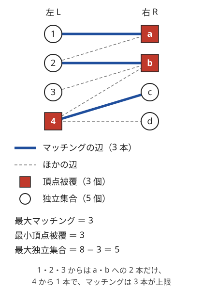

!!! abstract "要点"
    - **何ができるか**：二部グラフの最小[頂点被覆](../guide/glossary.md#vertex-cover)・最大独立集合・最小辺被覆の大きさを、最大[マッチング](../guide/glossary.md#matching)の大きさ $\nu$ から求める（順に $\nu$、頂点数 $- \nu$、頂点数 $- \nu$。最小辺被覆は辺を持たない頂点がないとき）。頂点の集合そのものは、最大流の後の最小カットから取り出せる。
    - **いつ使うか**：
        - 衝突する（隣り合う）ものを同時に選ばずに最大数選ぶ
        - すべての辺（マス）を監視するのに必要な最小数
        - 市松模様・偶奇で 2 つのグループに分かれる
    - **計算量**：頂点数 $N$・辺数 $M$ の二部グラフで、最大流は $O((N + M)\sqrt{N + M})$（容量がすべて 1 のとき）、被覆の復元は $O(N + M)$
    - **前提**：[二部マッチング](../graph/bipartite-matching.md)、[最小カット](../graph/min-cut.md)

<!-- textlint-disable -->
別名：Konig の定理・最小頂点被覆・最大独立集合・最小辺被覆・LP の半整数性・König's theorem
<!-- textlint-enable -->

König の定理は、二部グラフでは最大マッチングの大きさと最小頂点被覆の大きさが等しいという定理である。一般のグラフでは難しい最小頂点被覆と最大独立集合が、二部グラフなら最大流 1 回で求まる。答えの頂点の集合も、最大流を流した後の残余グラフから取り出せる。

## König の定理と 3 つの関係（頂点被覆・独立集合・辺被覆） {#theorem}

König の定理は、二部グラフの「選ぶ・覆う」の 4 つの量を、最大マッチング 1 つに結び付ける。二部グラフの頂点を左の組 $L$ と右の組 $R$ に分け、頂点数を $N = |L| + |R|$、辺数を $M$ とする。

- **マッチング**：端点を共有しない辺の集まり。最大の本数を $\nu$ と書く
- **頂点被覆**：どの辺も、少なくとも一方の端点が入っている頂点の集まり。最小の個数を $\tau$ と書く
- **[独立集合](../guide/glossary.md#independent-set)**：どの 2 頂点も辺で結ばれていない頂点の集まり。最大の個数を $\alpha$ と書く
- **辺被覆**：どの頂点も、少なくとも 1 本の辺の端点になっている辺の集まり。最小の本数を $\rho$ と書く（辺を持たない頂点があると作れない）

問題文の「衝突する 2 つを同時に選ばずに最大数選ぶ」は最大独立集合、「すべての辺（マス）を見張るのに必要な最小数」は最小頂点被覆である。どちらも一般のグラフでは NP 困難で、$N$ が 40 を大きく超えると全探索は間に合わない。二部グラフなら、次の関係で最大マッチングの計算 1 回に帰着する。

$$
\tau = \nu, \qquad \alpha = N - \tau = N - \nu, \qquad \rho = N - \nu \ (\text{辺を持たない頂点がないとき})
$$

| 関係 | 成り立つ範囲 | 理由 |
| --- | --- | --- |
| $\tau = \nu$ | 二部グラフならいつも（一般には $\tau \ge \nu$ で、等しいとは限らない） | 最大流最小カット定理 |
| $\alpha + \tau = N$ | どのグラフでも | 被覆の補集合が独立集合 |
| $\rho + \nu = N$ | どのグラフでも（辺を持たない頂点がないとき） | マッチングに辺を足す |

次の図は、左右 4 頂点ずつの二部グラフの例である。太線が最大マッチング（3 本）、四角の頂点が最小頂点被覆（3 個）、丸の頂点が最大独立集合（5 個）を表す。



左の 1・2・3 の隣は a と b だけである。そのため、この 3 頂点からはマッチングの辺を 2 本しか出せない。残る左の頂点は 4 だけなので、合わせて 3 本が上限であり、$\nu = 3$ になる。被覆 $\{4, a, b\}$ はすべての辺の端点を押さえ、その補集合 $\{1, 2, 3, c, d\}$ の中には辺がない。最小辺被覆は $8 - 3 = 5$ 本で、マッチングの 3 本に、まだ覆われていない 3 と d のための辺（3b と 4d）を足せば作れる。

**$\tau \ge \nu$（どのグラフでも）**：マッチングの辺は端点を共有しないので、それらを覆うには辺ごとに別の頂点が要る。

**$\tau \le \nu$（二部グラフ）**：始点 $s$ から各 $u \in L$ へ容量 1、各 $v \in R$ から終点 $t$ へ容量 1、元の辺 $uv$ に $u \to v$ の容量 $\infty$ の辺を張る。整数の最大流の値は最大マッチングの大きさ $\nu$ である（[二部マッチング](../graph/bipartite-matching.md#reduction)）。容量が有限のカット $(S, T)$（$s \in S$、$t \in T$）に対して、$C = (L \cap T) \cup (R \cap S)$ とおく。

- カットの容量は $|C|$ に等しい。切れる辺は、$u \in L \cap T$ への $s \to u$ と、$v \in R \cap S$ からの $v \to t$ だけだからである（容量 $\infty$ の辺は有限のカットでは切れない）
- $C$ は頂点被覆である。辺 $uv$ で $u \in T$ なら $u \in C$ である。$u \in S$ なら、容量 $\infty$ の辺 $u \to v$ が切れないので $v \in S$ で、$v \in C$ である

最小カットの容量は最大流の値 $\nu$ に等しい（[最小カット](../graph/min-cut.md#maxflow-mincut)）ので、大きさ $\nu$ の頂点被覆がある。

**$\alpha = N - \tau$（どのグラフでも）**：頂点の集合 $C$ が頂点被覆であることと、補集合 $V \setminus C$ が独立集合であることは同じである。両端とも $C$ の外にある辺は、覆われていない辺そのものだからである。したがって最小の被覆の補集合が最大の独立集合になる。

??? note "証明：$\rho = N - \nu$（辺を持たない頂点がないとき）"
    **$\rho \le N - \nu$**：最大マッチングの $\nu$ 本は $2\nu$ 頂点を覆う。残りの $N - 2\nu$ 頂点には辺が 1 本以上あるので、各頂点から 1 本ずつ足す。合わせて $\nu + (N - 2\nu) = N - \nu$ 本で全頂点を覆える。

    **$\rho \ge N - \nu$**：最小辺被覆では、両端がほかの辺でも覆われている辺はない（あれば外せるので最小でない）。そのため最小辺被覆の辺は、1 つの中心から辺が出る星の形の成分に分かれる。辺 $s$ 本の星は頂点 $s + 1$ 個なので、成分の数を $k$ とすると $\rho + k = N$ である。星ごとに辺を 1 本選ぶと、大きさ $k$ のマッチングになる。よって $\nu \ge k = N - \rho$ である。

## 被覆の復元（最小カットから） {#restore}

最小頂点被覆と最大独立集合の頂点そのものは、最大流を流した後の残余グラフで、始点 $s$ から辺をたどって届く頂点の集合 $S$ から作る。$S$ は最小カットの始点側なので、[3 つの関係](#theorem)の証明の $C = (L \cap T) \cup (R \cap S)$ がそのまま最小頂点被覆になる。

1. $s \to u$（$u \in L$）・$v \to t$（$v \in R$）・$u \to v$（元の辺）の辺を張り、$s$ から $t$ へ最大流を流す
2. 残余グラフで $s$ から届く頂点を求める（ACL の `min_cut(s)`）
3. 最小頂点被覆は「$L$ のうち届かない頂点」と「$R$ のうち届く頂点」を合わせたもの。最大独立集合はその補集合で、「$L$ のうち届く頂点」と「$R$ のうち届かない頂点」である

被覆に入れる側は、左と右で逆になる。左の頂点 $u$ が届かないのは、$s \to u$ が切られて $u$ がカットの容量に数えられたときである。右の頂点 $v$ は、届くときに $v \to t$ が切られている。

[図](#theorem)の例で、マッチング 1a・2b・4c を流した後の残余グラフをたどる。$s$ から出る辺で容量が残るのは、マッチングに入らない 3 への辺だけである。3 から b へ進み、b からはマッチングの辺 2b を逆にたどって 2 へ戻る。2 から a、a から 1 へ進んで止まる。届く頂点は $\{1, 2, 3, a, b\}$ で、被覆は「左の届かない 4」と「右の届く a・b」の $\{4, a, b\}$ になる。

このたどり方は、マッチングに入らない左の頂点から始めて「左から右へはマッチングでない辺」「右から左へはマッチングの辺」を交互にたどる交互路の探索と同じである。

!!! info "ACL では"
    `atcoder::mf_graph<int> g(n);`。`g.add_edge(from, to, cap)` で辺を足し、`g.flow(s, t)` で最大流を流す（容量がすべて 1 なら $O((n + m)\sqrt{m})$、$m$ は足した辺の数）。`g.min_cut(s)` は残余グラフで $s$ から届くかを `vector<bool>` で返す（$O(n + m)$）。最小カットに対応するのは、`flow` を `flow_limit` なしで 1 回だけ呼んだ後である。

```cpp
--8<-- "konig-theorem/cover.cpp:core"
```

コード片では、元の辺の容量を $\infty$ ではなく 1 にしている。重みのない場合はこれでも被覆が正しく取り出せ、容量がすべて 1 なので ACL の計算量の上限 $O((n + m)\sqrt{m})$ がそのまま使える。重みのある場合は 1 にしてはいけない（[落とし穴](#pitfalls)）。

??? note "証明：元の辺の容量を 1 にしても、取り出した集合が被覆になる理由"
    $\infty$ の証明で使ったのは「$u \in L \cap S$、$v \in R \cap T$ を結ぶ元の辺がない」ことだけである。容量 1 でもこれが成り立つことを示す。

    そのような辺 $uv$ があったとする。$v$ に届かないので、$u \to v$ に残りの容量はなく、流量 1 が流れている。$u$ に入る流れは $s \to u$ の 1 だけなので $s \to u$ は飽和しており、$u$ から出る流れは $u \to v$ の 1 本だけである。残余グラフで $u$ に入る辺は、$s \to u$（容量 0）と、流れのある $u \to v$ の逆辺 $v \to u$ だけになる。$v$ には届かないので、$u$ にも届かない。これは $u \in S$ に反する。

    この辺がなければ、カット $(S, T)$ で切れる辺は $s \to u$（$u \in L \cap T$）と $v \to t$（$v \in R \cap S$）だけになり、$|C|$ はカットの容量、すなわち最大流の値 $\nu$ に等しい。

## 二部グラフに作り直す（市松模様・偶奇） {#make-bipartite}

König の定理を使う問題の多くは、二部グラフがそのまま与えられるのではなく、「何を頂点・辺にすれば二部グラフになるか」を見抜くところが山場である。作ったグラフに奇数の長さの閉路があると定理が保証されないので、2 色に塗れる理由を必ず確かめる（[二部グラフでないことと奇閉路があることは同じ](../graph/bipartite-graph.md#odd-cycle)）。

- **隣り合うマスを同時に選ばない（市松模様）**：4 近傍のグリッドは、マス $(i, j)$ を $i + j$ の偶奇で塗ると二部グラフになる（[市松模様で二部グラフになる](../graph/grid-graph.md#checkerboard)）。使えるマスを頂点、隣り合う 2 マスを辺にすれば、選べるマスの最大数は最大独立集合で、マスの数 $- \nu$ である。サイン：「隣り合わないように置く」「市松模様」
- **マスを辺にする（行と列・区間と区間）**：各マスがちょうど 1 つの「行のまとまり」と 1 つの「列のまとまり」に属し、まとまりを 1 つ選ぶとその中のマスがすべて覆われる形である。まとまりを頂点、マスを 2 つのまとまりを結ぶ辺にすると、全マスを覆うまとまりの選び方は頂点被覆になる。障害物がなければ行と列、あれば障害物で区切った横の区間と縦の区間をまとまりにする（[例題](#abc274_g)）。サイン：「すべてのマスを見張る（消す）のに必要な最小数」
- **偶奇で衝突が決まる数**：「2 数の和が素数になる組を同時に選ばない」では、和が 3 以上の素数なら奇数なので、衝突は偶数と奇数の間にしか起きない。偶数を左、奇数を右に置けば二部グラフである。数が正の整数なら、和が 2 になる組は 1 と 1 だけなので、1 は 1 個だけ残してから組み立てる
- **駒の動き**：1 手で $(\pm a, \pm b)$ か $(\pm b, \pm a)$ だけ動く駒を考える。$\gcd(a, b) = 1$ とすると、$a + b$ が奇数なら $x + y$ の偶奇が 1 手ごとに変わる。$a$ と $b$ がどちらも奇数なら $x$ の偶奇が 1 手ごとに変わる。$\gcd(a, b) = g > 1$ なら座標を $\lfloor x / g \rfloor$・$\lfloor y / g \rfloor$ にして同じことを言える。どの場合も奇数の長さの閉路はできない
- **頂点を入口と出口に分ける**：DAG の最小パス被覆は、各頂点を「出る側」と「入る側」に分けた二部グラフの最大マッチングで求まる（[DAG の最小パス被覆](../graph/dilworth-path-cover.md#path-cover)）
- **頂点を 2 倍にする**：一般のグラフでも、制約を緩めた問題なら 2 倍にした二部グラフで解ける（[頂点を 2 倍にして二部グラフにする](#lp-half-integrality)）

## 一般グラフでは難しい（彩色数・最大独立集合のページへ） {#general-graph}

König の定理が保証されるのは二部グラフだけで、奇数の長さの閉路があると $\tau > \nu$ になりうる。いちばん小さい例は三角形で、どの 2 辺も端点を共有するので $\nu = 1$ だが、3 本の辺を覆うには頂点が 2 個要るので $\tau = 2$ である。このとき「$N - \nu$」で最大独立集合を計算すると $3 - 1 = 2$ になるが、正しくは $\alpha = N - \tau = 1$ である。

一般のグラフで崩れうるのは $\tau = \nu$ だけで、$\alpha + \tau = N$ と $\rho + \nu = N$ はそのまま成り立つ。一般のグラフの最大マッチングは多項式時間で求まる（[一般グラフのマッチング](../graph/general-matching.md#edmonds)）ので、最小辺被覆は一般のグラフでも求まる。一方、最小頂点被覆と最大独立集合は NP 困難のままである。

一般のグラフで最大独立集合が要るときは、構造で道を探す。

- **頂点が少ない**：$N$ が 40 程度までなら、分枝や半分全列挙で解ける（[彩色数・最大独立集合](../graph/chromatic-number.md#independent-set)）
- **木**：木は二部グラフなので König の定理も使えるが、木 DP で各頂点を選ぶ・選ばないの 2 状態にする方が短く書ける（[頂点の選択を状態に足す](../dp/tree-dp.md#vertex-states)）。葉から貪欲に選んでもよい（[葉から考える](../tree/leaf-first.md)）
- **値を実数（半分）まで緩めてよい**：[頂点を 2 倍にして二部グラフにする](#lp-half-integrality)

## 頂点を 2 倍にして二部グラフにする（LP の半整数性） {#lp-half-integrality}

追加の前提：なし（[3 つの関係](#theorem)と[被覆の復元](#restore)の続き）。この節は発展の問題で使う型である。

一般のグラフで「各頂点に 0 以上 1 以下の実数 $x_v$ を置き、どの辺 $uv$ でも $x_u + x_v \le 1$ を守って、総和 $\sum_v x_v$ を最大にする」問題を考える。$x_v$ を 0 か 1 に限れば最大独立集合で、実数まで緩めたものを最大独立集合の LP 緩和という。こちらは一般のグラフでも、頂点を 2 倍にした二部グラフの最大マッチングで解ける。最適解には、どの $x_v$ も $0$・$\tfrac{1}{2}$・$1$ のどれかになるもの（半整数の解）がある。

二部グラフ $B$ を次のように作る。各頂点 $v$ を左の $v_L$ と右の $v_R$ の 2 つにし、元の辺 $uv$ ごとに $u_L v_R$ と $v_L u_R$ の 2 本の辺を張る。$B$ は頂点 $2N$・辺 $2M$ の二部グラフで、次が成り立つ。

$$
\max \sum_v x_v = \frac{\alpha(B)}{2} = \frac{2N - \nu(B)}{2}
$$

**$B$ の独立集合から半整数の解を作る**：$B$ の独立集合 $I$ に対して $x_v = \frac{1}{2}\bigl([v_L \in I] + [v_R \in I]\bigr)$ とおく。辺 $uv$ に対して $B$ には辺 $u_L v_R$・$v_L u_R$ があるので、どちらの組も同時には $I$ に入らない。したがって $x_u + x_v = \frac{1}{2}\bigl([u_L] + [v_R] + [v_L] + [u_R]\bigr) \le 1$ で、総和は $|I| / 2$ である。

**どの解も $\alpha(B)/2$ を超えない**：条件を満たす $x$ と、$0 \le t < 1$ の実数 $t$ に対して、$I_t = \{v_L : x_v > t\} \cup \{v_R : x_v > 1 - t\}$ とおく。$B$ の辺 $u_L v_R$ の両端が $I_t$ に入ると $x_u + x_v > t + (1 - t) = 1$ となり条件に反するので、$I_t$ は独立集合である。$t$ を $[0, 1)$ から一様に選ぶと、$v_L$ と $v_R$ はどちらも確率 $x_v$ で $I_t$ に入るので、$|I_t|$ の期待値は $2 \sum_v x_v$ である。期待値以上の $t$ があるので $\alpha(B) \ge 2 \sum_v x_v$ が言える。

2 つを合わせると、LP 緩和の最大値は $\alpha(B)/2$ で、$B$ の最大独立集合から作った半整数の解がそれを達成する。$B$ の最大独立集合は[被覆の復元](#restore)の手順で取り出せる。頂点に重み $w_v \ge 0$ があり $\sum_v w_v x_v$ を最大にする場合も、$v_L$ と $v_R$ の両方に重み $w_v$ を付ければ同じ議論が成り立つ（重み付きの最小頂点被覆は最小カットで求める）。

```cpp
--8<-- "konig-theorem/lp-double.cpp:core"
```

この型が効くのは、「辺の両端の値の和が $c$ 以下」という制約で、0 以上の値の総和を最大にする問題である。辺を持つ頂点の値は、辺の条件から $c$ 以下になる。辺を持たない頂点は、値の上限 $c$ が別にあるときに限ってこの形になる（上限がなければ答えは限りなく大きい）。このとき値を $c$ で割れば LP 緩和になり、半整数の最適解から値は $0$・$c/2$・$c$ に絞れる。$c$ が偶数なら、整数に限っても答えは $\frac{c}{2} \cdot \alpha(B)$ である。$c$ が奇数だと $c/2$ が整数にならないので、この式は整数の答えの上限にすぎない（三角形で $c = 1$ なら LP の値は $3/2$、整数では 1）。練習の [ABC461 G](#practice) がこの形である。

## 落とし穴 {#pitfalls}

- **二部グラフでないグラフに使う**：奇数の長さの閉路があると $\tau > \nu$ になりうる。三角形では $N - \nu = 2$ が最大独立集合の大きさ 1 と食い違う。作ったグラフを 2 色に塗れる理由（座標の偶奇など）を確かめてから使う
- **被覆の左右の取り違え**：最小頂点被覆は「左の届かない頂点」と「右の届く頂点」である。左右とも「届く頂点」を集めると、被覆とも独立集合とも限らない。復元した集合がすべての辺を覆うかを、小さい入力で `assert` して確かめるとよい
- **重み付きで元の辺を容量 1 にする**：重み $w_u = w_v = 5$ の 2 頂点を結ぶ辺 1 本のグラフでは、最小頂点被覆の重みは 5 である。元の辺の容量を 1 にすると、その辺を切るカットの容量 1 が最小になり、頂点の集合に対応しない値が出る。重み付きでは元の辺を容量 $\infty$（重みの総和より大きい値）にする
- **辺を持たない頂点がある最小辺被覆**：辺を持たない頂点は辺で覆えないので、辺被覆は存在しない。$\rho = N - \nu$ は、そうした頂点がないときだけの式である
- **`min_cut` を呼ぶ時機**：`flow` を呼ぶ前や、`flow_limit` を付けて途中で止めた後に `min_cut` を呼ぶと、最小カットになるとは限らない。`flow(s, t)` を 1 回だけ流してから呼ぶ
- **マスを頂点にするか辺にするか**：「隣り合うマスを同時に選ばない」ではマスが頂点、「すべてのマスを見張る」ではマスが辺である。逆にすると、求める量が最大独立集合と最小頂点被覆の間で入れ替わってしまう

## 例題 {#examples}

### ABC274 G. Security Camera 3 {#abc274_g}

<div class="kp-problems" data-role="example" markdown>

- [ABC274 G. Security Camera 3](https://atcoder.jp/contests/abc274/tasks/abc274_g)（diff 2340）：障害物のある盤面に、上下左右のどれかを向く監視カメラを置いて障害物のないマスをすべて監視するとき、カメラの最小台数を求める。

</div>

カメラの向きは右と下だけ考えればよい。行の中で障害物に挟まれた空きマスの並び（横の区間）では、左右を向くどのカメラも、その区間の左端に右向きに置いたカメラ以下の範囲しか見張れないからである。下向きも、縦の区間の上端に置けば足りる。すると問題は「横の区間と縦の区間をいくつか選び、どの空きマスも、属する横の区間か縦の区間のどちらかが選ばれているようにする最小数」になる。区間を頂点、空きマスを「属する横の区間と縦の区間を結ぶ辺」にした二部グラフの最小頂点被覆で、答えは最大マッチングの大きさである。

??? note "解法の詳細"
    盤面を左上から順に見て、各空きマスに「属する横の区間の番号」と「属する縦の区間の番号」を振る。左隣が空きマスでなければ新しい横の区間を作り、空きマスなら左隣と同じ番号にする。縦も上隣で同じように決める。

    横の区間を左、縦の区間を右とし、空きマスごとに（横の区間, 縦の区間）の辺を張る。$s$ から各横の区間へ容量 1、各縦の区間から $t$ へ容量 1 の辺を足して最大流を流し、その値を出力する。

    空きマスの数を $K$ とすると、区間は合わせて $2K$ 個以下、元の辺は $K$ 本である。容量がすべて 1 なので、最大流は $O(K\sqrt{K})$ で求まる。カメラの置き場所までは問われないので、復元は要らない。

## 練習問題 {#practice}

<div class="kp-problems" data-role="practice" markdown>

- [ABC445 G. Knight Placement](https://atcoder.jp/contests/abc445/tasks/abc445_g)（diff 2250）：N×N の盤面の置けないマスを避けて、縦横に (±A, ±B) か (±B, ±A) だけ動く駒を、どの 2 つも互いに 1 手で届かないように最も多く置く置き方を 1 つ求める。
- [ABC461 G. Graph Problem 2026](https://atcoder.jp/contests/abc461/tasks/abc461_g)（diff 2391）：グラフの各頂点に 0 以上の整数を書き、どの辺でも両端の数の和が 2026 以下になるようにするときの、書いた数の総和の最大を求める。

</div>

??? note "方針"
    - **ABC445 G**：1 手で届く 2 マスを辺で結ぶと、[駒の動き](#make-bipartite)のとおり座標の偶奇で 2 色に塗れる二部グラフになる。置ける駒の最大数は最大独立集合で、置くマスは「左の届く頂点」と「右の届かない頂点」として[被覆の復元](#restore)の手順で取り出す
    - **ABC461 G**：値を 2026 で割ると最大独立集合の LP 緩和になる。最適解は半整数で、値は 0・1013・2026 に絞れる。頂点を 2 倍にした二部グラフ $B$ の最大マッチングを $\nu(B)$ とすると、答えは $1013 \cdot (2N - \nu(B))$ である（[頂点を 2 倍にして二部グラフにする](#lp-half-integrality)）

## 確認問題 {#quiz}

??? question "確認問題：最大独立集合の補集合が頂点被覆になるのはなぜか"
    どのグラフでも、最大独立集合 $I$ の補集合 $V \setminus I$ が頂点被覆になる理由を説明せよ。

    ??? success "答え"
        $V \setminus I$ に覆われていない辺があるとすると、その辺の両端はどちらも $I$ に入っている。これは $I$ の中に辺がないことに反する。逆に被覆の補集合も独立集合なので、最小の被覆と最大の独立集合は補集合どうしで、$\alpha + \tau = N$ になる。

??? question "確認問題：三角形と星"
    三角形（3 頂点・3 辺）と、中心 1 個に葉が 3 個つながった星について、$\nu$・$\tau$・$\alpha$・$\rho$ を求めよ。どちらで König の定理が成り立つか。

    ??? success "答え"
        三角形は $\nu = 1$、$\tau = 2$、$\alpha = 1$、$\rho = 2$ で、$\tau \ne \nu$ なので König の定理は成り立たない（二部グラフでない）。$\alpha + \tau = 3$ と $\rho + \nu = 3$ は成り立つ。星は $\nu = 1$、$\tau = 1$（中心）、$\alpha = 3$（葉）、$\rho = 3$ で、二部グラフなので $\tau = \nu$ が成り立つ。

??? question "確認問題：左の頂点は「届かない」方を被覆に入れるのはなぜか"
    最小カットからの復元で、左の組では残余グラフで $s$ から届かない頂点、右の組では届く頂点を被覆に入れる。左右で逆になるのはなぜか。

    ??? success "答え"
        カットで切れる辺に対応する頂点を被覆に入れるからである。左の頂点 $u$ の辺 $s \to u$ が切れるのは $u$ が終点側（届かない）のとき、右の頂点 $v$ の辺 $v \to t$ が切れるのは $v$ が始点側（届く）のときである。

??? question "確認問題：頂点を 2 倍にした二部グラフで、5 頂点の閉路の LP 緩和の値は"
    5 頂点の閉路で、$x_u + x_v \le 1$（各辺）、$0 \le x_v \le 1$ の下での $\sum_v x_v$ の最大値を求めよ。整数に限った最大独立集合と比べよ。

    ??? success "答え"
        すべて $\tfrac{1}{2}$ にすると $\tfrac{5}{2}$ で、各辺の和は 1 である。2 倍にした二部グラフは 10 頂点の閉路で完全マッチングを持つので、$\alpha(B) = 10 - 5 = 5$、LP の値は $\tfrac{5}{2}$ になる。整数に限ると最大独立集合は 2 個なので、LP の値の方が大きい。

## 使い分け {#comparison}

| 求めるもの | グラフ | 使う手法 |
| --- | --- | --- |
| 最大マッチング | 二部グラフ | [二部マッチング](../graph/bipartite-matching.md) |
| 最小頂点被覆・最大独立集合・最小辺被覆（重みなし） | 二部グラフ | König の定理 |
| 重み付きの最小頂点被覆・最大独立集合 | 二部グラフ | [最小カット](../graph/min-cut.md)（元の辺を容量 $\infty$）、[燃やす埋める](../graph/project-selection.md) |
| 最大独立集合 | 木 | [木 DP](../dp/tree-dp.md#vertex-states) |
| 最大独立集合・最小頂点被覆 | 一般（$N$ が小さい） | [彩色数・最大独立集合](../graph/chromatic-number.md#independent-set) |
| 最大マッチング・最小辺被覆 | 一般 | [一般グラフのマッチング](../graph/general-matching.md) |
| 最小パス被覆 | DAG | [DAG の最小パス被覆](../graph/dilworth-path-cover.md#path-cover) |

## 参考 {#references}

- [AtCoder Library「MaxFlow」（document_ja）](https://github.com/atcoder/ac-library/blob/master/document_ja/maxflow.md)：`flow` の計算量（容量がすべて 1 のとき）と、`min_cut` が返す集合とその呼び方（v1.6 の手元の版で確かめた）
- [Wikipedia「Kőnig's theorem (graph theory)」](https://en.wikipedia.org/wiki/K%C5%91nig%27s_theorem_(graph_theory))：交互路による最小頂点被覆の構成、頂点被覆と独立集合が補集合の関係にあること
- [Wikipedia「Edge cover」](https://en.wikipedia.org/wiki/Edge_cover)：最大マッチングに辺を足して最小辺被覆を作ることと、辺被覆とマッチングの大きさの和が頂点数になること
- [Wikipedia「Vertex cover」](https://en.wikipedia.org/wiki/Vertex_cover)：頂点被覆の LP 緩和が半整数の最適解を持つこと
- [kmjp「AtCoder ABC #274 (キーエンスプログラミングコンテスト2022) : G - Security Camera 3」](https://kmjp.hatenablog.jp/entry/2022/10/22/0900)：例題 abc274_g の問い、向きを右と下に絞る理由、区間を頂点・マスを辺にするグラフ
- [kmjp「AtCoder ABC #445 : G - Knight Placement」](https://kmjp.hatenablog.jp/entry/2026/02/14/1030)：練習 abc445_g の問い、奇閉路がない理由（最大公約数で割った偶奇）、最小カットからの復元
- [kmjp「AtCoder ABC #461 : G - Graph Problem 2026」](https://kmjp.hatenablog.jp/entry/2026/06/09/0900)：練習 abc461_g の問い、値を 0・1013・2026 に絞ることと、頂点を 2 倍にした二部グラフの最大独立集合
