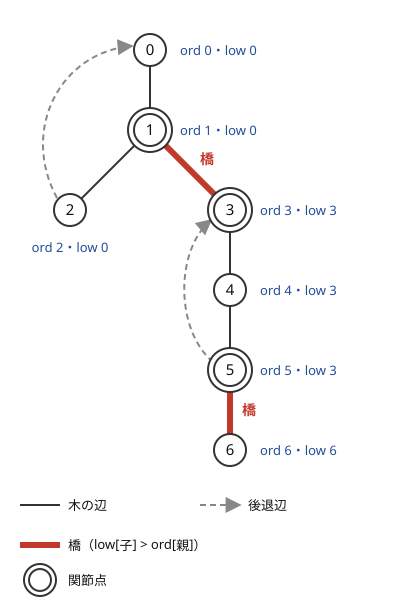
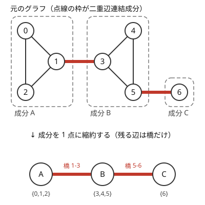

!!! abstract "要点"
    - **何ができるか**：無向グラフで、取り除くと非連結になる辺（橋）と頂点（関節点）を、DFS 1 回の $O(N + M)$ ですべて求める。DFS 木の行きがけ番号 $\mathrm{ord}$ と、部分木から[後退辺](../guide/glossary.md#back-edge)を 1 本使って戻れる最小の番号 $\mathrm{low}$ を比べるだけで判定できる。橋や関節点で分けた成分を[縮約](../guide/glossary.md#contraction)すると木になる。
    - **いつ使うか**：
        - その辺（頂点）を取り除くと非連結になるか。
        - すべての辺（頂点）について、取り除いたときの連結成分の数を求める。
        - $N, M \le 2 \times 10^5$ で、辺を 1 本ずつ除いて調べる $O(M(N + M))$ は間に合わない。
    - **計算量**：$\mathrm{ord}$ と $\mathrm{low}$ の計算、橋・関節点の判定、二重辺連結成分の番号付けのどれも $O(N + M)$
    - **前提**：[深さ優先探索（DFS）](../graph/dfs.md)

<!-- textlint-disable -->
別名：lowlink・橋・関節点・二重辺連結成分・二重頂点連結成分・ブロックカット木・ord と low・bridge・articulation point・biconnected components・block-cut tree
<!-- textlint-enable -->

橋・関節点・二重連結成分は、無向グラフを 1 回 DFS して各頂点に 2 つの番号を付け、その大小から「切ると分かれる場所」を一度に見つける手法である。番号の付け方から lowlink とも呼ばれる。橋で区切った成分を 1 点にまとめるとグラフが木になるので、「2 点の間で必ず通る辺」のような問いを木の上の問いに直せる。

## ord と low の定義と求め方 {#ord-low}

$\mathrm{ord}$ と $\mathrm{low}$ は、無向グラフの [DFS 木](../guide/glossary.md#dfs-tree)の上で「部分木から上へ抜け出す道があるか」を測る 2 つの番号である。辺を 1 本ずつ除いて連結かを調べると、1 本あたり $O(N + M)$ で全体が $O(M(N + M))$ になり、$N, M \le 2 \times 10^5$ では間に合わない。DFS 1 回で全部の辺と頂点を判定するために、この 2 つの番号を使う。

無向グラフの DFS では、DFS 木に入らなかった辺はどれも**祖先と子孫を結ぶ**。辺 $\{u, w\}$ で $u$ を先に訪れたとすると、DFS は $u$ から出る前に $u$ から行ける未訪問の頂点をすべて訪れるので、$w$ は $u$ の子孫になるからである。この「子孫から祖先へ戻る辺」を**後退辺**と呼ぶ。有向グラフと違い、別の枝へ渡る辺（横断辺）はない。

各頂点 $v$ に次の 2 つの値を付ける。頂点は 0-indexed で、$\mathrm{ord}$ も 0 から振る。

- $\mathrm{ord}[v]$：$v$ を訪れた順番（行きがけの番号）
- $\mathrm{low}[v]$：$v$ から DFS 木の辺を子の向きに 0 回以上たどり、最後に後退辺を高々 1 本使って着ける頂点の $\mathrm{ord}$ の最小。ただし $v$ に下りてきた木の辺そのものは逆向きに使わない

$\mathrm{low}[v] < \mathrm{ord}[v]$ なら、$v$ の部分木から $v$ より上の祖先へ直接戻る後退辺がある。$\mathrm{low}[v] = \mathrm{ord}[v]$ なら、部分木の外へ出る道は $v$ に下りてきた木の辺しかない。



図は、三角形 $\{0, 1, 2\}$ と三角形 $\{3, 4, 5\}$ を辺 1-3 でつなぎ、5 の先に 6 を付けたグラフを頂点 0 から DFS したものである。頂点 2 は後退辺で 0 へ戻れるので $\mathrm{low}[2] = 0$ で、その値が親の 1 にも伝わる。頂点 5 は後退辺で 3 へ戻れるので、4 と 5 の $\mathrm{low}$ は 3 になる。頂点 6 は葉で後退辺もないので、$\mathrm{low}[6] = \mathrm{ord}[6] = 6$ のままである。

$\mathrm{low}$ は帰りがけに子から親へ伝えて求める。$v$ の部分木から戻れる先は、$v$ 自身の後退辺の先か、どれかの子の部分木から戻れる先なので、次の式になる。

$$
\mathrm{low}[v] = \min\Bigl(\mathrm{ord}[v],\ \min_{\text{後退辺 } v - w} \mathrm{ord}[w],\ \min_{\text{子 } c} \mathrm{low}[c]\Bigr)
$$

```text
k ← 0、すべての v で ord[v] ← 未訪問
dfs(v, pe):                         # pe は v に下りてきた辺の番号（根なら なし）
    ord[v] ← low[v] ← k; k を 1 増やす
    v に接する各辺 e = {v, to} について:
        e = pe なら飛ばす            # 来た辺だけを除く
        to が未訪問なら:              # 木の辺
            dfs(to, e)
            low[v] ← min(low[v], low[to])
        そうでなければ:               # 後退辺（祖先の側から見た同じ辺も来る）
            low[v] ← min(low[v], ord[to])
すべての頂点 s について、未訪問なら dfs(s, なし)
```

後退辺は両端から 1 回ずつ見える。祖先の側から見ると、行き先は子孫なので $\mathrm{ord}[\mathit{to}] > \mathrm{ord}[v]$ で、$\min$ に影響しない。だから「祖先から子孫へ向けて見た後退辺」を区別しなくてよい。

計算量は $O(N + M)$ である。各頂点で dfs を 1 回呼び、各辺は両端から 1 回ずつ、合わせて 2 回だけ調べるからである。再帰の深さは最大で $N$ になる（[非再帰の DFS と再帰の深さ](../graph/dfs.md#iterative)）。

## 橋の条件と関節点の条件（根は子の数で判定） {#conditions}

橋と関節点は、DFS 木の親 $p$ と子 $c$ の組ごとに $\mathrm{low}[c]$ と $\mathrm{ord}[p]$ を比べて判定する。後退辺は木の上の道と合わせて閉路を作るので、橋になるのは木の辺だけである。

**橋の条件**：木の辺 $\{p, c\}$（$p$ が親）が橋 $\iff \mathrm{low}[c] > \mathrm{ord}[p]$。

- $\mathrm{low}[c] \le \mathrm{ord}[p]$ のとき：$c$ の部分木のどこかから、$p$ かその祖先へ戻る後退辺がある。その後退辺と木の上の道で、辺 $\{p, c\}$ を含む閉路ができる。閉路の上の辺は 1 本除いても残りの道で両端がつながるので、橋ではない
- $\mathrm{low}[c] > \mathrm{ord}[p]$ のとき：$c$ の部分木から出る後退辺は、どれも $\mathrm{ord}$ が $\mathrm{ord}[p]$ より大きい祖先に着く。部分木の頂点の祖先で $\mathrm{ord}[p]$ より後に訪れたものは、部分木の中にしかない。部分木から外へ出る辺は $\{p, c\}$ だけなので、これを除くと部分木が切り離される

図では、$\mathrm{low}[3] = 3 > \mathrm{ord}[1] = 1$ なので 1-3 が橋、$\mathrm{low}[6] = 6 > \mathrm{ord}[5] = 5$ なので 5-6 が橋である。$\mathrm{low}[c]$ は $\mathrm{ord}[c]$ に等しいか $\mathrm{ord}[p]$ 以下かのどちらかである。部分木から出る後退辺の先は、部分木の中（$\mathrm{ord}[c]$ 以上）か $p$ とその祖先（$\mathrm{ord}[p]$ 以下）しかないからである。だから条件は $\mathrm{low}[c] = \mathrm{ord}[c]$ と書いても同じである（[SCC との対比](#vs-scc)で使う）。

**関節点の条件**：根でない頂点 $p$ が関節点 $\iff$ ある子 $c$ で $\mathrm{low}[c] \ge \mathrm{ord}[p]$。

$p$ を除いたとき、子 $c$ の部分木が残りとつながるには、部分木から $p$ より上の祖先へ戻る後退辺が要る。$\mathrm{low}[c] \ge \mathrm{ord}[p]$ はその後退辺がないことを表し、$p$ への後退辺があっても $p$ ごと消えるので助けにならない。橋の条件との違いは等号で、$p$ に戻る後退辺は辺を除くときは迂回路になるが、頂点を除くときはならない。

**根は子の数で判定する**：根 $r$ では $\mathrm{ord}[r] = 0$ が最小なので、$\mathrm{low}[c] \ge \mathrm{ord}[r]$ はどの子でも成り立ち、上の条件は使えない。根の子の部分木どうしを結ぶ辺はない（後退辺は祖先と子孫しか結ばない）ので、根は DFS 木で子が 2 つ以上あるときだけ関節点である。

頂点を除くと**何個の成分に分かれるか**も、同じ数え方で分かる。$\mathrm{low}[c] \ge \mathrm{ord}[v]$ となる子 $c$ の数を $s_v$ とする。$v$ を除くと、$v$ を含んでいた連結成分は次の個数に分かれる。

- $v$ が根でないとき：$s_v + 1$ 個（切り離される $s_v$ 個の部分木と、親を含む残り）
- $v$ が根のとき：$s_v$ 個（子の数と同じ。孤立点なら 0 個で、成分が 1 つ消える）

次のコードは、橋と関節点、頂点を除いたときに分かれる個数 `pieces[v]` をまとめて求める。辺の番号を隣接リストに入れるのは、[次の節](#multi-edges)で述べる多重辺のためである。

```cpp
--8<-- "lowlink/lowlink.cpp:core"
```

**応用の型**：

- **辺・頂点を 1 つ除いたときの連結成分の数**：辺なら「橋なら 1 増え、そうでなければ変わらない」、頂点なら上の `pieces[v]` を使う。サインは「どれか 1 つを壊す（塗り替える）とき」「1 つ一様に選んで除いたときの期待値」。グリッドのマスを頂点にした期待値の問題（[オフラインの動的連結性](../graph/offline-dynamic-connectivity.md)の例題の ABC334 G）は、関節点で切り離される部分木を数えても解ける
- **すべての最短路に含まれる辺**：「1 から $N$ へのすべての最短路が通る辺」は、最短路に乗る辺だけを残した部分グラフの橋である。すべての最短路が辺 $e = \{u, v\}$ を通るなら、ほかの最短路の辺は $u$ より手前か $v$ より先にしかないので、$e$ を除くと 1 の側と $N$ の側が切れるからである（[最短路 DAG の力試し](../graph/shortest-path-dag.md#challenge)の ABC375 G）

## 多重辺は辺の番号で親を除外する {#multi-edges}

DFS で「親へ戻る辺」を飛ばすとき、親の**頂点**で判定すると[多重辺](../guide/glossary.md#multi-edge)のある辺を橋と誤判定する。飛ばすべきなのは、下りてきた 1 本の**辺**だけである。

頂点 0 と 1 の間に辺が 2 本ある（辺 0 と辺 1）グラフを、頂点 0 から DFS する。

- **頂点で判定する誤り**：頂点 1 で「行き先が親の 0 なら飛ばす」とすると、2 本とも飛ばされて $\mathrm{low}[1] = 1 > \mathrm{ord}[0] = 0$ になり、辺 0 が橋と判定される。実際は辺 1 が残るので、辺 0 を除いても 0 と 1 はつながっている
- **辺の番号で判定する**：頂点 1 では下りてきた辺 0 だけを飛ばす。辺 1 は後退辺として扱われ、$\mathrm{low}[1] = \mathrm{ord}[0] = 0$ になるので、辺 0 は橋でないと正しく判定される

隣接リストに（行き先, 辺の番号）を入れておけば、この判定ができる（[グラフの表し方](../graph/graph-basics.md#representations)）。入力で単純グラフと保証されていても、成分を縮約したグラフやグリッドから作ったグラフでは多重辺が生じうる。いつも辺の番号で書いておくと安全である。

関節点の判定は、頂点で判定しても誤らない。親 $p$ への辺が $\mathrm{low}[c]$ に与える値はちょうど $\mathrm{ord}[p]$ で、関節点の条件 $\mathrm{low}[c] \ge \mathrm{ord}[p]$ の成否を変えないからである。[自己ループ](../guide/glossary.md#self-loop)は自分の $\mathrm{ord}$ を $\min$ に入れるだけなので、どちらの判定にも影響しない。

## 二重辺連結成分（橋で分けて縮約すると木になる） {#two-edge-connected}

二重辺連結成分は、グラフからすべての橋を取り除いたときの連結成分である。同じ成分の 2 頂点は、どの辺を 1 本除いてもつながったままである。辺を共有しない道が 2 本あることとも同値になる（メンガーの定理の辺の版）。

**縮約すると木になる**。各成分を 1 点にまとめると、残る辺は橋だけである。このグラフに閉路があれば、閉路の上の辺は除いても両端がつながるので橋ではないことになり、矛盾する。元のグラフが連結なら縮約したグラフも連結なので、木になる（非連結なら森）。この木をここでは橋の木と呼ぶ。



図の例では、橋 1-3 と 5-6 を除くと $\{0, 1, 2\}$・$\{3, 4, 5\}$・$\{6\}$ の 3 成分に分かれ、縮約すると A-B-C の一本道になる。成分の番号は、橋を求めた後で、橋を渡らない DFS（または BFS）で付ければよい。

```cpp
--8<-- "lowlink/two-edge.cpp:core"
```

**応用の型**：

- **2 点の間で必ず通る辺の本数**：$u$ から $v$ へのどの道も通る辺は、橋の木の上で $u$ の成分から $v$ の成分への道に乗る橋である。本数は木の上の距離なので、[最小共通祖先（LCA）](../tree/lca.md#distance)で 1 回 $O(\log N)$ で答えられる。「A から B を経て C へ、同じ橋を 2 回渡らずに行けるか」は、橋の木の上で B の成分が A と C の成分を結ぶ道の上にあるかの判定になる
- **1 本壊れても行き来できるか**：「どの辺が 1 本壊れても $u$ と $v$ がつながっているか」は、$u$ と $v$ が同じ成分にあるかで答えられる

## 有向グラフの SCC（同じ ord・low の考え方）との対比 {#vs-scc}

有向グラフの[強連結成分分解](../graph/scc.md)の Tarjan 法も、同じ $\mathrm{ord}$ と $\mathrm{low}$ を使う。どちらも「部分木から上へ戻れるか」を測っているが、DFS 木に入らない辺の種類が違うので、細部が変わる。

| | 無向グラフ（橋・関節点） | 有向グラフ（Tarjan の SCC） |
| --- | --- | --- |
| 木に入らない辺 | 後退辺だけ | 後退辺・前進辺・横断辺 |
| 親へ戻る辺 | 下りてきた辺だけを除く | 除かない（$u \to v$ と $v \to u$ は本当に閉路） |
| $\mathrm{low}$ に入れる先 | 後退辺の先すべて | 成分の決まっていない頂点だけ |
| 判定 | $\mathrm{low}[c] > \mathrm{ord}[p]$ で橋 | $\mathrm{low}[v] = \mathrm{ord}[v]$ で成分の根 |

無向グラフでも、橋の条件は $\mathrm{low}[c] = \mathrm{ord}[c]$ と同じである（[条件の節](#conditions)）。だから Tarjan 法と同じく、訪れた頂点をスタックに積み、帰りがけで $\mathrm{low}[v] = \mathrm{ord}[v]$ なら $v$ までを取り出す、という書き方でも二重辺連結成分が求まる。

逆に、無向の辺を両向きの有向辺にして SCC を求めても役に立たない。$u \to v$ と $v \to u$ がそろうので、つながった頂点はすべて同じ成分になる。無向グラフでは「来た辺を戻らない」という制限を付けて初めて、橋が見えるようになる。

## 落とし穴 {#pitfalls}

**親を頂点で除外して、多重辺を橋と判定する**。下りてきた辺の番号で除外する（[多重辺の節](#multi-edges)）。

**根の関節点を、ほかの頂点と同じ条件で判定する**。根では $\mathrm{low}[c] \ge \mathrm{ord}[\text{根}] = 0$ がいつも成り立つので、子が 1 つでも関節点になってしまう。根は DFS 木での子の数（2 つ以上か）で判定する。隣接する頂点の数ではなく、DFS で実際に子になった頂点の数を数える。

**後退辺で $\mathrm{low}[\mathit{to}]$ を使う**。後退辺の先では $\mathrm{low}[v] \leftarrow \min(\mathrm{low}[v], \mathrm{ord}[\mathit{to}])$ とする。$\mathrm{low}[\mathit{to}]$ を使うと、後退辺の先の頂点からさらに戻れる先まで $\mathrm{low}$ が下がる。橋の判定は変わらないが、関節点を見落とす。例として、三角形 $\{0, 1, 2\}$ と三角形 $\{1, 3, 4\}$ が頂点 1 を共有するグラフを、0 から 0→1→2→3→4 の順に訪れる DFS を考える。頂点 2 の後退辺で先に $\mathrm{low}[1]$ が 0 まで下がる。その値が後退辺 4-1 を通じて $\mathrm{low}[4]$ と $\mathrm{low}[3]$ へ伝わる。その結果、関節点の 1 を見落とす。

**非連結なグラフで 1 回しか DFS しない**。すべての頂点について、未訪問なら DFS を始める。根の判定は、DFS を始めた各頂点に対して行う。

**再帰が深くなる**。一本道のグラフでは深さが $N$ になる。AtCoder ではたいてい通るが、手元で落ちるなら[非再帰の DFS](../graph/dfs.md#iterative) に書き直す。$\mathrm{low}$ は子の処理が終わってから親へ伝えるので、出るときの処理を積む形にする。

**頂点を除いた後の成分の数で、除いた頂点自身を数える**。孤立点を除くと、その成分は 0 個になる。根でない頂点では親を含む残りの 1 個を足し忘れやすい。

## 例題 {#examples}

### ABC075 C. Bridge {#abc075_c}

<div class="kp-problems" data-role="example" markdown>

- [ABC075 C. Bridge](https://atcoder.jp/contests/abc075/tasks/abc075_c)（diff 1067）：N ≤ 50 の連結な無向グラフで、取り除くと非連結になる辺の数を求める。

</div>

問われているのは橋の本数そのものである。制約が小さいので、辺を 1 本ずつ除いて連結かを調べる全探索でも間に合う。$\mathrm{ord}$ と $\mathrm{low}$ を求めれば、$\mathrm{low}[c] > \mathrm{ord}[p]$ となる木の辺を数えるだけで $O(N + M)$ になる。

??? note "解法の詳細"
    - **全探索**：各辺 $i$ について、辺 $i$ 以外をすべて Union-Find で結び、代表元が 1 つかを調べる。代表元が 2 つ以上なら辺 $i$ は橋である。辺 1 本あたり $O(M \alpha(N))$ で、全体で $O(M^2 \alpha(N))$。
    - **lowlink**：[条件の節](#conditions)のコードで `is_bridge` が真の辺を数える。全体で $O(N + M)$。
    - 制約を $N, M \le 2 \times 10^5$ に広げると、全探索は間に合わず lowlink だけが通る。

## 練習問題 {#practice}

ABC で lowlink をそのまま使う問題は少ない。橋と関節点の実装を確かめるには、次の Library Checker の問題がよい。

- [Two-Edge-Connected Components](https://judge.yosupo.jp/problem/two_edge_connected_components)：二重辺連結成分を求め、成分ごとに頂点を出力する。多重辺を含むので、親を辺の番号で除外しているかが試される。
- [Biconnected Components](https://judge.yosupo.jp/problem/biconnected_components)：二重頂点連結成分を求める（[ブロックカット木の節](#block-cut-tree)）。

ABC の G で、橋や関節点を使って解ける問題として、ABC375 G（[最短路 DAG の力試し](../graph/shortest-path-dag.md#challenge)）と ABC334 G（[オフラインの動的連結性](../graph/offline-dynamic-connectivity.md)の例題）がある。どちらも本文の応用の型で方針を述べた。

## 確認問題 {#quiz}

??? question "確認問題：橋の両端は関節点か"
    辺 $\{u, v\}$ が橋のとき、$u$ と $v$ は必ず関節点か。

    ??? success "答え"
        必ずではない。$u$ の隣の頂点が $v$ だけなら、$u$ を除いても残りはつながったままなので、$u$ は関節点でない（図の頂点 6）。$u$ に $v$ のほかの隣の頂点があれば関節点である（単純グラフなら、次数が 2 以上のときと同じである）。橋を除くと $u$ 側と $v$ 側に分かれ、$u$ を除くと、$v$ 側と、$u$ のほかの隣の頂点がつながらなくなるからである。

??? question "確認問題：根だけ条件が違う理由"
    根でない頂点は「ある子 $c$ で $\mathrm{low}[c] \ge \mathrm{ord}[p]$」で関節点を判定する。この条件を根にそのまま使うと何が起きるか。

    ??? success "答え"
        根の $\mathrm{ord}$ は 0 で最小なので、$\mathrm{low}[c] \ge 0$ はどの子でも成り立ち、子が 1 つしかない根まで関節点と判定してしまう。根の上には「残りの部分」がないので、子の部分木が 2 つ以上あるとき（DFS 木での子が 2 つ以上のとき）だけ、根を除くと分かれる。

??? question "確認問題：多重辺と関節点"
    親を頂点で除外する実装は、多重辺のある辺を橋と誤判定する。同じ実装で関節点も誤るか。

    ??? success "答え"
        誤らない。親 $p$ への辺が $\mathrm{low}[c]$ に与える値は $\mathrm{ord}[p]$ で、関節点の条件 $\mathrm{low}[c] \ge \mathrm{ord}[p]$ は、その値を入れても入れなくても同じ結果になる。橋の条件 $\mathrm{low}[c] > \mathrm{ord}[p]$ だけが、この値で結果が変わる。

## 使い分け {#comparison}

- 制約が小さい（$M \le$ 数百）なら、辺や頂点を 1 つずつ除いて[連結成分](../graph/connected-components.md)を数える全探索で足りる
- 辺を順に壊していき、そのつど連結性を答えるなら、逆順に辺を足す [Union-Find](../graph/union-find-connectivity.md#reverse-deletion) を使う。lowlink は「1 つだけ除いたら」の問いに向く
- 辺の追加と削除が混ざるなら、[オフラインの動的連結性](../graph/offline-dynamic-connectivity.md)を使う
- 有向グラフで「互いに行き来できる」を問うなら、[強連結成分分解](../graph/scc.md)を使う
- 「消すと最短距離が変わる辺」は[最短路 DAG](../graph/shortest-path-dag.md) で、最短路に乗る辺を求めてから橋を求める

## 二重頂点連結成分とブロックカット木 {#block-cut-tree}

この節は発展の内容で、ここまでの関節点の条件を前提にする。関節点で分けた成分を考えると、頂点を 1 つ除く問いを木の上の問いに直せる。

**二重頂点連結成分（ブロック）**は、どの頂点を 1 つ除いても連結のままである極大な部分グラフである。2 頂点と 1 本の橋だけからなる部分グラフもブロックとして数える。辺はちょうど 1 つのブロックに属し、関節点だけが複数のブロックに属する。頂点で区切るので、頂点の集合は重なるが、辺の集合は重ならない。

**ブロックカット木**は、ブロックと関節点をそれぞれ頂点にし、関節点とそれを含むブロックを辺で結んだグラフである。元のグラフが連結なら木になる。$u$ から $v$ へのどの道も通る頂点は、ブロックカット木の上で $u$ と $v$ を結ぶ道に乗る関節点である。

**求め方**：DFS で通った辺を順にスタックに積む（木の辺も、祖先へ向かう後退辺も積む）。子 $c$ から親 $p$ へ戻ったときに $\mathrm{low}[c] \ge \mathrm{ord}[p]$ なら、スタックから辺 $\{p, c\}$ が出てくるまで取り出し、取り出した辺の集合を 1 つのブロックにする。根でも同じ規則でよい。各辺を 1 回ずつ積んで取り出すので $O(N + M)$ である。辺のない孤立点を 1 点だけのブロックとして数えるかは、問題の定義に合わせる。Library Checker の Biconnected Components では、孤立点も 1 点の成分として出力する。

自作するときは、Library Checker の [Biconnected Components](https://judge.yosupo.jp/problem/biconnected_components) で確かめられる。

## 参考 {#references}

- [ei1333「橋/関節点(LowLink)」](https://ei1333.github.io/luzhiled/snippets/graph/lowlink.html)：ord と low の定義、橋と関節点の条件
- [ei1333「二重辺連結成分分解(Two-Edge-Connected-Components)」](https://ei1333.github.io/luzhiled/snippets/graph/two-edge-connected-components.html)：橋を除いた成分の番号付けと、成分を橋で結んだグラフ
- [algo-logic「グラフにおける関節点(Articulation Points)を検出するアルゴリズム」](https://algo-logic.info/articulation-points/)：根と根以外で関節点の条件が違う理由
- [はまやん「競技プログラミングにおける無向グラフに関する（橋、関節点、サイクル基底、lowlink）問題まとめ」](https://blog.hamayanhamayan.com/entry/2016/10/18/123552)：応用の型（橋の木の上の道）の確かめ
- [はまやん「ABC075 C. Bridge」の解説](https://blog.hamayanhamayan.com/entry/2017/10/15/002234)：例題 ABC075 C の問いと全探索の方針
- [あめんばーど「G - Christmas Color Grid 2 / AtCoder Beginner Contest 334」](https://amentorimaru.hatenablog.com/entry/2025/04/11/210228)：ABC334 G を関節点で切り離される部分木の数で解く方針
- [codwarm「ABC375 (A~G) 题解」](https://www.cnblogs.com/codwarm/p/18463129)：ABC375 G を最短路に乗る辺の部分グラフの橋で解く方針
