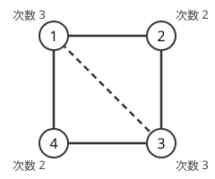

!!! abstract "要点"
    - **何ができるか**：無向グラフの全域木の個数を、ラプラシアン行列（次数行列 − 隣接行列）から 1 行 1 列を除いた行列の行列式として求める。有向グラフの根付き全域木の版と、有向オイラー閉路を数える BEST 定理もある。
    - **いつ使うか**：
        - 全域木の個数を数える（mod p で答える）。
        - 有向グラフのオイラー閉路の数。
    - **計算量**：行列を作る $O(N^2 + M)$、行列式 $O(N^3)$（mod 素数の掃き出し）
    - **前提**：[行列式](../math/determinant.md)

<!-- textlint-disable -->
別名：Kirchhoff の定理・全域木の個数・全域木の数え上げ・BEST 定理・matrix-tree theorem
<!-- textlint-enable -->

行列木定理は、決まったグラフの[全域木](../guide/glossary.md#spanning-tree)の個数を、次数と隣接の情報を並べた行列の[行列式](../math/determinant.md)で求める定理である。全域木は辺の数に対して指数個ありうるが、数だけなら $O(N^3)$ で求まる。完全グラフなら [Cayley の公式](../comb/cayley-pruefer.md) $N^{N-2}$ で済むが、使える辺が限られると行列木定理が要る。

## ラプラシアン行列と余因子 {#laplacian}

$N$ 頂点 $M$ 辺の無向グラフで、$N \times N$ の行列 $L$ を次のように作る。これをラプラシアン行列と呼ぶ。

- 対角成分 $L_{vv}$ ＝ 頂点 $v$ の[次数](../guide/glossary.md#degree)
- 非対角成分 $L_{uv}$ ＝ $-$（$u$ と $v$ を結ぶ辺の本数）

$L$ から好きな頂点 $r$ の行と列を 1 つずつ除いた $(N-1) \times (N-1)$ 行列の行列式が、全域木の個数に等しい。どの $r$ を除いても値は同じである。[多重辺](../guide/glossary.md#multi-edge)は本数をそのまま数え（別の辺として区別した全域木の数になる）、[自己ループ](../guide/glossary.md#self-loop)は全域木に使えないので行列に入れない。グラフが連結でなければ行列式は 0 になるので、連結かどうかを別に調べなくてよい。

次の 4 頂点のグラフ（4 本の辺で四角形を作り、破線の辺 1-3 を足したもの）で確かめる。



頂点 1 の行と列を除くと、残る頂点 2・3・4 の行列は次のとおりで、行列式は 8 である。

$$
\det \begin{pmatrix} 2 & -1 & 0 \\ -1 & 3 & -1 \\ 0 & -1 & 2 \end{pmatrix} = 2 \cdot (6 - 1) - (-1) \cdot (-2) = 8
$$

全列挙と比べる。破線の辺を使わない全域木は、四角形の 4 本から 1 本を除く 4 通りである。破線の辺を使うときは、四角形の 4 本から 2 本を選ぶ 6 通りのうち、三角形 1-2-3（辺 1-2・2-3）か三角形 1-3-4（辺 3-4・4-1）を閉じる 2 通りを除いて 4 通りである。合わせて 8 通りで一致する。

辺に重み $w_e$ があるときは、本数の代わりに重みを足して行列を作ると、行列式は「全域木の辺の重みの積」の総和になる。

??? note "なぜ行列式で数えられるか（証明の筋）"
    各辺に向きを勝手に付け、$N \times M$ の行列 $B$ を「辺 $e = (u \to v)$ の列は、$u$ の行が $+1$、$v$ の行が $-1$、ほかは 0」で作る。すると $L = B B^{\mathsf{T}}$ になる。頂点 $r$ の行を除いた $B$ を $B'$ とすると、除いた後の行列は $B' B'^{\mathsf{T}}$ である。

    Cauchy-Binet の公式で、$\det(B' B'^{\mathsf{T}})$ は「$B'$ から $N - 1$ 本の辺の列を選んだ正方行列の行列式の 2 乗」の総和に分解できる。選んだ $N - 1$ 本が全域木なら、その小行列式は $\pm 1$（葉から順に展開できる）で、2 乗は 1 である。全域木でなければ（閉路を含むか、$r$ と連結でない頂点があれば）0 である。よって総和は全域木の個数になる。詳しい証明は学ぶための資料に任せる。

## 有向グラフの版（根付き全域木の数） {#directed}

有向グラフでは、全域木の向きを決めて数える。根 $r$ からすべての頂点へ辺の向きに沿って到達できる全域木（根から出る木）なら、次の行列を使う。

- 対角成分 $L_{vv}$ ＝ 頂点 $v$ の[入次数](../guide/glossary.md#in-degree)（自己ループを除く）
- 非対角成分 $L_{uv}$ ＝ $-$（$u \to v$ の辺の本数）

この $L$ から $r$ の行と列を除いた行列式が、根 $r$ から出る全域木の個数である。根から出る木では、根以外の各頂点がちょうど 1 本の入ってくる辺を持つので、対角に入次数を置く。

逆に、すべての頂点から辺をたどって根 $r$ に着く全域木（根へ向かう木）なら、対角に出次数を置き、非対角は同じく $-$（$u \to v$ の辺の本数）とする。無向の場合と違い、除く行と列は根のものに決まっていて、どの頂点を除いても同じとは限らない。向きを取り違えると別のものを数えるので、小さい例（3 頂点の有向閉路では、どの根でも 1）で確かめる。

## BEST 定理（有向オイラー閉路の数） {#best-theorem}

有向グラフの[オイラー閉路](../graph/euler-path.md#conditions)（すべての辺をちょうど 1 回ずつ通って戻る閉路）の個数は、根付き全域木の数から求まる。グラフが次の 2 つを満たすとする（満たさなければオイラー閉路はなく、答えは 0）。

- すべての頂点で入次数と出次数が等しい。
- 辺を持つ頂点がすべて 1 つの連結成分に入る（向きを無視した連結でよい）。

このとき、辺を持つ頂点だけを残したグラフで、ある頂点 $w$ へ向かう全域木の数を $t_w$ とすると、オイラー閉路の数は次のとおりである。

$$
\mathrm{ec}(G) = t_w \cdot \prod_{v} (\deg^{+}(v) - 1)!
$$

$\deg^{+}(v)$ は出次数で、積は辺を持つ頂点すべてにわたる。辺はすべて区別し、巡回シフトで移り合う閉路は同じとみなす（1 本目の辺を固定した数）。入次数と出次数が等しいので $t_w$ は $w$ によらず、根から出る木の数と等しい。

なぜこの形になるかの筋は次のとおりである。$w$ から出る辺を 1 本目に固定して閉路をたどり、$w$ 以外の各頂点から最後に出ていく辺を集めると、$w$ へ向かう全域木になる。逆に、その木を決めた上で、各頂点の残りの出ていく辺の使う順を自由に決めると、閉路が 1 つずつ決まる。$w$ では 1 本目の辺が決まっていて、ほかの頂点では最後の辺が決まっているので、どの頂点でも順を選べるのは $\deg^{+}(v) - 1$ 本である。

競技プログラミングで使うときは、次の 2 つの言い換えがよく要る。

- **始点と終点が決まったオイラー路**：始点 $s$ から終点 $t$（$s \ne t$）へすべての辺を通る路の数は、辺 $t \to s$ を 1 本足したグラフで、その辺を 1 本目に固定したオイラー閉路の数に等しい。足したグラフに BEST 定理を使えばよい。
- **始点だけが決まったオイラー閉路**：頂点 $s$ から出て $s$ に戻る辺の並べ方は、$\mathrm{ec}(G) \cdot \deg^{+}(s)$ 通りである（1 本目の辺を $s$ から出る辺のどれにするか）。

辺を区別しない（同じ種類の辺が $c$ 本ある）ときは、始点を決めた列の数（上の 2 つの言い換え）を辺を区別して数えた後で、種類ごとに $c!$ で割る。巡回シフトを同一視した $\mathrm{ec}(G)$ そのものは、こうして割ってはいけない。同じ種類の辺の入れ替えが巡回シフトと重なることがあり、割り切れないこともある（2 頂点で $0 \to 1$ と $1 \to 0$ が 2 本ずつなら $\mathrm{ec}(G) = 2$ だが、区別しない閉路は 1 つである）。

## 頂点集合ごとに数えて部分集合の DP と組む {#subset-dp}

追加の前提：[bitDP](../dp/bit-dp.md)、[連結なグラフの数え上げ](../comb/counting-labeled-graphs.md#subset-dp)

頂点数 $N$ が 15 程度までなら、頂点集合 $S$ ごとに行列木定理を使える。「選んだ辺が森になる」「連結成分がどれも木」のような配置を数えるときの型である。$S$ の内側の辺だけで作ったグラフの全域木の数を $t(S)$ とすると、森は「頂点集合の分割の各部分に 1 本ずつ木を張ったもの」なので、次の DP で数えられる。

- 状態：$\mathrm{dp}[S]$ ＝ $S$ の頂点を使い、$S$ の内側の辺で作る森（成分の数を状態に足すこともある）の数。
- 遷移：$S$ の中で番号が最小の頂点を含む成分 $T \subseteq S$ を選び、$\mathrm{dp}[S] \mathrel{+}= t(T) \cdot \mathrm{dp}[S \setminus T]$ とする。最小の頂点を含む成分に固定するので、同じ森を 2 回数えない。
- 初期値：$\mathrm{dp}[\emptyset] = 1$。

$t(S)$ は $2^N$ 個の集合それぞれで行列式を求めて $O(2^N N^3)$、DP は[部分集合](../guide/glossary.md#submask)の列挙で $O(3^N)$ である。最小の頂点で分ける考え方は、連結なグラフを数える DP と同じである。

## 計算量と自作するときの要点 {#library}

計算は「行列を作る」と「行列式を求める」の 2 段である。行列は辺を 1 本ずつ見て $O(N^2 + M)$ で作れる。行列式は[掃き出し法](../math/gaussian-elimination.md#mod-p)で上三角にし、対角成分の積に行の交換の回数だけ $-1$ を掛けて $O(N^3)$ で求める。答えは膨大になるので、mod 素数で求めるのがふつうである。

```cpp
--8<-- "matrix-tree-theorem/count.cpp:det"
```

無向の全域木と、根から出る全域木の数は次のとおりである（完全なプログラムは `snippets/matrix-tree-theorem/count.cpp`。小さいグラフで、辺の部分集合の全列挙と一致することを確かめている）。

```cpp
--8<-- "matrix-tree-theorem/count.cpp:laplacian"
```

BEST 定理は、次数と連結性を確かめ、辺のない頂点を除いてから使う。

```cpp
--8<-- "matrix-tree-theorem/count.cpp:best"
```

自作するときに気をつける点は次のとおりである。

- **自己ループと多重辺**：自己ループは行列に入れない。多重辺は本数を足す。BEST 定理の $(\deg^{+}(v) - 1)!$ の出次数には自己ループも数える（閉路は自己ループも通る）。
- **辺のない頂点**：BEST 定理で辺のない頂点を残すと、その頂点を含む全域木がなく、$t_w = 0$ になる。行列を作る前に除く。
- **有向の向き**：根から出る木は対角に入次数、根へ向かう木は対角に出次数を置く。
- **行の交換で符号を反転する**：ピボットが 0 の列で行を入れ替えたら $-1$ を掛ける。列のどこにも 0 でない値がなければ行列式は 0 である。
- **mod の値の 0**：全域木が 1 つ以上あっても、その個数が法の倍数なら行列式の mod は 0 になる。連結かどうかを知りたいときは、行列式ではなく探索で調べる。

ACL に行列式はない。自作したものは Library Checker で確かめる（どれも $N \le 500$、答えは mod 998244353）。

- [Counting Spanning Trees (Undirected)](https://judge.yosupo.jp/problem/counting_spanning_tree_undirected)：多重辺・自己ループのある無向グラフの全域木の数。
- [Counting Spanning Trees (Directed)](https://judge.yosupo.jp/problem/counting_spanning_tree_directed)：根 $r$ から出る[有向全域木](../guide/glossary.md#arborescence)の数。
- [Counting Eulerian Circuits](https://judge.yosupo.jp/problem/counting_eulerian_circuits)：有向グラフのオイラー閉路の数（1 本目の辺を固定した数）。
- [Determinant of Matrix](https://judge.yosupo.jp/problem/matrix_det)：行列式そのもの。

## 学ぶための資料 {#resources}

- 英語版 Wikipedia の「Kirchhoff's theorem」：主張と、接続行列と Cauchy-Binet の公式による証明。重み付き・有向の版にも触れている。
- 英語版 Wikipedia の「BEST theorem」：BEST 定理の主張と、根へ向かう全域木の数が根によらないこと。
- potato167 氏の「BEST theorem を用いることができる競プロの問題例」：BEST 定理の実装（多重辺を個数の行列で受ける形）と、BEST 定理に帰着できる問題の一覧。

## 例題 {#examples}

### ABC336 G. 16 Integers {#abc336_g}

<div class="kp-problems" data-role="example" markdown>

- [ABC336 G. 16 Integers](https://atcoder.jp/contests/abc336/tasks/abc336_g)（diff 3138）：0 から 15 の各値 i について個数 X_i が与えられ、X_i の和を N とする。0 と 1 からなる長さ N + 3 の列のうち、連続する 4 文字を 2 進数として読んだ値 i がちょうど X_i 回現れるものの数を、998244353 で割った余りで求める。

</div>

方針：連続する 4 文字の窓を、先頭 3 文字の状態から末尾 3 文字の状態への有向辺とみる。状態は $2^3 = 8$ 個の頂点で、値 $i$ の窓は頂点 $\lfloor i / 2 \rfloor$ から頂点 $i \bmod 8$ への辺が $X_i$ 本ある。条件を満たす列は、このグラフのすべての辺をちょうど 1 回ずつ通るオイラー路と 1 対 1 に対応するので、[BEST 定理](#best-theorem)で数える。

??? note "解法の詳細"
    - 列は「始点の頂点」と「辺の並べ方」で決まる。始点 $s$ と終点 $t$ の組を 64 通り試し、次数の条件を満たす組だけを数える。
    - $s \ne t$ なら辺 $t \to s$ を足し、その辺を 1 本目に固定したオイラー閉路の数を BEST 定理で求める。$s = t$ ならオイラー閉路の数に $\deg^{+}(s)$ を掛ける。
    - 根付き全域木の数は、辺を持つ頂点だけ（8 個以下）の行列の行列式で求める。
    - 同じ値の窓の辺どうしは区別しないので、最後に $\prod_i X_i!$ で割る（mod では逆元を掛ける）。階乗は $N$ まで前計算する。

## 参考 {#references}

- [「Kirchhoff's theorem」（英語版 Wikipedia）](https://en.wikipedia.org/wiki/Kirchhoff%27s_theorem)：主張（余因子・重み付き）と、接続行列と Cauchy-Binet の公式による証明の筋
- [「BEST theorem」（英語版 Wikipedia）](https://en.wikipedia.org/wiki/BEST_theorem)：BEST 定理の式と条件、根へ向かう全域木の数が根によらないこと
- [potato167「BEST theorem を用いることができる競プロの問題例」](https://potato167.hatenablog.com/entry/2024/02/21/100000)：BEST 定理の実装上の注意（多重辺を階乗で割る）と、例題の帰着の確認
- [kmjp「AtCoder ABC #336 : G - 16 Integers」](https://kmjp.hatenablog.jp/entry/2024/01/16/0930)：例題の問いの確認と、始点と終点を固定して BEST 定理を使う方針
- [Library Checker の問題定義（GitHub）](https://github.com/yosupo06/library-checker-problems/tree/master/graph)：counting_spanning_tree_undirected・counting_spanning_tree_directed・counting_eulerian_circuits の定義と制約（$N \le 500$）
