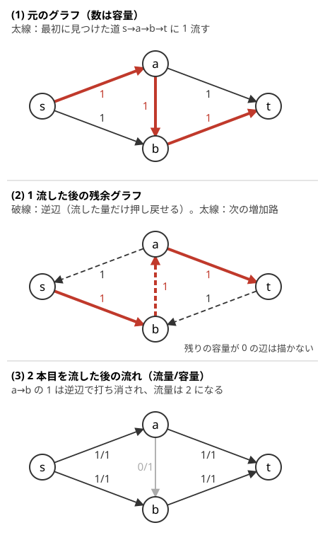

!!! abstract "要点"
    - **何ができるか**：容量付きの有向グラフで、始点 $s$ から終点 $t$ へ流せる量の最大を求める。[残余グラフ](../guide/glossary.md#residual-graph)上で $s$ から $t$ への道（[増加路](../guide/glossary.md#augmenting-path)）を見つけて流すことをくり返し、逆辺で先に流した分を押し戻せることが正しさの要である。ACL の `mf_graph`（Dinic 法）で書ける。
    - **いつ使うか**：
        - 同時に使えない資源を割り当てる・各行・各列に高々 1 つ
        - 辺（頂点）を共有しない経路の本数
        - 容量・上限つきで送れる量の最大
        - 頂点数が数百〜数千、辺数が $10^5$ 程度まで（フローが間に合う規模）
    - **計算量**：Dinic 法で $O(N^2 M)$。容量がすべて 1 なら $O((N + M)\sqrt{M})$、流量を $F$ とすると $O(F(N + M))$ でも抑えられる（どれも上限で、実際はずっと速いことが多い）
    - **前提**：[幅優先探索（BFS）と無重み最短路](../graph/bfs.md)、[深さ優先探索（DFS）](../graph/dfs.md)

<!-- textlint-disable -->
別名：最大フロー・Ford-Fulkerson・Dinic・残余グラフ・増加路・maximum flow
<!-- textlint-enable -->

最大流は、各辺に「1 度に通せる量の上限（容量）」がある有向グラフで、始点 $s$ から終点 $t$ へ同時に流せる量の最大を求める問題である。アルゴリズムの中身は ACL に任せられるので、競技プログラミングで問われるのは「どんなグラフを作れば答えが最大流になるか」の方である。このページでは、正しさの要である残余グラフと逆辺を押さえてから、よく出るグラフの作り方の型を並べる。頂点は 0-indexed で、頂点数を $N$、辺数を $M$ とする。

## 残余グラフと増加路・逆辺が要る理由 {#residual}

**流れ（フロー）** とは、各辺 $e$ に流す量 $f_e$ を決めたもので、次の 2 つを満たすものをいう。

- **容量の制約**：各辺で $0 \le f_e \le c_e$（$c_e$ は辺の容量）
- **流量の保存**：$s$ と $t$ 以外の各頂点で、入ってくる量の和と出ていく量の和が等しい

このとき「$s$ を出ていく量の和 − $s$ に入ってくる量の和」（＝「$t$ に入る量の和 − $t$ を出ていく量の和」）を流量と呼び、流量の最大を求めるのが最大流である。水道管の網で、蛇口 $s$ から排水口 $t$ へ毎秒どれだけ流せるかを考えるとよい。

**逆辺がないと何が困るか**：素朴には「$s$ から $t$ へ、容量が残っている辺だけを通る道を見つけて流す」をくり返せばよさそうに見える。しかしこれは道の選び方しだいで最大にならない。下の図の (1) で、最初に $s \to a \to b \to t$ を選んで 1 流すと、$s$ から出る辺のうち残るのは $s \to b$、$t$ に入る辺のうち残るのは $a \to t$ だけになる。$s \to b$ の先は使い切った $b \to t$ しかないので、もう流せない。ところが $s \to a \to t$ と $s \to b \to t$ に 1 ずつ流せば流量は 2 になる。最初の道の選び方を誤ったのである。

**残余グラフ**は、この誤りを後から直せるようにしたグラフである。元の辺 $u \to v$（容量 $c$、流量 $f$）ごとに、次の 2 本を持つ。

- 順辺 $u \to v$：残りの容量 $c - f$。まだ流せる量
- 逆辺 $v \to u$：容量 $f$。すでに流した量のうち、押し戻せる量

残余グラフで $s$ から $t$ へ、容量が正の辺だけを通る道を**増加路**という。増加路が見つかったら、道の上の容量の最小値 $d$ だけ流す。順辺を通ったなら元の辺の流量を $d$ 増やし、逆辺を通ったなら元の辺の流量を $d$ 減らす（押し戻す）。どちらでも、道の上の各頂点で入る量と出る量が同じだけ変わるので、流量の保存は崩れず、流量は $d$ 増える。



図の (2) は、1 本目を流した後の残余グラフである。破線の逆辺 $b \to a$ を使うと、$s \to b \to a \to t$ という増加路が見つかる。これに 1 流すと、$a \to b$ の流量 1 が打ち消され、(3) のとおり $s \to a \to t$ と $s \to b \to t$ に 1 ずつ流した状態になる。逆辺を通ることは、「$a$ から $b$ に送っていた分を、$a$ からは $t$ へ直接送り、$b$ には $s$ から別に届ける」という付け替えに当たる。

次の動く図は、同じグラフで増加路を 1 本ずつ流し、そのたびに順辺の容量が減って逆辺の容量が増える様子をステップ送りで示す。

<div class="kp-viz" data-viz="max-flow-residual" data-config='{"n": 4, "labels": ["s", "a", "b", "t"], "edges": [[0, 1, 1], [0, 2, 1], [1, 2, 1], [1, 3, 1], [2, 3, 1]], "s": 0, "t": 3, "paths": [[0, 1, 2, 3], [0, 2, 1, 3]]}'></div>

1 本目の道 $s \to a \to b \to t$ を流すと、3 本の順辺が使い切られ、代わりに 3 本の逆辺の容量が 1 になる。2 本目の増加路 $s \to b \to a \to t$ は逆辺 $b \to a$ を通り、その後は $s$ から $t$ へ届く道がなくなって終わる。最後のステップでは、残余グラフで $s$ から届く頂点（ここでは $s$ だけ）を塗り、そこから外へ出る元の辺 $s \to a$・$s \to b$ に最小カットの印を付けている。

**なぜ増加路がなくなれば最大か**：増加路がなくなった時点で、残余グラフで $s$ から届く頂点の集合を $S$ とする。$t \notin S$ である。$S$ から外へ出る元の辺はどれも容量いっぱいに流れていて（残りがあれば外の頂点にも届く）、外から $S$ へ入る元の辺はどれも流量 0 である（流れていれば逆辺で届く）。よって今の流量は「$S$ から外へ出る辺の容量の和」に等しい。一方、どんな流れも $S$ から外へ出る辺を通らないと $t$ に着けないので、流量はこの和を超えられない。上限に達しているから最大である。この「$S$ から外へ出る辺の容量の和」が[最小カット](../graph/min-cut.md)で、最大流と最小カットの値が等しいこと（最大流最小カット定理）がここから分かる。

??? note "証明（流量はどのカットの容量も超えない）"
    $s \in S$、$t \notin S$ となる頂点の集合 $S$ を 1 つ固定する。$S$ に入っている頂点ごとに「出ていく量 − 入ってくる量」を足し合わせる。$s$ では流量 $F$、ほかの頂点では流量の保存により 0 なので、和は $F$ である。一方、両端が $S$ の中にある辺の量は、始点の側で $+$、終点の側で $-$ として 1 回ずつ数えられ、打ち消し合う。残るのは $S$ から外へ出る辺の量の和から、外から $S$ へ入る辺の量の和を引いたものである。よって

    $$F = \sum_{e : S \to \overline{S}} f_e - \sum_{e : \overline{S} \to S} f_e \le \sum_{e : S \to \overline{S}} c_e$$

    となる。増加路がなくなったときの $S$ では、本文のとおり等号が成り立つ。

**容量が整数なら、流れも整数にできる**：容量がすべて整数なら、各回に流す $d$ も整数で、最後まで各辺の流量は整数のままである。容量 1 の辺は「使う・使わない」の 2 択になるので、最大流の答えをそのまま「割り当て方」として読み出せる。[モデル化の型](#modeling)の多くは、この性質に頼っている。

## Ford-Fulkerson・Dinic と計算量 {#algorithms}

増加路を見つけて流すことをくり返す、という骨組みは共通で、増加路の探し方で計算量が変わる。

- **Ford-Fulkerson 法**：増加路を DFS で 1 本ずつ探す。1 回の探索は $O(N + M)$ で、流量が 1 回に少なくとも 1 増えるので、容量が整数なら最大流を $F$ として $O(F(N + M))$ である。$F$ が小さいとき（容量 1 の辺だけで、答えが $N$ 以下など）は十分速い。容量が $10^9$ のように大きいと、道の選び方しだいで増加が 1 ずつになり、回数が $F$ 回に近づいて間に合わない
- **Edmonds-Karp 法**：増加路を BFS で辺の本数が最少のものから選ぶ。容量によらず $O(NM^2)$ になる
- **Dinic 法**：残余グラフで $s$ からの距離（層）を BFS で求め、層が 1 つずつ増える辺だけを通る道に、流せるだけ流す。これを $s$ から $t$ へ届かなくなるまでくり返す。ACL の `mf_graph` はこれである

Dinic 法の 1 回分の手順は次のとおりである。

```text
flow(s, t):
    total ← 0
    残余グラフで s から t に届く間、くり返す:
        level ← 残余グラフでの s からの距離（BFS。容量 0 の辺は通らない）
        iter[v] ← 0（各頂点で、次に調べる辺の位置）
        dfs(s, ∞) が 0 を返すまで total に足す

dfs(v, up):                  # v まで up だけ届いている。t へ流せた量を返す
    v = t なら up を返す
    iter[v] から順に辺 e: v → w を見る:
        容量が 0、または level[w] ≠ level[v] + 1 なら飛ばす
        d ← dfs(w, min(up, e の容量))
        d > 0 なら e の容量を d 減らし、e の逆辺の容量を d 増やして d を返す
        （d = 0 なら、この辺からはもう流せないので iter[v] を進める）
    0 を返す
```

**なぜ速いか**：1 回の BFS の後に流せるだけ流すと、層に沿う道はすべてどこかで容量 0 になる。新しくできるのは逆辺だけで、逆辺は層を 1 つ戻る向きなので、次の BFS では $s$ から $t$ への距離が真に増える。距離は $N - 1$ 以下なので、BFS は $N$ 回以下で終わる。1 回分では、`iter` により使えなくなった辺を二度と見ないので、見つける道 1 本につき $O(N)$、使えない辺を飛ばすのに合わせて $O(M)$ で、道は高々 $M$ 本（1 本ごとにどこかの辺が容量 0 になる）なので $O(NM)$ である。合わせて $O(N^2 M)$ になる。

容量がすべて 1 なら、BFS の回数が $O(\sqrt{M})$ に減り、1 回分も $O(N + M)$ になるので $O((N + M)\sqrt{M})$ である（ACL のドキュメントの記載）。[二部マッチング](../graph/bipartite-matching.md)はこの場合に当たる。

実際の競技プログラミングの問題では、これらの上限よりずっと速く終わることが多い。頂点数が数千、辺数が $10^5$ 程度なら、多くの場合は間に合う。ただし上限どおりに遅くなる入力も作れるので、頂点数が $10^5$ を超える問題では、フローを使う前にほかの解き方（貪欲・DP）を疑う。例外は流量 $F$ が小さい（定数）と分かるときで、$O(F(N + M))$ で抑えられるので頂点数が $10^5$ を超えても使える（[練習](#practice)の ABC318 G）。

??? note "C++ の実装例（Dinic 法を自分で書く）"
    各辺は逆辺の位置 `rev` を持ち、流すたびに自分の容量を減らして逆辺の容量を増やす。DFS の `iter[v]` は参照で回し、行き止まりの辺を次の DFS で見ないようにする。

    ```cpp
    --8<-- "max-flow/own-dinic.cpp:core"
    ```

## ACL の mf_graph で書く {#acl}

最大流は、自分で書かずに ACL の `mf_graph` を使えば足りる。頂点の数を決めてから辺を足し、`flow(s, t)` を呼ぶ。

!!! info "ACL では"
    `#include <atcoder/maxflow>`、`atcoder::mf_graph<long long> g(n);`（容量の型は `int` か `long long`）。`g.add_edge(from, to, cap)` は辺を足して辺の番号（足した順に 0, 1, …）を返す。`g.flow(s, t)` は流せるだけ流して流した量を返し、計算量は $O(N^2 M)$（容量がすべて 1 なら $O((N + M)\sqrt{M})$、返り値を $F$ として $O(F(N + M))$）。`g.get_edge(i)`・`g.edges()` で各辺の `from`・`to`・`cap`・`flow` を読める。要件は $s \ne t$ と、返り値が容量の型に収まること。

```cpp
--8<-- "max-flow/usage.cpp:core"
```

- **割り当てを読み出す**：`add_edge` の返り値（または足した順）で辺の番号を覚えておき、`get_edge(i).flow` が 1 かどうかで「その割り当てを使ったか」を読む。逆辺は `edges()` に出てこない
- **流量の上限**：`g.flow(s, t, limit)` は $\mathrm{limit}$ に達したら止まる。「流量が $K$ に届くか」だけを知りたいときは、上限を付けると速く終わる
- **続けて流せる**：`flow` は何度呼んでもよく、前の流れに上乗せして流した量を返す。辺を足してから再び `flow` を呼べば、最初から流し直さずに増えた分だけ求まる
- **最小カット**：`g.min_cut(s)` は、残余グラフで $s$ から届く頂点に `true` を付けた配列を返す。`flow(s, t)` を上限なしで 1 回呼んだ後なら、これが[最小カット](../graph/min-cut.md)の $s$ 側になる

## モデル化の型（行と列を頂点に・頂点の分割・時間の層） {#modeling}

最大流の問題の本体は、答えが流量に一致するグラフを作ることである。作ったら、次の 2 つを確かめる。

1. どの割り当て（解）からも、同じ値の流れが作れる
2. どの整数の流れからも、同じ値の割り当てが読み出せる

両方が言えれば、最大流がそのまま答えになる。2 には、容量が整数なら流れも整数にできる性質（[残余グラフと増加路](#residual)）を使う。以下に、ABC でよく出る型を並べる。

**2 種類のものを組にする（二部マッチング）**：左の物と右の物を、許された組だけで、どれも高々 1 回ずつ使って最も多く組にする。$s \to$ 左の各頂点（容量 1）、許された組の左 $\to$ 右（容量 1）、右の各頂点 $\to t$（容量 1）と張れば、流量が組の数になる。マス目に隣り合う 2 マスを覆う板を置く問題は、[市松模様で 2 色に塗る](../graph/grid-graph.md#checkerboard)とこの形になる。詳しくは[二部マッチング](../graph/bipartite-matching.md)を見る。

- サイン：「2 種類のものの組」「重ならないように最も多く置く」「隣り合う 2 つで 1 組」

**行と列を頂点にする**：「各行に高々 1 つ、各列に高々 1 つ」という条件は、行の頂点と列の頂点を作り、$s \to$ 行（容量 1）、列 $\to t$（容量 1）とすれば表せる。マス $(r, c)$ に置くことは、行 $r$ から列 $c$ への 1 の流れになる。置ける物に個数の制限もあるなら、行と列の間に物の頂点を挟む。例題の [ABC205 F](#abc205_f) がこの形である。

- サイン：「各行・各列に高々 1 つ（$K$ 個）」「縦と横の両方の制約」

**上限つきで割り振る**：$K$ 個の仕事を、それぞれ担当できる人のうちの誰か 1 人に任せ、人 $i$ は $b_i$ 個までしか受けられないとき、全部を任せられるか。$s \to$ 仕事（容量 1）、仕事 $\to$ 担当できる人（容量 1）、人 $i \to t$（容量 $b_i$）と張り、流量が $K$ になるかを見る。試合の勝者を割り振って各選手の勝ち数を上限以下に抑えられるか、という判定もこの形である（力試しの [ABC241 G](#challenge)）。

- サイン：「すべてを割り振れるか」「それぞれ $b_i$ 個まで」

**頂点を入口と出口に分ける**：頂点に「通れるのは高々 $c$ 回」のような制限があるときは、頂点を 2 つに分けて、入口 $\to$ 出口の辺の容量を $c$ にする。詳しくは[頂点の容量の表し方](#undirected-vertex-capacity)を見る。行と列の間に挟んだ物の頂点を「1 回だけ使う」にするのも同じ手である。

**時間の層を作る**：人や物が時刻とともに移動し、各時刻・各場所で容量があるときは、(場所, 時刻) の組を頂点にする。時刻 $k$ の場所 $u$ から時刻 $k+1$ の場所 $v$ へ移動の辺を、時刻 $k$ の $u$ から時刻 $k+1$ の $u$ へ「その場で待つ」辺を張る。時刻 $T$ までに $t$ へ着ける量は、層を $T$ 段重ねたグラフの最大流になる。頂点数は（場所の数）×（時刻の数）に増えるので、時刻の数が小さいときに使う。「時刻 $T$ までに全員が着けるか」は $T$ について単調なので、[答えで二分探索](../basics/binary-search-answer.md)と組み合わせることが多い。

- サイン：「各時刻に 1 人まで」「何ターン目までに」「移動に時間がかかる」

## 無向の辺・頂点の容量の表し方 {#undirected-vertex-capacity}

最大流は有向グラフの問題なので、無向の辺や頂点の容量は、有向の辺に直してから流す。

**無向の辺**：容量 $c$ の無向の辺 $\{u, v\}$ は、$u \to v$（容量 $c$）と $v \to u$（容量 $c$）の 2 本にする。両方向に同時に流れていても、少ない方の量だけ打ち消せば、流量を変えずに片方向だけの流れに直せる。よって「どちらか一方向に合わせて $c$ まで流す」という無向の辺の意味と食い違わない。ACL の `add_edge` は 1 本の有向の辺なので、無向の辺は 2 回呼ぶ。

**頂点の容量**：頂点 $v$ を通る量を $c$ 以下にしたいときは、$v$ を入口 $v_{\mathrm{in}}$ と出口 $v_{\mathrm{out}}$ に分け、$v_{\mathrm{in}} \to v_{\mathrm{out}}$ に容量 $c$ の辺を張る。元の辺 $u \to v$ は $u_{\mathrm{out}} \to v_{\mathrm{in}}$ にする。$v$ に入る流れは必ず $v_{\mathrm{in}}$ に着く。そこから先へ進むには $v_{\mathrm{in}} \to v_{\mathrm{out}}$ を通るしかないので、$v$ を通る量はこの辺の容量で抑えられる。始点は $s_{\mathrm{out}}$、終点は $t_{\mathrm{in}}$ にする（$s$ と $t$ そのものの容量は数えない）。

**辺・頂点を共有しない道の本数**：$s$ から $t$ への道のうち、互いに辺を共有しないものの最大本数は、各辺の容量を 1 にした最大流に等しい。容量 1 の流れは $s$ から $t$ への道の集まりに分けられ、各辺を使うのは高々 1 本だからである。$s$・$t$ 以外の頂点を共有しない道の最大本数は、さらに各頂点を分けて容量 1 を付けた最大流である。次のコード片は無向グラフでこの 2 つを求める。頂点 $v$ の入口を $2v$、出口を $2v + 1$ とし、番号が重ならないようにしている。

```cpp
--8<-- "max-flow/vertex-split.cpp:edge"
```

```cpp
--8<-- "max-flow/vertex-split.cpp:vertex"
```

たとえば頂点 0 から 4 への道が、0–1–4 と 0–2–1–3–4 の 2 本あるグラフでは、辺を共有しない道は 2 本だが、どちらも頂点 1 を通るので頂点を共有しない道は 1 本になる。

- サイン：「同じ道（町）を 2 度通らない」「互いに交わらない経路を何本」「この頂点は 1 回だけ」

## 落とし穴 {#pitfalls}

- **無向の辺を 1 本の有向の辺で足す**：`add_edge(u, v, c)` だけでは $v \to u$ に流せない。無向の辺は向きを変えて 2 回足す（[無向の辺の表し方](#undirected-vertex-capacity)）
- **頂点の番号が重なる**：$s$・$t$・行・列・物の頂点を 1 本の番号に並べるときは、範囲を先に紙に書いてからずらしの量を決める。たとえば「行 $r$ → $r$、列 $c$ → $H + c$、$s$ → $H + W$、$t$ → $H + W + 1$」とする。番号が重なってもコンパイルと実行は通り、答えだけが違う。`mf_graph` に渡す頂点の総数が足りないと、`add_edge` の assert で実行時エラーになる（自分で書いたフローなら範囲外を触る）
- **「無限大」の容量**：切ってはいけない辺の容量は、ほかの容量の和より大きく、かつ流量の合計が容量の型に収まる値にする。容量 $10^9$ の辺が $10^5$ 本あれば和は $10^{14}$ で、`int` では足りない。容量の型は `long long` にし、無限大は $10^{18}$ 程度にする。無限大の辺だけで $s$ から $t$ へ道ができると、流量が無限大以上になる（答えがない合図として判定する）。そのような道が何本もあると `long long` でもあふれる。無限大は、道の本数を掛けても型に収まる値にする
- **自分で書くときに逆辺を忘れる**：逆辺がないと、[図](#residual)の例のように、最初に選んだ道しだいで答えが小さくなる。逆辺は容量 0 で足し、流すたびに順辺から引いて逆辺に足す
- **頂点の容量のつもりで辺の容量にする**：「各町を 1 回まで」は頂点の容量である。町に入る辺ごとに容量 1 を付けても、入る辺が 2 本あれば 2 回通れてしまう。頂点を分ける
- **容量で表せない条件をそのまま入れようとする**：容量は「この辺に流せる量の上限」しか表せない。それ以外の条件は行き先が決まっている。「最低でも $L$ 流す」は[下限付きフロー](../graph/flow-lower-bounds.md)、「流す量に加えてコストの和を最小にする」は[最小費用流](../graph/min-cost-flow.md)を使う。「流れが 2 つの辺のどちらか一方だけを通る」のような排他の条件は、そのままではフローで表せない

## 例題 {#examples}

### PRACTICE2 D. Maxflow {#practice2_d}

<div class="kp-problems" data-role="example" markdown>

- [PRACTICE2 D. Maxflow](https://atcoder.jp/contests/practice2/tasks/practice2_d)（diff なし）：障害物のあるマス目に 1×2 のタイルを重ならないように最大何枚置けるかを求め、置き方を出力する。

</div>

ACL の `mf_graph` の使い方を示すための問題である。隣り合う 2 マスは、市松模様で塗ると必ず違う色になる。黒のマスを左、白のマスを右とする[二部マッチング](../graph/bipartite-matching.md)にすれば、タイル 1 枚が黒と白の組 1 つに当たり、最大流がそのまま答えになる。置き方は、流れたマスの間の辺から読み出す。

??? note "解法の詳細"
    マス $(i, j)$ を頂点 $iW + j$ とし（$W$ は列の数）、$s$ と $t$ を足す。障害物でないマスのうち、$i + j$ が偶数のマスには $s$ から容量 1、奇数のマスから $t$ へ容量 1 の辺を張る。偶数のマスから、上下左右の障害物でない（奇数の）マスへ容量 1 の辺を張る。

    整数の流れでは、各偶数のマスから出る量は高々 1 で、行き先の奇数のマスも高々 1 しか受けないので、流れた「偶数のマス $\to$ 奇数のマス」の辺はマスを共有しない。これがタイルの置き方そのものである。逆に、タイルの置き方からは同じ枚数の流れが作れる。

    流した後、`edges()` で $s$ と $t$ に触れない辺のうち流量が 1 のものを集め、2 マスの位置関係（上下か左右か）からタイルの向きを書き込む。マスの数を $V$ とすると、辺の数も $O(V)$ で、容量がすべて 1 なので $O(V\sqrt{V})$ で終わる。

### ABC205 F. Grid and Tokens {#abc205_f}

<div class="kp-problems" data-role="example" markdown>

- [ABC205 F. Grid and Tokens](https://atcoder.jp/contests/abc205/tasks/abc205_f)（diff 2088）：H×W の盤面に置く駒の候補が N 個あり、候補ごとに置ける長方形が決まっているとき、各行・各列に高々 1 個という条件で置ける駒の最大数を求める。

</div>

「各行・各列に高々 1 個」なので、[行と列を頂点にする](#modeling)型を使う。$s \to$ 行 $\to$ 駒 $\to$ 列 $\to t$ と並べ、駒 $i$ には自分の長方形に入る行から入り、長方形に入る列へ出る辺を張る。ただし駒の頂点を 1 つにすると、1 つの駒に複数の行から流れ込んで複数の列へ出ていけてしまい、1 つの駒を何度も置いたことになる。そこで駒を入口と出口に分けて、間に容量 1 の辺を張る。

??? note "解法の詳細"
    頂点は $s$、行 $H$ 個、駒の入口 $N$ 個、駒の出口 $N$ 個、列 $W$ 個、$t$ である。辺はどれも容量 1 で、次のとおり張る。

    - $s \to$ 行 $r$（各行に高々 1 個）
    - 行 $r \to$ 駒 $i$ の入口（$r$ が駒 $i$ の長方形の行の範囲に入るとき）
    - 駒 $i$ の入口 $\to$ 駒 $i$ の出口（各駒は高々 1 回）
    - 駒 $i$ の出口 $\to$ 列 $c$（$c$ が駒 $i$ の長方形の列の範囲に入るとき）
    - 列 $c \to t$（各列に高々 1 個）

    整数の流れでは、流れる道 1 本が $s \to r \to i_{\mathrm{in}} \to i_{\mathrm{out}} \to c \to t$ の形になり、「駒 $i$ をマス $(r, c)$ に置く」に当たる。$r$ と $c$ はどちらも駒 $i$ の範囲に入るので、$(r, c)$ は長方形の中にある。容量 1 の辺により、行・列・駒はどれも高々 1 回しか使われない。逆に、条件を満たす置き方からは、置いた駒の数だけの流れが作れる。よって最大流が答えである。

    頂点は $H + W + 2N + 2$ 個、辺は駒 1 つにつき $H + W + 1$ 本以下である。容量がすべて 1 なので、ACL の `mf_graph<int>` で十分速い。

## 練習問題 {#practice}

<div class="kp-problems" data-role="practice" markdown>

- [鉄則本 A68. Maximum Flow](https://atcoder.jp/contests/tessoku-book/tasks/tessoku_book_bp)（diff なし）：容量付きの有向グラフで、頂点 1 から頂点 N へ流せる量の最大を求める。
- [ABC318 G. Typical Path Problem](https://atcoder.jp/contests/abc318/tasks/abc318_g)（diff 2260）：無向グラフで、頂点 A から頂点 B を通って頂点 C へ行く、同じ頂点を 2 度通らないパスがあるかを判定する。

</div>

??? note "方針"
    - **鉄則本 A68**：入力の辺をそのまま `add_edge` で足し、頂点 1 から頂点 $N$ へ流す。問題は 1-indexed なので、頂点番号から 1 を引く
    - **ABC318 G**：$A$ から $B$ を通って $C$ へ行く単純な道は、$B$ から $A$ への道と $B$ から $C$ への道で、$B$ 以外の頂点を共有しないものの組と同じである。頂点を入口と出口に分けて容量 1 を付け、無向の辺は 2 本にし、$B$ の出口を始点、$A$ と $C$ の出口から新しい終点へ容量 1 の辺を張る。流量が 2 になれば Yes である。流量は高々 2 なので、頂点と辺が多くても $O(N + M)$ で終わる

## 力試し {#challenge}

<div class="kp-problems" data-role="challenge" markdown>

- [ABC241 G. Round Robin](https://atcoder.jp/contests/abc241/tasks/abc241_g)（diff 2422）：総当たり戦の一部の結果が決まっているとき、残りの結果しだいで単独優勝しうる選手をすべて求める。

</div>

??? note "方針"
    - **ABC241 G**：選手 $x$ ごとに判定する。$x$ は残りの試合にすべて勝つとしてよく、そのときの勝ち数を $W$ とする。ほかの選手は勝ち数を $W - 1$ 以下に抑えたい。試合を頂点にして $s \to$ 試合（容量 1）、試合 $\to$ 勝ちうる選手（決まった試合と $x$ の残りの試合は勝者だけ、ほかは両方。容量 1）、選手 $\to t$（$x$ は $W$、ほかは $W - 1$）と張る。流量が試合の総数になれば、$x$ は単独優勝しうる

## 確認問題 {#quiz}

??? question "確認問題：逆辺を使わずに、容量の残る道を見つけては流すだけだと、なぜ最大にならないことがあるのか"
    最初に選んだ道が、後でほかの道に使いたい辺を使ってしまうことがあるからである。[図](#residual)のグラフで最初に $s \to a \to b \to t$ を選ぶと、$b \to t$ を使い切り、残りの $s \to b$ の先が行き止まりになる。逆辺 $b \to a$ があれば $s \to b \to a \to t$ と流して $a \to b$ の流れを打ち消せるので、流量 2 に届く。

??? question "確認問題：容量 3 の無向の辺 {u, v} はどう張るか。両方向に流れてしまっても困らないのはなぜか"
    $u \to v$ と $v \to u$ に容量 3 の辺を 1 本ずつ張る。両方向に $p$ と $q$ だけ流れていたら、少ない方の量 $\min(p, q)$ を両方から引いても、両端の頂点の出入りの差は変わらず、流量も変わらない。こうして片方向だけで $\lvert p - q \rvert \le 3$ 流れる形に直せるので、無向の辺の意味と食い違わない。

??? question "確認問題：各頂点を高々 1 回しか通れないとき、頂点に入る辺それぞれに容量 1 を付けるのでは、なぜだめか"
    頂点に入る辺が 2 本あれば、それぞれから 1 ずつ入って合わせて 2 回通れてしまうからである。頂点を入口と出口に分け、入口 $\to$ 出口に容量 1 を付ければ、入る辺が何本あっても通る量は 1 以下になる。

??? question "確認問題：容量が最大 10^9 のグラフで Ford-Fulkerson 法（DFS で増加路を探す）を使うと、何が起こりうるか"
    流量 $F$ が $10^{9}$ 以上になりうるうえ、道の選び方しだいで 1 回に 1 しか増えないことがある。すると増加路の探索が $F$ 回近く起きて間に合わない。Dinic 法の計算量 $O(N^2 M)$ は容量の大きさによらないので、ACL の `mf_graph` を使えばこの心配はない。

??? question "確認問題：二部マッチングを最大流で解いた後、どの組を選んだかはどう読み出すか"
    左 $\to$ 右の辺を足したときの辺の番号を覚えておき、流した後に `get_edge(i).flow` が 1 の辺を集める。容量が 1 で流れが整数なので、各辺の流量は 0 か 1 である。流量 1 の辺が、選んだ組を表す。

## 使い分け {#comparison}

| 状況 | 使う手法 |
| --- | --- |
| 容量の上限の中で送れる量・割り当てられる数の最大 | 最大流（このページ） |
| 2 種類のものを 1 対 1 で組にする数の最大 | [二部マッチング](../graph/bipartite-matching.md)（最大流の特別な場合） |
| 辺や頂点を消して $s$ と $t$ を切り離す最小のコスト | [最小カット](../graph/min-cut.md)（値は最大流と同じ） |
| 2 択の組み合わせのコストの最小 | [燃やす埋める](../graph/project-selection.md) |
| 流す量に加えて、1 単位ごとのコストの和を最小にする | [最小費用流](../graph/min-cost-flow.md) |
| 辺に「最低これだけ流す」という条件がある | [下限付きフロー](../graph/flow-lower-bounds.md) |

頂点数が $10^5$ を超える問題や、グラフが木や区間のような特別な形の問題では、フローで書けても間に合わないことが多く、貪欲や DP で解けることも多い。ただし流量が定数と分かるときは $O(F(N + M))$ で済み、大きなグラフでも使える（[練習](#practice)の ABC318 G）。フローは「割り当ての形が一般的なグラフで、規模が数千程度」のときに選ぶ。

## 参考 {#references}

- [AtCoder Library「MaxFlow」（document_ja）](https://github.com/atcoder/ac-library/blob/master/document_ja/maxflow.md)：`mf_graph` の関数・計算量・要件（v1.6 の手元の版で確かめた）
- [AtCoder Library「Appendix」（document_ja）](https://github.com/atcoder/ac-library/blob/master/document_ja/appendix.md)：`flow` を複数回呼んだときの挙動と `min_cut` の定義
- [AtCoder Library「maxflow_practice.cpp」](https://github.com/atcoder/ac-library/blob/master/test/example/maxflow_practice.cpp)：例題 practice2_d のグラフの作り方と、`edges()` からの置き方の読み出し
- [kmjp「AtCoder ABC #205 : F - Grid and Tokens」](https://kmjp.hatenablog.jp/entry/2021/06/13/1000)：例題 abc205_f のグラフ（行・駒の入口と出口・列）
- [kmjp「AtCoder ABC #318 (THIRD プログラミングコンテスト 2023 アルゴ) : G - Typical Path Problem」](https://kmjp.hatenablog.jp/entry/2023/09/02/0900)：練習 abc318_g の頂点の分割と、終点への合流のさせ方
- [kmjp「AtCoder ABC #241 : G - Round Robin」](https://kmjp.hatenablog.jp/entry/2022/03/06/0900)：力試し abc241_g の判定のグラフ
- [E869120「kyopro-tessoku answer_A68.cpp」](https://github.com/E869120/kyopro-tessoku/blob/main/codes/cpp/chap09/answer_A68.cpp)：練習 tessoku_book_bp の問い（頂点 1 から N への最大流）の確認
