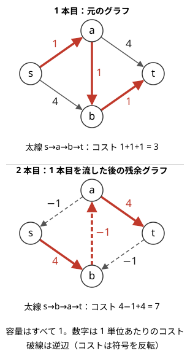
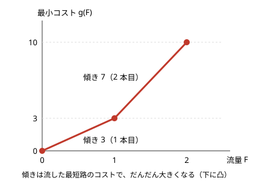

!!! abstract "要点"
    - **何ができるか**：容量とコストの付いた有向グラフで、流量 $F$ を流すときのコストの最小値を求める。[残余グラフ](../guide/glossary.md#residual-graph)上のコストの最短路に沿って流すことをくり返し、逆辺に現れる負のコストはポテンシャルで消してダイクストラ法で探す。ACL の `mcf_graph` で書け、流量ごとの最小コスト（下に凸な折れ線）も一度に得られる。
    - **いつ使うか**：
        - K 個選んだときの最大（最小）を K ごとに答える。
        - 重み付きの割当・各行・各列から高々 K 個。
        - 流す量とコストの両方を最適化する。
        - $N \le$ 数百、$M \le$ 数千程度で、流す量 $K \le N$。
    - **計算量**：流量を $F$ として $O(F (N + M) \log (N + M))$（増加 1 回ごとにダイクストラ法 1 回）。最初から負のコストの辺があるなら、初回のポテンシャルを作るベルマンフォード法の $O(NM)$ を足す。
    - **前提**：[最大流](../graph/max-flow.md)、[ダイクストラ法](../graph/dijkstra.md)

<!-- textlint-disable -->
別名：primal-dual・重み付きマッチング・割当問題・ハンガリアン法・slope・minimum cost flow
<!-- textlint-enable -->

最小費用流は、各辺に容量と「1 単位流すごとのコスト」を持たせ、始点 $s$ から終点 $t$ へ決まった量を流すときの総コストを最小にする問題である。[最大流](../graph/max-flow.md)が「どれだけ流せるか」だけを問うのに対し、「どの経路で流すと安いか」まで決める。競プロでは、重み付きのマッチングや「$K$ 個選んだときの最大」を、何を頂点・辺・コストにするかのモデル化で解く場面が多い。

## 逐次最短路とポテンシャル {#successive-shortest-path}

最小費用流の基本の解き方は、残余グラフの上で $s$ から $t$ へのコストの最短路を探し、そこに流せるだけ流すことをくり返す方法である（逐次最短路法、primal-dual 法とも呼ぶ）。残余グラフは最大流と同じで、辺 $u \to v$（容量 $c$、コスト $w$）に $f$ だけ流したら、順向きに残り $c - f$、逆向き $v \to u$ に容量 $f$ の辺がある。最小費用流では、逆辺のコストを $-w$ にする。逆辺に流すことは、先に流した分を押し戻してそのコストを返してもらうことだからである。

次の図は、容量がすべて 1 のグラフに 2 単位流す例である。1 本目は最短路 $s \to a \to b \to t$（コスト 3）に流す。2 本目は残余グラフで探すと、逆辺 $b \to a$（コスト $-1$）を通る $s \to b \to a \to t$（コスト 7）が最短になり、合計は 10 である。2 本目は 1 本目の $a \to b$ を取り消しているので、結果として流れるのは $s \to a \to t$ と $s \to b \to t$（どちらもコスト 5）である。



貪欲に安い経路から流しても、逆辺で取り消せるので最適になる。正しさの要は次の性質である。

- 流量 $F$ の流し方のうち、残余グラフにコストが負の閉路がないものは、流量 $F$ で最小コストである。
- 負の閉路がない残余グラフで最短路に流しても、流した後の残余グラフに負の閉路はできない。

1 つ目から、最短路に流すたびに「その流量での最小コスト」が保たれる。2 つ目の証明は、次のポテンシャルの話と同じ式になる。

??? note "証明"
    **1 つ目**：流量 $F$ の 2 つの流し方 $f$ と $f'$ の差（辺ごとの流量の差）は、$f$ の残余グラフの上の閉路の和に分けられる（どの頂点でも出入りの差が 0 になるので）。$f'$ のコストが $f$ より小さければ、差のコストは負なので、そのうち 1 つの閉路のコストは負である。対偶をとれば、負の閉路がなければ $f$ は最小である。

    **2 つ目**：残余グラフの $s$ からの最短距離を $d$ とする（$s$ から届かない頂点は流しても残余グラフの辺が変わらないので、ここでは $s$ から届く頂点だけを考える。届かない頂点も含めた扱いは後の「$\mathrm{dist}[t]$ を上限にする」段落で述べる）。残余グラフのどの辺 $u \to v$ でも $d(v) \le d(u) + w(u, v)$、すなわち $w(u, v) + d(u) - d(v) \ge 0$ である。最短路の上の辺ではこの値は 0 で、流した後に現れる逆辺の値も $-0 = 0$ である。だから流した後の残余グラフでも、すべての辺で $w + d(u) - d(v) \ge 0$ が成り立つ。閉路に沿ってこの値を足すと $d$ の部分は打ち消し合って元のコストの和になるので、どの閉路のコストも 0 以上である。

**ポテンシャルで負のコストを消す**。逆辺のコストは負なので、残余グラフの最短路をそのままダイクストラ法で求めることはできない。そこで[ダイクストラ法のポテンシャルの節](../graph/dijkstra.md#potential)と同じく、各頂点に値 $h(v)$ を持たせ、コストを $w'(u, v) = w(u, v) + h(u) - h(v)$ に付け替える。$h$ には前回の最短距離を使う。証明の 2 つ目のとおり、前回の最短距離で付け替えると、流した後の残余グラフのどの辺でも $w' \ge 0$ になる。だから毎回ダイクストラ法が使え、終わったら $h$ に今回の距離を足して次に備える。

処理の流れは次のとおりである（0-indexed）。

```text
h[v] = 0（すべての v）              # 元のコストがすべて 0 以上なら 0 で始めてよい
流量 = 0, コスト = 0
while 流量 < 上限:
    残余グラフで、コスト w + h[u] - h[v] を使ったダイクストラ法で dist を求める
    dist[t] = INF なら終わり（もう流せない）
    すべての v で h[v] += min(dist[v], dist[t])
    t から親をたどった経路の残り容量の最小 add を求める（上限 - 流量 も超えない）
    経路の各辺の残り容量を add 減らし、逆辺を add 増やす
    流量 += add, コスト += add * (h[t] - h[s])   # h[t] - h[s] が元のコストでの最短路の長さ
```

$h$ の更新で $\mathrm{dist}[t]$ を上限にするのは、$t$ より遠い頂点や届かない頂点（$\mathrm{dist} = \infty$）でも $w' \ge 0$ を保つためである。$D = \mathrm{dist}[t]$ とすると、三角不等式 $\min(\mathrm{dist}[v], D) \le \min(\mathrm{dist}[u], D) + w'(u, v)$ が成り立つ。だから上限を付けた距離で更新しても、付け替えたコストは 0 以上のままになる。

**計算量**：1 回の増加で流量は 1 以上増えるので、増加は高々 $F$ 回である。1 回は二分ヒープのダイクストラ法で $O((N + M) \log (N + M))$ なので、全体で $O(F (N + M) \log (N + M))$ になる。流量 $F$ に比例する上限なので、$F$ が $10^9$ のように大きいと間に合わないことがある（1 回で大きく流れる経路が多ければ実際は少ない回数で済む）。元のグラフに負のコストの辺があるときは、最初の $h$ を[ベルマンフォード法](../graph/bellman-ford.md#vs-potential)（DAG ならトポロジカル順の DP）で作る。元のグラフに負の閉路があると、この方法は使えない。

??? note "自作するときのコード（ACL と同じ結果になることを確かめたもの）"
    ```cpp
    --8<-- "min-cost-flow/primal-dual.cpp:core"
    ```

## コストは 0 以上（最大化は「定数 − 利得」に直す） {#nonnegative-cost}

ACL の `mcf_graph` は、辺のコストが 0 以上であることを求める（最初のポテンシャルを 0 で始めるため）。一方、問題の多くは「選んだものの価値の和を最大にする」形で、そのままではコストが負になる。そこで、利得 $a$ の辺のコストを $B - a$（$B$ は利得の最大以上の定数）にする。

この置き換えで答えが正しく戻るのは、**どの 1 単位の流れも、定数を足した辺をちょうど 1 回通るとき**である。$s \to$ 左の頂点 $\to$ 右の頂点 $\to t$ のように層に分かれたグラフで、1 つの層の辺だけに $B$ を足せば、流量 $F$ の流し方はどれも、ちょうど $F \cdot B$ だけコストが増える。

$$
\text{利得の最大} = F \cdot B - (\text{コストの最小})
$$

足した量が流し方によらず $F \cdot B$ に決まるので、コストの順位は変わらない。逆に、1 本の流れが定数を足した辺を 2 回通ることもある（層に分かれていない）グラフでは、通る回数の多い経路が不当に高くなり、答えがずれる。

**流量が決まっていないとき**。「高々 $K$ 個選ぶ」のように流量が自由な問題では、$B$ を足すと「流すほど損」に見えて、正しい比較ができない。この場合の直し方は 2 つある。

- **捨てる辺を張る**：$s \to t$ に直接、コスト $B$ の辺を容量に余裕を持たせて張り、流量を上限ちょうどに固定する。選ぶ経路（$B - a$）と捨てる辺（$B$）のどちらを通っても 1 単位あたり $B$ が乗るので、上の式がそのまま使える。ACL の練習問題の例（[例題の practice2_e](#practice2_e)）がこの形である。
- **流量ごとのコストを見る**：[流量ごとの最小コスト](#slope)を `slope` で求め、各流量 $F$ で $F \cdot B - g(F)$ を計算して最大をとる。

**オーバーフローに注意する**。$B = 10^9$、流量が $10^5$ ならコストの合計は $10^{14}$ に達するので、コストの型は `long long` にする。ACL は、コストの型が `int` なら「頂点数 × 辺のコストの最大」が $2 \times 10^9$ 程度まで、`long long` なら $8 \times 10^{18}$ 程度までであることも求める。

## 流量ごとの最小コスト（slope は下に凸） {#slope}

流量 $F$ のときの最小コストを $g(F)$ とすると、$g$ は下に凸な折れ線になる。逐次最短路法で $F$ から $F + 1$ へ増やすときの増え方 $g(F + 1) - g(F)$ は、そのときの残余グラフの最短路の長さである。その長さは流すたびに小さくならない。



図は[逐次最短路の節](#successive-shortest-path)の例で、1 本目の最短路の長さ 3、2 本目の 7 がそのまま傾きになっている。最短路が短くならない理由は、ポテンシャルの性質から言える。前回の最短距離 $d$ で付け替えたコスト $w'$ はすべて 0 以上なので、次の最短路の長さは $w'(\text{経路}) + d(t) - d(s) \ge d(t)$ で、前回の長さ $d(t)$ 以上である。

この性質から、次の型が出てくる。

- **K ごとの答えを一度に**：$K = 1, 2, \dots$ ごとに流し直す必要はない。1 回流しきって折れ線を作れば、どの $K$ の答えも折れ線から読める。
- **好きな数だけ選ぶ**：利得を負のコストとみると、コストが負の最短路がある間だけ流せばよい。傾きが 0 以上になった流量が最適で、それ以上流しても得をしない（凸なので、途中でまた下がることはない）。コストを非負に直して使うなら、各折れ線の頂点で $g(F) - F \cdot B$ を計算して最小をとる。凸の折れ線から直線を引いても凸なので、最小は折れ線の頂点のどれかにある。
- **二分探索・Alien DP との相性**：凸なので、「$K$ 個選ぶ」の制約を外して 1 個ごとにペナルティを課す見方もできる（[Alien DP](../dp/alien-dp.md#penalty)）。ただし最小費用流で解けるなら、折れ線を直接作る方が易しい。

ACL の `slope` は折れ線の頂点だけを返し、同じ直線上にある点は省く。間の流量 $x$ のコストは、両隣の頂点 $(x_0, c_0)$・$(x_1, c_1)$ から $c_0 + (c_1 - c_0)(x - x_0) / (x_1 - x_0)$ で補う。1 つの区間の傾きは、その区間で流した最短路の長さ（同じ長さが続いた分はまとめられる）なので整数で、割り切れる。

## モデル化の型（重み付き二部マッチング・市松模様・差分列の流れ） {#modeling}

最小費用流は、中身よりも「何を頂点・辺にし、容量とコストをどう付けるか」が問題の本体である。よく出る型を 4 つ挙げる。

**重み付き二部マッチング**。左の頂点と右の頂点を結ぶ辺に重みがあり、端点を共有しないように選んで重みの和を最大にする。$s \to$ 左（容量 1、コスト 0）、左 $\to$ 右（容量 1、コスト $B - \text{重み}$）、右 $\to t$（容量 1、コスト 0）と張る。「各行・各列から高々 $K$ 個」なら、行を左、列を右、マスを辺にして、$s \to$ 行と列 $\to t$ の容量を $K$ にする。「大学も得意分野も重ならないように人を選ぶ」のように、人を「2 つの属性を結ぶ辺」とみる言い換えが要の問題も多い（[例題の abc247_g](#abc247_g)）。選ぶ本数が自由なら、[流量が決まっていないとき](#nonnegative-cost)の 2 つの直し方のどちらかを使う。重みのない場合は[二部マッチング](../graph/bipartite-matching.md)である。

**市松模様**。マス目に $1 \times 2$ のドミノを置く問題は、マスを市松模様に塗ると、ドミノは必ず白と黒のマスを 1 つずつ覆う。白マスを左、黒マスを右、隣り合う組を辺とした二部グラフになる（[グリッドの市松模様の節](../graph/grid-graph.md#checkerboard)）。覆ったマスの値をコストにすれば、ドミノの置き方の最適化が最小費用流になる。好きな枚数だけ置くなら、[slope の節](#slope)の「傾きが 0 以上になるまで流す」を使う。

**差分列の上の流れ**。「区間 $[l, r)$ の全要素に 1 を足す」操作は、[差分列](../basics/imos.md#adjacent-difference)では位置 $l$ に $+1$、位置 $r$ に $-1$ の 2 点の変化になる。これを「位置 $l$ の不足を、位置 $r$ の余りで 1 単位埋める」とみると、差分の過不足を運ぶ流れになる。足りない位置へ $s$ から、余る位置から $t$ へ辺を張る。操作 1 回を $l \to r$ のコスト 1 の辺にすれば、最小の操作回数が最小コストになる。

**下限のある条件を安い辺と高い辺で表す**。「各行・各列に 1 個以上」のような下限は、そのままでは表せない。$s \to$ 行に「容量 1・コスト 0」の辺と「容量に余裕・コスト大」の辺を並べて張ると、高い辺のコスト $L$ は、ほかの辺のコストの総和より大きくとる。すると、すべての下限を満たせる流量 $f$ では、最小費用流は安い辺をすべて使う（安い辺を 1 本でも残すと $L$ が余分に乗り、ほかの辺をどう選び直しても取り返せない）。だから高い辺を通る回数は流量 $f$ から一通りに決まり、その回数 × $L$ を引けば流量 $f$ での本当のコストになる。[コストは 0 以上の節](#nonnegative-cost)の「定数はどの 1 単位もちょうど 1 回通る層に置く」とは違い、ここでは定数の乗る回数が流量ごとに決まるので、流量ごとに引く量を変えればよい。下限を一般に扱うなら[下限付きフロー](../graph/flow-lower-bounds.md)である。

どの型でも、頂点の番号の割り当て（$s$・$t$・行・列のオフセット）を最初に紙に書いておくと、取り違えを防げる。

## ACL の mcf_graph（flow と slope） {#acl}

!!! info "ACL では"
    `atcoder::mcf_graph<Cap, Cost> g(n);`（ヘッダは `<atcoder/mincostflow>`）。`g.add_edge(from, to, cap, cost)` は $0 \le \mathrm{cost}$ が条件で、辺の番号を返す。`g.flow(s, t)`・`g.flow(s, t, limit)` は流量とコストの組を、`g.slope(s, t)`・`g.slope(s, t, limit)` は折れ線の頂点 $(x, g(x))$ の列（先頭は $(0, 0)$）を返す。計算量は $O(F (n + m) \log (n + m))$。`flow` と `slope` を合わせて複数回呼んだときの挙動は未定義である。流した後の各辺の流量は `g.edges()` で読める。

次のコード片は、二部グラフで端点を共有しない辺を $k$ 本選ぶときの重みの和の最大を、$k = 1, 2, \dots$ ごとに求める。コストを $B - w$ にして非負にし、`slope` の頂点の間を直線で補ってから $k \cdot B$ を戻している。

```cpp
--8<-- "min-cost-flow/slope.cpp:core"
```

- 流量が決まっている問題で `flow(s, t, limit)` を使うときは、返った流量が `limit` に届いたかを確かめる。届かなければ、その流量は流せない（条件を満たす選び方がない）。
- 選んだ組を出力するときは、`g.edges()` の中で `flow` が正の辺を読む。`add_edge` の返り値を覚えておけば `g.get_edge(i)` でも読める。

## 割当問題とハンガリアン法 {#hungarian}

この節は発展の内容で、前提は上の[逐次最短路とポテンシャル](#successive-shortest-path)である。割当問題は、$N$ 人に $N$ 個の仕事を 1 つずつ割り当て、コスト $a_{ij}$ の和を最小にする問題で、完全二部グラフの最小重み完全マッチングである。

- **最小費用流で解く**：$s \to$ 人、人 $\to$ 仕事（コスト $a_{ij}$）、仕事 $\to t$ に容量 1 で張り、$N$ 流す。辺は $N^2$ 本なので $O(N^3 \log N)$ である。$a_{ij}$ が負なら、人ごとに定数を足して非負にしてよい（各人はちょうど 1 回割り当てられるので、足した量の合計は流し方によらない）。
- **ハンガリアン法**：人ごとにポテンシャル $u_i$、仕事ごとに $v_j$ を持ち、$u_i + v_j \le a_{ij}$ を保ちながら、人を 1 人ずつ足して増加路を探す。中身は密グラフでの逐次最短路法で、ヒープを使わない $O(N^2)$ のダイクストラ法を $N$ 回行うので $O(N^3)$ になる。
- **使い分け**：$N$ が数百までなら ACL の `mcf_graph` で足りることが多い。密な割当で $\log$ の分が厳しいときに、ハンガリアン法の自作を考える。

自作の割当問題は Library Checker の [Assignment Problem](https://judge.yosupo.jp/problem/assignment)、一般の最小費用流（頂点ごとに供給・需要がある形）は [Minimum Cost b-flow](https://judge.yosupo.jp/problem/min_cost_b_flow) で確かめられる。

## 落とし穴 {#pitfalls}

- **ACL で `flow` を何度も呼ぶ**：$K$ ごとの答えを得るために `g.flow(s, t, 1)` を $K$ 回呼ぶのは、ACL では未定義である。`slope` を 1 回呼んで折れ線から読む（[slope の節](#slope)）。
- **`slope` の頂点の間を補わない**：同じ直線上の点は省かれるので、`slope` の返り値の要素数は流量 + 1 とは限らない。添字を流量だと思って読むと、答えが抜ける。
- **定数を足す辺の位置**：「$B - $ 利得」の $B$ は、どの 1 単位の流れも必ずちょうど 1 回通る層に置く。2 回通りうる辺に置くと、答えから $F \cdot B$ を引いても戻らない。
- **コストの型**：$B = 10^9$ と流量の積は `int` に収まらない。`mcf_graph<int, long long>` のようにコストを `long long` にし、$F \cdot B$ も `long long` で計算する。
- **負の閉路がある**：元のグラフに負のコストの閉路があると、逐次最短路法は最小を返さない。モデル化の段階で、負のコストの辺が閉路を作らないかを確かめる。
- **流量が足りない**：「ちょうど $F$」を要求する問題で、流れた量を確かめずにコストだけを出力する。流れた量が $F$ 未満なら「できない」を出力する。

## 確認問題 {#quiz}

??? question "確認問題：逆辺のコスト"
    残余グラフで、辺 $u \to v$（コスト $w$）の逆辺 $v \to u$ のコストを $w$（符号を反転しない）にすると、何が起きるか。

    ??? success "答え"
        逆辺に流すのは「先に流した分を取り消す」ことなので、コストは返ってくる（$-w$）はずである。$w$ のままにすると、取り消すたびにコストを二重に払う計算になり、[逐次最短路の節](#successive-shortest-path)の図の 2 本目は $4 + 1 + 4 = 9$ と数えられる。実際のコストは 7 なので、合計が実際より大きく出るうえ、取り消しを使う流し方が不当に高く見えて最適を逃す。

??? question "確認問題：K ごとの答え"
    「$K = 1, 2, \dots, N$ のそれぞれについて、$K$ 組選んだときの重みの和の最大を答えよ」という問題を、最小費用流を $N$ 回流し直して解くと、全体の計算量はどうなるか。1 回で済ませるにはどうすればよいか。

    ??? success "答え"
        $K$ 回目に流量 $K$ を流すと $O(K (N + M) \log (N + M))$ かかるので、合計で $O(N^2 (N + M) \log (N + M))$ になる。逐次最短路法は流量 1 ずつ最適を保ちながら進むので、1 回流しきって `slope` の折れ線を作れば、すべての $K$ の答えが $O(N (N + M) \log (N + M))$ で得られる。

??? question "確認問題：最大化をコスト非負に直す"
    左 3 頂点・右 3 頂点の二部グラフで、重み（0 以上 100 以下）の和が最大の完全マッチングを ACL の `mcf_graph` で求めたい。辺のコストをどう付け、答えをどう戻すか。

    ??? success "答え"
        左から右への辺のコストを $100 - \text{重み}$ にし、流量 3 を流す。どの 1 単位も左から右への辺をちょうど 1 回通るので、コストの合計には $3 \times 100$ がちょうど 1 回ずつ乗る。答えは $300 - (\text{コストの最小})$ である。流れた量が 3 に届かなければ完全マッチングはない。

??? question "確認問題：好きな数だけ選ぶ"
    盤面にドミノを好きな枚数だけ置き、覆われたマスの値の和を最小にしたい（値は負もある）。コストを覆うマスの値にした最小費用流で、どこまで流せばよいか。

    ??? success "答え"
        残余グラフの最短路のコストが負である間だけ流し、0 以上になったら止める。最小コストの折れ線は下に凸なので、傾きが 0 以上になった後は流すほどコストは減らない。ACL でコストを非負に直したなら、`slope` の各頂点で「コスト − 流量 × 足した定数」を計算して最小をとる。

## 使い分け {#comparison}

- コストがなく、流せる量だけを問うなら[最大流](../graph/max-flow.md)。重みのないマッチングは[二部マッチング](../graph/bipartite-matching.md)。
- 選ぶ・選ばないの 2 択と、その組み合わせのペナルティを最小にするなら、最小費用流ではなく最小カットの[燃やす埋める](../graph/project-selection.md)。
- 「$K$ 個選んだときの最大」でも、選び方の制約がなければソートや[優先度付きキュー](../ds/priority-queue.md)の貪欲で済む。制約が「各行・各列に高々 1 個」のように交差するときに最小費用流を疑う。
- 片側の頂点数が 20 程度以下なら、[bitDP](../dp/bit-dp.md) でマッチングを全部調べる方が速く書けることがある。

## 例題 {#examples}

### PRACTICE2 E. MinCostFlow {#practice2_e}

<div class="kp-problems" data-role="example" markdown>

- [PRACTICE2 E. MinCostFlow](https://atcoder.jp/contests/practice2/tasks/practice2_e)（diff —）：N×N のマス目から、各行・各列で K 個以下になるようにマスを選び、選んだマスの値の和を最大化して選び方を出力する。

</div>

行と列を頂点にし、マスを「行 $\to$ 列」の容量 1 の辺にする。各行・各列から $K$ 個以下なので、$s \to$ 行と列 $\to t$ の容量を $K$ にする。和の最大化なので、マスの辺のコストを $B - a$ にして非負に直す。選ぶ個数が決まっていないので、[捨てる辺](#nonnegative-cost)を張って流量を固定する。

??? note "解法の詳細"
    - 頂点：行 $0..N-1$、列 $N..2N-1$、$s = 2N$、$t = 2N+1$。
    - 辺：$s \to$ 行 $i$（容量 $K$、コスト 0）、列 $j \to t$（容量 $K$、コスト 0）、行 $i \to$ 列 $j$（容量 1、コスト $B - a_{ij}$）、捨てる辺 $s \to t$（容量 $NK$、コスト $B$）。$B$ は $a$ の最大以上（ACL の例では $10^9$）。
    - 流量 $NK$ ちょうどを流す。どの 1 単位も、マスの辺か捨てる辺のどちらか一方をちょうど 1 回通るので、答えは $NK \cdot B - (\text{コスト})$ である。
    - 選び方は `g.edges()` のうち、行から列への辺で流量が 1 のものを読んで復元する。

### ABC247 G. Dream Team {#abc247_g}

<div class="kp-problems" data-role="example" markdown>

- [ABC247 G. Dream Team](https://atcoder.jp/contests/abc247/tasks/abc247_g)（diff 2159）：大学・得意分野・強さを持つ人が N 人いるとき、大学も得意分野も重ならないように k 人選んだ強さの和の最大値を、各 k について求める。

</div>

人を「大学と得意分野を結ぶ辺」とみると、大学も得意分野も重ならない選び方は、大学を左・得意分野を右とした二部グラフのマッチングになる。強さの和の最大化なので、辺のコストを $B - \text{強さ}$ にする。$k$ ごとの答えは、流量ごとの最小コストの折れ線から一度に読める。

??? note "解法の詳細"
    - 辺：$s \to$ 大学（容量 1、コスト 0）、得意分野 $\to t$（容量 1、コスト 0）、人ごとに大学 $\to$ 得意分野（容量 1、コスト $B - \text{強さ}$）。$B$ は強さの最大以上にする。
    - どの 1 単位も人の辺をちょうど 1 回通るので、流量 $k$ の最小コストを $g(k)$ とすると答えは $k B - g(k)$ である。
    - `slope` で折れ線を作り、頂点の間を直線で補って $k = 1, 2, \dots$ の答えを出す。選べる最大の人数は折れ線の最後の流量である。コードは [ACL の節](#acl)のものとほぼ同じ形である。

## 練習問題 {#practice}

<div class="kp-problems" data-role="practice" markdown>

- [ABC407 G. Domino Covering SUM](https://atcoder.jp/contests/abc407/tasks/abc407_g)（diff 2190）：整数の書かれた盤面にドミノを重ならないように好きな数だけ置き、ドミノに覆われていないマスの整数の和を最大化する。
- [ABC421 G. Increase to make it Increasing](https://atcoder.jp/contests/abc421/tasks/abc421_g)（diff 2410）：数列と区間の候補が与えられ、候補の区間を選んでその中の全要素に 1 を足す操作をくり返すとき、数列を広義単調増加にするための最小の操作回数を求める（できるかどうかも判定する）。

</div>

??? note "練習の方針"
    - **ABC407 G**：覆われないマスの和の最大は、全体の和から覆うマスの和の最小を引いたものである。市松模様の白マスを左、黒マスを右にし、$s \to$ 白（コスト＝そのマスの値）、白 $\to$ 隣の黒（コスト 0）、黒 $\to t$（コスト＝そのマスの値）と容量 1 で張る。1 単位がドミノ 1 枚になる。枚数は自由なので、最短路のコストが負である間だけ流す。ACL で解くなら、$s \to$ 白と黒 $\to t$ の両方に定数 $B$ を足し（1 単位あたり $2B$）、`slope` の各頂点で $g(F) - 2BF$ の最小をとる。
    - **ABC421 G**：差分 $D_i = A_{i+1} - A_i$ をすべて 0 以上にする問題に言い換える。区間への $+1$ は、左端の 1 つ手前の差分を増やし、右端の差分を減らす。負の差分の位置へ $s$ から（容量は不足分）、正の差分の位置から $t$ へ（容量は余り）、列の末尾からは $t$ へ容量に余裕のある辺を張り、操作を「左端の手前 $\to$ 右端」のコスト 1 の辺にする。不足分の合計を流しきれなければできない。

## 力試し {#challenge}

<div class="kp-problems" data-role="challenge" markdown>

- [ABC231 H. Minimum Coloring](https://atcoder.jp/contests/abc231/tasks/abc231_h)（diff 2681）：費用つきの候補のマスから駒を置くマスを選び、すべての行とすべての列に駒が 1 個以上ある状態にする最小費用を求める。

</div>

??? note "力試しの方針"
    - **ABC231 H**：行を左、列を右、候補のマスを辺（容量 1、コスト＝費用）とした二部グラフの最小辺被覆である。「どの行・列も 1 回以上」の下限を、$s \to$ 行と列 $\to t$ に「容量 1・コスト 0」と「容量に余裕・コスト大」の 2 本を並べて表す（[モデル化の節](#modeling)の最後の型）。高い辺のコスト $L$ を候補の費用の総和より大きくとると、流量 $f \ge \max(H, W)$ で安い辺は $H + W$ 本すべて使われ、高い辺を通る回数は $(f - H) + (f - W)$ に決まる。ACL なら `slope` を 1 回呼び、各流量 $f \ge \max(H, W)$ で（頂点の間は直線で補って）$\text{コスト} - L \cdot ((f - H) + (f - W))$ を計算し、その最小をとる。

## 参考 {#references}

- [AtCoder「ac-library MinCostFlow のドキュメント」](https://github.com/atcoder/ac-library/blob/master/document_ja/mincostflow.md)：mcf_graph の宣言・条件（コストが 0 以上、flow と slope を複数回呼ぶと未定義、コストの型の範囲）・計算量・slope の返り値の性質
- [AtCoder「ac-library の mincostflow_practice.cpp」](https://github.com/atcoder/ac-library/blob/master/test/example/mincostflow_practice.cpp)：例題 practice2_e のグラフ（捨てる辺と BIG − a のコスト）
- [kmjp「AtCoder ABC #247 : G - Dream Team」](https://kmjp.hatenablog.jp/entry/2022/04/10/1030)：例題の方針（大学と得意分野の二部グラフ、定数 − 強さのコスト、人数ごとの答え）
- [kmjp「AtCoder ABC #407 : G - Domino Covering SUM」](https://kmjp.hatenablog.jp/entry/2025/05/27/0900)：練習の方針（市松模様の二部グラフ、コストが負の間だけ流す）
- [kmjp「AtCoder ABC #421 : G - Increase to make it Increasing」](https://kmjp.hatenablog.jp/entry/2025/08/30/1000)：練習の方針（差分列の過不足を流れで運ぶ）
- [kmjp「AtCoder ABC #231 (パナソニックプログラミングコンテスト2021) : H - Minimum Coloring」](https://kmjp.hatenablog.jp/entry/2021/12/12/1000)：力試しの方針（最小辺被覆、安い辺と高い辺を並べて下限を表す）
