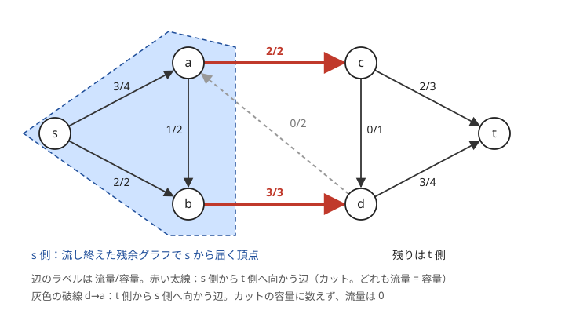
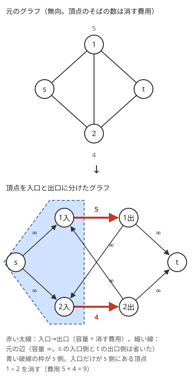

!!! abstract "要点"
    - **何ができるか**：頂点を s 側と t 側に分けたとき、s 側から t 側へ向かう辺の容量の和の最小値を、最大流の値として求める。流し終えた残余グラフで s から届く頂点を s 側とすれば、どの辺を切るか（カット）も復元できる。
    - **いつ使うか**：
        - s と t を切り離す最小のコスト。
        - 頂点を消すコストの最小・どれを消したかも出力する。
    - **計算量**：最大流 1 回（ACL の `mf_graph` で $O(N^2 M)$、容量がすべて 1 なら $O((N + M)\sqrt{M})$）と、カットの復元 $O(N + M)$
    - **前提**：[最大流](../graph/max-flow.md)

<!-- textlint-disable -->
別名：最大流最小カット定理・頂点カット・頂点分割・カットの復元・minimum cut・s-t cut
<!-- textlint-enable -->

最小カットは、辺や頂点を消して s から t へ行けなくする最小のコストである。消し方は $2^M$ 通りあって全部は試せないが、最大流最小カット定理によって[最大流](../graph/max-flow.md)の値と一致するので、流すだけで求まる。問題の本体は「消すコストを辺の容量としてどう表すか」と「消したものをどう取り出すか」にある。

## 最大流最小カット定理 {#maxflow-mincut}

有向グラフの頂点を、s を含む組 $S$ と t を含む組 $T$ に分けたものを s-t [カット](../guide/glossary.md#cut)という。カットの容量は、**$S$ から $T$ へ向かう辺**の容量の和である。$T$ から $S$ へ向かう辺は数えない。$S$ から $T$ へ向かう辺をすべて消すと、s から t へは行けなくなる。逆に、いくつかの辺を消して s から t へ行けなくしたなら、消した後に s から届く頂点を $S$ とすれば、$S$ から出る辺はすべて消してある。だから「辺を消して s と t を切り離す最小のコスト」は、カットの容量の最小値（最小カット）に等しい。

**最大流最小カット定理**：s から t への最大流の値は、最小カットの容量に等しい。

次の図は、流し終えたグラフでこの関係を確かめたものである。辺のラベルは「流量/容量」で、最大流は 5 である。



なぜ一致するかは 2 段で示せる。

1. **どの流れもどのカット以下**：s から出た流れは、どこかで $S$ から $T$ へ渡らないと t に着かない。s 以外の $S$ の頂点では入る量と出る量が等しいので、$S$ の頂点すべてで足し合わせると、流れの値（s から出る量）は「$S$ から $T$ へ渡る量」から「$T$ から $S$ へ戻る量」を引いたものに等しい。渡る量は辺の容量を超えない。だから、どの流れの値もどのカットの容量以下である。
2. **流し終えたら等号が成り立つカットがある**：最大流を流し終えた[残余グラフ](../graph/max-flow.md)で、s から届く頂点を $S$ とする。t には届かないので、t は $T$ 側にある。$S$ から $T$ へ向かう辺に容量の余りがあれば、その先の頂点にも届くはずなので、どれも流量 ＝ 容量（飽和）である。$T$ から $S$ へ向かう辺に流れがあれば、その逆辺をたどって届くはずなので、どれも流量 0 である。すると 1. の式で、流れの値はちょうどこのカットの容量になる。

1. により最小カット以上は流せず、2. によりそれを達成する流れとカットの組がある。図では a→c と b→d が飽和し、d→a は流量 0 になっている。

この定理のおかげで、最小カットの問題は「切る対象を容量にしたグラフを作って流す」に置き換わる。グラフを作るときの決まりは次の 3 つである。

- **切るコストは容量にする**。切れないもの（消してはいけない辺、元の辺の形を保つための辺）は容量を十分大きな値 $\infty$ にする。
- **無向の辺は両向きの 2 本にする**。コスト $w$ の無向辺 $\{u, v\}$ は $u \to v$ と $v \to u$ をどちらも容量 $w$ で張る。カットでは 2 本のうち多くとも 1 本しか $S$ から $T$ へ向かわないので、コストは 1 回だけ数えられる。
- **始点や終点が複数あるなら[超頂点](../guide/glossary.md#super-vertex)でまとめる**。終点が $v_1, \dots, v_K$ なら新しい頂点 t を足し、各 $v_i \to t$ を張る。この辺を容量 $\infty$ にすれば「どの $v_i$ にも届かない」、容量 $c_i$ にすれば「$v_i$ に届くことを $c_i$ で許す」を表す。

**応用の型**：辺のコストがすべて 1 なら、最小カットは「s と t を切り離すのに消す辺の最小本数」で、これは辺を共有しない s-t パスの最大本数にも等しい（容量 1 の最大流を 1 本ずつのパスに分けられるため）。サインは「切り離す」「通れなくする最小の本数」である。

## カットの復元（ACL の min_cut） {#restore}

値だけでなく「どの辺を切るか」を答えるときは、[最大流最小カット定理](#maxflow-mincut)の証明の 2. をそのまま使う。最大流を流し終えた残余グラフで、s から届く頂点の集合を $S$ とする。

- 残余グラフの辺は、容量の余りがある向き（流量 < 容量）と、流れを押し戻せる逆向き（流量 > 0）の 2 種類である。
- s から BFS か DFS でたどり、届いた頂点を $S$ にする。計算量は $O(N + M)$ である。
- 元の辺のうち、始点が $S$ にあり終点が $S$ にない辺がカットである。その容量の和は流した量に等しい。

ACL の `mf_graph` の `min_cut(s)` は、この「残余グラフで s から届くか」を `vector<bool>` で返す。カットの辺は、自分で元の辺を走査して取り出す。

```cpp
--8<-- "min-cut/restore.cpp:core"
```

!!! info "ACL では"
    `atcoder::mf_graph<long long> g(n);`。`g.add_edge(from, to, cap)` は追加した順の辺の番号を返す。`g.flow(s, t)` で流し、続けて `g.min_cut(s)` を呼ぶと、残余グラフで s から届く頂点が `true` になる（$O(N + M)$）。ドキュメントがカットに対応すると保証するのは、`flow(s, t)` を `flow_limit` なしでちょうど 1 回呼んだ後である。同じ s・t で辺を足して `flow(s, t)` を流し直した後も、残余グラフに s から t への道は残らないので、最小カットに対応する。`g.edges()` で各辺の流量と容量も見られる。

復元で気をつけることは 3 つある。

- **飽和した辺がカットとは限らない**。カットの辺はどれも飽和しているが、逆は成り立たない。たとえば図の c→t の容量が 3 でなく 2 なら、流量 2/2 で飽和するが、両端が t 側にあるのでカットではない。必ず「$S$ から $S$ の外へ」で判定する
- **最小カットは 1 つとは限らない**。s から届く集合で作るカットは、最小カットのうち $S$ が最も小さいものになる。逆に、残余グラフで t へたどり着ける頂点を $T$ とすれば、$S$ が最も大きい最小カットになる。どれを答えてもよい問題なら、s から届く集合を使えばよい
- **flow の呼び方**：`flow_limit` を付けて途中で止めた後や、別の s・t で流した後、`change_edge` で流量を書き換えた後の `min_cut` は、最小カットに対応するとは限らない。同じ s・t で辺を足して `flow(s, t)` を流し直したなら、流し終えた時点の `min_cut(s)` は最小カットに対応する（ACL のドキュメントが保証するのは 1 回だけ呼んだ場合で、残余グラフの定義は [ACL の appendix](https://github.com/atcoder/ac-library/blob/master/document_ja/appendix.md) にある）。

## 頂点を入口と出口に分けて頂点カットを表す {#vertex-cut}

「頂点 $v$ を消すとコスト $c_v$」の形は、カットが辺しか数えないのでそのままでは表せない。各頂点 $v$ を入口 $v_{\mathrm{in}}$ と出口 $v_{\mathrm{out}}$ の 2 頂点に分け、次のように辺を張る。

- $v_{\mathrm{in}} \to v_{\mathrm{out}}$ に容量 $c_v$（この辺を切ることが $v$ を消すことにあたる）。
- 元の有向辺 $u \to v$ は $u_{\mathrm{out}} \to v_{\mathrm{in}}$ に容量 $\infty$。無向辺は $v_{\mathrm{out}} \to u_{\mathrm{in}}$ も張る。
- 始点を $s_{\mathrm{out}}$、終点を $t_{\mathrm{in}}$ にする（s と t を消せないようにするため）。



**なぜ正しいか**：元のグラフの s から t へのパスは、分けたグラフでは途中の頂点ごとに「入口 → 出口」の辺を 1 本ずつ通る。容量 $\infty$ の辺は有限のカットに入らないので、有限のカットは「入口 → 出口」の辺の集まりになる。それを切って s と t が切り離されることは、その頂点を消して元のグラフで s と t が切り離されることと同じである。だから最小カットは消す頂点のコストの和の最小値に等しい。辺にもコストがあるなら、$\infty$ の代わりにその辺のコストを容量にすればよい。

始点を $s_{\mathrm{in}}$ にすると、$s_{\mathrm{in}} \to s_{\mathrm{out}}$ の辺がカットに入りうる。s を消せない問題では、始点を $s_{\mathrm{out}}$・終点を $t_{\mathrm{in}}$ にするか、s と t の「入口 → 出口」を容量 $\infty$ にする。

**復元**：流し終えた後、$v_{\mathrm{in}}$ が s 側で $v_{\mathrm{out}}$ が t 側の頂点 $v$ を消す。次のコード片は、頂点 0 から頂点 $n - 1$ へ行けなくする最小のコストと、消す頂点を求める（入口を $2v$、出口を $2v + 1$ とした）。

```cpp
--8<-- "min-cut/vertex-cut.cpp:core"
```

$\infty$ は「有限の容量の総和 + 1」にしてある。流した量がこれ以上なら、$\infty$ の辺を切らないと切り離せない（s と t が隣り合う）ので、答えは「できない」になる。

**応用の型**：「通れなくするために消すマス・石・人」のように、消す対象が頂点で、どれを消したかも問われる。頂点を分ける形は最大流でも使い、「各頂点を通れる回数に上限がある」を入口 → 出口の容量で表す（[最大流](../graph/max-flow.md)）。

## カットの形を決め打つ {#cut-shape}

この節は発展の内容で、[燃やす埋める](../graph/project-selection.md)と合わせて読むとよい。カットは「各頂点を s 側と t 側のどちらに置くか」の選択なので、取りうる形を制限したり、形を直接数え上げたりできる。

**$\infty$ の辺で形を制限する**。$u \to v$ に容量 $\infty$ の辺を張ると、有限のカットでは「$u$ が s 側なら $v$ も s 側」が強制される。頂点の列 $x_1 \to x_2 \to \dots \to x_k$ を容量 $\infty$ でつなぐと、s 側に入るのは列の後ろの部分（ある位置から先）だけになり、その位置で $0$〜$k$ の整数を表せる。整数どうしの「差がこれ以下」「上がった分だけコスト」を辺で表すと、整数を割り当てる問題が最小カットになる（力試しの [ABC397 G](#challenge)）。

**流さずに、カットの式を直接最小化する**。辺が多すぎて流せないときでも、カットの容量が「一部の頂点の置き方」だけで決まる式に書けることがある。たとえば $s \to (\text{左の頂点}) \to (\text{右の頂点}) \to t$ の 3 層のグラフで、左の頂点の置き方を決めると、右の各頂点は s 側と t 側の安い方に置けばよいので、カットの容量が式で書ける。左の置き方をそのまま全部は試せなくても、式が「左の s 側の頂点の重みの和」だけで決まるなら、その和ごとの最小値を DP で求めればよい（力試しの [ABC332 G](#challenge)）。最大流の値が欲しいときに、逆に最小カットを計算するという向きになる。

## 落とし穴 {#pitfalls}

**$T$ から $S$ へ向かう辺を数える**。カットの容量に入るのは $S$ から $T$ へ向かう辺だけである。有向グラフで両向きを数えると、最大流と一致しなくなる。コストを「s 側と t 側に分かれたら払う」形で付けたいなら、無向の辺（両向きの 2 本）にする。

**$\infty$ の大きさ**。$\infty$ が小さすぎると、$\infty$ の辺が「安い辺」として切られる。大きすぎると、s から出る $\infty$ の辺が何本も並ぶとき、流れの値（それらの容量の和）が `long long` を超える。有限の容量の総和 + 1 にしておけば、最小カットが有限ならそれより小さく、流量が $\infty$ 以上になったら「有限のカットがない（切り離せない）」と判定できる。$10^{18}$ のような値を何本も足すとあふれる。

**無向の辺を片方だけ張る**。`add_edge(u, v, c)` は $u \to v$ の向きにしか流さない。無向の辺は `add_edge(v, u, c)` も呼ぶ。

**飽和した辺をカットとして出力する**。[カットの復元](#restore)のとおり、飽和していても $T$ の中や $S$ の中の辺はカットではない。復元は `min_cut` の結果で行う。

**頂点の番号の割り当て**。入口・出口・超頂点の番号が重なると、気づきにくい誤答になる。入口 $2v$・出口 $2v + 1$、超頂点 $2N$ のように式で決め、グラフの頂点数 $2N + 1$ を `mf_graph` に渡す。

## 例題 {#examples}

### ABC010 D. 浮気予防 {#abc010_4}

<div class="kp-problems" data-role="example" markdown>

- [ABC010 D. 浮気予防](https://atcoder.jp/contests/abc010/tasks/abc010_4)（diff 1777）：頂点 0 から指定された頂点群のどれにも行けなくするのに必要な、最小の操作回数を求める。

</div>

終点が複数あるので、超頂点 t を足して指定された各頂点から t へ容量 1 の辺を張る。グラフの辺（無向）は両向きに容量 1 で張る。辺を 1 本消す操作はグラフの辺を切ることに、指定された頂点を消す操作はその頂点から t への辺を切ることに対応し、どちらもコスト 1 である。頂点 0 から t への最大流が答えになる。

??? note "解法の詳細"
    頂点数を $N$ とし、超頂点を $N$ 番にして `mf_graph<int> g(N + 1)` を作る。辺 $\{u, v\}$ ごとに `g.add_edge(u, v, 1)` と `g.add_edge(v, u, 1)`、指定された頂点 $v$ ごとに `g.add_edge(v, N, 1)` を呼び、`g.flow(0, N)` を出力する。指定された頂点を消せない問題なら、$v \to N$ の容量を $\infty$ にすればよい。$N$ は 100 までなので、どの最大流のアルゴリズムでも間に合う。

### ABC239 G. Builder Takahashi {#abc239_g}

<div class="kp-problems" data-role="example" markdown>

- [ABC239 G. Builder Takahashi](https://atcoder.jp/contests/abc239/tasks/abc239_g)（diff 2215）：頂点 1 から頂点 N へ行けなくするために消す頂点（1 と N は除く）の費用の和の最小値を求め、消す頂点を出力する。

</div>

消すのが頂点なので、[頂点を入口と出口に分けて](#vertex-cut)入口 → 出口に費用を、元の辺に $\infty$ を付ける。最小カットの値が答えの費用で、消す頂点は残余グラフで入口だけが s 側にある頂点として復元する。

??? note "解法の詳細"
    頂点 $v$（0-indexed）の入口を $2v$、出口を $2v + 1$ とし、$v = 1, \dots, N - 2$ に `add_edge(2v, 2v + 1, C_v)` を張る。無向辺 $\{u, v\}$ には `add_edge(2u + 1, 2v, INF)` と `add_edge(2v + 1, 2u, INF)` を張る。始点を頂点 0 の出口 $1$、終点を頂点 $N - 1$ の入口 $2(N - 1)$ にして流す。`min_cut(1)` で $2v$ が `true`、$2v + 1$ が `false` の頂点を出力する。[頂点カットの節](#vertex-cut)のコード片がこの形である。費用の和と $\infty$ が `int` に収まるとは限らないので、容量は `long long` にしておく。

## 力試し {#challenge}

<div class="kp-problems" data-role="challenge" markdown>

- [ABC332 G. Not Too Many Balls](https://atcoder.jp/contests/abc332/tasks/abc332_g)（diff 2775）：N 種類のボール（種類 i は A_i 個）を M 個の箱（箱 j には合計 B_j 個まで、種類 i のボールは箱 j に i × j 個まで）に入れるとき、入れられるボールの数の最大値を求める。
- [ABC397 G. Maximize Distance](https://atcoder.jp/contests/abc397/tasks/abc397_g)（diff 2947）：N 頂点 M 辺の有向グラフで、M 本の辺のうち K 本の重みを 1、残りを 0 にするとき、頂点 1 から頂点 N への最短距離の最大値を求める。

</div>

??? note "方針"
    - **ABC332 G**：$s \to$ 種類 $i$（容量 $A_i$）、種類 $i \to$ 箱 $j$（容量 $ij$）、箱 $j \to t$（容量 $B_j$）の最大流が答えだが、辺が $NM$ 本あって流せない。最小カットで考え、s 側に残す種類の集合を $P$、$X = \sum_{i \in P} i$ とすると、カットの容量は $\sum_{i \notin P} A_i + \sum_j \min(B_j, jX)$ になる（箱 $j$ は t 側なら $jX$、s 側なら $B_j$ を払う）。$X$ ごとに $\sum_{i \notin P} A_i$ の最小値をナップサックの DP で求め、$\sum_j \min(B_j, jX)$ は $X$ を動かしながら $B_j / j$ を境に切り替わる和として求める。
    - **ABC397 G**：答え $D$ を決め打つ。最短距離が $D$ 以上になることは、各頂点に $0$〜$D$ の値 $g(v)$ を、$g(1) = 0$・$g(N) = D$・各辺 $u \to v$ で $g(v) \le g(u) + (\text{重み})$ を満たすように割り当てられることと同じである。重みは 0 か 1 なので、$g(v) = g(u) + 1$ となる辺だけ重みを 1 にする必要があり、$g(v) \ge g(u) + 2$ は許されない。頂点ごとに $D$ 個の頂点の列を容量 $\infty$ でつないで $g(v)$ を表し、「上がった辺の本数」を最小カットで数えて、$K$ 以下なら $D$ を達成できる。

## 確認問題 {#quiz}

??? question "確認問題：流し終えた残余グラフで s から届く集合が、なぜ最小カットを与えるか"
    ??? success "答え"
        届く集合を $S$ とする。$S$ から外へ向かう辺に容量の余りがあれば先の頂点にも届くので、どれも飽和している。外から $S$ へ向かう辺に流れがあれば逆辺で届くので、どれも流量 0 である。流れの値は「$S$ から出る流量 − $S$ へ入る流量」なので、ちょうどこのカットの容量に等しい。どのカットも流れの値以上なので、これが最小である。

??? question "確認問題：有向グラフで、t 側から s 側へ向かう辺をカットの容量に数えないのはなぜか"
    ??? success "答え"
        s から t へ行けなくするのに切る必要があるのは、s 側から t 側へ渡る辺だけだからである。t 側から s 側へ戻る辺が残っていても、s から t 側へ入れないので t には届かない。流れの側から見ても、その辺の流量は 0 になっている。

??? question "確認問題：頂点を入口と出口に分けたとき、始点を s の入口にすると何が起きるか"
    ??? success "答え"
        s の入口 → 出口の辺がカットに入りうるので、消してはいけない s を消す解が出てくる。たとえば s の消す費用が小さい（0 など）と、その辺だけを切る答えになる。始点を s の出口にするか、その辺の容量を $\infty$ にする。

??? question "確認問題：コスト w の無向辺を、容量 w の有向辺 2 本で表してよいのはなぜか"
    ??? success "答え"
        カットでは、2 本の辺 $u \to v$ と $v \to u$ のうち $S$ から $T$ へ向かうのは多くとも 1 本である。$u$ と $v$ が別の側にあればちょうど 1 本が数えられ、同じ側ならどちらも数えない。だから「$u$ と $v$ が切り離されたら $w$ を払う」をちょうど表している。

## 使い分け {#comparison}

| 状況 | 使う手法 |
| --- | --- |
| s から t へ流せる量そのものを問われる | [最大流](../graph/max-flow.md) |
| 要素ごとの二択とその組合せのコストを最小化する | [燃やす埋める](../graph/project-selection.md) |
| 二部グラフの最小頂点被覆・最大独立集合 | [König の定理](../graph/konig-theorem.md) |
| 無向グラフで、辺 1 本・頂点 1 個を消して切れるかだけを問う | [lowlink](../graph/lowlink.md)（橋・関節点を $O(N + M)$ で） |

## 参考 {#references}

- [AtCoder Library「MaxFlow」（document_ja）](https://github.com/atcoder/ac-library/blob/master/document_ja/maxflow.md)：`min_cut` の返り値と呼ぶ条件、`flow` の計算量（v1.6 の手元の版で確かめた）
- [AtCoder Library「Appendix」（document_ja）](https://github.com/atcoder/ac-library/blob/master/document_ja/appendix.md)：`min_cut(s)` が使う残余グラフの辺の定義
- [drken「AtCoder ABC 010 D - 浮気予防 (2D, 試験管青色)」](https://drken1215.hatenablog.com/entry/2021/08/04/155100)：例題 abc010_4 の超頂点の張り方と、指定された頂点を消す操作の表し方・制約
- [kmjp「AtCoder ABC #239 (デンソークリエイトプログラミングコンテスト2022) : G - Builder Takahashi」](https://kmjp.hatenablog.jp/entry/2022/02/22/0900)：例題 abc239_g の頂点の分け方と、残余グラフの到達でのカットの復元
- [kmjp「AtCoder ABC #332 : G - Not Too Many Balls」](https://kmjp.hatenablog.jp/entry/2024/05/06/0900)：力試し abc332_g の、s 側に残す種類の番号の和で最小カットを DP する方針
- [kmjp「AtCoder ABC #397 (オムロンプログラミングコンテスト2025) : G - Maximize Distance」](https://kmjp.hatenablog.jp/entry/2025/03/15/0930)：力試し abc397_g の (頂点, 距離) の層グラフと容量 ∞ の辺の張り方
