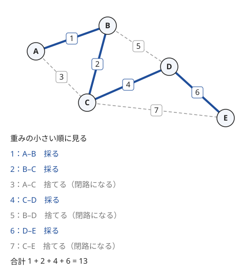

!!! abstract "要点"
    - **何ができるか**：連結グラフの全域木のうち辺の重みの和が最小のものを求める。辺を重みの昇順に見て閉路を作らない辺だけを採るクラスカル法か、頂点を 1 つずつ伸ばすプリム法を使う。候補の辺を減らせば、辺が $N^2$ 本ある完全グラフにも使える。
    - **いつ使うか**：
        - すべての頂点をつなぐ最小コストを求める。
        - 不要な辺を取り除いて、取り除いた辺の報酬を最大にする。
        - 完全グラフで $N \le 2 \times 10^5$（辺が $N^2$ 本あり、候補の辺を減らす必要がある）。
        - 与えられた辺が、最小全域木に入るかを問われる。
    - **計算量**：クラスカル法は $O(M \log M)$（ソートが支配的で、Union-Find はならし $O(\alpha(N))$）。プリム法は優先度付きキューで $O(M \log N)$、配列で $O(N^2)$
    - **前提**：[Union-Find](../ds/union-find.md)、[ソートで考える](../basics/sorting-techniques.md)

<!-- textlint-disable -->
別名：MST・クラスカル法・プリム法・Kruskal・Prim・最大全域木・minimum spanning tree
<!-- textlint-enable -->

最小全域木は、連結な無向グラフの[全域木](../guide/glossary.md#spanning-tree)（すべての頂点を含み、閉路のない部分グラフ。辺はちょうど $N - 1$ 本）のうち、辺の重みの和が最小のものである。「軽い辺から貪欲に採ってよい」ことが正しさの核で、ABC ではアルゴリズムそのものより、何を頂点と辺にするか、辺をどう減らすかが問われる。

## クラスカル法とプリム法（密なら O(N^2) のプリム法） {#kruskal-prim}

頂点数を $N$、辺数を $M$ とし、頂点は 0-indexed で書く。全域木は $M$ 本から $N - 1$ 本を選ぶので、選び方を全部試すと $\binom{M}{N-1}$ 通りになり、$N \le 8$ 程度でしか使えない（[小さいグラフの全探索](../graph/small-graph-brute-force.md)）。次の 2 つの方法は、どちらも軽い辺から貪欲に採るだけで最小を得る。

**クラスカル法**：辺を重みの昇順に並べ、順に見る。両端がまだ別の成分なら採って 2 つの成分を併合し、同じ成分なら捨てる。成分の管理には [Union-Find](../ds/union-find.md) を使う。次の図は 5 頂点 7 辺のグラフでの動きである。



図の流れを文章で追うと次のとおりである。

- 重み 1 の A–B、重み 2 の B–C を採る。この時点で A・B・C が 1 つの成分になる
- 重み 3 の A–C は、両端が同じ成分にあるので捨てる。採ると A–B–C–A の閉路になる
- 重み 4 の C–D を採り、重み 5 の B–D は捨てる。重み 6 の D–E を採ると全頂点がつながり、辺は $N - 1 = 4$ 本になる
- 重み 7 の C–E は捨てる。合計は $1 + 2 + 4 + 6 = 13$ である

```cpp
--8<-- "minimum-spanning-tree/kruskal.cpp:core"
```

採った辺が $N - 1$ 本に届かなければ、グラフは連結でなく、全域木はない。このとき採った辺は、各連結成分の最小全域木を集めた最小全域森になる。

**プリム法**：1 つの頂点から始め、「いま木にある頂点」と「まだない頂点」を結ぶ辺のうち最も軽いものを採って、木を 1 頂点ずつ伸ばす。実装は[ダイクストラ法](../graph/dijkstra.md)とほぼ同じ形で、優先度付きキューに入れる値が「始点からの距離」ではなく「木から 1 本の辺の重み」になる。キューから取り出した頂点がすでに木にあれば読み飛ばす。

**密なグラフでは配列のプリム法**：完全グラフでは $M = N(N-1)/2$ なので、辺を並べるクラスカル法は $O(N^2 \log N)$ の時間と $O(N^2)$ の領域が要る。$N = 5000$ なら辺は約 $1.25 \times 10^7$ 本で、重みと両端を持つと 200 MB 近くになる。配列 $\mathrm{mind}[v]$（木の頂点から $v$ への辺の重みの最小）を持ち、毎回 $\mathrm{mind}$ が最小の頂点を線形に探すプリム法なら、時間 $O(N^2)$・領域 $O(N)$ で済む。辺の重みを関数で計算できれば、辺を保存する必要もない。

```cpp
--8<-- "minimum-spanning-tree/prim-dense.cpp:core"
```

**計算量**：クラスカル法はソートに $O(M \log M)$、Union-Find の操作が $M$ 回でならし $O(M \alpha(N))$ なので、全体で $O(M \log M)$ である。単純グラフなら $M < N^2$ より $\log M < 2 \log N$ なので、$O(M \log N)$ と書いても同じである。優先度付きキューのプリム法は、各辺で高々 2 回（両向き）push するので $O(M \log M) = O(M \log N)$、配列のプリム法は $N$ 回の各段で $O(N)$ かかるので $O(N^2)$ である。

!!! info "ACL では"
    最小全域木の関数はない。クラスカル法の成分の管理に `dsu d(n);` を使い、`d.same(a, b)` で同じ成分かを判定し、`d.merge(a, b)` で併合する。どちらもならし $O(\alpha(N))$ である。自作のライブラリは Library Checker の minimum_spanning_tree で確かめられる。

## 正しさの理由（カット性質・閉路性質） {#why-correct}

最小全域木の正しさは、次の 2 つの性質で説明できる。頂点を 2 つの組 $S$ と $V \setminus S$ に分けることを[カット](../guide/glossary.md#cut)と呼び、両端が別の組にある辺を「カットを渡る辺」と呼ぶ。

> **カット性質**：どのカットについても、カットを渡る辺のうち重みが最小のもの $e$ は、ある最小全域木に含まれる。
>
> **閉路性質**：閉路の上で重みが他のどの辺よりも真に大きい辺は、どの最小全域木にも含まれない。

カット性質は交換で示す。$e$ を含まない最小全域木 $T$ があるとする。$T$ に $e$ を足すと閉路が 1 つでき、この閉路は $e$ でカットを渡るので、もう 1 か所どこかでカットを渡り戻す辺 $f$ を含む。$e$ はカットを渡る辺の最小なので $w(e) \le w(f)$ であり、$T$ から $f$ を除いて $e$ を足した $T'$ も全域木で、重みは $T$ 以下である。よって $T'$ も最小全域木で、$e$ を含む。

閉路性質も同じ形で示す。閉路の上で真に最大の辺 $e$ を含む最小全域木 $T$ があったとする。$T$ から $e$ を除くと 2 つに分かれ、閉路の残りの部分は分かれた 2 つを結ぶので、その上に 2 つを渡る辺 $f$ がある。$w(f) < w(e)$ なので、$e$ を $f$ に替えると $T$ より軽い全域木ができ、矛盾する。

??? note "証明：クラスカル法が最小全域木を返す"
    「ここまでに採った辺の集合 $F$ は、ある最小全域木 $T$ に含まれる」を不変条件にする。最初は $F$ が空なので成り立つ。

    クラスカル法が辺 $e = (u, v)$ を採るとき、$u$ を含む成分を $S$ とするカットを考える。それまでに見た辺は、採ったものも捨てたものも、両端が同じ成分の中にある（捨てた辺は両端がすでに連結だった）。よってそれらはこのカットを渡らず、$e$ はカットを渡る辺のうち最小である。$F$ の辺もカットを渡らない。

    $e \notin T$ なら、カット性質の証明と同じく $T$ に $e$ を足してできる閉路から、カットを渡る別の辺 $f$ を選ぶ。$f$ はカットを渡るので $F$ には入らず、$T - f + e$ は $F + e$ を含む最小全域木である。よって不変条件が保たれ、$N - 1$ 本を採り終えたとき $F$ 自身が最小全域木になる。

    プリム法も同じで、木にある頂点の集合を $S$ とするカットにカット性質を使えばよい。

カット性質は「同じ重みの辺がいくつあっても成り立つ」ことに注意する。重みに同じ値があると、最小全域木は 1 つとは限らない。それでもどの最小全域木も重みの和は同じで、クラスカル法は同じ重みの辺をどう並べても、そのうちの 1 つを返す。重みがすべて異なれば、最小全域木はただ 1 つに決まる（[確認問題](#quiz)）。

## 最大全域木 {#maximum}

辺の重みの和が最大の全域木（最大全域木）は、辺を重みの降順に見てクラスカル法を行えば求まる。重みをすべて $-1$ 倍して最小全域木を求めるのと同じで、カット性質・閉路性質の大小を入れ替えたものがそのまま成り立つ。比較関数の不等号を逆にするだけである（[比較関数の要件](../basics/sorting-techniques.md#strict-weak-ordering)を満たす `a.w > b.w` にする）。

「連結を保ったまま辺を取り除き、取り除いた辺の重みの和を最大にする」は、残す辺の重みの和の最小化に言い換えられる。残す辺は連結でなければならないので、全域木か、それに辺を足したものである。重みがすべて正なら最小全域木だけを残せばよい。重みが負の辺（取り除くと損をする辺）があるときは、それらは閉路を作っても残す。クラスカル法で言えば、負の辺は判定せずに併合し、正の辺だけを「両端がすでに連結なら取り除く」と判定する（[例題の ABC218 E](#abc218_e)）。

「必ず使う辺が決まっている」場合も同じ考え方で、その辺を先にすべて併合してからクラスカル法を続ける。先に併合した辺の重みは、閉路を作っても答えに足す。

「操作をくり返して最後に 1 つにまとめる」問題が、最大（最小）全域木になることがある。2 つを選んで得点を得て片方を消す操作を $N - 1$ 回行うなら、選んだ組を辺と見ると、閉路があれば途中で操作できなくなり、逆にどの全域木も葉から消していけば実現できる。よって選べる組の集合はちょうど全域木で、得点の和の最大は最大全域木の重みになる（練習の ABC282 E）。

## クエリの辺が最小全域木に入るか（まとめて重み順に処理する） {#query-edges}

「元のグラフに辺 $(u, v, w)$ を 1 本だけ足したとき、その辺が最小全域木に入るか」を多数のクエリで問われたら、クラスカル法の途中経過を使う。足した辺 $e$ を含む最小全域木があるのは、次の条件が成り立つときである。

$$
\text{重みが } w \text{ より真に小さい元の辺だけで、} u \text{ と } v \text{ が連結でない}
$$

連結でなければ、重みが $w$ 未満の辺をすべて見終えた時点で $u$ と $v$ は別の成分にあり、同じ重みの中で $e$ を先に見るクラスカル法は $e$ を採る。連結なら、$u$ と $v$ を結ぶ道の上の辺はどれも $e$ より軽く、$e$ はその閉路の真に最大の辺なので、閉路性質によりどの最小全域木にも入らない。

この条件はクエリごとに独立に判定できるので、元の辺とクエリの辺をまとめて重みの順にソートし、1 回のクラスカル法で全部に答える。

- 元の辺は、いつものとおり併合する
- クエリの辺は、その時点で両端が連結かを見るだけで、**併合しない**。クエリは 1 本ずつ別々に足す想定なので、ほかのクエリに影響させてはいけない
- 同じ重みの元の辺とクエリの辺があれば、クエリの辺を先に見る（上の条件が「真に小さい」だから）。「すべての最小全域木に入るか」を問われたら、逆に元の辺を先に併合してから判定する

```cpp
--8<-- "minimum-spanning-tree/query-edges.cpp:core"
```

全体の計算量は $O((M + Q) \log (M + Q))$ である。この「クエリを元の辺と混ぜて重みの順に処理する」形は、[クエリの先読み](../ds/offline-queries.md)の代表例である。オンラインに答える必要があれば、最小全域木を作ってから、$u$–$v$ の木の上のパスの最大の辺と $w$ を比べる方法もある（パスの最大は [LCA](../tree/lca.md) のダブリングで求める）。

## 辺の候補を減らす（ソートした隣どうし・約数で絞る） {#reduce-candidates}

辺が $N^2$ 本ある完全グラフでも、最小全域木に入りうる辺が $O(N)$ 本や $O(N \log N)$ 本に絞れれば、クラスカル法が間に合う。絞ってよいかは次の形で確かめる。

> 捨てる辺 $(u, v, w)$ のそれぞれについて、残す辺だけを使い、重みがどれも $w$ 以下の $u$–$v$ の道があるなら、残す辺だけの最小全域木の重みは元のグラフと同じである。

同じ重みの中では残す辺を先に見るクラスカル法を考える。捨てた辺の番が来たときには、重み $w$ 以下の残す辺で両端がすでにつながっているので、どのみち採られない（閉路性質の、等号を許す形）。

代表的な絞り方は 3 つある。

- **ソートした隣どうし**：辺の重みが $\min(\lvert x_i - x_j \rvert, \lvert y_i - y_j \rvert)$ なら、$x$ でソートした隣どうしと $y$ でソートした隣どうしの辺、合わせて $2(N - 1)$ 本で足りる。重みが $x$ 座標の差で決まる辺 $(u, v)$ について、$x$ 座標が $u$ と $v$ の間にある点 $t$ があれば、$u$–$t$ と $t$–$v$ の重みはどちらも $u$–$v$ の重み以下だからである（練習の ARC076 D）
- **同じ重みでつなぐ集合は鎖にする**：$K$ 個の頂点の全組を同じ重み $c$ で結ぶ操作は、並べた隣どうしの $K - 1$ 本だけにしても、最小全域木の重みは同じになる。どの 2 頂点も、鎖をたどれば重み $c$ の辺だけでつながるからである（練習の ABC352 E）
- **約数・倍数で絞る**：辺の重みが $\gcd(A_i, A_j)$ の最大全域木では、値 $g$ を大きい順に見て、$A_i$ が $g$ の倍数である頂点どうしを鎖でつなぐ。この鎖の辺の本当の重みは $g$ 以上だが、$g$ より大きい公約数を持つ組はそれより前の $g$ ですでにつながっているので、重み $g$ として扱ってよい。値の上限を $V$ とすると、倍数の列挙は[調和級数](../math/harmonic-sum.md)で全体 $O(V \log V)$ である（練習の ABC469 F）

絞り方が思いつかないときは、小さい $N$ で全辺のクラスカル法と比べて、採られる辺に共通する形（隣どうし・近い値どうし）を探すとよい。それも難しく、$N$ が数千までなら[配列のプリム法](#kruskal-prim)で全辺を扱う。

??? question "確認問題：マンハッタン距離なら隣どうしで足りるか"
    辺の重みが $\lvert x_i - x_j \rvert + \lvert y_i - y_j \rvert$ のとき、$x$ でソートした隣どうしと $y$ でソートした隣どうしの辺だけで、最小全域木の重みは変わらないか。

    ??? success "答え"
        変わることがある。4 点 $(3, 0)$・$(0, 3)$・$(2, 2)$・$(4, 4)$ を考える。$x$ の順は $(0, 3), (2, 2), (3, 0), (4, 4)$ で、隣どうしの重みは 3・3・5 である。$y$ の順は $(3, 0), (2, 2), (0, 3), (4, 4)$ で、重みは 3・3・5 である。候補だけの最小全域木は $3 + 3 + 5 = 11$ だが、$(2, 2)$–$(4, 4)$ の重み 4 の辺を使うと $3 + 3 + 4 = 10$ になる。

        この辺は、$x$ の順では $(3, 0)$ が、$y$ の順では $(0, 3)$ が間に挟まるので候補から漏れる。マンハッタン距離では、間にある点を通る 2 本の辺がどちらも元の辺の重み以下とは限らない（$(3, 0)$–$(4, 4)$ は重み 5 で、元の辺の 4 より重い）。だから絞ってよい条件が成り立たない。正しく絞るには、各点のまわりを 45 度ずつ 8 つの領域に分け、領域ごとに最も近い点だけを候補にする（Manhattan MST。[特殊な最小全域木](../graph/spanning-tree-advanced.md#manhattan)）。

## 操作を頂点にする・区間を辺にする {#modeling}

この節は[超頂点](../graph/extended-dijkstra.md#super-vertex)の考え方と[累積和](../basics/prefix-sum.md)を前提にする。グラフが直接与えられない問題でも、何を頂点と辺にするかを決めれば最小全域木になることがある。

**区間を辺にする**：長さ $N$ の 0/1 の列で「区間 $[L, R]$（閉区間、1-indexed）を費用 $C$ で反転する」操作を選び、どんな列でも作れるようにする問題を考える。位置の間の境目 $0, 1, \dots, N$ を頂点にし、区間 $[L, R]$ の反転を頂点 $L - 1$ と $R$ を結ぶ辺と見る。列の隣どうしの差（XOR）を境目に置くと、区間の反転は両端の 2 つの境目だけを反転するからである。どんな列でも作れることは、選んだ辺で $N + 1$ 頂点がすべて連結になることと同じなので、答えは $N + 1$ 頂点の最小全域木になる（練習の典型90 049）。

??? note "証明：すべての列を作れることと連結であること"
    列 $a_1, \dots, a_N$ に $a_0 = a_{N+1} = 0$ を足し、境目 $i$（$0 \le i \le N$）に $d_i = a_i \oplus a_{i+1}$ を置く。列と $d$ は 1 対 1 に対応し、$d$ の 1 の個数はいつも偶数である。区間 $[L, R]$ を反転すると $d_{L-1}$ と $d_R$ だけが反転する。

    選んだ辺で連結な成分の中では、2 頂点を結ぶ道の辺をすべて使うと、その 2 頂点の $d$ だけを反転できる。よって連結なら、1 の個数が偶数のどんな $d$ も 2 つずつ組にして作れる。逆に連結でなければ、どの操作も成分の中の $d$ の 1 の個数の偶奇を変えないので、成分をまたいで 1 を 2 つ置いた $d$ は作れない。

**操作を頂点にする**：「頂点 $N + i$ と、区間 $[L_i, R_i]$ のすべての頂点を費用 $C_i$ の辺で結ぶ」のように、1 回の操作で多数の辺が張られるなら、操作そのものを頂点として持つ。辺は $\sum (R_i - L_i + 1)$ 本と多い。しかし費用の小さい順に操作を見ると、操作 $i$ で採る辺は「頂点 $N + i$ と $L_i$ を結ぶ 1 本」と、まだ同じ成分にない隣り合う頂点の組の数だけの辺である。ここで組とは、$[L_i, R_i]$ の中の頂点 $j, j + 1$ のことである。まだ同じ成分にない組を次々に飛ばして探すのに、[次の空きへ飛ぶ Union-Find](../ds/union-find-applications.md#next-pointer) を使うと、全体でほぼ線形になる（力試しの ABC364 F）。

どちらの型でも、最後に全体が連結になったかを確かめる。辺の作り方を変えただけで、非連結なら答えがない（$-1$ を出力する）ことは変わらない。

## 辺の重みの種類が少ないとき {#few-weights}

この節は [Union-Find の応用](../ds/union-find-applications.md#multiple-uf)を前提にする。辺の重みが $0, 1, \dots, C$ の $C + 1$ 種類しかないとき、クラスカル法を「同じ重みの辺をまとめて併合する」段の列と見ると、各段で何本採ったかは連結成分の数だけで決まる。

重み $c$ 以下の辺だけで連結成分の数を $k_c$ とすると、最小全域木のうち重み $c$ 以下の辺の本数は $N - k_c$ である。クラスカル法は重み $c$ 以下の辺を見終えた時点で、それらだけで作れる全域森を張っているからである。よって重みがちょうど $c$ の辺は $k_{c-1} - k_c$ 本採られ（$k_{-1} = N$）、グラフが連結（$k_C = 1$）なら次の式になる。

$$
\sum_{c=0}^{C} c \, (k_{c-1} - k_c) = \sum_{c=0}^{C-1} k_c - C
$$

- **重みが 0 と 1 だけ**：答えは $k_0 - 1$、すなわち重み 0 の辺だけでの連結成分の数から 1 を引いたものである。重み 0 の辺で成分をまとめ、成分どうしを重み 1 の辺で $k_0 - 1$ 本つなげばよい
- **辺の追加のたびに答える**：重み $c$ ごとに「重み $c$ 以下の辺だけの Union-Find」を持つ。重み $w$ の辺を足したら $c \ge w$ の Union-Find すべてで併合し、$k_c$ を更新して上の式で答える。1 回 $O(C \alpha(N))$ である（力試しの ABC355 F、[しきい値ごと・関係ごとに Union-Find を持つ](../ds/union-find-applications.md#multiple-uf)）

同じ重みの辺を段ごとにまとめる見方は、重みが多くても使える。同じ重みの段の中では採る辺の選び方が複数ありうるが、段の後の連結成分は選び方によらず同じである。全域木の個数や、ある辺がすべての最小全域木に入るかを考えるときの土台になる。

## 落とし穴 {#pitfalls}

**連結でないのに答えを出す**。クラスカル法は非連結でも止まらず、全域森の重みを返す。採った辺の本数が $N - 1$ かを必ず確かめ、足りなければ「不可能」の出力にする。区間や操作から辺を作った問題では、作った頂点の数（$N + 1$ や $N + M$）で数える。

**重みの和のオーバーフロー**。辺の重みが $10^9$ で $N = 2 \times 10^5$ なら、和は $2 \times 10^{14}$ になり `int` に収まらない。重みと和は `long long` で持つ。

**ソートの向きと比較関数**。最大全域木で昇順のままにする、`tuple` の先頭に重みを置かずに頂点番号の順でソートしてしまう、が典型的な誤りである。辺を `(重み, u, v)` の順で持つか、重みだけを比べる比較関数を書く。

**同じ重みの扱い**。最小全域木の重みは同じ重みの辺の並べ方によらないが、「この辺は入るか」「辺の集合はどれか」を問う問題では並べ方が答えを変える。[クエリの辺の節](#query-edges)のように、同じ重みの中で何を先に見るかを条件から決める。

**最短路と取り違える**。最小全域木は「すべてを最も安くつなぐ」もので、2 点間の最短路は与えない。始点から各頂点への最短距離を問われたら[ダイクストラ法](../graph/dijkstra.md)で、最短路を集めた木（[最短路 DAG](../graph/shortest-path-dag.md) から選んだ木）は一般に最小全域木と異なる（[確認問題](#quiz)）。

**一部の頂点だけをつなぐ**。「指定した $K$ 個の頂点をつなぐ最小コスト」で、ほかの頂点を経由してよいなら最小全域木ではない（[最小シュタイナー木](../graph/steiner-tree.md)）。指定した頂点だけの部分グラフの最小全域木では、ほかの頂点を経由した方が安い場合を逃す。

**完全グラフの辺を全部作る**。$N = 2 \times 10^5$ の完全グラフで辺を並べると、時間も領域も足りない。[辺の候補を減らす](#reduce-candidates)か、$N$ が数千までなら配列のプリム法にする。

## 使い分け {#comparison}

- 連結かどうかだけを問われたら、重みは要らず [Union-Find で連結性を扱う](../graph/union-find-connectivity.md)か BFS で足りる
- 経路上の最大の辺を最小にしたい（2 点を結ぶ道のボトルネック）なら、最小全域木の上の道が答えになる（[最小ボトルネック路](../graph/bottleneck-path.md#why-mst)）。併合の順を木として残すのが[併合過程の木](../tree/merge-process-tree.md#new-vertex)である
- 辺が疎で $M$ が $N$ の数倍ならクラスカル法、完全グラフで $N$ が数千までなら配列のプリム法、辺が暗黙に与えられて候補を絞れないなら Borůvka 法（[特殊な最小全域木](../graph/spanning-tree-advanced.md#boruvka)）を使う
- 有向グラフの最小全域木（最小有向全域木）は別の問題で、クラスカル法は使えない（Chu-Liu/Edmonds 法。同じく特殊な最小全域木のページ）

## 例題 {#examples}

### ABC218 E. Destruction {#abc218_e}

<div class="kp-problems" data-role="example" markdown>

- [ABC218 E. Destruction](https://atcoder.jp/contests/abc218/tasks/abc218_e)（diff 1004）：連結グラフからいくつかの辺を取り除き、連結のまま、取り除いた辺の重みの和（報酬）を最大にする

</div>

取り除いた辺の報酬の和は「全辺の報酬の和 − 残した辺の報酬の和」なので、残す辺の報酬の和を最小にすればよい。報酬が負の辺は、取り除くと損をするので、閉路を作っても全部残す。報酬が正の辺は、連結にするのに要るものだけを軽い順に残す。報酬が 0 の辺は、どちらとして扱っても答えは変わらない。これは負の辺を先に併合しておくクラスカル法である（[最大全域木](#maximum)の節）。

??? note "解法の詳細"
    辺を報酬の昇順にソートし、Union-Find を使って順に見る。報酬が 0 以下の辺は判定せずに併合する（残す）。報酬が正の辺は、両端がすでに連結なら取り除いて報酬を答えに足し、連結でなければ併合する（残す）。昇順に見るので、負の辺はすべて正の辺より先に併合される。全体で $O(M \log M)$ で、答えは `long long` で持つ。

    負の辺を残すのは、残しても連結性が悪くならず、取り除くと答えが減るだけだからである。正の辺の判定は、負の辺を先に併合したグラフの上でのクラスカル法で、残す正の辺の和が最小になる。

### ABC235 E. MST + 1 {#abc235_e}

<div class="kp-problems" data-role="example" markdown>

- [ABC235 E. MST + 1](https://atcoder.jp/contests/abc235/tasks/abc235_e)（diff 1304）：グラフと Q 本の追加の辺が与えられ、各辺を 1 本だけ足したときにその辺が最小全域木に含まれうるかを判定する

</div>

クエリの辺 $(u, v, w)$ が最小全域木に入るのは、重みが $w$ より小さい元の辺だけで $u$ と $v$ が連結でないときである。元の辺と $Q$ 本のクエリの辺をまとめて重みの順にソートし、1 回のクラスカル法の途中で判定する。クエリの辺は判定だけをして併合しない（[クエリの辺が最小全域木に入るか](#query-edges)の節）。

??? note "解法の詳細"
    この問題では、元の辺の重みはすべて異なり、クエリの辺の重みも元の辺のどれとも異なるので、同じ重みの扱いを考えなくてよい。辺に「元の辺か、何番目のクエリか」の印を付け、$M + Q$ 本を重みの昇順にソートする。元の辺なら併合し、クエリの辺なら両端が連結かを見て、連結でなければ Yes、連結なら No を、クエリの番号の位置に記録する。最後に入力の順に出力する。$N, M, Q \le 2 \times 10^5$ で、全体で $O(N + (M + Q) \log (M + Q))$ である。

## 練習問題 {#practice}

<div class="kp-problems" data-role="practice" markdown>

- [ABC352 E. Clique Connect](https://atcoder.jp/contests/abc352/tasks/abc352_e)（diff 1030）：頂点集合ごとにその中の全点対を同じ重みで結ぶ操作をくり返した後のグラフが連結か判定し、連結なら最小全域木の重みを求める
- [ABC469 F. GCD Maximum Spanning Tree](https://atcoder.jp/contests/abc469/tasks/abc469_f)（diff 1567）：互いに異なる整数 A_1, …, A_N を頂点とし、2 頂点の間の辺の重みを 2 数の最大公約数とした完全グラフで、全域木の辺の重みの和の最大を求める。
- [ABC282 E. Choose Two and Eat One](https://atcoder.jp/contests/abc282/tasks/abc282_e)（diff 1604）：ボールを 2 つ選んで得点（x^y + y^x を M で割った余り）を得て片方を捨てる操作をくり返すとき、得点の合計の最大値を求める
- [ARC076 D. Built?](https://atcoder.jp/contests/arc076/tasks/arc076_b)（diff 1615）：平面上の町を結ぶ費用が min(|Δx|, |Δy|) のとき、すべての町をつなぐ最小費用を求める
- [典型90 049. Flip Digits 2（★6）](https://atcoder.jp/contests/typical90/tasks/typical90_aw)（diff —）：区間 [L_i, R_i] の 0/1 を費用 C_i で反転できる操作を選び、全部 0 の列からどんな列でも作れるようにするための最小費用を求める

</div>

??? note "練習の方針"
    - **ABC352 E**：各操作の頂点を並べた隣どうしの $K_i - 1$ 本だけを重み $C_i$ の辺にし、操作を重みの昇順に処理する。採った辺が $N - 1$ 本に届かなければ $-1$（[辺の候補を減らす](#reduce-candidates)）
    - **ABC469 F**：値 $g$ を大きい順に見て、$g$ の倍数である $A_i$ の頂点どうしを、まだ別の成分なら重み $g$ で併合する。$A_i \le 10^6$ なので倍数の列挙は調和級数で間に合う
    - **ABC282 E**：選んだ組を辺と見ると、操作の列はちょうど全域木に対応する（[最大全域木](#maximum)の節）。$N \le 500$ なので、全組の得点を繰り返し二乗法で求めてよい。重みの降順にクラスカル法をするか、配列のプリム法で最大を求める
    - **ARC076 D**：$x$ でソートした隣どうしと $y$ でソートした隣どうしの $2(N - 1)$ 本だけでクラスカル法をする
    - **典型90 049**：区間 $[L, R]$ の反転を、頂点 $L - 1$ と $R$ を結ぶ費用 $C$ の辺にした $N + 1$ 頂点の最小全域木。連結でなければ $-1$（[操作を頂点にする・区間を辺にする](#modeling)）

## 力試し {#challenge}

<div class="kp-problems" data-role="challenge" markdown>

- [ABC210 E. Ring MST](https://atcoder.jp/contests/abc210/tasks/abc210_e)（diff 1618）：環状に並ぶ頂点に「x と x + A_i (mod N) を費用 C_i で結ぶ」操作が何度でも使えるとき、全体を連結にする最小費用を求める
- [ABC364 F. Range Connect MST](https://atcoder.jp/contests/abc364/tasks/abc364_f)（diff 1878）：頂点 N+i と区間 [L_i, R_i] の各頂点を費用 C_i の辺で結んだグラフが連結か判定し、連結なら最小全域木の重みを求める
- [ABC355 F. MST Query](https://atcoder.jp/contests/abc355/tasks/abc355_f)（diff 1924）：辺の重みが 10 以下のグラフに辺を 1 本ずつ足し、そのたびに最小全域木の重みを求める

</div>

??? note "力試しの方針"
    - **ABC210 E**：操作を費用の昇順に見る。いまの連結成分の数を $k$ とすると、ステップ $A$ の操作を使い切った後の成分の数は $\gcd(k, A)$ になり、その間に $k - \gcd(k, A)$ 本の辺を費用 $C$ で採る。最後に成分が 1 つでなければ $-1$
    - **ABC364 F**：操作を費用の昇順に見て、操作の頂点と $L_i$ を結ぶ 1 本と、$[L_i, R_i]$ の中でまだつながっていない隣どうしの境目の分だけ費用を足す。境目は次の空きへ飛ぶ Union-Find で探す（[操作を頂点にする・区間を辺にする](#modeling)）
    - **ABC355 F**：重み $c = 1, \dots, 10$ ごとに、重み $c$ 以下の辺だけの Union-Find を持ち、連結成分の数から最小全域木の重みを出す（[辺の重みの種類が少ないとき](#few-weights)）

## 確認問題 {#quiz}

??? question "確認問題：最小全域木の上の道は、2 点間の最短路か"
    最小全域木の上で頂点 $s$ から $t$ への道をたどると、元のグラフの $s$–$t$ の最短路になるか。

    ??? success "答え"
        ならない。3 頂点 $s, a, t$ に、辺 $s$–$a$（重み 2）、$a$–$t$（重み 2）、$s$–$t$（重み 3）があるとする。最小全域木は重み 2 の 2 本で、その上の $s$–$t$ の道の長さは 4 だが、最短路は直接の辺の 3 である。最小全域木は辺の重みの「和」を全体で最小にするだけで、個々の道の長さは保証しない。保証されるのは、道の上の最大の辺が最小になること（[最小ボトルネック路](../graph/bottleneck-path.md#why-mst)）である。

??? question "確認問題：辺の重みがすべて異なれば、最小全域木がただ 1 つに決まるのはなぜか"
    異なる最小全域木 $T_1, T_2$ があるとして矛盾を導け。

    ??? success "答え"
        $T_1$ と $T_2$ の一方にだけある辺のうち、重みが最小のものを $e$ とし、$e \in T_1$ とする。$T_2$ に $e$ を足すと閉路ができ、その閉路には $T_1$ にない辺 $f$ がある（閉路の辺がすべて $T_1$ にあると $T_1$ に閉路ができる）。$f$ は $T_2$ にだけある辺なので、$e$ の選び方と重みが異なることから $w(e) < w(f)$ である。$T_2$ から $f$ を除いて $e$ を足すと、$T_2$ より真に軽い全域木ができ、$T_2$ が最小であることに矛盾する。

??? question "確認問題：辺の重みをすべて 2 乗しても、最小全域木の辺の集合は変わらないか"
    重みはすべて正とする。重みの和が最小の全域木と、重みの 2 乗の和が最小の全域木は同じか。

    ??? success "答え"
        同じである（同じ重みがあるときは、同じものを選べる）。クラスカル法は重みの大小の順だけを使い、値そのものは使わない。正の数の 2 乗は大小の順を変えないので、クラスカル法が採る辺は変わらない。同じ理由で、重みを単調増加な関数で変換しても最小全域木は変わらない。一方、最短路は 2 乗すると変わりうる。

## 参考 {#references}

- [AtCoder Library「DSU」（document_ja/dsu.md）](https://github.com/atcoder/ac-library/blob/master/document_ja/dsu.md)：`merge`・`same` の計算量（v1.6 の手元の版で確かめた）
- [kyo-pro「ABC218E - Destruction」](https://kyo-pro.hatenablog.com/entry/ABC218E)：例題 abc218_e の方針（報酬が負の辺は残し、昇順のクラスカル法で取り除く辺を決める）
- [drken「AtCoder ABC 235 E - MST + 1 (1D, 水色, 500 点)」](https://drken1215.hatenablog.com/entry/2023/06/11/023548)：例題 abc235_e の方針（クエリの辺を混ぜて重みの順に処理し、クエリの辺は併合しない）と制約
- [Lanly「AtCoder Beginner Contest 352」](https://www.cnblogs.com/Lanly/p/18173063)：練習 abc352_e の方針（操作の頂点を鎖でつなぐ）
- [ikatakos「AtCoder Beginner Contest 469 D,E,F,G問題メモ」](https://ikatakos.com/pot/programming_algorithm/contest_history/atcoder/2026/0801_abc469)：練習 abc469_f の方針（約数ごとの箱を大きい順に処理する。解法の部分だけを参照）
- [drken「AtCoder ABC 282 E - Choose Two and Eat One (1D, 青色, 500 点)」](https://drken1215.hatenablog.com/entry/2022/12/29/102900)：操作の列と全域木の対応（閉路があると操作できず、全域木は葉から実現できる）と制約
- [drken「AtCoder ABC 065 D - Built? (ARC 076 D) (1D, 青色, 500 点)」](https://drken1215.hatenablog.com/entry/2019/02/14/124300)：ソートした隣どうしで足りる理由（閉路性質）
- [E869120「kyopro_educational_90 sol/049.cpp」](https://github.com/E869120/kyopro_educational_90/blob/main/sol/049.cpp)：練習 typical90_aw の辺の張り方（頂点 L−1 と R を結ぶ N+1 頂点の最小全域木）
- [hamayan「Ring MST [AtCoder Beginner Contest 210 E]」](https://blog.hamayanhamayan.com/entry/2021/07/17/233253)：力試し abc210_e の方針（費用の昇順と gcd による成分の数）
- [Lanly「AtCoder Beginner Contest 364」](https://www.cnblogs.com/Lanly/p/18327726)：力試し abc364_f の方針（費用の順に区間を処理し、つながった境目を飛ばす）
- [Lanly「AtCoder Beginner Contest 355」](https://www.cnblogs.com/Lanly/p/18213969)：力試し abc355_f の方針（重みごとの Union-Find）
