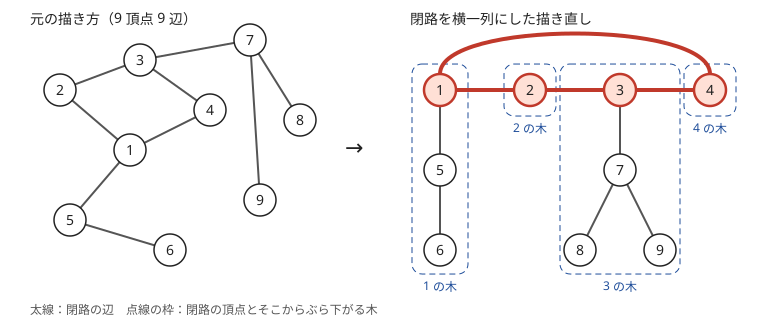
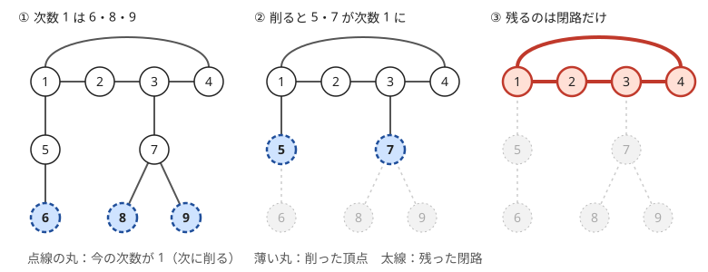

!!! abstract "要点"
    - **何ができるか**：$N$ 頂点 $N$ 辺の連結な無向グラフで、パスや距離の問いを木の部分と閉路の部分に分けて答える。このグラフは閉路がちょうど 1 つあり、閉路上の各頂点から木がぶら下がる。次数 1 の頂点を削り続けると閉路だけが残るので、各頂点がぶら下がる閉路の頂点が求まる。
    - **いつ使うか**：
        - $N$ 頂点 $N$ 辺の連結グラフ・木に辺を 1 本足したグラフ。
        - 2 頂点間の単純パスが一意か。
    - **計算量**：閉路と木への分解は $O(N)$（Union-Find を使うなら $O(N \alpha(N))$）。分解の後、2 点が同じ木にあるかの判定は 1 回 $O(1)$（Union-Find ならならし $O(\alpha(N))$）
    - **前提**：[連結成分](../graph/connected-components.md)、[閉路の検出と復元](../graph/cycle-detection.md)、[木の基本性質と表現](../tree/tree-basics.md)

<!-- textlint-disable -->
別名：なもり・unicyclic graph・pseudotree・閉路が 1 つのグラフ・木に辺を 1 本足したグラフ・N 頂点 N 辺の連結グラフ
<!-- textlint-enable -->

なもりグラフは、$N$ 頂点 $N$ 辺の連結な無向グラフのことである。木より辺が 1 本多いだけなので、閉路はちょうど 1 つで、残りの部分は閉路の頂点からぶら下がる木になる。閉路さえ取り出せば、あとは木の手法と、閉路を右回りに進むか左回りに進むかの場合分けで扱える。

以下、頂点は 0-indexed で $0, \dots, N - 1$ と書き、問題文の 1-indexed の番号からは 1 を引いて使う。図だけは問題文に合わせて 1 から番号を振る。

## 閉路がちょうど 1 つある理由 {#one-cycle}

$N$ 頂点 $N$ 辺の連結グラフに閉路がちょうど 1 つあることは、[全域木](../guide/glossary.md#spanning-tree)を使うと分かる。連結なグラフからは、辺を $N - 1$ 本選んで全域木を作れる。選ばれなかった辺はちょうど 1 本で、それを $(u, v)$ とする。

- **閉路が少なくとも 1 つある**：全域木の上の $u$ から $v$ への道に辺 $(u, v)$ を足すと閉路になる
- **閉路は 1 つしかない**：どの閉路も、全域木の外の辺を少なくとも 1 本含む（木には閉路がないから）。外の辺は $(u, v)$ だけなので、どの閉路も $(u, v)$ を通る。$(u, v)$ を通る閉路から $(u, v)$ を除くと、木の上の $u$ から $v$ への[単純パス](../graph/graph-basics.md#terms)が残る。木の上の単純パスは 1 本しかないので、閉路も 1 つに決まる

閉路を横一列に並べて描き直すと、形がはっきりする。次の図は 9 頂点 9 辺の例で、閉路は $1 - 2 - 3 - 4 - 1$ である。閉路を除くと、頂点 $5, 6$ は閉路の頂点 $1$ から、頂点 $7, 8, 9$ は閉路の頂点 $3$ からぶら下がる木になる。



閉路から辺を 1 本外すと、残りは木になる。逆に、閉路に含まれない辺（ぶら下がる木の辺）を外すと、グラフが 2 つに分かれる。「辺を 1 本消して木にする方法の数は閉路の長さに等しい」のは、このためである。

連結でない場合は、グラフ全体で頂点数と辺数が等しくても、閉路を 2 つ持つ成分と木の成分が混ざっていることがある。成分ごとに頂点数と辺数が等しいなら、各成分がなもりグラフである（[連結成分の集計](../graph/connected-components.md#per-component)）。各頂点から辺が 1 本ずつ出る有向グラフはこの形になる（[有向版は Functional graph](#directed-version)）。

??? question "確認問題：辺が 1 本多い連結グラフ"
    $N$ 頂点 $N + 1$ 辺の連結グラフで、次数 1 の頂点を削り続けると何が残るか。それは閉路 1 つか。

    ??? success "答え"
        すべての頂点の次数が 2 以上の部分が残るが、閉路 1 つとは限らない。全域木の外の辺が 2 本あるので、2 つの閉路が 1 頂点を共有する「8 の字」、閉路に弦を 1 本足した形、2 つの閉路をパスでつないだ形のどれかが残る。残った頂点の次数の和は $2(N' + 1)$（$N'$ は残った頂点の数）なので、次数 3 以上の頂点が必ずある。次数がすべて 2 になってちょうど 1 つの閉路が残るのは、辺数と頂点数が等しいときだけである。

## 次数 1 の頂点を削って閉路を求める（Union-Find でも） {#peel-leaves}

なもりグラフの閉路は、[次数](../graph/graph-basics.md#terms) 1 の頂点（葉）を削り続けて求めるのが簡単である。葉は閉路の上にない。閉路の上の頂点は閉路の辺だけで次数が 2 あるからである。葉を削っても連結のままで、頂点と辺が 1 つずつ減るので「頂点数 ＝ 辺数」も保たれる。



削れなくなったとき、残った $N'$ 頂点はどれも次数が 2 以上で、辺も $N'$ 本ある。[握手補題](../graph/graph-basics.md#handshake)より次数の和は $2N'$ なので、すべての頂点の次数がちょうど 2 である。次数がすべて 2 の連結グラフは 1 つの閉路なので、残った頂点が閉路の頂点そのものになる。

処理の流れは次のとおりである。

```text
deg[v] = v の次数（自己ループは 2 と数える）
deg[v] == 1 の頂点をすべてキューに入れる
キューが空になるまで：
    v を取り出し、削った印を付ける
    v の隣の w のうち、まだ削っていないものについて：
        deg[w] を 1 減らす
        deg[w] == 1 になったら w をキューに入れる
削られなかった頂点が閉路の頂点
```

各頂点は 1 回だけキューに入り、各辺は両端から 1 回ずつ見るので、全体で $O(N)$ である。有向グラフの[トポロジカルソート](../graph/topological-sort.md)（Kahn 法）で入次数 0 の頂点を取り除くのと同じ形で、「入次数 0」が「次数 1」に変わっただけである。

```cpp
--8<-- "namori-graph/peel-leaves.cpp:core"
```

**Union-Find で求める**。辺を順に Union-Find で結んでいくと、両端がすでに同じ成分にある辺がちょうど 1 本見つかる。それを $(u, v)$ とすると、閉路は「残りの $N - 1$ 本の辺でできた木の上の $u$ から $v$ への道」と辺 $(u, v)$ でできている。閉路の頂点を列挙したいときは、残りの辺で $u$ から BFS して親を記録し、$v$ から親をたどる（[閉路の検出と復元](../graph/cycle-detection.md)）。辺を読みながら閉路を作る辺を見つけたいときや、閉路の長さや閉路の頂点の並び順が要るときに向く。並び順は、葉を削る方法でも閉路の頂点から隣の閉路の頂点へ 1 周たどれば得られる。

## 閉路の頂点ごとにぶら下がる木に分ける {#hanging-trees}

閉路が分かったら、各頂点 $v$ に「$v$ がぶら下がっている閉路の頂点」$\mathrm{root}[v]$ を求める。閉路の頂点 $r$ については $\mathrm{root}[r] = r$ とする。$\mathrm{root}$ が同じ頂点の集まりを「$r$ の木」と呼ぶ。図の例では $\mathrm{root}[5] = \mathrm{root}[6] = 1$、$\mathrm{root}[7] = \mathrm{root}[8] = \mathrm{root}[9] = 3$ である。求め方は 2 通りある。

- **閉路の頂点から探索する**：閉路の各頂点 $r$ から BFS か DFS を始め、閉路のほかの頂点を通らずに届く頂点について $\mathrm{root} = r$ とする。深さ（$r$ からの距離）$\mathrm{dep}[v]$ も同時に求められる
- **Union-Find で結ぶ**：両端がどちらも閉路の上にある辺は閉路の辺で、それ以外の辺がぶら下がる木の辺である。閉路の辺以外を Union-Find で結ぶと、各成分が「閉路の頂点 1 つとその木」になる。[閉路を求める節](#peel-leaves)のコード片の後半がこの方法である

閉路の辺は、両端が閉路の頂点である辺とちょうど一致する。削った後に残った部分は 1 つの閉路で、どの頂点も次数 2 だから、閉路の頂点どうしを結ぶ辺は閉路の辺のほかにない。ただし多重辺で長さ 2 の閉路ができるときは、2 本とも閉路の辺である。

分けた後は、問いを「木の中」と「閉路の上」に分けて考える。

- **2 点間の距離**：$\mathrm{root}[x] = \mathrm{root}[y]$ なら、その木の中の距離である（木の距離は [LCA](../tree/lca.md) で求める）。$\mathrm{root}$ が違うなら、$x$ から自分の根へ上がり、閉路を近い向きに進み、$y$ の根から下りる。閉路の頂点に 1 周の順で番号 $\mathrm{pos}$ を振り、閉路の長さを $L$ とする。$k = \lvert \mathrm{pos}[\mathrm{root}[x]] - \mathrm{pos}[\mathrm{root}[y]] \rvert$ とすると、距離は $\mathrm{dep}[x] + \mathrm{dep}[y] + \min(k, L - k)$ である
- **閉路の辺を 1 本外して木の問題にする**：閉路の辺 $(u, v)$ を 1 本外すと木になる。外した辺の両端の状態（たとえば $u$ を選ぶかどうか）で場合分けし、それぞれを木の上で解いて合わせる。外した辺がかかわる条件は $u$・$v$ の状態だけで決まるので、その状態を固定すれば残りは木の上の問題になる。外す辺をすべて試すと $O(L)$ 倍かかるので、多くの問題では 1 本を外して場合分けで済ませる
- **木ごとに集計してから閉路を回る**：木ごとに[木 DP](../dp/tree-dp.md) などで値をまとめ、閉路の頂点を並べた列（円環）の問題にする。円環の問題は、列を 2 周分並べて長さ $L$ の区間を見ると扱いやすい

## 単純パスが一意になる条件 {#unique-path}

なもりグラフで 2 頂点 $x, y$ の間の単純パスがただ 1 つになるのは、$x$ と $y$ が同じ閉路の頂点の木にあるとき、すなわち $\mathrm{root}[x] = \mathrm{root}[y]$ のときに限る。

ここでは多重辺がない（または通る辺の列でパスを区別する）とする。多重辺で長さ 2 の閉路ができると、違う木の 2 点の間の 2 本は通る辺だけが違い、頂点の列としては同じになる（下の確認問題）。

**同じ木にあるとき（一意）**。木の中には $x$ から $y$ への単純パスが 1 本ある。木の外を通るパスはない。木の外へ出るには根 $r = \mathrm{root}[x]$ を通って閉路に出るしかなく、戻ってくるにも $r$ を通るので、$r$ を 2 回通ってしまう。

**違う木にあるとき（2 本）**。$x$ から根 $\mathrm{root}[x]$ へ上がる道と、$\mathrm{root}[y]$ から $y$ へ下りる道は 1 本ずつに決まる。その間の閉路の上の進み方は、右回りと左回りの 2 通りある。2 つの根は閉路の上の異なる頂点なので、どちらの向きも同じ頂点を 2 回通らない単純パスになる。図の例では、6 から 8 へは $6 - 5 - 1 - 2 - 3 - 7 - 8$ と $6 - 5 - 1 - 4 - 3 - 7 - 8$ の 2 本がある。

[閉路を求める節](#peel-leaves)のコード片のように Union-Find を作れば、質問 $(x, y)$ ごとに `d.same(x, y)` が真なら一意、偽なら一意でないと答えられる。[例題](#abc266_f)はこの形である。

??? question "確認問題：閉路の上の 2 点"
    閉路の上の異なる 2 頂点の間の単純パスが一意にならないのはなぜか。閉路の長さが 1（自己ループ）や 2（多重辺）のときはどうなるか。

    ??? success "答え"
        2 頂点は閉路を 2 つの弧に分け、どちらの弧をたどっても同じ頂点を 2 回通らないからである。それぞれ自分自身が根なので、根が異なる場合に当たる。長さ 1 の閉路は頂点が 1 つしかないので、閉路の上の異なる 2 頂点がそもそもなく、すべての 2 点間のパスが一意になる。長さ 2 の閉路は 2 本の辺のどちらを通るかで 2 通りになるが、頂点の列としては同じである。問題が頂点の列で区別するのか辺の列で区別するのかを確かめる。

## 有向版は Functional graph {#directed-version}

各頂点から辺がちょうど 1 本出る有向グラフ（[Functional graph](../graph/functional-graph.md)）は、向きを無視して弱連結成分に分けると、各成分の頂点数と辺数が等しい。だから各成分は向きを無視するとなもりグラフで、閉路がちょうど 1 つある。

無向のなもりグラフとの違いは、辺の向きがそろっていることである。閉路の辺は同じ向きに 1 周し、木の辺はすべて閉路へ向かう（ρ の形）。各頂点から出る辺は 1 本なので、木の中の頂点から先へ進むと必ず閉路に入る。

- **閉路の求め方**：入次数 0 の頂点を削り続けると、閉路の頂点だけが残る。無向の「次数 1」が有向の「入次数 0」に変わる。出次数がすべて 1 なので、残る頂点はすべて閉路の上にある（一般の有向グラフで入次数 0 を削っても、閉路から出た先の頂点が残るので、残りが閉路だけとは限らない）
- **ぶら下がる木**：根付き木の辺が子から親へ向いた形で、閉路へ向かって流れ込む。「$K$ 回進んだ後の位置」は、木の中を上がって閉路に入るまでと、閉路の周回に分けて求める

逆に、無向のなもりグラフも、閉路の辺を 1 方向へ回る向きにして木の辺を閉路の側へ向ければ、どの頂点からも辺が 1 本ずつ出る形になる。

## 落とし穴 {#pitfalls}

**連結かどうかを確かめない**。「$N$ 頂点 $N$ 辺」だけでは連結とは限らない。連結でないと、閉路を 2 つ持つ成分と木の成分とが混ざりうる。木の成分は葉を削ると全部消える。問題文に連結と書かれていなければ、成分ごとに頂点数と辺数を数える（[練習問題](#practice)の ABC292 D はこの形である）。

**多重辺・自己ループを落とす**。[多重辺](../guide/glossary.md#multi-edge)があると長さ 2 の閉路が、[自己ループ](../guide/glossary.md#self-loop)があると長さ 1 の閉路ができる。次数は隣接リストに入れた本数で数え、自己ループは 2 と数える。重複を除いて `set` に入れると、次数が変わって閉路が見つからなくなる。

**キューに入れる条件を「1 以下」にする**。削った印を見ずに隣の次数をすべて減らす書き方では、削った頂点の次数も 1 から 0 に減る。「次数が 1 以下になったら入れる」と書くと、削った頂点をもう一度キューに入れてしまう。削った印を見て飛ばすか、「ちょうど 1 になった瞬間」だけ入れる。

**再帰で削る**。葉から再帰で親へ進む書き方は、長いパスがぶら下がると深さが $N$ になる。キューで書けば深さの心配がない。木に分けるときの DFS も同じで、BFS か Union-Find にする。

**閉路の上の 2 点を同じ木と数える**。$\mathrm{root}$ を求めるとき、閉路の頂点から探索して隣の閉路の頂点に入ってしまうと、閉路全体が 1 つの木になる。探索では閉路の頂点に入らない。Union-Find では閉路の辺を結ばない。

!!! info "ACL では"
    木への分け方に `atcoder::dsu d(n);` を使える。閉路の辺以外を `d.merge(u, v)` で結ぶと、`d.same(x, y)` が「同じ閉路の頂点の木にあるか」、`d.size(x)` がその木の頂点数になる。どれもならし $O(\alpha(N))$。閉路を見つけるのも、`d.same(u, v)` が真になる辺を探せばよい。

## 例題 {#examples}

### ABC266 F. Well-defined Path Queries on a Namori {#abc266_f}

<div class="kp-problems" data-role="example" markdown>

- [ABC266 F. Well-defined Path Queries on a Namori](https://atcoder.jp/contests/abc266/tasks/abc266_f)（diff 1525）：N 頂点 N 辺の連結な無向グラフで、2 頂点 x・y の間の単純パスがただ 1 つかを Q 個の質問に答える

</div>

問いはそのまま[単純パスが一意になる条件](#unique-path)である。次数 1 の頂点を削って閉路を求め、閉路の辺以外を Union-Find で結ぶ。質問ごとに 2 点が同じ成分にあるかを答える。

??? note "解法の詳細"
    - 隣接リストと次数を作り、次数 1 の頂点をキューで削り続ける。残った頂点が閉路の頂点である。$O(N)$。
    - 両端がどちらも閉路の頂点である辺を除いた $N - L$ 本の辺（$L$ は閉路の長さ）を Union-Find で結ぶ。成分は閉路の頂点の数だけでき、それぞれが閉路の頂点 1 つとそこからぶら下がる木である。
    - 質問 $(x, y)$ には、1 を引いて 0-indexed にしてから、同じ成分なら Yes、違えば No を答える。同じ木なら木の中のパスだけ、違えば閉路の右回りと左回りの 2 本があるからである。
    - 全体で $O((N + Q) \alpha(N))$。コードは[閉路を求める節](#peel-leaves)のコード片と同じ形である。

## 練習問題 {#practice}

<div class="kp-problems" data-role="practice" markdown>

- [ABC292 D. Unicyclic Components](https://atcoder.jp/contests/abc292/tasks/abc292_d)（diff 579）：無向グラフのすべての連結成分で、頂点数と辺数が等しいかを判定する
- [ABC378 F. Add One Edge 2](https://atcoder.jp/contests/abc378/tasks/abc378_f)（diff 1436）：N 頂点の木に辺を 1 本足して単純グラフを作るとき、できる閉路の上の頂点の次数がすべて 3 になる足し方の数を求める。

</div>

??? note "練習の方針"
    - **ABC292 D**：Union-Find で成分に分け、成分ごとに頂点数と辺数を数える。辺数は辺の片方の端の根に 1 を足して数え、自己ループや多重辺もそのまま 1 本と数える。すべての成分で等しければ、各成分がなもりグラフである
    - **ABC378 F**：木に辺を 1 本足すと閉路がちょうど 1 つできる。足す辺の両端は（足す前に）次数 2、間の閉路の頂点は次数 3 であるべきなので、次数 3 の頂点の連結成分ごとに接する次数 2 の頂点の数 $K$ を数え、$K(K-1)/2$ を足す。$O(N)$ である

## 使い分け {#comparison}

- 一般の無向グラフで閉路を 1 つ見つけるだけなら、DFS や Union-Find の[閉路の検出](../graph/cycle-detection.md)を使う。次数 1 を削る方法は、閉路が 1 つと分かっているなもりグラフで閉路の頂点をすべて求めるのに向く
- 各頂点から行き先が 1 つずつ決まる遷移なら、有向のまま [Functional graph](../graph/functional-graph.md) として扱う
- 閉路がたくさんあるグラフで「この辺を消すと分かれるか」「2 点間に辺を共有しない道が 2 本あるか」を問うなら、[lowlink](../graph/lowlink.md#conditions) で橋を求める
- 葉から順に決める考え方は、木の上の貪欲にも使われる（[葉から決める](../tree/leaf-first.md)）

## 参考 {#references}

- [fjnkt98「ABC266 F」](https://zenn.dev/fjnkt98/articles/98c9dfbd0702a4)：例題の方針（葉を削って閉路を求め、閉路の頂点ごとの木を Union-Find でまとめる）
- [kyo-pro「ABC292 D」](https://kyo-pro.hatenablog.com/entry/ABC292D)：練習の方針（成分ごとの頂点数と辺数）
- [AtCoder Library「DSU」](https://github.com/atcoder/ac-library/blob/master/document_ja/dsu.md)：`dsu` のメソッドと計算量
- [drken「AtCoder ABC 378 F - Add One Edge 2 (1D, 水色, 500 点)」](https://drken1215.hatenablog.com/entry/2024/11/04/002341)：練習 ABC378 F の次数 3 の成分ごとに次数 2 の頂点から 2 つ選ぶ数え方
