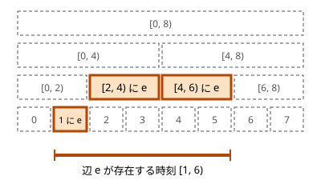

!!! abstract "要点"
    - **何ができるか**：辺の追加と削除が混ざる連結性の質問に、各辺が存在する時間の区間を時間軸のセグ木の $O(\log Q)$ 個のノードに載せ、DFS で入るときに併合・出るときに取り消してオフラインで答える。
    - **いつ使うか**：
        - 辺の追加と削除のクエリが混ざり、そのつど連結性を答える（先に全部読んでよい）
        - 各要素が「ない」時刻の区間がいくつかある
    - **計算量**：頂点数 $N$、クエリ数 $Q$ で時間 $O(N + Q \log Q \log N)$、メモリ $O(N + Q \log Q)$。併合 1 回は最悪 $O(\log N)$ で、ならしではない
    - **前提**：[Union-Find で連結性を扱う](../graph/union-find-connectivity.md)、[ロールバックできる Union-Find](../ds/rollback-union-find.md)、[セグメント木](../ds/segment-tree.md)

<!-- textlint-disable -->
別名：Offline Dynamic Connectivity・オフライン動的連結性・時間軸のセグ木・辺の削除がある連結判定
<!-- textlint-enable -->

辺の追加と削除が混ざる連結性は、Union-Find では扱えない「辺の削除」を、取り消し（[巻き戻し](../guide/glossary.md#rollback)）に置き換えて解く方法である。クエリをすべて先に読む[オフライン](../guide/glossary.md#offline)の方法で、時刻を葉とするセグメント木を 1 回 DFS するだけで全時刻の質問に答える。ABC で必須になることはまれで、使える問題の多くには別の解き方もある。

## 各辺の存在する区間を時間軸のセグ木に載せる {#time-segment-tree}

[Union-Find](../ds/union-find.md) は辺を足せるが、消せない。削除だけなら時間を逆にたどって追加に変えればよい（[削除を逆順の追加にする](../graph/union-find-connectivity.md#reverse-deletion)）。しかし追加と削除が混ざると、逆にたどっても削除が残る。

そこで、クエリを時刻 $0, 1, \dots, Q - 1$ と数え、時刻 $t$ は「$t$ 番目のクエリを処理した直後の状態」を指すことにする。辺ごとに、存在する時刻を[半開区間](../guide/glossary.md#half-open-interval) $[l, r)$ で表す。$l$ 番目のクエリで追加され、$r$ 番目のクエリで削除される辺の区間は $[l, r)$ である。最後まで残る辺は $r = Q$ とする。同じ辺が何度も追加・削除されるなら、区間が何本もできる。

時刻を葉とするセグメント木を考え、各辺の区間を、それをちょうど覆う $O(\log Q)$ 個のノードに載せる。載せ方はセグメント木の区間取得と同じ分け方である（[なぜ O(log N) か](../ds/segment-tree.md#complexity)）。次の図は、葉が 8 個の木に、時刻 $[1, 6)$ に存在する辺 $e$ を載せた様子である。



こう載せると、次のことが成り立つ。

- 葉 $t$ から根までの経路にあるノードの区間は、どれも $t$ を含む。
- 辺の区間を覆うノードは互いに重ならないので、区間が $t$ を含むなら、そのうちちょうど 1 個が葉 $t$ から根までの経路にある。含まないなら、経路には 1 個もない。

よって、**葉 $t$ から根までの経路のノードに載った辺を全部集めると、時刻 $t$ に存在する辺とちょうど一致する**。図の例では、葉 3 の経路は $[2, 4)$ を通るので $e$ を拾い、葉 6 の経路は $e$ を載せたノードを 1 つも通らない。

連結性に限らず、「要素がある時刻の区間」が決まっていれば同じように載せられる。マスや頂点が消えている時刻があるなら、その前後の 2 つの区間に分けて載せる（[例題](#abc334_g)）。品物の追加と削除が混ざるナップサックでも同じ載せ方をする（[戻す DP の分割統治の節](../dp/knapsack-undo.md#offline-divide-and-conquer)）。

## DFS で入るときに併合・出るときに取り消す（ロールバック Union-Find はデータ構造の章） {#dfs-rollback}

セグメント木を根から DFS し、ノードに入るとき、そのノードの辺をすべて併合し、出るときはその併合を取り消す。葉 $t$ に着いた時点の Union-Find は、根から葉までの経路の辺をすべて併合した状態で、それは時刻 $t$ のグラフである。そこで時刻 $t$ の質問（2 頂点が連結か、連結成分の数など）に答える。

```text
dfs(node):
    node に載った各辺 (u, v) を併合する
    node が葉 t なら、時刻 t の質問に答える
    そうでなければ dfs(左の子)、dfs(右の子)
    node で行った併合を、新しいものから順に取り消す
```

取り消しが成り立つのは、ノードの入りと出が後入れ先出しになっているからである。出るときに取り消すのは、そのノードで行った併合である。それより後の併合（子孫のノードのもの）は、すでに取り消されている。だから、取り消しはいつも最も新しい併合に当たる。この形の取り消しができる Union-Find が[ロールバックできる Union-Find](../ds/rollback-union-find.md#what-it-does) である。

ロールバックできる Union-Find は経路圧縮をせず、[union by size](../ds/union-find.md#complexity) だけで木の高さを $O(\log N)$ に保つ。経路圧縮の速さは[ならし計算量](../guide/glossary.md#amortized-complexity)なので、元に戻すと同じ重い find が何度でも起こりうるからである。そのため find と併合は 1 回ごとに最悪 $O(\log N)$ で、取り消しは書き換えた場所を戻すだけの $O(1)$ である。

計算量の根拠は次のとおりである。

- 辺の区間は追加 1 回につき 1 本なので $O(Q)$ 本で、それぞれ $O(\log Q)$ 個のノードに載る。併合と取り消しは合わせて $O(Q \log Q)$ 回、1 回 $O(\log N)$ である。
- ノードの数は $O(Q)$、葉での質問は $Q$ 回以下で、1 回 $O(\log N)$ である。
- 合わせて時間 $O(N + Q \log Q \log N)$ になる。ノードに載せた辺のメモリは $O(Q \log Q)$ である。

次のコード片は、時刻の区間に辺を載せる関数と DFS である（完全なプログラムは [`snippets/offline-dynamic-connectivity/usage.cpp`](https://github.com/yuukougun/kyopro-atlas/blob/main/snippets/offline-dynamic-connectivity/usage.cpp)。ロールバックできる Union-Find も同じファイルにある）。

```cpp
--8<-- "offline-dynamic-connectivity/usage.cpp:core"
```

完全なプログラム：[`usage.cpp`](https://github.com/yuukougun/kyopro-atlas/blob/main/snippets/offline-dynamic-connectivity/usage.cpp)（GitHub）
{ .kp-code-src }

クエリを読んで辺の区間を作り、葉で答える部分は次のようになる。クエリは「0 u v」（辺の追加）・「1 u v」（辺の削除）・「2 u v」（連結か）・「3」（連結成分の数）の 4 種類とし、頂点は 1-indexed で読んで直後に 1 を引く。

```cpp
--8<-- "offline-dynamic-connectivity/usage.cpp:usage"
```

完全なプログラム：[`usage.cpp`](https://github.com/yuukougun/kyopro-atlas/blob/main/snippets/offline-dynamic-connectivity/usage.cpp)（GitHub）
{ .kp-code-src }

時刻の約束や取り消しの回数など、自作するときの注意は[自作するときの要点](#library)にまとめた。

頂点の値の加算と、成分の値の合計の質問が加わる型もある。加算は時刻 $[t, Q)$ に存在する操作として同じ木に載せ、入るときにその時点の根の合計に足し、出るときに引けば、併合と同じく後入れ先出しで取り消せる。根には成分の値の合計を持たせ、併合で足し、取り消しで引く。同じノードに辺と加算があるときは、加算を先に引いてから併合を取り消す（逆にすると、引くときの根が足したときの根と変わる）。

クエリが前の答えに依存して先に読めない（[オンライン強制](../guide/glossary.md#forced-online)）なら、この方法は使えない（[オンライン強制の見分け方](../ds/offline-queries.md#online)）。

## 使い分け {#comparison}

- 辺の削除だけで、先に全部読めるなら、時間を逆にたどって追加に変える（[Union-Find で連結性を扱う](../graph/union-find-connectivity.md#reverse-deletion)）。ロールバックと $\log$ の分が要らない
- 辺や頂点を「1 つだけ」除いたときの連結成分の数を、全部の候補について求めるなら、[橋と関節点](../graph/lowlink.md#conditions)で $O(N + M)$ で済む
- 追加と削除が混ざり、先に全部読めるなら、このページの方法を使う

## 自作するときの要点と Library Checker {#library}

ACL の `dsu` は経路圧縮をするので取り消せず、この方法には使えない。[ロールバックできる Union-Find](../ds/rollback-union-find.md) と時間軸のセグメント木を自作する。

- **時刻の約束**：時刻 $t$ を「$t$ 番目のクエリの直後」と決めると、$l$ 番目で追加・$r$ 番目で削除の辺は $[l, r)$ になる。質問のクエリは状態を変えない。だから、その時刻の葉で答えればよい。$r$ を含めて閉区間にすると、削除の直後の質問にもその辺が残る。
- **区間の作り方**：今ある辺ごとに追加された時刻を連想配列に持ち、削除のたびに区間を閉じる。$u$ と $v$ の順を入れ替えた削除にも対応できるよう、キーは $(\min(u, v), \max(u, v))$ にそろえる。同じ辺が 2 本以上同時にありうる問題なら、キーごとに追加時刻の列を持つ。
- **取り消しの回数**：同じ成分どうしで併合が起きなかったときは、記録を 1 つ積むか、成功した併合の回数を数えておく。ノードに載った辺の数だけ取り消すと、何もしなかった併合の分だけ余計に戻してしまう。
- **連結成分の数**：併合が成功するたびに 1 減らし、取り消すたびに 1 増やしておけば、葉ではその値を読むだけでよい。
- **再帰の深さ**：DFS の深さは $O(\log Q)$ なので、再帰で書いてよい。

Library Checker の Dynamic Graph Vertex Add Component Sum（[練習問題](#practice)）で、頂点の値の加算まで含めて確かめられる。

## 学ぶための資料 {#resources}

- cp-algorithms の「Deleting from a data structure in O(T(n) log n)」（英語）：時間軸のセグメント木に要素を載せて削除を取り消しに置き換える一般の枠組みと、動的連結性への適用
- [ロールバックできる Union-Find](../ds/rollback-union-find.md)：取り消しのできる Union-Find の作り方と、この方法での使い方

## 例題 {#examples}

### ABC334 G. Christmas Color Grid 2 {#abc334_g}

<div class="kp-problems" data-role="example" markdown>

- [ABC334 G. Christmas Color Grid 2](https://atcoder.jp/contests/abc334/tasks/abc334_g)（diff 2242）：緑のマスを 1 つ一様に選んで赤に塗り替えたときの、緑のマスの連結成分の数の期待値を求める。

</div>

緑のマスを $0, 1, \dots, G - 1$ と番号付けし、時刻 $h$ を「マス $h$ だけを赤に塗り替えた状態」とする。期待値は、全時刻の連結成分の数の和を $G$ で割ったものである。各時刻のグラフは、マスが 1 つ消えた状態で、時刻ごとに消えるマスが違う。マス $h$ は時刻 $h$ にだけ「ない」ので、存在する時刻は $[0, h)$ と $[h + 1, G)$ の 2 つの区間になり、時間軸のセグメント木に載せられる。

??? note "解法の詳細"
    - 隣り合う緑のマス $a < b$ を結ぶ辺は、両端が残っている時刻（$a$ と $b$ 以外の時刻）に存在する。区間は $[0, a)$・$[a + 1, b)$・$[b + 1, G)$ の 3 つで（空の区間は載せない）、[時間軸のセグ木](#time-segment-tree)にそのまま載せられる。
    - 緑のマスを頂点とするロールバックできる Union-Find で DFS し、葉 $h$ で連結成分の数を読む。マス $h$ はどの辺にもつながらず 1 点の成分として数えられているので、緑のマスの成分の数は Union-Find の成分の数から 1 を引いたものになる。
    - 辺の数は $O(G)$ なので、全体は $O(G \log^2 G)$ である。問題が指定する法で、成分の数の和に $G$ の逆元を掛けて答える。
    - マスそのものを区間 $[0, h)$・$[h + 1, G)$ のノードに載せ、マスを置くときに、すでに置かれている隣のマスと併合する書き方もある（kmjp 氏の解説はこの形）。載せる要素が辺の方法の半分以下で済み、盤面が大きいときはこちらが軽い。
    - 関節点を求め、マスを除いたときに分かれる個数を数えても解ける（[橋と関節点](../graph/lowlink.md#conditions)）。こちらは $O(G)$ である。

## 練習問題 {#practice}

### Library Checker

- [Dynamic Graph Vertex Add Component Sum](https://judge.yosupo.jp/problem/dynamic_graph_vertex_add_component_sum)：辺の追加と削除、頂点の値への加算が混ざり、頂点を含む連結成分の値の合計を答える。[DFS の節](#dfs-rollback)の加算の扱いをそのまま使える。

## 参考 {#references}

- [kmjp「AtCoder ABC #334 (ユニークビジョンプログラミングコンテスト2023 クリスマス) : G - Christmas Color Grid 2」](https://kmjp.hatenablog.jp/entry/2023/12/23/1030)：例題を、各マスが緑である時刻の区間をセグメント木に載せ、ロールバックできる Union-Find で DFS して解く方法
- [あめんばーど「【AtCoder】G - Christmas Color Grid 2 / AtCoder Beginner Contest 334」](https://amentorimaru.hatenablog.com/entry/2025/04/11/210228)：例題を関節点で解く別解
- [cp-algorithms「Deleting from a data structure in O(T(n) log n)」](https://cp-algorithms.com/data_structures/deleting_in_log_n.html)：時間軸のセグメント木に要素を載せて削除を取り消しに置き換える一般の枠組みと、動的連結性への適用（文章と図は使っていない）
- [Library Checker「Dynamic Graph Vertex Add Component Sum」](https://github.com/yosupo06/library-checker-problems/tree/master/graph/dynamic_graph_vertex_add_component_sum)：練習の問題の内容（GitHub の問題文で確認）
