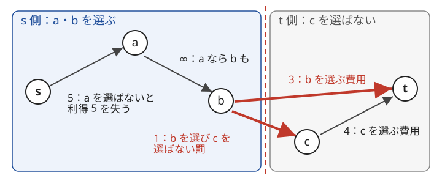

!!! abstract "要点"
    - **何ができるか**：各要素を選ぶか選ばないかの 2 択とその組合せのコストを辺に直し、最小カットで最適な選び方を求める。利得は定数を足してコストに読み替え、二部グラフなら片側の意味を反転する。
    - **いつ使うか**：
        - 各要素を選ぶ・選ばないの 2 択で、利得とコストの合計を最大化する。
        - A を選ぶなら B も選ぶ必要がある（依存関係）。
        - 隣どうしが違う（同じ）とペナルティ・利得。
        - 要素の数 $N$ が 100〜数百程度で、選び方は $2^N$ 通りある。
        - 目的関数が、0/1 変数ごとの項と「$x_i = 1$ かつ $x_j = 0$ ならコスト $c$」の項の和で書ける。
    - **計算量**：最大流を 1 回求める。変数 $N$ 個・2 変数までの項 $M$ 個なら、頂点も辺も $O(N + M)$ 個のグラフになる。多くの変数をまとめる項は、その変数の数だけ辺が増える。ACL の `mf_graph` の上限は頂点 $V$・辺 $E$ で $O(V^2 E)$ だが、実際はずっと速い。
    - **前提**：[最小カット](../graph/min-cut.md)

<!-- textlint-disable -->
別名：Project Selection・最大重み閉包・劣モジュラ・project selection problem
<!-- textlint-enable -->

燃やす埋めるは、$N$ 個の 0/1 変数 $x_1, \dots, x_N$ について「選ぶとかかる費用」「選ばないと失う利得」「A を選んで B を選ばないと払う罰」のような項の和を、[最小カット](../graph/min-cut.md)で最小化する方法である。$2^N$ 通りの選び方を調べる代わりに、項を 1 つずつ辺に直したグラフで最大流を 1 回求める。難しいのは最大流の部分ではなく、問題を「どの項が辺にできる形か」に書き直すところである。式では変数を $x_1, \dots, x_N$ と 1 から番号付けし、コード片では 0-indexed で持つ（$x_i$ はコードの `x[i - 1]`、頂点 $i - 1$ に当たる）。

## 0/1 の選択を s 側と t 側に対応させる {#idea}

燃やす埋めるでは、変数ごとに頂点を 1 つ作り、始点 $s$ と終点 $t$ を足す。[カット](../guide/glossary.md#cut)は頂点を $s$ を含む組（s 側）と $t$ を含む組（t 側）に分けることなので、次のように読めば、カット 1 つが 0/1 の割り当て 1 つに当たる。

- 頂点 $i$ が s 側なら $x_i = 1$（選ぶ）、t 側なら $x_i = 0$（選ばない）

カットの値は、s 側から t 側へ向かう辺の容量の和である。t 側から s 側へ向かう辺は数えない。だから辺 $u \to v$（容量 $c$）は「$u$ が s 側、$v$ が t 側」のときだけ $c$ を足す。これを 0/1 の言葉に直すと次のようになる。

- 辺 $s \to i$：$x_i = 0$ のときだけ切れる（選ばないとコスト）
- 辺 $i \to t$：$x_i = 1$ のときだけ切れる（選ぶとコスト）
- 辺 $i \to j$：$x_i = 1$ かつ $x_j = 0$ のときだけ切れる（$i$ を選び $j$ を選ばないとコスト）

こうして作ったグラフでは、どの割り当てについても「カットの値＝項の和」が成り立つ。よって最小カット（＝最大流）が項の和の最小値になる。最小を達成する割り当ては、流し終えた残余グラフで $s$ から届く頂点を s 側とすれば得られる（[最小カット](../graph/min-cut.md#restore)）。

次の図は、3 つの変数 a・b・c の例である。項は「a を選ばないと利得 5 を失う」「a を選ぶなら b も選ぶ」「b を選ぶと費用 3」「c を選ぶと費用 4」「b を選び c を選ばないと罰 1」の 5 つで、最小カットは a・b を選び c を選ばない割り当てに当たる。



図のカットで切れるのは $b \to t$ と $b \to c$ だけで、値は $3 + 1 = 4$ である。c も選ぶと $b \to c$ の代わりに $c \to t$ の 4 が切れて 7 になる。何も選ばないと $s \to a$ の 5 が切れる。a だけを選ぶと $a \to b$ の ∞ が切れるので、「a を選ぶなら b も」が守られる。8 通りを全部比べても 4 が最小である。

**処理の流れ**は次のとおりである。

1. 問題を 0/1 変数の項の和の最小化に書き直す（最大化なら符号を反転する）
2. 各項を[早見表](#cheatsheet)で辺に直す。負の容量になる分は定数として外へ出す
3. 最大流を求め、「最小カット＋外へ出した定数」を答えにする。割り当てが要るなら `min_cut` で復元する

**計算量**：最大流を 1 回求めるだけである。変数 $N$ 個・項 $M$ 個なら、頂点は $N + 2$ に補助の頂点を足した数になる。項が 2 変数までなら辺は $O(N + M)$ 本である。多くの変数をまとめる項（$K$ 変数の利得は 1 項で辺が $K + 1$ 本）や[多値変数](#multi-valued)の差の 2 乗（値が $K$ 段なら隣り合う組 1 つで $O(K^2)$ 本）があるときは、辺の数を項ごとに数える。ACL の `mf_graph`（Dinic 法）の上限は頂点 $V$・辺 $E$ で $O(V^2 E)$ である。この上限は大きいが、実際の反復はずっと少なく、頂点が数千・辺が数万程度のグラフなら間に合うことが多い。

!!! info "ACL では"
    `atcoder::mf_graph<long long> g(n);` で頂点 $n$ 個のグラフを作る。`g.add_edge(from, to, cap)` で辺を足し（`cap` は 0 以上）、`g.flow(s, t)` で最大流（＝最小カットの値）を返す。上限は $O(n^2 m)$ である。`flow` を 1 回呼んだ後の `g.min_cut(s)` は、残余グラフで $s$ から届く頂点を `true` とする `vector<bool>` を $O(n + m)$ で返す。

## 条件から辺への早見表 {#cheatsheet}

燃やす埋めるの項は、ほとんどが次の表の形に直せる。向きは「s 側＝選ぶ（$x = 1$）、t 側＝選ばない（$x = 0$）」の約束による。

| 条件 | 足す辺 | 外へ出す定数 |
| --- | --- | --- |
| $x_i = 1$ なら費用 $c$ | $i \to t$（$c$） | なし |
| $x_i = 0$ なら費用 $c$ | $s \to i$（$c$） | なし |
| $x_i = 1$ かつ $x_j = 0$ なら罰 $c$ | $i \to j$（$c$） | なし |
| $x_i \ne x_j$ なら罰 $c$ | $i \to j$ と $j \to i$（どちらも $c$） | なし |
| $x_i = 1$ なら $x_j = 1$ | $i \to j$（∞） | なし |
| $x_i$ を 1 に固定 | $s \to i$（∞） | なし |
| $x_i = 1$ なら利得 $p$ | $s \to i$（$p$） | $-p$ |
| $x_i = x_j = 1$ なら利得 $p$ | $s \to i$（$p$）と $i \to j$（$p$） | $-p$ |
| $x_i = x_j = 0$ なら利得 $p$ | $j \to t$（$p$）と $i \to j$（$p$） | $-p$ |
| $x_{v_1}, \dots, x_{v_K}$ がすべて 1 なら利得 $p$ | 補助の頂点 $y$ に $s \to y$（$p$）、各 $y \to v_k$（∞） | $-p$ |
| $x_{v_1}, \dots, x_{v_K}$ がすべて 0 なら利得 $p$ | 補助の頂点 $y$ に $y \to t$（$p$）、各 $v_k \to y$（∞） | $-p$ |

答えは「最小カット＋外へ出した定数の和」である。容量はどれも 0 以上でなければならない。罰 $c$ や利得 $p$ が負なら、別の行（費用と利得の入れ替え）に読み替える。

表の 4 行目のように、2 つの変数が「違う」ときの罰は 2 本の辺で表せる。一方「同じ」であるときの罰と「どちらも 1」のときの罰は、どう辺を引いても表せない（[表せる項と表せない項](#submodular)）。表せない形が出てきたら、[片側の意味を反転](#flip-side)できないかを考える。

コードでは、項を足す関数をそろえた組み立て役を作っておくと、向きの取り違えが減る。変数 $x_i$ ごとに「0 のときと 1 のときの費用」を受け取る `unary` は、費用の小さい方を定数として外へ出し、差だけを辺にする。

```cpp
--8<-- "project-selection/builder.cpp:core"
```

完全なプログラム：[`builder.cpp`](https://github.com/yuukougun/kyopro-atlas/blob/main/snippets/project-selection/builder.cpp)（GitHub）
{ .kp-code-src }

このコード片の `main`（取り込んでいない部分）は、変数 7 個以下・項 8 個以下のランダムな入力を作り、$2^N$ 通りの全探索と最小値・復元した割り当てが一致することを確かめている。

## 利得はコストに読み替えて定数を足す {#gains}

最小カットが表すのは、0 以上のコストの和の最小値である。利得の最大化をそのまま辺にはできないので、「利得 $p$ を得る」を「先に $p$ をもらっておき、得られなかったら $p$ を払う」と読み替える。先にもらう $p$ は答えに足す定数になり、払う $p$ は 0 以上の容量の辺になる。

- **1 変数の利得**：「$x_i = 1$ なら利得 $p$」は、定数 $-p$ と「$x_i = 0$ なら費用 $p$」（$s \to i$）の和である
- **負の費用**：「$x_i = 1$ なら費用 $-3$」のように費用が負になったら、同じく利得 3 と読む。一般に「$x_i = 0$ なら $f_0$、$x_i = 1$ なら $f_1$」は、定数 $\min(f_0, f_1)$ と差 $\lvert f_1 - f_0 \rvert$ の辺 1 本に直せる
- **2 変数がどちらも 1 なら利得 $p$**：定数 $-p$ と、「$x_i = 0$ なら費用 $p$」「$x_i = 1$ かつ $x_j = 0$ なら費用 $p$」の和に分ける。$x_i = 0$ なら 1 つ目が、$x_i = 1, x_j = 0$ なら 2 つ目が $p$ を払い、$x_i = x_j = 1$ のときだけどちらも払わない

$K$ 個の変数がすべて 1 のときの利得は、補助の頂点 $y$ を 1 つ足して表す。$y = 1$ を「利得を得る」と読み、$y = 0$ なら $p$ を払う（$s \to y$）。$y \to v_k$ の ∞ の辺は「$y = 1$ なら $x_{v_k} = 1$」なので、利得を得られるのは全員が 1 のときだけになる。全員が 1 なら、$y = 1$ にして $p$ を払わないのが最小なので、ちょうど利得を表す。すべて 0 のときの利得は、向きを全部逆にすればよい。

!!! warning "利得の答えの符号"
    最大化の問題では「答え＝－（最小カット＋定数）」になる。利得を全部先にもらう形なら「答え＝（利得の合計）－（最小カット）」と書ける。どちらで書いたかを最初に決め、途中で混ぜない。

??? question "確認問題：2 変数がどちらも 0 なら利得"
    「$x_i = x_j = 0$ なら利得 $p$」を、0 以上の容量の辺と定数で表せ。

    ??? success "答え"
        定数 $-p$ と、「$x_j = 1$ なら費用 $p$」（$j \to t$）、「$x_i = 1$ かつ $x_j = 0$ なら費用 $p$」（$i \to j$）である。$x_j = 1$ なら 1 つ目が、$x_j = 0, x_i = 1$ なら 2 つ目が $p$ を払い、$x_i = x_j = 0$ のときだけどちらも払わない。

## 最大重み閉包（依存関係） {#closure}

最大重み閉包は、品物ごとに利益 $p_i$（負もある）があり、「$a$ を選ぶなら $b$ も選ぶ」という条件がいくつか付いたとき、条件を守る選び方の利益の和の最大値を求める問題である。条件を守る集合（$a$ が入れば $b$ も入る集合）を閉包と呼ぶ。燃やす埋めるの最も基本の型で、次のように組む。

- $p_i > 0$ の品物：$s \to i$（$p_i$）。選ばないと $p_i$ を失う
- $p_i < 0$ の品物：$i \to t$（$-p_i$）。選ぶと $-p_i$ を払う
- 条件「$a$ なら $b$」：$a \to b$（∞）

答えは「正の利益の合計 − 最小カット」である。正の利益を全部先にもらい、失う分と払う分をカットで引いている。∞ の辺が s 側から t 側へ向くカットは値が ∞ になるので、最小カットは必ず条件を守る。

```cpp
--8<-- "project-selection/closure.cpp:core"
```

完全なプログラム：[`closure.cpp`](https://github.com/yuukougun/kyopro-atlas/blob/main/snippets/project-selection/closure.cpp)（GitHub）
{ .kp-code-src }

依存関係は推移的につながる。「$a$ なら $b$」「$b$ なら $c$」があれば、$a$ を選ぶと $c$ も選ぶことになるが、辺は隣どうしの 2 本だけでよい。∞ の辺をたどって届く頂点は、どれも s 側でなければならないからである。条件が閉路をなす（互いに必要とする）品物は、まとめて選ぶか選ばないかになる。

依存が「操作の連鎖」として書かれた問題も、この型になることが多い。あるマスを変えると、決まった向きの隣も連鎖して変わる操作なら、「変わったマスの集合」は「変わったマスの隣も変わっている」という閉包の条件で書ける（[例題 ABC472 G](#abc472_g)）。

応用の型（サイン）は次のとおりである。

- 「$X$ をするには $Y$ が必要」「$Y$ を先にしないと $X$ はできない」と、報酬と費用がある：最大重み閉包
- 段階のあるもの（レベル 1〜5 など）の費用と、段階の条件付きの報酬：段階ごとの頂点を「レベル $k$ 以上」として並べ、「レベル $k+1$ 以上ならレベル $k$ 以上」を ∞ の辺にする（[多値変数を頂点の列で表す](#multi-valued)）

??? question "確認問題：辺の向き"
    「$a$ を選ぶなら $b$ も選ぶ」の ∞ の辺を $b \to a$ の向きに引くと、どの条件を表すことになるか。

    ??? success "答え"
        「$b$ を選ぶなら $a$ も選ぶ」になる。辺 $b \to a$ が切れるのは $b$ が s 側（選ぶ）・$a$ が t 側（選ばない）のときなので、∞ はその組合せを禁じる。s 側と t 側の意味を逆に約束している解説では、同じ条件の辺の向きも逆になる。

## 表せる項と表せない項（劣モジュラ） {#submodular}

2 変数の項 $\theta(x_i, x_j)$ の値を、$A = \theta(0, 0)$、$B = \theta(0, 1)$、$C = \theta(1, 0)$、$D = \theta(1, 1)$ とおく。この項が辺と定数で表せるのは、次の不等式を満たすときである。この不等式を満たす項を劣モジュラという。

$$
B + C \ge A + D
$$

満たすなら、次のように 1 変数の項 2 つと罰 1 つに分けられる。$(x_i, x_j)$ に 4 通りを入れると、どれも $\theta$ に一致する。

$$
\theta(x_i, x_j) = A + (C - A)\,x_i + (D - C)\,x_j + (B + C - A - D)\,(1 - x_i)\,x_j
$$

最後の項は「$x_j = 1$ かつ $x_i = 0$ なら罰 $B + C - A - D$」で、罰が 0 以上であることがちょうど不等式である。1 変数の項は負でも定数で直せる（[利得の読み替え](#gains)）。[早見表](#cheatsheet)のコードの `binary` はこの分け方をそのまま書いたものである。

逆に、不等式を満たさない項はどう辺を引いても表せない。辺 1 本が足すコストは「$u = 1$ かつ $v = 0$ なら $c$」の形で、2 変数の表にすると $B + C - A - D$ は $c \ge 0$ か 0 になる。辺をいくつ足しても、この値は足し算で 0 以上のままである。補助の頂点を足しても、補助の頂点について最小をとった関数は劣モジュラのままである（Kolmogorov と Zabih の論文の定理。[参考](#references)）。

よく出る 2 変数の条件を当てはめると次のようになる。

| 条件 | $(A, B, C, D)$ | 表せるか |
| --- | --- | --- |
| 違うと罰 $c$ | $(0, c, c, 0)$ | 表せる |
| 同じだと利得 $p$ | $(-p, 0, 0, -p)$ | 表せる |
| どちらも 1 なら利得 $p$ | $(0, 0, 0, -p)$ | 表せる |
| 同じだと罰 $c$ | $(c, 0, 0, c)$ | 表せない |
| 違うと利得 $p$ | $(0, -p, -p, 0)$ | 表せない |
| どちらも 1 なら罰 $c$（両立しない） | $(0, 0, 0, c)$ | 表せない |

表せない項が混ざった問題は、一般には難しい。たとえば「違うと利得」だけの問題は、グラフの頂点を 2 組に分けて間の辺を最も多くする最大カットで、効率のよい解法は知られていない。表せない項が出たら、次の 2 つを考える。

- 変数の一部の意味を反転して、表せる形にできないか（[二部グラフで片側の意味を反転する](#flip-side)）
- $N$ が小さいなら [bit 全探索](../basics/bit-full-search.md)、依存が木や 1 列なら DP で解けないか

??? question "確認問題：違うと罰"
    「$x_i \ne x_j$ なら罰 $c$」を、上の分け方の式で辺に直すとどうなるか。早見表の 2 本の辺と同じになるか。

    ??? success "答え"
        $(A, B, C, D) = (0, c, c, 0)$ なので、式は $c\,x_i - c\,x_j + 2c\,(1 - x_i)\,x_j$ になる。$-c\,x_j$ は定数 $-c$ と「$x_j = 0$ なら $c$」（$s \to j$）に直す。合わせると辺 $i \to t$（$c$）・$s \to j$（$c$）・$j \to i$（$2c$）と定数 $-c$ で、4 通りの値はどれも早見表の $i \to j$・$j \to i$ の 2 本と同じになる。辺の引き方は 1 通りではない。

## 二部グラフで片側の意味を反転する {#flip-side}

「同じだと罰」「どちらも 1 なら罰」のような表せない項も、変数の一部の意味を入れ替えると表せることがある。$x_j$ を $x'_j = 1 - x_j$ に置き換えると、項の表の $(A, B, C, D)$ は $(B, A, D, C)$ に並び替わる。不等式は $A + D \ge B + C$ に変わるので、元の項が表せない向きなら、反転後は表せる。

| 元の条件 | $x_j$ を反転した後の条件 |
| --- | --- |
| 同じだと罰 $c$ | 違うと罰 $c$（表せる） |
| どちらも 1 なら罰 $c$ | $x_i = 1$ かつ $x'_j = 0$ なら罰 $c$（表せる） |
| どちらも 1 は禁止 | $x_i = 1$ なら $x'_j = 1$（∞ の辺） |

ただし反転は変数ごとに 1 回しか決められない。表せない項が辺で結ぶ変数のグラフを考え、どの辺も「片方だけ反転」になるように反転する変数を選ぶ必要がある。これはそのグラフが[二部グラフ](../graph/bipartite-graph.md)であることと同じで、片方の色の変数をすべて反転すればよい。グリッドの隣り合うマス（市松模様）、行と列、決まった動きで移る盤面の位置などは二部グラフになりやすい。

反転するときは次の 3 点に気を付ける。

- **もともと表せた項も反転される**：2 色をまたぐ項に「違うと罰」が混ざっていると、反転後は「同じだと罰」になって表せなくなる。反転する前に、2 色をまたぐ項がすべて表せない向き（または $B + C = A + D$）かを確かめる
- **1 変数の項も入れ替える**：反転した変数では、「$x_j = 1$ なら費用 $c$」が「$x'_j = 0$ なら費用 $c$」になる。値の固定も逆になる
- **復元で戻す**：`min_cut` で得た割り当ては反転後の値なので、反転した側は 0 と 1 を戻してから出力する

応用の型（サイン）は次のとおりである。

- 隣り合うマスが同じ色だと罰（違う色だと利得）：市松模様の片側の色を反転する（練習の ABC193 F）
- 行と列を選び、交点のマスを二重に数えない・負のマスの行と列を両方選べない：列の意味を反転する（練習の ABC259 G）
- 互いに利き合う位置に駒を置けない（独立集合）：利きのグラフが二部グラフであることを示して片側を反転する（[例題 ABC445 G](#abc445_g)）。二部グラフの最大独立集合は [König の定理](../graph/konig-theorem.md#theorem)でも求まる

??? question "確認問題：二部グラフでないとき"
    3 つの変数 $x_1, x_2, x_3$ のどの 2 つにも「同じだと罰 1」が付いているとき、反転で表せる形にできるか。

    ??? success "答え"
        できない。どの 2 つも「片方だけ反転」にするには、3 頂点の閉路を 2 色で塗り分ける必要があり、奇数の長さの閉路は塗り分けられない。実際、3 つのうち少なくとも 2 つは同じ値になるので、罰の最小値は 1 である。

## 多値変数を頂点の列で表す {#multi-valued}

この節は発展の内容で、[最大重み閉包](#closure)の組み方を前提にする。変数が 0/1 ではなく $1, \dots, K$ の値を取るときは、1 つの変数を $K - 1$ 個の頂点 $y_2, \dots, y_K$ で表す。$y_k$ は「値が $k$ 以上か」の 0/1 で、値は $1 + (y_k = 1 \text{ の個数})$ になる。

- **値の並びを守る**：「$k + 1$ 以上なら $k$ 以上」なので、$y_{k+1} \to y_k$ に ∞ の辺を引く。こうすると 1 になる頂点は $y_2, \dots, y_v$ の形にそろい、頂点の列と値が 1 対 1 に対応する
- **値ごとのコスト**：値 $v$ のコストを $f(v)$ とすると、$f(v) = f(1) + \sum_{k=2}^{v} (f(k) - f(k-1))$ なので、$y_k$ に「1 なら費用 $f(k) - f(k-1)$」を付ければよい（負なら定数で直す）
- **値の固定**：値を $a$ に固定するなら、$y_a$ を 1 に（$a \ge 2$ のとき）、$y_{a+1}$ を 0 に（$a < K$ のとき）∞ で固定する
- **レベルの条件**：「変数 $u$ の値が $k$ 以上なら、$w$ の値も $l$ 以上」は、$u$ の $y_k$ から $w$ の $y_l$ への ∞ の辺 1 本になる

隣り合う 2 つの値の差にかかるコストも、差について下に凸なら表せる。差の 2 乗 $(a - b)^2$ なら、変数 $u$ の $y_k$ から変数 $w$ の $y_l$ へ、$l = k$ なら容量 1、$l < k$ なら容量 2 の辺を引き、$u$ と $w$ を入れ替えた辺も同じように引く。$a \ge b$ のとき切れる辺は $b < l \le k \le a$ の組で、$d = a - b$ とすると $l = k$ が $d$ 本、$l < k$ が $\binom{d}{2}$ 本ある。合計は $d + 2\binom{d}{2} = d^2$ である。入れ替えた向きの辺は、$a \ge b$ のときは切れない。

頂点は変数 1 つにつき $K - 1$ 個、隣り合う組 1 つにつき辺は $O(K^2)$ 本になる。サインは「マスに 1〜5 の値を書き、隣との差の 2 乗の和を最小にする」（力試しの ABC347 G）、「スキルのレベルを上げる費用と、レベルの条件付きの報酬」（練習の ABC326 G）のような、値の段階が少ない問題である。

## 落とし穴 {#pitfalls}

- **s 側と t 側の意味の取り違え**：「s 側＝選ぶ」と「s 側＝選ばない」のどちらで約束しても解けるが、辺の向きがすべて逆になる。解説によって約束が違うので、読むときは最初に確かめる。自分では 1 つに決めて、組み立て役の関数に閉じ込める
- **負の容量**：`add_edge` の容量は 0 以上でなければならない。「$x = 1$ なら $-3$」は、定数 $-3$ と「$x = 0$ なら 3」に直す。罰（2 変数の項）が負になるなら、その項は表せない向きなので、[反転](#flip-side)を考える
- **∞ の大きさ**：∞ は、有限の容量の合計より大きくする。ただし ∞ どうしや定数を足して `long long` を超えないよう、$2^{50}$ 程度にする（$10^{18}$ を 10 本足すと溢れ、距離の INF に使う $2^{60}$ も 8 本で溢れる。[INF の決め方](../cpp/cpp-types-literals.md#inf)）。値の固定などで条件を満たす割り当てがない入力では、最小カットが ∞ 以上になるので、それで判定する
- **答えの定数を忘れる**：負の費用・利得を辺に直すたびに定数が出る。組み立て役の中で定数も一緒に足していくと忘れない
- **min_cut を flow の前に呼ぶ**：`min_cut(s)` は `flow(s, t)` を 1 回呼んだ後の残余グラフを見る。最適な割り当てが複数あるときは、s 側が最も小さいものが返る
- **反転を戻し忘れる**：片側を反転したら、復元した値の 0 と 1 をその側だけ戻す

## 例題 {#examples}

### 典型90 040. Get More Money（★7） {#typical90_an}

<div class="kp-problems" data-role="example" markdown>

- [典型90 040. Get More Money（★7）](https://atcoder.jp/contests/typical90/tasks/typical90_an)（diff なし）：家に入ると得られる利得とかかる費用があり、ある家に入るには別の家にも入る必要があるとき、得られる値の最大値を求める。

</div>

家ごとに「入る・入らない」の 2 択で、家 $i$ に入ると $A_i - W$ の利益が出る。家 $c$ に入るには家 $i$ に入っている必要がある、という条件は「$c$ を選ぶなら $i$ も選ぶ」なので、そのまま[最大重み閉包](#closure)になる。

??? note "解法の詳細"
    家 $i$ の利益を $p_i = A_i - W$ とする。$p_i > 0$ なら $s \to i$（$p_i$）、$p_i < 0$ なら $i \to t$（$-p_i$）を引く。家 $i$ に入らないと入れない家 $c$ ごとに、$c \to i$（∞）を引く。答えは「$p_i > 0$ の和 − 最小カット」である。何も入らなければ 0 なので、答えは 0 以上になる。$N \le 100$ で、辺は条件の数だけなので、最大流は十分に速い。

### ABC472 G. Cascading Grid {#abc472_g}

<div class="kp-problems" data-role="example" markdown>

- [ABC472 G. Cascading Grid](https://atcoder.jp/contests/abc472/tasks/abc472_g)（diff 2018）：+・-・# の盤面で、# でないマスと、そこから # を通らずに左右と下へ進んで届くマスを # に変える操作を何度でも行い、+ の数から - の数を引いた値を最大化する。

</div>

最終的に # に変わるマスの集合を $T$ とする。$T$ のマスの左・右・下の隣で、元から # でないマスは、必ず $T$ に入る。逆に、この条件を満たす $T$ なら、$T$ のマスを順に操作すれば $T$ ちょうどを # にできる。よって「# に変えるマスの閉包」を選ぶ[最大重み閉包](#closure)になる。

??? note "解法の詳細"
    **閉包と一致する理由**：あるマス $v$ が操作で # になったとき、$v$ の左・右・下の隣 $w$（元は # でない）は、そのときすでに # か、同じ操作で $v$ から届くので # になる。だから最終的な $T$ は条件を満たす。逆に条件を満たす $T$ では、まだ # でない $T$ のマスを 1 つ選んで操作すると、届くマスはすべて $T$ に入っている（$T$ の外へ出る隣は元から # の壁）。これを $T$ が尽きるまでくり返せば、$T$ ちょうどが # になる。

    **グラフ**：元が # でないマスを頂点にし、「# に変える」を s 側とする。+ のマスを # にすると値が 1 減り、- のマスを # にすると 1 増える。最初の値（+ の数 − - の数）を定数とし、+ のマスは利益 $-1$（$v \to t$ に 1）、- のマスは利益 $+1$（$s \to v$ に 1）とする。各マスから左・右・下の隣（元が # でないもの）へ ∞ の辺を引く。答えは「最初の値 ＋ - のマスの数 − 最小カット」である。頂点はマスの数、辺はその約 4 倍である。

### ABC445 G. Knight Placement {#abc445_g}

<div class="kp-problems" data-role="example" markdown>

- [ABC445 G. Knight Placement](https://atcoder.jp/contests/abc445/tasks/abc445_g)（diff 2250）：一部のマスが使えない N × N の盤面に、縦横に (A, B) か (B, A) 離れた 2 マスの両方には置けない駒を最も多く置き、置き方を 1 つ出力する。

</div>

互いに利き合う 2 マスを辺で結んだグラフで、最大の独立集合を求める問題である。「両方に置くのは禁止」は表せない項だが、このグラフは二部グラフになるので、[片側の意味を反転](#flip-side)すると最小カットで解ける。置き方の出力は `min_cut` の復元で得る。

??? note "解法の詳細"
    **二部グラフである理由**：$g = \gcd(A, B)$、$a = A / g$、$b = B / g$ とすると、$a$ と $b$ は互いに素なので両方が偶数ではない。1 回の移動で、座標を $g$ で割った商（同じ連結成分では余りは変わらない）は $(\pm a, \pm b)$ か $(\pm b, \pm a)$ だけ変わる。$a$ と $b$ の一方だけが奇数なら、商の行と列の和の偶奇が毎回変わる。両方が奇数なら、商の行の偶奇が毎回変わる。どちらの場合も、その偶奇で 2 色に塗れば、どの辺も色の違うマスを結ぶ。

    **グラフ**：使えるマスを頂点にし、置かないマスの数を最小化する。色 0 のマスは「置く」を s 側、色 1 のマスは反転して「置かない」を s 側とする。色 0 のマスには $s \to v$（1、置かないと 1）、色 1 のマスには $v \to t$（1、反転後の 1 は置かない）を引く。利き合う色 0 のマス $u$ と色 1 のマス $w$ には、$u \to w$（∞）を引く。これは「$u$ に置き、$w$ に置く（反転後は 0）」を禁じる。最大で置ける数は「使えるマスの数 − 最小カット」で、`min_cut` の結果を色 1 の側だけ反転して置くマスを読む。

## 練習問題 {#practice}

<div class="kp-problems" data-role="practice" markdown>

- [鉄則本 B68. ALGO Express](https://atcoder.jp/contests/tessoku-book/tasks/tessoku_book_eo)（diff なし）：各駅を急行の停車駅にするかを選ぶ。停車駅にすると利益（負もある）が得られ、「駅 A を停車駅にするなら駅 B も停車駅にする」という条件がいくつかあるとき、利益の合計の最大値を求める。
- [ABC259 G. Grid Card Game](https://atcoder.jp/contests/abc259/tasks/abc259_g)（diff 2428）：整数の書かれた盤面でいくつかの行と列を選び、選んだ行・列に含まれるマスの和（重なりは 1 回）を最大化する。ただし負のマスを行と列の両方から選んではいけない。
- [ABC326 G. Unlock Achievement](https://atcoder.jp/contests/abc326/tasks/abc326_g)（diff 2470）：スキルのレベルを上げる費用と、各アチーブメントの達成条件（スキルのレベル）と報酬が与えられ、報酬から費用を引いた値の最大値を求める。
- [ABC193 F. Zebraness](https://atcoder.jp/contests/abc193/tasks/abc193_f)（diff 2475）：一部が白・黒に決まった盤面の残りのマスを塗り、隣り合う異なる色のマスの組の数を最大化する。

</div>

??? note "練習の方針"
    - **鉄則本 B68**：利益 $P_i$ の品物と「A なら B」の条件で、[最大重み閉包](#closure)そのものである
    - **ABC259 G**：行の和と列の和を利益にし、両方を選んだマスの二重の数え上げを「どちらも 1 なら罰」（負のマスなら ∞）にする。行と列は二部グラフなので、列の意味を反転する
    - **ABC326 G**：スキルごとに「レベル $k$ 以上」の頂点を並べ、アチーブメントを「報酬を得る」頂点にする。アチーブメントからは条件のレベルの頂点へ ∞ の辺を引く。値の段階を持つ最大重み閉包である
    - **ABC193 F**：「隣が同じ色なら罰 1」の最小化に言い換え、市松模様の片側の色を反転して「隣が違う色なら罰 1」にする。決まった色のマスは ∞ で固定する（反転した側は色も反転する）

## 力試し {#challenge}

<div class="kp-problems" data-role="challenge" markdown>

- [ABC225 G. X](https://atcoder.jp/contests/abc225/tasks/abc225_g)（diff 2566）：マス目からいくつかのマスを選んで × 印を描き、選んだマスの値の和から、斜めに続く線を 1 本と数えた線の本数の C 倍を引いた値を最大化する。
- [ABC347 G. Grid Coloring 2](https://atcoder.jp/contests/abc347/tasks/abc347_g)（diff 2876）：一部が決まったマス目の空いたマスに 1〜5 を書き、隣り合うマスの差の 2 乗の和を最小にする。

</div>

??? note "力試しの方針"
    - **ABC225 G**：斜めの線の本数は、線の上端になるマスの数に等しい。選んだマスの左上（右上）のマスが選ばれていなければ、そこから線が始まるので、「$v$ を選び左上を選ばないと罰 $C$」を辺 1 本にする（左上が盤面の外なら $v \to t$）。選んだマスの値は利得にする
    - **ABC347 G**：マスごとに「値が $k$ 以上」の頂点を 4 つ並べ、差の 2 乗を[多値変数](#multi-valued)の辺で表す。決まったマスは ∞ で固定し、`min_cut` で各マスの値を復元する

## 確認問題 {#quiz}

??? question "確認問題：x と y が異なるとコスト c を辺で表せ"
    $x \to y$ と $y \to x$ に、どちらも容量 $c$ の辺を引く。$x = 1, y = 0$ なら 1 本目が、$x = 0, y = 1$ なら 2 本目が切れ、同じ値ならどちらも切れない。

??? question "確認問題：x と y が同じだとコスト c は、なぜそのままでは表せないか"
    $(A, B, C, D) = (c, 0, 0, c)$ で、$B + C = 0 < 2c = A + D$ だからである。辺 1 本が表せるのは「$u = 1$ かつ $v = 0$ なら $c$」の形だけで、どの辺も $B + C - A - D \ge 0$ を保つので、和もこの不等式を満たす。

??? question "確認問題：二部グラフで片側を反転すると、なぜ表せるようになるか"
    $y$ を $y' = 1 - y$ に置き換えると、項の表の $B$ と $A$、$D$ と $C$ が入れ替わり、不等式の向きが逆になる。「同じだとコスト」は「違うとコスト」に変わる。二部グラフなら、どの項も片方の変数だけが反転されるように選べる。

??? question "確認問題：最大重み閉包で、利益が 0 の品物はどう扱うか"
    $s$ とも $t$ とも結ばない。選んでも選ばなくても値は変わらず、∞ の辺による条件だけが効く。`min_cut` は s 側が最も小さいカットを返すので、必要のない 0 の品物は選ばれない。

## 使い分け {#comparison}

| 状況 | 使う手法 |
| --- | --- |
| 2 択の条件が「a なら b」「a と b は両立しない」の論理だけで、可能かを問う | [2-SAT](../graph/two-sat.md) |
| 二部グラフの最大独立集合・最小頂点被覆の大きさ | [König の定理](../graph/konig-theorem.md)（二部マッチング） |
| 量を流してコストを最小にする | [最小費用流](../graph/min-cost-flow.md) |
| 依存が木や 1 列で、DP で状態を作れる | [木 DP](../dp/tree-dp.md)・[bitDP](../dp/bit-dp.md) |
| 表せない項が残り、二部グラフにもならない | $N$ が小さければ [bit 全探索](../basics/bit-full-search.md) |

2-SAT は 0/1 の割り当てがあるかだけを答え、コストの最小化はできない。燃やす埋めるは「両立しない」を直接は表せないが、二部グラフなら反転で表せ、そのうえでコストも最小化できる。

## 参考 {#references}

- [drken「燃やす埋める問題（最小カット問題）の考え方を総整理！ 前編 〜 カットの定義から現実への応用例まで 〜」](https://qiita.com/drken/items/52aafd8c073b37749539)：s 側と t 側の約束、辺の規則、利得と負の費用の読み替え、表せる条件と表せない条件。例題 typical90_an・abc472_g と練習 tessoku_book_eo の組み方
- [drken「2 変数劣モジュラ関数のグラフ表現 〜「燃やす埋める」の早見表 〜」](https://drken1215.hatenablog.com/entry/2023/11/24/034300)：1 変数・2 変数の項の早見表、$B + C \ge A + D$ の条件、$K$ 変数の利得の補助頂点
- [drken「典型 90 問 040 - Get More Money（★7）」](https://drken1215.hatenablog.com/entry/2023/11/25/070850)：例題 typical90_an の問いと条件の向き・制約
- [kmjp「AtCoder ABC #445 : G - Knight Placement」](https://kmjp.hatenablog.jp/entry/2026/02/14/1030)：例題 abc445_g の二部グラフである理由と、片側を反転したグラフ
- [kmjp「AtCoder ABC #259 G. Grid Card Game」](https://kmjp.hatenablog.jp/entry/2022/07/09/0900)：練習 abc259_g の列の反転と容量
- [kmjp「AtCoder ABC #326 G. Unlock Achievement」](https://kmjp.hatenablog.jp/entry/2023/10/28/1100)：練習 abc326_g のレベルごとの頂点
- [kmjp「AtCoder ABC #193 F. Zebraness」](https://kmjp.hatenablog.jp/entry/2021/02/27/1000)：練習 abc193_f の市松模様での反転
- [kmjp「AtCoder ABC #225 G. X」](https://kmjp.hatenablog.jp/entry/2021/11/01/0900)：力試し abc225_g の線の数え方と罰の辺
- [kmjp「AtCoder ABC #347 G. Grid Coloring 2」](https://kmjp.hatenablog.jp/entry/2024/03/31/0930)：力試し abc347_g の値ごとの頂点と、差の 2 乗の辺の容量
- [AtCoder Library「MaxFlow」（document_ja）](https://github.com/atcoder/ac-library/blob/master/document_ja/maxflow.md)：`mf_graph` の `add_edge`・`flow`・`min_cut` の約束と計算量（v1.6 の手元の版で確かめた）
- V. Kolmogorov, R. Zabih, "What Energy Functions Can Be Minimized via Graph Cuts?", IEEE Transactions on Pattern Analysis and Machine Intelligence 26(2), 2004：補助の頂点を含むグラフのカットで表せる関数は劣モジュラであること（必要条件の定理）
