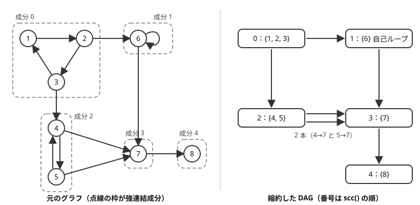

!!! abstract "要点"
    - **何ができるか**：有向グラフを、互いに行き来できる頂点の極大集合（強連結成分）に分ける。成分を 1 点に縮めると DAG になるので、閉路のあるグラフでも DAG 上の DP やトポロジカル順の処理が使える。
    - **いつ使うか**：
        - 互いに行き来できる頂点の組・グループ
        - 何度でもくり返せる（閉路の中にいる）
        - 閉路を 1 点に縮めた DAG の上で DP・数え上げをしたくなる
    - **計算量**：$O(N + M)$（Kosaraju・Tarjan のどちらも。ACL の `scc_graph` は成分をトポロジカル順に返す）
    - **前提**：[トポロジカルソート](../graph/topological-sort.md)

<!-- textlint-disable -->
別名：強連結成分・SCC・Kosaraju・Tarjan・strongly connected components
<!-- textlint-enable -->

強連結成分分解は、有向グラフの頂点を「互いに行き来できる」という関係で分ける方法である。分けた成分を 1 点に縮めたグラフには閉路がないので、閉路のせいで DP の順序が決まらない問題を、DAG の問題に直せる。頂点数 $N$・辺数 $M$ に対して $O(N + M)$ で求まり、AtCoder では ACL の `scc_graph` を呼べば足りることが多い。

## 縮約したグラフが DAG になる理由 {#condensation}

有向グラフで、頂点 $u$ から $v$ へも $v$ から $u$ へも辿り着けるとき、$u$ と $v$ は互いに行き来できるという。互いに行き来できることを $u \leftrightarrow v$ と書き、どの頂点も自分自身とは行き来できるとみなす。この関係は、$u \leftrightarrow u$（反射律）、$u \leftrightarrow v$ なら $v \leftrightarrow u$（対称律）、$u \leftrightarrow v$ かつ $v \leftrightarrow w$ なら $u \leftrightarrow w$（推移律）の 3 つを満たす。よって頂点全体は重なりのないグループに分かれる。各グループを強連結成分（SCC）と呼ぶ。閉路に乗らない頂点は 1 頂点だけの成分になる。

成分を 1 つの頂点に縮め、成分をまたぐ辺だけを残したグラフを縮約したグラフ（condensation）と呼ぶ。次の図は 8 頂点・12 辺のグラフと、その縮約である（頂点は 1-indexed）。



図の下側には閉路がない。これはどんなグラフでも成り立つ。

> 縮約したグラフは必ず DAG である。

縮約したグラフに閉路 $C_1 \to C_2 \to \dots \to C_k \to C_1$（$k \ge 2$）があったとする。成分の中では自由に動けるので、$C_1$ のどの頂点からも閉路に沿って $C_2$ のどの頂点へも行け、$C_2$ から閉路を一周して $C_1$ へも戻れる。すると $C_1$ と $C_2$ の頂点は互いに行き来でき、同じ成分に入るはずである。これは成分が別であることに反する。

DAG になると、[トポロジカルソート](../graph/topological-sort.md)で成分を並べられる。すべての辺が前の成分から後ろの成分へ向く順である。成分の中の頂点は互いに行き来できるので、「どの頂点に行けるか」「何を拾えるか」は成分の単位で同じになる。閉路を気にせず成分の単位で考えられることが、強連結成分分解を使う理由のほとんどである。

## Kosaraju と Tarjan {#algorithms}

強連結成分分解の代表的なアルゴリズムは 2 つあり、どちらも [DFS](../graph/dfs.md) を使って $O(N + M)$ で動く。ACL を使うなら中身を知らなくても書けるが、「なぜ成分がトポロジカル順に出てくるか」を知っておくと、縮約した DAG の使い方を間違えにくい。

### Kosaraju 法（DFS を 2 回）

Kosaraju 法は、次の 2 回の DFS で成分を求める。

1. 元のグラフで、まだ訪れていない頂点から DFS をくり返し、各頂点を[帰りがけ順](../graph/dfs.md#pre-post-order)に並べる
2. 辺の向きをすべて逆にしたグラフ（逆辺のグラフ）を作る。1 の帰りがけ順の逆（最後に帰りがけした頂点から）に頂点を見て、まだ成分の決まっていない頂点から逆辺のグラフで DFS する。1 回の DFS で届いた頂点が、ちょうど 1 つの成分になる

正しさの鍵は、次の性質である。成分 $C$ の帰りがけの時刻の最大を $f(C)$ と書く。

> 成分 $C$ から成分 $D$ へ辺があれば、$f(C) > f(D)$ である。

1 の帰りがけ順の逆で最初に見る頂点は、$f$ が最大の成分にある。この性質により、その成分には他の成分から入る辺がない。逆辺のグラフでは、そこから出る辺がないことになる。だから 2 回目の DFS はその成分の外へ出られず、成分の中は互いに行き来できるので成分全体に届く。次の DFS の始点は、まだ決まっていない成分の中で $f$ が最大の成分にあり、そこから逆辺で出られる先は、すでに決まった成分だけである。こうして 1 回の DFS ごとに 1 つの成分が決まり、決まる順はトポロジカル順になる。

??? note "証明（f(C) > f(D) となる理由）"
    1 回目の DFS が $C \cup D$ の頂点のうち最初に訪れた頂点を $x$ とする。

    - $x$ が $C$ にあるとき：$x$ を訪れた時点で $C \cup D$ の頂点はどれも未訪問で、$x$ からはすべてに辿り着ける（$C$ の中は自由に動け、辺で $D$ へ移れる）。DFS は $x$ から辿り着ける未訪問の頂点をすべて訪れてから $x$ の帰りがけをするので、$D$ のどの頂点も $x$ より先に帰りがけする。よって $f(C) \ge (x \text{ の時刻}) > f(D)$
    - $x$ が $D$ にあるとき：$D$ から $C$ へは辿り着けない（辿り着けるなら $C$ と $D$ は同じ成分になる）。$x$ からの DFS は $D$ の頂点をすべて訪れて終わり、その間に $C$ の頂点は訪れない。$C$ の頂点を訪れるのはその後なので、$C$ の頂点の帰りがけはどれも $D$ のどの頂点より後になる。よって $f(C) > f(D)$

??? note "C++ の実装例（Kosaraju 法）"
    ```cpp
    --8<-- "scc/kosaraju.cpp:core"
    ```

    完全なプログラム：[`kosaraju.cpp`](https://github.com/yuukougun/kyopro-atlas/blob/main/snippets/scc/kosaraju.cpp)（GitHub）
    { .kp-code-src }

    `comp[v]` は 0 から始まる成分の番号で、番号の小さい成分から大きい成分へだけ辺が向く。

### Tarjan 法（DFS を 1 回）

Tarjan 法は、DFS 1 回で成分を求める。ACL の `scc_graph` の中身はこちらである。各頂点 $v$ に次の 2 つの値を持たせる。

- $\mathrm{ord}[v]$：$v$ を訪れた順番（行きがけの番号）
- $\mathrm{low}[v]$：$v$ の DFS 木の部分木から、DFS 木の辺を下りて最後に 1 本だけ別の辺を使って辿り着ける頂点のうち、まだ成分の決まっていない頂点の $\mathrm{ord}$ の最小

訪れた頂点を順にスタックに積んでおき、$v$ の帰りがけで $\mathrm{low}[v] = \mathrm{ord}[v]$ なら、スタックの $v$ より上にある頂点と $v$ をまとめて取り出して 1 つの成分にする。$\mathrm{low}[v] = \mathrm{ord}[v]$ は「$v$ の部分木からは、$v$ より前に訪れた頂点のうち、まだ成分の決まっていないものへ戻れない」ことを表す。これは $v$ が成分の中で最初に訪れた頂点（成分の根）であることを意味する。

```text
dfs(v):
    ord[v] ← low[v] ← (訪れた数); 訪れた数 を 1 増やす; v をスタックに積む
    v から出る各辺 v → to について:
        to が未訪問なら dfs(to) して low[v] ← min(low[v], low[to])
        to が訪問済みなら low[v] ← min(low[v], ord[to])
    low[v] = ord[v] なら:
        v が出てくるまでスタックから頂点を取り出し、それらを 1 つの成分にする
        取り出した頂点の ord を N にする      # 決まった成分の頂点は、以後 low に効かない
```

Tarjan 法では、出口のない成分（DAG の末端）から先に決まる。成分の決まる順はトポロジカル順の逆なので、ACL は最後に番号を逆にして、前から後ろへ向く順で返している。同じ $\mathrm{ord}$ と $\mathrm{low}$ を無向グラフで使うと橋と関節点が求まる（[橋・関節点・二重連結成分](../graph/lowlink.md#vs-scc)）。ただし判定の条件は異なる。

### 計算量とその根拠

どちらの方法も、各頂点を 1 回だけ訪れ、各辺を 1 回だけ（Kosaraju 法は元のグラフと逆辺のグラフで 1 回ずつ）調べる。よって時間は $O(N + M)$ で、領域も $O(N + M)$ である。Kosaraju 法は逆辺のグラフを持つぶん、メモリが多い。どちらも再帰で書くと、一直線のグラフで深さが $N$ になる（[非再帰の DFS と再帰の深さ](../graph/dfs.md#iterative)）。ACL の `scc_graph` も中で再帰を使っている。

## ACL の scc_graph（トポロジカル順の成分のリスト） {#acl}

ACL の `scc_graph` は、強連結成分を「頂点のリストのリスト」として返す。返すリストの並びがトポロジカル順になっていることが、使い方のほぼすべてを決める。

!!! info "ACL では"
    `scc_graph g(n);`。`g.add_edge(from, to)` はならし $O(1)$ で有向辺を足し、`g.scc()` は $O(N + M)$ で `vector<vector<int>>` を返す。各頂点はちょうど 1 つのリストに入り、内側のリストが 1 つの成分である。異なる成分の頂点 $u, v$ について、$u$ から $v$ へ辿り着けるなら $u$ のリストが前に来る。リストの中の頂点の順は決まっていない。頂点は 0-indexed で、$0 \le \mathit{from}, \mathit{to} < n$。

`scc()` の結果から、各頂点の成分の番号 `comp[v]` を作っておくと扱いやすい。番号を `scc()` の順にすれば、成分をまたぐ辺 $u \to v$ は必ず `comp[u] < comp[v]` を満たす。$u$ から $v$ へ辺で辿り着けるので、$u$ の成分が前に来るからである。よって縮約した DAG の辺は、番号の小さい成分から大きい成分へだけ向く。

次のコードは、各頂点に非負の価値 $w_v$ があるグラフで、得られる価値の和の最大を求める。頂点 1 から辺をたどって好きなだけ動き、どこで止めてもよい。各頂点の価値は初めて訪れたときに 1 回だけ得る。成分の番号を作り、縮約した DAG を組み、後ろの成分から DP する（DP の意味は[縮約した DAG の上で DP する](#dp-on-dag)）。

```cpp
--8<-- "scc/condense-dp.cpp:core"
```

完全なプログラム：[`condense-dp.cpp`](https://github.com/yuukougun/kyopro-atlas/blob/main/snippets/scc/condense-dp.cpp)（GitHub）
{ .kp-code-src }

- **順の向き**：`scc()` の順は「辺が前から後ろへ向く」順である。「行き先の値から自分の値を決める」DP は後ろの成分から、「来た元の値を配る」DP は前の成分から回す
- **前にあっても辿り着けるとは限らない**：保証されるのは「辿り着けるなら前」だけである。番号が小さいからといって、大きい番号の成分へ辿り着けるとは限らない
- **DAG なら頂点の並びそのもの**：閉路のないグラフでは成分が 1 頂点ずつになり、`scc()` の順がそのままトポロジカル順になる。ただし辞書順最小のトポロジカル順になるとは限らない（[トポロジカルソート](../graph/topological-sort.md)）

## 閉路に含まれる頂点（自己ループに注意） {#on-cycle}

「何度でもくり返せる」「いつまでも続けられる」と問われたら、閉路に含まれる頂点を調べることが多い。強連結成分を使うと、各頂点が閉路に含まれるかは次のように決まる。

> 頂点 $v$ がある閉路に含まれるのは、$v$ の成分の頂点数が 2 以上か、$v$ に[自己ループ](../guide/glossary.md#self-loop)（$v \to v$ の辺）があるときである。

成分の頂点数が 2 以上なら、同じ成分の別の頂点 $u$ があり、$v \to u \to v$ と戻る道がある。同じ頂点を 2 度通る道でも、$v$ に戻る道のうち最短のものは同じ頂点を 2 度通らないので閉路になる。逆に $v$ が長さ 2 以上の閉路に含まれれば、閉路上の別の頂点と行き来できるので成分の頂点数は 2 以上である。残るのは長さ 1 の閉路、すなわち自己ループだけである。

自己ループは成分の大きさを変えないので、`scc()` の結果だけを見ると見落とす。辺を読むときに自己ループの有無を別の配列に記録しておく。

```cpp
--8<-- "scc/on-cycle.cpp:core"
```

完全なプログラム：[`on-cycle.cpp`](https://github.com/yuukougun/kyopro-atlas/blob/main/snippets/scc/on-cycle.cpp)（GitHub）
{ .kp-code-src }

閉路に含まれる頂点が分かれば、「閉路に辿り着ける頂点」（そこから無限に動き続けられる頂点）も求まる。縮約した DAG で、自分が閉路の成分であるか、行き先に「辿り着ける」成分があれば「辿り着ける」とし、後ろの成分から決めればよい。同じ答えは、出次数 0 の頂点を逆辺で取り除いていく方法でも求まる（[トポロジカルソート](../graph/topological-sort.md)）。

各頂点から出る辺がちょうど 1 本のグラフでは、強連結成分を使わなくても閉路を見つけられる（[Functional graph](../graph/functional-graph.md)）。強連結成分分解は辺の本数に制限がないときにも使える一般の方法である。

## 縮約した DAG の上で DP する {#dp-on-dag}

閉路の中を何度回っても得るものが変わらない問題では、成分を 1 点に縮めて [DAG 上の DP](../dp/dp-dag.md#with-cycles) をする。手順は次のとおりである。

1. `scc()` から成分の番号 `comp[v]` を作り、成分ごとの値（頂点数・価値の和・閉路かどうかなど）をまとめる
2. 元の辺 $u \to v$ のうち `comp[u] != comp[v]` のものだけを、成分の間の辺として残す
3. `scc()` の順（またはその逆）に成分を回して DP する

[ACL の scc_graph](#acl) のコードはこの形で、状態と遷移は次のとおりである。

$$
\mathrm{dp}[c] = \mathrm{val}[c] + \max_{c \to d} \mathrm{dp}[d] \quad (\text{行き先がなければ } \max \text{ の項は } 0)
$$

$\mathrm{dp}[c]$ は「成分 $c$ に入ってから得られる価値の和の最大」である。成分 $c$ に入れば $c$ の頂点をすべて回ってから好きな出口を選べる。価値が非負なので成分の頂点をすべて回っても損をせず、$c$ の価値はまとめて得られる。辺は番号の大きい成分へ向くので、番号の大きい順に計算すれば行き先の値はすでに決まっている。答えは $\mathrm{dp}[\mathrm{comp}[0]]$ である。

縮約してよいかは、閉路を回ったときに答えが変わるかで決まる。

- **縮約してよい**：辿り着けるか、拾える頂点の種類数、各頂点で 1 回だけ得る価値の和の最大、閉路に辿り着けるか
- **縮約できない**：通るたびに価値が増える（正の閉路を回れば無限大）、ウォークの数を数える（閉路があれば無限）、最短路（成分の中でも頂点ごとに距離が違うので、1 点に縮められない。閉路を回る得もないので、縮約は要らない）

「無向グラフを、値が減らないように進む」のような条件では、行き来できるのは同じ値の頂点の間だけである。元の無向グラフの各辺に、値の小さい方から大きい方へ（同じ値なら両方向に）向きを付けて縮約すると、同じ値の頂点がまとまって DAG になる（[DAG だと気づく・作る](../dp/dp-dag.md#find-dag)）。

成分の間の辺は多重辺になりうる（図の成分 2 から成分 3 への 2 本）。最大値や「辿り着けるか」の DP では多重辺があっても結果は変わらない。経路の数を数える DP や、入ってくる成分の数そのものを答えに使う場合は、同じ辺を 2 度数えて答えがずれる。縮約した辺を `sort` と `unique` で 1 本にまとめてから使う。

## 縮約の応用の型（組の数・不等式の割り当て・2-SAT） {#patterns}

強連結成分分解の使い方は、「同じ成分かどうか」を使う型と、「成分の順序」を使う型に分かれる。

- **互いに行き来できる組の数**（サイン：互いに行き来できる頂点の組）：組は同じ成分の中にしかないので、頂点数 $s$ の成分ごとに $\binom{s}{2} = s(s - 1)/2$ を足す。頂点数が $10^5$ なら組の数は約 $5 \times 10^9$ で、`int` に収まらない（[例題](#typical90_u)）
- **不等式を満たす割り当て**（サイン：「$x_u \le x_v$」「$x_u < x_v$」の条件が並ぶ）：条件ごとに辺 $u \to v$ を張る。同じ成分の頂点は $\le$ が一周するので全部等しくなければならず、その中に $<$ の辺があれば矛盾である。矛盾がなければ、成分に `scc()` の順で $1, 2, 3, \dots$ を割り当てると、成分をまたぐどの辺でも前の成分の値が小さくなり、すべての条件を満たす
- **真偽の割り当て**（サイン：各条件が「$a$ または $b$」の形の真偽の割り当て）：条件を含意の辺に直して強連結成分分解し、$x$ と「$x$ でない」が同じ成分なら充足できない。そうでなければ成分の順から割り当てが作れる（[2-SAT](../graph/two-sat.md#unsatisfiable)）
- **縮約した DAG での最適化**：縮約してから到達可能性を全部求める（[bitset による高速化](../misc/bitset-speedup.md#reachability)）、最小パス被覆を求める（[最小パス被覆と Hall の定理](../graph/dilworth-path-cover.md#path-cover)）など、DAG の手法を重ねる問題もある

## 落とし穴 {#pitfalls}

- **自己ループの見落とし**：自己ループのある頂点は 1 頂点の成分のまま閉路に含まれる。「成分の頂点数が 2 以上」だけで判定すると数え落とす（[閉路に含まれる頂点](#on-cycle)）
- **Kosaraju 法の 2 回目を元のグラフで行う**：2 回目は逆辺のグラフで、帰りがけ順の逆に始点を選ぶ。元のグラフで DFS すると、始点の成分から辿り着ける成分まで 1 つにまとめてしまう
- **DP を回す向きの取り違え**：`scc()` の順は辺が前から後ろへ向く順で、Tarjan 法の素の出力（成分の決まる順）とは逆である。自作の実装と ACL を混ぜるときは、どちら向きの番号かを確かめる
- **縮約した辺の多重辺**：経路の数や、入ってくる成分の数を数えるなら、成分の間の辺を 1 本にまとめる（[縮約した DAG の上で DP する](#dp-on-dag)）
- **辿り着ける頂点の数を足し算で求める**：「成分 $c$ から辿り着ける頂点の数」を行き先の値の和で求めると、ひし形のように 2 通りの道で辿り着ける成分を 2 度数える。辿り着ける集合の大きさは、bitset の OR で集合として求める（[bitset による高速化](../misc/bitset-speedup.md#reachability)）。各頂点から辺がちょうど 1 本出るグラフでは道が 1 本に決まるので、足し算でよい
- **無向グラフに使う**：無向の辺を両向きの有向辺にすると、つながった頂点はすべて同じ成分になり、閉路の判定にも使えない。無向グラフは[連結成分](../graph/connected-components.md)や[橋と関節点](../graph/lowlink.md)で扱う
- **添字と再帰の深さ**：ACL の頂点は 0-indexed なので、1-indexed の入力は 1 を引いて渡す。自作の DFS は一直線のグラフで再帰が深くなる

## 例題 {#examples}

### PRACTICE2 G. SCC {#practice2_g}

<div class="kp-problems" data-role="example" markdown>

- [PRACTICE2 G. SCC](https://atcoder.jp/contests/practice2/tasks/practice2_g)（diff —）：有向グラフの頂点を、互いに行き来できる頂点の極大の集まりに分け、集まりの間の辺が前から後ろへ向く順に出力する

</div>

ACL の練習用の問題で、`scc_graph` に辺を足して `scc()` を呼び、返ったリストをそのまま出力すれば解ける。出力の順の条件は、`scc()` が返すトポロジカル順の保証と同じである。

??? note "解法の詳細"
    頂点は 0-indexed で与えられるので、そのまま `add_edge(u, v)` に渡す。`scc()` の戻り値の大きさが成分の数で、各リストの大きさと頂点を順に出力する。リストの中の頂点の順は問われないので、並べ替えは要らない。全体で $O(N + M)$ である。

### 典型90 021. Come Back in One Piece（★5） {#typical90_u}

<div class="kp-problems" data-role="example" markdown>

- [典型90 021. Come Back in One Piece（★5）](https://atcoder.jp/contests/typical90/tasks/typical90_u)（diff —）：有向グラフで、互いに行き来できる頂点の組の数を求める

</div>

互いに行き来できる 2 頂点は同じ成分にあり、同じ成分の 2 頂点は必ず互いに行き来できる。だから成分ごとに頂点数 $s$ から $s(s - 1)/2$ を数えて足せばよい。

??? note "解法の詳細"
    想定解は Kosaraju 法で書かれている。1 回目の DFS で帰りがけ順を作り、その逆の順に逆辺のグラフで 2 回目の DFS をする。2 回目の DFS 1 回で届いた頂点の数が 1 つの成分の頂点数 $s$ で、そのたびに $s(s - 1)/2$ を答えに足す。ACL なら `scc()` の各リストの大きさを使えば同じである。組の数は `int` に収まらないことがあるので `long long` で数える。全体で $O(N + M)$ である。

## 練習問題 {#practice}

<div class="kp-problems" data-role="practice" markdown>

- [ABC296 E. Transition Game](https://atcoder.jp/contests/abc296/tasks/abc296_e)（diff 1285）：x から A_x へ移る操作について、相手が回数 K をどう選んでも、出発点をうまく選べば K 回の移動の後に i にいられるような i の個数を求める。
- [ABC357 E. Reachability in Functional Graph](https://atcoder.jp/contests/abc357/tasks/abc357_e)（diff 1295）：各頂点から辺がちょうど 1 本出る有向グラフで、u から v へ到達できる組 (u, v) の数を求める
- [ABC478 E. lt and le](https://atcoder.jp/contests/abc478/tasks/abc478_e)（diff 1376）：「x_u < x_v」または「x_u ≤ x_v」の形の条件をすべて満たす整数の割り当てがあるかを判定し、あれば 1 つ示す。

</div>

??? note "方針"
    - **ABC296 E**：辺 $i \to A_i$ のグラフで、閉路に含まれる頂点を数える。$A_i = i$ は自己ループなので、1 頂点の成分でも数える（[閉路に含まれる頂点](#on-cycle)）。強連結成分を使わず、入次数 0 の頂点から取り除いていく方法でも解ける（[Functional graph](../graph/functional-graph.md)）
    - **ABC357 E**：閉路の成分の頂点からは、その閉路の頂点数だけの頂点に辿り着ける。閉路にない頂点 $v$ からは、行き先から辿り着ける数に $v$ 自身を足した数になる。後ろの成分から順に決めて合計する。道が 1 本なので足し算で数えてよい。答えは $N^2$ 程度まで大きくなるので `long long` で数える
    - **ABC478 E**：条件ごとに辺 $u \to v$ を張って強連結成分分解する。同じ成分の中に $<$ の条件があれば割り当てはない。なければ成分に `scc()` の順で $1, 2, 3, \dots$ を割り当てる（[縮約の応用の型](#patterns)）

## 確認問題 {#quiz}

??? question "確認問題：縮約したグラフに閉路ができないのはなぜか"
    閉路があると、閉路上の成分どうしが互いに行き来できることになる。成分の中は自由に動けるので、閉路上の 2 つの成分の頂点は互いに行き来でき、同じ成分に入るはずである。これは成分が別であることに反する。

??? question "確認問題：頂点が 1 つだけの成分が閉路を含むのはどんなときか"
    その頂点に自己ループがあるときだけである。長さ 2 以上の閉路に含まれる頂点は、閉路上の別の頂点と行き来できるので、成分の頂点数が 2 以上になる。

??? question "確認問題：Kosaraju 法の 2 回目の DFS を元のグラフで行うとどうなるか"
    3 頂点の一直線 $1 \to 2 \to 3$ で考える。頂点 1 から 1 回目の DFS をすると、帰りがけ順は $3, 2, 1$ で、その逆は $1, 2, 3$ である。元のグラフで頂点 1 から 2 回目の DFS をすると $1, 2, 3$ のすべてに届き、1 つの成分と誤って判定する。逆辺のグラフなら頂点 1 からはどこへも行けず、正しく 3 つの成分に分かれる。

??? question "確認問題：成分ごとの「辿り着ける頂点の数」を、行き先の成分の値の和で求めてはいけないのはなぜか"
    成分 $a$ から $b$ と $c$ へ辺があり、$b$ と $c$ のどちらからも $d$ へ辺があるとする。$a$ の値を $b$ と $c$ の値の和で作ると、$d$ の頂点を 2 度数える。辿り着ける頂点の集合は和集合で求める必要があり、bitset で表して OR を取る。

## 使い分け {#comparison}

| 状況 | 使う手法 |
| --- | --- |
| 無向グラフで、つながっている頂点のグループ | [連結成分](../graph/connected-components.md) |
| 有向グラフで、閉路があるかだけを知りたい | [トポロジカルソート](../graph/topological-sort.md)・[閉路の検出](../graph/cycle-detection.md) |
| 各頂点から辺がちょうど 1 本出る | [Functional graph](../graph/functional-graph.md)（強連結成分分解でも解ける） |
| 有向グラフで、互いに行き来できるか・閉路を縮めたい | 強連結成分分解 |
| 無向グラフで、切ると分かれる辺・頂点 | [橋と関節点](../graph/lowlink.md) |
| 真偽の割り当てで、各条件が「a または b」 | [2-SAT](../graph/two-sat.md) |

## 参考 {#references}

- [AtCoder Library「SCC」（document_ja）](https://github.com/atcoder/ac-library/blob/master/document_ja/scc.md)：`scc_graph` の関数・制約・計算量と、返すリストがトポロジカル順である保証（v1.6 の手元の版で確かめた）
- [AtCoder Library「internal_scc.hpp」](https://github.com/atcoder/ac-library/blob/master/atcoder/internal_scc.hpp)：中身が Tarjan 法で再帰を使うこと、決まった成分の頂点の ord を n にすること、最後に番号を逆にしていること
- [AtCoder Library「scc_practice.cpp」](https://github.com/atcoder/ac-library/blob/master/test/example/scc_practice.cpp)：例題 practice2_g の使い方
- [E869120「kyopro_educational_90 sol/021.cpp」](https://github.com/E869120/kyopro_educational_90/blob/main/sol/021.cpp)：例題 typical90_u の想定解（Kosaraju 法と成分ごとの組の数）
- [kyo-pro「ABC296E - Transition Game」](https://kyo-pro.hatenablog.com/entry/ABC296E)：練習 abc296_e の言い換え（閉路に含まれる頂点を数える）
- [drken「AtCoder ABC 357 E - Reachability in Functional Graph (1D, 水色, 450 点)」](https://drken1215.hatenablog.com/entry/2024/06/09/231700)：練習 abc357_e の数え方（閉路の頂点数と、閉路にない頂点の値）
- [ikatakos「AtCoder Beginner Contest 478 E,F,G問題メモ」](https://ikatakos.com/pot/programming_algorithm/contest_history/atcoder/2026/1003_abc478)：練習 abc478_e の辺の張り方と矛盾の条件（解法の部分だけ）
- [torus711「AtCoder Beginner Contest 335, E : Non-Decreasing Colorful Path」](https://torus711.hatenablog.com/entry/2024/01/07/215719)：値が減らない移動を有向辺にして縮約し、DAG 上で DP する型
