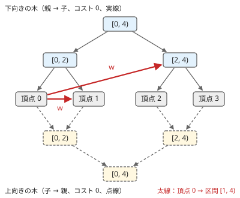
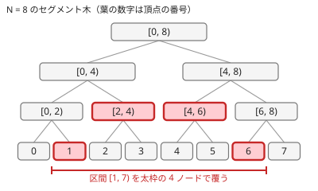

!!! abstract "要点"
    - **何ができるか**：頂点から区間内の全頂点へ辺がある問題で、セグメント木のノードを[補助頂点](../guide/glossary.md#auxiliary-vertex)にして区間を $O(\log N)$ 個で覆い、辺の数を $O(M \log N)$ に減らして最短路を求める。
    - **いつ使うか**：頂点から区間内の全頂点へ移動できる・区間から区間へ移動できる
    - **計算量**：頂点 $O(N + M)$、辺 $O(N + M \log N)$。ダイクストラ法と合わせて $O((N + M \log N) \log N)$（$N$ は元の頂点数、$M$ は区間の辺の本数）
    - **前提**：[状態を頂点にする](../graph/extended-dijkstra.md)、[セグメント木](../ds/segment-tree.md)

<!-- textlint-disable -->
別名：区間に辺を張るテク・セグ木グラフ・セグメント木の形の補助頂点・segment tree graph
<!-- textlint-enable -->

区間に辺を張る手法は、[セグメント木](../ds/segment-tree.md)のノードを補助の頂点としてグラフに足し、「頂点 $u$ から区間 $[l, r)$ の全頂点へコスト $w$」のような辺を $O(\log N)$ 本で表す手法である。辺をそのまま張ると区間の辺 1 本につき $r - l$ 本、全体で $O(NM)$ 本になって間に合わない。この手法なら、距離を変えずに $O(M \log N)$ 本に減らせる。グループ内の全点を 1 つの[超頂点](../graph/extended-dijkstra.md#super-vertex)でつなぐ考え方を、区間の形に合わせて何段にも重ねたものとみればよい。

ABC では難しい G（difficulty 3000 前後）で 1 問確かめられただけで、黄までの範囲で必須になることはまれである。「区間から区間へ移動できる」最短路に出会ったときの切り札として知っておけばよい。

## 下向きの木と上向きの木（コスト 0 の辺） {#two-trees}

区間に辺を張るグラフは、元の頂点 $0, \dots, N-1$ を葉に持つセグメント木を 2 本用意して作る。

- **下向きの木**：各ノードから 2 つの子へ、コスト 0 の辺を張る。ノード $[a, b)$ に入れば、その下の葉 $a, \dots, b-1$ のどれにも追加のコストなしで降りられる。
- **上向きの木**：各ノードから親へ、コスト 0 の辺を張る。葉 $v$ からは、$v$ を含むどのノードにも追加のコストなしで登れる。

葉は 2 本の木で共有し、元の頂点そのものとする。新しく足すのは 2 本の木の内部のノードで、それぞれ $N - 1$ 個である。



辺の向きごとに、使う木が決まる。

- **頂点 $u$ → 区間 $[l, r)$（コスト $w$）**：$[l, r)$ を覆う下向きの木のノードそれぞれへ、$u$ からコスト $w$ の辺を張る。ノードに入った後は 0 で葉まで降りられるので、区間内のどの頂点へも $w$ で届く。
- **区間 $[l, r)$ → 頂点 $v$（コスト $w$）**：$[l, r)$ を覆う上向きの木のノードそれぞれから、$v$ へコスト $w$ の辺を張る。区間内のどの頂点も 0 でそのノードまで登れる。
- **区間 $[l_1, r_1)$ → 区間 $[l_2, r_2)$（コスト $w$）**：中継の頂点 $x$ を 1 つ足し、$[l_1, r_1)$ を覆う上向きの木のノードから $x$ へコスト $w$、$x$ から $[l_2, r_2)$ を覆う下向きの木のノードへコスト 0 の辺を張る。$x$ を置かずに覆うノードの組をすべて結ぶと $O(\log^2 N)$ 本になるが、$x$ を置けば $O(\log N)$ 本で済む。

**距離が変わらない理由**：頂点 $u$ から区間 $[l, r)$ への辺で考える。元の辺 $u \to v$（$v \in [l, r)$）は、$u \to$（$v$ を含む覆うノード）$\to \dots \to v$ の道に対応し、コストは $w + 0 + \dots + 0 = w$ で等しい。逆に、下向きの木を通る道は必ず「コスト $w$ の辺で覆うノードに入り、コスト 0 の辺で葉まで降りる」形をしているので、元の辺 1 本に戻せる。上向きの木も向きを逆にして同じである。区間から区間の辺でも、$x$ に入るにはコスト $w$ の辺を 1 本通るしかないので、$x$ を通る道は元の辺 1 本（$[l_1, r_1)$ のどれか → $[l_2, r_2)$ のどれか）にちょうど対応する。下向きの木は降りることしかできず、上向きの木は登ることしかできないので、区間の外の葉へ漏れ出すことはない。1 本の木に両方の向きの辺を張ると、葉から登って別の枝へ 0 で降りられてしまい、距離が壊れる。2 本に分けるのはこのためである。

## 区間を O(log N) 個のノードで覆う {#cover}

区間 $[l, r)$ は、セグメント木で区間の値を取得するときに使うノードの集まりで、ちょうど重なりなく覆える。その個数は各段で高々 2 個、全体で $O(\log N)$ 個である（理由は[セグメント木の計算量](../ds/segment-tree.md#complexity)と同じ）。



たとえば $N = 8$ で区間 $[1, 7)$ への辺を張るなら、覆うノードは葉 $1$・$[2, 4)$・$[4, 6)$・葉 $6$ の 4 つで、辺は 6 本でなく 4 本で済む。区間の長さが $N$ に近くても辺の本数は $2 \log_2 N$ 程度にとどまる。

これで計算量が決まる。木の内部のノードは 2 本で $2(N - 1)$ 個、木の辺は $4(N - 1)$ 本である。区間の辺 1 本あたり、補助の辺は $O(\log N)$ 本（区間から区間なら中継の頂点が 1 つ増える）なので、全体で頂点 $O(N + M)$、辺 $O(N + M \log N)$ になる。コストが非負ならこのグラフで[ダイクストラ法](../graph/dijkstra.md)を回し、$O((N + M \log N) \log N)$ で全頂点への距離が求まる。コストがすべて 1 のような場合も、補助の辺にコスト 0 が混ざるので BFS ではなく [01-BFS](../graph/zero-one-bfs.md) かダイクストラ法を使う。

## 自作するときの要点と Library Checker {#library}

ACL にこの手法の部品はなく、セグメント木の添字をそのまま頂点の番号に使って自作する。[非再帰のセグメント木](../ds/segment-tree.md#invariants)の番号付け（ノード $i$ の子が $2i$ と $2i+1$）を、葉の数を 2 の冪に切り上げずに $N$ のまま使うと短く書ける。葉 $v$ は $N + v$ になる。

- **頂点の番号**：下向きの木のノード $i$（$1 \le i < 2N$）はそのまま $i$、上向きの木の内部のノード $i$（$1 \le i < N$）は $2N + i$ とし、葉 $N + v$ は 2 本で共有する。中継の頂点は $3N$ 以降に足していく。元の頂点 $v$ の距離は、番号 $N + v$ の頂点の距離として読む。
- **覆うノードの列挙**：区間の値を取得する非再帰のループ（$l$ と $r$ に $N$ を足し、端が奇数ならそのノードを取って 1 段上がる）をそのまま使い、取った各ノードに辺を張る。$N$ を 2 の冪に切り上げなくても、このループは正しく覆う。2 の冪でない $N$ では葉が端をまたいで並ぶ内部のノードもあるが、ループが取るノードはどれも $[l, r)$ の中に収まるからである。不安なら 2 の冪に切り上げてもよい（下のコード片の試験は 2 の冪でない $N$ も含む）。
- **木の向きを取り違えない**：「区間から出る」のは上向きの木、「区間に入る」のは下向きの木である。逆にすると、区間の外へ漏れる・区間の中へ届かないのどちらかになる。
- **距離は `long long` で**：補助の辺のコストは 0 で和を増やさない。それでも元のコストの和が `int` を超えることは多い。

中心の部分は次のとおりである（完全なプログラムは [`snippets/segment-tree-graph/range-edges.cpp`](https://github.com/yuukougun/kyopro-atlas/blob/main/snippets/segment-tree-graph/range-edges.cpp)）。区間から区間への辺を `add_edge` で張る。小さい乱数の入力で、区間の全組に辺を張る愚直な方法と距離を照らし合わせている。

```cpp
--8<-- "segment-tree-graph/range-edges.cpp:core"
```

完全なプログラム：[`range-edges.cpp`](https://github.com/yuukougun/kyopro-atlas/blob/main/snippets/segment-tree-graph/range-edges.cpp)（GitHub）
{ .kp-code-src }

Library Checker にこの手法そのものの問題はない。ふつうの最短路は Shortest Path で確かめられるので、ダイクストラ法をそこで確かめてから、区間の辺の部分は上のコード片のように愚直な方法と照らし合わせて確かめる。

## 学ぶための資料 {#resources}

- OI Wiki の「线段树基础」の節「应用：线段树优化建图」（中国語）：入る木（下向き）と出る木（上向き）の 2 本を作る図と、点から区間・区間から点の辺を張る最短路の例題がまとまっている
- kmjp 氏の ABC414 G の記録：区間から区間への辺に、移動距離に応じたコストが付く応用。補助の辺のコストを負にしない工夫が要点になる

## 例題 {#examples}

### ABC414 G. AtCoder Express 4 {#abc414_g}

<div class="kp-problems" data-role="example" markdown>

- [ABC414 G. AtCoder Express 4](https://atcoder.jp/contests/abc414/tasks/abc414_g)（diff 3020）：一直線上に並ぶ駅と、乗る駅の区間と降りる駅の区間が決まった何種類もの列車があり、運賃は列車ごとの基本料金と移動距離の和であるとき、駅 1 から各駅への最小の費用を求める。

</div>

方針：列車 1 つが「区間から区間へ」の辺である。乗る駅の区間と降りる駅の区間は重ならないので、東向きと西向きの列車に分けられる。列車ごとに乗る頂点と降りる頂点を足し、その間に基本料金の辺を張る。移動距離の分は木の辺のコストに割り振り、割り振り方が向きで変わるので、乗る用と降りる用の木を向きごとに用意する（4 本）。

??? note "解法の詳細"
    東向き（降りる駅の区間が乗る駅の区間より東）の列車では、降りる駅の区間の西端の駅を $L$ として、移動距離 $X_t - X_s$ を降りる区間の西端 $X_L$ で 2 つに分けて $(X_L - X_s) + (X_t - X_L)$ とする。区間が重ならないので、どちらも 0 以上になる。

    - 乗る用の上向きの木では、子から親への辺のコストを「子の東端から親の東端までの距離」にする。駅 $s$ からノードまで登るコストが「ノードの東端 − $X_s$」になる。
    - 乗る区間を覆うノードから列車の頂点へ、コスト「$X_L$ − ノードの東端」の辺を張る（0 以上）。列車の乗る頂点から降りる頂点へは基本料金の辺を張る。
    - 降りる頂点から、降りる区間を覆う下向きの木のノードへ、コスト「ノードの西端 − $X_L$」の辺を張る。下向きの木の親から子への辺のコストは「親の西端から子の西端までの距離」にする。

    こうすると、どの道も合計が基本料金 $+ X_t - X_s$ になり、すべての辺のコストが 0 以上なのでダイクストラ法が使える。西向きは東西を入れ替えて同じように作る。コストを単純に「乗る駅からの距離」で付けようとすると負の辺が出るのが、この問題の難しいところである。

## 参考 {#references}

- [OI Wiki「线段树基础」](https://oi-wiki.org/ds/seg/)：学ぶための資料。節「应用：线段树优化建图」の入る木と出る木の作り方と、点から区間・区間から点の辺（文章・図・コードは使っていない）
- [kmjp「AtCoder ABC #414 (ミラティブ プログラミングコンテスト2025) : G - AtCoder Express 4」](https://kmjp.hatenablog.jp/entry/2025/07/14/0930)：例題の方針。向きごとの木と、補助の辺のコストを負にしない分け方
- [yosupo06「library-checker-problems/graph」](https://github.com/yosupo06/library-checker-problems/tree/master/graph)：この手法に対応する問題がないこと、Shortest Path があること
