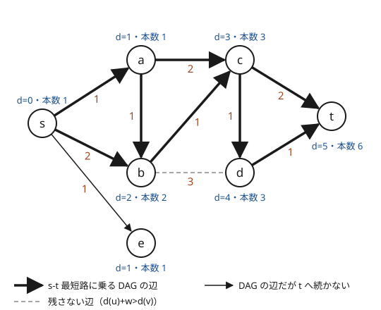

!!! abstract "要点"
    - **何ができるか**：始点 $s$ からの距離 $\mathrm{dist}$ を求め、$\mathrm{dist}[v] = \mathrm{dist}[u] + w(u, v)$ を満たす辺だけを残すと DAG になり、最短路はその上の $s$ からのパスと 1 対 1 に対応する。ここから最短路の本数・最短路木・最短路に乗る辺とすべての最短路に乗る辺が分かる。
    - **いつ使うか**：
        - 最短路の本数を数える。
        - この辺を通らなくても最短距離は変わらないか・最短路に使われない辺を数える。
        - 始点からの最短距離を保ったまま辺を減らし、全域木を出力する。
    - **計算量**：距離を求めるのに $O((N + M) \log N)$（重みがすべて 1 なら BFS で $O(N + M)$）。DAG を作るのと本数の DP は、頂点を距離の順に並べて $O(N \log N + M)$。重みは正とする（0 の辺があるときは[作り方の節](#build)）。
    - **前提**：[ダイクストラ法](../graph/dijkstra.md)、[DAG 上の DP](../dp/dp-dag.md)

<!-- textlint-disable -->
別名：最短路木・最短経路の数え上げ・最短路に必ず使われる辺・すべての最短路に含まれる辺・shortest path DAG
<!-- textlint-enable -->

最短路 DAG は、始点からの距離がちょうど辺の重みだけ増える辺だけを集めたグラフである。経路復元が最短路を 1 本だけ取り出すのに対し、最短路 DAG はすべての最短路を一度に表す。最短路についての「何本あるか」「この辺を使うか」「全部がこの辺を通るか」という問いは、この DAG の上の DP と、両端からの距離の比較に帰着する。

## 最短路 DAG の作り方と性質（重み 0 の辺に注意） {#build}

始点 $s$ からの距離 $\mathrm{dist}$ を[ダイクストラ法](../graph/dijkstra.md)（重みがすべて 1 なら [BFS](../graph/bfs.md)）で求める。有向の辺 $u \to v$（重み $w$）を、次の等式が成り立つときだけ残す。無向の辺は 2 つの向きの有向辺として別々に調べる。

$$
\mathrm{dist}[u] + w = \mathrm{dist}[v]
$$

この等式を満たす辺を「きつい辺」と呼ぶことにする。どの辺でも $\mathrm{dist}[v] \le \mathrm{dist}[u] + w$（三角不等式）なので、きつい辺は不等式が等号で成り立つ辺である。残したグラフには次の性質がある。

1. **残した辺だけでたどる $s$ から $v$ へのパスは、どれも最短路である**。パスの辺ごとに $\mathrm{dist}$ がちょうど重みだけ増えるので、パスの長さは $\mathrm{dist}[v] - \mathrm{dist}[s] = \mathrm{dist}[v]$ になる
2. **$s$ から $v$ への最短路は、残した辺だけを使う**。最短路の途中までの部分も最短路なので、最短路の上の各辺 $u \to v$ では $\mathrm{dist}[u] + w = \mathrm{dist}[v]$ が成り立つ
3. **重みがすべて正なら閉路はない**。残した辺はどれも $\mathrm{dist}$ が真に増える向きなので、一周して元に戻れない。頂点を $\mathrm{dist}$ の小さい順に並べると[トポロジカル順](../graph/topological-sort.md)になる

1 と 2 から、$s$ から $v$ への最短路と、DAG の上の $s$ から $v$ へのパスは 1 対 1 に対応する。次の図は、重み付きの無向グラフで最短路 DAG を作った例である。各頂点の d は $s$ からの距離、本数は $s$ からの最短路の本数（[次の節](#count-paths)）である。



図で残らないのは b-d だけである（細い矢印の $s \to e$ は DAG に残るが、$t$ へは続かない。[s-t 最短路の節](#edge-on-path)で使う）。$\mathrm{dist}[b] + 3 = 5$ は $\mathrm{dist}[d] = 4$ より大きく、$d$ には $c$ から距離 4 で届くので、b-d はどの最短路にも使われない。

**重み 0 の辺があると性質 3 が崩れる**。有向の重み 0 の辺 $u \to v$ は、両端の距離が等しいときにきつい。無向の重み 0 の辺 $\{u, v\}$ は、両端の距離が必ず等しくなるので両方の向きがきつく、それだけで長さ 2 の閉路になり、DAG ではなくなる。最短路の数え上げでは、0 の閉路を何周しても長さが変わらないので、歩き方（同じ頂点を何度通ってもよい経路）としての本数は無限になる。また閉路がなくても、同じ距離の頂点どうしの順が $\mathrm{dist}$ だけでは決まらない。対処は 2 つある。

- **0 の閉路がない**とき：残した辺のグラフで[トポロジカルソート](../graph/topological-sort.md)をして、その順に DP する（距離の順に並べるだけでは足りない）
- **0 の閉路がある**とき：問題が何を数えるのかを確かめる。閉路の頂点を 1 つにまとめてよい問いなら、[強連結成分分解](../graph/scc.md)で縮約してから DAG として扱う

最短路木は、ダイクストラ法で距離が真に短くなったときだけ親を記録すれば、重み 0 の辺があっても作れる（[最短路木の節](#shortest-path-tree)）。きつい辺を頂点ごとに勝手に 1 本選ぶと、0 の辺の両向きを選んで閉路になることがある。

??? question "確認問題：重み 0 の辺"
    無向グラフに重み 0 の辺 $\{u, v\}$ があり、$\mathrm{dist}[u] = \mathrm{dist}[v]$ である。最短路 DAG（きつい辺だけを残したグラフ）はどうなるか。$s$ から $v$ への最短路の本数を DP で数えるとき、何が起きるか。

    ??? success "答え"
        $\mathrm{dist}[u] + 0 = \mathrm{dist}[v]$ と $\mathrm{dist}[v] + 0 = \mathrm{dist}[u]$ がどちらも成り立つので、$u \to v$ と $v \to u$ の両方が残り、閉路ができる。$u$ と $v$ の間を何往復しても長さは変わらないので、往復を許す数え方では本数が無限になる。閉路のあるグラフにはトポロジカル順がないので、DP の計算順序も決まらない。

## 最短路の本数の DP {#count-paths}

$s$ から各頂点への最短路の本数は、最短路 DAG の上のパスの本数である。$\mathrm{cnt}[v]$ を「$s$ から $v$ への最短路の本数」とすると、$v$ への最短路の最後の辺は $v$ に入るきつい辺のどれか 1 本なので、次の式になる。

$$
\mathrm{cnt}[s] = 1, \qquad \mathrm{cnt}[v] = \sum_{u \to v \text{ がきつい辺}} \mathrm{cnt}[u]
$$

重みが正なら、頂点を $\mathrm{dist}$ の小さい順に処理すれば、$\mathrm{cnt}[u]$ はどれも先に確定している。手順は次のとおりで、$\mathrm{dist}$ を求めた後に [DAG 上の DP](../dp/dp-dag.md#count-shortest-paths) として配るだけである。

```text
dist を求める
dist が有限の頂点を dist の小さい順に並べる
cnt[s] = 1、ほかは 0
並べた順に u を取り出し、辺 u → v（重み w）ごとに：
    dist[u] + w == dist[v] なら  cnt[v] += cnt[u]
```

[作り方の節](#build)の図の例では $\mathrm{cnt}[b] = \mathrm{cnt}[s] + \mathrm{cnt}[a] = 2$、$\mathrm{cnt}[c] = \mathrm{cnt}[a] + \mathrm{cnt}[b] = 3$、$\mathrm{cnt}[d] = \mathrm{cnt}[c] = 3$、$\mathrm{cnt}[t] = \mathrm{cnt}[c] + \mathrm{cnt}[d] = 6$ になる。ダイクストラ法の中で同時に数える方法（距離が更新されたら置き直し、等しければ足す）もあり、[DAG 上の DP の節](../dp/dp-dag.md#count-shortest-paths)で説明している。どちらも数える対象は同じである。

本数は指数的に増える。格子状のグラフでは $\binom{2n}{n}$ 本になるので、問題は本数を mod で答えさせる。mod を取った値の大小は元の本数の大小と関係がなく、mod で等しくても本数が等しいとは限らない。だから、「本数が等しいか」を判定に使うときは[辺を消す節](#edge-removal)の注意を読む。

??? question "確認問題：未到達の頂点からの足し込み"
    $\mathrm{dist}$ を `INF = LLONG_MAX` で初期化し、全頂点について `dist[u] + w == dist[v]` を調べた。何が起きうるか。

    ??? success "答え"
        到達できない頂点 $u$ では `dist[u] + w` があふれて未定義動作になる。`INF` を `LLONG_MAX / 4` のようにあふれない大きさにしても、重み 0 の辺では `INF + 0 == INF` が成り立ち、到達できない頂点どうしの辺がきつい辺と判定される。$\mathrm{dist}$ が有限の頂点だけを調べる。

## 最短路木（最小全域木との違い） {#shortest-path-tree}

最短路木は、$s$ から到達できる各頂点 $v \ne s$ について、$v$ に入るきつい辺を 1 本ずつ選んでできる木である。$s$ からの距離は木の上でも元のグラフと同じになる。辺は（到達できる頂点数）$- 1$ 本である。重みが正なら、選んだ辺の始点は終点より距離が真に小さいので閉路がなく、木になる。

実装は、ダイクストラ法で $\mathrm{dist}[v]$ が真に短くなったときに「$v$ に入る辺」を記録するだけである。距離が等しい辺が見つかっても付け替えない。重みが正ならどちらを選んでもよい。しかし重み 0 の辺があると、等しいときに付け替えて閉路ができることがある。重み 1 の $s$-$a$・$s$-$b$ と重み 0 の $a$-$b$ では、$a$ の親を $b$、$b$ の親を $a$ とする誤りが起こりうる。真に短くなったときだけ記録すれば、記録した辺の始点は $v$ より先に距離が確定した頂点なので、重み 0 の辺があっても閉路はできない。経路復元で親をたどるのと同じ配列である。

```cpp
--8<-- "shortest-path-dag/shortest-path-tree.cpp:core"
```

最短路木は**各頂点への距離を同時に最小にする**木であり、**辺の重みの総和を最小にする**[最小全域木](../graph/minimum-spanning-tree.md)とは別物である。重み 2 の辺 $s$-$a$・$s$-$b$ と重み 1 の辺 $a$-$b$ の三角形では、最短路木は $\{s\text{-}a, s\text{-}b\}$（総和 4、距離はどちらも 2）、最小全域木は $\{a\text{-}b\}$ と $s$-$a$ か $s$-$b$ の一方（総和 3、片方の頂点への距離は 3）になる。「残す辺の重みの合計」を問われたら最小全域木、「始点からの距離（の和）」を問われたら最短路木である。

??? question "確認問題：距離の総和を最小にする全域木"
    連結な無向グラフで $N - 1$ 本の辺を残し、$s$ から各頂点への距離の総和を最小にしたい。最短路木がこの最小を達成するのはなぜか。

    ??? success "答え"
        どんな全域木でも、$s$ から $v$ への木の上の距離は元のグラフの最短距離 $\mathrm{dist}[v]$ 以上である。最短路木では、すべての $v$ でちょうど $\mathrm{dist}[v]$ になる。頂点ごとに下限を達成しているので、総和も下限の $\sum_v \mathrm{dist}[v]$ になり最小である。

## 辺が s-t 最短路に乗る条件（両端からの距離） {#edge-on-path}

$s$ から特定の終点 $t$ への最短路だけを考えるときは、$s$ からの距離 $\mathrm{ds}$ と $t$ からの距離 $\mathrm{dt}$ の 2 つを使う。有向グラフでは、$\mathrm{dt}$ は辺の向きを逆にしたグラフで $t$ から求める（[逆向きのグラフと両端からの最短路](../graph/dijkstra.md#reverse-graph)）。$D = \mathrm{ds}[t]$ とすると、辺 $u \to v$（重み $w$）が**ある** $s$-$t$ 最短路に乗るのは、次の等式が成り立つときである。

$$
\mathrm{ds}[u] + w + \mathrm{dt}[v] = D
$$

左辺は「$s$ から $u$ まで最短で行き、辺を渡り、$v$ から $t$ まで最短で行く」経路の長さで、どんな $s$-$t$ 経路も $D$ 以上である。等しければこの経路が最短路になり、辺はその上にある。逆に辺が最短路の上にあれば、その前後の部分も最短路なので等号が成り立つ。無向の辺は 2 つの向きの両方を調べる。

**$s$ からのきつい辺だけでは足りない**。$\mathrm{ds}[u] + w = \mathrm{ds}[v]$ は「$s$ から $v$ への最短路に乗る」ことしか言わず、$v$ から $t$ へ最短で続くとは限らない。[作り方の節](#build)の図の $s \to e$ はきついが、$e$ は $t$ への最短路の途中にない（$\mathrm{dt}[e] = 6$ で $0 + 1 + 6 = 7 > 5$）。$s$-$t$ 最短路に乗る辺や頂点を問われたら、$\mathrm{dt}$ も求めて上の等式で絞る（本数だけなら $\mathrm{cnt}[t]$ でよい。$t$ に続かない枝は $\mathrm{cnt}[t]$ に足されない）。

**全点対の場合**。「どの 2 頂点の最短路にも使われない辺」を問われたら、[ワーシャルフロイド法](../graph/warshall-floyd.md)で全点対の距離 $d$ を求める。辺 $\{u, v\}$（重み $w$）は、$d(u, v) = w$ なら $u$ から $v$ への最短路そのものになる。$d(u, v) < w$ なら、どの 2 頂点の最短路でもこの辺を $u$-$v$ 間のもっと短い経路に置き換えられるので、使われない。だから辺ごとに $d(u, v) = w$ かを見るだけでよく、2 頂点の組をすべて試す必要はない（[ABC051 D](#practice)）。

## 辺を消すと距離が変わるか {#edge-removal}

この節は[いもす法](../basics/imos.md)と[座標圧縮](../basics/coordinate-compression.md)も使う。辺 $e$ を 1 本だけ消したとき $s$-$t$ の最短距離が変わるのは、$e$ が**すべての** $s$-$t$ 最短路に乗っているときである。最短路のうち $e$ を通らないものが 1 本でもあれば、それが残るので距離は変わらない。

**本数で判定する**。$e = u \to v$ が $s$-$t$ 最短路に乗るとき、$e$ を通る最短路の本数は $\mathrm{cnt}_s[u] \times \mathrm{cnt}_t[v]$ である（$\mathrm{cnt}_t$ は $t$ からの本数）。これが全体の本数 $\mathrm{cnt}_s[t]$ に等しければ、すべての最短路が $e$ を通る。本数は巨大なので mod で比べることになり、本当は違う本数が mod で偶然一致すると誤る。テストケースは事前に作られているので、固定の mod 1 つでは衝突する入力を作られうる。複数の mod で比べるか、実行時に乱数で選んだ大きな素数を使うと、誤る確率を十分小さくできる（[ABC375 G](#challenge)を解いた kmjp 氏は 3 つの素数で比べている）。

**距離の区間で判定する（衝突なし）**。重みが正なら、mod を使わない判定もできる。$s$-$t$ 最短路に乗る辺 $x \to y$ ごとに、距離の区間 $[\mathrm{ds}[x], \mathrm{ds}[y])$ を考える。1 本の $s$-$t$ 最短路の辺の区間は、すき間も重なりもなく $[0, D)$ を覆う。このとき次が成り立つ。

> $e$ がすべての $s$-$t$ 最短路に乗る $\iff$ $e$ の区間と重なる区間を持つ、ほかの「最短路に乗る辺」がない

- ほかの辺 $f$ の区間が $e$ の区間と重なるなら、$f$ を通る最短路を 1 本とる。その最短路の辺の区間は互いに重ならないので、$e$ を含まない。よって $e$ を通らない最短路がある
- 重なる辺がないとき、$e$ の区間の内側で、どの頂点の距離とも等しくない点 $r$ をとる（頂点は有限個なのでとれる。重みが整数なら $\mathrm{ds}[u] + 0.5$ でよい）。どの最短路も、$r$ を内側に含む区間の辺を必ず 1 本通る。その辺は $e$ と重なるので、$e$ 自身である

実装は 2 段に分かれる。対象は無向グラフで、重みは 1 以上、$s = 0$・$t = n - 1$ とする。まず両端からの距離を求め、$s$-$t$ 最短路に乗る辺ごとに区間を作る。無向の辺は、等式が成り立つ向きで区間の端を決める。

```cpp
--8<-- "shortest-path-dag/edge-classify.cpp:on-path"
```

次に、区間の端（距離の値）を座標圧縮し、いもす法で各小区間を覆う辺の本数を数える。$e$ の区間の中に 2 本以上で覆われる小区間がなければ、$e$ はすべての最短路に乗る。各辺は「0：どの最短路にも乗らない」「1：ある最短路に乗る」「2：すべての最短路に乗る」に分かれる。

```cpp
--8<-- "shortest-path-dag/edge-classify.cpp:classify"
```

全体で $O((N + M) \log N + M \log M)$ である。小さなグラフで、辺を 1 本ずつ消して最短距離を求め直す全探索と結果が一致することを確かめた。

**消した後の距離そのものを問われたら**。距離が変わらない辺は答えがそのまま $D$ である。変わる辺は、最短路を 1 本固定するとその上にしかない。1 本の最短路の辺は $N - 1$ 本以下なので、$N$ が小さく $O(N(N + M))$ が間に合うなら、その辺を消したときだけ求め直せばよい（[ABC218 F](#practice)）。$N$ と $M$ がどちらも大きいとき、すべての辺について消した後の距離を求めるのは、これより難しい問題になる。

## 落とし穴 {#pitfalls}

**重み 0 の辺で DAG でなくなる**。距離の順に処理する DP は、重みが正であることに頼っている。0 の辺があれば、残した辺のグラフでトポロジカルソートするか、0 の閉路を問題に合わせて処理する（[作り方の節](#build)）。

**$s$ から $t$ への問いに $s$ からの距離だけを使う**。$s$ からのきつい辺には、$t$ に続かない枝も入る。$s$-$t$ 最短路に乗る辺を問われたら、$t$ からの距離も求めて $\mathrm{ds}[u] + w + \mathrm{dt}[v] = D$ で調べる。有向グラフでは $\mathrm{dt}$ を逆向きのグラフで求める。

**無向の辺の片方の向きしか調べない**。入力の辺 $\{a, b\}$ を $a \to b$ の向きだけで判定すると、最短路が $b \to a$ の向きに通る辺を見落とす。重みが正なら、きついのは多くとも片方の向きである。

**未到達の頂点で `INF + w` があふれる**。等式を調べる前に、関わる距離がすべて有限かを確かめる。

**mod の本数を等しさの判定に使う**。mod の値が一致しても本数が等しいとは限らない。複数の mod か乱択の mod を使うか、距離の区間で判定する。

**最短路木と最小全域木を取り違える**。「辺を減らして木にする」という形は同じでも、距離を保つのか重みの合計を最小にするのかで答えが変わる。

## 使い分け {#comparison}

- 最短路を 1 本だけ出力するなら、経路復元（[BFS の経路復元](../graph/bfs.md#path-restoration)）で足りる。すべての最短路について問われたら最短路 DAG を作る
- 全点対の最短路について辺を調べるなら、[ワーシャルフロイド法](../graph/warshall-floyd.md)で距離表を作り、辺ごとに $d(u, v) = w$ かを見る
- 「消すと連結でなくなる辺」は最短距離ではなく連結性の問いなので、[lowlink](../graph/lowlink.md#conditions) で橋を求める

## 例題 {#examples}

### ABC211 D. Number of Shortest paths {#abc211_d}

<div class="kp-problems" data-role="example" markdown>

- [ABC211 D. Number of Shortest paths](https://atcoder.jp/contests/abc211/tasks/abc211_d)（diff 755）：無向グラフで、都市 1 から都市 N への最短路の本数を求める

</div>

辺の重みがすべて 1 なので、BFS で距離を求め、距離が 1 増える辺だけからなる最短路 DAG の上で本数を数える。BFS は距離の小さい順に頂点を取り出すので、BFS と同時に配ればよい。

??? note "解法の詳細"
    - $\mathrm{dist}[0] = 0$、$\mathrm{cnt}[0] = 1$ から BFS をする。頂点 $u$ を取り出したら、隣の $v$ について、未訪問なら $\mathrm{dist}[v] = \mathrm{dist}[u] + 1$・$\mathrm{cnt}[v] = \mathrm{cnt}[u]$ としてキューに入れ、$\mathrm{dist}[v] = \mathrm{dist}[u] + 1$ なら $\mathrm{cnt}[v]$ に $\mathrm{cnt}[u]$ を足す。
    - 本数は $10^9 + 7$ で割った余りで持つ。頂点 $N$ に届かなければ $\mathrm{cnt}$ は 0 のままで、それが答えになる。
    - 全体で $O(N + M)$。

### ABC252 E. Road Reduction {#abc252_e}

<div class="kp-problems" data-role="example" markdown>

- [ABC252 E. Road Reduction](https://atcoder.jp/contests/abc252/tasks/abc252_e)（diff 1294）：道路を N−1 本だけ残して、都市 1 から各都市への距離の総和を最小にするとき、残す道路を出力する

</div>

どの全域木でも、都市 1 から各都市への距離は元のグラフの最短距離以上である。最短路木はすべての都市でその下限を達成するので、距離の総和も最小になる。ダイクストラ法で各都市に入る最短路の辺を記録し、その番号を出力する。

??? note "解法の詳細"
    - 都市 1 からダイクストラ法を行い、$\mathrm{dist}[v]$ が真に短くなったときに、$v$ に入った辺の番号を記録する。
    - 都市 1 以外の各都市について、記録した辺の番号を出力する。都市 1 以外の各都市に 1 本ずつなので $N - 1$ 本になる。
    - 計算量は $O((N + M) \log N)$。コードは[最短路木の節](#shortest-path-tree)のものと同じ形である。

## 練習問題 {#practice}

<div class="kp-problems" data-role="practice" markdown>

- [ABC051 D. Candidates of No Shortest Paths](https://atcoder.jp/contests/abc051/tasks/abc051_d)（diff 1566）：無向グラフで、どの 2 頂点間の最短路にも含まれない辺の数を求める
- [ABC218 F. Blocked Roads](https://atcoder.jp/contests/abc218/tasks/abc218_f)（diff 1753）：有向グラフの各辺について、その辺だけを除いたときの頂点 1 から頂点 N への最短距離を求める

</div>

??? note "練習の方針"
    - **ABC051 D**：ワーシャルフロイド法で全点対の距離を求め、辺 $(u, v, w)$ で $d(u, v) < w$ のものを数える（[辺が最短路に乗る条件の節](#edge-on-path)）
    - **ABC218 F**：辺の長さはすべて 1 なので BFS で最短路を 1 本求め、その上の辺（$N - 1$ 本以下）を消したときだけ BFS をやり直す。ほかの辺を消しても最短距離は変わらない

## 力試し {#challenge}

<div class="kp-problems" data-role="challenge" markdown>

- [ABC375 G. Road Blocked 2](https://atcoder.jp/contests/abc375/tasks/abc375_g)（diff 2014）：各道路について、その道路だけを通行止めにしたとき都市 1 から都市 N への最短距離が変わるかを判定する

</div>

??? note "力試しの方針"
    - **ABC375 G**：都市 1 と都市 N の両方からダイクストラ法で距離と本数を求める。辺が最短路に乗り、かつその辺を通る最短路の本数が全体の本数に等しければ距離が変わる。本数は複数の mod で比べる。衝突を避けたいなら、[辺を消す節](#edge-removal)の距離の区間による判定を使う

## 確認問題 {#quiz}

??? question "確認問題：きつい辺が DAG になる理由"
    重みがすべて正のグラフで、$\mathrm{dist}[u] + w = \mathrm{dist}[v]$ を満たす辺 $u \to v$ だけを残した。このグラフに閉路がない理由を 1 文で説明せよ。

    ??? success "答え"
        残した辺はどれも $\mathrm{dist}$ を $w > 0$ だけ増やす向きなので、閉路を一周すると $\mathrm{dist}$ が真に増えて元の頂点に戻れないからである。

??? question "確認問題：すべての最短路に乗る辺"
    頂点 1-2-3-4 が重み 1 の辺で一直線につながり、さらに 1-3 に重み 2 の辺がある無向グラフで、頂点 1 から 4 への最短路を考える。すべての最短路に乗る辺はどれか。

    ??? success "答え"
        最短距離は 3 で、最短路は 1-2-3-4 と 1-3-4 の 2 本である。距離の区間は 1-2 が $[0, 1)$、2-3 が $[1, 2)$、1-3 が $[0, 2)$、3-4 が $[2, 3)$ で、ほかと重ならないのは 3-4 だけである。だから 3-4 だけがすべての最短路に乗り、消すと最短距離が変わる。本数で見ても、3-4 を通る本数は $2 \times 1 = 2$ で全体の 2 本に等しい。

## 参考 {#references}

- [drken「AtCoder ABC 211 D - Number of Shortest paths (2Q, 茶色, 400 点)」](https://drken1215.hatenablog.com/entry/2023/06/10/150200)：例題の方針（BFS と同時に本数を数える）
- [kyo-pro「ABC252E - Road Reduction」](https://kyo-pro.hatenablog.com/entry/ABC252E)：例題の方針（最短路木の辺を出力する）
- [drken「AtCoder ABC 051 D - Candidates of No Shortest Paths (1Q, 水色, 400 点)」](https://drken1215.hatenablog.com/entry/2019/02/15/141000)：全点対の距離で使われない辺を判定する方法
- [kyo-pro「ABC218F - Blocked Roads」](https://kyo-pro.hatenablog.com/entry/ABC218F)：最短路 1 本の上の辺だけを求め直す方法と計算量
- [kmjp「AtCoder ABC #375 (パナソニックグループ プログラミングコンテスト2024) : G - Road Blocked 2」](https://kmjp.hatenablog.jp/entry/2024/10/14/0930)：両端からの距離と本数による判定、複数の素数で mod を取ること
