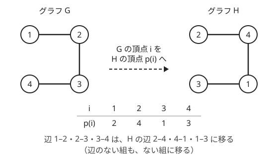
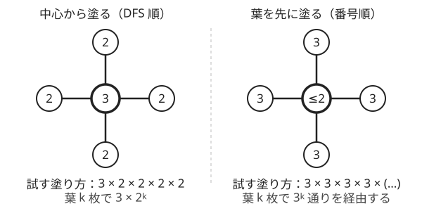

!!! abstract "要点"
    - **何ができるか**：$N \le 8$〜$10$ 程度の小さいグラフで、頂点の対応（$N!$ 通り）・辺の部分集合・彩色を全部試す。場合の数を先に見積もり、多すぎるときは連結成分に分けたり塗る順を工夫したりして探索を絞る。彩色は塗る順を工夫すれば $N \le 20$ でも数えられる。
    - **いつ使うか**：
        - $N \le 8$〜$10$ で頂点の対応や辺の部分集合を全部試せる。
        - 頂点の番号を付け替えて同じ形にできるか。
        - 隣り合う頂点が異なる色になる 3 色の塗り方の数。
        - 3 彩色なら $N \le 20$ でも、DFS 順に塗れば $3 \cdot 2^{N-1}$ 通り以下に収まる。
    - **計算量**：頂点の対応は $O(N! \cdot N^2)$（$N = 8$ で約 $1.1 \times 10^6$）。$N - 1$ 本の辺の組は $O(\binom{M}{N-1} \cdot M)$。3 彩色は成分ごとに DFS 順で塗れば $O(2^N (N + M))$。
    - **前提**：[深さ優先探索（DFS）](../graph/dfs.md)、[bit 全探索と順列全探索](../basics/bit-full-search.md)

<!-- textlint-disable -->
別名：グラフ同型・全域木の全列挙・彩色の全探索・頂点の対応の全探索・graph isomorphism
<!-- textlint-enable -->

小さいグラフの全探索は、頂点数が 8〜10 程度しかないグラフで、頂点の対応・辺の選び方・頂点の色を全部試す方法である。道具は[bit 全探索と順列全探索](../basics/bit-full-search.md)そのもので、グラフに特有なのは「何を全部試すか」の選び方と、場合の数の見積もりである。全部試すと多すぎるときも、連結成分に分ける・塗る順を変えるだけで間に合うことが多い。

このページでは問題文の頂点番号を 1-indexed、コードを 0-indexed で書く（頂点 $i$ はコードでは `i - 1`）。

## 頂点の対応の全探索（同型の判定・同型にするコスト） {#isomorphism}

2 つのグラフ $G$・$H$（頂点数はどちらも $N$）が[同型](../guide/glossary.md#graph-isomorphism)であるとは、$G$ の頂点 $i$ を $H$ の頂点 $p(i)$ に移す 1 対 1 の対応 $p$ があって、すべての頂点の組 $\{i, j\}$ について次が成り立つことである。

$$
\text{$G$ に辺 } i\text{–}j \text{ がある} \iff \text{$H$ に辺 } p(i)\text{–}p(j) \text{ がある}
$$

対応 $p$ は $1, \dots, N$ の順列なので $N!$ 通りある。$N \le 8$ なら $8! = 40320$ 通りで、各 $p$ で $\binom{N}{2} = 28$ 組を確かめても約 $1.1 \times 10^6$ 回で済む。次の図は、パスの形の 2 つのグラフで、ある $p$ が辺を辺に、辺のない組を辺のない組に移している例である。



隣接行列を持てば、組 $\{i, j\}$ の辺の有無は $O(1)$ で引ける。順列は `next_permutation` で回す（昇順から始める理由は[順列全探索の節](../basics/bit-full-search.md#permutations)）。

```cpp
--8<-- "small-graph-brute-force/isomorphism.cpp:core"
```

完全なプログラム：[`isomorphism.cpp`](https://github.com/yuukougun/kyopro-atlas/blob/main/snippets/small-graph-brute-force/isomorphism.cpp)（GitHub）
{ .kp-code-src }

**同型にするコストの最小**。「$H$ の辺 $i$–$j$ を足すか消すのに $A_{i,j}$ かかるとき、$H$ を $G$ と同型にする最小コスト」も同じ全探索で求まる。対応 $p$ を 1 つ決めると、$H$ をどう変えるべきかが組ごとに決まる。$G$ と $H$ で辺の有無が食い違う組 $\{i, j\}$ について、$H$ 側の組 $\{p(i), p(j)\}$ を直すコスト $A_{p(i), p(j)}$ を足せばよい。どの $p$ に合わせるかは自由なので、すべての $p$ での合計の最小が答えである。全体で $O(N! \cdot N^2)$ になる。

対応を写像として読むこの型は、同型の判定に限らない。「$G$ の頂点に $H$ の頂点を割り当てて、条件を満たすものがあるか」という問題なら、割り当てを順列として全部試し、各組の条件を隣接行列で確かめればよい。

## 辺の部分集合の全探索（全域木の全列挙） {#edge-subsets}

「全域木のうち、重みの和を $K$ で割った余りが最小のもの」のように、[最小全域木](../graph/minimum-spanning-tree.md)の貪欲が使えない目的では、[全域木](../guide/glossary.md#spanning-tree)を全部列挙する。余りで比べると、和の大きい方が余りは小さいこともある。そのため「軽い辺から選べば悪くならない」という最小全域木の理屈が成り立たない。

全域木は $N - 1$ 本の辺からなる。だから全部の辺の部分集合（$2^M$ 通り）を見る必要はなく、$N - 1$ 本の組だけを見ればよい。$N = 8$ の完全グラフなら $M = 28$ で、$2^{28} \approx 2.7 \times 10^8$ 通りに対して $\binom{28}{7} = 1184040$ 通りしかない。

選んだ $N - 1$ 本が全域木かどうかは、閉路がないかを確かめるだけでよい。閉路のない $N$ 頂点のグラフ（森）の[連結成分](../graph/connected-components.md)の数は「頂点数 − 辺の数」なので、$N - 1$ 本で閉路がなければ成分は 1 つ、つまり全域木である。閉路の有無は [Union-Find](../ds/union-find.md) で、辺の両端がすでに同じ成分にあるかを見れば分かる。

$N - 1$ 本の組は、長さ $M$ の 0/1 の列（1 が $N - 1$ 個）を `next_permutation` で回すと全部作れる。列を昇順の $0 \dots 0 1 \dots 1$ から始めるのがこつで、1 の位置が辺の選び方を表す。

```cpp
--8<-- "small-graph-brute-force/spanning-trees.cpp:core"
```

完全なプログラム：[`spanning-trees.cpp`](https://github.com/yuukougun/kyopro-atlas/blob/main/snippets/small-graph-brute-force/spanning-trees.cpp)（GitHub）
{ .kp-code-src }

1 通りあたり $O(M)$ の確認なので、全体で $O(\binom{M}{N-1} \cdot M)$、$N = 8$ でも約 $3.3 \times 10^7$ 回である。さらに速くしたければ、辺を 1 本ずつ「使う・使わない」と[再帰で決め](../basics/recursive-enumeration.md)、閉路ができる辺は使わないように枝刈りする。こうすると葉は閉路のない辺の集合（森）だけになり、$N = 8$ の完全グラフでも呼び出しは約 $2 \times 10^6$ 回で済む。ただし葉には辺の足りない森も残るので、葉がすべて全域木になるわけではない（$N$ 頂点の完全グラフの全域木は $N^{N-2}$ 個、$N = 8$ で $262144$ 個である）。

## 彩色は成分ごとに DFS で塗って探索を絞る {#coloring}

この節は[連結成分](../graph/connected-components.md)と[再帰による全列挙](../basics/recursive-enumeration.md)を前提にする。

「隣り合う頂点が異なる色になるような 3 色の塗り方の数」を $N \le 20$ で求めたいとする。各頂点の色を 3 通りずつ全部試すと $3^{20} \approx 3.5 \times 10^9$ 通りで間に合わない。そこで、次の 2 つで探索を絞る。

- **連結成分ごとに数えて掛ける**：辺のない頂点どうしの色は互いに影響しない。だから成分ごとに塗り方を数え、それらの積を答えにすればよい
- **DFS で訪れた順に塗る**：DFS で訪れた順番で頂点を並べる。成分の先頭以外のどの頂点も、自分より前に塗った隣の頂点（DFS で自分を見つけた頂点）を必ず持つ。その色は使えないので、選べる色は 2 通り以下になる

この順で塗れば、頂点数 $k$ の成分で試す塗り方は高々 $3 \cdot 2^{k-1}$ 通りである。成分ごとに別々に数えるので、全体でも $3 \cdot 2^{N-1}$（$N = 20$ で約 $1.6 \times 10^6$）通り以下で済む。各頂点で塗り済みの隣の色を調べるので、全体は $O(2^N (N + M))$ になる。

塗る順が大事なことは、星の形のグラフで分かる。次の図の左のように中心から塗れば、葉は中心と違う 2 色から選ぶだけである。右のように番号順で葉を先に塗ると、葉どうしは隣り合わないので 3 色ずつ全部試してしまう。



```cpp
--8<-- "small-graph-brute-force/coloring.cpp:core"
```

完全なプログラム：[`coloring.cpp`](https://github.com/yuukougun/kyopro-atlas/blob/main/snippets/small-graph-brute-force/coloring.cpp)（GitHub）
{ .kp-code-src }

2 色なら塗り方は、[二部グラフ判定](../graph/bipartite-graph.md)と同じく、成分ごとに 0 通りか 2 通りに決まる。全部を試す必要はない。3 色以上で塗れるかどうかは一般には難しく、$N$ が大きいなら[彩色数の手法](../graph/chromatic-number.md#chromatic-number)を使う。

??? question "確認問題：番号順に塗ったときの探索の量"
    頂点 $20$ が中心で、頂点 $1, \dots, 19$ がすべて頂点 $20$ とだけつながる星のグラフがある。頂点を番号順（$1, 2, \dots, 20$）に塗り、塗り済みの隣と同じ色を避けて全部試すと、頂点 $19$ まで塗り終えた時点で何通りの途中の塗り方を経由するか。DFS 順（頂点 $20$ から）なら何通りか。

    ??? success "答え"
        番号順では、頂点 $1, \dots, 19$ はどれも塗るときに塗り済みの隣がないので、$3^{19} \approx 1.2 \times 10^9$ 通りを経由し、間に合わない。DFS 順なら頂点 $20$ が 3 通り、残りの 19 頂点は各 2 通りで、全部で $3 \cdot 2^{19} = 1572864$ 通りである。

## 落とし穴 {#pitfalls}

**辺のある組だけ比べる**。同型の判定で「$G$ の各辺 $i$–$j$ について、$H$ に $p(i)$–$p(j)$ がある」だけを確かめると、$H$ の辺の方が多いときに誤って同型と答える。辺の数が等しいことを先に確かめるか、辺のない組も含めてすべての組を比べる。

**コストの添字を取り違える**。同型にするコストの問題で、$p$ が「$G$ の頂点 $i$ を $H$ の頂点 $p(i)$ へ」移すなら、直すのは $H$ の組なので $A_{p(i), p(j)}$ を足す。$A_{i,j}$ を足すと、別の組のコストを数えてしまう。$p$ がどちら向きの写像かを 1 文のコメントで書いてから実装する。

**順列や 0/1 の列を昇順から始めない**。`next_permutation` は辞書順で後の並びしか作らない。頂点の順列は $0, 1, \dots, N - 1$、辺の選び方は $0 \dots 0 1 \dots 1$ から始める。入力例が小さいと、漏れがあっても答えの合うことがあり、気づきにくい。

**全部の部分集合に重い確認をする**。全域木の列挙で $2^M$ 個の部分集合それぞれに Union-Find をかけると、$M = 28$ で約 $2.7 \times 10^8 \times M$ 回になり間に合わない。辺の本数を $N - 1$ に固定してから回す。

**重みの和があふれる**。重みと $K$ が大きい問題では、$N - 1$ 本の重みをそのまま足すと `long long` を超えることがある。各重みが $K$ 未満なら、足すたびに $K$ で割った余りをとると途中の値は $2K$ 未満に収まる（重みが $K$ 以上なら先に余りをとる）。

**塗り方の数が `int` に収まらない**。3 色の塗り方は最大で $3^N$ 通りある。$3^{20} = 3486784401$ は `int` の上限（約 $2.1 \times 10^9$）を超える。数える変数は `long long` にする。

**戻し忘れ**。再帰で色を塗ったら、次の色を試す前と関数を抜ける前に「未塗り」に戻す。戻し忘れると、別の枝で塗った色が残って隣の判定を狂わせる（[状態を戻し忘れない](../basics/recursive-enumeration.md#backtrack)）。

## 上位の手法へのつながり {#next-steps}

- **頂点数が 16〜20 で、途中の状態が合流する**：訪れた頂点の集合などで途中の状態が表せるなら、$N!$ 通りの全探索を [bitDP](../dp/bit-dp.md) にまとめられる
- **全域木の数を数える**：列挙せずに数だけ求めるなら、[行列木定理](../graph/matrix-tree-theorem.md#laplacian)で行列式として計算できる
- **彩色数・最大独立集合**：「何色あれば塗れるか」は、$N \le 20$ 程度なら包除原理を使って $O(2^N N)$ で求まる（[彩色数・最大独立集合・最大クリーク](../graph/chromatic-number.md#chromatic-number)）
- **大きい木の同型**：一般のグラフの同型を多項式時間で判定する方法は知られていないが、木なら子の形に名前を付けていく方法で速く判定できる（[木の同型判定と木のハッシュ](../tree/tree-isomorphism.md#ahu)）

## 確認問題 {#quiz}

??? question "確認問題：頂点の対応の数"
    頂点数 $N = 8$ の 2 つのグラフの同型を判定するとき、試す頂点の対応は何通りか。各対応で全部の頂点の組を比べると、比べる回数は合計で何回くらいか。

    ??? success "答え"
        対応は $8! = 40320$ 通りである。頂点の組は $\binom{8}{2} = 28$ 組なので、比べる回数は $40320 \times 28 = 1128960$、約 $1.1 \times 10^6$ 回である。

??? question "確認問題：全域木の辺の本数"
    頂点数 $N$ の連結グラフの全域木を、辺の部分集合から全列挙する。何本の辺を選べばよいか。選んだ辺が全域木かどうかは何を確かめれば足りるか。

    ??? success "答え"
        $N - 1$ 本である。$N - 1$ 本の辺で閉路がなければ、連結成分の数は $N - (N - 1) = 1$ になり、全域木である。だから閉路がないこと（Union-Find で、辺の両端がすでに同じ成分にないこと）だけを確かめればよい。

## 例題 {#examples}

### ABC232 C. Graph Isomorphism {#abc232_c}

<div class="kp-problems" data-role="example" markdown>

- [ABC232 C. Graph Isomorphism](https://atcoder.jp/contests/abc232/tasks/abc232_c)（diff 685）：頂点数 N ≤ 8 の 2 つの単純無向グラフが、頂点の番号を付け替えて一致するか（同型か）を判定する

</div>

$N \le 8$ なので、頂点の対応 $p$ を $8! = 40320$ 通り全部試せる。各 $p$ で、すべての頂点の組について 2 つのグラフの辺の有無が一致するかを確かめ、一致する $p$ が 1 つでもあれば同型である。

??? note "解法の詳細"
    - 2 つのグラフをそれぞれ $N \times N$ の隣接行列にする（入力の頂点番号から 1 を引く）。
    - $p = (0, 1, \dots, N - 1)$ から始めて `next_permutation` で全順列を回す。各 $p$ で、$i < j$ のすべての組について「1 つ目のグラフの $(i, j)$」と「2 つ目のグラフの $(p_i, p_j)$」の辺の有無を比べる。
    - すべての組で一致する $p$ があれば Yes、なければ No。全体で $O(N! \cdot N^2)$。
    - コードは[頂点の対応の全探索](#isomorphism)の節のものと同じ形である。

## 練習問題 {#practice}

<div class="kp-problems" data-role="practice" markdown>

- [ABC371 C. Make Isomorphic](https://atcoder.jp/contests/abc371/tasks/abc371_c)（diff 849）：辺の追加・削除にそれぞれ費用がかかるとき、グラフ H をグラフ G と同型にする最小費用を求める
- [ABC328 E. Modulo MST](https://atcoder.jp/contests/abc328/tasks/abc328_e)（diff 1160）：N ≤ 8 の重み付き連結グラフで、全域木の重みの和を K で割った余りの最小値を求める

</div>

??? note "練習の方針"
    - **ABC371 C**：$G$ の頂点 $i$ を $H$ の頂点 $p(i)$ に対応させる $p$ を $8!$ 通り回す。各 $p$ で辺の有無が食い違う組 $\{i, j\}$ について $A_{p(i), p(j)}$ を足し、合計の最小を答える（[同型にするコストの最小](#isomorphism)）
    - **ABC328 E**：$M \le 28$ 本の辺から $N - 1 \le 7$ 本を選ぶ組を全列挙する。Union-Find で閉路がないと分かったものだけについて、重みの和を $K$ で割った余りの最小をとる。最大でも約 $1.2 \times 10^6$ 通りである（[辺の部分集合の全探索](#edge-subsets)）

## 力試し {#challenge}

<div class="kp-problems" data-role="challenge" markdown>

- [ABC199 D. RGB Coloring 2](https://atcoder.jp/contests/abc199/tasks/abc199_d)（diff 1804）：N ≤ 20 の単純無向グラフで、隣り合う頂点が異なる色になる 3 色の塗り方の数を求める

</div>

??? note "力試しの方針"
    - **ABC199 D**：$3^{20}$ 通りは多すぎる。連結成分ごとに頂点を DFS 順に並べ、その順に塗り済みの隣と違う色を選んで全部試す。先頭以外は 2 色以下しか選べないので、成分の頂点数を $k$ として $3 \cdot 2^{k-1}$ 通り以下で済む。成分ごとの数を掛け合わせ、答えは `long long` で持つ（[彩色は成分ごとに DFS で塗って探索を絞る](#coloring)）

## 参考 {#references}

- [sano192「M-SOLUTIONS プロコンオープン2021(ABC232) A～D問題 ものすごく丁寧でわかりやすい解説 python 灰色～茶色コーダー向け」](https://qiita.com/sano192/items/3cb3ae52adae8829c94f)：例題の方針（頂点の対応を順列で全部試す）
- [Lanly「AtCoder Beginner Contest 371」](https://www.cnblogs.com/Lanly/p/18414807)：練習の方針（対応ごとに食い違う組のコストを足す）
- [drken「AtCoder ABC 328 E - Modulo MST (1Q, 緑色, 475 点)」](https://drken1215.hatenablog.com/entry/2023/11/12/184431)：練習の方針（N − 1 本の辺の組の全列挙と Union-Find による判定、通り数の見積もり）
- [hamayan「RGB Coloring 2 [AtCoder Beginner Contest 199（Sponsored by Panasonic） D]」](https://blog.hamayanhamayan.com/entry/2021/04/25/002321)：力試しの方針（成分ごとに分けて隣接順に塗ること、適当な順では星の形で遅くなること）
