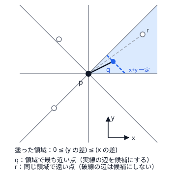

!!! abstract "要点"
    - **何ができるか**：辺が暗黙に与えられる完全グラフの最小全域木を Borůvka 法で求め、マンハッタン距離の完全グラフは候補辺を $O(N)$ 本に絞る。有向グラフの最小全域木（Chu-Liu/Edmonds）と第 2 最小全域木の求め方もある。
    - **いつ使うか**：
        - 辺が暗黙に $O(N^2)$ 本ある完全グラフの最小全域木。
        - マンハッタン距離の完全グラフ。
        - 有向グラフで、根から全頂点へ届く最小コストの辺の集合。
    - **計算量**：Borůvka 法 $O(M \log N)$（暗黙の辺なら 1 段の探索の時間 × $\log N$）、Manhattan MST $O(N \log N)$、最小[有向全域木](../guide/glossary.md#arborescence) $O(NM)$（併合できるヒープで $O(M \log N)$）、第 2 最小全域木 $O(M \log N)$
    - **前提**：[最小全域木](../graph/minimum-spanning-tree.md)

<!-- textlint-disable -->
別名：Borůvka 法・Boruvka・Manhattan MST・Chu-Liu/Edmonds・最小有向全域木・第 2 最小全域木・directed MST
<!-- textlint-enable -->

特殊な最小全域木は、[クラスカル法とプリム法](../graph/minimum-spanning-tree.md#kruskal-prim)がそのままでは使えない 4 つの場面の求め方をまとめたものである。辺が多すぎて並べられない完全グラフ（Borůvka 法・Manhattan MST）、辺に向きがあるグラフ（最小有向全域木）、最小の次に安い全域木（第 2 最小全域木）を扱う。どれも ABC での出題は確認できず、ここでは何ができるかと自作するときの要点に絞り、証明の細部は資料に任せる。

## Borůvka 法 {#boruvka}

Borůvka 法は、「各連結成分から外へ出る最小の辺を、すべての成分について同時に採る」段を、成分が 1 つになるまでくり返す方法である。1 段で調べるのは「各頂点から、別の成分の頂点への最小の辺」だけなので、辺をすべて並べなくても、この問いに速く答えられれば完全グラフでも使える。

**なぜ正しいか**：ある成分とそれ以外に頂点を分ける[カット](../guide/glossary.md#cut)を考えると、成分から外へ出る最小の辺はカットを横切る最小の辺である。[カット性質](../graph/minimum-spanning-tree.md#why-correct)により、この辺はある最小全域木に入る。重みの等しい辺があるときは、(重み, 辺の番号) のような全順序（完全グラフなら辺の番号の代わりに頂点の組）で比べて重みをすべて異なるものとみなす。比べ方を決めずに選んだ辺をまとめて採ると、2 つの成分が同じ重みの別の辺を選び、合わせて閉路を作りうる。採るたびに Union-Find で両端がすでに同じ成分かを確かめるなら、比べ方を決めなくても重みの和は正しい。それでも比べ方を決めておくと、選んだ辺が必ず森になり扱いやすい。

**なぜ速いか**：1 段で各成分が少なくとも 1 本の辺を採り、別の成分と併合されるので、成分の数は 1 段で半分以下になる。段は高々 $\lceil \log_2 N \rceil$ 回で、辺を直接持つなら 1 段 $O(M)$、全体で $O(M \log N)$ である。暗黙の辺なら、1 段の探索の時間に $\log N$ を掛けたものになる。

暗黙の辺で 1 段の探索を速くするには、「自分と同じ成分の頂点を除いた最小値」を求める工夫が要る。よく使う形は次の 2 つである。

- **成分の異なる上位 2 件を持つ**：走査しながら最小値を持つとき、1 位と、1 位と成分が異なる中での最小の 2 件を持つ。1 位が自分と同じ成分なら 2 位を使えばよい。
- **自分の成分を一時的に除く**：Binary Trie やセグメント木に全頂点を入れておき、成分ごとに「その成分の頂点を消す → 成分の各頂点で問い合わせる → 戻す」を行う。各頂点は 1 段で 1 回ずつ消して戻すので、1 段はデータ構造の操作 $O(N)$ 回で済む。

例として、一列に並ぶ頂点 $i, j$（0-indexed）を重み $D \lvert i - j \rvert + A_i + A_j$ の辺で結ぶ完全グラフを考える。$j < i$ の相手との重みは $(A_j - Dj) + (A_i + Di)$ なので、左から走査して $A_j - Dj$ の上位 2 件を成分が異なるように持てば、各 $i$ の左側の最良の相手が $O(1)$ で分かる。右側も同じで、1 段は $O(N)$、全体で $O(N \log N)$ になる。中心の部分は次のとおりである（完全なプログラムは `snippets/spanning-tree-advanced/boruvka.cpp`。乱数の入力で配列のプリム法と比べている）。

```cpp
--8<-- "spanning-tree-advanced/boruvka.cpp:core"
```

自作するときの要点は次のとおりである。

- **同じ辺を 2 回足さない**：成分 $X$ と $Y$ が互いに同じ辺を選ぶことがよくある。採るときに [Union-Find](../ds/union-find.md) で両端がすでに同じ成分かを確かめれば、1 回だけ数えられる。
- **非連結の検出**：ある段でどの成分も外へ出る辺を見つけられなければ、グラフは連結でない。そのまま回すと無限ループになる。
- **成分の番号は段の初めに固定する**：段の途中で併合した結果を探索に混ぜると、上位 2 件の前提が崩れる。段の初めに各頂点の代表を配列に写してから探索する。

ACL に Borůvka 法はない。辺を直接持つ形なら、Library Checker の Minimum Spanning Tree で確かめられる（[練習問題](#practice)）。辺の候補を $O(N \log N)$ 本に減らしてクラスカル法を使う方法（分割統治・[重心分解](../tree/centroid-decomposition.md)）で同じ問題が解けることも多い。

## Manhattan MST {#manhattan}

Manhattan MST は、平面上の $N$ 点を[マンハッタン距離](../geometry/manhattan-chebyshev.md)の辺で結んだ完全グラフの最小全域木である。辺は $N(N-1)/2$ 本あるが、最小全域木を含む候補の辺を高々 $4N$ 本に絞れるので、絞った後にクラスカル法を使えば $O(N \log N)$ で求まる。

**絞ってよい理由**：点 $p$ のまわりを、縦・横・2 本の斜めの線で 45 度ずつ 8 つの領域に分ける。同じ領域にある 2 点 $q$・$r$ について、$d(p, q) \le d(p, r)$ ならば $d(q, r) \le d(p, r)$ である。すると $p$-$q$-$r$ の閉路で $p$-$r$ が最大の辺なので、[閉路性質](../graph/minimum-spanning-tree.md#why-correct)により $p$-$r$ は使わなくてよい。よって各点は、領域ごとに最も近い点との辺だけを候補にすればよい。



**最も近い点の探し方**：点 $p$ から見て $0 \le y_q - y_p \le x_q - x_p$ となる領域（図の塗った領域）では、距離は $(x_q + y_q) - (x_p + y_p)$ である。だから点を $x + y$ の小さい順に見ると、$p$ の領域へ最初に入ってきた点が、領域の中で $p$ から最も近い点である。まだ相手の決まっていない点を $y$ で並べた `map` に入れておき、新しい点 $i$ が来たら、$y$ が $y_i$ 以下の点を $y$ の大きい順に取り出す。$i$ がその点の領域に入る限り、辺を作って点を消す。各点は 1 回入って 1 回消えるので、1 回の走査は $O(N \log N)$ である。

残りの 7 つの領域は、座標の変換（$x$ と $y$ の交換、$x$ の符号の反転）で同じ走査に帰着する。辺に向きはないので、$p$ から見て向かい合う領域の辺は相手の側の走査で見つかり、走査は 4 回で足りる。向きを固定して場合分けし、盤面を変換してくり返す書き方は[絶対値の外し方](../geometry/manhattan-chebyshev.md#remove-abs)と同じである。

```cpp
--8<-- "spanning-tree-advanced/manhattan-mst.cpp:core"
```

返した候補の辺でクラスカル法を行えば答えになる（完全なプログラムは `snippets/spanning-tree-advanced/manhattan-mst.cpp`。同じ座標の点を含む乱数の入力で、全点対のクラスカル法と比べている）。「$x$ でソートした隣どうしと $y$ でソートした隣どうし」だけでは足りないことに注意する（反例は[最小全域木の確認問題](../graph/minimum-spanning-tree.md#reduce-candidates)）。自作したものは Library Checker の Manhattan MST で確かめる。

## 最小有向全域木（Chu-Liu/Edmonds） {#directed}

最小有向全域木は、有向グラフと根 $r$ が与えられたとき、$r$ からすべての頂点へ届く辺の集合（根付きの有向全域木）のうち、重みの和が最小のものである。根以外の各頂点はちょうど 1 本の入る辺を持つ。辺に向きがあるとカット性質が成り立たないので、クラスカル法とプリム法は使えない。Chu-Liu/Edmonds 法は次の手順で求める。

```text
1. 根以外の各頂点 v について、v に入る最小の辺を選ぶ（入る辺がなければ答えなし）
2. 選んだ辺に閉路がなければ、それが答え
3. 閉路があれば、閉路を 1 頂点に縮約する。
   閉路上の頂点 v に入る外からの辺 (u, v, w) の重みを w - (v で選んだ辺の重み) に直す
4. 縮約したグラフで 1. に戻る（答えの重みには選んだ辺の重みを足していく）
```

**なぜ正しいか**：頂点 $v$ に入る辺すべてから同じ値 $c_v$ を引いても、どの有向全域木も $v$ に入る辺をちょうど 1 本使うので、重みは一律に $c_v$ だけ減り、最適な木は変わらない。$c_v$ を入る辺の最小値にすると、各頂点は重み 0 の辺を持つ。0 の辺に閉路がなければ、それらは重み 0 の有向全域木で、重みは負にならないので最適である。閉路があれば、閉路の辺を 1 本だけ外して残りを使う最適な木があるので、閉路を[縮約](../guide/glossary.md#contraction)して「閉路にどこから入るか」を選ぶ問題に直せる（手順 3 の重みの直しがこれに当たる）。

**計算量**：縮約は高々 $N - 1$ 回で、1 回は $O(M)$ なので素朴には $O(NM)$ である。頂点ごとに入る辺を[併合可能なヒープ](../ds/advanced-ds-catalog.md)（skew heap など、全体に値を足す遅延の印を持つもの）に入れ、縮約でヒープを併合すれば $O(M \log N)$ になる。

自作するときの要点は次のとおりである。

- **閉路の検出**：選んだ辺を逆にたどると、根以外の各頂点から出る辺が 1 本のグラフになる。根には自分への辺を足す（または根で止まる）と、[Functional graph](../graph/functional-graph.md) の閉路の見つけ方がそのまま使える。
- **縮約後の自己ループを捨てる**：閉路の内側どうしの辺は、縮約すると自分から自分への辺になる。これを残すと、手順 1 で自分への辺を入る辺として選んでしまい、答えなしの判定も狂う。縮約のたびに捨てる。
- **答えなしの判定**：根から届かない頂点があると、その頂点（または縮約した頂点）に入る辺がなくなる。手順 1 で入る辺のない頂点が見つかったら答えなしとする。
- **根が決まっていないとき**：新しい根を足し、各頂点へ重み $L$（元の辺の重みの絶対値の和より大きい値）の辺を張る。答えの重みが $2L$ 以上なら、元のグラフでは 1 つの根から全体へ届かない。$2L$ 未満なら $L$ の辺を 1 本だけ使っており、結果から $L$ を引いたものが答えで、その $L$ の辺の先の頂点が根になる。
- **辺の集合の復元**：縮約のたびに「どの元の辺を選んだか」を記録し、最後に縮約を逆順にほどいて元の辺に戻す。重みだけでよいなら復元は要らない。

ACL に最小有向全域木はない。Library Checker の Directed MST（$N, M \le 2 \times 10^5$、根から全頂点に届く。木の親の列も出力する）で確かめる。有向全域木の個数は[行列木定理](../graph/matrix-tree-theorem.md)で数える。

## 第 2 最小全域木 {#second-best}

第 2 最小全域木は、最小全域木と辺の集合が異なる全域木のうち、重みの和が最小のものである。最小全域木 $T$ から 1 本の辺を外して別の 1 本を入れた木の中に、第 2 最小全域木が必ずある（資料の補題）。だから次のように求まる。

1. 最小全域木 $T$ を求める（重み $W$）。
2. $T$ に入らない各辺 $(u, v, w)$ について、$T$ 上の $u$-$v$ パスで重みが最大の辺 $m$ を求め、$W - m + w$ を候補にする。
3. 候補の最小が答えである。

辺 $(u, v)$ を $T$ に足すと $T$ 上の $u$-$v$ パスと閉路を作り、閉路から 1 本外せば全域木に戻る。外して最も得なのはパス上の最大の辺である。パス上の最大は、[ダブリングの表と一緒にパスの最大を持つ方法](../tree/lca.md#path-aggregate)で 1 回 $O(\log N)$ なので、全体で $O(M \log N)$ になる。$N$ が数千までなら、各頂点から $T$ を DFS してすべての組のパスの最大を $O(N^2)$ で表にしてもよい。

**重みが真に大きいものを求めるとき**：最小全域木が一意でなければ、上の手順は $W$ と同じ重みを返す。それでよい問題もあるが、「重みが $W$ より真に大きい中で最小」を問われたら、パス上で「最大」と「最大より真に小さい中での最大」の 2 つを持つ。$w$ が最大と等しいときは 2 番目を外す候補にする。

この形は「この辺を必ず使うときの最小全域木」にも使える。辺 $e$ が $T$ に入らないなら、答えは $W - (\text{パス上の最大}) + w_e$ である。パス上の最大の辺が経路のボトルネックになる理由は[最小ボトルネック路](../graph/bottleneck-path.md#why-mst)と同じである。

## 練習問題 {#practice}

ABC で必須になる問題は確認できなかった。自作したものは次の Library Checker で確かめる。

### Library Checker

- [Minimum Spanning Tree](https://judge.yosupo.jp/problem/minimum_spanning_tree)：辺を直接持つ形の Borůvka 法を確かめる。
- [Manhattan MST](https://judge.yosupo.jp/problem/manhattanmst)：$N \le 2 \times 10^5$ 点のマンハッタン距離の最小全域木の重みと辺を出力する。
- [Directed MST](https://judge.yosupo.jp/problem/directedmst)：根を指定した最小有向全域木の重みと、各頂点の親を出力する。

## 学ぶための資料 {#resources}

- 英語版 Wikipedia の「Borůvka's algorithm」：手順・計算量と、重みが等しいときに全順序で比べる必要。
- 英語版 Wikipedia の「Edmonds' algorithm」：縮約と重みの直しの手順、Tarjan による $O(M \log N)$ の実装への言及。
- cp-algorithms の「Manhattan Distance」の Manhattan MST の節：8 つの領域の補題の証明と、$x + y$ の順の走査（文章と図の利用条件は CC BY-SA）。
- cp-algorithms の「Second Best Minimum Spanning Tree」：1 本だけ入れ替えればよい補題と、ダブリングでパスの最大を求める実装。
- ei1333 氏のライブラリの Boruvka・Manhattan MST・Directed MST：自作するときの関数の形の例と、Library Checker で確かめたコード。

## 参考 {#references}

- [「Borůvka's algorithm」（英語版 Wikipedia）](https://en.wikipedia.org/wiki/Bor%C5%AFvka%27s_algorithm)：手順・段の数の上限・重みが等しい辺の扱い
- [「Edmonds' algorithm」（英語版 Wikipedia）](https://en.wikipedia.org/wiki/Edmonds%27_algorithm)：縮約と重みの直し、計算量
- [cp-algorithms「Manhattan Distance」](https://cp-algorithms.com/geometry/manhattan-distance.html)：8 つの領域の補題と 4 回の走査で足りること（文章と図は使っていない）
- [cp-algorithms「Second Best Minimum Spanning Tree」](https://cp-algorithms.com/graph/second_best_mst.html)：1 本の入れ替えの補題、$O(M \log N)$ の求め方、真に大きいものを求めるときの 2 番目の最大（文章は使っていない）
- [ei1333「Boruvka」（Luzhiled's Library）](https://ei1333.github.io/library/graph/mst/boruvka.hpp)：各成分の最小の辺を利用者が渡す関数の形、段の数と計算量
- [ei1333「Manhattan MST」（Luzhiled's Library）](https://ei1333.github.io/library/graph/mst/manhattan-mst.hpp)：候補の辺を返す関数の形と 4 回の走査
- [ei1333「Directed MST」（Luzhiled's Library）](https://ei1333.github.io/library/graph/mst/directed-mst.hpp)：skew heap を使う $O(M \log N)$ の実装と、縮約をほどく復元
- [drken「キーエンス プログラミング コンテスト 2019 E - Connecting Cities (橙色, 600 点)」](https://drken1215.hatenablog.com/entry/2019/01/15/081500)：番号の差と両端の値で重みが決まる完全グラフの最小全域木（Borůvka 法でも解けるという言及）
- [Library Checker の問題定義（GitHub）](https://github.com/yosupo06/library-checker-problems)：directedmst（graph）・manhattanmst（geo）・minimum_spanning_tree の内容と制約
