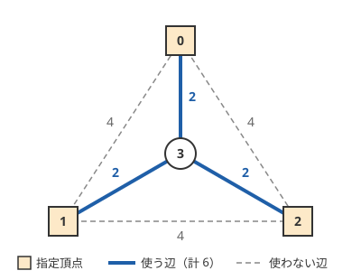

!!! abstract "要点"
    - **何ができるか**：一般のグラフで指定した K 点（$K \le 10$ 程度）をすべてつなぐ最小コストを、端点の集合と頂点を状態にした DP で求める。部分集合の分割とダイクストラ法を交互に行う。
    - **いつ使うか**：指定した K 点（$K \le 10$ 程度）をすべて連結にする最小コスト
    - **計算量**：$O(3^K N + 2^K (N + M) \log N)$（$K$ は指定頂点の数）。密グラフで配列のダイクストラ法を使うなら $O(3^K N + 2^K N^2)$。メモリ $O(2^K N)$
    - **前提**：[ダイクストラ法](../graph/dijkstra.md)、[部分集合を列挙する DP](../dp/subset-enumeration-dp.md)

<!-- textlint-disable -->
別名：シュタイナー木・Steiner tree・Dreyfus-Wagner
<!-- textlint-enable -->

最小シュタイナー木は、重み付きの無向グラフで、指定された $K$ 個の頂点（指定頂点）をすべてつなぐ辺の集合のうち、重みの和が最小のものである。指定されていない頂点を経由してもよい点が[最小全域木](../graph/minimum-spanning-tree.md)と違う。一般には [NP 困難](../guide/glossary.md#np-hard)だが、$K$ が小さければ指定頂点の部分集合を状態にした DP（Dreyfus-Wagner のアルゴリズム）で解ける。

一般のグラフでこの DP の要る ABC の問題は、これまで difficulty 2400 を超える G だけである（グラフが木の[易しい版](#on-tree)なら D にも出る）。問題文に「指定した数個の頂点をつなぐ最小コスト」とあり、$K$ が 10 前後に抑えられていればこの手法を疑う。



図の例では、指定頂点だけを結ぶ辺で全域木を作ると $4 + 4 = 8$ かかる。指定されていない頂点 3 を経由すると $2 + 2 + 2 = 6$ で済み、これが最小である。

## DP の状態の定義（頂点の集合と根の頂点） {#state}

指定頂点を $t_0, \dots, t_{K-1}$ とし、その部分集合を $K$ bit の整数で表す。状態は次のとおりである。

$$
\mathrm{dp}[S][v] = \text{（指定頂点の集合 } S \text{ と頂点 } v \text{ をすべてつなぐ辺の集合の重みの最小）}
$$

$v$ は指定頂点でなくてもよい。重みが 0 以上なら、最適な辺の集合は木にできる（閉路があれば 1 本除いても連結のままで、重みは増えない）。そこで $\mathrm{dp}[S][v]$ を「$v$ を根にした木」の重みの最小とみる。

- 初期値：$\mathrm{dp}[\{t_i\}][t_i] = 0$、ほかは $\infty$
- 答え：$\mathrm{dp}[\text{全体}][t_0]$（$t_0$ はどうせ木に含まれるので、根を $t_0$ に固定してよい）。「指定頂点と頂点 $i$ をつなぐ最小」を各 $i$ について問われたら、$\mathrm{dp}[\text{全体}][i]$ がそのまま答えになる
- 計算順序：$S$ を整数として小さい順に回す。遷移は $S$ の真部分集合（整数として小さい）か、同じ $S$ の値だけを読む

根 $v$ を固定した最適な木で、$v$ の次数を見ると遷移が 2 種類に分かれる。次数が 2 以上なら木を 2 つに分け（[次の節](#merge)）、次数が 1 なら $v$ から出る辺を 1 本たどる（[ダイクストラ法の節](#dijkstra-step)）。次数が 0 なら木は $v$ だけで、初期値に当たる。

![左は根 v の次数が 2 以上で、v の下の部分木を T 側と S∖T 側の 2 つに分け dp[T][v] + dp[S∖T][v] とする図。右は v の次数が 1 で、辺 v-u（重み w）を除いた残りが S と u をつなぐ木になり dp[S][u] + w とする図](../img/steiner-tree/transitions.svg)

$K = 2$ なら答えは $t_0$ と $t_1$ の最短路の長さで、$K$ が全頂点なら最小全域木の重みになる。この DP はその両方を含む。

## 部分集合を 2 つに分けて合わせる遷移 {#merge}

根 $v$ の次数が 2 以上なら、$v$ から出る辺のうち 1 本以上ずつを 2 つの組に分けると、木は $v$ だけを共有する 2 つの木に分かれる。片方に含まれる指定頂点を $T$、もう片方を $S \setminus T$ とすると、重みは 2 つの木の和なので

$$
\mathrm{dp}[S][v] \gets \min_{\varnothing \ne T \subsetneq S} \bigl( \mathrm{dp}[T][v] + \mathrm{dp}[S \setminus T][v] \bigr)
$$

である。$v$ 自身が指定頂点 $t_i$ で、$v$ の次数が 1 の場合も、$T = \{t_i\}$ とすればこの式に入る（$\mathrm{dp}[\{t_i\}][t_i] = 0$）。

$S$ の部分集合 $T$ は $T \gets (T - 1) \text{ AND } S$ で列挙する（[部分集合の部分集合の列挙](../dp/subset-enumeration-dp.md#submask-loop)）。すべての $S$ と $T$ の組は $3^K$ 通りなので（[3^N になる理由](../dp/subset-enumeration-dp.md#why-3n)）、各頂点で試すとこの遷移は全体で $O(3^K N)$ になる。$T$ と $S \setminus T$ を入れ替えた分け方は同じなので、$S$ の最小の要素を含む $T$ だけを試せば回数は半分になる。

## ダイクストラ法で v を動かす遷移 {#dijkstra-step}

根 $v$ の次数が 1 で、$v$ が $S$ に含まれない場合、$v$ から出る辺 $(v, u)$（重み $w$）を除くと、残りは $S$ と $u$ をつなぐ木になる。$v$ が指定頂点なら、[分ける遷移](#merge)で $T = \{v\}$ として扱う。よって

$$
\mathrm{dp}[S][v] \gets \mathrm{dp}[S][u] + w
$$

である。この遷移は同じ $S$ の値どうしを辺でつなぐので、$v$ の順に 1 回なめるだけでは済まない。これは「各頂点 $u$ に初期の距離 $\mathrm{dp}[S][u]$ を置いた最短路」そのものである。分ける遷移を終えた $\mathrm{dp}[S][\cdot]$ をすべて始点の距離として優先度付きキューに入れ、[ダイクストラ法](../graph/dijkstra.md)を 1 回回せば、$S$ の値が確定する。

```text
for S = 1 .. 2^K - 1:
    for v: for T（S の空でない真部分集合）: dp[S][v] = min(dp[S][v], dp[T][v] + dp[S∖T][v])
    dp[S][・] を始点の距離にしてダイクストラ法を 1 回回す
```

1 回のダイクストラ法は $O((N + M) \log N)$ で、$S$ ごとに 1 回なので $O(2^K (N + M) \log N)$ になる。完全グラフのように $M$ が $N^2$ に近いなら、[密グラフの O(N^2) 版](../graph/dijkstra.md#dense)を使うと $O(2^K N^2)$ で済む。辺の重みは 0 以上でなければならない（負の辺があるとダイクストラ法が壊れ、木にできるという前提も崩れる）。

2 種類の遷移を合わせて、全体は $O(3^K N + 2^K (N + M) \log N)$ である。指定頂点が 10 個、$N = 4000$、$M = 8000$ なら、前半は $3^{10} \times 4000 \approx 2.4 \times 10^8$、後半は $2^{10} \times 12000 \times 12 \approx 1.5 \times 10^8$ ほどの回数になる。前半のループは単純な足し算と比較なので、制限時間に収まる見当である。

C++ では次のように書く（完全なプログラムは `snippets/steiner-tree/steiner.cpp`）。`by_mask` と `by_edge` は、値がどの遷移から来たかを記録する復元用の配列である。

```cpp
--8<-- "steiner-tree/steiner.cpp:core"
```

## 木の上なら易しい（木の章の「指定頂点を結ぶ最小の部分木」） {#on-tree}

グラフが木なら、2 頂点を結ぶ道は 1 通りなので、どの道を使うかを選ぶ必要がない。指定頂点をすべて含む最小の部分木は 1 つに決まり、$K$ がいくつでも $O(N)$ で求まる。辺 $(v, \mathrm{par}[v])$ を使うのは、$v$ の部分木の中と外の両方に指定頂点があるときだけだからである。

問題文に「シュタイナー木」とあっても、グラフが木ならこのページの DP は要らない。[指定頂点を結ぶ最小の部分木](../tree/steiner-subtree.md)の方法（[指定頂点を根にして部分木に指定頂点を含むかで判定する](../tree/steiner-subtree.md#root-at-terminal)・[指定されていない葉を削り続ける](../tree/steiner-subtree.md#prune-leaves)）を使う。指定頂点の集合をクエリごとに変えて何度も問われるなら、[Auxiliary Tree](../tree/auxiliary-tree.md#build) で指定頂点だけの木に縮める。

## 自作するときの要点と確かめ方 {#library}

ACL に最小シュタイナー木はない。自作するときの要点は次のとおりである。

- **DP の表の大きさ**：$2^K \times N$ 個の値を持つ。$K = 12$、$N = 10^5$ なら $4 \times 10^8$ 個で、`long long` で約 3.3 GB になり、メモリ制限（1024 MiB など）に収まらない。$K$ と $N$ の両方の上限からメモリを見積もる
- **$\infty$ の足し算**：分ける遷移で $\infty + \infty$ を作らないよう、どちらかが $\infty$ なら飛ばすか、$\infty$ を上限の 4 分の 1 程度にする
- **答えの頂点**：答えは $\mathrm{dp}[\text{全体}][t_0]$ で、指定されていない頂点で最小を取る必要はない。$K = 1$ なら答えは 0 になる
- **辺の集合の復元**：各 $\mathrm{dp}[S][v]$ について、分ける遷移なら $T$ を、辺の遷移なら辺の番号を記録する。$\mathrm{dp}[\text{全体}][t_0]$ から記録を再帰でたどって辺を集める。重みが正なら同じ辺は 2 回出ないが、重み 0 の辺は 2 つの枝で重なることがあるので、使った辺に印を付けて重複を除く
- **密グラフ**：辺が $N^2$ 本近いなら、優先度付きキューより配列のダイクストラ法の方が速い

復元の部分は次のとおりである。ダイクストラ法では距離が真に小さくなるときだけ記録を書き換えるので、辺の記録をたどっても同じ頂点に戻らない。

```cpp
--8<-- "steiner-tree/steiner.cpp:restore"
```

Library Checker の Minimum Steiner Tree（minimum_steiner_tree）が、この DP をそのまま確かめる問題である。制約は $N \le 100$、$M \le 1000$、$K \le 12$、辺の重みは $1$ 以上 $10^9$ 以下で、重みの和に加えて使う辺の番号も出力する（2026-10-22 に問題の設定ファイルで確かめた）。自作したら、小さいグラフで辺の部分集合をすべて試す方法と比べる。`snippets/steiner-tree/steiner.cpp` の `main` はこの比べ方をしている。

## 学ぶための資料 {#resources}

- ikatakos 氏の ABC364 の記録の G 問題の節は、$\mathrm{DP}[S][v]$ の定義・2 種類の遷移・計算量を短くまとめている。載っているコードは空集合の値を 0 に置いて実装を簡単にしている
- ei1333 氏のライブラリの Minimum Steiner Tree のドキュメントは、計算量 $O(N 3^K + (N + M) 2^K \log N)$ と、DP の表と辺の復元を持つライブラリの形を示している
- Library Checker の問題のリポジトリにある minimum_steiner_tree の設定で、制約と出力の形を確かめられる

## 例題 {#examples}

### ABC364 G. Last Major City {#abc364_g}

<div class="kp-problems" data-role="example" markdown>

- [ABC364 G. Last Major City](https://atcoder.jp/contests/abc364/tasks/abc364_g)（diff 2455）：連結グラフで、各頂点 i について、頂点 1〜K−1 と頂点 i をすべてつなぐ辺の集合のコストの最小値を求める。

</div>

方針：頂点 $1, \dots, K-1$ を指定頂点にして DP を回すと、各頂点 $i$ の答えは $\mathrm{dp}[\text{全体}][i]$ である。頂点 $i$ ごとに DP をやり直す必要はない（[DP の状態の定義](#state)の答えの取り出し方）。

??? note "解法の詳細"
    - 指定頂点は $K - 1$ 個なので、状態は $2^{K-1} \times N$ 個である
    - $\mathrm{dp}[S][v]$ の意味は「$S$ と $v$ をつなぐ最小」なので、$S$ を全体にした行がそのまま「頂点 $1, \dots, K-1$ と頂点 $v$ をつなぐ最小」になる。最後の 1 点を答えの頂点として根に置く見方である
    - 分ける遷移を全体で $O(3^{K-1} N)$、ダイクストラ法を集合ごとに 1 回で $O(2^{K-1} (N + M) \log N)$ かける
    - 異なる頂点の組 $(u, v)$ の値まで合わせると $O(3^K N^2)$ になり、間に合わない。合わせるのは同じ頂点 $v$ の値どうしだけにし、頂点を動かすのは辺に沿ったダイクストラ法に任せる

## 練習問題 {#practice}

<div class="kp-problems" data-role="practice" markdown>

- [ABC395 G. Minimum Steiner Tree 2](https://atcoder.jp/contests/abc395/tasks/abc395_g)（diff 2561）：完全グラフで、指定の K 点と 2 頂点 S・T をすべて含む木の重みの最小値を求める。

</div>

### Library Checker

- [Minimum Steiner Tree](https://judge.yosupo.jp/problem/minimum_steiner_tree)：重みの和と使う辺の番号を出力する。復元まで確かめられる

??? note "練習の方針"
    - ABC395 G：S を指定頂点に足した $K + 1$ 点で DP を回すと、T は根の頂点として $\mathrm{dp}[\text{全体}][T]$ で読める。S の候補は $N$ 通りなので、S ごとに DP を 1 回ずつ、前計算で全部回す。完全グラフなので配列のダイクストラ法を使い、全体は $O(3^K N^2 + 2^K N^3)$ になる。S が指定の K 点に含まれるなら、K 点だけで回した DP の表で T を読めばよい

## 確認問題 {#quiz}

??? question "確認問題：$K = 2$ のとき、DP は何を計算するか"
    ??? success "答え"
        $\{t_0, t_1\}$ の分け方は $\{t_0\}$ と $\{t_1\}$ の 1 通りだけで、$\mathrm{dp}[\{t_i\}][v]$ はダイクストラ法で求めた $t_i$ からの距離 $\mathrm{dist}_i(v)$ である。分ける遷移で $\mathrm{dp}[\{t_0, t_1\}][v] = \mathrm{dist}_0(v) + \mathrm{dist}_1(v)$ となり、続くダイクストラ法で「$t_0$-$t_1$ の道の上の頂点 $u$ から $v$ へ枝を 1 本伸ばした木」の重み $\min_u (\mathrm{dist}_0(u) + \mathrm{dist}_1(u) + \mathrm{dist}(u, v))$ に下がる。答え $\mathrm{dp}[\{t_0, t_1\}][t_0]$ は $0 + \mathrm{dist}_1(t_0)$、すなわち $t_0$ と $t_1$ の最短路の長さである。

??? question "確認問題：指定頂点だけを頂点とし、指定頂点の間の最短路の長さを重みにした完全グラフの最小全域木では、なぜ最小にならないことがあるか"
    ??? success "答え"
        最小全域木は指定頂点のどれかで枝分かれする木しか作れず、指定されていない頂点で枝分かれできない。冒頭の図では、どの 2 つの指定頂点の間も最短路の長さは 4 なので、最小全域木は 8 になる。しかし頂点 3 で 3 方向に枝分かれすれば 6 で済む。DP の[分ける遷移](#merge)は、指定されていない頂点 $v$ でも木を分けるので、この枝分かれを表せる。

## 参考 {#references}

- [ikatakos「日本レジストリサービス（JPRS）プログラミングコンテスト2024#2（AtCoder Beginner Contest 364）F,G問題メモ」](https://ikatakos.com/pot/programming_algorithm/contest_history/atcoder/2024/0727_abc364)：例題 ABC364 G の DP の定義・2 種類の遷移・計算量・答えの取り出し方（解法の節だけを読んだ）
- [kmjp「AtCoder ABC #364 : G - Last Major City」](https://kmjp.hatenablog.jp/entry/2024/07/27/0930)：例題 ABC364 G の、頂点の組を合わせると間に合わず、隣の頂点への遷移をダイクストラ法にする点
- [ikatakos「AtCoder Beginner Contest 395 F,G問題メモ」](https://ikatakos.com/pot/programming_algorithm/contest_history/atcoder/2025/0301_abc395)：練習 ABC395 G の、指定頂点に 1 点足して前計算し、もう 1 点を根の頂点として読む方法と、配列のダイクストラ法（解法の節だけを読んだ）
- [kmjp「AtCoder ABC #395 : G - Minimum Steiner Tree 2」](https://kmjp.hatenablog.jp/entry/2025/03/01/0900)：練習 ABC395 G の DP の形
- [ei1333「Minimum Steiner Tree」](https://github.com/ei1333/library/blob/master/docs/minimum-steiner-tree.md)：計算量と、辺の復元を持つライブラリの形
- [yosupo「Library Checker の問題（minimum_steiner_tree）」](https://github.com/yosupo06/library-checker-problems/tree/master/graph/minimum_steiner_tree)：問題の制約（info.toml）と出力の形（task.md）
