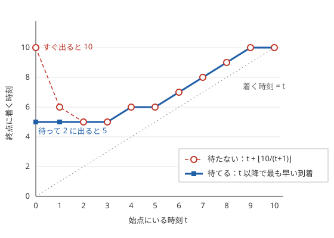

!!! abstract "要点"
    - **何ができるか**：辺の所要時間が出発時刻によって変わるグラフについて、始点から各頂点へ最も早く着く時刻を求める。早く着いて損をしない（待てる）なら、各頂点で最も早い到着時刻だけを持つダイクストラ法がそのまま使える。終点に間に合う最も遅い出発時刻は、終点から逆向きに遅い順に確定させる。
    - **いつ使うか**：
        - 決まった時刻にしか出発できない・待つことができる。
        - 出発時刻によって所要時間が変わる。
        - 終点に間に合う最も遅い出発時刻を求める。
    - **計算量**：辺 1 本の到着時刻を $O(1)$ で計算できれば $O((N + M) \log N)$。時刻表を二分探索で引くなら、辺ごとに $O(\log K)$（$K$ は 1 本の辺の便の数）が掛かる。
    - **前提**：[ダイクストラ法](../graph/dijkstra.md)

<!-- textlint-disable -->
別名：時刻依存の最短路・待機・最終電車・出発時刻・time-dependent shortest path
<!-- textlint-enable -->

時刻で変わる辺の最短路は、「頂点 $u$ を時刻 $t$ に出ると、頂点 $v$ に何時に着くか」が $t$ によって変わるグラフについて、最も早い到着時刻を求める方法である。辺の重みが一定でなくても、早く着いて損をしないという性質さえあれば、距離の代わりに時刻を持つ[ダイクストラ法](../graph/dijkstra.md)で解ける。時刻を状態に加える必要はない。コード片は頂点を 0-indexed で持ち、問題文の 1-indexed の番号からは 1 を引いて使う。例題の解説は問題文の番号（駅 $1, \dots, N$）のまま書く。

## 早く着いて損をしない性質（FIFO 性） {#fifo}

ふつうのダイクストラ法は、辺 $u \to v$ を「$\mathrm{dist}[u]$ に重み $w$ を足す」形で緩和する。時刻で変わる辺では、重みの代わりに**到着時刻の関数** $a_e(t)$ を辺 $e$ ごとに考える。$a_e(t)$ は「時刻 $t$ に $e$ の始点にいるとき、$e$ の終点に着ける最も早い時刻」である。待てない辺では、時刻 $t$ にすぐ出たときの到着時刻そのものである。待てる辺では、$t$ 以降のどの時刻に出るかも選べる。緩和は $\mathrm{dist}[v] \leftarrow \min(\mathrm{dist}[v], a_e(\mathrm{dist}[u]))$ になる。ここで $\mathrm{dist}[v]$ は「$v$ に着ける最も早い時刻」を表す。

この緩和でダイクストラ法が正しく動くには、すべての辺で次の 2 つが要る。

1. **時刻が戻らない**：$a_e(t) \ge t$。ふつうの最短路で辺の重みが非負であることに当たる
2. **早く着いて損をしない（FIFO 性）**：$t \le t'$ なら $a_e(t) \le a_e(t')$。始点に早くいるほど、終点にも早く（同時以前に）着ける

FIFO 性があると、各頂点では最も早い到着時刻だけを覚えておけば足りる。$u$ に遅く着く経路は、その先のどの辺でも早く着く経路より得をしないからである。時刻が戻らないので、ヒープから取り出した頂点の時刻が後から縮むこともない。この 2 つでふつうのダイクストラ法の証明がそのまま通る。

??? note "証明"
    ヒープから頂点 $v$ を時刻 $d$ で取り出したとき、$v$ に $d$ より早く着く経路があったとする。その経路で、まだ取り出していない頂点に初めて入る辺を $x \to y$ とする。$x$ は取り出し済みなので $\mathrm{dist}[x]$ は $x$ への最も早い到着時刻であり、経路上で $x$ にいる時刻は $\mathrm{dist}[x]$ 以上である。FIFO 性から、$y$ に着く時刻は $a(\mathrm{dist}[x])$ 以上で、これは緩和済みなので $\mathrm{dist}[y]$ 以上である。時刻が戻らないので、経路で $v$ に着く時刻は $y$ に着く時刻以上である。$y$ は未取り出しなので $\mathrm{dist}[y] \ge d$ で、経路で $v$ に着く時刻は $d$ 以上になり、仮定と食い違う。

FIFO 性は「待てる」ことと深く関わる。始点で好きなだけ待てるなら、早く着いた人は遅く着いた人と同じ時刻まで待ってから同じように出ればよい。だから待てる辺は必ず FIFO 性を満たす。逆に待てないと崩れることがある。

次の図は、時刻 $s$ に出ると $s + \lfloor 10 / (s + 1) \rfloor$ に着く辺の到着時刻である（混雑が出発時刻とともに引いていく道を表す）。待たずにすぐ出るとき（破線と丸）は、時刻 0 にいると 10 に着くが、時刻 2 にいると 5 に着く。早くいる方が遅く着くので FIFO 性がない。待てるとき（実線と四角）は、時刻 0 にいても 2 まで待てば 5 に着ける。$t$ 以降に出る中で最も早い到着時刻を $a_e(t)$ にすると、グラフは右へ行くほど下がらない。$t \ge 2$ では 2 つは同じ値なので、丸と四角が重なる。



まとめると、時刻で変わる辺の問題では最初に「待てるか」を確かめる。待てるなら、各辺の $a_e(t)$ を「$t$ 以降の出発の中で最も早い到着」として計算すれば、FIFO 性が自動的に成り立つ。待てない問題で FIFO 性も崩れるなら、各頂点で最も早い時刻だけを持つ方法は使えず、時刻を状態に持つ[状態を頂点にする](../graph/extended-dijkstra.md)方法などを考える。

??? question "確認問題：待てない場合"
    図の辺 $u \to v$ の先に、時刻 5 ちょうどだけ出発できる辺 $v \to w$ があるとする。始点から $u$ へ、時刻 0 に着く経路と時刻 2 に着く経路があるとする。どこでも待てないとき、$w$ へ行けるか。各頂点で最も早い到着時刻だけを持つダイクストラ法は正しい答えを出すか。

    ??? success "答え"
        行ける。時刻 2 に $u$ に着く経路なら、すぐ出て $v$ に 5 に着き、$w$ へ行ける。しかしダイクストラ法は $u$ の最も早い時刻 0 だけを持つので、$u$ を時刻 0 に出て $v$ に 10 に着くとしか考えず、$w$ へは行けないと誤る。このように、到着時刻が遅い方が先へ進めることがあるので、最も早い時刻だけを持つと解を見落とす。待てない問題では、FIFO 性が成り立つかを先に確かめる。

## 次の出発時刻まで待つ遷移 {#wait}

最もよく出る形は、辺 $e$ の便が決まった時刻にだけ出発し、所要時間 $T_e$ が一定である場合である。頂点では次の便まで待てる。時刻 $t$ に始点にいるとき、乗れる便は $t$ 以上で最も早い出発時刻 $\mathrm{next}_e(t)$ の便である。このとき $a_e(t) = \mathrm{next}_e(t) + T_e$ になる。$\mathrm{next}_e$ は $t$ について減らないので、FIFO 性が成り立つ。

$\mathrm{next}_e(t)$ の計算は、便の並び方で変わる。

| 便の出発時刻 | $\mathrm{next}_e(t)$ |
| --- | --- |
| $K$ の倍数 | $\lceil t / K \rceil \cdot K$ |
| $l, l + d, \dots, l + (k - 1)d$ | $t \le l$ なら $l$、そうでなければ $l + \lceil (t - l) / d \rceil \cdot d$（$k$ 本目を過ぎたら乗れない） |
| 昇順の一覧 $s_1 < s_2 < \dots$ | `lower_bound` で $t$ 以上の最初の $s_j$ |

時刻が 0 以上なら、切り上げは $\lceil t / K \rceil = \lfloor (t + K - 1) / K \rfloor$ で計算できる（[整数の割り算と余り](../math/integer-division.md)）。$t = 0$ でも $\lceil 0 / K \rceil = 0$ なので、時刻 0 の便に乗れる。

次のコードは、各辺の便が $K_e$ の倍数の時刻に出発する無向グラフで、時刻 0 に始点を出たときの各頂点の最も早い到着時刻を求める。ふつうのダイクストラ法と違うのは、緩和で `d + w` の代わりに `arrive(d, e)` を呼ぶ 1 か所だけである。

```cpp
--8<-- "time-dependent-dijkstra/earliest-arrival.cpp:core"
```

完全なプログラム：[`earliest-arrival.cpp`](https://github.com/yuukougun/kyopro-atlas/blob/main/snippets/time-dependent-dijkstra/earliest-arrival.cpp)（GitHub）
{ .kp-code-src }

ヒープから取り出す時刻が「最も早い到着時刻」なので、取り出した時刻のまま次の便を探せばよい。「待ってから遅い便に乗る方がよい」場合は、$\mathrm{next}_e$ が $t$ 以上で最も早い便を選ぶことで自然に含まれる。わざと遅い便に乗っても、同じ辺の早い便より先に着くことはない（所要時間が一定だから）。

便ごとに所要時間が違うと、遅い便の方が早く着くことがある（後から出る特急が先に着く）。このときは $t$ 以上の便のうち到着が最も早いものを選べばよい。$a_e(t) = \min_{s_j \ge t} (s_j + T_j)$ と定めれば $t$ について減らないので、FIFO 性は保たれる。後ろからの最小値を前計算しておけば、`lower_bound` の後に $O(1)$ で引ける。

## 最終電車型：終点から逆向きに最も遅い時刻を確定させる {#latest-departure}

「各頂点について、終点に間に合う最も遅い出発時刻を求める」問題では、始点がたくさんあり終点は 1 つである。辺をすべて逆に向け、時刻も逆向きに流れると考えると、終点を始点にした 1 回の探索になる。ふつうのダイクストラ法を鏡に映した形で、「小さい順」が「大きい順」に、最小ヒープが最大ヒープに入れ替わる。

$\mathrm{late}[v]$ を「$v$ を出て終点に間に合う最も遅い時刻」とする。終点では $\mathrm{late}[\text{終点}] = +\infty$（いつ着いてもよい）とし、ほかは「間に合わない」を表す値で始める。最大ヒープから頂点 $u$ を時刻 $t = \mathrm{late}[u]$ で取り出す。元の向きで $v \to u$ の列車それぞれについて、「$u$ へ時刻 $t$ までに着く最も遅い便の出発時刻」を求め、$\mathrm{late}[v]$ を大きい方へ更新する。

正しさは前向きのときと同じ形で示せる。$u$ に遅く着いてよいほど、$u$ を出る便の選択肢は広がる。だから各頂点では最も遅い時刻だけを持てば足りる（逆向きの FIFO 性）。便の出発は到着より前なので、逆向きに辿ると時刻は増えない。この 2 つから、最大ヒープから取り出した $\mathrm{late}[u]$ は後から大きくならない。

便が $l, l + d, \dots, l + (k - 1)d$ の $k$ 本で、所要時間が $c$ のとき、時刻 $t$ までに着く最も遅い便は次のように求まる。

- 出発時刻 $s$ は $s + c \le t$ を満たす必要がある。$t - c - l < 0$ なら最初の便でも間に合わない
- そうでなければ、間に合う最後の便の番号は $i = \min(k - 1, \lfloor (t - c - l) / d \rfloor)$ で、出発時刻は $l + i d$

次のコードは、逆向きの隣接リスト `rg` を作り、終点 `goal` からこの方法で $\mathrm{late}$ を求める。

```cpp
--8<-- "time-dependent-dijkstra/last-train.cpp:core"
```

完全なプログラム：[`last-train.cpp`](https://github.com/yuukougun/kyopro-atlas/blob/main/snippets/time-dependent-dijkstra/last-train.cpp)（GitHub）
{ .kp-code-src }

C++ の `/` は 0 の方向へ切り捨てるので、$t - c - l$ が $-d$ より大きい負の数だと商が 0 になり、間に合わない最初の便を間に合うと誤る。コードのように、割る前に負の場合を除いておく。$+\infty$ は $l + (k - 1)d$ の最大（$10^{18}$ 程度）より大きく、$c$ や $l$ を引いてもあふれない値にする。完全なプログラムでは、引くだけで足さないので `LLONG_MAX` を使っている（[INF の決め方](../cpp/cpp-types-literals.md#inf)）。

??? question "確認問題：時刻表が一覧で与えられる場合"
    辺 $v \to u$ の便の出発時刻が昇順の一覧 $s_1 < s_2 < \dots < s_k$ で与えられ、所要時間がどれも $c$ のとき、$u$ に時刻 $t$ までに着く最も遅い便の出発時刻はどう求めるか。

    ??? success "答え"
        $s_j \le t - c$ を満たす最大の $s_j$ を求めればよい。`upper_bound` で $t - c$ より大きい最初の要素を探し、その 1 つ前を見る。先頭の要素がすでに $t - c$ より大きければ、どの便も間に合わない。

## 最適な出発時刻を計算してから進む {#optimal-departure}

この節は、[早く着いて損をしない性質](#fifo)と[次の出発時刻まで待つ遷移](#wait)を前提にする。所要時間が出発時刻の式で与えられ、しかも待てる問題では、各辺で「いつ出発するのが最適か」を計算してから緩和する。到着時刻の関数を $g_e(s)$（時刻 $s$ に出たときの到着時刻）とすると、時刻 $t$ に始点にいるときの到着時刻は次の式になる。

$$
a_e(t) = \min_{s \ge t} g_e(s)
$$

$s$ をすべて試すと間に合わないので、$g_e$ の形を調べて最小になる $s$ を式で求める。代表例は $g_e(s) = s + C + \lfloor D / (s + 1) \rfloor$（$s$ は整数）である。$x = s + 1$ とおくと、$C$ を除いて $h(x) = x + \lfloor D / x \rfloor$ の最小化になる。実数の $x + D / x$ なら $x = \sqrt{D}$ で最小になる（相加平均と相乗平均の関係）。床関数があっても次の性質が成り立つ。

- $x(x + 1) \le D$ なら $h(x + 1) \le h(x)$（左側では増えない）
- $x(x + 1) \ge D$ なら $h(x + 1) \ge h(x)$（右側では減らない）

どちらも $\lfloor D / x \rfloor - \lfloor D / (x + 1) \rfloor$ と $D / x - D / (x + 1) = D / (x(x + 1))$ を比べれば分かる。実数の差が 1 以上なら床の差も 1 以上、1 以下なら床の差も 1 以下になる。たとえば $a - b \ge 1$ なら $\lfloor a \rfloor \ge \lfloor b + 1 \rfloor = \lfloor b \rfloor + 1$ である。$h(x + 1) - h(x) = 1 - (\lfloor D / x \rfloor - \lfloor D / (x + 1) \rfloor)$ なので、これで符号が決まる。だから $h$ は $x^* =$「$x(x + 1) \ge D$ を満たす最小の $x$」で最小になる。時刻 $t$ にいるときは、$x^* - 1 \ge t$ なら時刻 $x^* - 1$ まで待って出発し、すでに過ぎていればすぐ出るのが最適である。

```cpp
--8<-- "time-dependent-dijkstra/best-departure.cpp:core"
```

完全なプログラム：[`best-departure.cpp`](https://github.com/yuukougun/kyopro-atlas/blob/main/snippets/time-dependent-dijkstra/best-departure.cpp)（GitHub）
{ .kp-code-src }

コードの `main` では、$D \le 3000$ と小さい $t$ のすべてで、待つ時刻を全部試した結果と一致することを `assert` で確かめている。$\sqrt{D}$ を浮動小数点で求めると 1 ずれることがあるので、前後を整数の比較で直している。式で解く自信がないときは、$\lfloor \sqrt{D} \rfloor$ の前後の数個の整数と $t$ を候補にして最小を取る書き方でもよい。

この形の辺は、待てないと[FIFO 性の節の図](#fifo)のように FIFO 性が崩れる。待てるからこそ $a_e$ が減らない関数になり、各頂点で最も早い時刻だけを持つダイクストラ法が正しくなる。

## 落とし穴 {#pitfalls}

**待てない問題でそのまま使う**。「途中の駅で止まってはいけない」「出発時刻は到着と同時」のように待てない問題では、FIFO 性を確かめないと誤る。$a_e(t)$ を $t$ について並べ、減るところがないかを小さな例で確かめる。

**時刻をオーバーフローさせる**。到着時刻は所要時間の和に待ち時間が加わるので、辺の数 × 便の間隔の分だけ大きくなる。`int` ではなく `long long` で持ち、切り上げの `t + K - 1` や $+\infty$ からの引き算があふれないかを確かめる。

**負の数の切り捨て**。最終電車型の $\lfloor (t - c - l) / d \rfloor$ のように、割られる数が負になりうる式では、C++ の `/` が 0 の方向へ丸めることを忘れやすい。負の場合を先に除くか、床関数を自分で書く。

**時刻を状態に持ってしまう**。FIFO 性があるのに $\mathrm{dist}[v][t]$ のように時刻を状態に入れると、時刻が $10^9$ まで動く問題では持てない。FIFO 性があれば最も早い時刻だけで足りる。時刻を状態に持つのは、FIFO 性が崩れるか、時刻のほかの量と組で比べなければならず、しかも時刻の幅が小さい問題にする。

**開始時刻の解釈**。「時刻 0 に出発する」のか「時刻 0 から待ってよい」のか、「終点に時刻 $T$ ちょうどに着いてよい」のかで、不等号が変わる。最終電車型では、到着が締め切りと同時でよいなら $s + c \le t$、より前でなければならないなら $s + c < t$ にする。

## 例題 {#examples}

### ABC192 E. Train {#abc192_e}

<div class="kp-problems" data-role="example" markdown>

- [ABC192 E. Train](https://atcoder.jp/contests/abc192/tasks/abc192_e)（diff 1135）：線路 i は K_i の倍数の時刻にだけ出発して T_i かかるとき、都市 X から都市 Y へ最も早く着く時刻を求める

</div>

方針：都市で次の列車まで待てるので、FIFO 性が成り立つ。時刻 $t$ に都市を出ようとするとき、線路 $i$ で隣の都市へ着く時刻は $\lceil t / K_i \rceil K_i + T_i$ である。これを緩和に使ったダイクストラ法で、都市 X から都市 Y への最も早い到着時刻を求める。

??? note "解法の詳細"
    - $\mathrm{dist}[v]$ ＝ 都市 $v$ に着ける最も早い時刻とし、$\mathrm{dist}[X] = 0$ から始める。線路は双方向なので、隣接リストに両向きで入れる。
    - ヒープから $(d, v)$ を取り出し、$v$ から出る各線路で $\lfloor (d + K - 1) / K \rfloor \cdot K + T$ を計算して緩和する。[次の出発時刻まで待つ遷移](#wait)のコードがそのまま使える。
    - 都市 Y に着けなければ $-1$ を出力する。
    - 時刻は $10^9$ を超えうるので `long long` で持つ。計算量は $O((N + M) \log N)$。

### ABC342 E. Last Train {#abc342_e}

<div class="kp-problems" data-role="example" markdown>

- [ABC342 E. Last Train](https://atcoder.jp/contests/abc342/tasks/abc342_e)（diff 1476）：決まった時刻に出発する列車の情報から、各駅について駅 N に間に合う最も遅い出発時刻を求める

</div>

方針：各情報は「駅 $A$ から駅 $B$ へ、時刻 $l, l + d, \dots, l + (k - 1)d$ に出発して $c$ かかる列車」を表す。始点が駅 $1$ から $N - 1$ まであるので、辺を逆にして駅 $N$ から探索する。最も遅い時刻から順に確定させる最大ヒープのダイクストラ法で、各駅の最も遅い出発時刻が 1 回で求まる。

??? note "解法の詳細"
    - $\mathrm{late}[N] = +\infty$、ほかは「間に合わない」で始める。逆向きの隣接リストに、列車 $A \to B$ を $B$ から $A$ への辺として入れる。
    - 最大ヒープから $(t, u)$ を取り出し、$u$ に着く各列車で、$t$ までに $u$ に着く最も遅い便を求める。$t - c - l < 0$ なら使えない。そうでなければ $i = \min(k - 1, \lfloor (t - c - l) / d \rfloor)$ で、出発時刻 $l + i d$ で $\mathrm{late}[A]$ を更新する。[最終電車型の節](#latest-departure)のコードがそのまま使える。
    - 乗り換えの時間はかからないので、到着と同時に次の列車に乗れる。不等号は $s + c \le t$ でよい。
    - 間に合わない駅には `Unreachable` を出力する。$l + (k - 1)d$ は $10^{18}$ 程度になるので、$+\infty$ はそれより大きくする。$+\infty$ からは $c$ と $l$ を引くだけで足さないので、`LLONG_MAX` でよい（[INF の決め方](../cpp/cpp-types-literals.md#inf)）。計算量は $O((N + M) \log N)$。

## 練習問題 {#practice}

<div class="kp-problems" data-role="practice" markdown>

- [ABC084 C. Special Trains](https://atcoder.jp/contests/abc084/tasks/abc084_c)（diff 908）：一直線に並ぶ N 駅で、駅 i から i+1 へは時刻 S_i から F_i ごとに出る列車で C_i かかるとき、各駅から出発して駅 N に最も早く着く時刻を求める。
- [ABC319 E. Bus Stops](https://atcoder.jp/contests/abc319/tasks/abc319_e)（diff 1353）：家からバス停 1 まで X、バス停 i から i+1 へは P_i（≤ 8）の倍数の時刻に出るバスで T_i、最後のバス停から会社まで Y かかるとき、質問ごとの出発時刻に対して会社へ最も早く着く時刻を答える。
- [ABC204 E. Rush Hour 2](https://atcoder.jp/contests/abc204/tasks/abc204_e)（diff 1710）：時刻 t に出発すると通過に C + ⌊D/(t+1)⌋ かかる道路で、都市 1 から都市 N への最も早い到着時刻を求める

</div>

??? note "練習の方針"
    - **ABC084 C**：各始点から駅を順にたどる。現在時刻 $t$ が $S_i$ 未満なら $S_i$、そうでなければ $\lceil t / F_i \rceil \cdot F_i$ を出発時刻として $C_i$ を足す。$N \le 500$ なので始点ごとのシミュレーションで間に合う。一本道なのでヒープは要らない
    - **ABC319 E**：各停留所で「次の $P_i$ の倍数まで待つ」遷移 $\lceil t / P_i \rceil \cdot P_i + T_i$ を順にたどる。待ち方は周期 $\operatorname{lcm}(1, \dots, 8) = 840$ で繰り返すので、出発時刻 mod 840 ごとの到着時刻を前計算し、各質問に $O(1)$ で答える。一本道なのでダイクストラ法そのものは使わない
    - **ABC204 E**：都市では整数の時間だけ待てる。各道路で、最適な出発時刻（$\sqrt{D}$ の付近）まで待つかすぐ出るかを計算して到着時刻を求め、ダイクストラ法で緩和する。[最適な出発時刻を計算してから進む](#optimal-departure)の関数がそのまま使える

## 力試し {#challenge}

<div class="kp-problems" data-role="challenge" markdown>

- [ARC150 C. Path and Subsequence](https://atcoder.jp/contests/arc150/tasks/arc150_c)（diff 1802）：各頂点に値 A_v がある連結な無向グラフと数列 B（長さ K）について、頂点 1 から N へのどの単純パスでも、通った頂点の A の列が B を部分列に含むかを判定する。

</div>

??? note "力試しの方針"
    - **ARC150 C**：各頂点で「$B$ を先頭から貪欲に何個まで一致させたか」の最小値を距離とする。頂点 $v$ に入ると一致数 $x$ が $x + [A_v = B_{x+1}]$ になり、この遷移は $x$ 以上で $x$ について単調（$x < x'$ なら $f(x) \le x + 1 \le x' \le f(x')$）なので、ダイクストラ法（または 01-BFS）が使える。頂点 $N$ の値が $K$ に届けば Yes である

## 使い分け {#comparison}

- 辺の重みが一定なら、ふつうの[ダイクストラ法](../graph/dijkstra.md)で足りる。時刻で変わる辺のダイクストラ法は、緩和の式を $a_e(t)$ に替えただけである
- FIFO 性が崩れる、または時刻の幅が小さく「時刻 $t$ にどこにいられるか」を全部持てるなら、(頂点, 時刻) を状態にする（[状態を頂点にする](../graph/extended-dijkstra.md)）
- 便の周期が小さく（周期の最小公倍数の分だけ前計算できる大きさで）、1 本の道を進むだけ（分岐がない）なら、グラフの探索は要らない。出発時刻を周期で割った余りごとに前計算する[周期性の検出](../basics/periodicity.md)の考え方が効く

## 参考 {#references}

- [miscalc「コスト変化が変なときのダイクストラ法」](https://miscalc.hatenablog.com/entry/2022/10/10/115348)：ダイクストラ法が使える 2 つの条件（到着時刻の関数の単調性と、時刻が戻らないこと）
- [hamayan「Train [AtCoder Beginner Contest 192 E]」](https://blog.hamayanhamayan.com/entry/2021/02/20/233838)：例題の方針（次の倍数の時刻まで待つ遷移と、到着時刻が単調だから正しいこと）
- [Lanly「AtCoder Beginner Contest 342」](https://www.cnblogs.com/Lanly/p/18032259)：例題の方針（逆向きのグラフと最大ヒープ、最後の便の番号の式）
- [hamayan「Rush Hour 2 [AtCoder Beginner Contest 204 E]」](https://blog.hamayanhamayan.com/entry/2021/06/07/024520)：練習の方針（最適な出発時刻が √D の付近にあること）
- [ikatakos「ABC 084」](https://ikatakos.com/pot/programming_algorithm/contest_history/atcoder/2017/1230_abc084)：練習 ABC084 C の待ち時間の切り上げと始点ごとのシミュレーション（解説の部分だけを参照）
- [プロひろ「ABC319 E問題（Bus Stops）を解く」](https://programming-hiroba.com/abc319-e/)：練習 ABC319 E の周期 840 の前計算と切り上げ
- [merom686「ABC319」](https://merom686.hatenablog.com/entry/2023/09/10/022053)：練習 ABC319 E の mod 840 で引く方針
- [merom686「ARC150」](https://merom686.hatenablog.com/entry/2022/10/10/013513)：力試し ARC150 C の一致数が最小となるパスをダイクストラ法で求める方針
