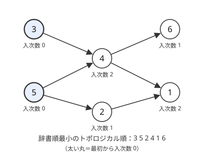
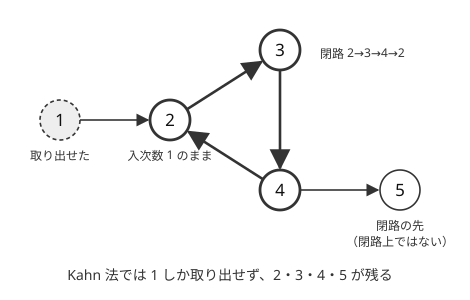

!!! abstract "要点"
    - **何ができるか**：閉路のない有向グラフの頂点を、すべての辺が前から後ろへ向くように $O(N + M)$ で並べる。入次数 0 の頂点から取り出す Kahn 法か DFS の帰りがけ順の逆で求め、閉路があれば並べられない。
    - **いつ使うか**：
        - a は b より前・依存関係・前提条件。
        - 条件を満たす辞書順最小の順序・順序が一意か。
        - 矛盾（閉路）があれば −1。
    - **計算量**：$O(N + M)$。辞書順最小にするなら優先度付きキューを使って $O(N \log N + M)$。
    - **前提**：[深さ優先探索（DFS）](../graph/dfs.md)、[幅優先探索（BFS）と無重み最短路](../graph/bfs.md)

<!-- textlint-disable -->
別名：トポロジカル順序・Kahn 法・入次数・DAG・topological sort
<!-- textlint-enable -->

トポロジカルソートは、有向グラフの頂点を「どの辺 $u \to v$ でも $u$ が $v$ より前」になるように並べることである。この並びをトポロジカル順という。並べられるのは閉路のない有向グラフ（[DAG](../guide/glossary.md#dag)）のときだけで、閉路があると、閉路上のどの頂点も「自分より前にあるべき頂点」を持つので先頭に置けない。「a は b より前」という条件は辺 $a \to b$ にすれば、条件をすべて満たす並べ方を求める問題になる。

頂点数を $N$、辺数を $M$ とする。図・表・確認問題では頂点を 1 から番号付けし、コードでは入力から 1 を引いて 0-indexed で持つ。

## Kahn 法と DFS の帰りがけ順 {#kahn-dfs}

トポロジカル順の作り方は 2 通りあり、どちらも $O(N + M)$ である。

**Kahn 法**は、先頭に置ける頂点から順に置いていく。先頭に置けるのは、まだ置いていない頂点から入る辺がない頂点、すなわち残りのグラフで[入次数](../guide/glossary.md#in-degree)が 0 の頂点である。手順は次のとおりである。

1. 各頂点の入次数 $\mathrm{indeg}[v]$ を数え、入次数 0 の頂点をすべてキューに入れる
2. キューから頂点 $u$ を取り出して並びの末尾に置き、$u$ から出る辺 $u \to v$ をすべて消す（$\mathrm{indeg}[v]$ を 1 減らし、0 になったら $v$ をキューに入れる）
3. キューが空になるまで 2 を繰り返す。置いた頂点が $N$ 個に届かなければ閉路がある

各頂点は 1 回だけキューに入り、各辺は 1 回だけ消されるので $O(N + M)$ である。次の図の 6 頂点の DAG では、最初に入次数 0 なのは 3 と 5 である。



キューを番号の小さい順に取り出す場合（次の節の優先度付きキュー）の動きは次のとおりである。

| 手順 | 取り出す前のキュー | 取り出す頂点 | 入次数が 0 になった頂点 |
| --- | --- | --- | --- |
| 1 | 3, 5 | 3 | なし（4 は 2 → 1） |
| 2 | 5 | 5 | 2, 4 |
| 3 | 2, 4 | 2 | なし（1 は 2 → 1） |
| 4 | 4 | 4 | 1, 6 |
| 5 | 1, 6 | 1 | なし |
| 6 | 6 | 6 | なし |

閉路があると、閉路上の頂点はどれも、閉路で 1 つ前の頂点から入る辺が消えないので入次数が 0 にならず、キューに入らない。次の図では頂点 1 を取り出した後、頂点 2 には辺 $4 \to 2$ が残るので入次数 1 のまま止まる。



残った頂点は閉路上の頂点だけではない。閉路から辺をたどって行ける頂点（図の 5）も、入る辺の始点が残っているので取り出せない（[閉路の検出の Kahn 法の節](../graph/cycle-detection.md#kahn-leftover)）。閉路そのものを求めるときは[閉路の検出と復元](../graph/cycle-detection.md#restore)の方法を使う。

**DFS の帰りがけ順の逆**も、トポロジカル順になる。[深さ優先探索](../graph/dfs.md#pre-post-order)で頂点から出る辺をすべて調べ終えた順（帰りがけ順）に並べると、閉路がなければ $v$ から行ける頂点はすべて $v$ より前に並ぶ。これを逆に読めば、どの辺も前から後ろへ向く。探索中（まだ出ていない）の頂点へ向かう辺を見つけたら、それは祖先へ戻る辺なので閉路がある。

```cpp
--8<-- "topological-sort/dfs-order.cpp:core"
```

どちらを使うかは目的で決める。辞書順の指定・一意性の判定・閉路の判定には、次に置ける候補を確かめられる Kahn 法が向く。依存するものを先に済ませる順が欲しいだけなら、帰りがけ順そのもの（逆にしない）を使えばよく、DFS の方が短く書ける。辺を「$v$ は $w$ を前提とする」の向き $v \to w$ で張ったなら、帰りがけ順が前提から先に並ぶ順である。

??? question "確認問題：帰りがけ順を逆にする理由"
    閉路のない有向グラフで、DFS の帰りがけ順の逆がトポロジカル順になるのはなぜか。辺 $u \to v$ について、$v$ が帰りがけ順で $u$ より前に並ぶことを示せ。

    ??? success "答え"
        $u$ を調べる時点の $v$ の状態で分ける。未訪問なら、$v$ は $u$ の中から探索されるので、$u$ より先に出る。探索済みで出た後なら、すでに $u$ より前に並んでいる。探索中（まだ出ていない）なら $v$ は $u$ の祖先で、$v \to \dots \to u \to v$ が閉路になるので起きない。どの場合も $v$ は $u$ より前に並ぶので、逆にすれば $u$ が前になる。

## 辞書順最小は優先度付きキューの Kahn 法 {#lexicographic}

条件を満たす並べ方のうち辞書順最小のものを求めるときは、Kahn 法のキューを[優先度付きキュー](../ds/priority-queue.md)（最小を取り出す向き）にする。計算量は $O(N \log N + M)$ である。

正しい理由は、先頭から 1 つずつ決める[辞書順の貪欲](../basics/lexicographic-greedy.md#topological)と同じである。次に置けるのは入次数 0 の頂点に限られ、そのどれを置いても、残りを並べきれるかは「残りのグラフに閉路がないか」だけで決まる。だから入次数 0 の中の最小を置いてよい。

```cpp
--8<-- "topological-sort/kahn-lex.cpp:core"
```

DFS の帰りがけ順では辞書順最小は作れない。隣を番号の小さい順に調べても、帰りがけ順を逆にすると「後から調べた頂点ほど前」になり、どの頂点が先頭に来るかを制御できない。「番号の小さい頂点をできるだけ前に置く」という別の問い方もあり、その場合は辺を逆にして大きい順に末尾から並べる（[辞書順の貪欲](../basics/lexicographic-greedy.md#topological)）。

## 順序が一意かの判定 {#unique}

トポロジカル順がただ 1 つに決まるのは、Kahn 法の途中でキューの中身が常に 1 個のときである。[辞書順最小の節](#lexicographic)のコードの `unique` がこの判定である（`pq.size() >= 2` になったら一意でない）。

- キューに 2 個以上入った時点で、閉路がなければそのどちらを先に置いても続きを並べられるので、並べ方は 2 通り以上ある
- 常に 1 個なら、毎回の選択肢が 1 つしかないので並べ方は 1 通りである

同じことを並びの側から言うと、トポロジカル順の隣り合う 2 頂点 $p_i, p_{i+1}$ がすべて辺で結ばれていることと同値である。$p_i \to p_{i+1}$ の辺がなければ、2 つを入れ替えても条件を破らない。

この型は「大小関係の情報から順列を復元できるか。できるなら復元せよ」という形で出る。情報「$A_x < A_y$」を辺 $x \to y$ にすれば、答えはトポロジカル順で $i$ 番目（1 から数える）に置いた頂点の値を $i$ にしたものである。

??? question "確認問題：順序は一意か"
    3 頂点で辺が $3 \to 1$、$1 \to 2$、$3 \to 2$ のグラフのトポロジカル順は一意か。辺 $1 \to 2$ を消したらどうか。

    ??? success "答え"
        一意である。入次数 0 は最初 3 だけで、3 を置くと 1 だけ、1 を置くと 2 だけが入次数 0 になり、キューは常に 1 個である（順は 3, 1, 2）。辺 $1 \to 2$ を消すと、3 を置いた後に 1 と 2 が同時に入次数 0 になり、3, 1, 2 と 3, 2, 1 の 2 通りになる。

## 出次数 0 の頂点から逆向きに剥がす {#peel-sinks}

「そこから辺をたどって無限に移動し続けられる頂点を数えよ」という問いは、Kahn 法を逆向きに使って解ける。出次数 0 の頂点（行き止まり）から剥がしていき、行き先がすべて剥がれた頂点も剥がす。最後に残った頂点が答えである。実装は、逆辺のグラフの上で出次数を入次数として扱う Kahn 法と同じ形である。

```cpp
--8<-- "topological-sort/peel-sinks.cpp:core"
```

- **剥がした頂点からは無限に歩けない**：剥がした順の逆に帰納法で示せる。行き止まりは明らかで、行き先がすべて剥がれた頂点からは、どの辺を選んでも無限に歩けない頂点に着く
- **残った頂点からは無限に歩ける**：残った頂点は、残った頂点への辺を少なくとも 1 本持つ（なければ出次数が 0 になって剥がれている）。だから残った頂点の中だけを永遠に歩ける

残るのは、閉路上の頂点と、閉路へたどり着ける頂点である。前の節の閉路の図と比べると、通常の Kahn 法で残るのは閉路の「先」の頂点まで、逆向きで残るのは閉路の「手前」の頂点までという違いがある。

ゲームの勝敗を終局から決めていく[後退解析](../comb/game-retrograde-analysis.md#counter)も、同じように行き先の数のカウンタを減らして確定させる。

## DAG 上の DP へ（DP の章） {#to-dag-dp}

トポロジカル順に頂点を処理すると、$v$ を処理する時点で $v$ に入る辺の始点はすべて処理済みである。この性質を使って、最長路・経路の数・到達可能性などを各辺 1 回の計算で求めるのが [DAG 上の DP](../dp/dp-dag.md) である。一般のグラフでは難しい最長路も、DAG なら $O(N + M)$ で求まる。

DP の章では、どの DP も状態を頂点・遷移を辺とする DAG の上の計算とみる（[計算順序](../dp/dp-order.md)）。添字の昇順や区間の長さ順といった普段の計算順序は、問題の性質から分かるトポロジカル順である。順序が問題から読み取れないときに、Kahn 法で順序を作る。

閉路があるグラフでも、互いに行き来できる頂点を[強連結成分分解](../graph/scc.md)で 1 点にまとめれば DAG になり、その上で DP できる。

## ACL の scc_graph を使う（DAG なら scc() の順がトポロジカル順） {#acl}

ACL にはトポロジカルソートそのものはないが、強連結成分分解の `scc_graph` が使える。`scc()` が返す成分のリストはトポロジカル順に並んでいる。DAG なら各成分が 1 頂点なので、成分を順に読めばトポロジカル順になる。

!!! info "ACL では"
    `atcoder::scc_graph sg(n);`。`sg.add_edge(from, to)` はならし $O(1)$、`sg.scc()` は $O(N + M)$ で、成分（頂点のリスト）のリストを返す。異なる成分の $u$ から $v$ に到達できるなら、$u$ の成分が前に並ぶ。

```cpp
--8<-- "topological-sort/acl-scc.cpp:core"
```

閉路の判定には、成分の数が $N$ より少ないかと、自己ループがあるかの両方を見る。自己ループ $v \to v$ だけの閉路では、$v$ は 1 頂点の成分のままだからである。得られる順は辞書順最小とは限らないので、辞書順の指定があれば[優先度付きキューの Kahn 法](#lexicographic)を使う。

## 落とし穴 {#pitfalls}

**閉路の確認を忘れる**。Kahn 法は閉路があっても止まり、途中までの並びを返す。「矛盾があれば −1」の問題では、取り出した頂点の数が $N$ に届いたかを必ず確かめる。DFS で作るときは、帰りがけ順を作るだけでは閉路を検出できないので、探索中の頂点への辺を調べる。

**辺の向きを取り違える**。「a は b より前」なら辺は $a \to b$ である。「b を読むには a が要る」も同じ向きになる。逆に張ると、並びがそっくり逆になる。辞書順最小の問題で逆に張ってから最後に反転させても、辞書順最小にはならない。

**入次数の数え方と消し方が合っていない**。同じ条件が 2 回与えられる（多重辺）と、入次数を 2 回数えたなら 2 回減らさなければならない。隣接リストは多重辺のまま持ち、入次数も 1 本ずつ数えれば自然に合う。重複を除くなら、隣接リストと入次数の両方で除く。自己ループは入次数が 0 にならないので、Kahn 法では閉路として正しく扱われる。

**DFS の再帰が深くなる**。一直線に並んだ $2 \times 10^5$ 頂点のグラフでは再帰も同じ深さになり、手元の環境ではスタックがあふれうる（[AtCoder と手元の C++ 環境](../cpp/cpp-environment.md#stack-depth)）。Kahn 法なら再帰を使わない。

**辞書順最小を DFS で作ろうとする**。番号の小さい順に DFS しても辞書順最小にはならない（[辞書順最小の節](#lexicographic)）。

## 上位の手法へのつながり {#next-steps}

- **DAG の上の最長路・経路の数**：トポロジカル順に値を配ると、どの頂点も入る辺がすべて処理された後に確定する（[DAG 上の DP](../dp/dp-dag.md)）。
- **閉路があるグラフ**：互いに行き来できる頂点を縮約して DAG にしてから並べる（[強連結成分分解（SCC）](../graph/scc.md)）。
- **ゲームの勝敗**：遷移のグラフを終局から逆向きにたどって勝ち負けを確定させる。閉路があって引き分けがありうる場合も扱える（[後退解析](../comb/game-retrograde-analysis.md)）。
- **真偽の割り当て**：2 変数の「または」の条件は、含意グラフの SCC のトポロジカル順から割り当てが決まる（[2-SAT](../graph/two-sat.md)）。

## 例題 {#examples}

### ABC223 D. Restricted Permutation {#abc223_d}

<div class="kp-problems" data-role="example" markdown>

- [ABC223 D. Restricted Permutation](https://atcoder.jp/contests/abc223/tasks/abc223_d)（diff 1069）：「A_i は B_i より前」という条件をすべて満たす 1〜N の順列のうち、辞書順最小のものを求める（なければ −1）

</div>

条件 $A_i$ が $B_i$ より前を辺 $A_i \to B_i$ にすると、条件を満たす順列はトポロジカル順そのものである。辞書順最小なので、[優先度付きキューの Kahn 法](#lexicographic)で入次数 0 の最小の頂点を置いていく。閉路があれば並べられないので −1 を出す。

??? note "解法の詳細"
    - 入力は 1-indexed なので 1 を引いて頂点 $0, \dots, N - 1$ にし、出力で 1 を足す。
    - 辺 $A_i \to B_i$ を張り、$\mathrm{indeg}[B_i]$ を 1 増やす。同じ条件が重複しても、そのまま 1 本ずつ数えてよい。
    - 入次数 0 の頂点を最小を取り出す優先度付きキューに入れ、取り出すたびに出る辺の先の入次数を減らし、0 になったら入れる。
    - 取り出した頂点が $N$ 個に届かなければ −1、届けばその順に出力する。$O(N \log N + M)$ で、$N, M \le 2 \times 10^5$ に間に合う。
    - コードは[辞書順最小の節](#lexicographic)のものと同じ形である。

## 練習問題 {#practice}

<div class="kp-problems" data-role="practice" markdown>

- [ABC315 E. Prerequisites](https://atcoder.jp/contests/abc315/tasks/abc315_e)（diff 921）：本 i を読むには指定された本を先に読む必要があるとき、本 1 を読むために読む本を、読む順に出力する
- [ABC216 D. Pair of Balls](https://atcoder.jp/contests/abc216/tasks/abc216_d)（diff 1039）：筒に積まれたボールの一番上が同じ色の 2 つの筒からボールを取り出す操作で、すべての筒を空にできるかを判定する
- [ABC245 F. Endless Walk](https://atcoder.jp/contests/abc245/tasks/abc245_f)（diff 1451）：有向グラフで、そこから無限に移動し続けられる頂点の数を求める

</div>

??? note "練習の方針"
    - **ABC315 E**：本 $v$ から「先に読む本」へ辺を張り、本 1 から DFS する。帰りがけ順は前提から先に並ぶので、逆にせずそのまま出力すればよい（本 1 自身は除く）。本 1 から行ける本だけを探索するので、要らない本は出てこない
    - **ABC216 D**：同じ筒で色 $c$ が色 $d$ のすぐ上にあれば「$c$ を先に取り出す」ので辺 $c \to d$ と考えられる。一番上の色がそろった色から取り出すのは、入次数 0 の頂点から処理するのと同じである。そろった色をキューに入れ、取り出したら 2 つの筒の新しい一番上だけを調べ直す。最後にすべて空なら可
    - **ABC245 F**：[出次数 0 の頂点から逆向きに剥がす](#peel-sinks)節の方法そのものである。逆辺と出次数を持ち、行き止まりから剥がして、残った頂点を数える

## 力試し {#challenge}

<div class="kp-problems" data-role="challenge" markdown>

- [典型90 071. Fuzzy Priority（★7）](https://atcoder.jp/contests/typical90/tasks/typical90_bs)（diff —）：依存関係を満たす頂点の並べ方を K 個（なければ −1）出力する

</div>

??? note "力試しの方針"
    - **典型90 071**：Kahn 法の「入次数 0 の候補からどれを置くか」を全通り試すバックトラックで、トポロジカル順を列挙する。置いたら辺を消し、戻るときに入次数と候補を元に戻す。DAG では途中まで作った並びが必ず最後まで延びるので、行き止まりの枝がなく、$K$ 個見つけた時点で打ち切れば探索は $K$ 個分の長さで済む。見つかった並びが $K$ 個に届かなければ −1 を出す（閉路があれば 1 個も作れない）

## 参考 {#references}

- [drken「AtCoder ABC 223 D - Restricted Permutation (緑色, 400 点)」](https://drken1215.hatenablog.com/entry/2025/02/07/003505)：例題の方針（条件を辺にし、優先度付きキューの Kahn 法で辞書順最小を作る）
- [kyo-pro「ABC315 E」](https://kyo-pro.hatenablog.com/entry/ABC315E)：練習の方針（DFS の帰りがけ順をそのまま出力する）
- [hamayan「Pair of Balls [AtCoder Beginner Contest 216 D]」](https://blog.hamayanhamayan.com/entry/2021/08/29/230959)：練習の方針（一番上の色がそろった筒の組をキューで処理する）
- [kyo-pro「ABC245 F」](https://kyo-pro.hatenablog.com/entry/ABC245F)：練習の方針（逆辺で出次数 0 の頂点から剥がす）
- [E869120「kyopro_educational_90 sol/071-03.cpp」](https://github.com/E869120/kyopro_educational_90/blob/main/sol/071-03.cpp)：力試しの方針（入次数 0 の候補を選ぶバックトラックと打ち切り）
- [プロひろ「ABC291 E問題（Find Permutation）を解く」](https://programming-hiroba.com/abc291-e/)：順序が一意かの判定（キューに 2 個以上入ったら一意でない）
- [AtCoder Library「SCC」（document_ja/scc.md）](https://github.com/atcoder/ac-library/blob/master/document_ja/scc.md)：`scc()` の返すリストがトポロジカル順であること
