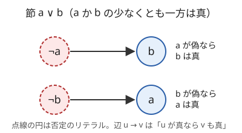
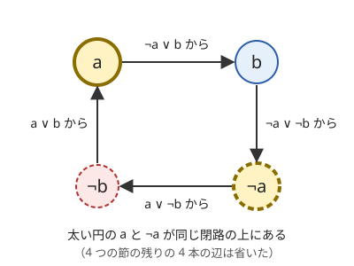

!!! abstract "要点"
    - **何ができるか**：各変数が真か偽で、条件がすべて「2 つのリテラルの OR」のとき、全条件を満たす割当があるかを判定し、あれば 1 つ求める。条件を含意の辺にしたグラフを強連結成分分解して $O(N + M)$ で解く。ACL の `two_sat` で書けるので、条件を節に直すモデル化が中心になる。
    - **いつ使うか**：
        - 各要素が 2 択で「この 2 つは同時に選べない」「少なくともどちらか一方」
        - 条件を満たす 2 択の割当があるか、あれば 1 つ出力する
        - 条件がすべて $(x_i \lor x_j)$ の形（2 つのリテラルの OR）に書ける
    - **計算量**：変数 $N$ 個・節 $M$ 個で $O(N + M)$
    - **前提**：[強連結成分分解（SCC）](../graph/scc.md)

<!-- textlint-disable -->
別名：2SAT・充足可能性・含意グラフ・2-satisfiability
<!-- textlint-enable -->

2-SAT は、真偽の変数 $x_0, \dots, x_{N-1}$ について「$x_i$ または $x_j$」のような 2 つの条件の OR（節）をいくつも与えられたとき、すべての節を同時に満たす割当を求める問題である。変数かその否定（$x_i$ や $\lnot x_i$）を**リテラル**と呼ぶ。節を「一方が偽なら他方は真」という含意の辺に直すと、強連結成分分解だけで線形時間で解ける。

## 使える形と使えない形 {#when-to-use}

2-SAT にできるのは、各要素の選択が 2 択で、条件がどれも「高々 2 つの要素の選択だけで決まる禁止」に書けるときである。「要素 $i$ が A で要素 $j$ が B の組合せは禁止」は、「$i$ が A でない、または $j$ が B でない」という節 1 本になる。2 要素の選択の 4 通りのうち禁止するものごとに 1 本の節を足せば、2 要素の間のどんな条件も表せる。

- **使えない形**：3 つ以上のリテラルの OR（「3 つのうち少なくとも 1 つ」）が必要なものは、そのままでは 2-SAT の形にならない。そうした節を許す一般の 3-SAT は [NP 困難](../guide/glossary.md#np-hard)で、2-SAT のようには解けない。ただし「高々 1 つ」は 2 つのリテラルの節で書ける（[「高々 1 つ」の節](#at-most-one)）。
- **二部グラフ判定との違い**：条件が「$x_u \ne x_v$」だけなら[二部グラフ](../graph/bipartite-graph.md)の判定で足りる。「$x_u$ が真なら $x_v$ も真」のような片向きの条件や、「両方偽は禁止」が混ざると 2-SAT が要る。
- **燃やす埋めるとの違い**：2-SAT は割当があるかだけを答え、コストの最小化はできない。条件を破るたびにコストがかかり、その和を最小にしたいときは、コストの形が燃やす埋めるの型（「$a$ が真で $b$ が偽ならコスト」のような最小カットで表せる形）に合えば[燃やす埋める](../graph/project-selection.md#comparison)を考える。2 変数の条件のコストを何でも扱えるわけではない。

## 節を含意の辺 ¬a→b・¬b→a に直す {#implication}

2-SAT を解くには、リテラル $2N$ 個を頂点にした有向グラフ（**含意グラフ**）を作る。辺 $u \to v$ は「$u$ が真なら $v$ も真」を表す。節 $a \lor b$（$a$・$b$ はリテラル）は「$a$ が偽なら $b$ は真」と「$b$ が偽なら $a$ は真」の 2 つと同じ意味なので、辺 $\lnot a \to b$ と $\lnot b \to a$ の 2 本にする。



この 2 本は互いに「矢印を逆にして両端を否定したもの」になっている。そのため含意グラフでは、$u$ から $v$ へのパスがあれば $\lnot v$ から $\lnot u$ へのパスもある（対偶）。ただし次の節の復元の正しさが直接使うのは、節ごとに張った 2 本の辺 $\lnot a \to b$・$\lnot b \to a$ が両方あることである（背理法で 2 本とも使う）。

辺 $u \to v$ をたどると、$u$ を真にしたときに真にせざるをえないリテラルが分かる。$u$ から到達できる頂点はすべて真でなければならない。

## x と ¬x が同じ SCC なら充足不能・答えの復元 {#unsatisfiable}

含意グラフを[強連結成分分解](../graph/scc.md)したとき、ある変数 $x$ について $x$ と $\lnot x$ が同じ強連結成分に入れば、割当は存在しない。$x \to \dots \to \lnot x$ のパスがあるので $x$ を真にすると $\lnot x$ も真になり、逆向きのパスもあるので $x$ を偽にしても $x$ が真になる。どちらを選んでも矛盾する。

次の図は、4 つの節 $a \lor b$・$\lnot a \lor b$・$a \lor \lnot b$・$\lnot a \lor \lnot b$（$a$・$b$ の 4 通りの割当をすべて禁じる）の含意グラフの一部である。$a$ と $\lnot a$ が 1 つの閉路の上にあり、同じ強連結成分に入る。



逆に、どの $x$ でも $x$ と $\lnot x$ が別の成分なら、割当は必ず存在し、次の規則で作れる。成分を[トポロジカル順](../graph/scc.md#acl)（辺がすべて前から後ろへ向く順）に並べ、成分の位置を $t(\cdot)$ とする。

- $t(x) > t(\lnot x)$（$x$ の成分の方が後ろ）なら $x$ を真に、そうでなければ偽にする。

この割当がすべての節を満たすことは、短い背理法で分かる。節 $a \lor b$ が破れた、すなわち $a$ と $b$ がどちらも偽だったとする。規則から $t(a) < t(\lnot a)$ と $t(b) < t(\lnot b)$ である。節の辺 $\lnot a \to b$ と $\lnot b \to a$ は前から後ろへ向く（同じ成分なら位置は等しい）ので $t(\lnot a) \le t(b)$、$t(\lnot b) \le t(a)$ である。並べると $t(a) < t(\lnot a) \le t(b) < t(\lnot b) \le t(a)$ となり矛盾する。

直感としては、トポロジカル順で後ろの成分ほど「そこから先に強制されるものが少ない」。後ろにある方を真にすれば、真にしたことで強制される先も後ろにしかなく、矛盾に届かない。

計算量は、頂点 $2N$ 個・辺 $2M$ 本のグラフの強連結成分分解なので $O(N + M)$ である。

## モデル化の早見表（同時に選べない・どちらかは必ず・a なら b） {#cheatsheet}

条件を節に直す型を次にまとめる。$a$・$b$ は「要素 $i$ が選択肢 A を取る」のようなリテラルで、右の列は ACL の `add_clause(i, f, j, g)`（節 $(x_i = f) \lor (x_j = g)$ を足す）での書き方である。ACL の列は $a$ を「$x_i$ が真」、$b$ を「$x_j$ が真」としたときの書き方で、リテラルが否定（たとえば「カード $i$ が裏」）なら、その側の `true`・`false` を入れ替える。

| 条件 | 足す節 | ACL での書き方 |
| --- | --- | --- |
| $a$ と $b$ は同時に選べない | $\lnot a \lor \lnot b$ | `(i, false, j, false)` |
| $a$ か $b$ の少なくとも一方 | $a \lor b$ | `(i, true, j, true)` |
| $a$ なら $b$ | $\lnot a \lor b$ | `(i, false, j, true)` |
| $a$ と $b$ はちょうど一方 | $a \lor b$ と $\lnot a \lor \lnot b$ | 上の 2 行を両方 |
| $a$ と $b$ は同じ | $\lnot a \lor b$ と $a \lor \lnot b$ | 「なら」を両向き |
| $a$ は必ず真 | $a \lor a$ | `(i, true, i, true)` |

「必ず真」は同じリテラルを 2 回並べた節で表せる（辺 $\lnot a \to a$ が 1 本できる）。「$a$ なら $b$」は「$\lnot b$ なら $\lnot a$」と同じで、どちらの向きで書いても同じ節になる。

変数の真偽を何に対応させるかを最初に決め、紙に書いておく。たとえば「$x_i$ が真 ＝ カード $i$ を表にする」と決めたら、条件の中の「裏」はすべて $\lnot x_i$ に直す。真偽の対応を途中で取り違えるのが、2-SAT で最も多い誤りである。

値が多段階の変数（$0 \le X_i \le M$）は、「$X_i \ge j$」を表す変数 $y_{i,j}$（$j = 1, \dots, M$）の列で表せる。「$y_{i,j+1}$ なら $y_{i,j}$」を足すと真の変数が先頭に詰まり、$X_i$ は真の個数として読める。値の範囲の条件は「$X_i \ge j$ なら $X_k \ge j'$」のような節になる（[ABC277 Ex](#practice) の型。燃やす埋めるの[多値変数](../graph/project-selection.md#multi-valued)と同じ発想）。

## 「高々 1 つ」を補助変数で O(K) 本の節にする {#at-most-one}

$K$ 個のリテラル $l_0, \dots, l_{K-1}$ のうち真になるのを高々 1 つにしたいとき、すべての組に $\lnot l_p \lor \lnot l_q$ を足すと節が $K(K-1)/2$ 本になる。素因数ごとに数を集めるような問題では $K$ が $N$ 程度になりうるので、補助変数で $O(K)$ 本に減らす。

補助変数 $s_k$ を「$l_0, \dots, l_k$ のどれかが真」の意味で用意し、各 $k$ について次の節を足す。

- $l_k \to s_k$（節 $\lnot l_k \lor s_k$）：真のリテラルがあれば、そこから先の $s$ は真になる。
- $s_{k-1} \to s_k$（節 $\lnot s_{k-1} \lor s_k$。$k \ge 1$）：$s$ は一度真になったら真のまま続く。
- $s_{k-1} \to \lnot l_k$（節 $\lnot s_{k-1} \lor \lnot l_k$。$k \ge 1$）：手前に真のリテラルがあれば、$l_k$ は偽でなければならない。

$l_p$ と $l_q$（$p < q$）がともに真だとすると、$l_p \to s_p \to \dots \to s_{q-1} \to \lnot l_q$ で矛盾する。逆に真が高々 1 つなら、$s_k$ を定義どおりに置けば全部の節が満たされる。補助変数は $K$ 個、節は $3K - 2$ 本以下である。

```cpp
--8<-- "two-sat/at-most-one.cpp:core"
```

完全なプログラム：[`at-most-one.cpp`](https://github.com/yuukougun/kyopro-atlas/blob/main/snippets/two-sat/at-most-one.cpp)（GitHub）
{ .kp-code-src }

補助変数の番号は `two_sat` を作る前に数えておく必要がある（ACL の `two_sat` は変数の数を後から増やせない）。リテラルの総数を先に数え、元の変数 $N$ 個の後ろに補助変数を並べる。

## ACL の two_sat と自作するときの要点 {#acl}

!!! info "ACL では"
    `two_sat ts(n);`（`#include <atcoder/twosat>`）。`ts.add_clause(i, f, j, g)` で節 $(x_i = f) \lor (x_j = g)$ を足し（ならし $O(1)$）、`ts.satisfiable()` で充足できるかを $O(n + m)$ で判定する。`ts.answer()` は最後の `satisfiable()` の割当を `vector<bool>` で返し、充足できなかったときの中身は未定義である。

```cpp
--8<-- "two-sat/usage.cpp:core"
```

完全なプログラム：[`usage.cpp`](https://github.com/yuukougun/kyopro-atlas/blob/main/snippets/two-sat/usage.cpp)（GitHub）
{ .kp-code-src }

`add_clause` の `f`・`g` は「その変数が取るべき値」であり、否定するかどうかの印ではない。「$x_i$ は偽」を言うときは `f = false` を渡す。

自作するときの要点は次のとおりである。

- **頂点の番号**：変数 $i$ の真を $2i + 1$、偽を $2i$ のように割り振ると、否定は `v ^ 1` で求まる（ACL の実装もこの割り振り）。
- **辺は必ず 2 本**：節ごとに $\lnot a \to b$ と $\lnot b \to a$ の両方を張る。片方だけでは復元の背理法が成り立たず、割当が節を破ることがある。
- **成分の番号の向き**：Tarjan 法は成分をトポロジカル順の**逆**に見つける。Kosaraju 法や ACL の `scc_graph` はトポロジカル順の番号を付ける。使った方法での向きを確かめ、「後ろの成分にある方を真」に合わせる（[Kosaraju と Tarjan](../graph/scc.md#algorithms)）。
- **再帰の深さ**：頂点が $2N$ 個あるので、再帰の DFS では深さが $2N$ になりうる。$N$ が $10^5$ を超えるなら非再帰で書くか、スタックの上限に気をつける。

自作したものは Library Checker の [Two-SAT](https://judge.yosupo.jp/problem/two_sat)（$N, M \le 5 \times 10^5$、入力は DIMACS の形式）で確かめる。入力のリテラル $k$ は $k$ 番目の変数を、$-k$ はその否定を表す。変数は 1-indexed なので、本文の $x_0, \dots, x_{N-1}$ に合わせるなら $k$ を $x_{k-1}$ に読み替える。出力は、充足可能なら `s SATISFIABLE` の行と、`v` に続けて各変数を真なら $i$、偽なら $-i$ で並べ 0 で終える行である。

## 学ぶための資料 {#resources}

- [「2-satisfiability」（英語版 Wikipedia）](https://en.wikipedia.org/wiki/2-satisfiability)：含意グラフ、強連結成分による Aspvall・Plass・Tarjan の線形時間の解き方と、成分を逆トポロジカル順に見て割当を作る方法の正しさ。
- [Luzhiled's Library「Two Satisfiability (2-SAT)」](https://ei1333.github.io/library/graph/others/two-satisfiability.hpp)：含意グラフと復元の説明に加え、「高々 1 つ」を補助のリテラルで $O(K)$ にする方法と、区間に対する節を減らす方法に触れている。
- [ACL「2-SAT」のドキュメント（GitHub）](https://github.com/atcoder/ac-library/blob/master/document_ja/twosat.md)と [ACL の使用例 twosat_practice.cpp（GitHub）](https://github.com/atcoder/ac-library/blob/master/test/example/twosat_practice.cpp)：`two_sat` の各関数の計算量と、PRACTICE2 H の解答の例。

## 例題 {#examples}

### PRACTICE2 H. Two SAT {#practice2_h}

<div class="kp-problems" data-role="example" markdown>

- [PRACTICE2 H. Two SAT](https://atcoder.jp/contests/practice2/tasks/practice2_h)（diff なし）：N 本の旗をそれぞれ 2 つの候補の座標のどちらかに置き、どの 2 本も距離 D 以上離れるようにできるかを判定し、できれば配置を出力する。

</div>

旗 $i$ を 1 つ目の候補に置くことを $x_i$ が真、2 つ目に置くことを偽に対応させる。旗の組 $(i, j)$ と置き場所の 4 通りについて、距離が $D$ 未満になる組合せを「同時に選べない」の節で禁じる。

??? note "解法の詳細"
    すべての組 $i < j$ と、$i$・$j$ の置き場所の 4 通り（1 つ目どうし・1 つ目と 2 つ目・…）を調べる。選んだ 2 つの座標の差の絶対値が $D$ 未満なら、その組合せを禁じる節を足す。たとえば $i$ の 1 つ目と $j$ の 2 つ目が近いなら、「$x_i$ が真かつ $x_j$ が偽」を禁じるので、節は $\lnot x_i \lor x_j$（`add_clause(i, false, j, true)`）になる。節は $O(N^2)$ 本で、全体も $O(N^2)$ である。`satisfiable()` が真なら `answer()` の値に応じて各旗の座標を出力する。

### ABC210 F. Coprime Solitaire {#abc210_f}

<div class="kp-problems" data-role="example" markdown>

- [ABC210 F. Coprime Solitaire](https://atcoder.jp/contests/abc210/tasks/abc210_f)（diff 2632）：各カードの表か裏を選んで、選んだ数のどの 2 つも互いに素にできるかを判定する。

</div>

カード $i$ を表にすることを $x_i$ が真に対応させる。2 つの数が互いに素でないのは共通の素因数を持つときなので、条件は「素因数 $p$ ごとに、$p$ を持つ面のうち上を向くのは高々 1 つ」と言い換えられる。これを[「高々 1 つ」の節](#at-most-one)で表す。

??? note "解法の詳細"
    すべての面の数を素因数分解する（[最小素因数の篩](../math/spf-sieve.md)を使うと速い）。素因数 $p$ ごとに、$p$ を持つ面のリテラル（カード $i$ の表なら $x_i$、裏なら $\lnot x_i$）を集めたリストを作る。各リストに「高々 1 つ」を補助変数で課す。1 つの数の異なる素因数は少ない（$10^7$ 以下なら 8 種類以下）ので、リストの長さの合計は $N$ の定数倍で、補助変数と節も $O(N)$ に収まる。
    
    同じカードの表と裏が同じ素因数を持つ場合も、そのまま同じリストに入れてよい。表と裏のどちらかは必ず上を向くので、ほかのカードの $p$ を持つ面はすべて下を向くことが強制される。補助変数の総数（リストの長さの合計）を先に数えてから `two_sat` を作る。

## 練習問題 {#practice}

<div class="kp-problems" data-role="practice" markdown>

- [ABC277 Ex. Constrained Sums](https://atcoder.jp/contests/abc277/tasks/abc277_h)（diff 2917）：各要素が 0〜M の範囲の数列で、2 要素の和に関する条件をすべて満たすものがあるかを判定し、あれば 1 つ出力する。

</div>

??? note "練習の方針"
    ABC277 Ex は、「$X_i \ge j$」を変数にして値を真の変数の個数で表す（[早見表](#cheatsheet)の最後の段落）。「$y_{i,j+1}$ なら $y_{i,j}$」で単調にし、和の下限は「$X_a < k$ なら $X_b \ge L - k + 1$」、和の上限は「$X_a \ge k$ かつ $X_b \ge R - k + 1$ は禁止」のように、$k$ ごとの節にする。範囲の外の添字になる場合は、変数を真か偽に固定するか節を省く。変数は $O(NM)$ 個、節は $O((N + Q)M)$ 本である。

### Library Checker

- [Two-SAT](https://judge.yosupo.jp/problem/two_sat)：$N$ 変数・$M$ 節の 2-SAT が充足可能かを判定し、可能なら割当を 1 つ出力する（DIMACS の形式）。

## 参考 {#references}

- [「2-satisfiability」（英語版 Wikipedia）](https://en.wikipedia.org/wiki/2-satisfiability)：含意グラフと強連結成分による線形時間の解き方、トポロジカル順からの割当の作り方
- [Luzhiled's Library「Two Satisfiability (2-SAT)」](https://ei1333.github.io/library/graph/others/two-satisfiability.hpp)：「高々 1 つ」を $O(K)$ の節にする方法の位置づけ
- [ACL「2-SAT」のドキュメント（GitHub）](https://github.com/atcoder/ac-library/blob/master/document_ja/twosat.md)：`two_sat` の関数・計算量・`answer` の約束
- [ACL の twosat.hpp（GitHub）](https://github.com/atcoder/ac-library/blob/master/atcoder/twosat.hpp)：頂点の割り振り（$2i$・$2i + 1$）と、成分の番号の大小による復元
- [ACL の使用例 twosat_practice.cpp（GitHub）](https://github.com/atcoder/ac-library/blob/master/test/example/twosat_practice.cpp)：PRACTICE2 H の節の作り方
- [kmjp「AtCoder ABC #210 : F - Coprime Solitaire」](https://kmjp.hatenablog.jp/entry/2021/07/18/0900)：ABC210 F の素因数ごとの「高々 1 つ」と累積の補助変数
- [kmjp「AtCoder ABC #277 (大和証券プログラミングコンテスト2022 Autumn) : Ex - Constrained Sums」](https://kmjp.hatenablog.jp/entry/2022/11/13/0930)：ABC277 Ex の「$X_i \ge j$」の変数と和の条件の節
- [Library Checker「Two-SAT」の問題定義（GitHub）](https://github.com/yosupo06/library-checker-problems/tree/master/other/two_sat)：入出力の形式と制約
