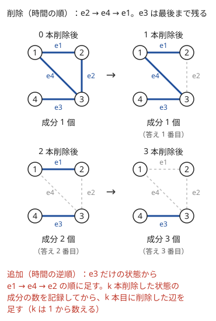

!!! abstract "要点"
    - **何ができるか**：辺や頂点の削除を時間の逆順の追加に直したり、しきい値の順に辺を足したりして、連結成分の数・大きさや 2 点の連結を Union-Find で答える。答えは逆順に記録してから反転する。
    - **いつ使うか**：
        - 辺（頂点）を順に削除し、そのつど連結成分の数・大きさを答える（橋が崩落する・停電）。
        - 重さ・高さ・年などの制限を満たす辺だけで行けるかを多数答える。
        - 答えを決め打つと、つながっているかどうかで判定できる。
    - **計算量**：併合と判定はならし $O(\alpha(N))$。逆順の処理は全体でならし $O((N + M + Q)\,\alpha(N))$。しきい値の順に処理するなら、ソートの $O(M \log M + Q \log Q)$ が加わる
    - **前提**：[連結成分](../graph/connected-components.md)

<!-- textlint-disable -->
別名：逆順 Union-Find・削除を逆順の追加にする・辺の削除を逆から・オフラインの連結判定・offline connectivity
<!-- textlint-enable -->

Union-Find で連結性を扱うとは、[Union-Find](../ds/union-find.md) が「併合はできるが分割はできない」ことに合わせて、問題を「辺を足していくだけ」の形に並べ直してから解く方法である。並べ直し方は主に 2 つある。削除の列を時間の逆順に見て追加の列にする方法と、辺とクエリをしきい値の順に並べて、条件が緩むほど辺が増える形にする方法である。どちらも、クエリを先に全部読む[オフライン](../ds/offline-queries.md)の処理である。

## 削除を逆順の追加にする（答えは逆順に記録して反転する） {#reverse-deletion}

辺を 1 本ずつ削除し、そのつど連結成分の数を答える問題を考える。時点ごとにグラフを作り直して数えると 1 回 $O(N + M)$ かかり、$Q$ 回で $O(Q(N + M))$ になる。$N, M, Q \le 2 \times 10^5$ なら $8 \times 10^{10}$ 回ほどで間に合わない。Union-Find は辺の追加には強いが、削除はできない。

そこで時間を逆に再生する。すべての削除を終えた状態から始めて時間を戻すと、削除された辺が 1 本ずつ戻ってくる。逆向きに見れば、これは辺の追加の列である。最後まで削除されない辺だけのグラフを最初に作っておけば、あとは追加だけで済む。

次の図は、4 頂点・4 本の辺のグラフから e2・e4・e1 の順に削除する例である。上の段を左から右へ読むと削除の列、右から左へ読むと追加の列になる。



逆向きに処理すると、答えは最後の時点のものから順に求まる。だから配列に記録しておき、最後に元の順で出力する。

### 処理の流れと時点の対応 {#reverse-steps}

削除の列を $d_0, d_1, \dots, d_{Q-1}$（0-indexed）、$\mathrm{ans}[i]$ を「$d_0, \dots, d_i$ を削除した直後の答え」とする。$\mathrm{ans}[i]$ のグラフは、一度も削除されない辺に $d_{i+1}, \dots, d_{Q-1}$ を加えたものである。この対応から、記録と追加の順が決まる。

```text
1. 一度も削除されない辺だけを併合する（成分の数 comps = N から、併合に成功するたびに 1 引く）
2. i = Q-1, Q-2, ..., 0 の順に
   - ans[i] = comps を記録する（今のグラフは d_0..d_i を削除した直後のもの）
   - 辺 d_i を足す（両端が別の成分なら併合して comps を 1 減らす）
3. ans[0], ans[1], ..., ans[Q-1] の順に出力する
```

記録してから足すのが要点である。足してから記録すると、すべての答えが 1 時点ずれる。問題が「$i$ 番目の削除の前」の答えを求めるなら、逆に「足してから記録」になる。どちらの時点かは、$\mathrm{ans}[i]$ に含まれる辺の集合を書き出して決めるとよい。

成分の数は、Union-Find に問い合わせなくても「頂点数 − 併合に成功した回数」で数えられる。併合に成功するのは両端が別の成分のときだけで、そのとき成分がちょうど 1 つ減るからである。

```cpp
--8<-- "union-find-connectivity/reverse-deletion.cpp:core"
```

最初の併合と逆順の追加を合わせて、併合は全体で $M$ 回なので、ならし $O((N + M + Q)\,\alpha(N))$ で済む。

### 頂点を削除するとき {#vertex-deletion}

頂点を順に削除する問題も同じ形で解ける。時間を戻すと頂点が 1 つずつ戻ってくるので、頂点 $v$ を戻すときに次の 2 つを行う。

- 成分の数を 1 増やす（$v$ だけの成分ができる）
- $v$ に接する辺のうち、相手がすでに戻っている辺だけを併合する

相手がまだ戻っていない辺は、相手を戻すときに併合される。頂点を番号の順に削除するなら、「番号が $v$ より大きい相手」がすでに戻っている頂点である。各辺はどちらか一方の端を戻すときに 1 回だけ調べるので、全体の併合は $M$ 回に収まる（[例題の ABC229 E](#abc229_e)）。

### 成分の数以外を答える {#other-values}

成分の数のほかに、成分の大きさから決まる量も、併合のたびに差分で更新できる。

- **行き来できない頂点の組の数**：大きさ $a$ と $b$ の成分を併合すると、新しく $a \times b$ 組が行き来できるようになる。併合の直前の 2 つの `size` の積 $a \times b$ を、組の数から引く（[例題の ABC120 D](#abc120_d)）
- **特定の頂点を含む成分の大きさ**：その頂点の `size` を記録する
- **黒い頂点を含む成分の数**：根に黒い頂点の数を持たせて併合で足す（根に情報を持たせる型は [Union-Find の応用](../ds/union-find-applications.md#data-on-root)）

どの量も、併合の前に 2 つの成分の値を読み、併合の後に新しい根へ書く。併合した後に読むと、2 つの成分はもう区別できない。

??? question "確認問題：記録と追加の順"
    辺を $Q$ 本順に削除し、各削除の直前の連結成分の数を答える問題になったとする。逆順の処理で、記録と辺の追加はどちらを先に行うか。

    ??? success "答え"
        追加を先に行う。$i$ 番目の削除の直前のグラフは、一度も削除されない辺に $d_i, d_{i+1}, \dots, d_{Q-1}$ を加えたものである。逆順の処理で $d_i$ を足した直後がちょうどこのグラフなので、足してから記録する。

## しきい値の順に辺を足してクエリに答える（オフライン） {#threshold}

各辺に重さ・高さ・年などの値が付き、クエリごとに「値が $w$ 以下の辺だけで $u$ と $v$ が連結か」「年 $w$ より後の辺だけで行ける頂点の数」を問う型である。クエリごとに Union-Find を作り直すと $O(Q(N + M))$ かかる。辺とクエリを同じ値の軸で並べると、しきい値が緩むにつれて使える辺は増える一方になり、Union-Find にそのまま載る。

- 条件が「$w$ 以下」なら辺とクエリを昇順に、「$w$ より後（大きい）」なら降順に並べる
- クエリの番が来たら、条件を満たす辺をすべて併合してから答える
- クエリには元の番号を持たせ、答えを元の順に戻して出力する

辺の併合は全体で $M$ 回なので、ソートを含めて $O(M \log M + Q \log Q + (N + M + Q)\,\alpha(N))$ である。実装は[オフラインのクエリ処理の節](../ds/offline-queries.md#threshold)にある。

しきい値に等しい辺を含めるかどうかで答えが変わる。条件をそのまま比較に写せばよく、「$w$ 以下」なら `<=`、「$w$ より後」なら `>` で辺を足す。ソートのキーを工夫する必要はない（[練習の ABC040 D](#practice)）。

この処理は、辺を重みの昇順に見て閉路を作らない辺を採る[最小全域木](../graph/minimum-spanning-tree.md)のクラスカル法と同じループである。「$w$ 以下の辺だけで連結か」の答えは、最小全域木（グラフが連結でなければ最小全域森）の辺だけで考えても変わらない。

クエリを先読みできず、1 つ答えるまで次が分からないときは、この並べ替えが使えない。併合した時刻を各頂点に記録する[部分永続 Union-Find](../ds/partially-persistent-union-find.md#what-it-does) なら、過去の任意の時点での連結を 1 回 $O(\log N)$ で答えられる。

## 超頂点と組み合わせる {#super-vertex}

「発電所のどれかとつながっているか」のように、複数の頂点のどれかとの連結を問う問題では、それらを最初に 1 つの頂点にまとめる。まとめた頂点を[超頂点](../graph/extended-dijkstra.md#super-vertex)と呼ぶ。発電所が $K$ か所あっても、すべてを 1 つの頂点 $s$ に併合しておけば、「どれかとつながっている」は「$s$ と同じ成分にある」の 1 回の判定になる。

Union-Find では、まとめ方が 2 通りある。

- **番号を付け替える**：発電所をすべて同じ番号 $s$ として読み込む。頂点数が減り、Union-Find の大きさは都市の数 + 1 で済む
- **最初に併合する**：発電所の頂点を残したまま、処理の前に発電所どうしをすべて併合する。どれか 1 つ（たとえば最初の発電所）を $s$ とみなす。入力をそのまま使える

削除と組み合わせるときは、逆順の処理の最初にまとめておく。発電所につながる都市の数を答えるなら、$s$ の成分の `size` から、その成分にある都市でない頂点の数を引く。番号を付け替えたなら $s$ の 1 個、発電所どうしを併合したなら発電所の $K$ 個である。別の方法として、根に都市の数を持たせて併合で足してもよい（[練習の ABC264 E](#practice)）。

まとめる対象は頂点の集合に限らない。通路の上の壁・下の壁や、グリッドの外周の辺を 1 つの頂点として扱うと、「壁から壁まで障害物がつながったか」を連結判定で調べられる。障害物がつながって通路を横切ると、そこを通り抜けられなくなる。通り抜けの判定を、障害物どうしの連結に言い換える型である（[グリッドの節](../graph/grid-graph.md#obstacle-dual)、[力試しの ABC181 F](#challenge)）。

??? question "確認問題：超頂点を作らないと"
    発電所が $K$ か所あるとき、超頂点を作らずに「都市 $v$ が発電所 $p_1, \dots, p_K$ のどれかと同じ成分か」を毎回 `same` で調べると、何が困るか。

    ??? success "答え"
        1 つの都市につき `same` を $K$ 回呼ぶので、全部の都市を数えると $O(NK\,\alpha(N))$ かかる。$N, K$ がどちらも $10^5$ 程度なら間に合わない。超頂点 $s$ にまとめれば、$s$ の成分の大きさを 1 回読むだけで数えられる。

## 辺の追加と削除が混ざるとき（ロールバック Union-Find・オフライン動的連結性へ） {#mixed-updates}

逆順の処理が使えるのは、削除だけが起き、一度消えた辺が戻らないときである。追加と削除が入り混じると、時間を逆にしても削除が残るので Union-Find だけでは扱えない。状況ごとに次のように考える。

- **削除だけが起き、途中で辺が増えない**：一度消した辺は戻らないので、逆順の処理で済む
- **追加と削除が混ざり、全部を先読みできる**：途中で辺が増える列は、逆向きに見るとその辺が途中で消えるので、削除が残る。この場合は、各辺が存在する時間の区間を求め、時間軸の[セグメント木](../ds/segment-tree.md)の各ノードに載せる。木を DFS し、ノードに入るときはそのノードの辺を併合し、出るときは併合を取り消す。取り消しには[ロールバックできる Union-Find](../ds/rollback-union-find.md#what-it-does) を使う（[辺の追加と削除が混ざる連結性](../graph/offline-dynamic-connectivity.md)）
- **削除がオンラインで来る**：Union-Find では扱えない。ABC の範囲を超える特別な構造が要る

ロールバックできる Union-Find は、経路圧縮をせず union by size だけで実装する。経路圧縮は過去の操作の結果を書き換えるので、取り消しの手順が増えるうえに、ならしの評価も成り立たなくなる。union by size だけでも木の深さは $O(\log N)$ に収まるので、1 回の操作は $O(\log N)$ である。各辺の区間はセグメント木の $O(\log Q)$ 個のノードに分かれるので、追加・削除・問い合わせの操作を合わせて $Q$ 個、最初の辺を $M$ 本とする。辺の区間は $O(M + Q)$ 個なので、全体で $O(N + (M + Q) \log Q \log N)$ になる。

クエリ数が小さい、または削除の回数が少ないなら、削除のたびに Union-Find を作り直す $O(Q(N + M))$ でも足りる。制約を先に見て、作り直しで間に合うかを確かめるとよい。

## 二分探索と連結判定の組合せ {#binary-search}

この節は[答えで二分探索](../basics/binary-search-answer.md)を前提にする。

「半径 $r$ の円が通り抜けられる最大の $r$」「$s$ と $t$ をつなぐ経路のうち、最も重い辺を最小にする」のように、答えを $x$ に決めると「使える辺だけで連結か」の判定になる問題がある。$x$ を緩めるほど使える辺が増え、辺が増えると連結は崩れないので、判定は $x$ について単調である。だから答えで二分探索ができ、判定 1 回はグラフを作って Union-Find で併合する $O((N + M)\,\alpha(N))$ になる。全体は、答えの候補の幅を $V$ として $O((N + M)\,\alpha(N) \log V)$ である。

二分探索をしない書き方もある。辺を条件が緩む順（重さの昇順など）に並べて足していき、判定が初めて真になった辺の値が答えである。答えは必ずどれかの辺の値に一致するので、実数の答えでも二分探索の打ち切りによる誤差が出ない。ソートの $O(M \log M)$ で済み、二分探索より速いことが多い。この値は $s$ から $t$ への経路の重さの最大値の最小に等しい（[最小ボトルネック路](../graph/bottleneck-path.md#kruskal-order)）。

どちらで書くかは、辺の作り方で決める。

- 辺が多すぎて全部を並べてソートするのが重いか、辺の値が判定のたびに計算で決まるなら、二分探索で書く
- 辺を全部並べられるなら、昇順に足していく。打ち切りの誤差がなく、二分探索より速い
- 2 点の組のクエリが多数あり、それぞれ「初めて連結になる値」を問うなら、どちらも 1 クエリずつでは遅い。[並列二分探索](../ds/parallel-binary-search.md#with-union-find)か[併合過程の木](../tree/merge-process-tree.md#bottleneck)を使う

幾何の問題では、円や障害物の間を通れるかを、障害物どうしの距離で辺を張った連結判定に言い換える。半径 $r$ の円は、中心の距離が $2r$ 未満の 2 つの点の間を通れない。ちょうど $2r$ なら触れながら通れるが、答えは実数の上限なので、判定で等号をどちらに入れても答えは変わらない。上の壁と下の壁を超頂点にして、壁から壁まで障害物がつながれば通れない（[力試しの ABC181 F](#challenge)）。

## 落とし穴 {#pitfalls}

**答えを逆順のまま出力する**。逆順の処理では、答えは最後の時点から求まる。配列 $\mathrm{ans}$ に時点の番号で書き込み、最後に前から出力する。`push_back` で記録したなら、出力の前に `reverse` する。

**記録と追加の順を取り違える**。「$i$ 番目の削除の直後」なのか「直前」なのかで、記録してから足すか、足してから記録するかが変わる。$\mathrm{ans}[i]$ のグラフに含まれる辺を書き出して確かめる。最初（削除前）と最後（すべての削除後）の値を出力に含めるかも、問題の出力の行数で確かめる。

**最後まで残る辺を最初に入れ忘れる**。逆順の処理の初期状態は「辺が 1 本もないグラフ」ではなく、一度も削除されない辺がすべて入ったグラフである。削除される辺に印を付け、印のない辺を先に併合する。

**頂点の削除で、まだ戻っていない頂点と併合する**。頂点 $v$ を戻すときに $v$ の辺をすべて併合すると、削除されているはずの頂点が成分に入ってしまう。相手がすでに戻っている辺だけを併合する。

**組の数の積があふれる**。$N = 10^5$ なら組の数は $N(N-1)/2 \approx 5 \times 10^9$ で、`int` に収まらない。大きさの積 $a \times b$ を計算するときも、`long long` にしてから掛ける。

**しきい値の等号の向き**。「以下」と「未満」、「より後」と「以降」で、しきい値に等しい辺を入れるかが変わる。比較の演算子を問題文の言葉にそのまま合わせる。

**1-indexed の頂点と超頂点の番号がぶつかる**。超頂点を番号 $N$ に置くなら、Union-Find の大きさは $N + 1$ にする。頂点を 0-indexed に直してから番号 $N$ を使うと分かりやすい。

!!! info "ACL では"
    `atcoder::dsu d(n);`。`d.merge(a, b)`・`d.same(a, b)`・`d.size(a)` はどれもならし $O(\alpha(n))$。`merge` は併合後の代表元を返すが、すでに同じ成分だったかは返さないので、成分の数を数えるときは先に `same` で調べる。削除と取り消しはできない。

## 例題 {#examples}

### ABC229 E. Graph Destruction {#abc229_e}

<div class="kp-problems" data-role="example" markdown>

- [ABC229 E. Graph Destruction](https://atcoder.jp/contests/abc229/tasks/abc229_e)（diff 1015）：頂点を番号順に 1 つずつ消していくとき、各時点の連結成分の数を求める。

</div>

頂点の削除は扱えないので、時間を逆にして頂点を番号の大きい順に戻していく。頂点 $v$ を戻すときは成分の数を 1 増やし、$v$ より番号の大きい相手との辺だけを併合する。番号の大きい頂点はすでに戻っているからである。答えは後ろの時点から求まるので、記録してから最後に元の順で出力する。

??? note "解法の詳細"
    - $\mathrm{ans}[i]$ を「頂点 $1, \dots, i$ を消した直後の成分の数」とする（1-indexed）。すべて消した直後の $\mathrm{ans}[N]$ は 0 である。
    - 成分の数 $c = 0$ から始め、$i = N, N-1, \dots, 1$ の順に次を行う：$\mathrm{ans}[i] = c$ を記録する。頂点 $i$ を戻して $c$ を 1 増やす。$i$ の隣の頂点 $j$ のうち $j > i$ のものについて、別の成分なら併合して $c$ を 1 減らす。
    - $\mathrm{ans}[i]$ の時点では頂点 $i+1, \dots, N$ だけが残っているので、記録してから頂点 $i$ を戻す順になる。
    - 辺は読み込むときに、番号の小さい方の端の隣接リストにだけ入れておくと、$j > i$ の判定が要らない。各辺を 1 回だけ調べるので、全体でならし $O(N + M\,\alpha(N))$。
    - $\mathrm{ans}[1], \dots, \mathrm{ans}[N]$ の順に出力する。

### ABC120 D. Decayed Bridges {#abc120_d}

<div class="kp-problems" data-role="example" markdown>

- [ABC120 D. Decayed Bridges](https://atcoder.jp/contests/abc120/tasks/abc120_d)（diff 1355）：橋が 1 本ずつ崩落していくとき、各時点で行き来できなくなった島の組の数（不便さ）を求める。

</div>

逆向きには橋が 1 本ずつ架かっていく。すべての橋が崩落した状態では、どの 2 つの島も行き来できないので、不便さは $N(N-1)/2$ である。大きさ $a$ と $b$ の成分を橋がつなぐと、新しく $a \times b$ 組が行き来できるようになり、不便さはその分だけ減る。同じ成分の中の橋なら何も変わらない。

??? note "解法の詳細"
    - $\mathrm{ans}[i]$ を「橋 $1, \dots, i$ が崩落した直後の不便さ」とする（1-indexed）。
    - $\mathrm{cur} = N(N-1)/2$ から始め、$i = M, M-1, \dots, 1$ の順に次を行う：$\mathrm{ans}[i] = \mathrm{cur}$ を記録する。橋 $i$ の両端 $u, v$ が別の成分なら、$\mathrm{cur}$ から $\mathrm{size}(u) \times \mathrm{size}(v)$ を引いてから併合する。
    - 引く量は併合の前の大きさで計算する。併合した後は 2 つの成分が 1 つになり、それぞれの大きさは読めない。
    - $N(N-1)/2$ は $N = 10^5$ で約 $5 \times 10^9$ なので、$\mathrm{cur}$ と積は `long long` で持つ。
    - 全体でならし $O(N + M\,\alpha(N))$。$\mathrm{ans}[1], \dots, \mathrm{ans}[M]$ の順に出力する。

## 練習問題 {#practice}

<div class="kp-problems" data-role="practice" markdown>

- [ABC264 E. Blackout 2](https://atcoder.jp/contests/abc264/tasks/abc264_e)（diff 1229）：電線が 1 本ずつ切れていくとき、各時点で発電所のどれかとつながっている都市の数を求める。
- [ABC040 D. 道路の老朽化対策について](https://atcoder.jp/contests/abc040/tasks/abc040_d)（diff 1656・参考値）：各道路に建設年があり、各国民について、ある年より後に作られた道路だけで行ける都市の数を求める。
- [ABC413 G. Big Banned Grid](https://atcoder.jp/contests/abc413/tasks/abc413_g)（diff 1723）：障害物のある巨大なグリッドで、左上から右下へ行けるかを判定する。

</div>

??? note "練習の方針"
    - **ABC264 E**：発電所をすべて 1 つの超頂点にまとめ、最後まで切れない電線を先に併合する。切れる電線を逆順に足しながら、超頂点の成分に含まれる都市の数を記録する。成分の大きさから都市でない頂点の数を引くか、根に都市の数を持たせる
    - **ABC040 D**：道路と国民を年の新しい順に並べる。国民の番が来たら、建設年がその年より大きい道路をすべて併合してから、その国民の都市の成分の大きさを答える。等しい年の道路は含めない。答えは国民の元の順に戻して出力する
    - **ABC413 G**：マスが多すぎて空きマスを頂点にできない。障害物を頂点にし、8 近傍で隣り合う障害物どうしを併合する。上の辺・右の辺の外周と、下の辺・左の辺の外周も頂点にし、この 2 つが同じ成分になれば道がふさがれて行けない（[障害物どうしの 8 近傍の連結](../graph/grid-graph.md#obstacle-dual)）。

## 力試し {#challenge}

<div class="kp-problems" data-role="challenge" markdown>

- [ABC181 F. Silver Woods](https://atcoder.jp/contests/abc181/tasks/abc181_f)（diff 2009）：上下の壁の間に釘が打たれた通路を、ある半径の円が左から右へ通り抜けられるときの最大の半径を求める。

</div>

??? note "力試しの方針"
    - **ABC181 F**：上の壁と下の壁を 1 つずつ頂点にし、釘も頂点にする。半径 $r$ を決めると、中心の距離が $2r$ 未満の釘どうしの間と、壁までの距離が $2r$ 未満の釘と壁の間は円が通れないので、そこに辺を張る（等号をどちらに入れても答えは変わらない）。上の壁と下の壁が連結なら通り抜けられない。$r$ について単調なので実数の二分探索ができる。二分探索をせずに、全部の候補の辺を長さの順に足して、上下の壁が初めてつながった辺の長さの半分を答えてもよい

## 確認問題 {#quiz}

??? question "確認問題：併合に失敗したとき"
    辺 $(u, v)$ を足そうとしたら、$u$ と $v$ はすでに同じ成分だった。このとき成分の数と、グラフの形について何が分かるか。

    ??? success "答え"
        成分の数は変わらない。また、$u$ から $v$ への経路がすでにあるので、この辺を足すと閉路ができる。成分の数を「頂点数 − 併合に成功した回数」で数えられるのは、失敗した併合が成分の数を変えないからである。

??? question "確認問題：オンラインの削除"
    辺の削除のクエリが、前のクエリの答えを使って暗号化されて来る（答えを出すまで次のクエリが分からない）。逆順の Union-Find は使えるか。

    ??? success "答え"
        使えない。逆順の処理は、最後のクエリまで先に読めることが前提である。答えを出すまで次のクエリが分からなければ、最後の状態から始めることができない。

## 使い分け {#comparison}

- グラフが固定で、連結成分を 1 回調べるだけなら、DFS か BFS で[連結成分](../graph/connected-components.md)に分ければよい
- 辺の追加と問い合わせが交互に来るだけなら、[Union-Find](../ds/union-find.md) をそのまま使う
- 削除だけが来て先読みできるなら、時間の逆順に追加する。追加と削除が混ざるなら[辺の追加と削除が混ざる連結性](../graph/offline-dynamic-connectivity.md)
- 「最後に塗った色が残る」のように、連結性以外でも後ろから見ると決まる問題は[後ろから・逆順に考える](../thinking/reverse-thinking.md)
- 「初めて連結になる値」を問うなら、辺を昇順に足すか、クエリが多ければ[並列二分探索](../ds/parallel-binary-search.md#with-union-find)

## 参考 {#references}

- [AtCoder Library「DSU」（document_ja）](https://github.com/atcoder/ac-library/blob/master/document_ja/dsu.md)：`dsu` の操作と計算量
- [kyo-pro「ABC229 E - Graph Destruction」](https://kyo-pro.hatenablog.com/entry/ABC229E)：例題の方針（頂点を逆順に戻し、番号の大きい相手とだけ併合する）
- [drken「AtCoder ABC 120 D - Decayed Bridges (1Q, 水色, 400 点)」](https://drken1215.hatenablog.com/entry/2019/03/03/224600)：例題の方針（逆順に橋を架け、大きさの積だけ不便さを減らす）と、答えに 64 ビット整数が要ること
- [kyo-pro「ABC264 E - Blackout 2」](https://kyo-pro.hatenablog.com/entry/ABC264E)：練習の方針（発電所をまとめ、逆順に電線を戻す）
- [kazun「ABC264 E - Blackout 2」](https://kazun-kyopro.hatenablog.com/entry/ABC/264/E)：練習の方針（成分ごとに都市と発電所の数を持つ）
- [pyteyon「ABC040: D - 道路の老朽化対策について」](https://pyteyon.hatenablog.com/entry/2019/09/30/110202)：練習の方針（道路とクエリを年の降順に並べ、等号を含めない）
- [drken「AtCoder ABC 181 F - Silver Woods (黄色, 600 点)」](https://drken1215.hatenablog.com/entry/2020/11/02/013900)：力試しの方針（壁を頂点にした連結判定、二分探索と長さの順に足す方法）
- [kmjp「AtCoder ABC 181 F」](https://kmjp.hatenablog.jp/entry/2020/11/01/0930)：力試しの方針（半径の二分探索）
- [kmjp「AtCoder ABC #413 (デンソークリエイトプログラミングコンテスト2025) : G - Big Banned Grid」](https://kmjp.hatenablog.jp/entry/2025/07/05/0930)：障害物どうしの連結で通り抜けを判定する型
