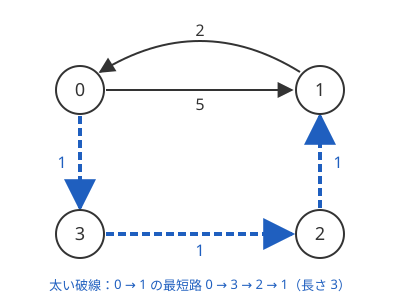

!!! abstract "要点"
    - **何ができるか**：経由してよい頂点を 1 つずつ増やす DP で、全点対の最短距離を $O(N^3)$ で求める。負辺があっても（負閉路がなければ）使え、負閉路の有無も同時に分かる。辺を 1 本足したときは $O(N^2)$ で表を更新できる。
    - **いつ使うか**：
        - $N \le 400$ 程度で全点対の距離が要る
        - 辺を 1 本ずつ追加（削除）するたびに、距離についての値を答える
        - 訪れる地点の順番を全部試す（地点間の距離が要る）
    - **計算量**：全点対の距離の計算 $O(N^3)$、メモリ $O(N^2)$。辺を 1 本足したときの更新は $O(N^2)$、距離の参照は $O(1)$
    - **前提**：[ダイクストラ法](../graph/dijkstra.md)、[DP の基本](../dp/dp-basics.md)

<!-- textlint-disable -->
別名：ワーシャルフロイド・Floyd-Warshall・全点対最短路・all-pairs shortest paths・フロイドワーシャル法
<!-- textlint-enable -->

ワーシャルフロイド法は、距離の表 $d[i][j]$ を「経由してよい頂点」を 1 つずつ増やしながら更新し、すべての頂点の組の最短距離を求める DP である。中身は 3 重ループの 1 行だけで、負の辺があっても正しく動く。

全点対の距離が要るとき、各頂点から[ダイクストラ法](../graph/dijkstra.md)を 1 回ずつ行うと $O(N(N + M) \log N)$ かかる。辺の多いグラフ（$M \approx N^2$）では $O(N^3 \log N)$ になり、負の辺があると使えない。ワーシャルフロイド法は辺の数によらず $O(N^3)$ で、$N = 400$ なら $6.4 \times 10^7$ 回の単純な更新で終わる。以下、頂点は 0-indexed で $0, \dots, N - 1$ とし、$d[i][j]$ は $i$ から $j$ への距離（有向）を表す。

## k を一番外のループにする理由 {#k-outer}

ワーシャルフロイド法の正しさは、次の DP の定義から来る。ループの順序もこの定義で決まる。

> $\mathrm{dp}_k[i][j]$ ＝ $i$ から $j$ への経路のうち、途中で通る頂点（両端を除く）がすべて $0, 1, \dots, k - 1$ のどれかであるものの最短の長さ

$\mathrm{dp}_0$ は途中に何も通さない経路、すなわち辺 1 本の長さ（$i = j$ なら $0$、辺がなければ $+\infty$）である。$\mathrm{dp}_N$ は途中の頂点に制限がないので、求める最短距離になる。

$\mathrm{dp}_k$ から $\mathrm{dp}_{k+1}$ を作るには、新しく頂点 $k$ を経由してよくなったことを反映する。途中の頂点が $0, \dots, k$ に収まる最短の経路は、次の 2 通りのどちらかである。

- 頂点 $k$ を通らない：長さは $\mathrm{dp}_k[i][j]$
- 頂点 $k$ を通る：[負閉路](../guide/glossary.md#negative-cycle)がなければ、最短の経路は $k$ を 1 回だけ通るものに取れる。$k$ で 2 つに切ると、前半の $i \to k$ と後半の $k \to j$ はどちらも途中の頂点が $0, \dots, k - 1$ に収まる。よって長さは $\mathrm{dp}_k[i][k] + \mathrm{dp}_k[k][j]$

$$
\mathrm{dp}_{k+1}[i][j] = \min\bigl(\mathrm{dp}_k[i][j],\ \mathrm{dp}_k[i][k] + \mathrm{dp}_k[k][j]\bigr)
$$

右辺は $\mathrm{dp}_k$ の表の全体を使う。だから $k$ のループを一番外に置き、$k$ 段目の表をすべて作り終えてから $k + 1$ 段目に進む。$i$ や $j$ を外に置くと、$d[i][k]$ や $d[k][j]$ がまだ前の段の値のまま使われ、2 つ以上の頂点を経由する経路を見落とすことがある（[確認問題](#quiz)）。

**1 つの 2 次元配列で足りる理由**：$k$ 段目の更新で、$k$ 行目と $k$ 列目は変わらない。$\mathrm{dp}_{k+1}[i][k] = \min(\mathrm{dp}_k[i][k], \mathrm{dp}_k[i][k] + \mathrm{dp}_k[k][k])$ で、負閉路がなければ $\mathrm{dp}_k[k][k] = 0$ だからである（$k$ 行目も同じ）。更新に使う値が段の途中で書き換わらないので、$k$ の添字を落として表 $d$ を 1 つだけ持ち、その場で上書きしてよい。

次の図は、4 頂点・5 本の有向辺のグラフである。頂点 $0$ から $1$ への辺は長さ $5$ だが、$0 \to 3 \to 2 \to 1$ と回ると長さ $3$ になる。



このグラフで $k = 0, 1, 2, 3$ と順に表を更新すると、$d[i][j]$ は次のように変わる。動く図では、$k$ 行目と $k$ 列目が中継点として光り、各マスが $d[i][k] + d[k][j]$ と比べられる（$k$ 行目・$k$ 列目・対角はその段で変わらないので飛ばす）。

<div class="kp-viz" data-viz="warshall-floyd" data-config='{"n": 4, "directed": true, "edges": [[0, 1, 5], [0, 3, 1], [3, 2, 1], [2, 1, 1], [1, 0, 2]], "pos": [[0, 0], [1, 0], [1, 1], [0, 1]]}'></div>

- $k = 0$：$1 \to 0 \to 3$ が見つかり、$d[1][3] = 2 + 1 = 3$ になる
- $k = 1$：頂点 $1$ を経由して、$d[2][0] = 1 + 2 = 3$、$d[2][3] = 1 + 3 = 4$ になる
- $k = 2$：頂点 $2$ を経由して、$d[3][0] = 1 + 3 = 4$、$d[3][1] = 1 + 1 = 2$ になる
- $k = 3$：頂点 $3$ を経由して、$d[0][1] = \min(5, 1 + 2) = 3$、$d[0][2] = 1 + 1 = 2$、$d[1][2] = 3 + 1 = 4$ になる

$d[0][1] = 3$ は 2 つの頂点 $3$ と $2$ を経由する経路の長さである。$k = 2$ 段目で $d[3][1] = 2$ が先にできていたので、$k = 3$ 段目で $d[0][3] + d[3][1]$ として見つかった。最後の表は次のとおりである。

| | $j = 0$ | $j = 1$ | $j = 2$ | $j = 3$ |
| --- | --- | --- | --- | --- |
| $i = 0$ | 0 | 3 | 2 | 1 |
| $i = 1$ | 2 | 0 | 4 | 3 |
| $i = 2$ | 3 | 1 | 0 | 4 |
| $i = 3$ | 4 | 2 | 1 | 0 |

**計算量**：$k, i, j$ の 3 重ループで $N^3$ 回更新し、各回は $O(1)$ なので $O(N^3)$ である。表は $N \times N$ なのでメモリは $O(N^2)$ になる。中身が単純なので定数倍が小さく、C++ なら $N = 500$（$1.25 \times 10^8$ 回）でも十分に間に合う。$N$ が数千になると $N^3$ が $10^{10}$ を超えるので、必要な始点からだけダイクストラ法を行う。

!!! tip "経路を復元するには"
    $\mathrm{nxt}[i][j]$（$i$ から $j$ への最短路で $i$ の次に通る頂点）を一緒に持つ。辺 $(i, j)$ があれば $\mathrm{nxt}[i][j] = j$ で始め、$d[i][j]$ を $d[i][k] + d[k][j]$ で更新したときは $\mathrm{nxt}[i][j] \leftarrow \mathrm{nxt}[i][k]$ とする。$i$ から $\mathrm{nxt}$ をたどれば $j$ に着く。

## 初期化（自分への距離は 0・多重辺・INF のあふれ）と負閉路の判定 {#init}

ワーシャルフロイド法の 3 重ループは短いので、バグはほとんど初期化と INF の扱いで起きる。次のコードは、有向辺を読んで表を作り、負閉路を判定するまでである。入力の頂点は 1-indexed で、読んだ直後に 1 を引く。

```cpp
--8<-- "warshall-floyd/wf.cpp:core"
```

完全なプログラム：[`wf.cpp`](https://github.com/yuukougun/kyopro-atlas/blob/main/snippets/warshall-floyd/wf.cpp)（GitHub）
{ .kp-code-src }

- **$d[i][i] = 0$ を先に置く**：辺を読む前に対角を $0$ にし、辺は `min` で書き込む。正の長さの自己ループで $d[i][i]$ を上書きすると、対角が $0$ でなくなり、距離の総和や迂回の判定のように対角を使う処理が壊れる。負の自己ループはそのまま負閉路として残してよい
- **多重辺は最小値**：同じ組の辺が何本もあるとき、後から読んだ辺で上書きせず `min` を取る
- **無向グラフは両向き**：`d[u][v]` と `d[v][u]` の両方に書く
- **INF の大きさ**：本当の距離の最大値（$(N - 1) \times$ 辺の長さの最大）より大きく、`INF + INF` があふれない値にする。`1LL << 60`（約 $1.15 \times 10^{18}$）なら、辺の長さが $10^9$、$N$ が数千でも足りる。`LLONG_MAX` にすると、足し算の 1 回目であふれる（[INF の決め方](../cpp/cpp-types-literals.md#inf)）
- **負の辺があるなら INF を飛ばす**：届かない組 $d[i][k] = \infty$ に負の辺の長さを足すと、`INF - 5` のように INF より小さい値になり、「届く」と誤って判定される。$d[i][k]$ か $d[k][j]$ が INF なら更新しない。負の辺がなくても、この判定を入れておけば INF の大きさに気を使わずに済む

**負閉路の判定**：ループの後、ある $i$ で $d[i][i] < 0$ になっていれば負閉路があり、すべての $i$ で $d[i][i] = 0$ なら負閉路はない。$d[i][i]$ は $i$ から出て $i$ に戻る経路の長さの最小値を表すからである。負閉路があるとき、$d[i][k] < \infty$、$d[k][k] < 0$、$d[k][j] < \infty$ を満たす $k$ がある組 $(i, j)$ は、閉路を何周もできるので本当の距離は $-\infty$ である。それ以外の組の値は正しい。

!!! warning "負閉路があると値が指数的に小さくなる"
    負閉路があると、$d[i][k] + d[k][j]$ の両方が負のまま足し合わされ、$k$ が進むたびに値が何倍にもなりうる。6 頂点のすべての組に長さ $-1$ の辺がある完全グラフでは、ループの後の最小値が $-5184$ になる。$N = 400$ で辺の長さが $10^9$ なら `long long` でもあふれて、未定義動作になる。負閉路がありうる問題では、更新のたびに `d[i][j] = max(d[i][j], -INF)` で下限を切るか、単一始点で済むなら[ベルマンフォード法](../graph/bellman-ford.md#relevant-cycles)を使う。

## 辺の追加を O(N^2) で反映する（削除は逆順の追加に） {#add-edge}

距離の表 $d$ ができた後に辺を 1 本足しても、表全体を $O(N^3)$ で作り直す必要はない。新しい有向辺 $a \to b$（長さ $c$）を使う最短路は、その辺を高々 1 回しか通らない（負閉路ができない限り）。使う場合の経路は「$i \to a$ の最短路、辺 $a \to b$、$b \to j$ の最短路」の 3 つをつないだものなので、

$$
d[i][j] \leftarrow \min\bigl(d[i][j],\ d[i][a] + c + d[b][j]\bigr)
$$

をすべての $(i, j)$ に行えば足りる。$N^2$ 組なので $O(N^2)$ である。無向辺なら、$b \to a$ の向きに使う $d[i][b] + c + d[a][j]$ も比べる。既存の辺を短くする操作も、短い辺を 1 本足すのと同じである。

```cpp
--8<-- "warshall-floyd/add-edge.cpp:core"
```

完全なプログラム：[`add-edge.cpp`](https://github.com/yuukougun/kyopro-atlas/blob/main/snippets/warshall-floyd/add-edge.cpp)（GitHub）
{ .kp-code-src }

**その場で上書きしてよい理由**：表のどの値も、ずっと「実際にある経路の長さ」のままである（上書きに使う値も実際の経路の長さなので、つないだものも経路になる）。よって値が本当の距離より小さくなることはない。一方、ループの途中で $d[i][a]$ などが先に小さくなっても、比べる候補が小さくなるだけである。最後の値は、古い表で作った候補のどれよりも大きくならない。古い表の候補の最小値は本当の距離なので、最後の値は本当の距離に一致する。

**削除はできない**：辺を消すと距離が増えることがあり、どの組が増えるかは表だけでは分からない。消した辺を使っていた最短路の代わりを探すには、作り直すしかない。そこで、質問を全部読んでから後ろから処理する（オフライン）。最後の状態のグラフで表を作り、時刻を逆にたどると、辺の削除は辺の追加になる。答えを逆順に記録し、最後に元の順で出力する。削除が $D$ 回なら全体で $O(N^3 + D N^2)$ である（[例題 ABC375 F](#abc375_f)）。

距離の総和のように表全体から計算する値を毎回答えるときも、表を作り直さずに $O(N^2)$ で数え直せる。

## 距離表を作ってから順列全探索・bitDP {#with-enumeration}

「決められた地点をすべて訪れる最短の道のり」を問う問題では、まずワーシャルフロイド法で地点間の距離の表を作り、その表の上で訪れる順番を探索する。グラフの頂点は多くても、訪れる地点が $R$ 個だけなら、探索は $R$ 個の点の完全グラフの上で済む。

- **$R \le 8$ 程度**：[順列全探索](../basics/bit-full-search.md#permutations)で $R!$ 通りの順番を試し、隣り合う地点の距離 $d[p_t][p_{t+1}]$ を足す。全体で $O(N^3 + R! \cdot R)$
- **$R \le 16$ 程度**：[集合と最後に訪れた点の bitDP](../dp/bit-dp.md#tsp) にする。全体で $O(N^3 + 2^R R^2)$

表の上で「各地点をちょうど 1 回ずつ」訪れる順番を探してよいのは、隣り合う 2 地点の間を最短路で結んでも答えが悪くならないからである。途中で別の地点を通り過ぎても「1 回以上訪れる」には反しない。この議論の詳細は [bitDP の距離を前計算する節](../dp/bit-dp.md#with-shortest-paths)にある。

順番の探索が本体の問題では、次の点で答えの取り方が変わる。

- 始点と終点：決まった始点から出るなら、表の始点の行から足し始める。どこから始めてもよいなら、最初の点の距離を $0$ にする。始点に戻るなら、最後に $d[p_{R-1}][p_0]$ を足す
- 届かない組：$d = \infty$ の組を足すと INF があふれる。足す前に飛ばす
- 通る辺が決まっている：「この橋を必ず渡る」で橋が $K$ 本なら、渡る順番（$K!$ 通り）と渡る向き（$2^K$ 通り）を全探索し、橋の端点の間を表の距離でつなぐ

距離の表を作るのは、ワーシャルフロイド法でなくてもよい。$N$ が大きく、地点の数が少ないなら、各地点からダイクストラ法（重みがなければ BFS）を行えば $O(R(N + M) \log N)$ で済む。$N \le 400$ 程度で負の辺があるなら、ワーシャルフロイド法が一番短く書ける。

## 距離以外の値を同じ形で求める（到達可能性・ボトルネック・2 つの基準） {#beyond-distance}

ワーシャルフロイド法の更新 $d[i][j] \leftarrow \min(d[i][j], d[i][k] + d[k][j])$ は、「経路の値は辺の値をつないで決まる」「2 つの経路のうち良い方を選ぶ」の 2 つだけを使っている。足し算と min を別の演算に替えても、次の 2 つが成り立てば、同じ 3 重ループが使える。

1. **つなぐ演算が良し悪しの順序を保つ**：$a$ が $b$ 以上に良ければ、$a$ に $c$ をつないだものも、$b$ に $c$ をつないだもの以上に良い（前からつないでも後ろからつないでも）。これで「$i \to k$ の最良と $k \to j$ の最良をつなぐと、$k$ を通る経路の最良になる」が言える。最短距離なら、$a \le b$ のとき $a + c \le b + c$ である
2. **最適な経路が単純な経路（同じ頂点を 2 度通らない）に取れる**

1 つ目は見落としやすい。たとえば負の重みを含む辺で「重みの積の最大」を求めると、負の数を掛けたときに大小が入れ替わるので、閉路のないグラフでもこの形では正しく求まらない。下の表の 4 つは、どれも両方の条件を満たす。

| 求めるもの | 経路をつなぐ | 良い方を選ぶ | 初期値（辺なし・$i = j$） |
| --- | --- | --- | --- |
| 最短距離 | $+$ | $\min$ | $+\infty$・$0$ |
| 到達できるか | AND | OR | false・true |
| 経路上の最大の辺を最小にする | $\max$ | $\min$ | $+\infty$・$-\infty$ |
| 距離が最小で、その中で得点が最大 | 成分ごとの $+$ | 辞書順の比較 | $(+\infty, \cdot)$・$(0, 0)$ |

- **到達できるか**：$\mathrm{reach}[i][j] \mathrel{|}= \mathrm{reach}[i][k] \text{ AND } \mathrm{reach}[k][j]$ で、どの頂点からどの頂点へ行けるかの表（推移閉包）が求まる。AND は順序（false より true が良い）を保つ。$N$ が数千なら、行を bitset で持つと $O(N^3 / 64)$ になる
- **ボトルネック**：「経路上の辺の重さの最大値」を最小にする経路は、閉路を取り除いても経路上の最大値が増えないので、単純な経路に取れる。$\max(a, c) \le \max(b, c)$（$a \le b$ のとき）なので、順序も保つ
- **2 つの基準**：「移動回数が最小で、その中で集めた価値が最大」なら、辺の値を $(1, -\text{価値})$ の組にして辞書順で最小を取る。成分ごとの足し算は辞書順を保つ。辺の値はどれも $(0, 0)$ より大きいので、閉路を回ると必ず悪くなり、単純な経路に取れる。頂点の価値は、その頂点に入る辺の値に移す。始点の価値はどの辺にも入らないので、最後に別に足す

2 段階で使う型もある。たとえば 1 回で移動できる範囲が距離 $L$ 以下に限られるときは、1 回目のワーシャルフロイド法で距離の表を作る。続けて「距離が $L$ 以下なら長さ $1$ の辺」とした新しいグラフで 2 回目を行うと、移動の回数の最小値が求まる。

## 迂回できる辺は不要 {#redundant-edges}

この節は青の内容である。前提は上の[初期化と負閉路の判定](#init)までで、辺の長さはすべて正とする。

多重辺のない無向グラフで「全点対の距離を変えずに消せる辺」を問う問題がある。辺 $(u, v)$（長さ $w$）は、次の条件を満たすとき、またそのときに限り消せる。

> $u$ とも $v$ とも異なる頂点 $k$ で、$d[u][k] + d[k][v] \le w$ となるものがある

$d$ はすべての辺を残したグラフでの距離である。条件を満たせば、辺 $(u, v)$ を使う最短路は $u \to k \to v$ の迂回に置き換えても長くならない。逆に満たさなければ、辺 $(u, v)$ は $u$ と $v$ を結ぶ唯一の最短路なので、消すと $d[u][v]$ が増える。$w > d[u][v]$ の辺（最短路に使われない辺）は、最短路の途中に別の頂点があるので、必ず条件を満たす。

条件の書き方で誤りやすいのは次の 2 点である。

- **等号を含める**：迂回路がちょうど同じ長さ（$d[u][k] + d[k][v] = w$）でも消せる。`<` で判定すると、同じ長さの迂回路がある辺を残してしまう
- **$k = u, v$ を除く**：$k = u$ なら $d[u][u] + d[u][v] = d[u][v] \le w$ がいつも成り立ち、どの辺も「消せる」と判定される

**消せる辺をすべて同時に消してよい理由**：辺 $(u, v)$ を消せるとき、迂回路 $u \to k \to v$ は 2 本以上の辺からなり、長さの合計が $w$ 以下である。辺の長さはすべて正なので、迂回路の各辺の長さは $w$ より真に小さい。よって、長さの小さい辺から順に考えると帰納法が使える。消せる辺は、自分より短い辺だけでできた迂回路に置き換えられる。その迂回路の中の消せる辺も、さらに短い辺の迂回路に置き換えられる。こうして、消せる辺はすべて残す辺だけの経路に置き換わる。長さ $0$ の辺があると、この議論は成り立たない（2 本の長さ $0$ の辺が互いの迂回路になりうる）。

同じ考え方で、距離の表 $A$ だけが与えられ「この表を距離に持つグラフのうち、辺の長さの和が最小のもの」を作る問題も解ける。$A$ にワーシャルフロイド法を 1 回行って値が減る組があれば、そんなグラフはない。減らなければ、迂回できない組 $(u, v)$ だけに辺を張ればよい（[DFS 木・BFS 木とグラフの構築](../graph/graph-construction.md#from-distances)）。

## 落とし穴 {#pitfalls}

- **$k$ を内側のループにする**：`for i, for j, for k` の順だと、$d[i][k]$ や $d[k][j]$ が途中の値のまま使われ、2 つ以上の頂点を経由する経路を見落とすことがある。小さい例ではたまたま合うので、試験で気づきにくい。$k$ は必ず一番外に置く
- **$d[i][i]$ を初期化しない**：対角を INF のままにすると、$i \ne j$ の値は正しく求まるが、$d[i][i]$ には $i$ を通る最短の閉路の長さが入る（届かなければ INF のまま）。$d[i][i] = 0$ を前提にした処理（総和・迂回の判定・始点の距離）が壊れる。逆に、有向グラフの最短の閉路を求めたいときは、この性質をわざと使える
- **1-indexed のまま配列を $N$ で取る**：問題文の頂点 $1, \dots, N$ をそのまま添字にするなら、表は $(N + 1) \times (N + 1)$ にし、ループも $1$ から $N$ まで回す。入力のときに 1 を引いて 0-indexed にそろえるほうが安全である（[初期化の節](#init)のコードはこの形）
- **`int` であふれる**：距離は最大で $(N - 1) \times$ 辺の長さの最大になる。辺の長さが $10^9$ なら `int` に収まらない。距離の総和を答える問題では、総和はさらに $N^2$ 倍になる
- **メモリ**：`long long` の $N \times N$ の表は $8 N^2$ バイトである。$N = 5000$ で 200 MB になり、時間も間に合わない。$N$ が大きいなら、必要な始点からだけダイクストラ法を行う
- **辺の追加で両向きを忘れる**：無向グラフに辺を足すとき、$d[i][a] + c + d[b][j]$ だけを比べると、$b \to a$ の向きに使う経路を見落とす

## 例題 {#examples}

### ABC079 D. Wall {#abc079_d}

<div class="kp-problems" data-role="example" markdown>

- [ABC079 D. Wall](https://atcoder.jp/contests/abc079/tasks/abc079_d)（diff 949）：数字 i を j に書き換える費用の表と、壁のマスに書かれた数字が与えられ、すべての数字を 1 にする最小費用を求める

</div>

数字 $0, \dots, 9$ を頂点、「$i$ を $j$ に書き換える費用」を辺 $i \to j$ の長さとみる。書き換えは何回に分けてもよいので、$i$ を $1$ にする最小費用は、このグラフでの $i$ から $1$ への最短距離である。10 頂点のワーシャルフロイド法で距離を求め、各マスの数字 $x$ について $d[x][1]$ を足せばよい。

??? note "解法の詳細"
    与えられる費用の表をそのまま $d$ の初期値にし、$k, i, j$ の 3 重ループを回す。表は直接の書き換えの費用なので、$3 \to 5 \to 1$ のように経由したほうが安いことがある（だから最短路が要る）。各マスは互いに影響しないので、マスごとに $d[x][1]$ を足すだけでよい。数字の書かれていないマスは飛ばす。前計算は $10^3$ 回、足し合わせは $O(HW)$ である。

### ABC208 D. Shortest Path Queries 2 {#abc208_d}

<div class="kp-problems" data-role="example" markdown>

- [ABC208 D. Shortest Path Queries 2](https://atcoder.jp/contests/abc208/tasks/abc208_d)（diff 1190）：経由してよい頂点を k 以下に限ったときの最短距離 f(s, t, k) の総和を求める

</div>

問題の $f(s, t, k)$ は、[k を一番外のループにする理由](#k-outer)の $\mathrm{dp}_k$ そのものである。頂点を 1-indexed のまま使い、$k = 1, \dots, N$ の各段の更新を終えるたびに、表の届く組の値をすべて足せばよい。

??? note "解法の詳細"
    $N \le 400$ なので $O(N^3)$ は $6.4 \times 10^7$ 回ほどである。$d$ を辺の長さ（$s = t$ は $0$、辺がなければ INF）で初期化する。$k = 1, \dots, N$ の順に「$k$ を経由する更新」を行い、その直後に $d[s][t] < \mathrm{INF}$ の組の値を答えに足す。足し合わせも各段 $O(N^2)$ なので、全体は $O(N^3)$ のままである。届かない組は足さない（$0$ として数える）。答えは 32 ビットに収まらないので `long long` で持つ。

    頂点の番号の小さい順に経由を許すことと、ループの $k$ の順序が一致している点が要である。0-indexed にずらすなら、$k$ 段目の後の表が $f(\cdot, \cdot, k + 1)$ になる。

### ABC375 F. Road Blocked {#abc375_f}

<div class="kp-problems" data-role="example" markdown>

- [ABC375 F. Road Blocked](https://atcoder.jp/contests/abc375/tasks/abc375_f)（diff 1546）：道路を通行止めにするクエリと、2 都市間の最短距離を問うクエリに答える

</div>

通行止め（辺の削除）は表に反映できないが、質問を後ろから処理すると辺の追加になる。最後まで通行止めにならない道路だけで表を作り、時刻を逆にたどって、通行止めのクエリでは[辺の追加](#add-edge)を $O(N^2)$ で行う。都市は 300 以下、通行止めのクエリも 300 回以下なので間に合う。

??? note "解法の詳細"
    すべてのクエリを先に読み、通行止めになる道路へ印を付ける。印のない道路だけで無向グラフの表を作り、ワーシャルフロイド法で $O(N^3)$ かけて距離を求める。

    クエリを最後から順に見る。距離のクエリなら、そのときの $d[x][y]$（INF なら $-1$）を記録する。通行止めのクエリなら、その道路 $(a, b, c)$ を足し、すべての $(i, j)$ を $d[i][a] + c + d[b][j]$ と $d[i][b] + c + d[a][j]$ で更新する。

    記録した答えを逆順に出力する。全体は $O(N^3 + D N^2 + Q)$（$D$ は通行止めの回数）で、$N = D = 300$ なら $5.4 \times 10^7$ 回ほどである。距離のクエリのたびに表を作り直すと $O(QN^3)$ になり間に合わない。

## 練習問題 {#practice}

<div class="kp-problems" data-role="practice" markdown>

- [ABC073 D. joisino's travel](https://atcoder.jp/contests/abc073/tasks/abc073_d)（diff 1345）：R 個（8 以下）の町を好きな順に訪れるとき、移動距離の総和の最小値を求める
- [典型90 087. Chokudai's Demand（★5）](https://atcoder.jp/contests/typical90/tasks/typical90_ci)（diff なし）：長さが X の辺を含むグラフで、最短距離が P 以下の頂点の組がちょうど K 組になる X の個数を求める
- [ABC243 E. Edge Deletion](https://atcoder.jp/contests/abc243/tasks/abc243_e)（diff 1637）：連結な重み付きグラフで、全点対の距離を変えずに消せる辺の最大数を求める
- [ABC143 E. Travel by Car](https://atcoder.jp/contests/abc143/tasks/abc143_e)（diff 1695）：燃料タンクの容量が L の車で町を移動するとき、各クエリの 2 町間の最小の給油回数を求める

</div>

??? note "方針"
    - **ABC073 D**：町の間の距離をワーシャルフロイド法で前計算し、訪れる $R$ 個の町の順番を `next_permutation` で全部試す（[距離表を作ってから順列全探索・bitDP](#with-enumeration)）。$8! = 40320$ 通りで間に合う
    - **典型90 087**：$X$ を大きくすると距離は減らないので、「距離が $P$ 以下の組の数」は $X$ について単調に減る。[答えで二分探索](../basics/binary-search-answer.md)で「$K$ 組以下になる最小の $X$」を求める。「$K - 1$ 組以下になる最小の $X$」も同じく求め、差を取る。各判定でワーシャルフロイド法を 1 回回す。$X$ を十分大きくしてもちょうど $K$ 組のままなら、条件を満たす $X$ は無限にある
    - **ABC243 E**：全点対の距離を求め、[迂回できる辺は不要](#redundant-edges)の条件（等号を含み、$k \ne u, v$）を満たす辺を数える
    - **ABC143 E**：1 回目のワーシャルフロイド法で町の間の距離を求め、距離が $L$ 以下の組に長さ $1$ の辺を張る。そのグラフで 2 回目を行う（[距離以外の値を同じ形で求める](#beyond-distance)）。2 回目の値は満タンで走る区間の数なので、給油の回数はそれから 1 を引いた値である

## 力試し {#challenge}

<div class="kp-problems" data-role="challenge" markdown>

- [ABC338 F. Negative Traveling Salesman](https://atcoder.jp/contests/abc338/tasks/abc338_f)（diff 1835）：負の辺があり負閉路のない有向グラフで、すべての頂点を 1 回以上訪れるウォークの重みの最小値を求める

</div>

??? note "方針"
    - **ABC338 F**：負の辺があるので、全点対の距離はワーシャルフロイド法で求める（届かない組の INF に負の値を足さない）。続けて $\mathrm{dp}[S][v]$（訪れた頂点の集合 $S$、今いる頂点 $v$）の bitDP で、表の距離を辺の長さとして順番を決める。どこから始めてもよいので、すべての $v$ で $\mathrm{dp}[\{v\}][v] = 0$ とする。全部を訪れた状態に届かなければ「訪れられない」と答える

## 確認問題 {#quiz}

??? question "確認問題：k を一番内側に置いて i, j, k の順に回すと、本文の例のグラフで何が起きるか"
    $d[0][1]$ が $3$ にならず $5$ のまま残る。$(i, j) = (0, 1)$ を計算するのは $i = 0$ の行の 2 番目で、このときの候補は $d[0][k] + d[k][1]$ である。$d[0][3] + d[3][1]$ を見るとき、$d[3][1]$ はまだ辺だけの値（$\infty$）で、$3 \to 2 \to 1$ が反映されていない。$d[0][2] + d[2][1]$ を見るときも、$d[0][2]$ は $j = 2$ をまだ計算していないので $\infty$ である。2 つの頂点を経由する経路は、どの候補からも見つからない。

    次の動く図は、同じグラフを $i, j, k$ の順に回したときの表である。各ステップで 1 つのマス $(i, j)$ を決め、最後に正しい表と違うマスに × を付ける。

    <div class="kp-viz" data-viz="warshall-floyd" data-config='{"n": 4, "directed": true, "order": "ijk", "edges": [[0, 1, 5], [0, 3, 1], [3, 2, 1], [2, 1, 1], [1, 0, 2]], "pos": [[0, 0], [1, 0], [1, 1], [0, 1]]}'></div>

??? question "確認問題：辺を 1 本足したとき、O(N^2) で表を正しく直せるのはなぜか"
    新しい辺を使う最短路は、その辺を高々 1 回しか通らない。2 回通るなら、間の部分は閉路になり、負閉路がなければ取り除いても長くならないからである。よって新しい辺を使う最短路は「$i \to a$ の最短路 ＋ 新しい辺 ＋ $b \to j$ の最短路」の形で、前後の部分は新しい辺を使わない。前後の長さは古い表の値なので、各 $(i, j)$ で 1 回比べれば足りる。

??? question "確認問題：ループの後で d[2][2] = −3 だった。何が分かるか"
    負閉路がある。$d[2][2]$ は頂点 $2$ から出て $2$ に戻る経路の長さの最小値で、それが負なので、負の長さで一周する経路がある。$2$ に届き、$2$ から届く組 $(i, j)$ は、その閉路を何周もできるので本当の距離は $-\infty$ である。その組の表の値は正しい距離ではない（それ以外の組の値は正しい）。

## 使い分け {#comparison}

全点対の距離が要るのか、決まった始点からの距離だけでよいのかで選ぶ。全体の比べ方は[似た手法の使い分け](../guide/method-comparison.md#shortest-path)にある。

| 状況 | 使う手法 | 計算量 |
| --- | --- | --- |
| $N \le 400$ 程度で全点対、負の辺もありうる | ワーシャルフロイド法 | $O(N^3)$ |
| $N$ が大きく、始点が少ない（重みが非負） | 始点ごとに[ダイクストラ法](../graph/dijkstra.md) | 始点 1 つにつき $O((N + M) \log N)$ |
| 重みがない | 始点ごとに [BFS](../graph/bfs.md) | 始点 1 つにつき $O(N + M)$ |
| 負の辺があり、始点が 1 つ | [ベルマンフォード法](../graph/bellman-ford.md) | $O(NM)$ |
| 辺の追加が来る | ワーシャルフロイド法の表を更新 | 1 本 $O(N^2)$ |

## 参考 {#references}

- [はまやんはまやんはまやん「[AtCoder] ABC079 D - Wall」](https://blog.hamayanhamayan.com/entry/2017/11/19/010816)：例題 abc079_d の方針（10 頂点の全点対最短路と各マスの和）
- [はまやんはまやんはまやん「[AtCoder] ABC208 D - Shortest Path Queries 2」](https://blog.hamayanhamayan.com/entry/2021/07/05/013220)：例題 abc208_d の方針（各段の後に表を足し合わせる）
- [Lanly「AtCoder Beginner Contest 375」（cnblogs）](https://www.cnblogs.com/Lanly/p/18461661)：例題 abc375_f の方針（逆順の処理と辺の追加の式）と制約
- [はまやんはまやんはまやん「[AtCoder] ABC073 D - joisino's travel」](https://blog.hamayanhamayan.com/entry/2017/09/10/002511)：練習 abc073_d の方針
- [E869120「競プロ典型 90 問 087 の想定解」（GitHub）](https://github.com/E869120/kyopro_educational_90/blob/main/sol/087.cpp)：練習 typical90_ci の 2 回の二分探索と無限の判定
- [競プロはじめました「ABC243 E」](https://kyo-pro.hatenablog.com/entry/ABC243E)：練習 abc243_e の判定の条件（等号を含む・端点を除く）
- [kmjp's blog「AtCoder ABC #143 : E - Travel by Car」](https://kmjp.hatenablog.jp/entry/2019/10/19/0900)：練習 abc143_e の 2 段階のワーシャルフロイド法と、回数から 1 を引くこと
- [programming-hiroba「ABC338 F問題（Negative Traveling Salesman）を解く」](https://programming-hiroba.com/abc338-f/)：力試し abc338_f の方針（負の辺のある全点対の距離と bitDP、INF を飛ばす）
