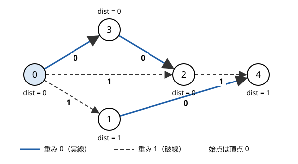

!!! abstract "要点"
    - **何ができるか**：辺の重みが 0 か 1 のグラフで、1 つの始点から各頂点への最短距離を $O(N + M)$ で求める。重み 0 の辺で距離が縮んだ頂点は deque の先頭へ、重み 1 の辺なら末尾へ入れる。壁を壊す回数や向きを変える回数の最小化に使う。
    - **いつ使うか**：
        - 壁を壊す回数・向きを変える回数・ワープの回数を最小化する。
        - 1 回の移動のコストが 0 か 1。
        - 言い換えると、辺の重みが 0 と 1 の 2 種類だけのグラフの最短路になる。
    - **計算量**：$O(N + M)$（各頂点が deque に入るのは高々 2 回）。ダイクストラ法の $O((N + M) \log N)$ から log が消える。
    - **前提**：[ダイクストラ法](../graph/dijkstra.md)

<!-- textlint-disable -->
別名：0-1 BFS・deque BFS
<!-- textlint-enable -->

01-BFS は、[ダイクストラ法](../graph/dijkstra.md)の優先度付きキューを deque（両端から出し入れできるキュー）に置き換えたものである。重みが 0 と 1 しかないと、待っている頂点の暫定距離は 2 種類だけになり、ヒープを使わなくても最小のものを先頭に置き続けられる。問題の本体は、何を重み 0、何を重み 1 にしたグラフを作るかである。

## 必要になる場面

迷路で「歩く移動は無料、壁を壊す移動は 1 回ごとに 1」のように無料の移動と有料の移動が混ざると、[幅優先探索](../graph/bfs.md)をそのまま使えない。BFS は「辺を 1 本たどるごとに距離が 1 増える」ことを前提に、最初に見つけた距離を確定させる。重み 0 の辺があると、辺の本数が多い経路の方が短いこともある。だから最初に見つけた距離が最短とは限らない。

ダイクストラ法なら正しく求まるが、$O((N + M) \log N)$ かかる。グリッドでマスが $10^6$ 個、1 マスから 5×5 の範囲へ辺が出るといった規模では、ヒープの log と定数倍が重くなる。01-BFS は重みが 0 と 1 だけという性質を使い、同じ答えを $O(N + M)$ で出す。

## deque の中の距離が 2 種類に保たれる理由 {#deque-invariant}

01-BFS は「距離の小さい順に頂点を確定させる」というダイクストラ法の考え方を、そのまま使う。違うのは、最小の頂点を取り出す道具だけである。

| 手法 | 辺の重み | 待っている頂点を入れる道具 | 先頭が最小になる理由 |
| --- | --- | --- | --- |
| BFS | すべて 1 | キュー | キューの中の距離は $d$ と $d + 1$ が前後に並ぶ |
| 01-BFS | 0 か 1 | deque | deque の中の距離は $d$ と $d + 1$ が前後に並ぶ |
| ダイクストラ法 | 非負 | 優先度付きキュー | ヒープが最小を返す |

01-BFS が保つ不変条件は次のとおりである。deque の先頭の距離を $d$ とする。

- deque の中の距離は、先頭から末尾へ広義単調増加に並ぶ
- deque の中の距離は $d$ か $d + 1$ のどちらかである

先頭から距離 $d$ の頂点 $u$ を取り出し、辺 $u \to v$ をたどったとき、この形が崩れないことを確かめる。

- 重み 0 の辺なら、$v$ の距離は $d$ である。deque の残りはすべて $d$ 以上なので、先頭に入れれば単調増加のままになる
- 重み 1 の辺なら、$v$ の距離は $d + 1$ である。deque の残りはすべて $d + 1$ 以下なので、末尾に入れれば単調増加のままになる

どちらも、入れる値は $d$ か $d + 1$ なので 2 種類のままである。こうして先頭が常に最小になる。辺の重みが非負なので、先頭の頂点より遠い頂点を経由して先頭の頂点に戻っても、距離は縮まない。よって先頭から取り出した頂点の距離は確定する。これはダイクストラ法で、ヒープから取り出した頂点の距離が確定する理由と同じである。

次の図の 5 頂点のグラフで、頂点 0 から 01-BFS を動かす。実線は重み 0、破線は重み 1 の有向辺で、各頂点の下（頂点 3 は上）に最終的な距離を書いた。



deque には（push したときの距離, 頂点）の組を入れる。古い組の扱いは[処理の流れ](#procedure)で述べる。

| 取り出した組 | たどった辺と更新 | 操作の後の deque（先頭 → 末尾） |
| --- | --- | --- |
| （始め） | $\mathrm{dist}[0] = 0$ | (0, 0) |
| (0, 0) | 0→1 で 1、0→2 で 1、0→3 で 0 | (0, 3)・(1, 1)・(1, 2) |
| (0, 3) | 3→2 で 0（1 から縮む） | (0, 2)・(1, 1)・(1, 2) |
| (0, 2) | 2→4 で 1 | (1, 1)・(1, 2)・(1, 4) |
| (1, 1) | 1→4 は 1 で縮まない | (1, 2)・(1, 4) |
| (1, 2) | 古い組（$\mathrm{dist}[2] = 0$）なので読み飛ばす | (1, 4) |
| (1, 4) | 出る辺がない | 空 |

どの時点でも、deque の中の距離は先頭から $0, \dots, 0, 1, \dots, 1$ の形に並んでいる。頂点 2 は 0→2 の辺で一度 1 になったが、重み 0 の辺 3→2 で 0 に縮み、先頭に入り直している。

<div class="kp-viz" data-viz="zero-one-bfs" data-config='{"n": 5, "source": 0, "edges": [[0, 1, 1], [0, 2, 1], [0, 3, 0], [3, 2, 0], [1, 4, 0], [2, 4, 1]]}'></div>

動く図では、同じグラフで 1 ステップずつ組を取り出し、重み 0 の辺で縮んだ頂点が先頭へ、重み 1 の辺で縮んだ頂点が末尾へ入る様子を示す。deque の中の距離は、どのステップでも 2 種類以下で、先頭が最小である。

## 処理の流れ {#procedure}

頂点の番号は 0-indexed、$\mathrm{dist}[v]$ は始点からの暫定距離とする。始点を $s$ として次のように進める。

```text
dist をすべて ∞ にし、dist[s] = 0、deque に (0, s) を入れる
deque が空でない間：
    先頭の組 (d, u) を取り出す
    d > dist[u] なら読み飛ばす（後でもっと短く更新された古い組）
    u から出る各辺 (u → v, 重み w) について：
        d + w < dist[v] なら：
            dist[v] = d + w
            w = 0 なら (d, v) を先頭へ、w = 1 なら (d + 1, v) を末尾へ入れる
```

- **縮んだら push する**：同じ頂点が deque に 2 回入ってよい。上の例の頂点 2 のように、重み 1 の辺で入った後に重み 0 の辺で縮むことがある
- **古い組を読み飛ばす**：組に push したときの距離を持たせ、$\mathrm{dist}[u]$ より大きければ何もしない。確定済みの印（`done[u]`）で判定してもよい
- **更新は真に小さいときだけ**：`<` を `<=` にすると、等しい距離でも push し直すので、重み 0 の閉路があると止まらない

```cpp
--8<-- "zero-one-bfs/graph.cpp:core"
```

**計算量**。各頂点の暫定距離が縮むのは高々 2 回なので、deque に入るのも高々 2 回である。読み飛ばしにより、各頂点から出る辺を調べるのは 1 回だけになる。よって全体は $O(N + M)$ である。

??? note "証明：各頂点の暫定距離が縮むのは高々 2 回"
    先頭の距離が $d$ である間に頂点 $v$ の暫定距離が初めて有限になったとする。そのときの値は $d$ か $d + 1$ である。値が $d$ なら、以後に取り出す組の距離はすべて $d$ 以上なので、これより縮まない。値が $d + 1$ なら、先頭の距離が $d$ である間に重み 0 の辺で $d$ に縮むことが 1 回だけありうる。先頭の距離が $d + 1$ 以上になった後は、$d + 1$ より小さい値は作られない。よって縮むのは、初めての更新を含めて高々 2 回である。

読み飛ばしを書かなくても答えは正しい。古い組を取り出しても、現在の $\mathrm{dist}[u]$ で緩和すれば何も更新されないか、正しい更新しか起きない。ただし辺を 2 回調べることがあるので、読み飛ばしを入れておく方が速い。

## 初めて見つけたときに確定させてはいけない {#no-early-fix}

BFS では、頂点を初めて見つけたときに距離を書き込み、訪問済みの印を付ける。01-BFS で同じことをすると誤る。重み 1 の辺で先に見つかった頂点が、後から重み 0 の辺でもっと短く届くことがあるからである。

[deque の例](#deque-invariant)では、頂点 0 を取り出したとき、0→2 の辺で頂点 2 を距離 1 で見つける。ここで頂点 2 を確定させると、3→2 の辺で届く距離 0 が使われず、頂点 2 の距離を 1 と誤る。正しくするには、次のどちらかの形にする。

- 距離が縮むたびに push し、取り出したときに古ければ読み飛ばす（[処理の流れ](#procedure)の形）
- 確定の印は、push のときではなく取り出したときに付ける

逆に、BFS のように「重み 0 の辺も末尾に入れる」と、deque の中の距離が単調に並ばなくなる。先頭が最小でなくなり、確定したはずの頂点の距離が後から縮む。重み 0 の辺は必ず先頭に入れる。

??? question "確認問題：初めて見つけたときに確定させる誤り"
    頂点 $s, a, b$ と辺 $s \to a$（重み 1）・$s \to b$（重み 0）・$b \to a$（重み 0）がある。$s$ から、「初めて見つけたら確定」の 01-BFS を動かすと、$a$ の距離はいくつになるか。正しい値はいくつか。

    ??? success "答え"
        $s$ を取り出すと、$a$ を距離 1 で見つけて確定し、$b$ を距離 0 で見つける。$b$ を取り出しても $a$ は確定済みなので更新されず、$a$ の距離は 1 になる。正しい値は $s \to b \to a$ の 0 である。辺を見る順によらず誤る。ただし $b \to a$ のような重み 0 の回り道がない入力では正しく動くので、サンプルだけでは気づきにくい。

## 何をコスト 1 にするか {#cost-modeling}

01-BFS を使う問題の多くは、最小化したい「回数」を重み 1、それ以外の移動を重み 0 にしたグラフの最短路になる。重みは辺に付くので、「何をしたら回数が 1 増えるか」を辺として書き出す。

- **壁を壊す回数（入るマスで重みが決まる）**：通路のマスへ入る辺は重み 0、壁のマスへ入る辺は重み 1 にする。壊した回数が距離になる。「$K$ 回まで壊せる」なら、距離が $K$ 以下かを調べる（[ARC005 C](#arc005_3)）
- **移動手段が 2 種類ある（無料の移動と、回数を数える移動）**：隣へ歩くのは重み 0、ワープやパンチで届くマスへは重み 1 の辺を張る。重み 1 の辺は、歩いても行けるマスへ張っても答えは変わらない。歩く方が短ければ重み 0 の経路が選ばれるからである（[ABC176 D](#abc176_d)）
- **向きを変える回数**：向きを状態に持ち、まっすぐ進むのを重み 0、曲がるのを重み 1 にする（[向きを状態に持つ](#direction-state)）
- **整数の状態の間の 2 種類の操作**：$K$ で割った余りを頂点にし、「1 を足す」を重み 1、「10 倍する」を重み 0 にすると、桁和の最小が距離になる（[剰余を頂点にする最短路](../graph/modular-shortest-path.md)）

グリッドを頂点にするときの添字の扱い（4 近傍の配列・$(i, j)$ の 1 次元化）は[グリッドグラフ](../graph/grid-graph.md)と同じである。

## 向きを状態に持つ（頂点数が 4 倍になる） {#direction-state}

「曲がる回数の最小」「同じ向きに何マス進んでも 1 手と数える移動の手数」では、コストはマスだけでなく、直前に進んでいた向きでも決まる。そこで頂点を（行, 列, 向き）の組にする。上下左右なら頂点数はマスの数の 4 倍、つまり $4HW$ になる（状態を頂点にする考え方は[状態を頂点にする](../graph/extended-dijkstra.md#parity-mod-direction)の「偶奇・mod・向きを持つ」）。

状態 $(i, j, d)$ からの辺は次の 2 種類である。

- **まっすぐ進む**：向き $d$ の隣のマスが通れれば、$(i, j, d) \to (i + \mathrm{dx}_d, j + \mathrm{dy}_d, d)$、重み 0
- **向きを変える**：その場で $(i, j, d) \to (i, j, d')$（$d' \ne d$）、重み 1

始点と答えの取り方は、何を数えるかで決める。曲がる回数なら、最初の向きは自由なので、始点の 4 つの状態をすべて距離 0 にして deque に入れる。ゴールの答えは、4 つの向きの距離の最小である。移動の手数を数えるなら、最初の 1 手も 1 回なので、曲がる回数に 1 を足したものが手数になる。

```cpp
--8<-- "zero-one-bfs/turns.cpp:core"
```

- **頂点数と辺数**：頂点は $4HW$、各頂点から出る辺は 1 + 3 本なので、全体で $O(HW)$ である。$H = W = 1500$ でも頂点は約 $9 \times 10^6$ 個で、`int` の配列なら約 36 MB に収まる。状態は `map` ではなく、整数に詰めて配列で引く
- **斜めの 4 方向でも同じ**：ビショップのように斜めに進む駒でも、向きを斜めの 4 つにすれば同じ形になる

??? question "確認問題：向きを変える辺の重みを 2 種類にしたい"
    「左右に曲がるのは 1 回、U ターンは 2 回と数える」場合、向きを変える辺はどう張ればよいか。

    ??? success "答え"
        U ターンの辺を張らず、左右に曲がる辺（重み 1）だけを張る。U ターンは左右に 2 回曲がることで表され、重み 2 になる。重みを 0 と 1 だけに保てるので、01-BFS のまま解ける。

## 重みが 0, 1, 2 ならどうするか {#weights-012}

重み 2 の辺をそのまま末尾に入れると、deque に $d$・$d + 1$・$d + 2$ が混ざる。末尾に $d + 2$ がある状態で重み 1 の辺の $d + 1$ を末尾に入れると、単調な並びが崩れ、先頭が最小と言えなくなる。対処は 3 つある。

- **辺を割る**：重み 2 の辺 $u \to v$ ごとに中継の頂点 $x$ を足し、$u \to x \to v$ を重み 1 の辺 2 本にする。頂点数は重み 2 の辺の本数だけ増えるが、01-BFS のまま $O(N + M)$ で解ける
- **距離ごとのキューを並べる**：重みの最大を $C$ とし、距離 $d$ の頂点を入れるキューを $d$ ごとに用意して、$d$ の小さい順に処理する（Dial の方法）。キューは $C + 1$ 個を使い回せば足りる。重みが小さい整数に限られるときの一般化である
- **ダイクストラ法を使う**：重みが大きいときや、種類が多いときはこれで十分である

制限時間に余裕があれば、重みが 0 と 1 でもダイクストラ法で通ることが多い。01-BFS が要るのは、辺の数が多いグリッドや、状態を増やして頂点数が大きくなったときである。

## 落とし穴 {#pitfalls}

**初めて見つけたときに確定させる**。BFS の書き方を流用して、push のときに訪問済みの印を付けると誤る（[初めて見つけたときに確定させてはいけない](#no-early-fix)）。サンプルでは辺の順の都合で当たることがあり、気づきにくい。

**重み 0 の辺も末尾に入れる**。push の向きを取り違えると、先頭が最小でなくなる。重み 0 は先頭、重み 1 は末尾と、コメントで書いておく。

**`<=` で更新する**。等しい距離でも push し直すと、重み 0 の閉路（通路のマスどうしの行き来）で無限ループになる。更新は `d + w < dist[v]` のときだけにする。

**重みを「入るマス」と「出るマス」のどちらで数えるかを取り違える**。「壁のマスに入るとき 1」とすると、始点のマスは数えず、終点のマスは数える。「出るとき 1」とすると逆になる。始点や終点が壁になりうる問題では、どちらの数え方が問題文の回数と合うかを確かめる。

**向きを持つ状態の配列が大きすぎる・遅い**。頂点数は $4HW$ になる。`vector<vector<vector<int>>>` よりも、$(i \cdot W + j) \cdot 4 + d$ に詰めた 1 次元の配列の方が速い。距離の配列を `long long` にする必要はなく、多くは `int` で足りる。

## 例題 {#examples}

### ABC176 D. Wizard in Maze {#abc176_d}

<div class="kp-problems" data-role="example" markdown>

- [ABC176 D. Wizard in Maze](https://atcoder.jp/contests/abc176/tasks/abc176_d)（diff 1248）：迷路で、隣へ歩く移動と、周囲 5×5 の範囲の道へのワープが使えるとき、ゴールまでのワープの最小回数を求める

</div>

ワープの回数を最小にしたいので、隣の道へ歩く移動を重み 0、ワープを重み 1 にしたグラフの最短路になる。各マスから出る辺は、歩く 4 本とワープの高々 24 本で、合わせて定数本である。01-BFS で全体が $O(HW)$ になる。

??? note "解法の詳細"
    - 頂点はマス、始点はスタートのマスで、距離はそれまでのワープの回数である。
    - 取り出したマス $(i, j)$ から、上下左右の道のマスへは重み 0 で緩和して deque の先頭へ入れる。
    - $(i, j)$ を中心とする 5×5 の範囲の道のマスへは、重み 1 で緩和して末尾へ入れる。歩いて行けるマスへの辺も混ざるが、重み 0 の辺の方が先に縮めるので答えは変わらない。
    - ゴールの距離が答えで、∞ のままなら届かないので $-1$ を出す。

### ARC005 C. 器物損壊！高橋君 {#arc005_3}

<div class="kp-problems" data-role="example" markdown>

- [ARC005 C. 器物損壊！高橋君](https://atcoder.jp/contests/arc005/tasks/arc005_3)（diff 1503）：塀を 2 回まで壊して進めるとき、家から魚屋へ行けるかを判定する

</div>

塀を壊す回数を最小にして、それが 2 以下かを調べればよい。通れるマスへ入るのを重み 0、塀のマスへ入るのを重み 1 にすると、距離が壊した塀の数になる。

??? note "解法の詳細"
    - 頂点はマス、辺は上下左右の隣へ入る向きに張り、重みは入る先のマスで決める（塀なら 1、それ以外は 0）。
    - 家のマスから 01-BFS を行い、魚屋のマスの距離が 2 以下なら YES、そうでなければ NO を出す。
    - $H, W \le 500$ なので、ダイクストラ法でも間に合う。01-BFS なら $O(HW)$ である。

## 練習問題 {#practice}

<div class="kp-problems" data-role="practice" markdown>

- [典型90 043. Maze Challenge with Lack of Sleep（★4）](https://atcoder.jp/contests/typical90/tasks/typical90_aq)（diff —）：迷路で、スタートからゴールまでに方向転換する回数の最小値を求める
- [ABC213 E. Stronger Takahashi](https://atcoder.jp/contests/abc213/tasks/abc213_e)（diff 1423）：道は歩けて、2×2 のマスの塀を壊すパンチが使える迷路で、ゴールまでのパンチの最小回数を求める
- [ABC246 E. Bishop 2](https://atcoder.jp/contests/abc246/tasks/abc246_e)（diff 1476）：障害物のある盤面で、ビショップが始点から終点へ移動する最小の手数を求める

</div>

??? note "練習の方針"
    - **典型90 043**：（行, 列, 向き）を頂点にし、まっすぐ進むのを重み 0、向きを変えるのを重み 1 にする。始点の 4 つの向きをすべて距離 0 で入れ、ゴールの 4 つの向きの最小を答える（[向きを状態に持つ](#direction-state)のコードと同じ形）
    - **ABC213 E**：歩いて隣の道へ入るのを重み 0、パンチ 1 回で届くマスへの移動を重み 1 にする。パンチで届くのは、自分を中心とする 5×5 の範囲から四隅を除いたマスである
    - **ABC246 E**：斜めの 4 方向を向きとして状態に持ち、同じ向きに進み続けるのを重み 0、向きを変えるのを重み 1 にする。最初の 1 手も 1 手と数えるので、始点の状態の距離を 1 にするか、答えに 1 を足す

## 確認問題 {#quiz}

??? question "確認問題：01-BFS と BFS が同じ動きになるとき"
    すべての辺の重みが 1 のグラフで 01-BFS を動かすと、BFS と同じ順に頂点を確定させるか。

    ??? success "答え"
        同じになる。重み 1 の辺しかないので、push はすべて末尾で、deque はキューと同じ使い方になる。BFS との違いは、BFS が見つけたときに確定させるのに対し、01-BFS は縮んだら push して取り出したときに確定させる点だけである。重みがすべて 1 なら、初めて見つけた距離より縮むことはないので、結果も同じになる。

??? question "確認問題：始点が複数あるとき"
    壁を壊す回数の最小を、複数のスタート候補のうち最もよいものから求めたい。どうすればよいか。

    ??? success "答え"
        すべてのスタート候補を距離 0 で deque に入れてから始める。距離 0 の頂点だけが並ぶので、不変条件は崩れない。超始点から各候補へ重み 0 の辺を張るのと同じである。

## 使い分け {#comparison}

- 辺の重みがすべて同じなら[幅優先探索](../graph/bfs.md)で足りる
- 重みが 0 か 1 なら 01-BFS で $O(N + M)$。0・1・2 のように小さい整数なら、辺を割るか、距離ごとのキューを並べる
- 重みが非負の一般の値なら[ダイクストラ法](../graph/dijkstra.md)。制限が緩ければ、重みが 0 と 1 でもダイクストラ法で通ることが多い
- 最短路の手法全体の選び方は[似た手法の使い分け](../guide/method-comparison.md)にまとめてある

## 参考 {#references}

- [ARMERIA「01-BFSのちょっと丁寧な解説」](https://betrue12.hateblo.jp/entry/2018/12/08/000020)：deque の中の距離が 2 種類に保たれる不変条件と、ダイクストラ法との関係
- [drken「AtCoder ARC 005 C - 器物損壊！高橋君 (試験管水色)」](https://drken1215.hatenablog.com/entry/2021/07/30/024800)：例題の方針（入るマスで重みを決める 01-BFS）と制約
- [oraclesqlpuzzle「ABC176-D Wizard in Maze」](https://oraclesqlpuzzle.ninja-web.net/kyoupro/05-atcoder-02-abc/kyoupro-abc176-d.html)：例題の方針（歩く移動を重み 0、ワープを重み 1）
- [E869120「競プロ典型 90 問 043 の想定解」](https://github.com/E869120/kyopro_educational_90/blob/main/sol/043.cpp)：向きを状態に持つ 01-BFS と、始点の 4 つの向きを距離 0 にする初期化
- [hamayan「Stronger Takahashi [AtCoder Beginner Contest 213 E]」](https://blog.hamayanhamayan.com/entry/2021/08/09/010308)：練習の方針（パンチで届く範囲と、重み 1 の辺を余分に張ってもよい理由）
- [hamayan「Bishop 2 [AtCoder Beginner Contest 246 E]」](https://blog.hamayanhamayan.com/entry/2022/04/03/015208)：練習の方針（向きを状態に持つ）
- [Wikipedia（英語）「Bucket queue」](https://en.wikipedia.org/wiki/Bucket_queue)：距離ごとのキュー（Dial の方法）と、$C + 1$ 個を使い回せる理由
