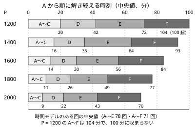

!!! abstract "要点"
    - **何がわかるか**：ABC（7 問・100 分）で、各位置の問題がどの色の難しさか、目標のパフォーマンスに届くには何分で何問を解けばよいか、どの順に読みどこで見切るか。
    - **数字の出どころ**：abc400〜abc480 の 81 回の difficulty と、AtCoder Problems の時間モデルによる推定。ガイドラインの目安（E869120・drken）と照らし合わせてある。
    - **使い方**：コンテストの前に「目標の時刻」と「見切りの時刻」を決めておき、終わった後は解き終えた時刻を表と比べて、どこで時間を失ったかを振り返る。
    - **前提**：なし。レート・パフォーマンス・difficulty の定義は [AtCoder の仕組み](../start/atcoder-system.md)にある。

<!-- textlint-disable -->
別名：時間配分・問題を読む順・立ち回り・詰まったときの切り替え
<!-- textlint-enable -->

コンテストの戦い方は、知識や実装力とは別に、限られた 100 分をどの問題に使うかの判断である。同じ問題を解ける人でも、読む順・見切りの早さ・誤答の数でパフォーマンスは数百変わる。ここでは最近の ABC のデータから目安の数字を出し、それをもとにした判断の手順を示す。考察の中身は[詰まったときの発想リスト](thinking-checklist.md)、バグの探し方は [WA・TLE・RE・MLE の原因チェックリスト](debugging-checklist.md)に任せる。

## 位置ごとの難しさと色 {#difficulty-by-position}

ABC の問題の難しさは位置（A〜G）でおおよそ決まり、E が水、F が青、G が黄以上の帯に当たる。次の表は abc400〜abc480 の 81 回で、各位置の difficulty（その問題を半々の確率で解けるレート）の分布を AtCoder Problems のデータから数えたものである。

| 位置 | 第 1 四分位 | 中央値 | 第 3 四分位 | 多い帯 |
| --- | ---: | ---: | ---: | --- |
| C | 243 | 330 | 458 | 灰・茶 |
| D | 677 | 821 | 942 | 茶・緑 |
| E | 1133 | 1286 | 1424 | 緑・水 |
| F | 1588 | 1744 | 1987 | 水・青 |
| G | 2167 | 2391 | 2804 | 黄・橙・赤 |

A・B の中央値は 13・48 で、どちらもすべて灰の帯にある。教材のレベル（[difficulty の帯](../start/atcoder-system.md)）に読み替えると次のようになる。

- **D**：93% が基礎（〜1199）で、素直な典型の当てはめが多い。
- **E**：59% が水（1200〜1599）、31% が基礎、10% が青以上である。
- **F**：水 26%・青 49%・黄 19%・発展 6% で、75% が 2000 未満である。
- **G**：黄 38%・発展（2400〜）49% で、青以下は 12% にとどまる。

つまり、水のページの知識は E と易しい F、青は F と難しい E、黄は難しい F と易しい G で効く。位置ごとにどの手法が多いかは[色別ロードマップ](roadmap.md)にまとめてある。

位置の並びと難しさの順は、ときどき逆転する。7 問体制の 162 回（abc319〜abc480）では、E の difficulty が F を上回った回は 17 回（約 10%）、F が G を上回った回は 15 回（約 9%）あった。2026 年のある回は E 2096・F 1604 で、F の方が 500 ほど易しかった。隣り合う位置の difficulty の差の中央値は、同じ 162 回で、D→E が約 470、E→F が約 490 である。この逆転が、[問題を読む順](#reading-order)で後ろの問題文も読む理由になる。

## 目標パフォーマンスごとの時間の目安 {#time-targets}

目標のパフォーマンスを P とすると、P の人が各位置をどれだけの確率で解き、何分かけるかを AtCoder Problems のモデルから推定できる。モデルは 2 つある。解く確率は difficulty のロジスティック曲線で、使う時間は「その問題を解いた人が直前の AC からかけた時間（その問題への誤答のペナルティ 5 分を含む）」をレートで回帰したものである（どちらも AtCoder Problems のソースで定義を確かめた）。次の表は abc400〜abc480 の各位置の問題についての中央値で、各セルは「解く確率／解いた人がかける分数」である。解く確率は 81 回、分数は時間のモデルがある回だけ（D は 81 回、E は 78 回、F は 74 回、G は 49 回）から求めた。

| P | D | E | F | G |
| ---: | --- | --- | --- | --- |
| 1000 | 69%／24 | 22%／31 | 3%／35 | 0%／38 |
| 1200 | 85%／21 | 40%／28 | 8%／33 | 0%／36 |
| 1400 | 93%／18 | 62%／25 | 18%／31 | 1%／34 |
| 1600 | 97%／15 | 80%／23 | 34%／30 | 3%／34 |
| 1800 | 99%／13 | 91%／21 | 56%／28 | 7%／33 |
| 2000 | 99%／12 | 96%／19 | 76%／27 | 15%／32 |

A〜C はどの行でも 95% 以上の確率で解け、A〜C にかかる時間の合計は P = 1200 で約 20 分、P = 2000 で約 9 分である。

A から順に解いたとき、各位置まで解き終える時刻を帯にすると次の図になる。時刻は、途中の位置すべてに時間のモデルがある回だけでの中央値である（A〜E は 78 回、A〜F は 71 回）。

| P | A〜C | A〜D | A〜E | A〜F |
| ---: | ---: | ---: | ---: | ---: |
| 1200 | 20 | 42 | 72 | 104 |
| 1400 | 16 | 35 | 64 | 93 |
| 1600 | 14 | 30 | 56 | 84 |
| 1800 | 11 | 26 | 49 | 77 |
| 2000 | 9 | 22 | 43 | 70 |

表と図から、目標ごとの姿は次のように読める。

解く確率の列は「難しさが中央値の問題を解く確率」で、そのまま「何回に何回解けるか」ではない。回ごとの見込みは 81 回の確率の平均で言う方がよく、下の「何回に何回」は平均から出した。

- **1200（水）**：A〜D を約 40 分で解き、E は 5 回に 2 回解ける。D を落とさないことが土台で、E は解ければ上振れになる。
- **1600（青）**：A〜D を約 30 分、A〜E を約 55 分で解き、E を 8 割の回で落とさない。F は 3 回に 1 回である。
- **2000（黄）**：A〜E を約 45 分、A〜F を約 70 分で解き、F は 3 回に 2 回ほど解ける（3 回に 1 回は落とす）。F の 75% が 2000 未満なので、青までの知識を確実にして速く解くことが主な条件になる。F を落とす回が 3 回に 1 回あるので、E までの速さも効く。

この推定は、ガイドラインの目安ともほぼ合う。E869120 氏は 6 問体制の頃に、水色の目安を A 1 分・B 4 分・C 10 分・D 25 分、黄色の目安を A 1 分・B 2 分・C 5 分・D 10 分・E 20 分としている。水色の目安の合計（A〜D で 40 分）は上の表の P = 1200 の 42 分と、黄色の目安の合計（A〜E で 38 分）は P = 2000 の 43 分と近い。

数字を読むときの注意が 3 つある。1 つは、時間は解けた人だけから求めているので、解く確率の低いセル（P = 1200 の F など）は「もし解けたなら」の目安にすぎないことである。もう 1 つは、中央値なので回ごとのばらつきが大きいことである。A〜E の時刻の四分位範囲は、P = 1600 で 45〜63 分、P = 2000 で 33〜50 分ある。最後は、時間のモデルがない F（正解者が少ないなどでモデルが作られなかったもの）は難しめの問題に偏っているので、A〜F の時刻は実際より短めに出ていることである。

## 完答数・速さとパフォーマンス {#solves}

パフォーマンスは得点（ABC ではほぼ完答数）で大枠が決まり、同じ完答数の中では速さで大きく動く。drken 氏の目安では、4 完で 800〜1600、5 完で 1400〜2200、6 完で 2000〜2400 である（6 問体制の頃の目安で、回によって変わる）。同じ 5 完でも、速いか遅いかで 800 の幅がある。

速さの重みは、E869120 氏が挙げた ABC148（6 問体制）の全完の時刻とパフォーマンスの例でも分かる。

| 全完の時刻 | パフォーマンス |
| ---: | ---: |
| 30 分 | 2400 |
| 40 分 | 2146 |
| 50 分 | 1971 |
| 60 分 | 1813 |

この回では、10 分の遅れがパフォーマンスで 160〜250 ほどに当たる。誤答 1 回のペナルティ 5 分（[提出前の確認とペナルティ](#before-submit)）も、同じ割合なら 80〜130 ほどになる（1 回の例から割った粗い見積もりである）。

レート P の人が「半々以上の確率で解ける問題」が何問あるかを 81 回で数えると、次の分布になった（手元の集計で数えた値）。

| P | 3〜4 問 | 5 問 | 6〜7 問 |
| ---: | ---: | ---: | ---: |
| 1200 | 73% | 27% | 0% |
| 1600 | 11% | 62% | 27% |
| 2000 | 0% | 21% | 79% |

P = 1200 の人にとって、ほとんどの回は 4 問の勝負で、5 問目（多くは E）が半々以上になる回は 4 回に 1 回ほどである。P = 2000 の人は 6 問を解ける見込みの回が 8 割になる。

ここから次のことが言える。

- 水のパフォーマンスは「4 完の早解き」か「5 完」で取れる。4 完でも遅いと緑の下位まで下がるので、まず 4 完を安定して速くすることが優先になる（fken_prime_57 氏）。D を 40 分以内に解けた回は 4 完でも水に届いた、という例もある（siooisi 氏）。
- 黄のパフォーマンスを安定させるには、F を解けなかった回でも E までを速く解いて大崩れしないことが効く。P = 2000 の人でも F を落とす見込みは 3 回に 1 回ほどある。
- 7 問体制で黄色を目指す目安として、「6 完を安定させ、550 点程度までの G を解く」という声がある（blueberry1001 氏）。

## 問題を読む順 {#reading-order}

A〜C は順に解き、D を解いたら E・F・G の問題文を一通り読んでから取り組む問題を決める。理由は 2 つある。

- 位置の難しさは約 1 割の回で逆転する（[位置ごとの難しさと色](#difficulty-by-position)）。E で詰まっている間に、易しい F を読まずに終えるのがいちばん大きな損になる。
- 問題文を読むのは数分で済むが、得意な形かどうかは読まないと分からない。知っている手法がそのまま使える問題は、位置が後ろでも速く解ける。

読む順の工夫には、色変記事にもいくつかの型がある。

- E と F の選び方を決めてから臨む：F を最低 3 分は読んでから E と F のどちらに進むかを決め、F が尺取り法と BIT で解けると気づいて先に通した例がある（Youteru 氏）。
- 得意な分野を先に解く：D の方針が立たないときに、得意な DP の F に切り替えて通し、レートを大きく上げた例がある（mackerel38 氏。うまくいかない回もあると本人が書いている）。
- 後ろから解く：疲れる前に難しい問題に取り組む考え方で、A〜F を 100 分で余裕を持って書ける速さがある人向けとされる（Iroha_3856 氏）。

学習者の今の位置（D まで安定、E は時々）なら、A〜D を順に速く解き、D の後に E・F・G を読むのが基本の形になる。

## 取り組む問題の選び方と切り替え {#switching}

D の後に読んだ問題のうち、どれに時間を使うかは「解ける見込み」と「残り時間で書き切れるか」で決める。判断の材料は次の 3 つである。

1. **知っている手法か**：問題文の言い回しや制約から手法の当たりが付くか。[逆引き辞典（言い回しから）](reverse-index-signs.md)の形に当てはまるものは見込みが高い。
2. **実装の重さ**：方針が立っても、場合分けが多い・データ構造を組み合わせる問題は時間を食う。残り時間と比べる。
3. **解かれている人数**：順位表で各問題の正解者数を見れば、逆転の回に気づける。一方で、順位表を見ると集中が乱れるので見ないという人もいる（Iroha_3856 氏）。見るなら問題ごとの正解者数だけにする、のように自分の約束を決めておく。

切り替えの時刻も、あらかじめ決めておく。目安は次のとおりである（データにもとづく提案で、決まった規則ではない）。

- **見切りの時刻**：E に 20〜30 分かけて方針が立たず、F の方が見込みがあるなら F に移る。[時間の目安](#time-targets)の表で、E を解く人がかける時間の中央値は P = 1200 で 28 分、P = 1600 で 23 分である。これは実装とペナルティまで含めた時間なので、方針が立つまでの時間はこれより短いはずである。自分の目標の P の E の分数を過ぎても方針がなければ、その回の E は自分にとって難しいと見てよい。
- **戻る判断**：F に移っても、E の考察が無駄になるわけではない。F の実装の合間や行き詰まったときに E に戻ると、離れたことで方針が見えることがある（[詰まったとき](#when-stuck)の「一度離れる」）。
- **期待値で比べる**：P = 1600 の人なら E を解く確率は 80%、F は 34% である。E の方針が少しでも立っているなら、E を詰める方が得になりやすい。ただし、この確率は問題を読む前の見込みで、詰まった後は下がる。比べるのは確率の数字より、方針の立ち具合である。

## 詰まったとき {#when-stuck}

方針が立たないときは、問いを順にたどって考察を進める。問いの一覧と、それぞれに対応する手法のページは[詰まったときの発想リスト](thinking-checklist.md)にあるので、ここではコンテスト中に回す順だけを示す。

1. **誤読を疑う**：$N$ の大きさ、木か一般のグラフか、最大か最小か、「ちょうど」か「以下」かを問題文で確かめ直す。
2. **制約から計算量を逆算する**：[制約と許される計算量の表](../basics/complexity-estimation.md#constraint-table)で、制約の形から候補の手法を絞る。
3. **小さいケースを手で試す**：$N = 1, 2, 3$ や極端な入力で答えを手で出し、規則を探す。全探索を書いて表を作るのも速い（[ストレステストと実験](stress-testing.md)）。
4. **言い換える**：答えを決め打ちする、逆から見る、1 つを固定する、寄与で数える。
5. **一度離れる**：別の問題を読み、時間をおいて戻る。

WA が取れないときは考察ではなく実装の問題であることが多い。症状ごとの原因は [WA・TLE・RE・MLE の原因チェックリスト](debugging-checklist.md)で引き、原因が見つからなければ愚直解と比べる（[ストレステストと実験](stress-testing.md)）。

## 提出前の確認とペナルティ {#before-submit}

誤答 1 回のペナルティは 5 分で、最終的に正解した問題への誤答だけが数えられる。順位は得点の合計で決まり、同点なら「最後に正解した時刻＋ペナルティ」の早い方が上になる。どの提出が誤答に数えられるか（コンパイルエラーなど）の細則は、各コンテストのルールのページで確かめる。

5 分は、[完答数・速さとパフォーマンス](#solves)の見積もりでパフォーマンス 80〜130 ほどに当たる。提出の前に 1〜2 分かけて次を確かめる方が、ほとんどの場合に得になる。

- 入出力例をすべて試したか。
- 最小の入力（$N = 1$、空、すべて同じ値）で正しく動くか。
- 最大の入力で間に合うか。計算量を見積もり直し、必要なら最大ケースを作って時間を測る。
- 積や和が `int` に収まるか（$10^9$ の 2 つの積は `long long` が要る）。
- 出力の形式（Yes と YES、区切りの空白、小数の桁数）が問題文どおりか。
- デバッグ用の出力を消したか。

確認の項目をもっと細かく引くときは、[WA・TLE・RE・MLE の原因チェックリスト](debugging-checklist.md)の提出前の確認を使う。黄色の色変記事にも、黄 diff 以上の問題を解けない回は、青 diff までをペナルティなしで素早く解く必要がある、という声がある（Yoyoyo8128 氏）。

## 終了前の 10〜15 分 {#last-minutes}

終了前の時間は、新しい問題を考え始めるより、得点に近いものを仕上げることに使う。次の順で考えるとよい（出典のない提案である）。

1. **実装が途中の問題があれば、それを書き切る**：方針が立っている問題を書き切るのがいちばん得点に近い。
2. **WA が取れない問題があれば、愚直解と比べる**：小さい入力で愚直解と答えを比べ、反例を探す（[ストレステストと実験](stress-testing.md)）。
3. **自信がなくても提出する**：最終的に正解しなかった問題の誤答はペナルティに数えられない。終了直前の提出は、外れても失うものがない。

逆に、まだ読んでいない問題を 10 分で考え始めても、解き切れることはまれである。[時間の目安](#time-targets)の表のとおり、解ける人でも E・F に 20〜30 分かかる。

## 生成 AI のルール {#ai-rules}

<!-- textlint-disable -->

AtCoder生成AI対策ルール（20261014 版）は、ABC・ARC・AGC の開催中に、問題文やその要約を生成 AI に入力して解法やコードを出力させることを禁じている。過去問の練習には適用されない。ルールは版ごとに変わってきたので、参加する前に AtCoder の告知で最新の版を確かめる。

<!-- textlint-enable -->

この教材との関係では、次のように使い分ける。

- **コンテスト中**：claude.ai に問題文や要約を見せて、解法やコードを頼まない。
- **コンテストの終了後**：解けなかった問題の解説を claude.ai に頼んでよい。頼み方は[この教材の使い方](../start/how-to-use.md)にある。

ルールの版の扱いと、ABC・ARC の区分は [AtCoder の仕組み](../start/atcoder-system.md)にまとめてある。なお、コンテストの終了前に問題の解法や難しさの感想を SNS に書かないことも、AI とは別の約束として守る（drken 氏の tips）。

## 終了後の振り返り {#after-contest}

コンテストの後は、解けなかった問題のうち最も易しいものを解き直し（upsolve）、時間を失った場所を確かめる。順番は次のとおりである。

1. **時刻を表と比べる**：各問題を解き終えた時刻を[時間の目安](#time-targets)の表と比べ、目標より遅れた位置を見つける。
2. **原因を切り分ける**：解けなかった、または遅れた問題ごとに、原因を「誤読／知識不足／考察不足／実装ミス／時間不足」のどれかに分ける。知識不足なら手法のページを読み、考察不足ならどの条件から手法を連想できたはずかを書き出す。
3. **次の 1 問を upsolve する**：解けなかった問題のうち最も易しいもの（多くは E か F）を、解説を読んで自力で書き直す。解説は claude.ai に頼んでもよい（[生成 AI のルール](#ai-rules)）。
4. **記録する**：原因の分類と、次に同じ形を見たら何を疑うかを一言で残す。

解説を読むまでの時間、復習の仕方、記録の付け方は[精進の仕方](practice-method.md)にまとめてある。

## 参考 {#references}

- [kenkoooo「AtCoderProblems / time-estimator/function.py」](https://github.com/kenkoooo/AtCoderProblems/blob/master/lambda-functions/time-estimator/function.py)：difficulty と予測解答時間のモデルの定義。表と図の数字は、このモデルの値を公開データから集計したもの
- [kenkoooo「AtCoderProblems / ProblemModelUtil.ts」](https://github.com/kenkoooo/AtCoderProblems/blob/master/atcoder-problems-frontend/src/utils/ProblemModelUtil.ts)：解く確率と時間の計算式
- [E869120「レッドコーダーが教える、競プロ・AtCoder上達のガイドライン【中級編：目指せ水色コーダー！】」](https://qiita.com/e869120/items/eb50fdaece12be418faa)：水色の時間の目安
- [E869120「レッドコーダーが教える、競プロ・AtCoder上達のガイドライン【上級編：目指せレッドコーダー！】」](https://qiita.com/e869120/items/acba3dd8649d913102b5)：黄色の時間の目安と ABC148 の全完の時刻の例
- [drken「AtCoder コンテストについての tips」](https://qiita.com/drken/items/8a6f139158cde8a61dce)：完答数とパフォーマンスの目安、同点のときの順位、終了前に問題について書かないこと
- [「AtCoder」（Wikipedia 日本語版）](https://ja.wikipedia.org/wiki/AtCoder)：ペナルティの時間と数え方、ABC の形式の変遷
- [ToastUz「AtCoderで生成AIをフル活用！2025年の競技プログラミング術」](https://qiita.com/ToastUz/items/98a4ff7fd63a061ef18d)：生成 AI のルールの版ごとの変遷
- [Youteru「数狂、遂に入水達成(入水の心得3つ)」](https://qiita.com/Youteru/items/074eafe7fc7b693aca39)：E と F の選び方（F を最低 3 分読む）
- [mackerel38「AtCoder 入青しました【色変記事】」](https://qiita.com/poe4294967296/items/0fdb4547eee65d9e751a)：得意な分野の後ろの問題を先に解く
- [Iroha_3856「入黄するまでに考えたこと」](https://iroha-3856.hatenablog.com/entry/2025/07/06/171457)：順位表を見ない約束、後ろから解く戦略、E・F を 10〜20 分で解く目標
- [siooisi「入水したのでいろいろ書いた」](https://qiita.com/siooisi/items/e50013e4ee7d615cba37)：4 完の早解きで水のパフォーマンスに届く時間
- [fken_prime_57「[AtCoder]プログラミング未経験だった大学生が8か月半で入水した方法」](https://qiita.com/Gifken/items/12194b9ab5cf765cfd0d)：水のパフォーマンスには 4 完の早解きか 5 完が要ること
- [blueberry1001「【Atcoder】高校2年生でAtcoder黄色になりました」](https://qiita.com/bluebery1001/items/3253399ebf287e197346)：7 問体制で黄色を目指す目安
- [Yoyoyo8128「AtCoderで入黄しました！」](https://qiita.com/Yoyoyo8128/items/57e089cb66f9fdaa864a)：青 diff までをペナルティなしで速く解くこと
- [kmyk「競技プログラミングの問題の解き方、そのマニュアル」](https://kmyk.github.io/blog/blog/2016/06/21/how-to-solve-problems-in-competitive-programming/)：詰まったときの手順と、解けなかった原因の切り分け
