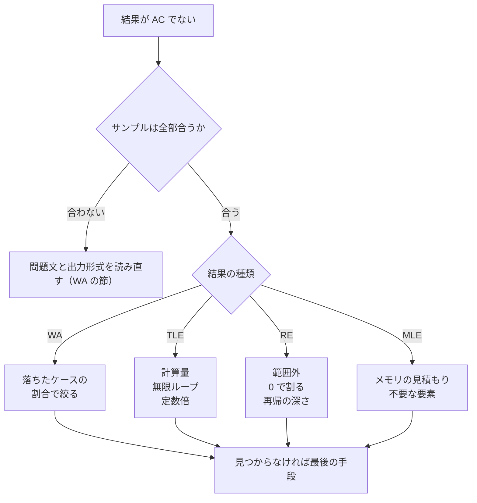

!!! abstract "要点"
    - **何のページか**：提出前の確認と、WA・TLE・RE・MLE の症状ごとに疑う原因を順にたどれる。各項目から C++ 章の落とし穴や手法のページへつなぐ。
    - **使い方**：提出の前に[提出前の確認](#before-submit)を一通り見る。結果が AC でなければ、まず[落ちたケースの割合](#partial)を見て、症状の節を上から順に疑う。原因の中身と直し方は、各項目のリンク先で確かめる。
    - **見つからないとき**：[最後の手段](#last-resort)の、愚直解との比較と書き直しに進む。

<!-- textlint-disable -->
別名：デバッグ・バグの探し方・WA の原因・TLE の原因・提出前の確認
<!-- textlint-enable -->

WA・TLE・RE・MLE の原因チェックリストは、ジャッジの結果（症状）から疑う原因を、起きやすい順・確かめやすい順に並べたものである。原因の多くは毎回同じ形で現れるので、思いつくままに探すより、表を上からたどる方が早く見つかる。C++ 特有の原因は、C++ の章の各ページに再現する例と直し方がある。

ジャッジの結果の略語は次のとおりである。

- **WA**（Wrong Answer）：出力が正しくない。
- **TLE**（Time Limit Exceeded）：実行時間の制限を超えた。
- **RE**（Runtime Error）：実行中に異常終了した（配列の範囲外・0 での割り算など）。
- **MLE**（Memory Limit Exceeded）：メモリの制限を超えた。

症状から疑う順を図にすると次のようになる。



この図は、サンプル（問題文の入出力例）が合うかで最初に分け、合うなら結果の種類ごとの節へ進む流れを表す。どの節でも見つからなければ、[最後の手段](#last-resort)で愚直解と比べて落ちる入力を探す。WA は症状が同じでも原因が広いので、[落ちたケースの割合](#partial)で先に絞る。一部だけ落ちるなら端のケース・初期化・あふれを、多くが落ちるなら解法そのものと問題文の誤読を疑う。

## 提出前の確認 {#before-submit}

次を確かめると、防げる誤答の多くを出す前に見つけられる。ABC では、最終的に正解した問題の誤答 1 回ごとに 5 分のペナルティが加わる（[順位とペナルティ](../start/atcoder-system.md#ranking)）。1 分の確認は、5 分のペナルティより安い。

- **サンプルを全部試す**：入出力例が複数あるときは、1 つ目だけでなく全部で試す。後ろの例ほど、端のケースや複数テストケースを含むことが多い。
- **小さい手作りのケースを試す**：$N = 1$、すべて同じ値、値が 0 や上限ちょうど、答えが存在しない場合（$-1$ を出す問題など）を作る。$H = 1$ や $W = 1$ のグリッド、頂点が 1 つのグラフも端のケースになる。
- **最大のケースで時間とメモリを見積もる**：制約の上限を計算量の式に入れて回数を出す（[制約から許される計算量](../basics/complexity-estimation.md#constraint-table)）。際どいなら、最大の入力を作って手元で時間を測る。メモリも同じ段で見積もる（[見積もりの手順](../basics/complexity-estimation.md#how-to-estimate)）。
- **あふれを見積もる**：答えや途中の値の最大を、制約から掛け算で出す。$10^9$ を超えうるなら `long long`、$10^{18}$ を超えうるなら式を変えるか `__int128` を使う（[整数のオーバーフロー](../cpp/cpp-integer-overflow.md)）。
- **出す前に見直す**：デバッグ出力を消したか（[手元だけのデバッグ出力](../cpp/cpp-macros-template-file.md#ifdef-local)にしておけば消し忘れない）。提出するファイルと問題、言語の選択を取り違えていないか。

!!! tip "複数テストケースの初期化"
    複数テストケースは、1 つの入力で $T$ 個のケースを与える形式である。前のケースの値が残ると、大きいケースの後に小さいケースが来たときだけ誤る。ケースの中で使う `vector` はケースの中で作る。使い回す配列は、使った添字だけを戻す（全体を毎回埋めると $T$ 倍の時間がかかる。[複数テストケースの見積もり](../basics/complexity-estimation.md#multiple-testcases)）。

    ```cpp
    --8<-- "debugging-checklist/multitest.cpp:core"
    ```

    完全なプログラム：[`multitest.cpp`](https://github.com/yuukougun/kyopro-atlas/blob/main/snippets/debugging-checklist/multitest.cpp)（GitHub）
    { .kp-code-src }

## 一部だけ落ちるか、多くが落ちるか {#partial}

WA が出たら、まず提出の詳細で、落ちたテストケースの数と結果の内訳を見る。割合で疑う場所が変わるからである（E869120 の記事が勧める手順）。

| 落ち方 | 疑うこと | 次に見る |
| --- | --- | --- |
| サンプルで落ちる | 出力形式・問題文の読み違い | [WA のとき](#wa)の最初の項目 |
| 1〜2 割だけ落ちる | 端のケース・場合分けの漏れ・初期化・あふれ | [WA のとき](#wa)の端のケースと型 |
| 半分以上落ちる | 解法そのもの（証明していない貪欲・誤読） | [WA のとき](#wa)の解法の項目、[最後の手段](#last-resort) |
| WA と RE が混ざる | 配列の範囲外（範囲外は RE にならず WA になることもある） | [RE のとき](#re) |
| WA と TLE が混ざる | 無限ループ・ループの条件の誤り | [TLE のとき](#tle) |

割合は目安にすぎない。小さなバグ 1 つで多くが落ちることも、誤った解法がたまたま 9 割通ることもある。割合で順番を決め、見つからなければほかの行も疑う。

## WA のとき {#wa}

WA の原因は、確かめやすいものから順に並べた。出力と読み取りの誤りを先に除き、次に端のケースと型、最後に解法そのものを疑う。

**出力と問題文**

- **出力形式**：`Yes`・`No` の大文字と小文字、区切りの空白と改行、各ケースの出力の順を確かめる（[区切りと改行の書き方](../cpp/cpp-io.md#separators)）。小数は、`cout` の既定では有効数字 6 桁しか出ないので、桁を指定する（[小数の出力](../cpp/cpp-io.md#float-output)）。
- **問題文の読み直し**：制約・出力するもの（最小値と個数のどちらを出すか、mod を取るか）・「異なる」「連続する」などの条件を読み直す。誤読していると、書いた愚直解も同じ誤りを持つ。

**端のケースと初期化**

- **端のケース**：$N = 1$、0 を含む、すべて同じ値、答えがない場合を試す。見落としやすい端の入力をコーナーケースと呼ぶ。グラフでは、到達できない頂点・非連結・多重辺と自己ループを確かめる（[グラフの落とし穴](../graph/graph-basics.md#pitfalls)）。
- **初期化の漏れ**：複数テストケースで前のケースの値が残っていないか（[提出前の確認](#before-submit)の囲み）。関数の中の変数と配列に初期値を書いたか（[未初期化変数](../cpp/cpp-undefined-behavior.md#uninitialized)）。
- **最大・最小の初期値**：最大値を 0 で始めると、値がすべて負のときに誤る。最小値の初期値が小さすぎないかも確かめる。

**型と計算**

- **[オーバーフロー](../guide/glossary.md#overflow)**：`int` どうしの積は `int` で計算される（[int どうしの積](../cpp/cpp-integer-overflow.md#int-product)）。INF どうしを足してあふれないか（[INF の決め方](../cpp/cpp-types-literals.md#inf)）。`accumulate` の初期値 `0` は `int` で足す（[accumulate](../cpp/cpp-algorithms.md#accumulate)）。
- **mod の取り忘れ**：足し算・掛け算のたびに余りを取ったか。引き算の後で負になっていないか（[負の数の余り](../math/mod-arithmetic.md#negative)）。
- **負の数の割り算**：C++ の `/` は 0 の方向へ切り捨てる。`-7 / 2` は $-3$ で、床関数の $-4$ ではない（[整数の割り算](../math/integer-division.md#cpp-vs-math)）。
- **浮動小数点数**：`==` で比べない（[浮動小数点数の比較](../cpp/cpp-types-literals.md#float-compare)）。`sqrt` の結果を整数に直すときは、前後を整数で確かめて補正する（[整数の平方根](../math/integer-root.md#sqrt-correction)）。`1e18` は `double` である（[1e18 は double](../cpp/cpp-types-literals.md#double-1e18)）。

**添字と順序**

- **添字の取り違え**：$N$ と $M$、$i$ と $j$、行と列の取り違えがないか。1-indexed の入力を 0-indexed に直したか。
- **±1 のずれ**：半開区間と閉区間の混在、ループの終わりの `<` と `<=`、植木算（$N$ 個の間は $N - 1$ 個）を確かめる。
- **処理と入力の順序**：入力を問題文の順に読んでいるか。更新と参照の順（更新する前の値を使うべきか）を確かめる。`&&` と `||`、`return`・`break` の位置もここで見る。

**解法と道具**

- **証明していない貪欲**：WA の原因として特に多い。小さいケースを全探索した答えと比べ、反例を探す（[反例の探し方](../basics/greedy-basics.md#counterexamples)）。
- **STL の仕様の誤解**：`multiset` の `erase(x)` は値 `x` をすべて消す（[1 個だけ消す](../cpp/cpp-container-idioms.md#multiset-erase-one)）。`set` の比較関数は「同じ」も決める（[set の比較関数](../cpp/cpp-comparators.md#set-equivalence)）。`priority_queue` の既定は最大が先頭である（[priority_queue の向き](../cpp/cpp-comparators.md#priority-queue-order)）。
- **参照の寿命**：`pq.top()` を参照で受けてから `pop` すると、値が変わる（[ダングリング①](../cpp/cpp-undefined-behavior.md#dangling-pq-top)）。
- **ハッシュの衝突**：文字列や集合をハッシュで比べると、固定の法と基数はテストで狙われる（[AtCoder で狙われる条件](../string/hash-safety.md#atcoder-tests)）。
- **自作ライブラリ**：ライブラリの側のバグも疑う。動作を確かめた版かどうかを見る。

思い込みの場所が分かっているなら、`assert` を書いて提出し直す。思い込みの崩れるケースでは、結果が WA ではなく RE になる（[assert で気づく](../cpp/cpp-undefined-behavior.md#assert)）。

## TLE のとき {#tle}

TLE は、計算量の見積もり違い・無限ループ・定数倍の 3 つに分けて、この順に疑う。計算量の次数が違う（$O(N^2)$ を $O(N \log N)$ にすべき）ときは、`#pragma` や `-O3` などの最適化の指定では間に合わない。

- **計算量の見積もり違い**：制約の上限を入れて回数を数え直す（[見積もりの手順](../basics/complexity-estimation.md#how-to-estimate)）。複数テストケースで、ケースごとに値の上限の大きさの配列を埋めていないか（[複数テストケースの見積もり](../basics/complexity-estimation.md#multiple-testcases)）。
- **無限ループ**：`while` の条件が変わらない、二分探索の幅が縮まない、`size()` が符号なしで `v.size() - 1` が巨大になる（[size は符号なし](../cpp/cpp-integer-overflow.md#unsigned-size)）。WA と TLE が混ざるときに疑う。
- **探索の印とダイクストラ法**：BFS で訪問済みの印を取り出すときに付けると、同じ頂点を何度も入れる（[印は push のときに付ける](../graph/bfs.md#mark-on-push)）。ダイクストラ法で古い組を読み飛ばさないと、遅くなる（[古い組を読み飛ばす](../graph/dijkstra.md#skip-stale)）。
- **次数が変わる書き方**：`set` への `std::lower_bound` は 1 回 $O(N)$ である（[メンバ関数を使う](../cpp/cpp-container-idioms.md#member-lower-bound)）。`s = s + c` と `vector` の値渡しは、毎回コピーする（[C++ 側で TLE になる書き方](../cpp/cpp-io.md#tle-causes)）。
- **入出力**：同期したままの `cin` は、$10^6$ 個の入力で 0.2 秒ほど余計にかかる。同期を切る 2 行を書く（[入出力の高速化](../cpp/cpp-io.md#fast-io)）。改行に `endl` を使わない（[endl](../cpp/cpp-io.md#endl)）。デバッグ出力が残っていないかも見る。
- **ハッシュの衝突**：`unordered_map` は、衝突を狙った入力で 1 回の操作が $O(N)$ になる（[unordered_map への攻撃](../string/hash-safety.md#unordered-map)）。`map` に替えるか、乱数を混ぜたハッシュにする。
- **定数倍**：同じ計算量でも、`set`・`map` は配列より数倍以上遅い（[定数倍](../basics/complexity-estimation.md#constant-factor)）。`map` の添字演算子は、キーがなければ要素を作る（[map の添字演算子](../cpp/cpp-container-idioms.md#map-subscript)）。

## RE のとき {#re}

RE は、プログラムが異常終了したことだけを表す。まず落ちる小さい入力を探す。それを不具合を探すビルドで動かせば、原因の行を特定できることが多い（[不具合を探すビルド](../cpp/cpp-undefined-behavior.md#debug-build)）。

- **配列の範囲外**：1-indexed の値で 0-indexed の配列を引く、`a[i + 1]` の $i$ が最後まで回る、負の添字。範囲外は既定では止まらず、WA になることもある（[配列の範囲外](../cpp/cpp-undefined-behavior.md#out-of-range)）。
- **0 で割る**：`/` だけでなく `%` も 0 で割ると止まる。個数が 0 のときの平均、法が入力で決まるときの mod 0 を確かめる。
- **空のコンテナ**：空の `queue`・`priority_queue` の `top`・`front`・`pop`、空の `vector` の `back` を呼んでいないか。
- **深すぎる再帰**：パス状の木やグラフで、再帰の深さが $N$ になる。AtCoder ではスタックの上限が大きいので通ることが多い。一方、手元では落ちやすい（[再帰の深さ](../tree/tree-traversal.md#recursion-depth)、[再帰の深さとスタック](../cpp/cpp-environment.md#stack-depth)）。
- **無効になったイテレータ**：`push_back` の後の参照、`erase` した要素のイテレータを使っていないか（[イテレータの無効化](../cpp/cpp-container-idioms.md#invalidation)）。
- **比較関数に「以下」**：`sort` の比較関数に `<=` を書くと、同じ値が多いと落ちる（[比較関数に以下を書くと](../cpp/cpp-comparators.md#less-equal-pitfall)）。
- **assert の失敗**：自分で書いた `assert` が偽になると RE になる。どの思い込みが崩れたかが分かる（[assert](../cpp/cpp-undefined-behavior.md#assert)）。

どの道具で何が見つかるかは、[見つける道具と見つけられるもの](../cpp/cpp-undefined-behavior.md#detection-tools)の表にある。`-fsanitize=address` は範囲外と解放後の読み書きを、`-D_GLIBCXX_DEBUG` は比較関数の誤りと無効なイテレータを見つける。

## MLE のとき {#mle}

MLE は、必要なメモリの見積もりから始める。`int` は 4 バイト、`long long` は 8 バイトなので、`int` の配列 $10^8$ 個で約 400 MB になる。ABC の多くはメモリ制限が 1024 MiB で、`int` なら約 $2.7 \times 10^8$ 個が上限である（[見積もりの手順](../basics/complexity-estimation.md#how-to-estimate)）。

- **2 次元の表**：$N \times N$ の表は $N = 2 \times 10^5$ では置けない。隣接行列ではなく隣接リストにする（[グラフの落とし穴](../graph/graph-basics.md#pitfalls)）。DP の表は、1 つ前の行だけを持てば減らせることが多い。
- **状態数**：状態を頂点にしたグラフや DP では、状態数 × 持つ値の大きさを先に見積もる。
- **意図しない要素**：`map` の添字演算子で存在を調べると、調べたキーの要素が増える（[map の添字演算子](../cpp/cpp-container-idioms.md#map-subscript)）。BFS で印を付け忘れると、キューに同じ頂点が何度も入る（[印は push のときに付ける](../graph/bfs.md#mark-on-push)）。
- **ケースをまたいでたまる要素**：複数テストケースで、グローバルの `vector` へケースごとに `push_back` し、`clear` を忘れると、要素がケースの合計の分だけたまる。ケースの中で作るか、各ケースの初めで空にする。各ケースで値の上限の大きさを確保する形は、ふつう MLE より先に TLE で落ちる（[TLE のとき](#tle)）。
- **再帰の深さ**：深い再帰は、1 段ごとに局所変数の分のメモリを使う。大きな局所配列を関数の中に置かない。

## 手元と AtCoder で結果が違う {#local-vs-judge}

手元と AtCoder で結果が違うとき、原因は次の 4 つにほぼ限られる。この順に疑う。手元で同じ条件を作って試すコマンドは[結果が違うときに疑う順](../cpp/cpp-environment.md#when-results-differ)で、症状からの逆引きは [C++ の逆引き](../cpp/cpp-reverse-index.md#symptoms)で引ける。

1. **未初期化変数**：AtCoder の GCC は初期値のない自動変数を 0 で埋める。そのため、初期化を忘れたコードが AtCoder では 0 から始まって AC することがあり、手元では答えが合わない（[未初期化変数](../cpp/cpp-undefined-behavior.md#uninitialized)）。
2. **[未定義動作](../guide/glossary.md#undefined-behavior)**：あふれ・範囲外があると、最適化の度合いで結果が変わる。`-O0` と `-O2` で答えが違う、関係のない行を足すと答えが変わる、は未定義動作の印である（[未定義動作とは](../cpp/cpp-undefined-behavior.md#what-is-ub)）。
3. **スタックの上限**：手元でだけ Segmentation fault で落ちるなら、深い再帰を疑う。手元の Linux は 8 MiB のことが多く、試す前に `ulimit -s unlimited` を実行する（[再帰の深さとスタック](../cpp/cpp-environment.md#stack-depth)）。
4. **版の違い**：手元の GCC が古いと、AtCoder で通るコードがコンパイルエラーになる。手元の ACL が v1.5 以前だと、`modint::val()` の型が違う（[ACL の版](../cpp/acl-reading.md#version)）。

逆に、手元で合うのに AtCoder で WA なら、手元で通したのが入出力例だけでないかを確かめる。未定義動作は、たまたま手元でだけ正しい値になることもある。

## 最後の手段 {#last-resort}

チェックリストで見つからないときは、落ちる入力を機械に探させるか、書き直す。

- **愚直解と比べる**：明らかに正しい愚直解と、小さい入力の生成器を書き、両者の出力が食い違う入力を探す（[ストレステストの手順](../guide/stress-testing.md#procedure)）。見つかった小さい入力を手で追えば、原因の行が分かる。
- **誤読に注意**：問題文を誤読していると、愚直解も同じ誤りを持つので、比べても食い違いが出ない。ストレステストで見つからなければ、問題文を読み直す。
- **書き直す**：元のコードを残したまま、別のファイルに最初から書き直す。同じ考えを別の書き方で書けば、気づかなかった誤りが消えることもある。終わったら 2 つを比べ、違いから原因を探す。
- **時間で切り替える**：コンテスト中なら、一定の時間で見つからなければ次の問題に移り、後で戻る。

## 確認問題 {#quiz}

??? question "確認問題：ストレステストで食い違いが出ない"
    WA の原因が見つからないので、愚直解と小さい入力の生成器を書いて 1 万回比べたが、一度も食い違いが出なかった。次に何を疑うか。なぜか。

    ??? success "答え"
        問題文の誤読を疑い、制約と出力するものを読み直す。愚直解は自分の読んだとおりに書くので、誤読していると愚直解も同じ誤りを持ち、両者の出力は一致してしまう。ストレステストが確かめるのは「速い解が愚直解と同じ答えを出すか」だけで、問題文の読み方が正しいかは確かめられない。生成器の作る入力が小さすぎて、上限付近でだけ起きるあふれを含まない場合も同じく見つからないので、あわせて疑う。

??? question "確認問題：手元でだけ落ちる"
    $N = 2 \times 10^5$ の木を再帰の DFS でたどるコードが、手元では Segmentation fault で落ち、AtCoder では AC した。考えられる原因と、手元で確かめる方法は何か。

    ??? success "答え"
        パス状の木で再帰の深さが $N$ になり、手元のスタックの上限（Linux では 8 MiB のことが多い）を超えたと考えられる。AtCoder はスタックの上限が大きいので通った。手元では `ulimit -s unlimited` を実行してから動かすか、再帰を使わない形に書き直す。

## 参考 {#references}

- [KACTL「troubleshoot.txt」](https://github.com/kth-competitive-programming/kactl/blob/main/content/contest/troubleshoot.txt)：提出前・WA・RE・TLE・MLE に分けた確認項目の構成
- [E869120「デバッグ力を高める！　～5 年間の経験から学んだ、競プロ・アルゴリズム実装におけるバグ取りの戦略～」](https://qiita.com/e869120/items/8be6521e72025d7b2a13)：落ちたケースの割合から原因を絞る手順、範囲外が WA になりうる点、誤読は愚直解との比較で見つからない点
- [未定義動作とダングリング](../cpp/cpp-undefined-behavior.md)・[計算量の見積もり](../basics/complexity-estimation.md)・[入出力と定数倍](../cpp/cpp-io.md)：本文の数値（未初期化変数の扱い・メモリの上限・入出力の計測）の確かめ先
