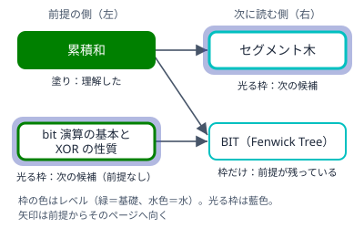
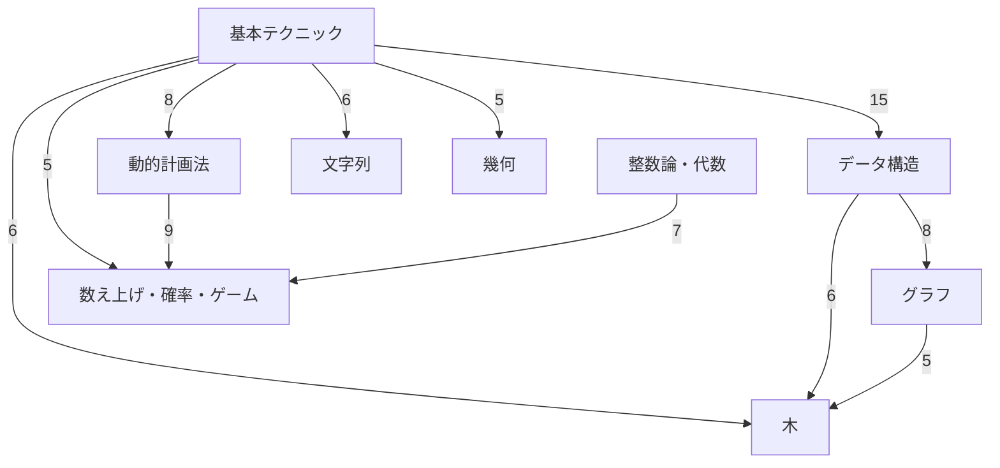

!!! abstract "要点"
    - **何のページか**：ページの前提関係を有向グラフで見て、選んだページの前提と次に読むページをたどれる。「理解した」ページと、直接の前提をすべて理解した次の候補を塗り分ける。
    - **使い方**：分野を選ぶと、その分野のページを前提の順に左から右へ並べて描く。ページの名前（略称でもよい）を入れるか、点を押して出る説明から「この点を中心に表示」を選ぶと、そのページの前提と次に読むページだけを描く。
    - **記録**：各ページの「理解した」のチェックを読み、理解したページを塗る。記録はこのブラウザの中だけにある。
    - **地図が出ないとき**：同じ内容はレベル別の一覧と、各ページの下の「前提」「次に読む」で見られる。

<!-- textlint-disable -->
別名：前提関係のグラフ・前提の地図・依存関係の地図
<!-- textlint-enable -->

知識マップは、各ページに書いた直接の前提を辺にした有向グラフである。辺は「前提 → そのページ」の向きに引き、ページの点を描く表示では前提の側を左、次に読む側を右に置く。全ページを 1 枚に描くと横長すぎて読めないので、分野ごと・選んだページの前後・分野どうしの全体の 3 通りに分けて描く。

## 地図の読み方 {#how-to-read}

地図の点は 1 つのページ、辺はそのページの直接の前提を表す。矢印は前提のページから、それを前提にするページへ向く。配置は辺の向きに沿って左から右へ段を作るので、左にあるページほど先に読む。

この図は地図の一部を写したものである（光る枠は実際の地図と同じ藍色で描いた）。[セグメント木](../ds/segment-tree.md)の直接の前提は[累積和](../basics/prefix-sum.md)だけで、[BIT](../ds/fenwick-tree.md)の直接の前提は累積和と [bit 演算の基本](../basics/bit-operations.md)の 2 つである。累積和だけを理解した状態では、セグメント木は次の候補として光るが、BIT は bit 演算の基本が残っているので光らない。

点の見た目は次の約束で決まる。

- **枠の色**：ページのレベル（AtCoder の色）。基礎は緑、水は水色、青は青、黄は黄、発展は橙で、レベルを持たないページ（案内・題材別など）は灰色の枠になる。
- **塗り**：そのページのレベルの「理解した」にチェックを付けた。
- **光る枠**：次の候補（[理解したページと次の候補](#progress)の条件を満たす）。
- **破線の枠**：ほかの分野のページ（分野ごとの表示で、その分野の前提として出てくる）。
- **「+青」などの印**：ページのレベルより上の帯の節がある。たとえば基礎の[答えで二分探索](../basics/binary-search-answer.md)には水と青の節があり、「答えで二分探索 +水青」と出る。

点を押す（タップする）か長押しすると、地図の中に題名・レベル・分野・要約を重ねて出し、「ページを開く」と「この点を中心に表示」を選べる。説明は、押した点を隠さないように地図の上か下の端に出て、右上の ×・Esc キー・地図の空いた所のどれかを押すまで残る。マウスを乗せただけでも説明は出るが、点から離れると消え、押して残した説明はほかの点にマウスを乗せても替わらない。点をダブルクリック（ダブルタップ）すると、そのページへ直接移る。本文がまだないページ（いまはない）には「（準備中）」と添える。

辺にするのは直接の前提だけである。前提の前提は辺をたどって見る。あると読みやすい関連のページ（front matter の related）は辺にせず配置にも使わない。関連まで辺にすると線が密になりすぎ、配置にも時間がかかるからである。関連は[選んだページの前後を描く表示](#focus)でだけ、選んだページの近くに薄く添える。

地図が画面より大きいときは、文字が読める倍率で、分野ごとの表示では左端（前提の側）から表示する。焦点の表示では、選んだページと関連の囲みが両方入るように寄せ、入らなければ倍率を少し下げる。全体の図は、いつも全体を収めて表示する。指かマウスで地図をずらして読み、全体の形を見たいときは「全体を収める」を押す。

## 分野ごとの表示 {#by-field}

分野ごとの表示は、地図を開いたときの既定の表示である。「分野」の欄で分野を選ぶと、その分野のページを前提の順に並べて描く。最初は基本テクニックの分野を出す。

分野ごとの表示には、その分野のページのほかに 2 種類の点が加わる。

- **破線の枠の点**：ほかの分野にある直接の前提。たとえばデータ構造の分野では、基本テクニックの累積和がセグメント木の前提として破線の枠で出る。
- **「→ 分野名」の点**：この分野のページを直接の前提にする、ほかの分野のページの数をまとめたもの。図の右端に並び、マウスを乗せるか長押しすると、元になったこの分野のページが光り、先のページの題名が出る。これも破線の枠（テーマの色）で描き、中に「N ページ」と出る。押すとその分野の表示に移る。

地図の上の行には、分野の名前・ページ数・理解した数・次の候補の数が出る。表示を切り替えるとアドレスの末尾が `?field=<分野の id>` に変わるので、ブックマークすれば同じ分野から始められる。分野の id は `basics`（基本テクニック）・`dp`（動的計画法）・`graph`（グラフ）・`ds`（データ構造）などで、各分野の入口の URL の名前と同じである。

## 全体の図 {#overview}

全体の図は、分野を点にした図である。「全体（分野）」を押すと出る（アドレスは `?view=all`）。15 の分野が点になり、点の中に分野の名前と「理解 2 / 30」のような数が出る。数は、その分野のレベルを持つページのうち理解したページの数と、レベルを持つページの数である。レベルを持たないページだけの分野（はじめに・横断ページ・題材別）は、ページ数を出す。ページの点を描く表示と違い、全体の図は前提の分野を上、それを受ける分野を下に置く。

辺は分野をまたぐ前提の数をまとめたもので、本数が多いほど太い。1 本だけの辺は薄く描く。辺にマウスを乗せると本数が出る。分野の点を押すと、その分野の表示に移る。

次の図は、2026-10-22 の時点で分野をまたぐ前提を数え、5 本以上ある組だけを描いたものである（数は地図のデータから数えた値で、ページを足すと変わる）。

図から読める流れは次のとおりである。

- 基本テクニックはほとんどの分野の出発点で、特にデータ構造へ多くの前提が出る（累積和から BIT・セグメント木など）。
- 木は基本テクニック・データ構造・グラフの 3 つから前提を受ける合流点である。
- 数え上げ・確率・ゲームは、動的計画法と整数論・代数の両方を前提にする。

## 選んだページの前提と次に読むページ {#focus}

選んだページを中心にした表示（焦点の表示）は、そのページの祖先と子孫だけを描く。祖先は前提を左へたどって届くページのすべて、子孫はそのページを前提にするページを右へたどって届くページである。分野をまたいでたどるので、1 つのページを読むのに何が要るかを分野の区切りなしに見られる。

焦点の表示は次の 3 通りで開く。

- 各ページの下にある「知識マップでこのページの前後を見る」を押す。次に読むページが 9 件以上あるときは「ほか N ページは知識マップで見る」から開く。
- 地図の上の「ページ」の欄に題名か別名（「セグ木」「LIS」「CHT」のような略称や英語名）を入れる。名前の一部でもよい。
- 点を押して出る説明の「この点を中心に表示」を押す。

「ページ」の欄は、大文字と小文字・全角と半角・カタカナとひらがな・空白の有無の違いを問わずに名前を比べる。題名・別名がそのまま一致するページ、名前の頭が一致するページ、名前の一部に含むページの順に選び、同じ順位のページが複数あれば、当たった名前が短いもの、よく出るもの、レベルの低いものを先にする。選ばれなかった候補は、地図の上の行にボタンで並ぶ。

選んだページは太い枠で描き、地図の上の行に祖先と子孫の数が出る。子孫が 80 ページを超えるときは、たどる深さを 1〜3 段に絞って始める。「次に読むの深さ」の欄で 1・2・3・すべてを選び直せる。祖先は深さを絞らず、いつもすべて描く。アドレスは `?focus=<ページの id>`（深さを絞ったときは `&depth=<段数>` も付く）になる。

選んだページの関連（related）は、配置を決めた後で選んだページのすぐ下（空いていなければ上）の「関連」の囲みに点線の枠で添え、矢印のない破線でつなぐ。関連は読む順序を決めないので、前提の流れとは別に見る。「解除」を押すと、選んだページの分野の表示に戻る。

焦点の表示は、上の帯のページを読む前の準備に使える。たとえば黄のページを選ぶと、その祖先のうち塗られていない点が、まだ理解していない前提である。塗られていない点のうち、レベルを持つ（枠に色のある）ものの最も左から読めば、前提を飛ばさずに進める。

## 理解したページと次の候補 {#progress}

地図の塗りと光る枠は、各ページの「理解した」のチェックから決まる。チェック欄はページの上と下にあり、ページのレベルと、上の帯の節のレベルの数だけ並ぶ（たとえば「答えで二分探索」には基礎・水・青の 3 つがある）。

- **理解した（塗り）**：ページ自身のレベルにチェックを付けたページである。上の帯の節のチェックは塗りに使わない。
- **次の候補（光る枠）**：レベルを持つページで、まだ理解しておらず、直接の前提のうちレベルを持つページをすべて理解したものである。

直接の前提がないページは、最初から次の候補として光る。地図を初めて開いたときに光っているのは、前提のない基礎のページなどである。理解したページが増えると、その先のページが順に光っていく。

レベルを持たないページ（案内・題材別・使い分けなど）には、塗りと光る枠のどちらも付かない。ほかのページの前提になっている場合でも、次の候補の条件からは外す。

次の候補は直接の前提だけを見て決める。直接の前提をすべて理解していれば、その前提の前提は理解済みとみなす。前提の前提を飛ばしてチェックを付けた場合は、焦点の表示で祖先に塗られていない点がないかを確かめるとよい。

「理解した」の記録は、このブラウザの localStorage に保存する。同じブラウザのほかのタブで付けたチェックも、地図に直ちに反映する。端末どうしの同期はしないので、別の端末へ移すときや記録を退避するときは、[使い方](../start/how-to-use.md#backup)の書き出しと読み込みを使う。色ごとの理解した数と解いた数の集計は[ロードマップの解いた数・理解した数](roadmap.md#progress)に出る。

## 表で見る {#as-table}

地図と同じ前提関係は、表と各ページの欄でも見られる。JS が動かない環境や、claude.ai がページを読む場合は、地図は描かれないのでこちらを使う。

| 知りたいこと | 見る場所 |
| --- | --- |
| 色ごとに要るページ | レベル別の一覧（[基礎](../lists/level-basic.md)・[水](../lists/level-cyan.md)・[青](../lists/level-blue.md)・[黄](../lists/level-yellow.md)・[発展](../lists/level-advanced.md)）。下のレベルのページの中にある上の帯の節は、各一覧の最後の表にある |
| 色ごとに読む順 | [ロードマップの色ごとのページの列](roadmap.md#reading-order)（前提の順に並ぶ） |
| 分野のページの並び | 各分野の入口（[基本テクニック](../basics/index.md)・[データ構造](../ds/index.md)など） |
| 1 つのページの前後 | 各ページの下の「前提」「次に読む」。次に読むは同じレベルと 1 つ上のレベルを優先して 8 件まで出す |

ページの名前から引くときは[用語の索引](term-index.md)、問題のサインから引くときは[逆引き辞典](reverse-index-signs.md)を使う。

## 確認問題 {#quiz}

??? question "確認問題：累積和と bit 演算の基本を理解し、BIT にはまだチェックを付けていない。BIT は光るか"
    光る。BIT の直接の前提は累積和と bit 演算の基本の 2 つで、どちらもレベルを持ち、どちらも理解しているからである。BIT 自身は理解していないので、塗りではなく光る枠になる。

??? question "確認問題：答えで二分探索の青のチェックだけを付けた。地図でこのページは塗られるか"
    塗られない。塗りに使うのはページ自身のレベル（基礎）のチェックだけで、上の帯の節（水・青）のチェックは使わない。基礎のチェックも付ければ塗られる。

??? question "確認問題：累積和にはチェックを付けず、bit 演算の基本と BIT にだけチェックを付けた。焦点の表示で BIT を選ぶと、どの点が塗られ、どの点が光るか"
    bit 演算の基本と BIT が塗られ、累積和が光る。累積和は直接の前提のない基礎のページで、理解していないので次の候補になる。BIT は理解したので光らない。次の候補は直接の前提だけを見るので、BIT の前提が残っていることは、祖先に塗られていない点があることで気づく。

## 参考 {#references}

- [Cytoscape.js](https://js.cytoscape.org/)：地図の描画に使うライブラリ
- [cytoscape.js-dagre](https://github.com/cytoscape/cytoscape.js-dagre)：前提の向きに沿って左から右へ段を作る配置
