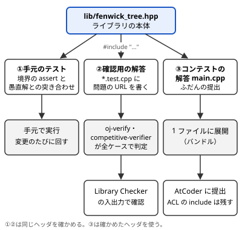

!!! abstract "要点"
    - **何ができるか**：自作のライブラリを何から作り、どんな約束（0-indexed・半開区間・assert）で書くかがわかる。提出用の展開と、正しさを確かめる問題と手順もわかる。
    - **使い方**：作る順は[何を自作するか](#what-to-build)、書き方は[インターフェースの決め方](#interface)と[ヘッダの書き方](#headers)、確かめ方は[不変条件と境界のテスト](#tests)と[動作確認の手順](#verify)を引く。各ページの Library Checker の問題は[ページ → 確認用の問題](#verify-table)の表にある。
    - **計算量**：自作の部品の計算量は ACL の同じ部品にそろえる。手元のテストは小さい $n$ の乱数で数千回、確認用の問題は Library Checker の全ケースで回す。
    - **関連**：C++ の[雛形と展開](../cpp/cpp-macros-template-file.md#bundling)と[ACL の読み方](../cpp/acl-reading.md#conventions)

<!-- textlint-disable -->
別名：ライブラリ整備・自作ライブラリ・Library Checker・verify・ライブラリの動作確認・ライブラリチェッカー
<!-- textlint-enable -->

自作ライブラリの設計と動作確認は、コンテストで何度も書く部品をヘッダにまとめ、正しいと確かめてから使うまでの流れである。手法そのものの説明は各ページにあり、ここでは部品にするときの約束と確かめ方だけを書く。流れの全体は次の図のとおりで、1 つのヘッダを手元のテストと確認用の問題の両方で確かめ、確かめたヘッダをコンテストの解答から使う。



手元のテストと確認用の解答は、どちらもヘッダを書き換えるたびに回して正しさを確かめる。コンテストの解答だけは提出前に 1 つのファイルへ展開するので、確かめたヘッダがそのまま提出に入る。

## 何を自作するか {#what-to-build}

自作の部品は、ACL にあるものも含めて作り直してよい。ACL を読むだけでは、不変条件や境界の扱いが手に残らない。自分で書いて確かめた部品なら、問題に合わせて中身を変えられる（区間の長さを持たせる、二分探索を足すなど）。

作る順は、使う回数が多く、短く書けるものからにする。次の表は目安で、上の段から順に作る。ただし作り始めるのは、下の「作り始める合図」が来てからである。表は、書く機会が来た部品のうち、どれからヘッダにするかを決める目安である。

| 段階 | 部品 | 手法のページ |
| --- | --- | --- |
| 1：ACL にあり短い | Union-Find、BIT、modint | [Union-Find](../ds/union-find.md#invariants)、[BIT](../ds/fenwick-tree.md#invariants)、[modint](../math/modint.md#self-made) |
| 2：ACL にない定番 | 二項係数の表、ダイクストラ法、座標圧縮、エラトステネスの篩 | [二項係数](../comb/binomial-coefficient.md#pascal)、[ダイクストラ法](../graph/dijkstra.md#skip-stale)、[座標圧縮](../basics/coordinate-compression.md)、[篩](../math/sieve-eratosthenes.md) |
| 3：区間と木 | セグメント木、遅延セグメント木、Sparse Table、LCA | [セグメント木](../ds/segment-tree.md#invariants)、[遅延セグメント木](../ds/lazy-segment-tree.md#invariants)、[Sparse Table](../ds/sparse-table.md#build)、[LCA](../tree/lca.md#jump) |
| 4：重い部品 | 重み付き Union-Find、ローリングハッシュ、行列累乗、SCC、畳み込み | [重み付き Union-Find](../ds/weighted-union-find.md)、[ローリングハッシュ](../string/rolling-hash.md#recommended-design)、[行列累乗](../math/matrix-power.md)、[SCC](../graph/scc.md)、[畳み込み](../math/convolution-ntt.md) |

- **作り始める合図**：同じ部品を 2 回以上コンテストで書いたら、ヘッダにする。使ったことのない部品を先回りして作らない
- **一般化しすぎない**：まず 1 つの用途（区間和の BIT など）で書いて確かめ、2 つ目の用途が出たときにテンプレート引数へ広げる。使わない機能は確かめる手間だけが増える
- **ACL と並べて使う**：自作が確かめ終わるまでは ACL を使ってよい。インターフェースを ACL にそろえておけば（[次の節](#interface)）、後から差し替えても呼び出し側が変わらない

## インターフェースの決め方 {#interface}

インターフェースは ACL を手本にする。ACL の約束は [ACL の読み方](../cpp/acl-reading.md#conventions)にまとまっていて、自作の部品も同じ約束にすると、ACL から乗り換えるときに呼び出し側を直さずに済む。次の 5 つをそろえる。

1. **添字は 0-indexed、区間は[半開区間](../guide/glossary.md#half-open-interval) $[l, r)$**：`sum(l, r)` が表すのは $l$ 番目から $r - 1$ 番目まで。`l == r` は空区間で、和なら 0、一般には[単位元](../guide/glossary.md#identity-element)を返す。問題文の 1-indexed の閉区間 $[L, R]$ を、呼び出し側で `(L - 1, R)` に直す
2. **コンストラクタに `explicit` を付ける**：`fenwick_tree<long long> fw = 5;` のような書き方をエラーにして、長さと値を取り違えないようにする（[explicit](../cpp/acl-reading.md#explicit)）。引数のないコンストラクタも用意すると、グローバル変数に置いて入力の後で `fw = fenwick_tree<long long>(n);` と代入できる
3. **前提を `assert` で確かめる**：範囲外の添字・`l > r` などを関数の入口で止める。AtCoder は `NDEBUG` を定義しないので、違反は誤った値ではなく RE になり、原因を探しやすい
4. **演算はテンプレート引数で渡す**：セグメント木のように載せる演算が問題ごとに変わる部品は、要素の型 `S`・[結合法則](../guide/glossary.md#associativity)を満たす演算 `op`・単位元 `e` を引数にする。ACL の `segtree<S, op, e>` と同じ形である（[segtree の引数](../cpp/acl-reading.md#segtree-args)）。何を載せるかの決め方は[セグメント木に何を載せるか](../ds/segment-tree-monoids.md#design-steps)にある
5. **制約と計算量を書いておく**：ACL のドキュメントは関数ごとに「制約」と「計算量」を書いている。自作の部品も、関数の上のコメントに同じ 2 つを書く。制約は `assert` の条件と一致させる

次は BIT をこの約束で書いた例である。名前空間 `mylib` に入れ、制約をコメントと `assert` の両方に書いた。先頭の `#pragma once` と標準ヘッダの include は[次の節](#headers)の規則のとおりである（`#pragma once` は、このコード片を 1 ファイルで動かすためコメントにした）。

```cpp
--8<-- "library-design/fenwick-tests.cpp:header"
```

- **ACL の工夫**：ACL の `fenwick_tree` は、中の配列を符号なし整数（`T = long long` なら `unsigned long long`）で持って足している。符号なし整数のあふれは $2^{64}$ を法とした値になり、[未定義動作](../guide/glossary.md#undefined-behavior)にならない。途中の和があふれても、最後の差が `long long` に収まれば正しい値が返る
- **名前**：メンバ関数の名前（`add`・`sum`・`prod`・`merge`・`same`）も ACL にそろえると、解説コードと読み比べやすい

## ヘッダの書き方 {#headers}

ライブラリは部品ごとに 1 つのヘッダ（`.hpp`）にし、コンテストの解答から `#include` で読む。置き場は次のような形にすると、[動作確認](#verify)の道具がそのまま使える。

```text
library/
  lib/
    fenwick_tree.hpp      # 本体（部品ごとに 1 つ）
    segtree.hpp
  test/
    fenwick_tree.unit.cpp            # 手元のテスト（境界・突き合わせ）
    point_add_range_sum.test.cpp     # 確認用の解答（Library Checker の問題）
```

ヘッダでは次の 5 つを守る。

- **先頭に `#pragma once`**：同じヘッダを 2 回読んでも中身が 1 回だけになる。展開の道具（[バンドル](#bundling)）も、これを手がかりに同じファイルを 1 回だけ展開する。oj-bundle は、1 行目に `#pragma once` を書いたヘッダなら確実に 1 回だけ展開する。インクルードガード（`#ifndef` の組）はガードの外に行があるとエラーになり、`#pragma once` も 1 行目以外に書くとエラーになる。そこで 1 行目の `#pragma once` にそろえる
- **名前空間に入れる**：`namespace mylib { … }` で囲む。解答の側の `using namespace std;` や ACL の名前とぶつからない。グローバルに `count` などを置くとエラーになる理由は[名前の衝突](../cpp/cpp-macros-template-file.md#namespaces)にある。補助の関数は `mylib::internal` のような内側の名前空間に入れると、使う側の名前を汚さない（ACL は `atcoder::internal`）
- **ヘッダの中で `using namespace std;` とマクロを書かない**：展開した後のファイル全体に効いてしまう。ヘッダの中では `std::vector` と `std::` を付けて書く。`rep` などのマクロは解答の雛形の側に置く（[マクロ](../cpp/cpp-macros-template-file.md#macros)）
- **使う標準ヘッダを自分で include する**：`<vector>`・`<cassert>` など、そのヘッダが使うものを書く。解答の側の `#include <bits/stdc++.h>` に頼ると、テストのファイルだけをコンパイルしたときに通らない
- **自作のヘッダは `#include "..."`（二重引用符）で読む**：展開の道具の多くは二重引用符の include だけを展開し、山括弧 `<...>` は標準ライブラリか ACL として残す。自作のヘッダを山括弧で書くと展開されずに残り、ジャッジで `No such file or directory` になる

cph の改造版の展開を使い、目印 `// @impl` でヘッダを分けるなら、さらに目印の位置に気をつける。この展開は目印より下を `main` の後ろへ回すので、戻り値が `auto` の関数、定数式で使う `constexpr` 関数、クラスの定義は目印より上に置く（[@impl](../cpp/cpp-macros-template-file.md#impl-marker)）。

## 提出用に 1 ファイルに展開する {#bundling}

ジャッジに出せるのは 1 ファイルだけである。`#include "lib/fenwick_tree.hpp"` を含む解答は、提出の前にヘッダの中身で置き換えた 1 ファイルにする。展開の手順（再帰的に置き換える・同じファイルを 1 回だけ・山括弧を残す）と道具（cph の改造版・ACL の `expander.py`・oj-bundle）の違いは、[自作のヘッダを展開する](../cpp/cpp-macros-template-file.md#bundling)と[展開の道具](../cpp/cpp-macros-template-file.md#bundling-tools)にある。

ライブラリを作る側で気をつけるのは、展開が壊れない書き方にすることである。

- [ヘッダの書き方](#headers)の `#pragma once`・二重引用符の include・ヘッダの中にマクロを置かない、の 3 つを守る
- oj-bundle は `#ifdef LOCAL` などの条件の中の `#include "..."` をエラーにする。デバッグ用のヘッダを条件つきで読むなら、展開に使う道具がそれを扱えるかを先に確かめる
- AtCoder には ACL が入っているので、`#include <atcoder/…>` は展開しないで残す。Library Checker の C++ にも ACL が入っているので、確認用の解答でも同じでよい。ACL のないジャッジに出すときは、ACL も `expander.py` で展開する
- 展開した後のファイルを手元で一度コンパイルしてから提出する。同じ名前の関数が 2 つのヘッダにあるなどの衝突は、展開した後に初めて見つかる

## 不変条件と境界のテスト {#tests}

部品を書いたら、確認用の問題に出す前の段階で、手元でテストする。確認用の問題が教えるのは「どこかで間違えている」ことだけで、手元のテストなら失敗した入力をその場で見られる。確かめるのは次の 2 種類である。

**境界を手で書いて確かめる**。バグの多くは端で起きる。部品ごとに次を `assert` で確かめる。

- **長さ 0 と 1**：作れるか。空区間 `sum(0, 0)` が単位元を返すか。ACL の BIT・セグメント木は長さ 0 を許す
- **空区間**：`l == r` が途中の位置（`sum(2, 2)`）でも単位元になるか
- **端の添字**：先頭の 0 と末尾の $n - 1$、区間の終わりの $n$
- **単位元**：演算をテンプレート引数で渡す部品は、`op(e(), x) == x` と `op(x, e()) == x` を、使う `x` の範囲で確かめる
- **あふれ**：要素が $10^9$ のとき、和が `int` の上限（約 $2.1 \times 10^9$）を超えても正しいか。modint なら負の数・0・法と等しい値・$10^{18}$ 近い値
- **負の値**：符号なし整数や `%` を使う部品は、負の値を入れたときに正しいか

```cpp
--8<-- "library-design/fenwick-tests.cpp:boundary"
```

**愚直解と乱数で突き合わせる**。境界を書き尽くしても、思いつかない入力は残る。そこで、配列をそのまま持つ愚直な実装と、乱数で作った操作の列で結果を比べる。長さは 0 を含む小さい値（0〜8 など）にすると、端の場合が何度も出る。乱数の種を固定しておけば、失敗した回を同じ入力で再現できる。

```cpp
--8<-- "library-design/fenwick-tests.cpp:stress"
```

突き合わせの考え方（愚直解の作り方・失敗した入力の縮め方）は、コンテスト中の WA を探すときと同じで、[愚直解との比較](../guide/stress-testing.md#procedure)にまとめている。

- **保つ性質を確かめる**：データ構造のページの「保つ性質」（[BIT](../ds/fenwick-tree.md#invariants)・[セグメント木](../ds/segment-tree.md#invariants)・[Union-Find](../ds/union-find.md#invariants)）は、テストの中で直接確かめられることが多い。Union-Find なら、`merge` のたびに、代表元（`leader(v) == v` の頂点 $v$）の `size` の合計が $n$ のままかを見る
- **assert を外さない**：テストは `-DNDEBUG` を付けずにコンパイルする。付けると、範囲外の呼び出しが止まらずに誤った値を返す
- **サニタイザを併用する**：`-fsanitize=address,undefined` を付けて回すと、範囲外の読み書きと符号付き整数のあふれも見つかる（[見つける道具](../cpp/cpp-undefined-behavior.md#detection-tools)）

## 動作確認の手順 {#verify}

手元のテストが通ったら、ジャッジの問題で確かめる。ジャッジのテストケースには最大の制約と意地の悪い入力が入っているので、正しさに加えて速さも確かめられる。おもな確認先は次の 2 つである。

- **Library Checker**（judge.yosupo.jp）：ライブラリの確認のための問題集で、入出力の形が単純である。2026-10-22 に問題の分類の一覧（GitHub の categories.toml）を数えると、一覧に載る問題は 14 の分類で 235 問あった。多い分類は Data Structure 43・Graph 36・Polynomial 26・Number Theory 22・Tree 20 で、235 問には動作確認の練習用の Sample 3 問を含む。一覧に載らない問題もリポジトリにあり、問題の総数はこれより多い。各ページの問題は[ページ → 確認用の問題](#verify-table)の表にある
- **AtCoder Library Practice Contest**（practice2）：ACL の部品の名前（Disjoint Set Union・Fenwick Tree・Segment Tree など）を題にした 12 問（A〜L）がある。ACL と同じ部品を自作したときの確認に向く。各問題とページの対応は[問題集の案内](../guide/problem-sets.md#problem-sets-practice2)で引く

手順は次のとおりである。

1. **問題を選ぶ**：[表](#verify-table)から、部品の手法のページの行を探す。BIT なら `point_add_range_sum`、セグメント木なら非可換の演算も確かめられる `point_set_range_composite` である
2. **確認用の解答を書く**：問題の入力を読み、自作のヘッダだけを使って答える。Library Checker の問題文は多くが 0-indexed・半開区間なので、ACL にそろえた部品はそのまま使える
3. **提出するか、道具で全ケースを回す**：サイトで提出して判定を受けてもよい。テストケースは問題のリポジトリ（library-checker-problems）の `generate.py` で手元に作れる（例：`./generate.py -p unionfind`）
4. **ヘッダを直したら回し直す**：一度通った部品も、直した後に確かめ直す。次の道具を使うと、これを自動にできる

自動にする道具は 2 つある。どちらも、確認用の解答に問題の URL を書いておくと、テストケースを取ってきて全ケースで判定する。

- **oj-verify**（online-judge-verify-helper）：拡張子の前に `.test` を付けたファイル（`point_add_range_sum.test.cpp`）を確認用の解答とみなす。ファイルの先頭に `#define PROBLEM "URL"` を書き、`oj-verify run` で回す。おもに Library Checker と Aizu Online Judge の問題に対応している
- **competitive-verifier**：oj-verify の流れをくむ道具で、`// competitive-verifier: PROBLEM URL` の形のコメントで問題を指定する。互換のために `#define PROBLEM` も読めるが、非推奨である。`competitive-verifier migrate` で oj-verify の形から移せる。GitHub Actions で回し、確認の結果をつけたドキュメントのサイトを作れる

次は oj-verify で回す確認用の解答の例である。1 行目の `PROBLEM` が問題の URL で、ライブラリは実際には `#include "../lib/fenwick_tree.hpp"` の 1 行で読む。2 つのコード片の間には、この 1 行の代わりにヘッダの中身が入っている（動かすため 1 ファイルにした）。

```cpp
--8<-- "library-design/verify-test.cpp:head"
```

```cpp
--8<-- "library-design/verify-test.cpp:core"
```

- **確認できないもの**：Library Checker の問題は部品の典型の使い方を確かめる。問題に合わせて中身を変えた版（区間の長さを持たせたなど）は、手元のテストで確かめ直す
- **入出力の速さ**：入力が $5 \times 10^5$ 行を超える問題もある。`cin` を使うなら `ios::sync_with_stdio(false);` と `cin.tie(nullptr);` を書く。部品が速くても入出力で TLE になることがある

## ページ → 確認用の問題 {#verify-table}

次の表は、手法のページごとに、自作の部品の確認に使える Library Checker の問題を並べたものである。各ページの front matter の `verify` から作っているので、ページが増えると表も増える。問題名は judge.yosupo.jp の URL の末尾と同じで、リンクから問題文に行ける。

- **読み方**：1 つのページに問題が複数あるときは、確かめられる使い方がそれぞれ違う。たとえば遅延セグメント木の `range_affine_range_sum` は区間のアフィン変換と区間和、`range_add_range_min` は区間加算と区間最小値で、載せる演算の違う 2 種類を確かめられる
- **同じ問題が複数のページにある**：`point_set_range_composite` はセグメント木と動的 DP の両方の行にある。非可換の演算（1 次関数の合成）を載せるので、演算の左右を取り違えたバグが出る
- **表にない部品**：Library Checker の問題一覧から、入出力の形が近いものを探す。見つからなければ、[不変条件と境界のテスト](#tests)の突き合わせだけで確かめる

<!-- gen:begin verify-table -->
<!-- textlint-disable -->

| ページ | 分野 | Library Checker の問題 |
| --- | --- | --- |
| [最長増加部分列](../dp/lis.md) | 動的計画法 | [longest_increasing_subsequence](https://judge.yosupo.jp/problem/longest_increasing_subsequence) |
| [動的 DP](../dp/dynamic-dp.md) | 動的計画法 | [point_set_range_composite](https://judge.yosupo.jp/problem/point_set_range_composite) |
| [Convex Hull Trick と Li Chao Tree](../dp/cht.md) | 動的計画法 | [line_add_get_min](https://judge.yosupo.jp/problem/line_add_get_min)、[segment_add_get_min](https://judge.yosupo.jp/problem/segment_add_get_min) |
| [Monge 性による DP の高速化](../dp/monge.md) | 動的計画法 | [min_plus_convolution_convex_arbitrary](https://judge.yosupo.jp/problem/min_plus_convolution_convex_arbitrary)、[min_plus_convolution_convex_convex](https://judge.yosupo.jp/problem/min_plus_convolution_convex_convex) |
| [閉路の検出と復元](../graph/cycle-detection.md) | グラフ | [cycle_detection](https://judge.yosupo.jp/problem/cycle_detection)、[cycle_detection_undirected](https://judge.yosupo.jp/problem/cycle_detection_undirected) |
| [彩色数・最大独立集合・最大クリーク](../graph/chromatic-number.md) | グラフ | [chromatic_number](https://judge.yosupo.jp/problem/chromatic_number)、[maximum_independent_set](https://judge.yosupo.jp/problem/maximum_independent_set) |
| [ダイクストラ法](../graph/dijkstra.md) | グラフ | [shortest_path](https://judge.yosupo.jp/problem/shortest_path) |
| [補グラフ上の BFS](../graph/complement-graph-bfs.md) | グラフ | [connected_components_of_complement_graph](https://judge.yosupo.jp/problem/connected_components_of_complement_graph) |
| [K 番目の最短路](../graph/k-shortest-paths.md) | グラフ | [k_shortest_walk](https://judge.yosupo.jp/problem/k_shortest_walk) |
| [最小シュタイナー木](../graph/steiner-tree.md) | グラフ | [minimum_steiner_tree](https://judge.yosupo.jp/problem/minimum_steiner_tree) |
| [強連結成分分解（SCC）](../graph/scc.md) | グラフ | [scc](https://judge.yosupo.jp/problem/scc) |
| [2-SAT](../graph/two-sat.md) | グラフ | [two_sat](https://judge.yosupo.jp/problem/two_sat) |
| [最小全域木](../graph/minimum-spanning-tree.md) | グラフ | [minimum_spanning_tree](https://judge.yosupo.jp/problem/minimum_spanning_tree) |
| [橋・関節点・二重連結成分](../graph/lowlink.md) | グラフ | [two_edge_connected_components](https://judge.yosupo.jp/problem/two_edge_connected_components)、[biconnected_components](https://judge.yosupo.jp/problem/biconnected_components) |
| [特殊な最小全域木](../graph/spanning-tree-advanced.md) | グラフ | [directedmst](https://judge.yosupo.jp/problem/directedmst)、[manhattanmst](https://judge.yosupo.jp/problem/manhattanmst) |
| [行列木定理](../graph/matrix-tree-theorem.md) | グラフ | [counting_spanning_tree_undirected](https://judge.yosupo.jp/problem/counting_spanning_tree_undirected)、[counting_spanning_tree_directed](https://judge.yosupo.jp/problem/counting_spanning_tree_directed) |
| [次数による平方分割](../graph/degree-sqrt.md) | グラフ | [enumerate_triangles](https://judge.yosupo.jp/problem/enumerate_triangles)、[counting_c4](https://judge.yosupo.jp/problem/counting_c4) |
| [オイラー路（一筆書き）](../graph/euler-path.md) | グラフ | [eulerian_trail_directed](https://judge.yosupo.jp/problem/eulerian_trail_directed)、[eulerian_trail_undirected](https://judge.yosupo.jp/problem/eulerian_trail_undirected) |
| [二部マッチング](../graph/bipartite-matching.md) | グラフ | [bipartitematching](https://judge.yosupo.jp/problem/bipartitematching) |
| [最小費用流](../graph/min-cost-flow.md) | グラフ | [min_cost_b_flow](https://judge.yosupo.jp/problem/min_cost_b_flow)、[assignment](https://judge.yosupo.jp/problem/assignment) |
| [一般グラフのマッチング](../graph/general-matching.md) | グラフ | [general_matching](https://judge.yosupo.jp/problem/general_matching)、[general_weighted_matching](https://judge.yosupo.jp/problem/general_weighted_matching) |
| [木の直径と最遠点](../tree/tree-diameter.md) | 木 | [tree_diameter](https://judge.yosupo.jp/problem/tree_diameter) |
| [木の同型判定と木のハッシュ](../tree/tree-isomorphism.md) | 木 | [rooted_tree_isomorphism_classification](https://judge.yosupo.jp/problem/rooted_tree_isomorphism_classification) |
| [最小共通祖先（LCA）](../tree/lca.md) | 木 | [lca](https://judge.yosupo.jp/problem/lca) |
| [木の上のパスの判定と分解](../tree/tree-path.md) | 木 | [jump_on_tree](https://judge.yosupo.jp/problem/jump_on_tree) |
| [オイラーツアー](../tree/euler-tour.md) | 木 | [vertex_add_subtree_sum](https://judge.yosupo.jp/problem/vertex_add_subtree_sum) |
| [HL 分解](../tree/hld.md) | 木 | [vertex_set_path_composite](https://judge.yosupo.jp/problem/vertex_set_path_composite) |
| [Static Top Tree と木 DP の動的更新](../tree/static-top-tree.md) | 木 | [point_set_tree_path_composite_sum](https://judge.yosupo.jp/problem/point_set_tree_path_composite_sum) |
| [動的木](../tree/dynamic-tree.md) | 木 | [dynamic_tree_vertex_add_path_sum](https://judge.yosupo.jp/problem/dynamic_tree_vertex_add_path_sum) |
| [重心分解](../tree/centroid-decomposition.md) | 木 | [frequency_table_of_tree_distance](https://judge.yosupo.jp/problem/frequency_table_of_tree_distance) |
| [比で親に併合する貪欲](../tree/tree-ratio-greedy.md) | 木 | [rooted_tree_topological_order_with_minimum_inversions](https://judge.yosupo.jp/problem/rooted_tree_topological_order_with_minimum_inversions) |
| [STL コンテナの使い分け](../ds/stl-containers.md) | データ構造 | [associative_array](https://judge.yosupo.jp/problem/associative_array) |
| [set・multiset・map の応用](../ds/ordered-set.md) | データ構造 | [predecessor_problem](https://judge.yosupo.jp/problem/predecessor_problem)、[double_ended_priority_queue](https://judge.yosupo.jp/problem/double_ended_priority_queue) |
| [単調スタックとスライド最小値](../ds/monotonic-stack.md) | データ構造 | [queue_operate_all_composite](https://judge.yosupo.jp/problem/queue_operate_all_composite)、[deque_operate_all_composite](https://judge.yosupo.jp/problem/deque_operate_all_composite) |
| [Union-Find](../ds/union-find.md) | データ構造 | [unionfind](https://judge.yosupo.jp/problem/unionfind) |
| [重み付き Union-Find](../ds/weighted-union-find.md) | データ構造 | [unionfind_with_potential](https://judge.yosupo.jp/problem/unionfind_with_potential)、[unionfind_with_potential_non_commutative_group](https://judge.yosupo.jp/problem/unionfind_with_potential_non_commutative_group) |
| [ロールバックできる Union-Find](../ds/rollback-union-find.md) | データ構造 | [dynamic_graph_vertex_add_component_sum](https://judge.yosupo.jp/problem/dynamic_graph_vertex_add_component_sum) |
| [BIT（Fenwick Tree）](../ds/fenwick-tree.md) | データ構造 | [point_add_range_sum](https://judge.yosupo.jp/problem/point_add_range_sum)、[static_range_sum](https://judge.yosupo.jp/problem/static_range_sum) |
| [K 番目の値を求めるデータ構造](../ds/kth-element.md) | データ構造 | [ordered_set](https://judge.yosupo.jp/problem/ordered_set) |
| [セグメント木](../ds/segment-tree.md) | データ構造 | [point_set_range_composite](https://judge.yosupo.jp/problem/point_set_range_composite) |
| [値を添字にする BIT・セグメント木](../ds/segment-tree-on-values.md) | データ構造 | [point_set_range_composite_large_array](https://judge.yosupo.jp/problem/point_set_range_composite_large_array) |
| [遅延セグメント木](../ds/lazy-segment-tree.md) | データ構造 | [range_affine_range_sum](https://judge.yosupo.jp/problem/range_affine_range_sum)、[range_add_range_min](https://judge.yosupo.jp/problem/range_add_range_min)、[range_affine_point_get](https://judge.yosupo.jp/problem/range_affine_point_get) |
| [遅延セグメント木の載せ方の型](../ds/lazy-segment-tree-patterns.md) | データ構造 | [range_set_range_composite](https://judge.yosupo.jp/problem/range_set_range_composite) |
| [Sparse Table](../ds/sparse-table.md) | データ構造 | [staticrmq](https://judge.yosupo.jp/problem/staticrmq) |
| [Segment Tree Beats](../ds/segment-tree-beats.md) | データ構造 | [range_chmin_chmax_add_range_sum](https://judge.yosupo.jp/problem/range_chmin_chmax_add_range_sum) |
| [クエリの先読み](../ds/offline-queries.md) | データ構造 | [static_range_count_distinct](https://judge.yosupo.jp/problem/static_range_count_distinct)、[static_range_frequency](https://judge.yosupo.jp/problem/static_range_frequency) |
| [平面走査](../ds/sweep-line-2d.md) | データ構造 | [rectangle_sum](https://judge.yosupo.jp/problem/rectangle_sum)、[area_of_union_of_rectangles](https://judge.yosupo.jp/problem/area_of_union_of_rectangles) |
| [Mo's algorithm](../ds/mo-algorithm.md) | データ構造 | [static_range_inversions_query](https://judge.yosupo.jp/problem/static_range_inversions_query) |
| [平方分割](../ds/sqrt-decomposition.md) | データ構造 | [static_range_mode_query](https://judge.yosupo.jp/problem/static_range_mode_query) |
| [CDQ 分割統治](../ds/cdq-divide-and-conquer.md) | データ構造 | [point_add_rectangle_sum](https://judge.yosupo.jp/problem/point_add_rectangle_sum) |
| [永続データ構造](../ds/persistent-data-structures.md) | データ構造 | [persistent_queue](https://judge.yosupo.jp/problem/persistent_queue)、[persistent_range_affine_range_sum](https://judge.yosupo.jp/problem/persistent_range_affine_range_sum) |
| [マージソート木](../ds/merge-sort-tree.md) | データ構造 | [static_range_sum_with_upper_bound](https://judge.yosupo.jp/problem/static_range_sum_with_upper_bound) |
| [Wavelet Matrix](../ds/wavelet-matrix.md) | データ構造 | [range_kth_smallest](https://judge.yosupo.jp/problem/range_kth_smallest) |
| [Binary Trie](../ds/binary-trie.md) | データ構造 | [set_xor_min](https://judge.yosupo.jp/problem/set_xor_min) |
| [平衡二分探索木と pb_ds の tree](../ds/balanced-bst.md) | データ構造 | [range_reverse_range_sum](https://judge.yosupo.jp/problem/range_reverse_range_sum)、[dynamic_sequence_range_affine_range_sum](https://judge.yosupo.jp/problem/dynamic_sequence_range_affine_range_sum) |
| [フェルマーの小定理と指数の mod](../math/exponent-mod.md) | 整数論・代数 | [tetration_mod](https://judge.yosupo.jp/problem/tetration_mod) |
| [エラトステネスの篩](../math/sieve-eratosthenes.md) | 整数論・代数 | [enumerate_primes](https://judge.yosupo.jp/problem/enumerate_primes) |
| [大きな数の素数判定と素因数分解](../math/miller-rabin.md) | 整数論・代数 | [primality_test](https://judge.yosupo.jp/problem/primality_test)、[factorize](https://judge.yosupo.jp/problem/factorize) |
| [位数・原始根・離散対数](../math/multiplicative-order.md) | 整数論・代数 | [discrete_logarithm_mod](https://judge.yosupo.jp/problem/discrete_logarithm_mod)、[primitive_root](https://judge.yosupo.jp/problem/primitive_root)、[sqrt_mod](https://judge.yosupo.jp/problem/sqrt_mod)、[kth_root_mod](https://judge.yosupo.jp/problem/kth_root_mod) |
| [整数の平方根・K 乗根と累乗数](../math/integer-root.md) | 整数論・代数 | [kth_root_integer](https://judge.yosupo.jp/problem/kth_root_integer) |
| [商の列挙](../math/floor-quotient-enum.md) | 整数論・代数 | [enumerate_quotients](https://judge.yosupo.jp/problem/enumerate_quotients) |
| [乗法的関数の和と素数の個数](../math/multiplicative-function.md) | 整数論・代数 | [counting_primes](https://judge.yosupo.jp/problem/counting_primes)、[sum_of_totient_function](https://judge.yosupo.jp/problem/sum_of_totient_function)、[sum_of_multiplicative_function](https://judge.yosupo.jp/problem/sum_of_multiplicative_function) |
| [floor sum](../math/floor-sum.md) | 整数論・代数 | [sum_of_floor_of_linear](https://judge.yosupo.jp/problem/sum_of_floor_of_linear)、[min_of_mod_of_linear](https://judge.yosupo.jp/problem/min_of_mod_of_linear) |
| [Stern-Brocot 木と連分数](../math/stern-brocot.md) | 整数論・代数 | [stern_brocot_tree](https://judge.yosupo.jp/problem/stern_brocot_tree)、[rational_approximation](https://judge.yosupo.jp/problem/rational_approximation) |
| [行列累乗](../math/matrix-power.md) | 整数論・代数 | [matrix_product](https://judge.yosupo.jp/problem/matrix_product)、[pow_of_matrix](https://judge.yosupo.jp/problem/pow_of_matrix) |
| [掃き出し法](../math/gaussian-elimination.md) | 整数論・代数 | [system_of_linear_equations](https://judge.yosupo.jp/problem/system_of_linear_equations)、[system_of_linear_equations_mod_2](https://judge.yosupo.jp/problem/system_of_linear_equations_mod_2)、[matrix_rank](https://judge.yosupo.jp/problem/matrix_rank)、[matrix_rank_mod_2](https://judge.yosupo.jp/problem/matrix_rank_mod_2)、[inverse_matrix](https://judge.yosupo.jp/problem/inverse_matrix) |
| [XOR 基底](../math/xor-basis.md) | 整数論・代数 | [intersection_of_f2_vector_spaces](https://judge.yosupo.jp/problem/intersection_of_f2_vector_spaces) |
| [行列式](../math/determinant.md) | 整数論・代数 | [matrix_det](https://judge.yosupo.jp/problem/matrix_det)、[matrix_det_mod_2](https://judge.yosupo.jp/problem/matrix_det_mod_2)、[matrix_det_arbitrary_mod](https://judge.yosupo.jp/problem/matrix_det_arbitrary_mod) |
| [畳み込みの使い方](../math/convolution-ntt.md) | 整数論・代数 | [convolution_mod](https://judge.yosupo.jp/problem/convolution_mod)、[wildcard_pattern_matching](https://judge.yosupo.jp/problem/wildcard_pattern_matching) |
| [FFT・NTT の仕組みと任意 mod の畳み込み](../math/fft-ntt.md) | 整数論・代数 | [convolution_mod](https://judge.yosupo.jp/problem/convolution_mod)、[convolution_mod_1000000007](https://judge.yosupo.jp/problem/convolution_mod_1000000007)、[convolution_mod_2_64](https://judge.yosupo.jp/problem/convolution_mod_2_64) |
| [XOR 畳み込み](../math/hadamard-transform.md) | 整数論・代数 | [bitwise_xor_convolution](https://judge.yosupo.jp/problem/bitwise_xor_convolution) |
| [形式的冪級数と多項式の演算](../math/fps-basics.md) | 整数論・代数 | [inv_of_formal_power_series](https://judge.yosupo.jp/problem/inv_of_formal_power_series)、[log_of_formal_power_series](https://judge.yosupo.jp/problem/log_of_formal_power_series)、[exp_of_formal_power_series](https://judge.yosupo.jp/problem/exp_of_formal_power_series)、[pow_of_formal_power_series](https://judge.yosupo.jp/problem/pow_of_formal_power_series)、[sqrt_of_formal_power_series](https://judge.yosupo.jp/problem/sqrt_of_formal_power_series)、[division_of_polynomials](https://judge.yosupo.jp/problem/division_of_polynomials)、[polynomial_taylor_shift](https://judge.yosupo.jp/problem/polynomial_taylor_shift)、[multipoint_evaluation](https://judge.yosupo.jp/problem/multipoint_evaluation)、[polynomial_interpolation](https://judge.yosupo.jp/problem/polynomial_interpolation) |
| [線形漸化式の高速化](../math/linear-recurrence-fast.md) | 整数論・代数 | [kth_term_of_linearly_recurrent_sequence](https://judge.yosupo.jp/problem/kth_term_of_linearly_recurrent_sequence)、[find_linear_recurrence](https://judge.yosupo.jp/problem/find_linear_recurrence)、[consecutive_terms_of_linear_recurrent_sequence](https://judge.yosupo.jp/problem/consecutive_terms_of_linear_recurrent_sequence) |
| [ラグランジュ補間とべき乗和](../math/lagrange-interpolation.md) | 整数論・代数 | [shift_of_sampling_points_of_polynomial](https://judge.yosupo.jp/problem/shift_of_sampling_points_of_polynomial)、[sum_of_exponential_times_polynomial](https://judge.yosupo.jp/problem/sum_of_exponential_times_polynomial) |
| [部分集合の高速ゼータ変換とメビウス変換](../comb/zeta-mobius-subset.md) | 数え上げ・確率・ゲーム | [bitwise_and_convolution](https://judge.yosupo.jp/problem/bitwise_and_convolution) |
| [Z-algorithm](../string/z-algorithm.md) | 文字列 | [zalgorithm](https://judge.yosupo.jp/problem/zalgorithm) |
| [回文の扱いと Manacher](../string/palindrome.md) | 文字列 | [enumerate_palindromes](https://judge.yosupo.jp/problem/enumerate_palindromes) |
| [Aho-Corasick 法](../string/aho-corasick.md) | 文字列 | [aho_corasick](https://judge.yosupo.jp/problem/aho_corasick) |
| [Suffix Array と LCP 配列](../string/suffix-array.md) | 文字列 | [suffixarray](https://judge.yosupo.jp/problem/suffixarray)、[number_of_substrings](https://judge.yosupo.jp/problem/number_of_substrings) |
| [Suffix Automaton と発展の文字列アルゴリズム](../string/suffix-automaton.md) | 文字列 | [eertree](https://judge.yosupo.jp/problem/eertree)、[lyndon_factorization](https://judge.yosupo.jp/problem/lyndon_factorization)、[runenumerate](https://judge.yosupo.jp/problem/runenumerate) |
| [偏角ソート](../geometry/argument-sort.md) | 幾何 | [sort_points_by_argument](https://judge.yosupo.jp/problem/sort_points_by_argument) |
| [円と幾何の最適化](../geometry/circle-geometry.md) | 幾何 | [minimum_enclosing_circle](https://judge.yosupo.jp/problem/minimum_enclosing_circle) |
| [凸包と凸多角形](../geometry/convex-hull.md) | 幾何 | [static_convex_hull](https://judge.yosupo.jp/problem/static_convex_hull) |
| [発展の幾何](../geometry/advanced-geometry.md) | 幾何 | [closest_pair](https://judge.yosupo.jp/problem/closest_pair)、[furthest_pair](https://judge.yosupo.jp/problem/furthest_pair) |

<!-- textlint-enable -->
<!-- gen:end verify-table -->

## 確認問題 {#quiz}

??? question "確認問題：自作の BIT を `lib/fenwick_tree.hpp` に置き、解答で `#include <fenwick_tree.hpp>` と書いて手元ではコンパイルできた。AtCoder に出すとどうなるか？"
    展開の道具が山括弧の include を標準ライブラリか ACL とみなして残すので、ヘッダの中身が入らないまま提出される。ジャッジには自分のヘッダがないので、`No such file or directory` でコンパイルエラー（CE）になる。自作のヘッダは `#include "fenwick_tree.hpp"` と二重引用符で読む。

??? question "確認問題：区間 max のセグメント木を自作し、単位元を 0 にした。要素がすべて 1 以上なら確認用の問題は通った。どんなテストで誤りが見つかるか？"
    要素に負の値を入れるテストである。$\max(0, x) = x$ は $x \ge 0$ でしか成り立たないので、負の要素だけの区間で 0 が返る。単位元の条件 $\mathrm{op}(e, x) = x$ を、使う値の範囲（負の値を含む）で確かめれば見つかる。単位元は要素の型の最小値（`int` なら `INT_MIN`）にする。

??? question "確認問題：乱数の突き合わせで、長さ $n$ を 1〜$10^5$ から選ぶようにした。小さい値（0〜8 など）から選ぶ場合と比べて何が困るか？"
    端の場合（長さ 0・1、空区間、先頭と末尾）がほとんど出なくなり、愚直解も遅くなるので回せる回数が減る。失敗したときの入力も大きく、原因を追いにくい。境界のバグを探すには、小さい $n$ で多くの回数を回すほうがよい。

## 参考 {#references}

- [AtCoder「AC Library のドキュメント（document_ja）」](https://github.com/atcoder/ac-library/tree/master/document_ja)：共通の約束（制約外の入力は未定義）、関数ごとに制約と計算量を書く形、長さ 0 を許す制約
- [AtCoder Library「fenwicktree.hpp」](https://github.com/atcoder/ac-library/blob/master/atcoder/fenwicktree.hpp)：explicit なコンストラクタ、assert による前提の確認、符号なし整数で足す工夫、名前空間 `atcoder` と `internal`
- [yosupo06「library-checker-problems」](https://github.com/yosupo06/library-checker-problems)：問題の分類と数（categories.toml）、`generate.py` でテストケースを作る手順、point_add_range_sum の入出力と制約
- [online-judge-tools「verification-helper」](https://github.com/online-judge-tools/verification-helper/blob/master/README.ja.md)：`.test.cpp` の名前と `#define PROBLEM`、`oj-verify run`、`#pragma once` とインクルードガードへの対応
- [online-judge-tools「verification-helper」の cplusplus_bundle.py](https://github.com/online-judge-tools/verification-helper/blob/master/onlinejudge_verify/languages/cplusplus_bundle.py)：oj-bundle がエラーにする書き方（2 行目以降の `#pragma once`・条件の中の include など）
- [yosupo06「library-checker-judge」の langs.toml](https://github.com/yosupo06/library-checker-judge/blob/master/langs/langs.toml)：Library Checker の C++ のコンパイルに ACL の場所（`-I /opt/ac-library`）が付いていること
- [competitive-verifier「ドキュメント」](https://competitive-verifier.github.io/competitive-verifier/document.ja.html)：`// competitive-verifier: PROBLEM` の書き方、`#define` の形が非推奨であること
- [competitive-verifier「competitive-verifier」](https://github.com/competitive-verifier/competitive-verifier)：verification-helper の流れをくむこと、`competitive-verifier migrate`
