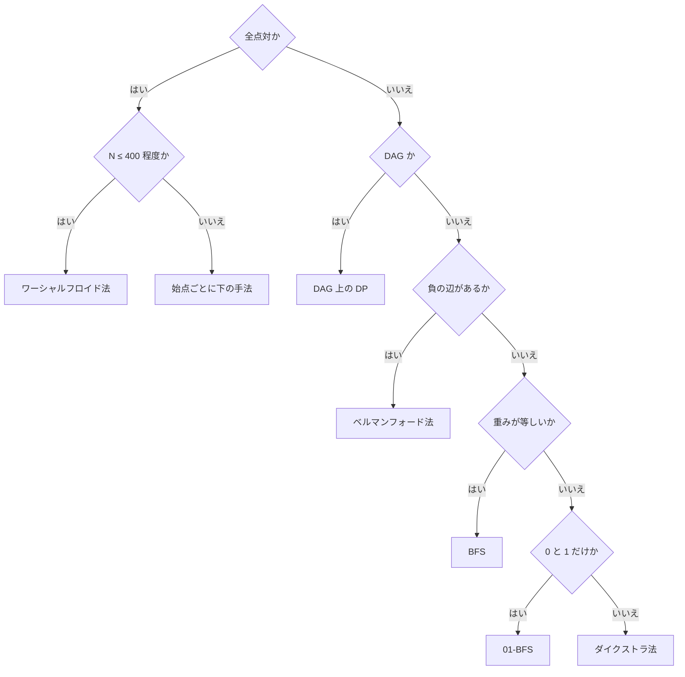

!!! abstract "要点"
    - **何のページか**：BFS・01-BFS・ダイクストラ法や、累積和・BIT・セグメント木のように混同しやすい手法の組を、できる操作・計算量・前提条件で比べる。問題の条件から、使う手法とそのページを選べる。
    - **いつ引くか**：
        - 候補の手法が 2 つ以上浮かび、どれで書くか迷う。
        - 重い手法で書けそうだが、もっと軽い手法で済まないかを確かめたい。
        - 名前の似た手法の違いが分からない。
    - **使い方**：題材の節を開き、表の左の列から問題の条件に合う行を探す。行の手法のページで、前提条件と計算量を確かめてから書く。
    - **計算量**：表の各行に記す

<!-- textlint-disable -->
別名：手法の比較・どれを使うか・使い分け・混同しやすい手法・最短路の選び方・最短路の比較・最短路アルゴリズムの使い分け
<!-- textlint-enable -->

似た手法の使い分けは、同じ種類の問いに答える手法を並べ、条件から 1 つを選ぶための表の集まりである。中身の説明は各ページに任せ、ここでは「どの条件ならどれか」と、その理由の要点だけを書く。問題文の言い回しから手法を探すときは[逆引き辞典（言い回しから）](../guide/reverse-index-signs.md#by-phrase)、制約から探すときは[逆引き辞典（制約・計算量から）](../guide/reverse-index-constraints.md#constraint-table)を使う。

## 比べる観点 {#criteria}

似た手法は、次の 5 つの観点で比べると違いがはっきりする。各節の表も、この観点のどれかで行を分けている。

| 観点 | 確かめること | 例 |
| --- | --- | --- |
| できる操作 | 更新があるか。どんな演算・問いに答えるか | 区間の和か、区間の最小値か |
| 計算量 | 前計算と 1 回の重さ。制約の最大値を入れた回数 | $N = 2 \times 10^5$ なら $O(N^2)$ は $4 \times 10^{10}$ 回で間に合わない |
| 前提条件 | 手法が正しく動くための条件 | 辺の重みが非負、演算に[逆元](../guide/glossary.md#inverse-element)がある、判定が単調 |
| オンラインかオフラインか | 質問を先に全部読んでから答えてよいか | いもす法・Mo's algorithm は質問を先に読む |
| 実装の重さ | 書く量と、ACL にあるか | ACL にセグメント木・Union-Find はあるが、最短路はない |

質問を先に全部読み、順番を入れ替えてまとめて処理するやり方を[オフライン](../guide/glossary.md#offline)という。前の答えで次の質問が決まる問題（[オンライン強制](../guide/glossary.md#forced-online)）では使えない。

選ぶときの原則は、**条件を満たす手法のうち、いちばん軽いものを使う**ことである。重い手法は軽い手法でできることを含むことが多い（BIT でできることはセグメント木でもでき、BFS で解ける最短路はダイクストラ法でも解ける）。重い方で書いても正しいが、実装の誤りと定数倍の遅さを招く。逆に、軽い手法の前提条件を確かめずに使うと誤る（負の辺のあるグラフでダイクストラ法を使うなど）。表の行を選んだら、そのページの前提条件を必ず確かめる。

計算量の見積もり方と、1 秒に $10^8$ 回前後という目安は[計算量の見積もり](../basics/complexity-estimation.md#constraint-table)にある。

## 最短路の選び方（重みと始点の数） {#shortest-path}

最短路の手法は、**辺の重みの種類**と**始点の数**の 2 つで決まる。どれも「距離の小さい順に確定させる」か「緩和をくり返す」かの違いで、前提条件が弱い手法ほど遅い。$N$ は頂点数、$M$ は辺数である。

| 辺の重み | 始点が 1 つ | 全点対 |
| --- | --- | --- |
| すべて等しい | [BFS](../graph/bfs.md#why-shortest) $O(N + M)$ | 全始点から BFS $O(N(N + M))$ |
| 0 か 1 | [01-BFS](../graph/zero-one-bfs.md#deque-invariant) $O(N + M)$ | 全始点から 01-BFS $O(N(N + M))$ |
| 非負 | [ダイクストラ法](../graph/dijkstra.md#why-correct) $O((N + M) \log N)$ | $N \le 400$ 程度なら[ワーシャルフロイド法](../graph/warshall-floyd.md#k-outer)、疎なら全始点からダイクストラ法 |
| 負の辺あり | [ベルマンフォード法](../graph/bellman-ford.md#why-n-minus-1) $O(NM)$ | ワーシャルフロイド法 $O(N^3)$ |

制約の目安は次のとおりである。演算回数が $10^8$ 前後に収まる範囲を書いた。

| 手法 | 計算量 | 制約の目安 |
| --- | --- | --- |
| BFS・01-BFS | $O(N + M)$ | $N, M \le 2 \times 10^5$ で十分に速い |
| ダイクストラ法（ヒープ） | $O((N + M) \log N)$ | $N, M \le 2 \times 10^5$ |
| ダイクストラ法（配列） | $O(N^2)$ | 辺が $N^2$ 本近くある密なグラフで $N$ が数千 |
| ベルマンフォード法 | $O(NM)$ | $N$ と $M$ が数千まで |
| ワーシャルフロイド法 | $O(N^3)$ | $N \le 400$〜$500$ |

表の行を選ぶときの注意をまとめる。

- **重みが 0 と 1 だけ**：01-BFS は deque の前に重み 0 の行き先、後ろに重み 1 の行き先を積む。制限時間が緩ければ、ダイクストラ法でも通ることが多い。重み 0 の辺がなければ BFS で足りる
- **負の辺がある**：ダイクストラ法は、確定させた頂点の距離が後から負の辺で縮むので壊れる（[負の辺で壊れる例](../graph/dijkstra.md#negative-edges)）。負の辺が「高さの差」の形なら、[ポテンシャル](../graph/dijkstra.md#potential)で非負に直してダイクストラ法を使える
- **グラフが DAG**：負の辺があっても、トポロジカル順に緩和する [DAG 上の DP](../dp/dp-dag.md#dp-as-dag) で $O(N + M)$ である
- **始点が複数で、どれかからの最短距離**：全点対ではない。全部の始点を距離 0 で最初に入れれば 1 回の探索で済む（[多始点 BFS](../graph/bfs.md#multi-source)）
- **終点が 1 つ、始点は多数**：辺を逆向きにしたグラフで終点から 1 回だけ求める（[逆向きのグラフ](../graph/dijkstra.md#reverse-graph)）

## 最短路の判断の順序 {#shortest-path-steps}

最短路の問題は、次の順で確かめると手法が決まる。前の段で決まらなければ次の段へ進む。

1. **辺の重みの種類**：等しい・0 と 1・非負・負ありのどれかを見る（[上の表](#shortest-path)の行）
2. **始点の数**：始点が 1 つか、全点対か。複数の始点の最小なら 1 回にまとめる
3. **制約**：選んだ手法の計算量に最大値を入れる。全点対で $N$ が大きければ、始点ごとの手法を回す
4. **頂点だけでは状態が足りない**：残りの燃料・向き・偶奇・使った回数で先の動きが変わるなら、（頂点, 状態）の組を頂点にする（[状態を頂点にする](../graph/extended-dijkstra.md#choose-state)）。状態数 × 遷移数で計算量を見積もる（[状態数の見積もり](../graph/extended-dijkstra.md#state-count)）
5. **辺が多すぎる**：同じグループの全員の間や、区間の全点へ辺を張ると辺が $N^2$ 本になる。中継の頂点を 1 つ置いて辺を減らす（[超頂点](../graph/extended-dijkstra.md#super-vertex)・[区間に辺を張る](../graph/segment-tree-graph.md#cover)）
6. **辺の重みが時刻で変わる**：待つことを許すダイクストラ法で済むことが多い（[時刻で変わる辺の最短路](../graph/time-dependent-dijkstra.md#fifo)）

上の 1〜2 段（重みの種類と始点の数）に、DAG かどうかを加えて分かれ道にすると次の図になる。全点対の判断を先に置き、単一始点の中で重みの種類を見る。図が扱うのは単純な最短路の手法の選び方だけで、制約・状態・辺の数・時刻による変化は箇条書きの 3〜6 段で確かめる。

図の分かれ道は、上から「全点対か」「DAG か」「負の辺があるか」「重みが等しいか」「0 と 1 だけか」の 5 つである。負の辺がないと決まった後は、重みが等しい・0 と 1・非負の順に、前提が弱く遅い手法になる。

**最短路と DP の境目**は、状態の遷移に閉路があるかである。状態を頂点、遷移を辺としたグラフが DAG なら、計算順序が決まるので DP で書ける。DP は DAG の上の最短路（最長路）とみなせる。閉路があると、どの状態から先に確定させればよいかが決まらない。そのときは、重みが非負ならダイクストラ法、等しいなら BFS で距離の小さい順に確定させる（[閉路があるとき](../dp/dp-dag.md#with-cycles)）。訪れた頂点の集合を状態に持つ問題は、集合が増える向きにしか遷移しないので、[bitDP](../dp/bit-dp.md#with-shortest-paths) で書ける。

## 最短路に共通の性質 {#shortest-path-properties}

どの手法でも成り立つ性質を 4 つ挙げる。手法を組み合わせたり、最短路の上の辺を調べたりするときの根拠になる。

- **部分路も最短路**：$s$ から $t$ への最短路の途中の頂点 $u$ までの部分は、$s$ から $u$ への最短路である。$u$ までにもっと短い道があれば、それに差し替えると $t$ までの道も短くなるからである。負閉路のないグラフで成り立つ
- **[三角不等式](../guide/glossary.md#triangle-inequality)**：最短距離 $\mathrm{dist}$ は、すべての辺 $u \to v$（重み $w$）で $\mathrm{dist}[v] \le \mathrm{dist}[u] + w$ を満たす。等号が成り立つ辺だけを集めると、最短路をすべて含むグラフになる。重みがすべて正なら閉路はなく DAG である（重み 0 の辺があると閉路ができうる。[最短路 DAG](../graph/shortest-path-dag.md#build)）。最短路の本数や、必ず通る辺はこの DAG で調べる
- **距離の小さい順に確定させる**：BFS・01-BFS・ダイクストラ法は同じ考え方の特殊化である。何が確定を保証するかが違う。BFS はキューの中の距離の差が高々 1、01-BFS は deque の中の距離が 2 種類、ダイクストラ法はヒープで最小を取り出すことが根拠である
- **負閉路の影響**：距離が $-\infty$ になるのは、始点から届く負閉路を経由して届く頂点だけである。グラフのどこかに負閉路があっても、聞かれた頂点に届かなければ答えは有限である（[答えに効く負閉路](../graph/bellman-ford.md#relevant-cycles)）

始点からの最短路を集めた木（[最短路木](../guide/glossary.md#shortest-path-tree)）と、辺の重みの和が最小の全域木（[最小全域木](../graph/minimum-spanning-tree.md#kruskal-prim)）は、一般に別の木である。前者を問うのが[最短路 DAG の例題 ABC252 E](../graph/shortest-path-dag.md#abc252_e)、後者を問うのが[最小全域木の例題 ABC218 E](../graph/minimum-spanning-tree.md#abc218_e)である。

## 区間の集約 {#range-queries}

列の区間について和や最小値を何度も答える手法は、**更新があるか**と**演算の性質**で選ぶ。演算の性質とは、引き算（逆元）があるか、同じ要素を 2 回含めても結果が変わらない（[冪等](../guide/glossary.md#idempotent)）か、である。

| 状況 | 使う手法 | 計算量 |
| --- | --- | --- |
| 更新なし、区間の和（引き算できる演算） | [累積和](../basics/prefix-sum.md#half-open) | 前計算 $O(N)$、1 回 $O(1)$ |
| 区間への加算をまとめて行い、最後に各点を読む | [いもす法](../basics/imos.md#imos-1d) | 加算 1 回 $O(1)$、最後に $O(N)$ |
| 更新なし、区間の最小値・最大値・gcd | [Sparse Table](../ds/sparse-table.md#idempotent) | 前処理 $O(N \log N)$、1 回 $O(1)$ |
| 一点の更新と区間の和が交互 | [BIT](../ds/fenwick-tree.md#operations) | どちらも $O(\log N)$ |
| 一点の更新と区間の最小値・非可換な演算 | [セグメント木](../ds/segment-tree.md#operations) | どちらも $O(\log N)$ |
| 区間への加算と一点の取得が交互 | 差分の BIT（[BIT の変種](../ds/fenwick-tree.md#variants)） | どちらも $O(\log N)$ |
| 区間への加算・代入と区間の和・最小値が交互 | [遅延セグメント木](../ds/lazy-segment-tree.md#what-it-does) | どちらも $O(\log N)$ |
| 窓の両端が戻らずに動き、窓の最小値 | [スライド最小値](../ds/monotonic-stack.md#sliding-window-minimum) | 全体 $O(N)$ |
| 更新なし、合成できない量（区間の種類数など） | [Mo's algorithm](../ds/mo-algorithm.md#what-it-does)・[クエリの先読み](../ds/offline-queries.md#distinct-count) | 全体 $O(N \sqrt{Q})$ など |
| どの木にも載らない操作 | [平方分割](../ds/sqrt-decomposition.md#buckets) | 1 回 $O(\sqrt{N})$ |

混同しやすい組の見分け方は次のとおりである。

- **累積和と BIT**：違いは更新の有無だけである。値が変わらないなら累積和で取得が $O(1)$ になる。1 回でも点の更新が質問の間に挟まるなら、累積和は作り直しに $O(N)$ かかるので BIT にする
- **いもす法と遅延セグメント木**：どちらも区間に加算する。加算が全部終わってから値を読むならいもす法、加算と読み出しが交互に来るなら遅延セグメント木（点を読むだけなら差分の BIT）である
- **BIT とセグメント木**：BIT は区間の和を「接頭辞の和の差」で求めるので、引き算できる演算にしか使えない。最小値は、値が小さくなる更新だけのときの接頭辞の最小値に限られる（[BIT の変種](../ds/fenwick-tree.md#variants)）。セグメント木は[結合法則](../guide/glossary.md#associativity)を満たす任意の演算に使え、非可換な演算（行列の積・文字列の連結のハッシュ）も載る。BIT を選ぶ理由は、短く書けて定数倍が軽いことである
- **Sparse Table とセグメント木**：Sparse Table は冪等な演算で区間を 2 つの重なる区間で覆い、1 回 $O(1)$ で答える。更新はできない

ACL には BIT（`fenwick_tree`）・セグメント木（`segtree`）・遅延セグメント木（`lazy_segtree`）がある。Sparse Table と累積和は自分で書く。

## 二分探索の種類 {#binary-search}

二分探索は「どこを探すか」で手法が分かれる。配列の位置を探すのか、答えの値を探すのか、データ構造の中を探すのかである。

| 探すもの | 使う手法 | 計算量 |
| --- | --- | --- |
| ソート済みの配列で、$x$ 以上の最初の位置 | [二分探索](../basics/binary-search.md#lower-bound)（`lower_bound`） | 1 回 $O(\log N)$ |
| 答えの値（値を決めると可否が単調に決まる） | [答えで二分探索](../basics/binary-search-answer.md#monotonicity) | 判定の重さ × $O(\log(\text{範囲}))$ |
| 平均・比の最大値 | [平均・中央値の最大化](../basics/fractional-binary-search.md#average) | 判定の重さ × 反復回数 |
| 全部を並べられない量の K 番目 | [K 番目の値](../basics/kth-value.md#why-count)（「$x$ 以下の個数」で二分探索） | 数える重さ × $O(\log(\text{範囲}))$ |
| 区間の総積が条件を満たす境界（更新あり） | [セグメント木上の二分探索](../ds/segment-tree-binary-search.md#what-it-does) | 1 回 $O(\log N)$ |
| 先頭からの和が $K$ に達する位置（値が非負） | [BIT 上の二分探索](../ds/fenwick-tree.md#binary-search) | 1 回 $O(\log N)$ |

答えの二分探索とデータ構造の中の二分探索の違いは、判定の重さにある。答えの二分探索は、1 回の判定に $O(N)$ かけてもよく、$\log$ 回だけ判定する。セグメント木上の二分探索は、木の節点の値を使い、根から葉へ 1 回降りるだけで境界を求める。外側で二分探索して毎回区間の値を取得すると $O(\log^2 N)$ になるが、$N, Q \le 2 \times 10^5$ なら多くは間に合い、書き間違えにくい。

二分探索と並んで迷う手法が 2 つある。

- **尺取り法**：区間の左端を進めても右端が戻らない（各 $l$ の右端 $r(l)$ が単調）なら、[尺取り法](../basics/two-pointers.md#vs-binary-search)で全体 $O(N)$ になる。区間の情報を足し引きできることも要る。各点から独立に境界を探すなら二分探索の $O(N \log N)$ で、こちらは右端が単調でなくても使える
- **三分探索**：可否の判定ではなく、値そのものが谷形（単峰）なら[三分探索](../basics/ternary-search.md#real-and-integer)を使う。判定が単調に作れるなら二分探索の方がよい。整数の上の凸関数は、隣との差の符号で二分探索する方が書き間違えにくい（[差分の符号で二分探索](../basics/ternary-search.md#difference-sign)）。平らな部分があると三分探索は誤る（[平らな部分の落とし穴](../basics/ternary-search.md#flat-pitfall)）

## 繰り返しの高速化 {#repetition}

同じ遷移を $K$ 回（$K \le 10^{18}$ など）くり返した結果を求める手法は、**1 歩の形**と**問い方**で選ぶ。$S$ は状態の種類数である。

| 1 歩の形・問い方 | 使う手法 | 計算量 |
| --- | --- | --- |
| 次の状態が 1 つに決まる、始点が 1 つで 1 回だけ | [周期の検出](../basics/periodicity.md#rho) | $O(S)$ |
| 次の状態が 1 つに決まる、始点やクエリが多い・途中の和・条件を満たす最大の回数 | [ダブリング](../basics/doubling.md#table) | 前計算 $O(S \log K)$、1 回 $O(\log K)$ |
| 木で親へ上る | [LCA のダブリングの表](../tree/lca.md#jump) | 前処理 $O(N \log N)$、1 回 $O(\log N)$ |
| 次の値が今の値の和・定数倍（線形） | [行列累乗](../math/matrix-power.md#write-as-matrix) | 行列の大きさ $d$ で $O(d^3 \log K)$ |
| $k$ 項の線形漸化式で $k$ が数百以上 | [線形漸化式の高速化](../math/linear-recurrence-fast.md#vs-matrix) | きたまさ法 $O(k^2 \log K)$ など |
| 結合法則を満たす演算を同じ値に $K$ 回 | [繰り返し二乗法](../math/mod-pow.md#monoid-power) | 演算 $O(\log K)$ 回 |

見分けの要点は、1 歩が「関数」か「線形変換」かである。ダブリングは、次の状態がただ 1 つに決まる遷移（関数）を 2 倍ずつ合成する。線形でなくてもよい。行列累乗は、状態ごとの個数や値が線形に移る遷移を合成する。関数の遷移を行列で書くこともできるが、$O(S^3 \log K)$ かかって遅い。LCA の表は、ダブリングの関数を「親」にしたものである。

周期の検出とダブリングの違いは、始点の数である。周期の検出は 1 つの始点について尾の長さと周期を求めれば、残りは余りの回数だけ進めばよい。始点ごとに尾と周期が違うので、始点が多いならダブリングの表を 1 つ作る方が扱いやすい（[周期性とダブリングの使い分け](../basics/periodicity.md#vs-doubling)）。

## 小さい N の全探索 {#small-n}

$N$ が 20 や 40 程度と小さいときの全探索は、何を列挙するかと、途中の状態がまとまるかで選ぶ。

| 状況 | 使う手法 | 計算量 |
| --- | --- | --- |
| $N \le 8$〜$10$ で並べ方を全部見る | [順列全探索](../basics/bit-full-search.md#permutations) | $O(N! \cdot N)$ |
| $N \le 20$ で各要素が独立な 2 択 | [bit 全探索](../basics/bit-full-search.md#bitmask) | $O(2^N N)$ |
| $N \le 16$〜$20$ で訪問順など、途中の状態が（集合, 最後の要素）にまとまる | [bitDP](../dp/bit-dp.md#tsp) | $O(2^N N^2)$ |
| 集合をいくつかのグループに分ける | [部分集合を列挙する DP](../dp/subset-enumeration-dp.md#why-3n) | $O(3^N)$（$N \le 15$〜$16$ 程度） |
| $N \le 40$ で 2 つの半分の結果を突き合わせられる | [半分全列挙](../basics/meet-in-the-middle.md#combine-halves) | $O(2^{N/2} N)$ |
| 選択肢の数が要素ごとに違う・組分け・途中で打ち切る | [再帰による全列挙](../basics/recursive-enumeration.md#skeleton) | 列挙する数による |

bit 全探索と bitDP の違いは、集合どうしの間で値を受け渡すかである。bit 全探索は部分集合を 1 つずつ調べるだけである。順番が効き、別々の選び方が同じ途中の状態に合流するなら、その状態をまとめた bitDP にする。$N = 16$ の訪問順は $16! \approx 2.1 \times 10^{13}$ 通りで全部は見られないが、bitDP なら $2^{16} \cdot 16^2 \approx 1.7 \times 10^7$ で済む。

部分和の問題は、$N$ の大きさと値の大きさで手法が変わる。

- **値の和 $S$ が小さい**（$NS$ が $10^8$ 程度まで）：和を添字にした[部分和 DP](../dp/subset-sum.md#three-forms) $O(NS)$
- **可否だけで $NS$ がもっと大きい**：DP の表を bitset にしてシフトで更新する（[bitset の部分和](../misc/bitset-speedup.md#subset-sum-shift)）。速くなるのは定数倍の 64 分の 1 だけである
- **$N \le 40$ で値が $10^9$ のように大きい**：和を添字にできないので[半分全列挙](../basics/meet-in-the-middle.md#vs-knapsack)

## 数え方 {#counting}

数えにくい条件を数える手法は、条件の数と構造で選ぶ。求めるもの（個数・総和・期待値）でも分かれる。

| 状況 | 使う手法 | ページ |
| --- | --- | --- |
| 条件が 1 つで、満たさない方が数えやすい | 全体から引く | [余事象](../thinking/complement.md#whole-minus-complement) |
| 条件が 2〜3 個重なる | 共通部分を書き出して足し引き | [2 つの条件の余事象](../thinking/complement.md#two-conditions) |
| 条件が 20 個程度まで | 条件の組を bit 全探索して包除 | [包除原理](../comb/inclusion-exclusion.md#bit-enumeration) |
| 条件が対称（破る個数だけで数が決まる） | 破る個数ごとにまとめて包除 | [対称な包除](../comb/inclusion-exclusion.md#symmetric) |
| 条件が列・木に沿って並ぶ | 符号を DP の値に掛けて運ぶ | [包除 DP](../comb/inclusion-exclusion-dp.md#weighted-sum) |
| 条件が約数の構造（gcd・周期） | 大きい約数から引いていく | [約数包除](../comb/divisor-inclusion-exclusion.md#order) |
| すべての組・区間・部分集合についての総和 | 要素ごとに何回数えられるかを数える | [主客転倒・寄与](../thinking/contribution.md#swap-roles) |
| 和に分けられる量の期待値 | 指示確率変数の和に分ける | [期待値の線形性](../comb/linearity-of-expectation.md#indicator) |
| 終わるまでの回数・状態をたどる量の期待値 | 後ろから状態ごとに求める | [期待値 DP](../comb/expected-value-dp.md#why-backward) |
| 最大値・K 番目の値の期待値 | $P(X \ge k)$ の和に直す | [期待値と確率の変換](../comb/expectation-tail-sum.md#kth-value) |
| 振り出しに戻るなど、閉路のある期待値 | 未知数を置いて方程式を解く | [閉路のある期待値](../comb/expectation-linear-equations.md#unknown) |

主客転倒・寄与・期待値の線形性は、同じ考え方の別名である。「対象ごとに値を求めて足す」和を、「要素ごとに、何個の対象で数えられるかを掛けて足す」和に入れ替える。期待値の線形性は、その確率の版である。独立でなくても成り立つ。

期待値 DP と期待値の線形性の違いは、状態をたどる必要があるかである。求める量が要素ごとの和に分けられ、各部分の確率が状態なしで求まるなら線形性で足す方が速い。次に何が起きるかが今の状態で変わり、終わるまでの回数を問うなら期待値 DP にする。

## ゲーム {#games}

2 人が交互に手を打つゲームは、ゲームの数・閉路の有無・問われるもので手法が決まる。

| 状況 | 使う手法 | ページ |
| --- | --- | --- |
| 1 つのゲームで、局面が少なく同じ局面に戻らない。勝ち負けを問う | 勝敗の DP・メモ化再帰 | [勝敗の DP](../comb/game-basics.md#game-dp) |
| 勝ち負けでなく得点（の差）を問う | 値を数にした max・min の DP | [ミニマックス](../comb/minimax.md#negamax) |
| 独立なゲームが並び、どれか 1 つを選んで動かす | 局面ごとの値の XOR | [Grundy 数](../comb/grundy-number.md#sum)・[Nim](../comb/nim.md#bouton) |
| 同じ局面に戻れる、引き分けがある | 終局から逆向きに確定させる | [後退解析](../comb/game-retrograde-analysis.md#draw) |
| サイコロなどの偶然が入る | 偶然の局面では平均を取る | [最適戦略の期待値](../comb/optimal-strategy-expectation.md#state-design) |
| 局面が多すぎる | 総手数の偶奇・真似戦略・小さい局面の実験 | [手数の偶奇](../comb/game-basics.md#move-parity)・[真似戦略](../comb/game-basics.md#mirror-strategy) |

ゲーム DP と Grundy 数の違いは、ゲームが 1 つか、独立なゲームの和かである。和のゲームをゲーム DP で解こうとすると、全部のゲームの局面の組が状態になって大きすぎる。Grundy 数は、各ゲームを Nim の 1 つの山に置き換え、XOR で和の勝敗を決める。ただし、手番で打てる手が違うゲームや、閉路のあるゲームの和には使えない（[Grundy 数が使えない場合](../comb/grundy-number.md#limitations)）。

## 連結性 {#connectivity}

つながり方や並ぶ順を扱う手法は、2 つの観点で選ぶ。**グラフが固定か、辺が増えていくか**と、**向きがあるか**である。

| 状況 | 使う手法 | 計算量 |
| --- | --- | --- |
| グラフが最初から全部与えられ、連結成分や距離も要る | [DFS・BFS](../graph/connected-components.md#three-methods) | $O(N + M)$ |
| 辺が増えていき、途中で「同じ成分か」を問われる | [Union-Find](../ds/union-find.md#what-it-does) | 1 回ならし $O(\alpha(N))$ |
| 辺の削除だけで、削除の順序が先に分かる | 逆順に見て追加にする（[削除を逆順の追加に](../graph/union-find-connectivity.md#reverse-deletion)） | Union-Find と同じ |
| 辺の追加と削除が混ざる | [辺の追加と削除が混ざる連結性](../graph/offline-dynamic-connectivity.md#time-segment-tree) | オフラインで $O(N + Q \log Q \log N)$ |
| 重みの和が最小の、全体をつなぐ木 | [最小全域木](../graph/minimum-spanning-tree.md#kruskal-prim) | クラスカル法 $O(M \log M)$ |
| 有向グラフで、互いに行き来できるグループ | [強連結成分分解](../graph/scc.md#condensation) | $O(N + M)$ |
| 有向グラフで、辺の向きに沿った順序 | [トポロジカルソート](../graph/topological-sort.md#kahn-dfs) | $O(N + M)$ |
| 順序に沿って値を伝える | [DAG 上の DP](../dp/dp-dag.md#ordering) | $O(N + M)$ |
| 無向グラフで、切ると分かれる辺・頂点 | [橋・関節点](../graph/lowlink.md#conditions) | $O(N + M)$ |

Union-Find と DFS・BFS の違いは、グラフがいつ与えられるかである。グラフが固定なら、どちらでも同じ成分の分け方が得られる。辺の追加と質問が交互に来るなら、毎回探索し直すと間に合わないので Union-Find を使う。Union-Find は連結かどうかしか分からず、距離や道そのものが要るなら探索を使う。

Union-Find を使うと決めたら、問われ方から拡張を選ぶ。基本の Union-Find は併合と「同じ成分か」の判定しかできないので、次の問われ方では、持たせる値か使い方を変える。

| 問われ方 | 使う Union-Find | ページ |
| --- | --- | --- |
| 成分の大きさ・辺数・値の和や最大値を答える | 根に成分の情報を持たせ、併合のときに合成する | [根に成分の情報を持たせる](../ds/union-find-applications.md#data-on-root) |
| 「$x_v - x_u = w$」の形の条件が矛盾しないか、2 つの値の差はいくつか | 重み付き Union-Find（各頂点が親との差を持つ） | [矛盾の判定と差の取得](../ds/weighted-union-find.md#consistency) |
| 「同じ色」「違う色」の条件で 2 色に塗れるか（条件が増えていく） | 頂点を 2 倍にする。または差を XOR にした重み付き Union-Find | [Union-Find で二部判定](../graph/bipartite-graph.md#union-find)・[XOR で偶奇](../ds/weighted-union-find.md#generalization) |
| 辺の削除だけが起き、削除の順序が先に分かる | 逆順に見て辺の追加にする | [削除を逆順の追加に](../graph/union-find-connectivity.md#reverse-deletion) |
| 辺の追加と削除が混ざり、先に全部読める | 時間軸のセグメント木と、ロールバックできる Union-Find | [辺の追加と削除が混ざる連結性](../graph/offline-dynamic-connectivity.md#time-segment-tree) |
| 直前の併合から順に取り消す（木の DFS で、入るとき併合し、出るとき戻す） | ロールバックできる Union-Find（経路圧縮をしない） | [ロールバックできる Union-Find](../ds/rollback-union-find.md#with-dfs) |
| 過去の時刻で連結だったか、初めて連結になった時刻を、先読みせずに答える | 部分永続 Union-Find（先に全部読めるなら並列二分探索でもよい） | [部分永続 Union-Find](../ds/partially-persistent-union-find.md#what-it-does)・[代わりの手](../ds/partially-persistent-union-find.md#alternatives) |
| 区間のまだ塗っていないマスだけを塗る、右へ最初の空きを探す | 次の空きへ飛ぶ Union-Find | [次の空きへ飛ぶ Union-Find](../ds/union-find-applications.md#next-pointer) |
| 重みが $w$ 以下の辺だけで連結かを、$w$ を変えて何度も問う | しきい値の順に辺とクエリを並べて足す。先読みできなければ併合過程の木 | [しきい値の順に辺を足す](../graph/union-find-connectivity.md#threshold)・[併合過程の木](../tree/merge-process-tree.md#bottleneck) |

辺の重みが数種類しかなく、辺を足すたびに答えるなら、重みのしきい値ごとに Union-Find を 1 つずつ持つ方法もある（[しきい値ごとに Union-Find を持つ](../ds/union-find-applications.md#multiple-uf)）。

トポロジカルソート・DAG 上の DP・強連結成分分解は、有向グラフで順に使われる組である。トポロジカルソートは順序そのものを求め、DAG 上の DP はその順に値を伝える。閉路があるとどちらも使えないので、閉路の中を自由に回れるなら強連結成分分解で閉路を 1 頂点に縮めてから DAG 上の DP にする（[縮約した DAG の上の DP](../graph/scc.md#dp-on-dag)）。

真偽の割り当てを決める問題は、条件の形で分かれる。

- **「同じ色」「違う色」の条件だけ**：[二部グラフ判定](../graph/bipartite-graph.md#coloring)か、Union-Find で頂点を 2 倍にする方法（[Union-Find で二部判定](../graph/bipartite-graph.md#union-find)）
- **「$a$ または $b$」の形の一般の条件**：[2-SAT](../graph/two-sat.md#when-to-use)。条件を満たす割り当てを求められるが、コストの最小化はできない
- **両立しない組にペナルティがあり、コストを最小にする**：[燃やす埋める](../graph/project-selection.md#idea)（最小カット）

## 木の手法 {#trees}

木の問題の手法は、**問いの単位**で選ぶ。単位は、根からの部分木・すべての頂点を根にした値・すべての頂点の組・2 頂点の間のパスの 4 つである。

| 問いの単位 | 使う手法 | 計算量 |
| --- | --- | --- |
| 根を 1 つ決めた部分木の値 | [木 DP](../dp/tree-dp.md#postorder) | $O(N)$ |
| すべての頂点を根にした値 | [全方位木 DP](../dp/rerooting.md#framework) | $O(N)$ |
| すべての頂点の組で、辺ごとの和に分けられる量（距離の総和） | [辺で切って数える](../tree/tree-edge-contribution.md#edge-pairs) | $O(N)$ |
| すべての頂点の組で、距離そのものに条件がある | [重心分解](../tree/centroid-decomposition.md#count-through) | $O(N \log N)$ から |
| 部分木ごとの集合・種類数 | [マージテク](../tree/small-to-large.md#subtree-merge) | 移動 $O(N \log N)$ 回 |
| 部分木の取得と更新が交互 | [オイラーツアー](../tree/euler-tour.md#in-out)と BIT・セグメント木 | 1 回 $O(\log N)$ |
| パスへの一括の更新、逆元のない演算のパスの集約 | [HL 分解](../tree/hld.md#when-to-use) | 1 回 $O(\log^2 N)$ |
| 2 頂点の LCA・距離 | [LCA](../tree/lca.md#jump) | 前処理 $O(N \log N)$、1 回 $O(\log N)$ |

全方位木 DP を書く前に、軽い方法で済まないかを確かめる。最も遠い頂点までの距離は直径の両端からの距離で求まり、距離の総和は根を動かしたときの差分で求まる（[全方位木 DP の使い分け](../dp/rerooting.md#when-to-use)）。

似た組の見分け方は次のとおりである。

- **オイラーツアーと HL 分解**：オイラーツアーは部分木を列の区間に直し、HL 分解はパスを $O(\log N)$ 個の区間に直す。和のように逆元がある演算のパスの問いは、根からの累積と LCA で済むので、HL 分解は要らない
- **LCA の求め方**：ダブリングは 1 回 $O(\log N)$ で、K 個上の祖先やパスの最大値も同じ表で求まる。オイラーツアーと Sparse Table は 1 回 $O(1)$ で、クエリが非常に多いときに向く（[LCA の求め方の比較](../tree/lca.md#comparison)）
- **重心分解とマージテク**：重心分解はパスの数え上げ（距離が $K$ の組など）に、マージテクは部分木の情報の併合（部分木ごとの種類数など）に使う

## 集合とキュー {#containers}

データを入れておく器は、クエリで**くり返す操作を全部書き出し**、そのすべてが速いものを選ぶ。できる操作が多い器ほど定数倍が重い。

| くり返す操作 | 選ぶもの | ページ |
| --- | --- | --- |
| 最大（最小）の取り出しと追加だけ | `priority_queue` | [優先度付きキュー](../ds/priority-queue.md#vs-multiset) |
| 任意の要素の削除・最小と最大の両方・前後の要素 | `set`・`multiset` | [set・multiset・map の応用](../ds/ordered-set.md#neighbors) |
| 値ごとの個数で、値の範囲が狭い（$10^6$ 程度まで） | 配列 | [STL コンテナの使い分け](../ds/stl-containers.md#comparison) |
| 値ごとの個数で、値が大きい・文字列 | `map` | [個数を数える map](../ds/stl-containers.md#counting-map) |
| 値を先に全部知れて、順位や配列の添字が要る | 座標圧縮 | [座標圧縮と map の違い](../basics/coordinate-compression.md#vs-map) |
| 値を先に知れず、値の範囲で区間の集約が要る | 動的セグメント木 | [値を添字にするセグメント木](../ds/segment-tree-on-values.md#dynamic-segment-tree) |
| 先頭と末尾の両方から出し入れ | `deque` | [スタック・キュー・deque の使いどころ](../ds/stack-techniques.md#deque) |

`priority_queue` でできることは `multiset` でもできる。ただし `multiset` は節点を 1 つずつ確保するので、定数倍が数倍重い。逆に、任意の要素を消す必要があるのに `priority_queue` を選ぶと、遅延削除の工夫が要る（[遅延削除](../ds/priority-queue.md#lazy-deletion)）。`multiset` の `erase(値)` は同じ値をすべて消すので、1 つだけ消すならイテレータを渡す（[1 つだけ消す](../cpp/cpp-container-idioms.md#multiset-erase-one)）。

`unordered_map` は平均 $O(1)$ だが、衝突を狙った入力で遅くなりうる。迷ったら `map` を使う（[unordered_map の注意](../string/hash-safety.md#unordered-map)）。

K 番目の値を取る器の比べ方（値の範囲・先読みの可否・K の固定）は[K 番目の値を求めるデータ構造の比較](../ds/kth-element.md#comparison)にあり、題材としての整理は [K 番目と中央値](../patterns/kth-and-median.md#overview)にある。

## 文字列の照合 {#strings}

文字列の一致を調べる手法は、**何と何を比べるか**で選ぶ。$N$ はテキストの長さ、$M$ はパターンの長さ（の総和）である。

| 目的 | 第一候補 | 計算量 |
| --- | --- | --- |
| 1 つのパターンの全出現 | [Z-algorithm](../string/z-algorithm.md#pattern-search)（ACL にある）・[KMP 法](../string/kmp.md#matching) | $O(N + M)$ |
| 任意の 2 か所の部分文字列が等しいかを多数 | [ローリングハッシュ](../string/rolling-hash.md#polynomial-hash) | 前計算 $O(N)$、1 回 $O(1)$ |
| border・周期 | [KMP 法](../string/kmp.md#border-chain) | $O(N)$ |
| 区間が回文か（更新なし） | [Manacher](../string/palindrome.md#manacher) | 前処理 $O(N)$、1 回 $O(1)$ |
| 辞書順・異なる部分文字列の数・任意の 2 接尾辞の LCP | [Suffix Array と LCP 配列](../string/suffix-array.md#distinct-substrings) | 構築 $O(N)$ から |
| 多数の文字列の共通の接頭辞 | [Trie](../string/trie.md#basic-operations) | 挿入 1 回 $O(\lvert S \rvert)$ |
| 多数のパターンの出現 | [Aho-Corasick 法](../string/aho-corasick.md#count-occurrences) | 構築のあと走査 $O(N)$ |
| 1 文字の更新があっての一致・回文 | [ハッシュのセグメント木](../string/rolling-hash.md#hash-segment-tree) | 1 回 $O(\log N)$ |
| ワイルドカードつきの一致 | [畳み込み](../math/convolution-ntt.md#string-matching) | $O((N + M) \log (N + M))$ |
| ハミング距離（各位置で一致する文字の数） | [畳み込み](../math/convolution-ntt.md#string-matching) | $O(\sigma (N + M) \log (N + M))$（$\sigma$ は文字の種類） |

決定的な方法で済むなら、そちらを先に考える。ハッシュは一致かどうかを確率的に答えるだけで、衝突の確率を見積もる必要がある。ハッシュが本命になるのは、更新があるとき、先頭に固定されない 2 か所を大量に比べるとき、二分探索と組み合わせるときである（[ハッシュで代用できる場面](../string/rolling-hash.md#when-to-use)）。

Z-algorithm と KMP 法は、どちらも先頭との一致を線形時間で求めるが、見る向きが違う。Z は位置 $i$ から始まる部分、KMP 法は位置 $i$ で終わる部分と先頭を比べる。パターンを探すだけなら ACL にある Z で足り、border を長い順にたどるときや、照合の状態を DP に載せるときは KMP 法を使う。

ローリングハッシュと集合のハッシュの違いは、順序を区別するかである。ローリングハッシュは並び順まで含めて一致を調べ、集合・多重集合のハッシュは順序を捨てて中身だけを比べる（[XOR と和の違い](../string/hashing-for-sets.md#xor-vs-sum)）。

## 最適化の方針 {#optimization}

最大値・最小値を求める問題では、DP・貪欲法・フローのどれで解くかを最初に決める。決め手は、局所の選択が全体の最適につながる証明があるかと、選択どうしの影響の形である。

| 状況 | 方針 | ページ |
| --- | --- | --- |
| 「この順・この選び方が最適」と交換論法で示せる | 貪欲法 | [貪欲法の正当性](../basics/greedy-basics.md#proof)・[交換論法](../basics/exchange-argument.md#adjacent-swap) |
| 小さい入力で貪欲の反例が出る、先の選び方が要約した状態だけで決まる | DP | [貪欲が失敗する例](../basics/greedy-basics.md#when-greedy-fails)・[DP の状態の設計](../dp/dp-state-design.md#why-summary-works) |
| 処理する順序は交換論法で決まり、何を選ぶかは決まらない | 並べ替えてから DP | [並べ替えてから DP する](../dp/exchange-argument-dp.md#set-and-order) |
| 各要素を 2 択に割り当て、両立しない組にペナルティがある | 燃やす埋める（最小カット） | [燃やす埋める](../graph/project-selection.md#idea) |
| 量を流し、量あたりのコストの和を最小にする | 最小費用流 | [最小費用流](../graph/min-cost-flow.md#modeling) |
| 最小値の最大化・最大値の最小化 | 答えで二分探索して判定 | [答えで二分探索](../basics/binary-search-answer.md#minimax) |

貪欲法は、証明がないまま提出すると WA の大きな原因になる。思いついた貪欲は、小さい入力の全探索と答えを突き合わせて確かめる（[ストレステストと実験](../guide/stress-testing.md#procedure)）。反例が出たら、その反例で「今の選択が後の選択肢をどう狭めたか」を見ると、DP の状態に何を持てばよいかが分かる。

DP の遷移が重いときの高速化は、遷移の式の形から選ぶ（[DP の高速化の選び方](../dp/dp-speedup-overview.md#shape-to-tool)）。

## 名前が似た別物 {#similar-names}

名前は似ているが、別の問いに答える手法の組である。取り違えると、まったく違うページを読むことになる。

| 名前 | 違い | ページ |
| --- | --- | --- |
| オイラーツアー（木）とオイラー路（グラフ） | 前者は木の頂点を DFS の順に並べて部分木を区間にする技法。後者はすべての辺をちょうど 1 回ずつ通る道 | [オイラーツアー](../tree/euler-tour.md#meanings)・[オイラー路](../graph/euler-path.md#conditions) |
| オイラー路とハミルトン路 | 辺をちょうど 1 回（次数の条件で判定でき、$O(N + M)$）か、頂点をちょうど 1 回（$N$ が小さいときの bitDP）か | [ハミルトン路との違い](../graph/euler-path.md#vs-hamiltonian) |
| 部分列と部分文字列 | 飛び飛びに取ってよい（部分列）か、連続（部分文字列）か | [部分文字列と部分列](../string/string-basics.md#substring-vs-subsequence)・[部分列と部分文字列](../patterns/subsequence-and-substring.md#overview) |
| 置換の巡回分解と転倒数 | 任意の 2 要素の交換の最小回数は $N$ − 巡回の個数、隣り合う 2 要素の交換の最小回数は転倒数 | [隣接 swap との違い](../comb/permutation-cycles.md#vs-adjacent)・[転倒数](../ds/inversion-number.md#adjacent-swaps) |
| なもりグラフと Functional graph | 前者は向きのない $N$ 頂点 $N$ 辺の連結グラフ。後者は各頂点から出る辺がちょうど 1 本の有向グラフ。どちらも各連結成分に閉路がちょうど 1 つある | [なもりグラフの有向版](../graph/namori-graph.md#directed-version)・[Functional graph](../graph/functional-graph.md#one-cycle) |
| 強連結成分と連結成分 | 有向グラフで互いに行き来できるグループか、無向グラフでつながっているグループか | [強連結成分分解](../graph/scc.md#condensation)・[連結成分](../graph/connected-components.md#three-methods) |
| 橋・関節点と強連結成分分解 | 同じ ord と low の考え方を使うが、前者は無向グラフ、後者は有向グラフで、判定の条件が違う | [lowlink と SCC の違い](../graph/lowlink.md#vs-scc) |
| 最短路木と最小全域木 | 始点からの距離を保つ木か、辺の重みの和が最小の木か | [最短路に共通の性質](#shortest-path-properties) |

## 数の扱い {#numbers}

数の型・割り算・素数の扱いは、値の大きさと個数で方法が変わる。

**実数と整数**。答えが整数で決まる比較（傾き・角度・距離の大小）は、浮動小数点数を使わず整数のまま判定する。

| 状況 | 方法 | ページ |
| --- | --- | --- |
| 比較・判定だけで、整数で書ける | 外積・2 乗の比較・掛け算の形のまま整数で | [整数での比較](../geometry/geometry-precision.md#integer-comparison) |
| 答えが無理数になる（円の交点・回転・最適化） | `double`、足りなければ `long double` | [long double と EPS](../geometry/geometry-precision.md#eps) |
| 整数を浮動小数点数に入れる | `double` は $2^{53} \approx 9.0 \times 10^{15}$ まで正確 | [浮動小数点数の型](../cpp/cpp-types-literals.md#floating-point) |

x86-64 の GCC（AtCoder も同じ）の `long double` は仮数部が 64 bit で、`double` より 3 桁ほど精度が高いが遅い。精度が足りないと分かったときの手段で、整数のまま書く代わりにはならない。

**mod での割り算**。逆元があるのは、割る数と法が[互いに素](../guide/glossary.md#coprime)なときだけである。

| 状況 | 方法 | ページ |
| --- | --- | --- |
| 法が素数（998244353・$10^9 + 7$） | フェルマーの小定理で $a^{p-2}$ | [フェルマーの小定理で求める](../math/mod-inverse.md#fermat) |
| 法が素数とは限らず、互いに素だけ分かっている | 拡張ユークリッドの互除法 | [拡張ユークリッドで求める](../math/mod-inverse.md#ext-gcd) |
| $1$ から $N$ までの逆元をまとめて | 逆元の表 $O(N)$ | [逆元の表](../math/mod-inverse.md#inverse-table) |
| 互いに素でない | 割り算を避ける形に直す | [逆元がないとき](../math/mod-inverse.md#not-invertible) |

**二項係数**。$n$ の大きさと法で方法が変わる。

| 状況 | 方法 | ページ |
| --- | --- | --- |
| 法が素数で $n \le 10^7$ 程度、質問が多い | 階乗と逆階乗の前計算（質問 1 回 $O(1)$） | [階乗と逆階乗の表](../comb/binomial-precompute.md#fact-ifact) |
| $n$ が $10^9$ 以上で $r$ が小さい | 分子 $r$ 項の積と $r!$ の逆元 | [n が大きいとき](../comb/binomial-precompute.md#large-n) |
| 法が素数でなく $n \le 5000$ 程度 | パスカルの三角形 $O(n^2)$ | [法が素数でないとき](../comb/binomial-precompute.md#composite-mod) |
| 法が小さい素数で $n \ge p$ もありうる | Lucas の定理 | [Lucas の定理](../comb/binomial-precompute.md#lucas) |

**素数判定と素因数分解**。分解する数の大きさと個数で選ぶ（[素因数分解の方法の比較](../math/prime-factorization.md#which-method)）。

| 状況 | 方法 | 計算量 |
| --- | --- | --- |
| 1 個で $N \le 10^{12}$ 程度 | [試し割り](../math/divisor-enum.md#primality) | $O(\sqrt{N})$ |
| 多数で、値が $10^7$ 程度まで、素数かだけ | [エラトステネスの篩](../math/sieve-eratosthenes.md#procedure) | 前計算 $O(V \log \log V)$ |
| 多数で、値が $10^7$ 程度まで、分解も | [最小素因数の篩](../math/spf-sieve.md#build-and-factor) | 前計算のあと 1 個 $O(\log V)$ |
| 連続した区間 $[L, R]$（閉区間）の数（$R \le 10^{12}$、$R - L \le 10^6$ など） | [区間篩](../math/segmented-sieve.md#why-sqrt) | $\sqrt{R}$ までの素数で篩う |
| 1 個で $N \le 10^{18}$ | [Miller-Rabin・Pollard's rho](../math/miller-rabin.md#miller-rabin) | 判定 $O(\log N)$、分解 期待 $O(N^{1/4})$ |

表の $V$ は値の上限である。試し割りは 1 個なら速いが、個数が多いと積で効く。値が $10^6$ 以下の数を $2 \times 10^5$ 個試し割りすると、最悪 $2 \times 10^8$ 回の割り算になる。

## 確認問題 {#quiz}

??? question "確認問題：辺の重みが 0 と 1 だけで、$N, M \le 2 \times 10^5$ の単一始点の最短路。何を使うか"
    01-BFS で $O(N + M)$ である。重み 0 の辺の行き先を deque の前に、重み 1 の辺の行き先を後ろに積む。ダイクストラ法でも $O((N + M) \log N)$ で多くは間に合う。重み 0 の辺がなければ BFS で足りる。

??? question "確認問題：負の辺があるが、グラフに閉路がない。始点 1 つからの最短路はどう求めるか"
    トポロジカル順に緩和する DAG 上の DP で $O(N + M)$ である。閉路がないので負閉路もなく、各頂点に入る辺の始点がすべて確定してから緩和できる。ベルマンフォード法でも正しいが $O(NM)$ かかる。

??? question "確認問題：N ≤ 300 で、全点対の最短距離を求める。負の辺もありうる。何に注意するか"
    ワーシャルフロイド法で $O(N^3) = 2.7 \times 10^7$ 回である。ループの後に $d[i][i] < 0$ となる $i$ があれば負閉路があり、その閉路に届いてそこから届く組の値は正しい距離ではない。ループの順は経由する頂点 $k$ を一番外にする。

??? question "確認問題：区間への加算が Q 回あり、加算がすべて終わってから各点の値を出力する。加算と出力が交互に来る場合はどう変わるか"
    すべて終わってから読むなら、いもす法で加算 1 回 $O(1)$、最後に $O(N)$ である。加算と 1 点の読み出しが交互に来るなら差分の BIT、区間の和や最小値も読むなら遅延セグメント木で、どちらも 1 回 $O(\log N)$ になる。

??? question "確認問題：更新のない長さ $10^6$ の列で、区間の最小値を $10^6$ 回聞かれる。何を使うか"
    Sparse Table で、前処理 $O(N \log N)$、1 回 $O(1)$ である。最小値は冪等なので、区間を 2 つの重なる区間で覆って答えられる。セグメント木でも 1 回 $O(\log N)$ で解けるが、回数が多いと定数倍の差が効く。

??? question "確認問題：グラフから辺を 1 本ずつ取り除き、そのたびに連結成分の数を答える。Union-Find は使えるか"
    取り除く順序が最初に全部分かるので、使える。最後の状態から始め、逆順に辺を足していけば Union-Find の併合になる。答えは逆順に記録し、最後に並べ替えて出力する。

??? question "確認問題：石の山がいくつかあり、手番では 1 つの山から決まった個数を取る。勝敗はどう決めるか"
    独立なゲームの和なので、山ごとの Grundy 数を DP で求め、その XOR が 0 でなければ先手の勝ちである。取れる個数に制限がなければ Nim そのもので、山の大きさの XOR で決まる。

??? question "確認問題：隣り合う 2 つの要素の交換だけで順列をソートする最小回数は、巡回分解で求まるか"
    求まらない。隣り合う交換の最小回数は転倒数である。巡回分解の「$N$ − 巡回の個数」は、任意の 2 要素を交換できるときの最小回数である。$(3, 2, 1)$ なら、任意の交換は 1 回、隣り合う交換は 3 回である。

## 参考 {#references}

- [cp-algorithms「0-1 BFS」](https://cp-algorithms.com/graph/01_bfs.html)：01-BFS の計算量と、重み 0 の辺がなければ BFS で足りるという使い分け（文章は使っていない）
- [drken「k 番目の値を高速に取り出せるデータ構造のまとめ - BIT上二分探索や平衡二分探索木など」](https://qiita.com/drken/items/1b7e6e459c24a83bb7fd)：K 番目を取る器を値の範囲・先読み・K の固定で選ぶ観点
- [AtCoder Library（document_ja）](https://github.com/atcoder/ac-library/blob/master/document_ja/index.md)：ACL にある手法（`fenwick_tree`・`segtree`・`lazy_segtree`・`dsu`・`scc_graph`・`two_sat`・`z_algorithm`・`suffix_array`）と、最短路が含まれないこと
