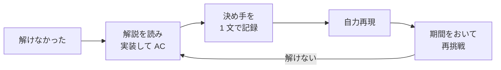

!!! abstract "要点"
    - **何のページか**：解けなかった問題を、次は解ける力に変える手順を引ける。解説を見るまでの時間、解説の読み方、読んでも分からないときの対処、upsolve と復習、記録、問題の量と難しさの選び方、速さの訓練、AtCoder Problems の使い方を、教材の解説と記録の仕組みにつなげる。
    - **使い方**：コンテストの後なら[解説を見るまでの時間](#when-to-read)から[記録の付け方](#records)まで順に読む。練習の計画を立てるときは[演習の量と難しさの選び方](#choosing-problems)から読む。どの節も単独で読める。
    - **前提**：なし

<!-- textlint-disable -->
別名：upsolve・解説の読み方・復習・精進・練習の方法
<!-- textlint-enable -->

精進は、競技プログラミングで練習を指して使われる言葉である。このページは、解けなかった問題を前にしたときの手順を、解説を見るまで・読むとき・読んだ後・記録・次の問題選びの順に並べる。時間や量の目安には複数の説があり、どれも固定の規則ではない。ここでは出典ごとに並べ、そのうえで選び方の考え方を示す。

## 解説を見るまでの時間 {#when-to-read}

解説を見るまでに自分で考える時間には、決まった正解がない。上位者の手引きと色が変わった人の記事（色変記事）では、次のように目安が分かれる。E869120 氏の 2 つの表は、行が読者の**今の**色を指す。目指す色の行ではなく、今の色の行を使う。

| 出典 | 目安 |
| --- | --- |
| E869120 中級編 | 配点ごとに、茶色の人は 100〜400 点で 5・7・30・45 分、緑色の人は 100〜600 点で 5・5・20・35・50・120 分 |
| E869120 上級編 | 配点ごとに、水色の人は 100〜700 点で 3・4・10・25・45・90・120 分、青色の人は 100〜800 点で 2・3・6・20・40・80・100・120 分、黄色の人は 100〜900 点で 1・2・4・15・35・60・80・100・120 分 |
| Youteru（入水） | 水 diff 以上は 1 時間ほど粘り、それでも分からなければ時間をおいて再挑戦する |
| igeee（入黄、復習のとき） | 5 分ほど止まったら解説を開く。考え直しになりそうならすぐ見る |
| edon8618（入黄） | 解けない問題は解説を見る。量をこなせないなら、解けるまで何日も解説を見ないのは効果が薄い |

E869120 氏の 2 つの表の時間は、どちらも「解答にかかった時間」ではなく「解法が分からなかった時間」の目安である。ここから、考える時間を 2 つに分けると判断しやすくなる。

- **方針が出ない時間**：短めに区切る。新しい案が出なくなったら解説を見る。易しい問題で手が止まる原因は、典型の知識の不足であることが多い。早めに見てよい（E869120 中級編）。
- **実装に詰まっている時間**：方針は分かっているので、表の時間には数えない（E869120 中級編）。解説を見る前に自分で原因を探す価値がある。[WA・TLE・RE・MLE の原因チェックリスト](debugging-checklist.md)と[ストレステストと実験](stress-testing.md)を使う。

区切りを延ばしすぎると、1 日に解ける問題の数が減る。区切りを縮めすぎると、自分で考える練習が減る。目安の表は、その間のどこに線を引くかを決める材料として使う。

## 解説の読み方 {#reading-editorials}

解説は一度に全部読まない。最初の数行で「何に着目するか」が分かったら、そこで止めて続きを自分で考える。詰まりが取れた位置で止めれば、残りは自力で解いた経験になる。

読み終えたら、決め手を 1 文で書き出す。chokudai 氏は、解いた後に「この部分にこういう要素があったから、この解法で解けた」と確かめることを、典型を増やす練習として勧めている。書き出すときは、手法の名前ではなく、手法を連想させた条件の側を書く。

- 弱い書き方：累積和を使う。
- 決め手を書いた形：区間の和の条件を累積和の差に言い換えると、右端を固定して左端を数えられる。

解説を読んだ問題は必ず実装して AC する（解説 AC）。読んで分かったつもりでも、実装すると境界や計算量の見積もりで止まることが多い。解説に出てきた手法の名前は、[逆引き辞典（言い回し・サインから）](reverse-index-signs.md)や[用語索引](term-index.md)で教材のページを引き、冒頭の要点と前提を確かめる。

## 解説を読んでも分からないとき {#still-stuck}

まず、解説のどの 1 文から分からなくなったかを特定する。分からない理由は、おおむね次の 3 つに分かれ、それぞれ対処が違う。

| 分からない理由 | 対処 |
| --- | --- |
| 前提の知識がない（知らない手法・用語が出てくる） | 教材でその手法のページを引き、前提のページまで戻る |
| 言い換えの理由が分からない | 小さい例を手で動かす。第三者の解説で別の説明を読む |
| 解説は分かるが実装できない | ほかの人の提出を読む |

drken 氏は、解説を読んでも分からないときの手段として次の 3 つを挙げている。

- **解説放送**：公式の解説放送は、問題に必要な知識から丁寧に説明している。
- **ほかの人の提出**：コンテスト中の提出を提出時刻の順に並べ、早いものから読む。
- **第三者の記事**：検索語に「AtCoder」とコンテスト名と問題の題名を入れて探す。1 つで分からなくても、複数を読むと分かることがある。

claude.ai のプロジェクトに教材をつなげておけば、問題と自分の考えを渡して、教材のページを引きながら解説してもらえる。「ヒントだけ」か「解説まで」かを選べる。頼み方は[この教材の使い方](../start/how-to-use.md#claude)に置いた。開催中のコンテスト（ADT・AWC を含む）の問題には使わない（AtCoder の生成 AI のルールは [AtCoder の仕組み](../start/atcoder-system.md#ai-rules)）。

それでも分からない問題は、保留にしてよい。印を付けておき、手法のページや前提を読み進めてから、日をおいて解説を読み直す。

なお E869120 上級編は、黄〜橙を目指す段階での難問の練習について書いている。自分のレートよりずっと難しい問題を解説なしで考え、120 分ほどで解法が分からなければいったん離れ、2 週間〜数か月後に再挑戦する。これは解説を読む前の打ち切りの話で、解説を読んだ後の保留とは場面が違う。

## upsolve と復習 {#upsolve}

upsolve は、コンテストで解けなかった問題を、終了後に解説などを使って AC まで持っていくことである。drken 氏は、解けなかった問題を次は解けるように復習することを、上達のために極めて大切な段階と書いている。解説 AC で終わらせず、自分の力で解けるかを確かめる段階まで進めると身につきやすい。

色変記事に出てくる復習の方法は、確かめる内容と手間で次のように並ぶ。

| 方法 | 何を確かめるか | 出典 |
| --- | --- | --- |
| 自力再現 | 解説とコードを閉じ、問題文だけから書き直せるか。できなければ解説に戻って繰り返す | edon8618 |
| 説明の練習 | 解法と、そこに至る筋道を、見ずに人へ説明できるか。3 回できたら卒業 | mkreem |
| 思い出す訓練 | 問題を見て、実装の手前まで発想を頭の中で再現できるか。実装はしない | igeee（Anki） |
| 期間をおいた再挑戦 | 日をおいてから、解説なしで解けるか | 教材の考え（E869120 上級編の再挑戦は、難問を解説なしで考えるときの話） |

図は、解説 AC → 決め手の記録 → 自力再現 → 期間をおいた再挑戦の順に進み、再挑戦で解けなければ解説に戻る流れを表す。

同じ問題の繰り返しには異論もある。Un_titled 氏は、同じ問題を繰り返すと記憶には残るが、苦手が分かったら同じ問題よりも類題を探す方が効率的だと書いている。決め手の条件から[逆引き辞典](reverse-index-signs.md)で手法のページを引けば、そのページの例題・練習が類題になる。

教材の中では、ページの「理解した」チェックと確認問題（折りたたみ）が復習に使える。チェックを付けたページの確認問題に、期間をおいて答え直すとよい（チェックの仕組みは[この教材の使い方](../start/how-to-use.md#progress)）。

## 記録の付け方 {#records}

記録は、残したいと思った問題だけでよい。全問を記録しようとすると続かない。記録するときは、解けなかった原因を次の 4 つから 1 つ選ぶ。原因によって次にすることが違う。

| 原因 | 次にすること | 引くページ |
| --- | --- | --- |
| 知識不足 | 手法のページを読み、例題を解く | [知識マップ](knowledge-map.md)・[色別ロードマップ](roadmap.md) |
| 気づけなかった | 手法を連想させた条件を 1 文にする | [詰まったときの発想リスト](thinking-checklist.md) |
| 実装ミス | ミスの種類を書き、その処理の書き方を 1 つに統一する | [原因チェックリスト](debugging-checklist.md) |
| 時間不足 | [速さの訓練](#speed)をする | [コンテストの戦い方](contest-strategy.md#time-targets) |

原因が重なるときは、いちばん大きいものを選ぶ。終了後の振り返りで原因を切り分ける手順は[コンテストの戦い方](contest-strategy.md#after-contest)に置いた。

記録の道具として、この教材は記録用スキル `/record-problem` を持つ（詳しくは[この教材の使い方](../start/how-to-use.md#record-skill)）。流れは次のとおりである。

1. claude.ai の解説の最後に「記録用まとめを出して」と頼む。
2. 出たコードブロックを写し、手元の Claude Code で `/record-problem` に続けて貼る。
3. `notes/<問題ID>.md` に 1 問 1 ファイルで記録される。同じ問題は追記になる。

記録用まとめには、原因・学んだことの一言・関連するページ（3 件まで）・教材の改善案が入る。`notes/` は git の追跡外なので、記録は手元だけに残り、claude.ai の解説からは読まれない。学んだことの一言は、[解説の読み方](#reading-editorials)で書き出した決め手をそのまま使う。

## 演習の量と難しさの選び方 {#choosing-problems}

演習の量には、E869120 氏の 2 つの目安がある。

- 中級編：水色を目指すなら、精選 100 問のうち 70 問を解く。
- 上級編：2019-12-09 時点の集計で、AC 数の帯ごとの黄色の達成割合は 1000〜1199 問で 35.4%、1200〜1499 問で 58.8%、1500〜1999 問で 87.1% だった。

AC 数と色の関係は相関であって、数を増やせば色が上がるという意味ではない。Youteru 氏は、灰色 500 問より青 100 問の方が努力の量は大きいとして、目標を AC 数ではなく「水 diff を 100 問」のように難しさで立てることを勧めている。

難しさは、自分のレート付近で解ける見込みのある問題を中心にする。difficulty は、その問題を半々の確率で解けるレートの値である（[AtCoder Problems の使い方](#atcoder-problems)）。色変記事では、次の声が多い。

- 実力より大きく上の問題は、典型以外の部分で詰まって効果が薄い（edon8618）。
- 入水の前に、解けそうな青 diff を 1 問 1 時間で解いたのが最も効いた。ただし、青 diff が合わない緑の人も多いとして、まず自分に合うかを試すよう勧めている（Youteru）。
- 水 diff を多く解くより、緑 diff までを速く安定して解く方が水パフォーマンスにつながった。NoviSteps（過去問に 11Q〜6D のグレードを付けたサイト。[問題集の案内](problem-sets.md#tools)）の同じグレードを 7〜8 割解けたら次へ進んだ（siooisi）。
- 青から黄の間に新しく覚えた知識はあまり使わず、ほとんど水色の頃の知識で足りた（nouka28）。

黄色を目指す段階でも、青 diff 以下を確実に速く解くことが土台になる。問題集と練習用コンテストのどれを使うかは[問題集と練習用コンテストの案内](problem-sets.md)、色ごとに読むページの順は[色別ロードマップ](roadmap.md)にまとめた。

## 速さの訓練 {#speed}

速さは、知っている手法を時間内に使い切る力である。解けた問題でも、時間がかかっていれば速さの訓練の材料になる。手引きと色変記事には、次の方法がある。

- **易しい問題をまとめて解く**：ABC から A を 1 問・B を 2 問・C を 3 問集め、30 分でできるだけ解く。週に 2 回ほど行う（E869120 中級編）。
- **バーチャル参加**：AtCoder 公式の機能で、過去の ABC を 1 回選び、本番と同じ時間で参加して当時の順位表と比べる。週に 2〜3 回行う（E869120 上級編）。
- **ADT**：AtCoder Daily Training の直近 200 回ほどを F まで埋めたうえで、All（全難度）の回を 60 分で全完できるかを確かめる。週に 2 回ほど行う（igeee）。

目標の時間は、目指すパフォーマンスごとに「A〜D・A〜E・A〜F を何分で解き終えるか」で立てる。その目安は[コンテストの戦い方](contest-strategy.md#time-targets)に置いた。

## AtCoder Problems の使い方 {#atcoder-problems}

AtCoder Problems は、AtCoder の問題を difficulty・解いた記録とともに一覧できる第三者のサイトである。精進では次の 3 つの機能をよく使う。

- **difficulty**：その問題を 50% の確率で解けるレートの値で、コンテストの結果から統計的に推定される。X 色の問題は「X 色の人の半分が解ける問題」であって、「X 色の人なら解ける問題」ではない。
- **おすすめ問題（Recommendation）**：自分のレートをもとに問題を挙げる。解ける確率の目安は Easy で 80%、Moderate で 50%、Difficult で 20% である。既定では解いた問題を除く。問題を選んで、そのままバーチャルコンテストを作れる。
- **バーチャルコンテスト**：GitHub でログインして AtCoder の ID を登録すると、日時と問題を決めてコンテストを作れる。Bacha Gacha は、difficulty の範囲を指定すると問題をランダムに選ぶ。参加者が解いた問題を除く設定もある。AtCoder 公式の[バーチャル参加](#speed)と違い、問題と時間を自分で選べる。

[演習の量と難しさの選び方](#choosing-problems)に合わせるなら、ふだんは Moderate を中心にし、速さの訓練には Easy の問題でバーチャルコンテストを組むとよい。この教材は AtCoder Problems と連携しない。教材の「解いた」チェックはブラウザの中だけに残る。

## 参考 {#references}

- [E869120「レッドコーダーが教える、競プロ・AtCoder上達のガイドライン【中級編：目指せ水色コーダー！】」](https://qiita.com/e869120/items/eb50fdaece12be418faa)：解説を見るまでの時間（茶色・緑色）とその意味、早めに見る理由、易しい問題をまとめて解く訓練、精選 100 問の目安
- [E869120「レッドコーダーが教える、競プロ・AtCoder上達のガイドライン【上級編：目指せレッドコーダー！】」](https://qiita.com/e869120/items/acba3dd8649d913102b5)：解説を見るまでの時間（水色・青色・黄色）、難問を解説なしで考えるときの再挑戦、バーチャル参加、AC 数ごとの黄色の達成割合
- [drken「AtCoder コンテストについての tips」](https://qiita.com/drken/items/8a6f139158cde8a61dce)：解説を読んでも分からないときの 3 つの手段、復習の大切さ
- [chokudai「競技プログラミングの強みと「典型力」について」](https://chokudai.hatenablog.com/entry/2018/04/23/165232)：解いた後に、どの要素から解法を連想できたかを確かめる振り返り
- [edon8618「競技プログラミング　atcoderで黄色になった話」](https://qiita.com/edon8618/items/16d23d247c9cad158c2c)：自力再現、効果が薄い練習とその条件
- [igeee「AtCoder黄色到達までにやったこと（復習と環境づくり）」](https://qiita.com/igeeeeee/items/9ef3a96ae19d9c0fe7ba)：Anki による思い出す訓練、ADT の使い方
- [mkreem「【入青】凡人が青コーダーになるために」](https://qiita.com/mkreem/items/f6941f6bbf932871a3f2)：説明できるかどうかで定着を確かめる復習
- [Youteru「数狂、遂に入水達成(入水の心得3つ)」](https://qiita.com/Youteru/items/074eafe7fc7b693aca39)：解説を見るまでの時間、青 diff の演習、目標を難しさで立てること
- [siooisi「入水したのでいろいろ書いた」](https://qiita.com/siooisi/items/e50013e4ee7d615cba37)：緑 diff までを速く安定させること、NoviSteps の進め方
- [nouka28「AtCoderで入黄しました！！」](https://qiita.com/nouka28/items/a8b06865331838642ff2)：青から黄の間に実戦で使った知識
- [Un_titled「【色変記事】緑になってから約2か月で入水しました！」](https://qiita.com/Un_titled/items/a7ed6f6da64d6b0d19f1)：同じ問題の繰り返しより類題を勧める考え
- [AtCoder Problems の FAQ（faq_ja.md）](https://github.com/kenkoooo/AtCoderProblems/blob/master/doc/faq_ja.md)：difficulty の定義
- [AtCoder Problems のガイド（recommend.md）](https://github.com/kenkoooo/AtCoderProblems/blob/master/guide/src/ja/recommend.md)：Easy・Moderate・Difficult の確率
- [AtCoder Problems のガイド（virtual_contest.md）](https://github.com/kenkoooo/AtCoderProblems/blob/master/guide/src/ja/virtual_contest.md)：作り方と Bacha Gacha
- [AtCoder Problems のソース（Recommendations/index.tsx）](https://github.com/kenkoooo/AtCoderProblems/blob/master/atcoder-problems-frontend/src/pages/UserPage/Recommendations/index.tsx)：おすすめ問題の除外の既定値
