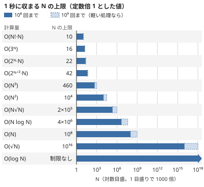

!!! abstract "要点"
    - **何のページか**：N の上限などの制約から、間に合う計算量と候補の手法を引ける。計算量から手法を引く逆向きの表も持ち、制約の帯ごとの候補のページは各ページの制約のサインから生成する。
    - **いつ使うか**：
        - $N \le 2 \times 10^5$ なのに $O(N^2)$ の方針しか浮かばない。
        - 方針は立ったが、制限時間に収まるかが分からない。
        - $N \le 20$ や $K \le 10$ のように、一部の制約だけが妙に小さい。
    - **使い方**：制約の最大値を[制約の表](#constraint-table)で引いて許される計算量を知り、[帯ごとの候補のページ](#pages-by-constraint)で手法を探す。思いついた手法の計算量が分かっているなら、[計算量の表](#complexity-to-methods)から引く。
    - **目安**：C++ の単純な処理なら 1 秒に $10^8$ 回はまず間に合い、軽い処理なら $10^9$ 回近くまで届く。$N = 2 \times 10^5$ で $N \log N \approx 3.5 \times 10^6$、$N^2 = 4 \times 10^{10}$ である。

<!-- textlint-disable -->
別名：制約から解法を推測する・計算量の目安・制約と計算量の対応表・制約から逆引き・計算量から逆引き
<!-- textlint-enable -->

逆引き辞典（制約・計算量から）は、問題文の制約の数字から、想定される計算量と疑う手法を引くための表の集まりである。制約は出題者が想定解の計算量に合わせて決めるので、逆に読めば候補が絞れる。見積もりの手順そのもの（ループの回数・log の数・ならし計算量）は[計算量の見積もり](../basics/complexity-estimation.md)にあり、ここは引くための表に絞る。

## 引き方と注意 {#how-to-read}

制約から手法を引くときは、次の 3 段で進める。

1. **制約と制限時間を確かめる**：問題文の制約のうち、最大の量だけでなく、すべての量の上限を書き出す。$N$ と $Q$・$H$ と $W$・値の上限 $A_i \le 10^9$・テストケースの数と $N$ の総和などである。実行時間制限も問題ごとに違うので読む。
2. **許される計算量を引く**：最大の量を[制約の表](#constraint-table)に当て、$10^8$ 回前後に収まる計算量のクラスを読む。量が複数あるときは、それぞれの最大値を同時に式へ入れる（$N, Q \le 2 \times 10^5$ でクエリごとに $O(N)$ なら $4 \times 10^{10}$ 回）。
3. **候補の手法を疑う**：表の候補と[帯ごとの候補のページ](#pages-by-constraint)から、問題の形に合うものを選ぶ。選んだ手法が本当に使えるかは、手法のページの「いつ使うか」で確かめる。

注意は 3 つある。

- **制約は決め手ではなく入口である**：同じ $N \le 2 \times 10^5$ でも、ソート・セグメント木・尺取り法のどれが正解かは制約だけでは決まらない。問題文の言い回しからも引く（[逆引き辞典（言い回しから）](../guide/reverse-index-signs.md#by-phrase)）。
- **制約に囚われすぎない**：制約は作問の都合で緩いことがある。$N \le 2000$ でも想定解が $O(N \log N)$ のことや、指数に見える探索が実は多項式で済むこともある。表の帯は「これより重いと間に合わない」上限として読む。
- **小さい制約にも意味がある**：$K \le 10$ や mod 1000 のように、一部だけ小さい制約は、その量を状態や全探索の対象にせよという合図のことが多い（[値や複数の制約から読めるサイン](#value-signs)）。

## 1 秒あたりの演算回数の目安 {#ops-per-second}

C++ で書いた単純な処理は、1 秒に $10^8$ 回ならまず間に合う。数×$10^8$ 回は中身次第で、$10^9$ 回に届くのは足し算や掛け算だけの軽いループに限られる。制限が $T$ 秒なら目安も $T$ 倍にする。

AtCoder の C++ は C++23（GCC 15.2.0）で、`-std=gnu++23 -O2 -march=native` などの指定でコンパイルされる（詳しくは [AtCoder と手元の C++ 環境](../cpp/cpp-environment.md#options)）。同じ版の g++-15 を同じ `-O2` で使い、手元で 4 種類のループを測った（`-march=native` は付けていないが、付けても結果はほぼ同じだった）。CPU は Intel Core i7-13700 で、WSL2 の上で動かした。

| 測った処理 | 回数 | 時間 | 1 秒あたりに直すと |
| --- | --- | --- | --- |
| 前の結果に依存する掛け算と足し算 | $10^8$ | 0.08 秒 | 約 $1.2 \times 10^9$ 回 |
| 32 MiB の配列を先頭から順に読んで足す | $10^8$ | 0.03 秒 | 約 $3 \times 10^9$ 回 |
| 同じ配列を乱数で決めた位置で読んで足す | $10^8$ | 0.44〜0.51 秒 | 約 $2 \times 10^8$ 回 |
| `set` への挿入と `lower_bound`（$10^6$ 回ずつ） | $2 \times 10^6$ | 0.34 秒 | 約 $6 \times 10^6$ 回 |

この表は手元の 1 台で測った値であり、AtCoder の判定機の速さとは一致しない。読むべきは比である。演算の回数が同じでも、キャッシュに収まらない大きさ（数十 MB）の配列を飛び飛びに読むと、順に読むより 10 倍以上遅い。`set` の操作は 1 回が、配列を順に読む処理の 500 回分ほどに当たる。「$10^8$ 回」の目安は、配列を順に読むような軽い処理を数えたものと考える。`set` や `map` の操作が $10^7$ 回程度になる解法（判定の中で `set` を引く二分探索など）は、1 秒を使い切ることがある。

測ったコードは次のとおりである。標準出力には検算用の値だけを出し、時間は標準エラーに出す。

```cpp
--8<-- "reverse-index-constraints/ops-benchmark.cpp:core"
```

定数倍を減らす書き方（配列で持つ・連続して読む・入出力を速くする）は、[計算量の見積もりの定数倍の節](../basics/complexity-estimation.md#constant-factor)と[入出力と定数倍](../cpp/cpp-io.md#tle-causes)にある。

## 制約 → 計算量 → 候補の手法 {#constraint-table}

制約の上限から、許される計算量と候補の手法を引く表である。計算量の列は「最大値を入れて $10^8$ 回前後に収まる」ものを並べた。上限がちょうど表の値でなくても、近い行を読めばよい。

| 制約の上限 | 許される計算量 | 候補の手法 |
| --- | --- | --- |
| $N \le 10$ | $O(N! \cdot N)$ | [順列全探索](../basics/bit-full-search.md#permutations)、[再帰による全列挙](../basics/recursive-enumeration.md#skeleton)、[小さいグラフの全探索](../graph/small-graph-brute-force.md#isomorphism) |
| $N \le 20$ | $O(2^N N)$、$O(3^N)$（$N \le 15$〜$16$ 程度） | [bit 全探索](../basics/bit-full-search.md#bitmask)、[bitDP](../dp/bit-dp.md#subsets-as-integers)、[部分集合を列挙する DP](../dp/subset-enumeration-dp.md#why-3n)、[包除原理](../comb/inclusion-exclusion.md#bit-enumeration) |
| $N \le 40$ | $O(2^{N/2} N)$ | [半分全列挙](../basics/meet-in-the-middle.md#combine-halves) |
| $N \le 80$ | $O(N^4)$ | 状態が 3 次元で遷移が $O(N)$ の DP（[DP の状態の設計](../dp/dp-state-design.md#state-count)）、4 つ組の全探索 |
| $N \le 500$ | $O(N^3)$ | [区間 DP](../dp/interval-dp.md#state)、[ワーシャルフロイド法](../graph/warshall-floyd.md#k-outer)、[掃き出し法](../math/gaussian-elimination.md#row-reduction) |
| $N \le 5000$ | $O(N^2)$（log 付きは $N \le 2000$ 程度） | [最長共通部分列と編集距離](../dp/lcs.md#recurrence)、[二乗の木 DP](../dp/tree-dp-square.md#why-n2)、[挿入 DP](../dp/insertion-dp.md#relative-rank)、各頂点からの [BFS](../graph/bfs.md#multi-source) |
| $N \le 2 \times 10^5$ | $O(N \log N)$、$O(N \log^2 N)$、$O(N \sqrt{N})$ | [ソート](../cpp/cpp-algorithms.md#sort)、[二分探索](../basics/binary-search.md#lower-bound)、[尺取り法](../basics/two-pointers.md#monotonicity)、[セグメント木](../ds/segment-tree.md#what-it-does)、[ダイクストラ法](../graph/dijkstra.md#why-correct)、[平方分割](../ds/sqrt-decomposition.md#buckets) |
| $N \le 10^6$ | $O(N)$、軽い $O(N \log N)$ | [いもす法](../basics/imos.md#imos-1d)、[Z-algorithm](../string/z-algorithm.md#linear-time)、[最小素因数の篩](../math/spf-sieve.md#build-and-factor)、[調和級数の列挙](../math/harmonic-sum.md#why-n-log-n) |
| $N \le 10^7$ | $O(N)$、$O(N \log \log N)$ | [エラトステネスの篩](../math/sieve-eratosthenes.md#complexity)、[線形篩](../math/spf-sieve.md#linear-sieve)、[累積和](../basics/prefix-sum.md#half-open) |
| $N \le 10^{12}$ | $O(\sqrt{N})$ | [約数列挙](../math/divisor-enum.md#why-sqrt)、[素因数分解](../math/prime-factorization.md#procedure)、[商の列挙](../math/floor-quotient-enum.md#why-sqrt)、[区間篩](../math/segmented-sieve.md#why-sqrt) |
| $N \le 10^{18}$ | $O(\log N)$、$O(\log^2 N)$、$O(1)$ | [答えで二分探索](../basics/binary-search-answer.md#monotonicity)、[繰り返し二乗法](../math/mod-pow.md#binary-expansion)、[行列累乗](../math/matrix-power.md#fast-power)、[ダブリング](../basics/doubling.md#table)、[桁 DP](../dp/digit-dp.md#tight-flag)、[周期性の検出](../basics/periodicity.md#rho)（状態の種類が少ないとき）、[floor sum](../math/floor-sum.md#why-log) |

$N \le 10^7$ の行では、計算量より先にメモリを見積もる。`int` の配列 $10^7$ 個は 40 MB で収まるが、`vector<vector<int>>` や `map` で持つと何倍にもなる。メモリの見積もり方は[計算量の見積もりの手順](../basics/complexity-estimation.md#how-to-estimate)にある。

計算量のクラスごとに、1 秒（$10^8$ 回）に収まる $N$ の上限を図にした。



図の値は定数倍を 1 とした計算値である。濃い棒の先は 1 秒に $10^8$ 回で数えた上限、破線の先は軽い処理で $10^9$ 回まで届くとしたときの上限である。指数の計算量の棒は $N = 10$〜$40$ の狭い範囲に固まり、多項式の計算量は $N^3$・$N^2$・$N \sqrt{N}$・$N \log N$・$N$ と 1 段軽くなるごとに上限が約 20 倍に伸びる。$10^9$ 回まで許しても伸びは小さく、指数の計算量では $N$ が 1〜6 増えるだけである。制約の帯の境目が $N \le 20$・$5000$・$2 \times 10^5$ のように決まった値に集まるのは、このためである。

## 制約の帯ごとの候補のページ {#pages-by-constraint}

各ページが「この制約なら疑う」として挙げたサインを、上限の数で帯に分けて集めた一覧である。[制約の表](#constraint-table)より細かく、「$H, W \le 2000$ のグリッド」「$K \le 10$ 個の特別な地点」のような形の制約から引ける。

- 帯は、$N$・$Q$・$K$ などの個数や回数の上限を優先し、そのうち最初に書かれた数で分けている。値の上限（$A_i$・座標など）は、個数や回数の上限がないときだけ使う。$N \le 16$〜$18$ のように幅のあるサインは、大きい方の数が入る帯に置いた。
- 1 つのページが複数の帯に現れることがある。逆に、同じ帯の中の行は互いに排他ではなく、問題の形に合う行を探して読む。
- 数の上限で分けられないサイン（実行時間制限が長い・値は大きいが個数は少ない、など）は最後の表にまとめた。
- 一覧は各ページの front matter から生成しており、ページが増えると行も増える。

<!-- gen:begin signs-constraint -->
<!-- textlint-disable -->

### 上限が 10 以下 {#signs-constraint-10}

| 制約 | ページ | レベル |
| --- | --- | --- |
| 制約の一部だけが小さい（K ≤ 5、末尾の K ≤ 10 文字、文字の種類 26） | [DP の状態の設計](../dp/dp-state-design.md) | 水 |
| N ≤ 8 / 20 / 40 / 400 / 5000 / 2×10^5 / 10^18 のような制約の大きさ | [計算量の見積もり](../basics/complexity-estimation.md) | 基礎 |
| 一方の次元だけ極端に小さい（H ≤ 8 など） | [全探索の設計](../basics/brute-force.md) | 基礎 |
| パターンの個数 ≤ 8 程度で、すべてを含むかを問う | [照合オートマトン上の DP](../string/string-automaton-dp.md) | 青 |
| N ≤ 8〜10 で並び順・割り当て・頂点の対応を決める | [bit 全探索と順列全探索](../basics/bit-full-search.md) | 基礎 |
| N ≤ 10 程度で、経路を全部列挙できる | [深さ優先探索（DFS）](../graph/dfs.md) | 基礎 |
| N ≤ 8〜10 で頂点の対応や辺の部分集合を全部試せる | [小さいグラフの全探索](../graph/small-graph-brute-force.md) | 基礎 |
| 指定した K 点（K ≤ 10 程度）をすべて連結にする最小コスト | [最小シュタイナー木](../graph/steiner-tree.md) | 発展 |
| K ≤ 10 程度の少数の要素を選ぶ条件で、要素の種類が多い | [乱択アルゴリズム](../misc/randomized.md) | 青 |

### 上限が 20 以下 {#signs-constraint-20}

| 制約 | ページ | レベル |
| --- | --- | --- |
| 各要素が 3 択で N ≤ 12 程度（3^N 通り） | [bit 全探索と順列全探索](../basics/bit-full-search.md) | 基礎 |
| N ≤ 10〜12 人を組・グループに分ける（ベル数 B12 ≈ 4.2×10^6） | [再帰による全列挙](../basics/recursive-enumeration.md) | 水 |
| N ≤ 10〜12 で、グループ分けを全部試す | [第 2 種スターリング数とベル数](../comb/bell-number.md) | 青 |
| グリッドの短い辺 ≤ 6〜14 | [プロファイル DP](../dp/broken-profile-dp.md) | 黄 |
| 2N ≤ 16 人を 2 人組に分ける（(2N−1)!! 通り） | [再帰による全列挙](../basics/recursive-enumeration.md) | 水 |
| N ≤ 16 程度の一般グラフでペアを作る | [一般グラフのマッチング](../graph/general-matching.md) | 発展 |
| 特別な地点が K ≤ 17 個（ほかの地点はグラフで結ばれている） | [bitDP](../dp/bit-dp.md) | 水 |
| N ≤ 17 程度の頂点数で、条件を満たす辺の選び方を数える | [連結なグラフの数え上げ](../comb/counting-labeled-graphs.md) | 黄 |
| N ≤ 18 程度で、集合とその部分集合の組をすべて調べる（全体で 3^N） | [bit 演算の基本と XOR の性質](../basics/bit-operations.md) | 基礎 |
| N ≤ 16〜18（3&#94;N ≈ 4×10&#94;7〜4×10&#94;8） | [部分集合を列挙する DP](../dp/subset-enumeration-dp.md) | 青 |
| カードの枚数 N ≤ 18 程度で、残りのカードの集合が局面になる | [ゲームの基本と勝敗の DP](../comb/game-basics.md) | 水 |
| N ≤ 15〜20 で各要素を「選ぶ／選ばない」 | [bit 全探索と順列全探索](../basics/bit-full-search.md) | 基礎 |
| N ≤ 16〜20 | [bitDP](../dp/bit-dp.md) | 水 |
| 3 彩色なら N ≤ 20 でも、DFS 順に塗れば 3·2^(N−1) 通り以下に収まる | [小さいグラフの全探索](../graph/small-graph-brute-force.md) | 基礎 |
| 禁止条件が M ≤ 20 個程度 | [包除原理](../comb/inclusion-exclusion.md) | 青 |
| N ≤ 20 で、すべての部分集合（bit）ごとの和・最大を求める | [部分集合の高速ゼータ変換とメビウス変換](../comb/zeta-mobius-subset.md) | 黄 |

### 上限が 40 以下 {#signs-constraint-40}

| 制約 | ページ | レベル |
| --- | --- | --- |
| N ≤ 40 で部分集合を選ぶ（2^N は無理だが 2^(N/2) は間に合う） | [半分全列挙](../basics/meet-in-the-middle.md) | 水 |
| H + W ≤ 40 程度のグリッドで、左上から右下への経路をすべて考える | [半分全列挙](../basics/meet-in-the-middle.md) | 水 |
| N ≤ 20〜40 の一般グラフで、独立集合・彩色・クリークを求める | [彩色数・最大独立集合・最大クリーク](../graph/chromatic-number.md) | 発展 |

### 上限が 80 以下 {#signs-constraint-80}

| 制約 | ページ | レベル |
| --- | --- | --- |
| N ≤ 50 程度で、長さ（個数）の組合せ（多重集合）を全部試す | [整数の分割と分割数](../comb/partition-number.md) | 黄 |
| N ≤ 50 程度の点で、実数の位置や半径を最適化する | [円と幾何の最適化](../geometry/circle-geometry.md) | 青 |
| N ≤ 60 程度で、mod を取らない正確な値を求める | [二項係数の意味と性質](../comb/binomial-coefficient.md) | 基礎 |

### 上限が 500 以下 {#signs-constraint-500}

| 制約 | ページ | レベル |
| --- | --- | --- |
| N ≤ 100、K ≤ 10^5 程度で、O(NK) は通るが O(NK^2) は通らない | [累積和・いもす法による DP の高速化](../dp/dp-prefix-sum.md) | 水 |
| N ≤ 100、値の総和 ≤ 10^5 程度 | [部分和 DP](../dp/subset-sum.md) | 基礎 |
| 状態数 n ≤ 100 程度で、繰り返しの回数 K が 10&#94;9〜10&#94;18 | [行列累乗](../math/matrix-power.md) | 青 |
| N ≤ 400 前後 | [区間 DP の応用](../dp/interval-dp-advanced.md) | 黄 |
| N ≤ 400 程度で全点対の距離が要る | [ワーシャルフロイド法](../graph/warshall-floyd.md) | 水 |
| N ≤ 300〜500 で O(N^3) が通る | [区間 DP](../dp/interval-dp.md) | 青 |
| N ≤ 数百、M ≤ 数千程度で、流す量 K ≤ N | [最小費用流](../graph/min-cost-flow.md) | 黄 |

### 上限が 5000 以下 {#signs-constraint-5000}

| 制約 | ページ | レベル |
| --- | --- | --- |
| M ≤ 1000 程度、N ≤ 100 程度 | [余り・個数を状態に持つ DP](../dp/dp-mod-state.md) | 水 |
| H, W ≤ 2000 程度のグリッドで領域の和を何度も求める | [2 次元累積和](../basics/prefix-sum-2d.md) | 水 |
| H, W ≤ 2000 程度（マスの数が 4×10^6 程度まで） | [グリッドグラフ](../graph/grid-graph.md) | 基礎 |
| H, W ≤ 3000 程度 | [グリッド上の DP](../dp/dp-grid.md) | 水 |
| N ≤ 3000 程度の順列の数え上げ | [挿入 DP・箱根駅伝 DP](../dp/insertion-dp.md) | 黄 |
| 2 つの列・文字列で N, M ≤ 3000〜5000 | [最長共通部分列と編集距離](../dp/lcs.md) | 水 |
| N ≤ 2000〜5000 の木 | [二乗の木 DP](../dp/tree-dp-square.md) | 黄 |
| N, M ≤ 数千（O(NM) が間に合う） | [ベルマンフォード法](../graph/bellman-ford.md) | 青 |
| 値の範囲 M ≤ 5000 程度で、各 k について P(X ≥ k) を数える | [期待値と確率の変換](../comb/expectation-tail-sum.md) | 黄 |
| \|S\| ≤ 5000 程度で、回転や置き方を全部試せる | [文字列の基本操作と辞書順](../string/string-basics.md) | 基礎 |
| N ≤ 2000〜5000 程度で、O(N^3) や O(N^2 M) が少し間に合わない | [bitset による高速化](../misc/bitset-speedup.md) | 青 |

### 上限が 2×10^5 前後（5×10^5 以下） {#signs-constraint-2e5}

| 制約 | ページ | レベル |
| --- | --- | --- |
| 法 P が 10^9 程度で、√P ≈ 3×10^4 個の表なら持てる | [位数・原始根・離散対数](../math/multiplicative-order.md) | 黄 |
| N ≤ 10^5 程度で、各位置の選択肢が数通り（全探索だと K^N 通り） | [DP の基本](../dp/dp-basics.md) | 基礎 |
| N ≤ 10^5 の列を K（数十）個の区間に分ける | [Monge 性による DP の高速化](../dp/monge.md) | 発展 |
| A_i < 2^60 で N ≤ 10^5 程度 | [XOR 基底](../math/xor-basis.md) | 黄 |
| H, W ≤ 10^5 のグリッドで、左上から右下への経路の数を求める | [格子路の数え上げ](../comb/lattice-paths.md) | 基礎 |
| H, W ≤ 10^5 のグリッドに障害物が N ≤ 3000 個 | [包除 DP](../comb/inclusion-exclusion-dp.md) | 黄 |
| 状態数 N ≤ 10^5 程度で、各状態の遷移が少数（または区間） | [期待値 DP](../comb/expected-value-dp.md) | 水 |
| Q ≤ 2×10^5 個のクエリ（1 回あたり O(log N) 以下が必要） | [計算量の見積もり](../basics/complexity-estimation.md) | 基礎 |
| A_i < 2&#94;30〜2&#94;60 で、全ペア（N ≤ 2×10&#94;5）の値を集計する | [bit ごとに独立に考える](../basics/bitwise-independence.md) | 水 |
| N ≤ 2×10^5 個の値に対して、Q ≤ 2×10^5 個の位置・個数の質問がある | [二分探索](../basics/binary-search.md) | 基礎 |
| Q ≤ 2×10^5 個の区間和のクエリで、値の更新がない | [累積和](../basics/prefix-sum.md) | 基礎 |
| N, Q ≤ 2×10^5 で区間への加算が多数あり、値を読むのは最後だけ | [いもす法](../basics/imos.md) | 基礎 |
| N ≤ 2×10^5 で区間を全部は調べられない | [尺取り法](../basics/two-pointers.md) | 基礎 |
| N ≤ 2×10^5 で、K が N^2 程度まで大きい | [K 番目の値](../basics/kth-value.md) | 青 |
| N ≤ 2×10^5 本の区間で、座標は 10^9 まで | [区間スケジューリング・区間の串刺し](../basics/interval-scheduling.md) | 基礎 |
| K ≤ 2×10^5 程度で、小さい順に K 個取り出せば足りる | [優先度付きキューを使う貪欲](../basics/greedy-priority-queue.md) | 水 |
| N, Q ≤ 2×10^5 で、区間ごとに計算し直すと間に合わない | [分割統治](../basics/divide-and-conquer.md) | 黄 |
| N ≤ 2×10^5 で 3 つ組は N^3 通りあり、全部は試せない | [一部を固定して数える](../thinking/fix-variable.md) | 基礎 |
| N ≤ 2×10^5 で、組・区間は N^2 個あり列挙できない | [主客転倒・寄与](../thinking/contribution.md) | 水 |
| N ≤ 2×10^5 で「部分列」「単調増加」 | [最長増加部分列](../dp/lis.md) | 水 |
| 文字の種類 26 程度、\|S\| ≤ 2×10^5 | [部分列 DP](../dp/subsequence-dp.md) | 黄 |
| N ≤ 2×10^5 では N^2 の隣接行列を持てない（N ≤ 2000 程度なら持てる） | [グラフの表現と用語](../graph/graph-basics.md) | 基礎 |
| N, M ≤ 2×10^5、またはマスの数 H×W ≤ 10^6 程度 | [幅優先探索（BFS）と無重み最短路](../graph/bfs.md) | 基礎 |
| N, M ≤ 2×10^5 で辺の重みが非負 | [ダイクストラ法](../graph/dijkstra.md) | 基礎 |
| N ≤ 2×10^5 で、補グラフの辺は N^2 本近くあり列挙できない | [補グラフ上の BFS](../graph/complement-graph-bfs.md) | 黄 |
| 完全グラフで N ≤ 2×10^5（辺が N^2 本あり、候補の辺を減らす必要がある） | [最小全域木](../graph/minimum-spanning-tree.md) | 水 |
| N, M ≤ 2×10^5 で、辺を 1 本ずつ除いて調べる O(M(N+M)) は間に合わない | [橋・関節点・二重連結成分](../graph/lowlink.md) | 黄 |
| N, M, Q ≤ 2×10^5 で、1 つの頂点の次数が N 近くになりうる | [次数による平方分割](../graph/degree-sqrt.md) | 青 |
| N ≤ 2×10^5 の木で、全ペア（N^2/2 組）についての和を求める | [辺で切って数える](../tree/tree-edge-contribution.md) | 水 |
| パス u–v に関するクエリが Q ≤ 2×10^5 個 | [最小共通祖先（LCA）](../tree/lca.md) | 青 |
| N, Q ≤ 2×10^5 で、部分木への更新と質問が交互に来る | [オイラーツアー](../tree/euler-tour.md) | 青 |
| クエリごとに K_i 個の頂点が指定され、ΣK_i ≤ 2×10^5 | [Auxiliary Tree](../tree/auxiliary-tree.md) | 発展 |
| N, Q ≤ 2×10^5 で、追加・削除・検索のクエリが来る | [STL コンテナの使い分け](../ds/stl-containers.md) | 基礎 |
| Q ≤ 2×10^5 で、更新のたびに上位 K 個の和や中央値を答える | [上位 K 個の和と中央値の管理](../ds/top-k-multiset.md) | 水 |
| Q ≤ 2×10^5 で、全体への操作を毎回 O(N) で行うと間に合わない | [全体への操作を変数で持つ](../ds/global-offset.md) | 基礎 |
| N ≤ 2×10^5 で、各要素から左右を見ていくと O(N^2) になる | [単調スタックとスライド最小値](../ds/monotonic-stack.md) | 水 |
| N, Q ≤ 2×10^5 で辺の追加と質問が混ざる | [Union-Find](../ds/union-find.md) | 基礎 |
| 情報と質問が交互に Q ≤ 2×10^5 回来る | [重み付き Union-Find](../ds/weighted-union-find.md) | 水 |
| N, Q ≤ 2×10^5 で更新があり、累積和を毎回作り直すと間に合わない | [BIT（Fenwick Tree）](../ds/fenwick-tree.md) | 水 |
| N ≤ 2×10^5 で、答えが約 2×10^10 まで大きくなる | [転倒数](../ds/inversion-number.md) | 水 |
| N, Q ≤ 2×10^5 で、更新のたびに条件を満たす最初の位置を答える | [セグメント木上の二分探索](../ds/segment-tree-binary-search.md) | 水 |
| 値が 10^9 まで、N, Q ≤ 2×10^5 | [値を添字にする BIT・セグメント木](../ds/segment-tree-on-values.md) | 水 |
| N, Q ≤ 2×10^5 で、区間の更新と区間の取得が交互に来る | [遅延セグメント木](../ds/lazy-segment-tree.md) | 水 |
| 値が 10^9 まで、N, Q ≤ 2×10^5 で、クエリにも新しい値が現れる | [クエリの先読み](../ds/offline-queries.md) | 水 |
| N, Q ≈ 2×10^5 で、制限時間が長めにとってある | [Mo's algorithm](../ds/mo-algorithm.md) | 青 |
| \|S\| ≤ 2×10^5 の数字列で、部分文字列を全部試すと間に合わない | [桁と mod](../math/digit-and-mod.md) | 水 |
| N, Q ≤ 2×10^5 で区間 gcd のクエリ | [GCD の性質](../math/gcd-properties.md) | 青 |
| N ≤ 2×10^5 程度で C(n,k) を何度も求める | [二項係数の前計算](../comb/binomial-precompute.md) | 基礎 |
| N, Q ≤ 2×10^5 で区間の多重集合を毎回比べる | [集合・多重集合のハッシュ](../string/hashing-for-sets.md) | 水 |
| 操作が M ≤ 2×10^5 回、各クエリは途中の時点での点の位置 | [回転・平行移動・アフィン変換](../geometry/rotation-transform.md) | 水 |
| N ≤ 2×10^5 点の全ペアのマンハッタン距離の和や最大を問い、全組 O(N^2) が間に合わない | [マンハッタン距離と 45 度回転](../geometry/manhattan-chebyshev.md) | 水 |
| A_i ≤ 10^9 を N ≤ 2×10^5 個足す、または 2 つ掛ける（int に収まらない） | [整数のオーバーフローと \_\_int128](../cpp/cpp-integer-overflow.md) | 基礎 |
| N ≤ 2×10^5 の木やグラフを再帰でたどる（一直線の入力では深さが N になり、手元の 8 MiB のスタックでは落ちることがある） | [AtCoder と手元の C++ 環境](../cpp/cpp-environment.md) | — |
| N, Q ≤ 2×10&#94;5〜5×10&#94;5 で、一点の更新と区間の質問が交互に来る | [セグメント木](../ds/segment-tree.md) | 水 |
| \|S\| ≤ 5×10^5 程度で全部分文字列を扱う | [Suffix Array と LCP 配列](../string/suffix-array.md) | 黄 |

### 上限が 10^6 以下 {#signs-constraint-1e6}

| 制約 | ページ | レベル |
| --- | --- | --- |
| A_i ≤ 10&#94;6（〜10&#94;7）の各要素を素因数分解する | [最小素因数の篩と線形篩](../math/spf-sieve.md) | 基礎 |
| A_i ≤ 10^6 程度で、値を配列の添字にできる | [調和級数と倍数の列挙](../math/harmonic-sum.md) | 水 |
| 値の上限 ≤ 10^6 程度で、すべての g について数える | [約数包除](../comb/divisor-inclusion-exclusion.md) | 青 |
| 値の上限 ≤ 10^6 程度で、gcd・lcm ごとに集計する | [約数・倍数のゼータ変換とメビウス変換](../comb/zeta-mobius-divisor.md) | 青 |
| N ≤ 10^6 程度で、μ を篩で前計算できる | [メビウス関数とメビウス反転](../comb/mobius-function.md) | 黄 |
| \|S\| ≤ 10&#94;5〜10&#94;6、文字は英小文字で 26×(N+1) の表が持てる | [部分列の判定と次の出現位置の表](../string/subsequence-matching.md) | 基礎 |
| N ≤ 10&#94;5〜10&#94;6 で、任意の 2 区間の一致判定が Q ≤ 2×10&#94;5 回 | [ローリングハッシュ](../string/rolling-hash.md) | 水 |
| \|S\|, \|T\| ≤ 10^6 で、ずらし方ごとに比べる O(\|S\|\|T\|) が間に合わない | [Z-algorithm](../string/z-algorithm.md) | 水 |
| \|S\| ≤ 10^6 で、すべての接頭辞について周期や一致する長さを問う | [KMP 法と文字列の周期](../string/kmp.md) | 青 |
| N ≤ 10^6 で、すべての中心（区間）について回文かを問う | [回文の扱いと Manacher](../string/palindrome.md) | 水 |

### 上限が 10^7 以下 {#signs-constraint-1e7}

| 制約 | ページ | レベル |
| --- | --- | --- |
| N ≤ 10&#94;6〜10&#94;7 の範囲の素数を全部使う | [エラトステネスの篩](../math/sieve-eratosthenes.md) | 基礎 |

### 上限が 10^12 以下 {#signs-constraint-1e12}

| 制約 | ページ | レベル |
| --- | --- | --- |
| 状態数が 10&#94;6〜10&#94;7 程度に収まる（9! = 362880、60&#94;4 ≈ 1.3×10&#94;7） | [状態を頂点にする](../graph/extended-dijkstra.md) | 水 |
| NW ≤ 10&#94;7〜10&#94;8（O(NW) が通る） | [ナップサック DP](../dp/knapsack-01.md) | 基礎 |
| 制限時間が長めで、O(N√N) ≈ 10^8 なら間に合う | [平方分割](../ds/sqrt-decomposition.md) | 黄 |
| −10^9 ≤ A_i ≤ 10^9 のように負の値を含む | [累積和と連想配列で区間を数える](../basics/prefix-sum-counting.md) | 基礎 |
| 重さの上限 W ≤ 10^9 で、価値の総和が 10^5 程度 | [DP の状態の削減](../dp/dp-dimension-reduction.md) | 青 |
| 法 M ≤ 10^9 が素数とは限らず、a^(M−2) で逆元を作れない | [拡張ユークリッドの互除法と一次合同式](../math/ext-gcd.md) | 水 |
| n, m ≤ 10^9 程度で i を全部回せない | [floor sum](../math/floor-sum.md) | 黄 |
| n ≤ 10^9 で k ≤ 10^6 程度 | [二項係数の前計算](../comb/binomial-precompute.md) | 基礎 |
| 座標が整数で \|x\|, \|y\| ≤ 10^9（外積は long long にぎりぎり収まる） | [ベクトルと外積](../geometry/geometry-vectors.md) | 基礎 |
| A_i < 2^30 で、追加・削除・質問が合わせて 2×10^5 回程度 | [Binary Trie](../ds/binary-trie.md) | 青 |
| N ≤ 10&#94;10〜10&#94;11 で Σ_{n≤N} f(n)（f は φ・約数の個数など）を求める | [乗法的関数の和と素数の個数](../math/multiplicative-function.md) | 発展 |
| K ≤ 10^12 で約数を扱う（約数の個数は最大 6720） | [全探索の設計](../basics/brute-force.md) | 基礎 |
| N ≤ 10^12 程度（√N ≤ 10^6）の約数・素数判定 | [約数列挙と素数判定](../math/divisor-enum.md) | 基礎 |
| N ≤ 10^12 程度の数を1つだけ素因数分解する | [素因数分解とルジャンドルの公式](../math/prime-factorization.md) | 基礎 |
| L, R ≤ 10^12 で R − L ≤ 10^6 | [区間篩](../math/segmented-sieve.md) | 水 |
| N ≤ 10^12 で i を全部回すと間に合わない | [商の列挙](../math/floor-quotient-enum.md) | 水 |
| N ≤ 10^12 で、N の約数や素因数を使う | [約数と倍数](../patterns/divisors-and-multiples.md) | — |

### 上限が 10^12 より大きい（10^18 など） {#signs-constraint-1e18}

| 制約 | ページ | レベル |
| --- | --- | --- |
| K ≤ 10&#94;18 回の操作で、状態の種類は 10&#94;5〜10&#94;6 程度 | [周期性の検出](../basics/periodicity.md) | 基礎 |
| K ≤ 10^18 回の移動・操作で、始点やクエリが多い | [ダブリング](../basics/doubling.md) | 水 |
| N ≤ 10^18 で、⌊N/2⌋・⌊N/3⌋ のような値しか現れない | [メモ化再帰](../dp/memoized-recursion.md) | 基礎 |
| N ≤ 10^18、または N が 10^4 桁の文字列 | [桁 DP](../dp/digit-dp.md) | 水 |
| K 回（K ≤ 10^18）移動した後の位置 | [Functional graph（出次数 1 のグラフ）](../graph/functional-graph.md) | 水 |
| N ≤ 10^18 の木 | [完全二分木](../tree/complete-binary-tree.md) | 基礎 |
| 入力に負の数（\|X\| ≤ 10^18 など）があり、割り算・余り・切り上げを使う | [整数の割り算と余り](../math/integer-division.md) | 基礎 |
| 指数・繰り返しの回数が N ≤ 10^18 | [繰り返し二乗法](../math/mod-pow.md) | 基礎 |
| 項数 N ≤ 10&#94;12〜10&#94;18 の等比数列の和を、素数とは限らない法 M ≤ 10&#94;9 で求める | [等比数列の和を mod で求める](../math/geometric-series-mod.md) | 基礎 |
| N ≤ 10&#94;12〜10&#94;18 で、約数の組を全探索して間に合うかを見積もる | [約数の個数の上界と高度合成数](../math/divisor-count-bound.md) | 水 |
| N ≤ 10^18 の素数判定・素因数分解（√N の試し割りでは間に合わない） | [大きな数の素数判定と素因数分解](../math/miller-rabin.md) | 発展 |
| N ≤ 10^18 で平方数・平方根を扱う | [整数の平方根・K 乗根と累乗数](../math/integer-root.md) | 基礎 |
| 線形漸化式の項数 K が数百〜数千で、N ≤ 10^18 | [線形漸化式の高速化](../math/linear-recurrence-fast.md) | 発展 |
| N ≤ 10^18 で、答えが段階ごとの選択肢の数の積になる | [和・積の法則と順列・組合せ](../comb/counting-basics.md) | 基礎 |
| 置換を K ≤ 10^18 回繰り返した結果を求める | [置換の巡回分解](../comb/permutation-cycles.md) | 基礎 |
| N ≤ 10&#94;9〜10&#94;18 で、パターンの長さの総和が小さい | [照合オートマトン上の DP](../string/string-automaton-dp.md) | 青 |

### 数の上限で分けられないもの {#signs-constraint-other}

| 制約 | ページ | レベル |
| --- | --- | --- |
| 実行時間制限が 5 秒など長い（重めの全探索が想定されている） | [計算量の見積もり](../basics/complexity-estimation.md) | 基礎 |
| テストケースが T 個あり、N の総和が 2×10^5 以下 | [計算量の見積もり](../basics/complexity-estimation.md) | 基礎 |
| 答えの範囲が 10&#94;9〜10&#94;18 と広い | [答えで二分探索](../basics/binary-search-answer.md) | 基礎 |
| 値は 10^9 まであるが、個数は 2×10^5 以下 | [座標圧縮](../basics/coordinate-compression.md) | 基礎 |
| 座標は 10^9 まで、区間とクエリは合わせて 2×10^5 個程度 | [イベントソートと平面走査の基本](../basics/event-sort.md) | 水 |
| レベルは 50 程度まででも、全体の長さが 10^15 を超える | [再帰的な構造](../basics/recursion-structure.md) | 基礎 |
| 余りや状態が M 種類しかなく、M + 1 個以上の候補がある | [対称性・鳩の巣原理・場合分け](../thinking/symmetry-pigeonhole-casework.md) | 基礎 |
| クエリの数 Q と目標の和 K がともに 5000 程度（O(QK) が通る） | [戻す DP](../dp/knapsack-undo.md) | 青 |
| K が 10&#94;5〜10&#94;6 程度 | [剰余を頂点にする最短路](../graph/modular-shortest-path.md) | 発展 |
| 頂点数が数百〜数千、辺数が 10^5 程度まで（フローが間に合う規模） | [最大流](../graph/max-flow.md) | 黄 |
| 要素の数 N が 100〜数百程度で、選び方は 2^N 通りある | [燃やす埋める](../graph/project-selection.md) | 黄 |
| 種類が 20 程度以下で、部分集合ごとに供給と需要を比べられる | [最小パス被覆と Hall の定理](../graph/dilworth-path-cover.md) | 発展 |
| 値が 10^9 まであり、配列の添字にできない | [set・multiset・map の応用](../ds/ordered-set.md) | 基礎 |
| 追加と取り出しが合わせて 2×10^5 回程度 | [優先度付きキュー](../ds/priority-queue.md) | 水 |
| 座標が 10^9 まで（配列の添字にできない） | [区間を set で管理する](../ds/interval-set.md) | 水 |
| クエリが 10^6 級で、1 回 O(1) で答えたい | [Sparse Table](../ds/sparse-table.md) | 青 |
| 座標が 10^9 まで・点とクエリが 2×10^5 個（2 次元累積和の表は作れない） | [平面走査](../ds/sweep-line-2d.md) | 青 |
| 積・lcm・累乗が 10^18 を超えうる（long long の上限は約 9.2×10^18） | [整数の割り算と余り](../math/integer-division.md) | 基礎 |
| 10^9 程度の値の積を何度も取り、余りを取らないと 64bit に収まらない | [mod の計算の基本](../math/mod-arithmetic.md) | 基礎 |
| 指数が 10^18 をさらに累乗した大きさになる | [フェルマーの小定理と指数の mod](../math/exponent-mod.md) | 水 |
| 変数・式の数が数百〜2000 程度で O(n³) や O(n³/64) | [掃き出し法](../math/gaussian-elimination.md) | 青 |
| 値の範囲や列の長さが 10&#94;5〜10&#94;6 程度で、組の全探索 O(N²) が間に合わない | [畳み込みの使い方](../math/convolution-ntt.md) | 青 |
| 値が 2&#94;16〜2&#94;20 程度で、添字の XOR で畳み込む | [XOR 畳み込み](../math/hadamard-transform.md) | 発展 |
| 山の大きさが 10^18 程度まであり、小さい山から全部の局面を調べられない | [Grundy 数と Sprague-Grundy の定理](../comb/grundy-number.md) | 青 |
| 比べ合うハッシュが 10^5 個以上（組が 5×10^9 以上） | [ハッシュの衝突と安全な設計](../string/hash-safety.md) | 青 |
| 文字列の個数が多く、長さの総和が 5×10^5 程度まで | [Trie](../string/trie.md) | 水 |
| パターンの長さの総和が 10&#94;5〜10&#94;6 で、パターンの個数も多い | [Aho-Corasick 法](../string/aho-corasick.md) | 青 |
| 座標が 10^9 規模の整数で、傾きや角度を比べる | [誤差の扱いと整数での処理](../geometry/geometry-precision.md) | 水 |
| 座標が 10^9 規模の整数で、角度の大小や一致を正確に比べる | [偏角ソート](../geometry/argument-sort.md) | 水 |
| 質問回数の上限が 20 回など log2 N 程度 | [インタラクティブ問題](../misc/interactive.md) | 基礎 |
| N が 5×10^4 程度で N^2/64 の計算が間に合う | [bitset による高速化](../misc/bitset-speedup.md) | 青 |
| 式の長さが 2×10^5 程度で、括弧の入れ子が深くなりうる | [構文解析](../misc/parsing.md) | 青 |
| 入力や出力が 10^6 個程度ある（入出力の書き方で実行時間に差が出る） | [入出力と定数倍](../cpp/cpp-io.md) | 基礎 |

<!-- textlint-enable -->
<!-- gen:end signs-constraint -->

## N = 2×10^5 のときの量の目安 {#magnitudes}

ABC で最もよく見る $N = 2 \times 10^5$ について、計算量の式に値を入れた結果を並べる。演算回数は定数倍を含まない。

| 式 | 値 | 判断の目安 |
| --- | --- | --- |
| $\log_2 N$ | 約 17.6（約 18） | log 1 つで約 18 倍、2 つで約 300 倍 |
| $\sqrt{N}$ | 約 447 | 平方分割のブロックの大きさ |
| $N H_N$（調和級数） | 約 $2.6 \times 10^6$ | 余裕で間に合う |
| $N \log N$ | 約 $3.5 \times 10^6$ | 余裕で間に合う。`set` を使っても多くは間に合う |
| $N \log^2 N$ | 約 $6.2 \times 10^7$ | 配列で済む処理なら間に合う。`set` や `map` を重ねると危うい |
| $N \sqrt{N}$ | 約 $8.9 \times 10^7$ | 定数の軽い処理なら間に合う。Mo's algorithm はこの帯 |
| $N^2 / 64$ | 約 $6.3 \times 10^8$ | bitset で救えるかの境目。語ごとの軽い演算なら 1 秒前後 |
| $N(N - 1) / 2$ | 約 $2.0 \times 10^{10}$ | 間に合わない。組を数える式を別に立てる |
| $N^2$ | $4 \times 10^{10}$ | 間に合わない |

$N$ 以外の量の log も同じように数える。値の範囲 $V$ で二分探索すると、$\log_2 V$ は $V = 10^9$ で約 30、$V = 10^{18}$ で約 60 になる。判定が $O(N)$ なら全体は $N \log V \approx 6 \times 10^6$〜$1.2 \times 10^7$ 回で、判定が $O(N \log N)$ でも $2 \times 10^8$ 回前後に収まる。棒グラフで比べた図は[計算量の見積もりの表](../basics/complexity-estimation.md#constraint-table)にある。

## 値や複数の制約から読めるサイン {#value-signs}

$N$ の上限のほかにも、値の上限や制約の組み合わせ方から読めることがある。次の表は、よく見る形と、そこから読めることである。

| 制約の形 | 読めること | ページ |
| --- | --- | --- |
| 値 $A_i \le 10^9$、個数 $N \le 2 \times 10^5$ | 値をそのまま添字にできない。順位に置き換える | [座標圧縮](../basics/coordinate-compression.md#three-steps) |
| 値 $A_i \le 10^6$ 程度 | 値を配列の添字にでき、倍数の列挙も間に合う | [値を添字にする BIT・セグメント木](../ds/segment-tree-on-values.md#index-by-value)、[調和級数と倍数の列挙](../math/harmonic-sum.md#collect-multiples) |
| クエリが $Q \le 2 \times 10^5$ 個 | 1 回を $O(\log N)$ か $O(1)$ にする。先読みしてまとめてもよい | [累積和](../basics/prefix-sum.md#half-open)、[クエリの先読み](../ds/offline-queries.md#idea) |
| テストケースが $T$ 個で、$N$ の総和 $\le 2 \times 10^5$ | 計算量は総和で見積もる。毎回の初期化を値の上限の大きさにしない | [複数テストケースの見積もり](../basics/complexity-estimation.md#multiple-testcases) |
| $K \le 10$〜$20$ のように一部の量だけ小さい | その量を DP の状態や頂点の組に入れる | [DP の状態の設計](../dp/dp-state-design.md#typical-summaries)、[状態を頂点にする](../graph/extended-dijkstra.md#choose-state) |
| mod が 1000 程度など小さい、余りの種類が少ない | 余りを状態にする。種類より多い候補があれば一致が起きる | [余り・個数を状態に持つ DP](../dp/dp-mod-state.md#why-remainder)、[鳩の巣原理](../thinking/symmetry-pigeonhole-casework.md#pigeonhole) |
| グリッドの一方の辺だけ小さい（$H \le 8$ など） | 小さい側の $2^H$ 通りを全探索するか、行ごとの状態にする | [全探索の設計](../basics/brute-force.md#what-to-enumerate)、[プロファイル DP](../dp/broken-profile-dp.md#row-by-row) |
| 答えや値が $10^{18}$ に届く | 答えを二分探索する。積が `long long` を超えないか確かめる | [答えで二分探索](../basics/binary-search-answer.md#monotonicity)、[整数のオーバーフロー](../cpp/cpp-integer-overflow.md#overflow-check) |
| 実行時間制限が 5 秒など長い | 重めの全探索や Mo's algorithm が想定されていることがある | [Mo's algorithm](../ds/mo-algorithm.md#what-it-does) |
| 入出力が $10^6$ 個を超える | 入出力の書き方だけで制限時間を使い切ることがある | [入出力と定数倍](../cpp/cpp-io.md#fast-io) |

値の上限と個数の上限のどちらが小さいかで、扱い方は逆になる。個数の方が小さければ、値を順位に置き換えて個数の大きさの配列にする。値の方が小さければ、値そのものを添字にして値の大きさの配列にする。どちらの配列も $10^6$ 程度までなら持てる。

## 見た目より速い・遅い計算量 {#deceptive}

ループの形だけを見て計算量を決めると、速い方針を捨てたり、遅い方針を選んだりする。見た目と実際がずれる代表を、速い側と遅い側に分けて並べる。

見た目より速いもの：

- **調和級数**：$d = 1, \dots, M$ について $d$ の倍数をたどる二重ループは、内側が $M/d$ 回なので合計 $O(M \log M)$ である（[調和級数と倍数の列挙](../math/harmonic-sum.md#why-n-log-n)）。
- **二乗の木 DP**：部分木のサイズの積でマージする木 DP は、三重ループに見えても $O(N^2)$ である。2 頂点の組が LCA で 1 回だけ数えられるからである（[二乗の木 DP](../dp/tree-dp-square.md#why-n2)）。
- **マージテク**：小さい集合を大きい集合へ移すと、各要素が移るたびに属する集合の大きさが 2 倍以上になるので、1 要素が移るのは $O(\log N)$ 回である（[マージテク](../tree/small-to-large.md#why-log)）。
- **ならし計算量**：for の中に while があっても、ポインタが戻らない・各要素がスタックに一度入って一度出るなら、while の回数の合計は $O(N)$ である（[ならし計算量](../basics/complexity-estimation.md#amortized)）。
- **累積 OR の値の種類**：左端を固定して右端を伸ばすと、区間の OR は立つ bit が増えるときにしか変わらない。値が $2^{30}$ 未満なら、異なる値は高々 31 種類である。AND も同じである。区間 gcd も、値が変わるたびに半分以下になるので $O(\log A)$ 種類しかない（[GCD の性質](../math/gcd-properties.md#range-gcd)）。
- **鳩の巣原理による打ち切り**：余りが $M$ 種類なら、候補を $M + 1$ 個調べた時点で必ず一致が見つかる。全候補が $2^N$ 個あっても、調べるのは先頭の $M + 1$ 個で済む（[鳩の巣原理](../thinking/symmetry-pigeonhole-casework.md#pigeonhole)）。
- **約数の個数**：$10^{12}$ 以下の数でも約数は最大 6720 個で、$\sqrt{N} = 10^6$ よりずっと少ない。約数ごとに重い処理をしても間に合うことがある（[約数の個数の上界と高度合成数](../math/divisor-count-bound.md#table)）。

見た目より遅いもの：

- **set に std::lower_bound**：`std::lower_bound(st.begin(), st.end(), x)` は、比較は $O(\log N)$ 回でもイテレータを 1 歩ずつ進めるので $O(N)$ かかる。メンバの `st.lower_bound(x)` を使う（[set・map の lower_bound](../cpp/cpp-container-idioms.md#member-lower-bound)）。
- **文字列の s = s + c**：毎回全体をコピーするので 1 回 $O(\lvert s \rvert)$ で、$N$ 回で $O(N^2)$ になる。`s += c` はならし $O(1)$ である（[s += c と s = s + c](../cpp/cpp-string-api.md#append)）。
- **毎回の初期化**：テストケースやクエリのたびに値の上限の大きさの配列を作り直すと、その大きさ × 回数がかかる（[複数テストケースの見積もり](../basics/complexity-estimation.md#multiple-testcases)）。
- **二乗の木 DP のループの範囲**：マージのループを部分木のサイズまでではなく長さ $N$ で回すと、$O(N^3)$ になる（[二乗の木 DP の落とし穴](../dp/tree-dp-square.md#pitfalls)）。
- **戻ってしまうポインタ**：尺取り法の左端や mex の候補を毎回 0 から探し直すと、ならしの議論が崩れて $O(N^2)$ になる（[ならし計算量](../basics/complexity-estimation.md#amortized)）。
- **log の重ね掛け**：二分探索の判定の中で `set` を引くと log が 2 つになり、`map` を添字代わりにした DP は状態ごとに log が付く。$\log^2 N$ は $N = 2 \times 10^5$ で約 300 倍である。

## 計算量から手法を引く {#complexity-to-methods}

思いついた方針の計算量のクラスから、同じクラスに入る手法を引く表である。「$O(N \log N)$ で解けるはずだが手法が浮かばない」ときや、方針を 1 段軽くしたいときに使う。右の列は、そのクラスで 1 秒に収まる $N$ の目安である。

| 計算量 | 代表的な手法 | $N$ の目安 |
| --- | --- | --- |
| $O(1)$、$O(\log N)$ | 公式、[二分探索](../basics/binary-search.md#meguru)、[繰り返し二乗法](../math/mod-pow.md#binary-expansion)、[ユークリッドの互除法](../math/gcd-lcm.md#euclid)、[ダブリング](../basics/doubling.md#table)、[floor sum](../math/floor-sum.md#why-log) | $10^{18}$ でも可 |
| $O(\sqrt{N})$ | [約数列挙と素数判定](../math/divisor-enum.md#why-sqrt)、[商の列挙](../math/floor-quotient-enum.md#why-sqrt) | $10^{12}$〜$10^{14}$ |
| $O(N)$、$O(N + M)$ | [累積和](../basics/prefix-sum.md#half-open)、[いもす法](../basics/imos.md#imos-1d)、[尺取り法](../basics/two-pointers.md#monotonicity)、[単調スタック](../ds/monotonic-stack.md#procedure)、[BFS](../graph/bfs.md#why-shortest)・[DFS](../graph/dfs.md#visit-once)、[Z-algorithm](../string/z-algorithm.md#linear-time)、[KMP 法](../string/kmp.md#linear-time)、[Manacher](../string/palindrome.md#manacher) | $10^7$ 程度 |
| $O(N \log \log N)$ | [エラトステネスの篩](../math/sieve-eratosthenes.md#complexity) | $10^7$ 程度 |
| ならし $O(N \alpha(N))$ | [Union-Find](../ds/union-find.md#complexity) | $10^6$ 以上 |
| $O(N \log N)$ | [ソート](../cpp/cpp-algorithms.md#sort)、[優先度付きキュー](../ds/priority-queue.md#binary-heap)、[BIT](../ds/fenwick-tree.md#what-it-does)、[セグメント木](../ds/segment-tree.md#complexity)、[ダイクストラ法](../graph/dijkstra.md#why-correct)、[調和級数の列挙](../math/harmonic-sum.md#why-n-log-n)、[マージテク](../tree/small-to-large.md#why-log)、[畳み込み](../math/convolution-ntt.md#sum-pairs) | $10^6$ 程度 |
| $O(N \log^2 N)$ | 判定に BIT を使う[答えの二分探索](../basics/binary-search-answer.md#monotonicity)、[HL 分解](../tree/hld.md#heavy-light)とセグメント木、[重心分解](../tree/centroid-decomposition.md#depth)、`set` を使うマージテク | $2 \times 10^5$ |
| $O(N \sqrt{N})$ | [平方分割](../ds/sqrt-decomposition.md#buckets)、[Mo's algorithm](../ds/mo-algorithm.md#what-it-does)、[次数による平方分割](../graph/degree-sqrt.md#few-heavy) | $10^5$〜$2 \times 10^5$ |
| $O(N^2)$ | 区間の全列挙、[LCS](../dp/lcs.md#recurrence)、[二乗の木 DP](../dp/tree-dp-square.md#why-n2)、[挿入 DP](../dp/insertion-dp.md#relative-rank) | $5000$ 程度 |
| $O(N^3)$ | [ワーシャルフロイド法](../graph/warshall-floyd.md#k-outer)、[区間 DP](../dp/interval-dp.md#state)、[行列累乗](../math/matrix-power.md#fast-power)の行列積、[掃き出し法](../math/gaussian-elimination.md#row-reduction) | $500$ 程度 |
| $O(2^N N)$ | [bit 全探索](../basics/bit-full-search.md#bitmask)、[bitDP](../dp/bit-dp.md#complexity) | $20$ 程度 |
| $O(3^N)$ | [部分集合を列挙する DP](../dp/subset-enumeration-dp.md#why-3n) | $16$ 程度 |
| $O(2^{N/2} N)$ | [半分全列挙](../basics/meet-in-the-middle.md#combine-halves) | $40$ 程度 |
| $O(N! \cdot N)$ | [順列全探索](../basics/bit-full-search.md#permutations) | $10$ 程度 |

表の $N$ の目安は、定数倍の重さを見込んで[制約の表](#constraint-table)の計算値より控えめにした。$O(N)$ の手法は $10^8$ まで届く計算になるが、配列のメモリと入力の読み込みで、実際の上限は $10^7$ 程度になる。$O(N \log N)$ も、`set` や優先度付きキューを使うなら $10^6$ を超えると危うい。

## 確認問題 {#quiz}

??? question "確認問題：N ≤ 40 で和が K になる選び方"
    $N \le 40$ 個の整数から部分集合を選び、和がちょうど $K$ になる選び方の数を求める。値は $10^9$ まであるとき、どの計算量を狙うか。

    ??? success "答え"
        $2^{40} \approx 1.1 \times 10^{12}$ なので全部の部分集合は試せない。値が大きいので和を添字にする DP も使えない。半分の 20 個ずつで $2^{20} \approx 10^6$ 通りの和を作り、片方をソートしてもう片方から二分探索する $O(2^{N/2} N)$ を狙う（[半分全列挙](../basics/meet-in-the-middle.md#combine-halves)）。

??? question "確認問題：N ≤ 10^18 でできること"
    $N \le 10^{18}$ の制約で、$N$ に比例する回数のループは書けない。どんな計算量の手法を疑うか、3 つ挙げよ。

    ??? success "答え"
        $O(\log N)$ か $O(\log^2 N)$、$O(1)$ の手法である。たとえば、答えの範囲を半分ずつ絞る[答えで二分探索](../basics/binary-search-answer.md#monotonicity)、$N$ 回の操作を 2 進数で分ける[ダブリング](../basics/doubling.md#table)や[繰り返し二乗法](../math/mod-pow.md#binary-expansion)・[行列累乗](../math/matrix-power.md#fast-power)、$N$ 以下の数を桁ごとに数える[桁 DP](../dp/digit-dp.md#tight-flag) がある。状態の種類が少なければ[周期性の検出](../basics/periodicity.md#rho)も使える。

??? question "確認問題：クエリごとに O(N) をかけてよいとき"
    $Q$ 個のクエリのそれぞれに $O(N)$ かける素朴な方法が間に合うのは、どんな制約のときか。

    ??? success "答え"
        $NQ$ が $10^8$ 前後に収まるときである。$N, Q \le 2 \times 10^5$ なら $4 \times 10^{10}$ で間に合わない。$N \le 2 \times 10^5$ でも $Q \le 100$ なら $2 \times 10^7$ で間に合う。また、クエリごとの $N_i$ に「総和 $\le 2 \times 10^5$」の制約があれば、合計は $O(\sum N_i)$ で済む。

??? question "確認問題：set の操作の回数から秒数を見積もる"
    $N = 2 \times 10^5$ 個の値を `set` に入れ、答えを $0$ 以上 $10^9$ 以下の範囲で二分探索する。判定 1 回で `st.lower_bound` を $N$ 回呼ぶ。`set` の操作は何回になり、[1 秒あたりの演算回数の目安](#ops-per-second)の表から何秒ほどかかりそうか。

    ??? success "答え"
        `set` の操作は判定 1 回で $N = 2 \times 10^5$ 回、二分探索が約 30 回なので、合わせて約 $6 \times 10^6$ 回になる（木の中の比較まで数えると $N \log N \log V \approx 10^8$ 回）。表では `set` の操作は 1 秒に約 $6 \times 10^6$ 回なので、これだけで 1 秒前後を使い、このままでは厳しい。値をソートした配列に入れ、判定を前からの走査や配列の二分探索に変える。

## 参考 {#references}

- [drken「計算量オーダーの求め方を総整理！ 〜 どこから log が出て来るか 〜」](https://qiita.com/drken/items/872ebc3a2b5caaa4a0d0)：1 秒あたりの演算回数の目安（$10^8$ 回）と、制約の大きさと計算量の対応
- [drken「特集！知らないと損をする計算量の話」](https://qiita.com/drken/items/18b3b3db5735241465ef)：値の範囲と配列の添字、STL の操作の計算量
- [アルゴリズムロジック「競技プログラミングで解法を思いつくための典型的な考え方」](https://algo-logic.info/how-to-think-cp/)：制約の帯（$N \approx 1000$ で $O(N^2 \log N)$ など）と、小さい mod や意味ありげな定数から読めること
- [Motsu_xe「解法キーアイデア集」](https://motsu-xe.hatenablog.com/entry/2019/12/17/173222)：制約の帯（$N \lesssim 15$ で $O(3^N)$、$N \gtrsim 10^{12}$ で公式や桁 DP）と、制約に囚われすぎない注意
- [かんプリン「競技プログラミング　典型問題メモ」](https://kanpurin.hatenablog.com/entry/2020/04/07/182948)：見た目より速い計算量（二乗の木 DP は見た目の O(N^3) ではなく O(N^2) で済む）
- [cppreference「std::lower_bound」](https://en.cppreference.com/cpp/algorithm/lower_bound)：ランダムアクセスでないイテレータでは、イテレータの移動が線形になること
