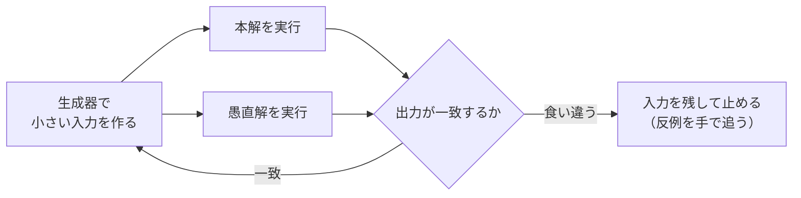

!!! abstract "要点"
    - **何のページか**：WA の原因が見つからないときに、愚直解と本解を小さいランダムな入力で比べて反例を探せる。小さいケースの全探索で表を作り、規則を予想する実験の手順も示す。
    - **使い方**：WA の原因を探すなら[手順](#procedure)と[書き方の形](#setups)を読み、1 つのプログラムにまとめる形から始める。入力の作り方で迷ったら[生成器のコツ](#generators)、反例が見つからないときは[注意](#caveats)を見る。
    - **考察に使うなら**：答えの規則や式を予想したいときは[実験で規則を予想する](#experiment)に進む。

<!-- textlint-disable -->
別名：ランダムテスト・愚直解との比較・実験・OEIS・撃墜ケース探し
<!-- textlint-enable -->

ストレステストは、遅いが確かな[愚直解](../guide/glossary.md#naive-solution)と提出する解（本解）を小さい入力でたくさん動かして答えを比べ、食い違う入力を探す方法である。ジャッジの[テストケース](../guide/glossary.md#test-case)はコンテスト中には見られないが、食い違う小さい入力が手元で見つかれば、手で追って原因の行を特定できる。同じ道具は考察にも使える。小さいケースを全探索して答えの表を作れば、規則や式を予想する手がかりになる。これを実験と呼ぶ。

## ストレステストの手順 {#procedure}

ストレステストは、[WA・TLE・RE・MLE の原因チェックリスト](../guide/debugging-checklist.md)をたどっても原因が見つからないときの次の手である。手順は次の 4 つで、生成と比較を食い違いが出るまで機械に繰り返させる。

1. **愚直解を書く**：速さを考えず、問題文のとおりに計算する。全探索・すべての組の二重ループ・素直なシミュレーションなど、本解とは別の考え方で書く。愚直解が誤っていると比べても意味がないので、正しさを最優先にする。
2. **生成器を書く**：制約を満たす小さい入力を乱数で作るプログラムである。最初は列の長さ 4〜10、値は 20 以下ほどにする（betrue12 氏の目安）。
3. **繰り返して比べる**：入力を作る → 本解と愚直解を実行する → 出力を比べる、を繰り返し、食い違ったらその入力を残して止める。
4. **反例を手で追う**：止まったときの入力は[反例](../guide/glossary.md#counterexample)である。本解の途中の値を出力し、愚直解の答えとどこでずれるかを調べる。



この図は、生成器が作った同じ入力を本解と愚直解の両方に与え、出力が一致する限り生成に戻る、というループを表す。ループを抜けるのは食い違ったときだけで、そのときの入力が手で追う材料になる。

反例は小さいほど追いやすい。長さ 1〜3 の入力で見つかれば、紙の上で本解を動かせる。そのため、生成器は小さい範囲から始め、見つからなければ長さや値の範囲を少しずつ広げる。小さい順にすべての入力を試せば（[書き方の形](#setups)の全数テスト）、最初に見つかる反例がそのまま最小の反例になる。

コンテスト中は、生成器と比べる仕組みの準備が長引けば、その分だけ考察の時間が減る。betrue12 氏は、コードを見直す間に裏で回しておき、反例が出れば助かる程度に考える使い方を勧めている。本番で素早く使えるように、ふだんの練習で一度組んでおく。

## 書き方の形 {#setups}

ストレステストの組み方は、1 つのプログラムにまとめる形・3 つのプログラムをシェルで回す形・online-judge-tools に任せる形の 3 通りがある。手軽さの順に並べると次のようになる。

| 形 | 準備 | 向く場面 |
| --- | --- | --- |
| 1 つのプログラム | 本解・愚直解・生成器を関数にして 1 ファイルに入れる | 入力が数や列で、関数に分けやすい |
| 3 つのプログラムとシェル | 3 つを別々にコンパイルし、ループで出力を比べる | 本解のファイルに手を入れたくない |
| online-judge-tools | 生成器と愚直解を渡して `oj` に回させる | `oj` を入れてあり、ファイルで管理したい |

### 1 つのプログラムにまとめる

1 つのプログラムにまとめる形は、本解と愚直解を関数に分け、`main` の中で生成と比較を繰り返す。入出力の形式を気にしなくてよいので、最も早く組める。例として、空でない区間の和の最大を求める本解と、すべての区間 $[l, r)$ を調べる愚直解を比べる。本解には「最大値を 0 で始める」誤りをわざと入れてある。

```cpp
--8<-- "stress-testing/compare-random.cpp:funcs"
```

完全なプログラム：[`compare-random.cpp`](https://github.com/yuukougun/kyopro-atlas/blob/main/snippets/stress-testing/compare-random.cpp)（GitHub）
{ .kp-code-src }

比べる部分は次のとおりである。乱数は `mt19937_64` で作り（[乱数の作り方](../cpp/cpp-math-functions.md#random)）、食い違ったら入力と両方の答えを出して止める。

```cpp
--8<-- "stress-testing/compare-random.cpp:core"
```

完全なプログラム：[`compare-random.cpp`](https://github.com/yuukougun/kyopro-atlas/blob/main/snippets/stress-testing/compare-random.cpp)（GitHub）
{ .kp-code-src }

値の範囲を $-5$ 以上 $5$ 以下にして種 7 で回すと、6 回目に長さ 1 の列 $(-5)$ で止まる。本解は 0、愚直解は $-5$ を返すので、値がすべて負のときに最大値の初期値 0 が残る誤りだと分かる。種を出力しておけば、同じ乱数の列を後で再現できる（同じ種で同じ列になるのは、標準ライブラリが同じときに限る）。

この形では、本解を関数に切り出す手間がかかる。提出用のコードがグローバル変数を使っているなら、ケースごとに初期化し直すのを忘れないようにする。

### 小さい順にすべて試す（全数テスト）

入力の候補が少ないなら、乱数の代わりにすべての入力を小さい順に試す。これを全数テストと呼ぶ。長さの短い順、同じ長さでは辞書順に試すので、最初に見つかる反例が最小になる。乱数では出にくい「すべて同じ値」「すべて負」のような入力も必ず試せる。

```cpp
--8<-- "stress-testing/exhaustive.cpp:core"
```

完全なプログラム：[`exhaustive.cpp`](https://github.com/yuukougun/kyopro-atlas/blob/main/snippets/stress-testing/exhaustive.cpp)（GitHub）
{ .kp-code-src }

長さ 4 以下・値 $-2$ 以上 $2$ 以下で試すと、最初の入力の長さ 1 の列 $(-2)$ で止まる。長さ $n$ の列は $(2v + 1)^n$ 通りあるので、試せるのは長さか値の範囲がごく小さいときだけである。$v = 2$ で長さ 8 なら $5^8 \approx 3.9 \times 10^5$ 通りで、愚直解が軽ければ一瞬で終わる。

### 3 つのプログラムをシェルで回す

本解・愚直解・生成器を別々のプログラムにして、シェルのループで回す形もある。本解のファイルをそのまま使えるのが利点である。処理の流れは次のとおりで、ループの中身を bash などで書く。

```text
繰り返す:
    生成器を実行して、入力をファイル input.txt に書く
    本解を input.txt で実行して、出力を out1.txt に書く
    愚直解を input.txt で実行して、出力を out2.txt に書く
    out1.txt と out2.txt が違えば（cmp や diff で比べる）:
        input.txt と 2 つの出力を表示して止める
```

入力を毎回同じファイルに上書きしておけば、ループが止まった時点の input.txt がそのまま反例になる。本解と愚直解は、実行ファイルの名前を分けてコンパイルしておく（g++ なら `-o` で名前を指定する）。

### online-judge-tools に任せる

online-judge-tools（`oj` コマンド）は、生成器で入力を作るサブコマンド `oj g/i` と、愚直解で出力を作る `oj g/o` を持つ。食い違う入力を探すだけなら、次の 1 行で生成と比較を繰り返し、見つかった入力を `test/` に保存する。

```bash
oj g/i --hack-actual ./a.out --hack-expected ./naive 'python3 generate.py'
```

`--hack-actual` に本解、`--hack-expected` に愚直解、最後に生成器を渡す。`--hack-expected` を省くと、本解が RE になる入力を探す（`-t 2` のように制限時間を渡せば、TLE になる入力も探す。渡さなければ制限時間はなく、本解が止まらないとそのまま待ち続ける）。並列に回す `-j` もある。

## 生成器のコツ {#generators}

生成器は、制約を満たす入力を偏りなく作るのが仕事である。ただ乱数を並べるだけでは、制約の特殊な条件を破ったり、答えが片方に偏ったりする。乱数そのものの作り方（`mt19937_64` と `uniform_int_distribution`、閉区間であること）は [C++ の乱数](../cpp/cpp-math-functions.md#random)にある。

- **値の範囲は狭く**：値の範囲が狭いほど、同じ値や境界の値が出やすい。値が $10^9$ までの問題でも、まずは 10 程度までで作る。
- **符号と 0 を制約どおりに**：制約が負の数や 0 を許すなら、生成器にも入れる。[1 つのプログラムにまとめる](#setups)例（空でない区間の和の最大で、最大値を 0 で始める誤り）では、値を 1 以上 20 以下で作ると $10^5$ 回回しても誤りが見つからない（値がすべて正なら、初期値 0 は答えに影響しない）。
- **互いに異なる値**：既に出た値を `set` で覚え、重なったら捨てて作り直す。順列は $1, \dots, N$ を `shuffle` する方が速い。
- **木**：頂点 $i$（$1 \le i < N$）を $i$ より前のランダムな頂点につなぎ、最後に番号をかき混ぜる。Union-Find で、つながっていない 2 点の間にだけ辺を張る作り方もある（[Union-Find](../ds/union-find.md)）。どちらもパス状の木やスター（1 頂点にすべてがつながる木）はめったに出ないので、別に作って混ぜる。
- **連結なグラフ**：まず木を作り、残りの辺を足す。足す辺は、[自己ループ](../guide/glossary.md#self-loop)と[多重辺](../guide/glossary.md#multi-edge)を禁じる制約なら、端点が異なることとまだない辺であることを確かめてから足す。この確かめは忘れやすい。

次のコードは、互いに異なる値と木を作る例である。

```cpp
--8<-- "stress-testing/generators.cpp:distinct"
```

```cpp
--8<-- "stress-testing/generators.cpp:tree"
```

完全なプログラム：[`generators.cpp`](https://github.com/yuukougun/kyopro-atlas/blob/main/snippets/stress-testing/generators.cpp)（GitHub）
{ .kp-code-src }

`random_tree` は、どの頂点も自分より前の頂点を親に持つので、閉路ができず必ず木になる。番号をかき混ぜるのは、頂点 0 が根に近いといった偏りを消すためである。どんな形の木も作れるが、すべての木が同じ確率で出るわけではない。

答えが偏る問題では、生成の向きを逆にする。たとえば「操作を繰り返して列 $A$ を列 $B$ にできるか」は、$A$ と $B$ を別々に作るとほとんど No になる。先に $A$ を作り、ランダムな操作を何回か施して $B$ を作れば、答えが必ず Yes の入力になる（betrue12 氏の例）。ただしこの入力では、Yes を No と誤る誤りしか見つからない。

## 注意 {#caveats}

ストレステストで食い違いが見つからなくても、本解が正しいとは言えない。見つからない原因として多いのは、次の場合である。

- **ランダムでは出ない端のケース**：0 や 2 の冪（kmyk 氏の例）、値の上限ちょうど、すべて同じ値のような特定の入力でだけ誤るなら、乱数ではまず当たらない。値の範囲を狭めるか、全数テストにするか、端のケースを手で作って足す。
- **小さい入力では出ない誤り**：オーバーフロー・TLE・深すぎる再帰は、値と長さが小さいと起きない。これらは最大のケースを 1 つ作って本解だけを動かし、時間と答えの桁を見る（[提出前の確認](../guide/debugging-checklist.md#before-submit)）。
- **誤読**：問題文を誤読していると、愚直解も同じ誤りを持つので食い違わない。見つからなければ問題文を読み直す（[最後の手段](../guide/debugging-checklist.md#last-resort)）。
- **愚直解の誤り**：食い違ったとき、誤っているのが愚直解の方ということもある。反例を手で解いて、どちらが正しいかを確かめる。
- **生成器の誤り**：制約の外の入力（重なった値・多重辺）を作ると、本解は正しいのに食い違う。逆に、作る入力の形が狭すぎると、誤りがあっても見つからない。

出力の比べ方にも注意がいる。

- **答えが複数ある問題**：構築問題などは、文字列として比べても意味がない。出力が条件を満たすかを確かめるプログラム（[チェッカー](../guide/glossary.md#checker)）を書いて判定する（[出力を検査するプログラム](../thinking/construction.md#checker)）。`oj t` では `--judge-command` でチェッカーを渡せる。
- **誤差が許される問題**：小数の出力は、差の絶対値か相対誤差で比べる（[浮動小数点数の比較](../cpp/cpp-types-literals.md#float-compare)）。`oj t` では `-e 1e-6` のように許す誤差を指定する。

未定義動作の検出と組み合わせると、見つかる誤りが増える。不具合を探すビルドで本解をコンパイルしてからストレステストを回せば、範囲外の読み書きは食い違いが出る前に止まる（[不具合を探すビルド](../cpp/cpp-undefined-behavior.md#debug-build)）。思い込みを `assert` で書いておけば、崩れた入力で止まる（[assert で気づく](../cpp/cpp-undefined-behavior.md#assert)）。

GCC 9.2 より前の Windows の MinGW では、`random_device` が実行ごとに同じ値を返す（betrue12 氏の記事、2019 年）。これは GCC の不具合 PR 85494 で、mingw-w64 では GCC 9.2 で直った。古い環境で生成器を回しても同じ入力しか出ないときは、時刻を種にする。

## 実験で規則を予想する {#experiment}

実験は、小さいケースを全探索で解いて答えの表を作り、その表から規則を予想する方法である。式が立たない、$N$ が $10^{18}$ で直接は計算できない、といったときに考察の糸口になる。手順は次のとおりである。

1. **全探索で表を作る**：$N = 1, 2, \dots, 10$ 程度の答えを、全探索で出力する。mod を取る問題でも、表を作るときは mod を取らない（規則が見えなくなる）。
2. **表を眺める**：周期（$N \bmod k$ で決まる）・単調性・差や比・素因数分解・前の項との関係を見る。パラメータが 2 つあるなら、片方を固定して並べる。
3. **数列を検索する**：値の列を [OEIS](https://oeis.org/)（オンライン整数列大辞典）で検索すれば、既知の数列と式を見つけられることがある。
4. **予想を確かめる**：予想した式を、表を作った範囲のすべてで比べる。証明できればよいが、できなければ範囲を広げて比べ、ストレステストと同じ考え方で裏付ける。

次のコードは 2 つの実験の例である。1 つ目は、長さ $k$ の 01 列のうち 1 が隣り合わないものを数える。

```cpp
--8<-- "stress-testing/experiment.cpp:count"
```

完全なプログラム：[`experiment.cpp`](https://github.com/yuukougun/kyopro-atlas/blob/main/snippets/stress-testing/experiment.cpp)（GitHub）
{ .kp-code-src }

$k = 1, \dots, 10$ の表は $2, 3, 5, 8, 13, 21, 34, 55, 89, 144$ になる。前の 2 項の和になっていると気づけば、漸化式を予想できる。この列を OEIS で検索すると、フィボナッチ数（A000045）が見つかる。コードの最後の `assert` は、予想した漸化式が表のすべてで成り立つかを確かめる。

2 つ目は、石の山から 1・3・4 個を交互に取り、取れなくなった方が負けのゲームである。石が $i$ 個の局面で手番の人が勝てるかを、小さい $i$ から順に決める（負けの局面へ動かせれば勝ち）。

```cpp
--8<-- "stress-testing/experiment.cpp:game"
```

完全なプログラム：[`experiment.cpp`](https://github.com/yuukougun/kyopro-atlas/blob/main/snippets/stress-testing/experiment.cpp)（GitHub）
{ .kp-code-src }

$i = 0, \dots, 20$ の表は `LWLWWWWLWLWWWWLWLWWWW` で、負け（L）は $i = 0, 2, 7, 9, 14, 16$ に現れる。7 ごとに同じ並びが繰り返すので、「$i \bmod 7$ が 0 か 2 なら負け」と予想できる。負けの位置の列 $0, 2, 7, 9, 14, 16$ を OEIS で検索すると、7 で割った余りが 0 か 2 の数の列（A047352）が見つかる。ゲームの表と周期の扱いは [Grundy 数の規則を見つける節](../comb/grundy-number.md#patterns)、数え上げの式の検算は[小さいケースの全探索で式を検算する](../comb/counting-mindset.md#verify-small)にもある。

予想は、表を作った範囲でしか確かめていない。範囲の外で規則が変わることもある（周期が始まるまでに前置きの部分がある、など）。表は答えに必要な範囲より十分に広く作り、できれば理由を考える。小さい例で見つけた規則を答えにしてよいかは、必要条件と十分条件の両方で考える（[実験の結果を信じてよいか](../math/proof-patterns.md#necessary-sufficient)）。考察の問いとしての実験は、[詰まったときの発想リスト](../guide/thinking-checklist.md#q-small-cases)にも並べてある。

## インタラクティブ問題を手元で試す {#interactive}

[インタラクティブ問題](../guide/glossary.md#interactive)は、入出力例をそのまま流し込んでも試せない。ジャッジの答えが自分の質問によって変わるからである。手元で試すには、隠れた答えを持ってルールどおりに答える「ジャッジ役のプログラム」を書き、自分のプログラムと双方向につなぐ。つなぎ方は[インタラクティブ問題の手元でのテスト](../misc/interactive.md#local-testing)にある。

ジャッジ役が隠れた答えを乱数で作るようにすれば、ストレステストと同じ要領で何度も回せる。ジャッジ役には、質問の回数が上限を超えたら止まる確かめと、最後の答えが隠れた答えと一致するかの確かめを入れる。online-judge-tools では、`oj t/r` にジャッジ役のプログラムを渡して試せる。

手軽に試すなら、ジャッジ役を自分のプログラムの中の関数として書き、質問の関数の中身だけを切り替える方法もある。この方法は質問の論理を試すのに向くが、[フラッシュ](../guide/glossary.md#flush)の忘れは見つけられない。flush の確認には、パイプでつなぐ方法を一度は通しておく。

## 確認問題 {#quiz}

??? question "確認問題：10 万回回しても見つからない"
    整数の列を受け取る問題で、本解の WA の原因を探すため、長さ 1〜5・値 1〜20 の列を作る生成器で 10 万回ストレステストを回したが、食い違いは出なかった。制約は「$-10^9 \le A_i \le 10^9$」である。まず何を疑うか。

    ??? success "答え"
        生成器が制約の形を覆っていないことを疑う。制約は負の数と 0 を許すのに、生成器は正の数しか作っていない。値の範囲を $-5$ 以上 $5$ 以下などにして回し直す。それでも見つからなければ、値が大きいときだけ起きる誤り（オーバーフロー）を最大のケースで確かめ、問題文の誤読も疑う。

??? question "確認問題：規則を信じてよいか"
    ある問題で $N = 1, \dots, 5$ の答えを全探索で出すと $1, 2, 4, 8, 16$ になったので、答えを $2^{N-1}$ と予想した。このまま提出してよいか。

    ??? success "答え"
        5 項だけでは決められない。たとえば円周上の $N$ 点を結ぶ線で円を分けた領域の最大数は、5 項目まで $1, 2, 4, 8, 16$ と一致するが、6 項目で 31 になる。表を $N = 10$ 程度まで広げて予想と比べ、できれば $2^{N-1}$ になる理由（各要素を選ぶか選ばないかの 2 通りが $N - 1$ 回ある、など）を考える。OEIS で検索して、同じ始まりの別の数列がないかを見るのもよい。

## 参考 {#references}

- [betrue12「競プロでWAが出たときのランダム入力データ生成入門」](https://betrue12.hateblo.jp/entry/2019/09/07/171628)：手順の 3 段階と反例の追い方、生成器の大きさの目安、互いに異なる値・木・連結なグラフ・多重辺の作り方、答えが偏る問題の作り方、MinGW の注意、事前の練習
- [kmyk「競技プログラミングにおける様々なテスト」](https://kmyk.github.io/blog/blog/2020/11/12/various-tests-in-competitive-programming/)：ランダムテスト・ストレステスト・全数テストの呼び方、完全なランダムでは端のケースを逃すこと
- [online-judge-tools「getting-started.ja.md」](https://github.com/online-judge-tools/oj/blob/master/docs/getting-started.ja.md)：`oj g/i`・`oj g/o`・`--hack`・`-j`、誤差の `-e`、チェッカーの `--judge-command`、インタラクティブの `oj t/r`
- [online-judge-tools「generate_input.py」](https://github.com/online-judge-tools/oj/blob/master/onlinejudge_command/subcommand/generate_input.py)：`--hack-actual`・`--hack-expected` の引数の意味と、`--hack-expected` を省いたときの動き
- [OEIS「A000045」](https://oeis.org/A000045)・[OEIS「A047352」](https://oeis.org/A047352)：実験の例の数列（フィボナッチ数、7 で割った余りが 0 か 2 の数）
- [GCC Bugzilla「Bug 85494」](https://gcc.gnu.org/bugzilla/show_bug.cgi?id=85494)：MinGW の `random_device` が固定の種を使っていた不具合と、mingw-w64 で GCC 9.2 で直ったこと
