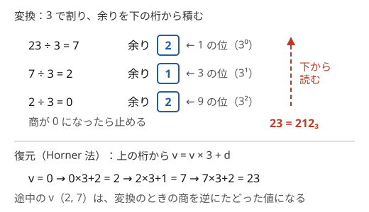

!!! abstract "要点"
    - **何ができるか**：$N$ を $b$ で割った余りを下の桁から並べて $b$ 進表記にし、上の桁から $v \gets vb + d$ を繰り返す Horner 法で数に戻す。負の基数（−2 進）や 0 を使わない 26 進（a..z, aa..）、基数を変数とみた二分探索といった変形にも使う。
    - **いつ使うか**：
        - $b$ 進法・−2 進法で表す。
        - a, b, …, z, aa, ab, … と続く名前の $n$ 番目。
        - 文字列を $n$ 進数とみた値が $M$ 以下になる $n$ を数える。
    - **計算量**：変換と復元はどちらも桁数に比例し、$O(\log_b N)$。$N \le 10^{18}$ なら 2 進で 60 桁ほどで済む。基数の二分探索は、数字列の長さを $L$ として $O(L \log M)$
    - **前提**：[整数の割り算と余り](../math/integer-division.md)

<!-- textlint-disable -->
別名：基数変換・base conversion・b 進法・n 進数・−2 進法・26 進・Horner 法
<!-- textlint-enable -->

N 進法は、整数を「$b$ の累乗の何倍の和か」で表す書き方である。変換の手順そのものは易しいので、ここでは 0 の扱い・桁の向き・負の余り・オーバーフローといった実装の落とし穴と、0 を使わない 26 進・負の基数・基数を動かす二分探索という変形に絞る。

このページで使う記法：基数を $b$（$b \ge 2$）、下から $i$ 桁目（0-indexed）の数字を $d_i$ とし、$N = \sum_i d_i b^i$ と書く。$x \bmod b$ は $0$ 以上 $b$ 未満の余りを表す（[記法と用語の約束](../start/notation.md#math)）。

## b 進表記への変換と Horner 法による復元（0 の扱い） {#convert}

$b$ 進表記への変換は、$N$ を $b$ で割った余りを 1 の位として取り出し、商で同じことを繰り返す手順である。正しい理由は、どんな $N \ge 0$ も

$$
\begin{gathered}
N = b \cdot \lfloor N / b \rfloor + (N \bmod b), \\
0 \le N \bmod b < b
\end{gathered}
$$

と書けることにある。$N = d_0 + b(d_1 + b(d_2 + \cdots))$ なので、$N \bmod b$ が $d_0$ になる。商 $\lfloor N / b \rfloor$ は「1 桁右にずらした数」$d_1 + b d_2 + \cdots$ である。商は毎回 $1/b$ 以下になるので、ループは桁数 $\lfloor \log_b N \rfloor + 1$ 回で止まる。表し方は 1 通りに決まる（各桁が $0$ 以上 $b$ 未満という条件が、割り算の商と余りの一意性そのものだから）。



図のように、余りは下の桁から順に得られる。文字列の末尾に足していくと逆順になるので、最後に反転する。

数に戻すときは、$\sum_i d_i b^i$ を累乗から計算するより、上の桁から $v \gets v \cdot b + d$ を繰り返す Horner 法がよい。$N = (\cdots((d_{k} b + d_{k-1}) b + d_{k-2}) \cdots) b + d_0$ という括り方なので、累乗を作らずに済む。途中の $v$ は常に最終の値以下で、最終の値が収まればあふれない。図の下段の $2, 7$ は、変換のときの商を逆にたどった値になっている。

```cpp
--8<-- "base-conversion/convert.cpp:core"
```

- **0 は特別扱いする**：`while (n > 0)` のループは $N = 0$ で 1 回も回らず、空文字列を返す。0 を出力する問題では先に `"0"` を返す
- **10 以上の数字**：16 進などでは 10 以上の桁を文字に対応させる。`'0' + d` のままだと `':'` などの記号になる
- **2 つの基数の間の変換**：$b_1$ 進から $b_2$ 進へは、いったん整数に戻してから変換すればよい（[練習問題](#practice)の典型90 067）。値が `long long` に収まらない長さなら、桁の配列のまま $b_2$ で割る筆算を繰り返す

??? question "確認問題：桁数"
    $N = 10^{18}$ を 2 進・3 進で表すと、それぞれ何桁か。

    ??? success "答え"
        桁数は $\lfloor \log_b N \rfloor + 1$ である。$2^{59} \approx 5.8 \times 10^{17} \le 10^{18} < 2^{60}$ なので 2 進では 60 桁、$3^{37} \approx 4.5 \times 10^{17} \le 10^{18} < 3^{38}$ なので 3 進では 38 桁である。桁数が小さいので、変換は何度繰り返しても軽い。

## 0 を使わない 26 進（1 を引いてから割る） {#bijective-26}

0 を使わない 26 進は、a, b, …, z, aa, ab, … のように、0 に当たる文字を持たない数え方である（各桁が 1 から始まる）。表計算ソフトの列名（A, …, Z, AA, …）も同じ仕組みである。各桁は 1〜26 をとり、$N = \sum_i c_i 26^i$（$1 \le c_i \le 26$）と表す。

普通の 26 進のつもりで $N \bmod 26$ を桁にすると、$N = 26$ で余りが 0 になり、対応する文字がない。そこで 1 の位を 1〜26 の範囲で決める。$c_0 \equiv N \pmod{26}$ かつ $1 \le c_0 \le 26$ となるのは

$$
\begin{aligned}
c_0 &= (N - 1) \bmod 26 + 1, \\
\text{残り} &= \frac{N - c_0}{26} = \left\lfloor \frac{N - 1}{26} \right\rfloor
\end{aligned}
$$

である。つまり「1 を引いてから普通に 26 で割る」を各桁で繰り返せばよく、余り $0$〜$25$ を a〜z に対応させる。1 を引くのは最初だけでなく、毎回の桁で行う。

```cpp
--8<-- "base-conversion/bijective26.cpp:core"
```

具体的に、長さ 1 の名前が 26 個、長さ 2 が $26^2 = 676$ 個あるので、$26 + 676 = 702$ 番目が zz、703 番目が aaa になる。境目の $N = 26, 27, 702, 703$ を手で確かめておくと、1 の引き忘れにすぐ気づける。

??? question "確認問題：28 番目の名前"
    a, b, …, z, aa, ab, … の 28 番目の名前は何か。手順どおりに求めよ。

    ??? success "答え"
        $28 - 1 = 27$ で、$27 \bmod 26 = 1$ から 1 の位は b、商は $\lfloor 27 / 26 \rfloor = 1$。次に $1 - 1 = 0$ で、$0 \bmod 26 = 0$ から a、商は 0 で止まる。下から読んだ b, a を反転して ab である。

## 負の基数（余りを 0 以上に直してから割る） {#negative-base}

この節は[整数の割り算と余り](../math/integer-division.md)の、負の数の割り算を前提にする。−2 進法は、$N = \sum_i d_i (-2)^i$（$d_i \in \{0, 1\}$）と表す書き方で、負の整数も符号なしで表せる。すべての整数がただ 1 通りに表せる。

変換の考え方は正の基数と同じで、$N = (-2) q + r$（$r \in \{0, 1\}$）となる $q, r$ を求め、$r$ を 1 の位、$q$ を残りとする。$r$ は $N$ の偶奇で決まり、$q = (N - r) / (-2)$ は割り切れる。

問題は C++ の `%` と `/` である。`/` は 0 方向へ切り捨て、`%` はそれに合わせて割られる数と同じ符号になる。そのため $N < 0$ のとき `N % 2` は $-1$ になりうる。余りを先に 0 以上へ直し、割り切れる $N - r$ を割れば、切り捨ての向きを気にしなくてよい。

```cpp
--8<-- "base-conversion/negabinary.cpp:core"
```

ループは止まる。$\lvert N \rvert \ge 2$ なら $\lvert q \rvert \le (\lvert N \rvert + 1) / 2 < \lvert N \rvert$ で絶対値が減る。$N = 1$ は 1 回で、$N = -1$ は $-1 \to 1 \to 0$ の 2 回で 0 になる。条件は `n != 0` にする（`n > 0` だと負の $N$ でループに入らない）。

一般の負の基数 $-b$ でも同じで、余りを `((n % b) + b) % b` で $0$〜$b - 1$ に直し、$(N - r) / (-b)$ に進む。

??? question "確認問題：6 を −2 進法で"
    6 を −2 進法で表せ。

    ??? success "答え"
        $6$：偶数なので $r = 0$、$q = 6 / (-2) = -3$。$-3$：奇数なので $r = 1$、$q = (-3 - 1) / (-2) = 2$。$2$：$r = 0$、$q = -1$。$-1$：$r = 1$、$q = 1$。$1$：$r = 1$、$q = 0$。余りを下から読んで 11010 である。確かめると $16 - 8 - 2 = 6$ になる。

## 基数の二分探索とオーバーフロー（1 桁の場合分け） {#base-binary-search}

この節は[答えで二分探索](../basics/binary-search-answer.md)を前提にする。数字列 $X$ を「$n$ 進数とみた値」$f(n)$ として、$f(n) \le M$ となる $n$ を数える問題では、基数 $n$ のほうを動かす。

**単調性**：$X$ が 2 桁以上で最上位の数字が 1 以上なら、$f(n) = \sum_i d_i n^i$ は $n$ について狭義単調増加である。最上位の項 $d_k n^k$ が $n$ とともに増え、ほかの項も減らないからである。したがって、使える基数は $X$ の最大の数字を $d$ として $d + 1, d + 2, \dots, n_{\max}$ の区間になり、$n_{\max}$ を二分探索で求めればよい。狭義単調増加なので、異なる $n$ は異なる値を与え、$n$ の個数がそのまま値の種類数になる。

**1 桁の場合分け**：$X$ が 1 桁なら $f(n) = X$ で $n$ によらない。単調増加ではないので二分探索が成り立たず、無限に多くの $n$ が条件を満たしうる。「値が何種類か」を問う形なら、$X \le M$ かどうかで 1 か 0 を答える。

**番兵**：ok は「まだ 1 つも数えていない」位置の $d$、ng は $\max(M, d) + 1$ に置く。2 桁以上なら $f(n) \ge n$ なので、$n > M$ では必ず $M$ を超える。最後に $\mathrm{ok} - d$ が個数である。mid は常に ok より大きいので $n = d$ が判定されることはなく、$f(d) \le M$ でなくてもよい。$n \ge d + 1$ のどれも条件を満たさなければ、ok は $d$ のまま残り、答えは 0 になる。

**オーバーフロー**：$n$ は $10^{18}$ 近くまで動くので、Horner 法の $v \cdot n$ は `long long` をすぐにあふれる。掛ける前に、整数 $v$ と、いま足す 1 桁の数字 $c$（$0 \le c \le M$）について成り立つ

$$
v \cdot n + c \le M \iff v \le \left\lfloor \frac{M - c}{n} \right\rfloor
$$

で比べ、超えた時点で「$M$ より大きい」と返す。割り算で比べるので、途中の値は $M$ 以下に保たれる。

```cpp
--8<-- "base-conversion/base-n.cpp:core"
```

`__int128` を使う場合も、各段で $v \le M$ を確かめて超えたら打ち切る必要がある。打ち切らないと、桁数が多いときに $n^{L}$ が `__int128` の範囲も超える（[整数のオーバーフロー](../cpp/cpp-integer-overflow.md)）。

## 落とし穴 {#pitfalls}

**0 が空文字列になる**。`while (n > 0)` の変換は $N = 0$ で何も出力しない。変換の関数の最初で 0 を特別扱いする。

**桁の向きを反転し忘れる**。余りは 1 の位から得られる。文字列に足していくなら最後に反転し、配列に入れたなら「添字 $i$ が $b^i$ の位」と決めて使う。回文の判定のように向きが関係ない処理でも、ほかの処理と組み合わせるときに食い違いやすい。

**負の数の `%`**。C++ では `-7 % 2` は $-1$ である。負の基数や、負の数を正の基数で表すときは、余りを `((n % b) + b) % b` で $0$ 以上に直してから、割り切れる $N - r$ を割る。

**`pow` で累乗を作る**。`pow(b, i)` は `double` を返す。`double` が整数を正確に表せるのは $2^{53}$（約 $9 \times 10^{15}$）までなので、それを超える値は丸められて 1 ずれることがある。復元は Horner 法で整数のまま計算する。

**Horner 法のオーバーフロー**。基数や桁数が大きいと、途中の $v \cdot b$ が `long long` を超える。値が上限 $M$ と比べるためだけに要るなら、[基数の二分探索の節](#base-binary-search)のように割り算で比べて打ち切る。

## 上位の手法へのつながり {#next-steps}

- **bit 演算**：2 進表記の桁は `(n >> i) & 1` で直接取り出せる（[bit 演算](../basics/bit-operations.md)）。3 つ以上の選択肢を持つ全探索は、$3^N$ 通りの番号を 3 進に変換して各要素の選択を読み取る（[bit 全探索](../basics/bit-full-search.md)の一般化）
- **桁 DP**：「$N$ 以下で、$b$ 進表記の桁が条件を満たす数の個数」は、上の桁から決める[桁 DP](../dp/digit-dp.md) で数える。$b$ 進でも 10 進と同じ形になる
- **桁と mod**：Horner 法の各段で mod をとれば、長い数字列を $m$ で割った余りが求まる（[桁と mod](../math/digit-and-mod.md)）。文字列を基数 $B$ の数とみる[ローリングハッシュ](../string/rolling-hash.md)も同じ式である
- **基数を全探索する**：「$b$ 進表記の桁和が $s$ になる最小の $b$」のように基数が単調に効かない問題では、$b \le \sqrt{N}$ を全探索し、$b > \sqrt{N}$ では 2 桁になることを使う（[商の列挙](../math/floor-quotient-enum.md)）

## 例題 {#examples}

### ABC171 C. One Quadrillion and One Dalmatians {#abc171_c}

<div class="kp-problems" data-role="example" markdown>

- [ABC171 C. One Quadrillion and One Dalmatians](https://atcoder.jp/contests/abc171/tasks/abc171_c)（diff 560）：犬に 1 番から a, b, …, z, aa, ab, …, zz, aaa, … と名前を付けるとき、N 番目の犬の名前を求める。

</div>

名前は 0 に当たる文字を持たない 26 進である。各桁で 1 を引いてから 26 で割り、余り $0$〜$25$ を a〜z に対応させ、最後に反転する。

??? note "解法の詳細"
    - $N \ne 0$ の間、$N \gets N - 1$、余り $N \bmod 26$ の文字を末尾に足し、$N \gets \lfloor N / 26 \rfloor$ とする
    - 集めた文字を反転して出力する。$N$ は $10^{15}$ 程度まであるので `long long` で持つ。計算量は $O(\log N)$
    - コードは[0 を使わない 26 進の節](#bijective-26)のものと同じである。1 の引き忘れがないかを、$N = 26$ と $N = 27$ で確かめる

## 練習問題 {#practice}

<div class="kp-problems" data-role="practice" markdown>

- [ABC186 C. Unlucky 7](https://atcoder.jp/contests/abc186/tasks/abc186_c)（diff 131）：N 以下の正の整数のうち、10 進でも 8 進でも数字 7 を含まないものの個数を求める。
- [典型90 067. Base 8 to 9（★2）](https://atcoder.jp/contests/typical90/tasks/typical90_bo)（diff なし）：8 進法で表された数 N を 9 進法に直し、数字 8 を 5 に置き換える操作を K 回行った結果を求める。
- [ABC105 C. Base -2 Number](https://atcoder.jp/contests/abc105/tasks/abc105_c)（diff 1204）：整数 N（負もありうる）を −2 進法で表す。
- [ABC192 D. Base n](https://atcoder.jp/contests/abc192/tasks/abc192_d)（diff 1425）：数字列 X を n 進数（n は X の最大の数字 + 1 以上）とみた値のうち、M 以下になるものが何種類あるかを求める（M ≤ 10^18）。

</div>

??? note "練習の方針"
    - **ABC186 C**：$N$ が小さいので 1 から $N$ まで全部調べる。各数について、10 と 8 で割った余りを順に見て 7 が出るかを判定する。文字列にしなくても余りを見るだけでよい
    - **典型90 067**：8 進の文字列を Horner 法で整数に戻して 9 進に変換し、8 を 5 に置き換える。これを $K$ 回繰り返す。値が 0 のときに空文字列にしない
    - **ABC105 C**：余りを 0 か 1 に直してから $(N - r) / (-2)$ に進む。$N = 0$ は 0 を出力する
    - **ABC192 D**：2 桁以上なら値は基数について単調増加なので、$M$ 以下になる最大の基数を二分探索する。1 桁は場合分けし、Horner 法の途中で割り算により $M$ との比較を打ち切る

## 参考 {#references}

- [drken「AtCoder ABC 171 C - One Quadrillion and One Dalmatians (2Q, 茶色, 300 点)」](https://drken1215.hatenablog.com/entry/2020/06/21/225500)：例題の、1 を引いてから 26 で割る理由と手順
- [drken「AtCoder ABC 186 C - Unlucky 7 (5Q, 灰色, 300 点)」](https://drken1215.hatenablog.com/entry/2020/12/19/224100)：練習の方針（余りで桁を取り出して全部調べる）
- [E869120「競プロ典型 90 問 067 の解答コード」](https://github.com/E869120/kyopro_educational_90/blob/main/sol/067.cpp)：練習の方針（8 進 → 整数 → 9 進と 0 の扱い）
- [drken「AtCoder ABC 105 C - Base -2 Number (1Q, 水色, 300 点)」](https://drken1215.hatenablog.com/entry/2018/08/13/123600)：負の基数で余りを 0 以上に直すことと、0 の特別扱い
- [ikatakos「SOMPO HD プログラミングコンテスト2021（AtCoder Beginner Contest 192）D,E,F問題メモ」](https://ikatakos.com/pot/programming_algorithm/contest_history/atcoder/2021/0220_abc192)：基数の二分探索の単調性・探索範囲・1 桁の場合分け（解説の部分だけを参照）
